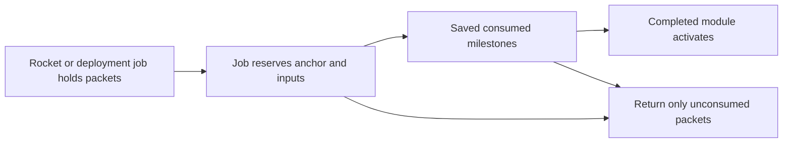

# R2MLVS11 - Orbital Stations and Manufacturing

## Global Mandatory Reading

> **Execution protocol**
>
> - Read this Global Mandatory Reading section before the first task and again
>   after every context compaction.
> - Before starting or resuming a task group, read the nearest preceding Area
>   Mandatory Reading block whose `Applies to` label includes that group. Area
>   blocks appear immediately before the first group they govern.
> - A referenced heading or exported symbol is authoritative. Global navigation
>   hints and Area line ranges are for navigation only; if they drift, relocate
>   the named section or symbol rather than expanding to the whole file.
> - Mandatory reading is non-transitive. Do not preload a linked file's own
>   Mandatory Reading, Consult on Demand, or Planning Provenance entries unless
>   this plan names them directly for the current area.
> - Do not read Consult on Demand or Planning Provenance merely because those
>   sources are listed. Use a Consult on Demand source only when its trigger
>   occurs.
> - No created source file, test file or JSON file should start with same prefix as a planning MD file (such as r2). Only MD files can have that prefix. No MD file should be created anywhere in source directories unless specifically asked.
> - After EVERY CONTEXT COMPACTION, you must add a note above the task group
>   which is currently in execution. The note will say: "Context has compacted
>   X times while executing this group.". If the compaction occurs before any
>   meaningful work was done (this can happen when there is a lot of baggage
>   from the previous compaction), then and ONLY then you can skip this step.
> - When exceeding 3 context compactions, YOU MUST ask yourself if you're not 
>   chewing more than we can handle :). Heck, plans change! :). In such a case, 
>   the way out is to split the group on the spot,
>   in the plan, into more groups, 
>   by appending B, C, D as a suffixes to those groups (splitting sub-groups 
>   themselves is also allowed). When you do this, create Local Mandatory
>   Reading areas so you can optimize your context only for the
>   ACTUAL task at hand.
>   Before starting or resuming a task group, read the nearest preceding Area
>   Mandatory Reading block whose `Applies to` label includes that group. Area
>   blocks appear immediately before the first group they govern.

| File name | Line Ranges | Description |
| --- | --- | --- |
| [docs/zz-reach2/upgrades/2026-10/r2mlvs-multilayer-vehicles-and-structures.md](r2mlvs-multilayer-vehicles-and-structures.md) | 352-376 | `AD-12` supplies the canonical gameplay/ownership decision for every group of this plan. It constrains delivered module/robot construction and bounded orbital processing; a consumer must not redefine it locally. |
| [src/map_layer.h](../../../../src/map_layer.h) | 81-89 | `MultiLayerMap` ownership preamble: `Map` owns packed storage/geometry and this controller owns layer semantics. Every group uses world tiles/explicit layer helpers; camera selection and ad hoc plane offsets cannot define gameplay. |
| [src/cargopacket.cpp](../../../../src/cargopacket.cpp) | 96-121 | Complete `CargoPacket::Split` and `Merge` define quantity/feeder-share ownership and allocation failure. Every construction, production and transport group must conserve actual packet quantities; station vehicle-loading reservations are not a generic orbital inventory API. |

Status: construction prerequisite Groups1-6 delivered,2026-10-14. Group6 publishes the exact native construction/module contract after focused RelWithDebInfo/Debug and22 Debug native phases. Evidence: `logs/orbital-handoff-debug-verification.json`; earlier immutable Release evidence: `logs/orbital-removal-verification.json`, `logs/orbital-evacuation-verification.json`, `logs/orbital-lifecycle-verification.json`, `logs/orbital-dock-verification.json`. Deferred Debug for4/4B/4C/5/5B/5C is now accepted. Return to [Space master](r2mlsp-space-master-plan.md) / Plan9 Group11 tasks11.3-11.4. Later orbital Assembly/manufacturing/processing, presentation and completion conditions remain open. Parent: [R2MLVS master](r2mlvs-multilayer-vehicles-and-structures.md).

**Artifact-layout migration (2026-10-09):** this plan consumes the parent [Development artifact layout](r2mlvs-multilayer-vehicles-and-structures.md#development-artifact-layout), implemented by [R2FC](r2fc-file-cleanup.md). It supersedes earlier docs asset/review/helper placement and fixed runtime-config destinations below. New native homes use `mlm/runtime/`, generated feature reviews use `mlm/reviews/`, logs remain under `logs/`, and reusable code/curated inputs keep their code/test owners. Paths and focused native/cold verification are complete; R2FC records the results and retained-input identities. Repository-relative executable commands run from the checkout root through their context-aware wrappers. Historical pass records remain dated evidence and are not new acceptance claims. No gameplay task is completed by this migration and the separate post-demo fixture-pruning gate remains.

## Outcome and Boundaries

**Delivered definition/queue handoff,2026-10-12:** Plan1 Group12B publishes
`multilayer_space_content.h` revision2 recipes, mass, budgets and paid-facility
admission; Plan8 Group6B publishes native `space_orders.h` queue/generation
ownership. Save410 carries exact `SDEF` content identity and separate bounded
`SPOR` transport, preserving ground/profile/package1 and paid old objects.
Both builds and focused native save/replay/refusal gates pass; see
`logs/space-content-orders-verification.json`. These handoffs grant no missing
commissioning, survey, blueprint, processing, descent, service, UI/art or network
producer. Consume their public definitions/commands; retain unfinished tasks.

Earth-launched construction probes deliver Steel and Goods to orbital
blueprints. Completed stations process mined ore into Steel/Goods and may
consume that output in further construction or vehicle assembly, haul it to
another station or send it to Earth through the authorized drop service.

**User revision,2026-10-12:** consume the canonical
[Space economy contract](r2mlvs1-d-recipes-and-bootstrap.md#space-economy-revision---2026-10-12)
and [revised numerical defaults](r2mlvs1-e-ground-and-space-budgets.md#space-economy-revision---2026-10-12).
All orbital builds require Steel/Goods; initial station/module recipes use
those two inputs. Later advanced equipment may add declared inputs. The former
Surface-preassembled Core recipe is superseded: a construction probe builds
the first Core from delivered packets at a placed blueprint. Earth-built
probes remain launch-center payloads until deployed; local probe manufacture
requires a completed orbital Assembly. These requirements are not yet delivered.

## Module contract

| Module | Role | Bootstrap input |
| --- | --- | --- |
| Core | Anchor, initial assembly/service capacity and ownership | Construction-probe-delivered Steel/Goods; no earlier station |
| Dock | Rocket/hauler service and explicit cargo exchange | Steel/Goods |
| Storage | Bounded cargo inventory | Steel/Goods |
| Utility | Station power/service capacity | Steel/Goods to construct; separately declared operating supplies |
| Assembly | Builds mining/survey/construction probes, later heavy robots and haulers | Steel/Goods to construct; each vehicle's paid recipe/capacity gate |
| Steelworks | Bounded metallic-ore conversion to Steel | Steel/Goods to construct; NORE feedstock and utility grant |
| Goodsworks | Bounded Steel/rare-earth conversion to Goods | Steel/Goods to construct; STEL and RARE feedstock and utility grant |
| Advanced processor | Later Refined Metals/Water Ice alternatives | Both common construction materials plus any declared advanced inputs |

Exact quantities, footprints and service consumption belong to r2mlvs1's
revised numerical tables. The first Core/Assembly/processor/probe path must
accept entirely Earth-delivered inputs. No processor supplies the materials
needed for its own first construction. GOOD keeps its crate unit and native
weight; displays, holds and recipe caps must not silently treat crates as tonnes.

## Public Handoff Contract

[src/orbital_station.h](../../../../src/orbital_station.h) publishes
`OrbitalModule`, `OrbitalConstructionJob`, `ReserveOrbitalConstructionInputs`
and `CommitOrbitalConstructionStep`, contained by the native `SpaceStructure`
in [src/space_structure.h](../../../../src/space_structure.h). Groups1/1B/2/3
have RelWithDebInfo/Debug producer evidence. Groups4/4B/4C/5/5B/5C now also
have both configurations' focused and native boundaries. The final exact type/
signature fixture passes with3,605 assertions in26 focused cases per configuration;
22 bounded Debug native phases cover activation, shared approaches, delivered
Dock services, removal, evacuation, company lifecycle and independent refusals.
`logs/orbital-handoff-debug-verification.json` freezes this422 handoff and the
repaired current Release freight fixture. Earlier dated Release proofs remain
immutable. Plan9 task11.3 now verifies423 direct rocket-to-module delivery and
original-hull recovery/failure acceptance in RelWithDebInfo/Debug
(`logs/module-flight-verification.json`). Orbital
Assembly/manufacturing/processing remain later producers.

| Native authority | Published contract |
| --- | --- |
| `SpaceStructure` / `SpaceStructureRef` | One paid static footprint, phase and monotonic generation. IDs may be reused only with a new generation; absent, stale or zero-generation references resolve to no owner. `FrameComplete` alone grants no facilities. |
| `OrbitalConstructionJob` | Two exclusive actual STEL/GOOD packet containers, consumed receipts, bounded whole/fractional work and saved native tick/allocation receipts. Final completion consumes one whole canonical recipe once; cancellation preserves only unconsumed material and refunds no work. |
| `ReserveOrbitalConstructionInputs(SpaceStructure &, SpaceVehicle &, bool)` | Actual precise admitted builder and matching typed Construct order. Estimate moves nothing; execution reserves only physically delivered still-missing material. `CmdReserveOrbitalModuleInputs` separately fills all missing labels atomically from actual adjacent Core stock. |
| `CommitOrbitalConstructionStep(SpaceVehicle &)` | Normal prepared native opportunity only. Portable paid tooling bootstraps Core; extensions consume the original Core's shared allocation. Queries, pauses and repeated callbacks earn no work. |
| `OrbitalModule` | Sole contained stock:1,024 units/64 packet references per label. Explicit paid-frame activation begins empty. Core/Storage/Power/Dock are supported; later recipe frames remain inert. Connection never expands another module's container. |
| `OrbitalServiceJob` / `GetServiceJobs()` | Core capacity1, activated Dock capacity2. Each contained job owns one RFMT/ELEC pair, exact craft generation/service serial and once-only750J work receipt. Onboard/contained jobs cannot overlap. Cancellation preserves actual parts and spent energy; it grants no return allowance. |
| `OrbitalFacilityState` | Original typed producer/service/construction consumer IDs; `UINT32_MAX` means absent. Core30kW and Power60kW use the shared Space electricity ledger. Dock has no panel: explicit `utility_source` binds one adjacent owned original Core/Power and one1,500J consumer. Old inventory-only Cores commission explicitly. |
| `space_approach.h` / contained `SpaceOrderQueue` | Shared generation-qualified admission, stable saved priority, precise physical slot and safe waiting point. This is the berth authority; service and freight consume it rather than create another registry. Dependency loss blocks handling; zero panel generation blocks service work. Both retain paid Dock geometry. |
| Removal/evacuation (422; RelWithDebInfo verified) | Exact owned empty removal preflights every physical/dependency/utility owner. `SpaceStructureRetirementHistory` remains beside native generation issuance, preserving spent material/service totals without retired-object inventory. Whole packet evacuation cancels jobs into one safe adjacent native inventory; hull holds/poses remain actual until explicit departure. |

Schema422 preserves the421 module row and appends no new inventory owner.
Its SPST header stores next generation(8bytes), live count(2), removed count(8),
spent STEL(8), spent GOOD(8) and completed services(8). Older schemas start
with zero retired aggregates. Native capture/install/digest and independent
preview use the same bounded history; rejected snapshots cannot borrow live
modules or reactivate retired utility identities.

Downstream consumers use these actual owners and command estimate/execute
boundaries. They cannot replace them with copied pools, private utility/cargo
tables, blueprint capacity, implicit activation or another capital/material
debit. The existing `orbital_removal.cpp` fixture binds exact exported types,
packet containers, contained ownership and function signatures at compile time;
the native producer fixtures verify their physical behavior.

**Construction batch,2026-10-13:** `space_structure.h` is the native Plan8
identity/occupancy owner; `orbital_station.h` owns its contained construction
job. The coordinated Plan8 Group13B / Plan10 Group8C batch implements those
missing producers before claiming their handoff. Job inventories contain real
packets; completion consumes the full canonical material batch atomically.
A finished frame is explicitly awaiting activation, with no storage, dock,
assembly or utility grant. Operational Core activation and those facilities
remain required by Groups1-5 and are not completed by the owner foundation.

## Implementation Tasks

Deepening pass, 2026-10-04: implementation groups use only SIMPLE, MEDIUM or HARD difficulty, with at most eight pending tasks each. Sketches describe proposed implementation contracts; verify the named earlier producers at each assumption gate. No gameplay or asset implementation is marked complete by this planning pass.

Groups are chronological and contain consecutive tasks of one difficulty. Each difficulty batch has at most eight tasks; area reading changes only when the implementation boundary or source of truth changes.

### Area Mandatory Reading - Delivered construction

_Applies to Groups 1-6._

**Entry gate.** The following public contracts must exist before dependent implementation in this area: `src/multilayer_content.h`: `MultiLayerGameplayProfile`, `LayerVehicleCapability`, `GetMultiLayerContentProfile`, `CheckDeepLayerAvailability`, `UtilityPowerAccount`; `src/multilayer_industry.h`: `LayerIndustryCapability`, `ValidateMineDepositClaim`, `ProduceLayerMineCargo`, `PrepareLayerRecipeBatch`, `CommitLayerRecipeBatch`; `src/space.h`: `SpaceVehicle`, `OrbitalBodyID`, `SpaceMission`, `SpaceStructure`, `SpaceTransition`; `src/launch_center.h`: `LaunchCenterAnchor`, `LaunchCollectionHub`, `SurfaceHandlingJob`, `SpaceDescentJob`, `CanReleaseOrbitalCargo`, `CommitOrbitalCargoRelease`; `src/asteroid.h`: `AsteroidBody`, `AdvanceAsteroidField`, plus `SpaceVehicle`, `SpaceMission`, `AssignSpaceMiningMission` and `SpaceVehicle::Tick` in `src/space_vehicle.h`.
**Delivered owner locations:** `space.h` supplies geometry and world types.
Native fleet/mission owners are in `space_vehicle.h`, static sites and contained
module identity in `space_structure.h`, and flights in `space_transition.h`.
The historical `space.h` navigation row below does not relocate those owners.
Use these actual headers with `orbital_station.h` and their compiled producer
fixtures; no consumer should add replacement declarations or a second pool.

Verify each public file/export/schema field with `rg` in the current workspace and inspect its command/field ownership. For a same-plan contract, compile its type/signature fixture or validate its artifact after the preceding producer groups. For cross-plan behavior, also run the producer's focused executable boundary test; declarations alone cannot authorize dependent mutations or runtime claims.
If a required export is absent, stop the dependent implementation, mutation and runtime claims in Groups 1-6. Read-only characterization, source/range verification, test-case design and asset-template work that does not assume the missing behavior may continue.
Do not bypass this gate by copying private pool/tile state, inventing local IDs or cargo registries, using a historical plan as a delivered implementation, opening user-wide content stores, substituting a second utility/accounting authority, or adding an unreviewed fallback path. Finish the named producer or revise the shared contract and its direct consumers first.

| File name | Line Ranges | Description |
| --- | --- | --- |
| [src/command.cpp](../../../../src/command.cpp) | 301-328 | `CommandHelperBase::InternalExecuteValidateTestAndPrepExec` defines refusal/estimate before execution; no validation phase may consume inventory, RNG or funds. |
| [src/industry.h](../../../../src/industry.h) | 75-106 | `ProducedCargo`, `AcceptedCargo`, `ProducedCargoes`, `AcceptedCargoes` expose bounded inventory and economy-time history; conserve materials and avoid narrow-counter overflow. |
| [src/vehicle_cmd.h](../../../../src/vehicle_cmd.h) | 20-42 | Build/refit/clone/depot-autoreplace commands and traits expose all purchase paths; `CloneVehicle` is `NoTest`, so do not rely on a generic estimate to enforce capability/commissioning. |
| `src/multilayer_content.h` (planned public contract; link after implementation) | Live definitions; no fixed range | [r2mlvs1-gameplay-contracts-and-content.md](r2mlvs1-gameplay-contracts-and-content.md) Groups 1-6, ending with Group 6's public-contract task, publish `MultiLayerGameplayProfile`, `LayerVehicleCapability`, `GetMultiLayerContentProfile`, `CheckDeepLayerAvailability`, `UtilityPowerAccount`. These exports/schema fields are authoritative for this area. Same-plan consumers follow those earlier groups; cross-plan consumers verify the producer's required implementation/tests as well. Proposed names alone do not prove delivery. |
| `src/multilayer_industry.h` (planned public contract; link after implementation) | Live definitions; no fixed range | [r2mlvs6-mines-and-resource-chains.md](r2mlvs6-mines-and-resource-chains.md) Groups 1-6, ending with Group 6's public-contract task, publish `LayerIndustryCapability`, `ValidateMineDepositClaim`, `ProduceLayerMineCargo`, `PrepareLayerRecipeBatch`, `CommitLayerRecipeBatch`. These exports/schema fields are authoritative for this area. Same-plan consumers follow those earlier groups; cross-plan consumers verify the producer's required implementation/tests as well. Proposed names alone do not prove delivery. |
| `src/space.h` (planned public contract; link after implementation) | Live definitions; no fixed range | [r2mlvs8-space-world-and-construction.md](r2mlvs8-space-world-and-construction.md) Groups 1-7, ending with Group 7's public-contract task, publish `SpaceVehicle`, `OrbitalBodyID`, `SpaceMission`, `SpaceStructure`, `SpaceTransition`. These exports/schema fields are authoritative for this area. Same-plan consumers follow those earlier groups; cross-plan consumers verify the producer's required implementation/tests as well. Proposed names alone do not prove delivery. |
| `src/launch_center.h` (planned public contract; link after implementation) | Live definitions; no fixed range | [r2mlvs9-launch-centers-and-rockets.md](r2mlvs9-launch-centers-and-rockets.md) Groups 1-7, ending with Group 7's public-contract task, publish `LaunchCenterAnchor`, `LaunchCollectionHub`, `SurfaceHandlingJob`, `SpaceDescentJob`, `CanReleaseOrbitalCargo`, `CommitOrbitalCargoRelease`. These exports/schema fields are authoritative for this area. Same-plan consumers follow those earlier groups; cross-plan consumers verify the producer's required implementation/tests as well. Proposed names alone do not prove delivery. |
| `src/asteroid.h` (planned public contract; link after implementation) | Live definitions; no fixed range | [r2mlvs10-asteroids-and-mining-probes.md](r2mlvs10-asteroids-and-mining-probes.md) Groups 1-7, ending with Group 7's public-contract task, publish `AsteroidBody`, `AdvanceAsteroidField`, plus `SpaceVehicle`, `SpaceMission`, `AssignSpaceMiningMission` and `SpaceVehicle::Tick` in `src/space_vehicle.h`. These exports/schema fields are authoritative for this area. Same-plan consumers follow those earlier groups; cross-plan consumers verify the producer's required implementation/tests as well. Proposed names alone do not prove delivery. |

**ASSUMPTION: this was already built previously. If not, re-asses at runtime**. This applies only to the producer contracts named in this area's gate, after their listed producer groups have run. Verify their actual exports and focused tests before using the sketches below; proposed types and helper names in sketches are not evidence of delivered code.

**Assembly ownership sketch (proposed).** The earlier blueprint and rocket producers supply occupancy and physical delivery. This plan adds assembly/function; it cannot accept a delivery into an imaginary completed station.



**ASSUMPTION: this was already built previously. If not, re-asses at runtime**. Later groups use completed core/module and public inventory ownership from these construction groups. Verify the actual completion/cancellation fixture before using it as a manufacturing predecessor; blueprint presence is insufficient.

Context has compacted 1 times while executing this group.

### Group 1 - Build the first Core from construction-probe deliveries

{{HARD}}
- [X] 1.1 Add the Fund Industry-style Space station/module selector and blueprint placement through r2mlvs8 occupancy commands. Show money, Steel/Goods required/delivered/missing and assigned probes; validate empty anchor/owner/recipe before reserving the site.
- [X] 1.2 Keep deliveries in one saved construction-job inventory while no Core exists. Accept Earth-launched construction probes with actual Steel/Goods; reserve progress without inventing completed storage/docking or teleporting material from Earth.
- [X] 1.3 Construct the first Core using probe work without its own Dock/Storage/Utility/heavy robot. Verify the28t two-material recipe through two capacity-checked Earth launches or subsequent actual resupply; publish starter capacity for the next module.

**Resumed batch,2026-10-13; both configurations verified.** The native selector now
uses the canonical static recipe catalogue, shows available funds and separate
required/delivered/missing/consumed materials, and places typed module blueprints.
Extensions require an owned operational Core edge. Explicit Core activation
retains its74-tick countdown and a separate real packet inventory in save416's
bounded `SPST` extension; genuine415 frames migrate inert. The shared1,024-unit
stock cap and64 packet slots per label are preflighted before precise exchange.
`orbital_core.cpp` and `orbital_core_checks-1.py` / `-2.py` cover activation,
actual paid resupply, stock exchange, continuation and malformed transport.
Each configuration passes77 contract assertions in four cases, exact18-family
activation/populated-stock continuation and paused resaves, and eight independent
full-load plus preview refusals. The real software-rendered selector capture
and registered artifact export pass. See `logs/orbital-core-verification.json`;
the genuine paid415 predecessor is unchanged. The focused native bursts take
approximately11 and36 seconds in RelWithDebInfo; Debug is also focused and
bounded. Precise berth/service
work, shared utility publication and the Plan9 rocket-to-module delivery path
remain required; an inventory-only Core does not complete task1.4 or Group4.

**Saved owner verified,2026-10-13; paused.** Plan8 Group13B's save415 `SPST`
family owns the real job packets, progress and consumed-material receipt.
RelWithDebInfo verifies two paid launches,740 single-slot working ticks,
interrupted replay, cancelled-job return/collection and company lifecycle.
`logs/space-construction-verification.json` records the exact binaries, input,
reports and native captures. Debug is deferred to the next substantial batch.
The user requested stopping at that earlier checkpoint. Its415 finished frame
remains inert until explicit activation. The later416 batch above completes
module selection and starter inventory; the417 Group1B checkpoint below completes
the initial Core service portion of task1.4.

### Local Mandatory Reading - Core service and shared power

_Applies to Group 1B; this splits the remaining service portion of original task1.4 after the verified selector/activation/inventory handoff._

Read the actual exports and owners below before service mutation. The shared
utility producer's `[utility-power-mutation]` fixture passes61 assertions in
two cases in both configurations; source/epoch proposals must still be
revalidated together with actual physical work. Declarations alone grant no power.

| Source | Relevant section or exports | Why required |
| --- | --- | --- |
| `r2mlvs1-e-ground-and-space-budgets.md` | Revised Space defaults: Core panel30,000W, station work750J/tick, serviceRFMT1/ELEC1 and148 ticks | Owns quantities, units and costs; no feature-local retuning. |
| `src/orbital_station.h`, `src/space_structure.h/.cpp` | `OrbitalModule`, `OrbitalConstructionJob`, generation-qualified site ownership and physical packet validation | Service is contained by the same native module; reserved service inputs are separate from stock and construction. |
| `src/space_manifest.cpp` | `GetSpaceSupplyCapacity`, `CmdServiceLaunchProbe`, `IsSpaceServiceWorkTick`, `TickSpaceManifests` | Existing paid supplies, service count and bounded return allowance remain authoritative; no duplicate renewal or timer. |
| `src/space_vehicle.cpp` | `SpaceVehicle::Tick`, `ValidateAsteroidPacketCustody` | One eligibility decision determines active upkeep and actual work; all extracted packets retain one physical owner. |
| `src/utility_power.h` | `RegisterUtilityPowerProducer`, `RegisterUtilityPowerConsumer`, `PublishUtilityGeneration`, `GetUtilityAllocation`, `PrepareUtilityMutation`, `CommitUtilityMutation`, `UtilityMutationParticipant` | Native IDs, source lineage and atomic750J work settlement; no local energy account. |
| `src/transport_tube_runtime.cpp`, `src/vehicle.cpp` | `PrepareTubePowerTick`, call before native vehicle iteration | Existing common per-tick source/request/allocation owner must include Core panels and jobs before vehicle work. |
| `src/saveload/space_structure_sl.cpp`, `src/saveload/afterload.cpp` | Bounded417 `SPST` decoder retaining415/416 and native-owner acceptance before shared utility validation | Explicit schema/migration, copied preview, and final validation after both physical sites and utility IDs resolve. |
| `src/space_manifest.cpp`, `src/space_descent.cpp`, `src/orbital_station.cpp` | `OtherPacketOwners`, `PhysicalDescents`, `InsertOrbitalPacketOwners` | Reserved service packets cannot simultaneously belong to a craft, descent, module stock or construction job. |

**Execution notes.** The delivered common interval driver already allocates once
per synchronized simulation tick; the older1-f Group16 table's74-tick cadence is
not this controller's cadence. Join that driver instead of opening another
interval. The30-kW generic AssemblyWork ceiling does not replace the revised
Space750J exact work debit. A Core service job owns RFMT/ELEC packets until
completion/cancellation, retains one generation-qualified craft/berth reference,
and renews the existing craft allowance to its declared maximum, never adds to it.
Old416 inventory-only Core records must not acquire power or service stock on load.
The retained415/416 builders were launched without a spare RFMT/ELEC preload.
Their paid Steel/Goods hull recipe is embodied hardware, separate from service
stock. The native service fixture imports actual RFMT/ELEC on an additional paid
flight of the same rocket; never turn a hull's assembly receipt into service parts.

Context has compacted 1 times while executing this group.

### Group 1B - Complete the first Core's paid service functions

{{HARD}}
- [X] 1B.1 Add one contained service/berth job per Core with real reserved RFMT/ELEC packets, saved progress and typed craft identity. Pause and cancellation retain or explicitly return only unconsumed material.
- [X] 1B.2 Register the actual Core panel and service consumer with the shared utility owner, join common source/request gathering, and settle750J with each actual service tick. Zero grants preserve progress/materials; no second utility authority or free service.
- [X] 1B.3 Add precise same-owner supply exchange and service start/pause/resume/cancel commands and native controls. One predicate controls active upkeep and work; completion consumes inputs once and renews the existing craft service allowance without stacking it.
- [X] 1B.4 Add explicit bounded persistence/migration and copied/full-load packet/reference checks. Verify partial work, pauses, cancellation, missing either input, lost/foreign references and exact continuation in focused bursts.
- [X] 1.4 Complete Core construction once, then activate only its declared initial inventory/service functions. Test missing either material, cancelled/partial delivery and saves before/after activation; returned unconsumed packets and recorded consumption must balance.

**Verified417 Core service checkpoint,2026-10-13.** RelWithDebInfo and Debug
build the game and focused test executable with two outer workers and
`CL_MPCount=2`. Each passes5,463 assertions in14 focused cases. Native paid
resupply supplies the real service parts;148 working ticks settle111,000J and
consume RFMT1/ELEC1 once, renewing the existing allowance to two. Manual pause,
zero generation, cancellation, foreign commands, takeover, company deletion
and ID reuse preserve their declared material/energy owners. Four interrupted
service phases and ordinary paused resaves match all26 owner families; completed
Release/Debug service state also matches across those families. Ten service and
eight Core malformed cases fail full load and independent copied preview.
Both construction-material shortages and cancellation return actual unconsumed
packets. Every focused burst stays below two minutes (Debug maximum about93s).
`logs/orbital-service-verification.json` binds sources, binaries, immutable paid
predecessors, reports and the native controls capture. Groups2-6 and direct
rocket-to-module delivery remain required for Plan9 task11.3.

### Local Mandatory Reading - Module construction after Core commissioning

_Applies to Groups 2-6. The Delivered construction entry gate above remains applicable._

Read `SpaceConstructionDefinition` in `src/multilayer_space_content.h`, actual
site/approach overlap and ownership commands in `src/space_structure.cpp`, and
`ReserveOrbitalConstructionInputs` / `CommitOrbitalConstructionStep` in
`src/orbital_station.cpp`. Consume the verified native `OrbitalModule` inventory
and Core service owner rather than creating another station, cargo pool or
energy meter. Re-read only the relevant command estimate/execute boundary in
`src/command.cpp` and packet split/merge/transfer semantics in `src/cargopacket.cpp`
and `src/hub_cargo.h` when those paths are changed. Repeat current focused
`[space-construction-contract]` / `[orbital-core-contract]` or their native
boundary producer as required by the actual changed dependency.

### Group 2 - Reserve module footprint and delivered inputs

Context has compacted 1 times while executing this group.

{{HARD}}
- [X] 2.1 Validate module type, adjacency/dependency, footprint, approach clearance and owner against the completed core. A blueprint grants no production/storage/service capacity.
- [X] 2.2 Select actual delivered packets for the module recipe and reserve them exclusively to a typed construction job; competing jobs cannot count the same quantity.
- [X] 2.3 Preflight the blueprint's reserved output identity/footprint and canonical assembly time, then atomically reserve every still-missing Steel/Goods input from adjacent Core stock. Refuse missing materials without partial inventory loss; accept imported and locally produced stock under the same recipe.

**Existing-owner clarification.** Paid blueprint placement already reserves the
native module identity and footprint while granting no function. Input
reservation fills that same job atomically; it must not allocate another site
or require a second capital payment. Physical builder deliveries remain valid
and can supply part of the recipe before this all-missing-input reservation.

**Verified, 2026-10-13.** Release and Debug each pass77 focused construction/Core
assertions and the native paid-import reservation observer. A real additional
rocket flight imports10 Steel; the existing paid Storage job reserves8 Steel
and8 Goods exclusively, leaving2 Steel in the Core. Missing either input,
competing jobs, foreign/stale references and repeated reservation preserve all
owners. The split retains provenance, age and total feeder share; reservation
earns no second capital charge or delivery payment. Ordinary paused resaves
and74-tick continuations match all26 packet/job/company/vehicle/utility owner
families. The frame remains inert with no assigned builder. Both native
controls captures were inspected, including the corrected selected recipe.
Evidence: `logs/orbital-module-reservation-verification.json`.

**Provenance scope.** The reservation boundary admits actual canonical cargo
containers without filtering Earth versus Space production origin. The native
acceptance here uses genuine imported stock; end-to-end local manufacture
remains in the later manufacturing groups and is not claimed by this result.

Context has compacted 1 times while executing this group.

### Group 3 - Advance saved assembly milestones and cancellation

{{HARD}}
- [X] 3.1 Define monotonic assembly milestones with explicit input quantities consumed at each step, saved progress/remainder and one commit marker. Preview/reservation consumes nothing.
- [X] 3.2 At each milestone, revalidate remaining inputs and utility/service capacity, then consume the exact inputs and advance progress once. Save at either side of the milestone and compare next-step behavior.
- [X] 3.3 On cancellation, return only unconsumed reserved packets through the explicit inventory-transfer path. Already consumed materials remain recorded as consumption or a declared bounded salvage recipe; never regenerate the original cargo.

**Assembly milestone contract.** Reservation and partial work retain both full
recipe inputs. Only final frame completion consumes both lists together and
records their exact canonical quantities. Save418 appends Q16 work, its exact
division remainder, the native work tick and original utility interval; these
describe physical progress, not another energy balance. Each operational Core
has one bounded construction consumer competing with its separate service
berth for the actual paid panel. Partial grants advance only their useful work,
and the last request cannot exceed the remaining work. Paid portable builders
still bootstrap a Core independently. Old415-417 records receive zero new work
receipts and no implicit consumer, cargo, energy or functionality. Cancellation
retains spent work and exposes only actual unconsumed packets for collection.

**Verified, 2026-10-13.** Release and Debug build both native targets and each
pass3,173 assertions in10 focused cases. Real810J panel competition supplies
60J partial work, then exact30J final use; Storage consumes Steel8/Goods8 once
and settles222,000J of assembly. Four interrupted continuations and ordinary
resaves preserve all26 owner families; both configurations agree at every
checkpoint and completed frame. Cancellation physically returns only the
unconsumed packets, with no energy refund or freight payment. Ten malformed
receipts/consumer/material/schema cases fail full load and copied preview.
Genuine415 first-Core work still bootstraps independently and migrates exactly.
The132-second Debug wrapper was split into `-3-1` and `-4-1` companion files;
all replacement bursts finish within two minutes. Frozen evidence:
`logs/orbital-assembly-verification.json`. Implementation stops after this
group at the user's2026-10-13 request; Groups4 onward remain unchecked.

**Activation ordering clarification.** Former task3.4 is now4.0 below because
its functionality preflight requires Group4's actual module owner. Assembly
finishes an accountable inert frame and keeps its exact native identity and
footprint reserved; the following group owns once-only functional activation.

Context has compacted 1 times while executing this group.

### Group 4 - Activate completed module functions

**Execution split,2026-10-13:** this group supplies atomic Core/Storage/Power
activation, bounded physical stock and the actual shared-ledger panel. Group4B
retains the shared approach prerequisite; Group4C retains Dock activation/berths
and dependency acceptance. Plan8 Group11's generic approach producer must pass
its public boundary before the Dock consumer is claimed.
The current user instruction resumes execution after the earlier Group3 pause.

{{MEDIUM}}
- [X] 4.0 Activate fully consumed Core/Storage/Power frames once through a synchronized, generation-checked command and saved countdown. Prepare native functionality and any shared producer before committing activation; preserve the native footprint/identity. No construction consumption, activation or refund generates a second delivery payment. Dock activation remains in Group4B.
- [X] 4.2 Activate Storage with a declared capacity and Utility with explicit power/service inputs and grants. Connecting modules does not create unlimited shared inventory or free energy.

**RelWithDebInfo verified,2026-10-13; paused at the user's request.** Save419
retains the418 byte layout and admits explicit74-tick Storage/Power activation;
old-version non-Core activation is refused. Storage has its own bounded1,024-unit
stock and no panel/work consumers. Power has no freight stock and publishes its
original60kW panel through the shared utility owner; the Core retains30kW.
The focused producer/consumer contracts pass285 assertions in11 cases. Native
activation and actual typed Core-to-Storage transport of one existing Steel
packet preserve26 owner families through interrupted replay and ordinary resave,
without another material debit or freight payment. Four malformed schema,
panel, stock-cap and work-consumer cases fail both full load and independent
preview, with live authority unchanged. All four native bursts finish under10s.
`logs/orbital-activation-verification.json` freezes sources, binaries, the
unchanged paid418 input, exact reports and logs. Debug remains explicitly
deferred to the next substantial Dock/approach/removal/handoff batch, following
the user's instruction to bundle costly builds. Group4B and later groups remain
unchecked; this checkpoint does not claim their functionality.

### Local Mandatory Reading - Shared approach prerequisite

_Applies to Group4B. Read the Global and Delivered construction Area gates,
the module-construction Local reading above, Plan8 Global/Orbital world and
construction Area reading, and its Group11 shared approach contract. Inspect
the actual `space_approach.h/.cpp`, contained native `SpaceOrderQueue`, SPOR
decoder/full-load/copied-preview boundaries and ordinary native movement.
Existing asteroid mining leases remain the physical attachment authority.
Reconcile and verify this producer before implementing its Dock consumer._

### Group 4B - Deliver shared approach reservations

**Execution split,2026-10-13:** the missing shared approach producer includes
saved priority, exclusive slots, local staging, actual movement and independent
loader/preview acceptance. Give it its own prerequisite group; original4.1/4.3
continue unchanged in Group4C. This preserves the original order while keeping
each active group and its reading focused.

{{HARD}}
- [X] 4B.1 Complete Plan8 Group11's actual shared approach producer, publish its native request/admission/release boundary and verify simultaneous contention, removed targets and queued reload before the Dock consumer.

**RelWithDebInfo verified,2026-10-14.** Plan8 Group11 publishes the contained
native queue request and `space_approach.h` admission/release/precise-berth
queries in save420. Focused contracts pass3,369 assertions in16 cases. Real
paid craft demonstrate static/body contention, actual departure, target
cancellation and moving-body tracking without acquiring mining/survey rights.
Both queued continuations and ordinary resaves preserve26 owner families;
four malformed cases fail both full load and copied preview with live owners,
cash and RNG unchanged. Frozen evidence: `logs/space-approach-verification.json`.
Debug remains queued with the next substantial batch. This completes the
shared prerequisite only; original4.1/4.3 remain unchecked in Group4C.

### Local Mandatory Reading - Dock functions and completed-module dependencies

_Applies to Group4C. Read the Global and Delivered construction Area gates,
the module-construction Local reading above, the verified Group4B/Plan8 Group11
approach handoff and Group4 activation/save validation. Inspect the actual
`OrbitalModule`, `SpaceStructureRef`, contained service jobs, precise admitted
berth queries and shared utility registration/settlement. Dock capacity must
consume explicit physically connected original sources and actual service
packets; no second inventory, berth registry or energy balance may bypass them._

### Group 4C - Activate Dock services and verify module dependencies

Context has compacted 1 times while executing this group.

{{MEDIUM}}
- [X] 4.1 Activate Core/Dock services only after completion; expose bounded berth and handling capacity through the r2mlvs8 approach contract. Complete the missing shared approach producer and its focused fixtures before claiming this consumer.
- [X] 4.3 Recompute adjacency/dependency queries from authoritative completed modules; unfinished modules remain inert. Verify activation/source outages against actual owners. Actual removal's dependent-only acceptance continues as task5.4 after the safe-removal producer.

**RelWithDebInfo verified,2026-10-14.** Focused Dock/activation/approach/
construction/Core contracts pass294 assertions in12 cases. Genuine418 paid
builders and the same recovered rocket import STEL8/GOOD12 plus two actual
RFMT/ELEC service pairs. Native shared work completes the444-tick Dock frame,
then explicit74-tick activation supplies two precise berths without a panel.
The one1,500J consumer binds the original adjacent Core; two real jobs compete
for its810J generation and settle750J once per admitted working tick, with
matching upkeep. Job pause and zero generation retain parts. Interrupted
service, completion and cancellation ordinary resaves preserve26 owner
families. Cancellation returns both unconsumed pairs and retires an idle
connection without refunding settled power. Four malformed source/hull/part/
schema cases fail full load and independent preview with active owners
unchanged; the older-schema case reaches the explicit Dock-version refusal.
The native inspector was inspected and shared module labels corrected through
a language-only build. Frozen evidence: `logs/orbital-dock-verification.json`.
Debug remains queued with Groups4/4B for the next substantial batch. This
handoff supplies Dock functions and outage queries; Group5 owns actual removal.

### Local Mandatory Reading - Safe module removal and evacuation

_Applies to Group5. Read the Global and Delivered construction Area gates,
the module-construction Local block, Group4C's contained service/connection
handoff and actual `SpaceStructure` generations, packet owners and job receipts.
Inspect `utility_power.cpp` source/share retirement and operation-sequence
preflight before retiring physical bindings. Whole refusal preserves every
packet, ledger, field and reference; only unconsumed material can be evacuated.
Preserve spent construction/material history while permitting generation-safe
native ID reuse. Read native queue/approach cancellation and company lifecycle
only where removal changes those owners. No copied ledger or private cargo
registry may replace the shared native authority._

### Group 5 - Classify and safely remove empty modules

**Execution split,2026-10-14:** retain original task order while separating
whole empty removal/retired receipts, packet evacuation, and lifecycle
acceptance. These changes share the next build batch; each group is checked
only after its own focused evidence passes.

{{HARD}}
- [X] 5.1 Classify dependent berths, vehicles, assembly jobs and stored packets before removing a module. Refuse final Core/Dock/Storage removal if an accountable item has nowhere valid to go.
- [X] 5.1B Remove only fully preflighted empty native owners, preserving aggregate spent-material/service receipts and exact utility history. Save issuance/retired history together through explicit schema422; old saves gain zero retired history.
- [X] 5.1C Verify estimate/refusal purity, empty removal, receipt conservation and generation-safe identity reuse at the native owner boundary.

**RelWithDebInfo verified,2026-10-14.** Focused dependency/removal contracts pass3,559 assertions in24 cases. The genuine paid Storage frame is removed through the actual command, preserving STEL8/GOOD8 in native retirement history. Its reused numeric ID receives a new generation and another capital payment; the old saved queue remains TargetRemoved. Stocked Core/occupied Dock and stale/foreign requests refuse unchanged. Ordinary resave preserves26 owner families. Four malformed issuance/material/service history cases fail both full load and independent preview, leaving active owners/cash/RNG unchanged. Exact construction signatures/contained types compile in the same fixture. Frozen evidence: `logs/orbital-removal-verification.json`. Debug remains queued; evacuation/lifecycle still require their own gates.

### Local Mandatory Reading - Explicit module evacuation

_Applies to Group5B. Read Global/Delivered construction and module-construction
Local reading, Group5's exact removal classifier/history handoff, actual
`HubCargoTransfer` station-to-station preflight/move, native module stock limits
and contained construction/service jobs. Preflight every destination label,
packet bound and held craft before moving anything. Return only unconsumed
parts/materials and leave spent source history and unrelated owners unchanged.
Packet evacuation cancels contained jobs and preserves actual hull holds,
poses and surviving berth admission. Craft departure remains an explicit
native order/movement step; occupied modules remain protected from removal._

### Group 5B - Evacuate unconsumed module inventory explicitly

Context has compacted 1 times while executing this group.

{{HARD}}
- [X] 5.2 Implement a deterministic explicit evacuation/cancellation path where possible, using the public cargo/job APIs and preserving unconsumed components.

**RelWithDebInfo verified,2026-10-14.** Focused evacuation contracts pass46 assertions in2 cases, including full replacement inventory and unsafe last-Core destination refusal. Native paid Dock-job and unfinished-assembly evacuation preserve actual packet quantity/provenance/feeder share, spent work/energy, hull holds/poses and manifest allowances. Both ordinary resaves preserve26 owner families; occupied completed Dock still refuses removal. Both native inspector captures were reviewed. Frozen evidence: `logs/orbital-evacuation-verification.json`. Debug remains queued.

### Local Mandatory Reading - Module removal lifecycle acceptance

_Applies to Group5C. Read Global/Delivered construction, the verified Group5
removal and Group5B evacuation handoffs, actual company ownership hooks and
native generation-qualified queue/approach/service owners. Exercise actual
removal and takeover commands; copied fixture deletion is not gameplay proof.
Inspect copied/full-load validators only for changed cross-family owners.
Reuse the frozen paid Dock421 predecessor and exact identity-bound reports._

### Group 5C - Verify removal dependencies and company lifecycle

{{HARD}}
- [X] 5.3 Test full replacement storage, occupied last dock, active assembly and company transfer. Reused module IDs cannot inherit old berth/recipe assignments.
- [X] 5.4 Test actual safe module removal changes only its dependents, using authoritative completed-module queries. This is the removal-acceptance portion of original4.3; it follows the producer that makes removal possible.

**RelWithDebInfo verified,2026-10-14.** Actual takeover/loss/company-ID reuse, occupied last-Dock refusal followed by native hull departure/empty removal, and dependency-local Core removal pass924 assertions in3 native cases. Completed Dock removal retains spent STEL8/GOOD12 and two completed services while its original Core panel survives. Actual Core stock leaves in paid native hull compartments; removing that empty Core disables only its empty Storage/Dock, preserving independent paid inert blueprint, queues, cargo, manifest, cash and spent source history. All three ordinary resaves preserve26 owner families. Group5/5B supply full destination/active assembly and generation-reuse boundaries. The original replacement-flight test design was narrowed because the immutable input has only8 fuel; no fuel/material was fabricated. Frozen evidence: `logs/orbital-lifecycle-verification.json`. Debug remains queued.

### Local Mandatory Reading - Delivered construction publication

_Applies to Group6. Read Global/Delivered construction and module-construction
Local reading, the Public Handoff Contract above, and the verified5/5B/5C
producer evidence when available. Inspect exact public owner/signature/schema
fields in `orbital_station.h`, `space_structure.h`, `space_structure_cmd.h`,
`orbital_service.h` and `space_approach.h`; use their actual compiled fixture.
Publish only delivered behavior and scoped configuration evidence. Keep direct
rocket-to-module integration and later manufacturing gates explicit. Update
direct consumer references if an actual owner/signature differs from the
contract, rather than aliasing a second registry or a private mutation path._

### Group 6 - Delivered construction

{{HARD}}
- [X] 6.1 Publish `src/orbital_station.h` with the exact exports/schema fields in `Public Handoff Contract`; document authoritative fields, invalid-ID semantics and command/estimate boundaries. Register any created C++ source in the existing build list. If the chosen implementation uses a different public location, update this contract and every direct consumer before declaring the producer ready.

**Delivered,2026-10-14.** The native public owner/signature/schema table above matches `orbital_station.h`, `space_structure.h`, commands, service jobs and shared approaches. Exact type/function bindings compile in both configurations. Focused handoff contracts pass3,605 assertions/26 cases per configuration; all22 bounded Debug native phases and repaired Release freight replay/resave pass. Sixteen malformed schema/ownership/history cases refuse in both independent load paths. Actual Debug Dock/evacuation captures were inspected. This closes deferred Debug for4/4B/4C/5/5B/5C; earlier dated pending statements are superseded by this checkpoint. Frozen evidence: `logs/orbital-handoff-debug-verification.json`. Return to Plan9 task11.3. Later recipes and final source-plan acceptance remain open.

### Area Mandatory Reading - Orbital manufacture and processing

_Applies to Groups 7-12._

**Entry gate.** The following public contracts must exist before dependent implementation in this area: `src/orbital_station.h`: `OrbitalModule`, `OrbitalConstructionJob`, `ReserveOrbitalConstructionInputs`, `CommitOrbitalConstructionStep`.
Verify each public file/export/schema field with `rg` in the current workspace and inspect its command/field ownership. For a same-plan contract, compile its type/signature fixture or validate its artifact after the preceding producer groups. For cross-plan behavior, also run the producer's focused executable boundary test; declarations alone cannot authorize dependent mutations or runtime claims.
If a required export is absent, stop the dependent implementation, mutation and runtime claims in Groups 7-12. Read-only characterization, source/range verification, test-case design and asset-template work that does not assume the missing behavior may continue.
Do not bypass this gate by copying private pool/tile state, inventing local IDs or cargo registries, using a historical plan as a delivered implementation, opening user-wide content stores, substituting a second utility/accounting authority, or adding an unreviewed fallback path. Finish the named producer or revise the shared contract and its direct consumers first.

| File name | Line Ranges | Description |
| --- | --- | --- |
| [src/industry_cmd.cpp](../../../../src/industry_cmd.cpp) | 1152-1240 | `ProduceIndustryGoodsHelper` and `ProduceIndustryGoods` expose complete rate/callback production paths; augment output once before authoritative monthly accounting. |
| [src/cargopacket.h](../../../../src/cargopacket.h) | 458-489 | `VehicleCargoList::Append`, `AgeCargo`, `Stage`, `Return`, `Unload`, `Shift` move accountable packets; exchange/descent/processing must not clone packet age or feeder shares. |
| [src/economy_base.h](../../../../src/economy_base.h) | 20-38 | `CargoPayment`, `PayTransfer`, `PayFinalDelivery` own transport income. Visiting an origin station, a descent, or handling transfer is not automatic final payment. |
| `src/orbital_station.h` (planned public contract; link after implementation) | Live definitions; no fixed range | [r2mlvs11-orbital-stations-and-manufacturing.md](r2mlvs11-orbital-stations-and-manufacturing.md) Groups 1-6, ending with Group 6's public-contract task, publish `OrbitalModule`, `OrbitalConstructionJob`, `ReserveOrbitalConstructionInputs`, `CommitOrbitalConstructionStep`. These exports/schema fields are authoritative for this area. Same-plan consumers follow those earlier groups; cross-plan consumers verify the producer's required implementation/tests as well. Proposed names alone do not prove delivery. |
| `src/multilayer_industry.h` (planned public contract; link after implementation) | Live definitions; no fixed range | r2mlvs6 `Publish layer-industry and recipe boundaries` declares `PrepareLayerRecipeBatch` and `CommitLayerRecipeBatch`; its following production groups implement and test inventory-view/commit participants. Consume those behaviors for orbital processing, not an `Industry*`-only private implementation. |
| [src/core/pool_type.hpp](../../../../src/core/pool_type.hpp) | 331-368 | `Create`, `CreateAtIndex` and `CanAllocateItem` separate runtime materialization from save reconstruction; exhausted allocation leaves a saved manufacturing job. |
| [src/vehicle.cpp](../../../../src/vehicle.cpp) | 829-895 | Complete `Vehicle::PreDestructor` truncates cargo and cleans accounting; orbital sale/replacement must settle holdings and mission references before generic destruction. |
| `src/utility_power.h` (planned public contract; link after implementation) | Live definitions; no fixed range | [r2mlvs12](r2mlvs12-solar-farms-mirrors-and-eti.md) `Useful Power Handoff`, produced by its native-ledger, atomic-mutation and consumer-effect groups, supplies `PublishUtilityGeneration`, `AllocateUtilityPower`, `GetUtilityAllocation`, `UtilityGrantID`, `UtilityMutationKind`, `PrepareUtilityMutation`, `CommitUtilityMutation`. Verify its allocation, consume/release/layer-transfer, effect and save/retry fixtures before dependent power mutations; no private account writes or duplicate grid. |

**ASSUMPTION: this was already built previously. If not, re-asses at runtime**. This applies only to the producer contracts named in this area's gate, after their listed producer groups have run. Verify their actual exports and focused tests before using the sketches below; proposed types and helper names in sketches are not evidence of delivered code.

**Shared batch sketch.** r2mlvs6 owns the all-input recipe algorithm. This area supplies an orbital inventory participant plus local service grants and commits through that same contract.

```text
proposal = PrepareLayerRecipeBatch(recipe, orbital_inventory_view, service_grant)
if proposal cannot fit every input/output: retain stock and wait
else CommitLayerRecipeBatch(proposal, orbital_inventory_commit_participant)
```

The helper names are proposed public exports, not evidence of delivery. **ASSUMPTION: this was already built previously. If not, re-asses at runtime**. Verify their definitions and r2mlvs6 atomic-batch tests before implementing processor mutation; if absent, stop processing work but continue module UI/test design. Do not copy an industry-private loop or invent a second utility authority.

**Scoped electricity gate. ASSUMPTION: this was already built previously. If not, re-asses at runtime**. Any recipe/service participant using common electrical grants must verify r2mlvs12 Useful Power Handoff and its mutation fixtures first. If absent, stop those power mutations while independent module/cargo tests continue; do not mutate `UtilityPowerAccount` privately. Local non-electrical service inputs remain explicit recipe inventory.

### Group 7 - Prepare heavy-robot and hauler manufacturing orders

{{HARD}}
- [ ] 7.1 Add typed manufacture requests at completed Assembly modules for mining/survey/construction probes and later heavy robots/haulers. Resolve the profile recipe, role and compatible berth; preserve Earth commissioning as the only pre-station path.
- [ ] 7.2 Validate actual Steel/Goods, declared extra inputs, funds, service grants and free berth before reserving stock. All first vehicle recipes accept entirely Surface-delivered inputs; local production is an alternate source, not a prerequisite.
- [ ] 7.3 Route ordinary purchase/clone/replacement requests for these models through the same physical-input facility gate. No generic vehicle command may bypass assembly or clone a paid recipe for free.

### Group 8 - Materialize one built vehicle without duplicate inputs

{{HARD}}
- [ ] 8.1 Advance saved assembly progress with explicit consumption milestones and reserve vehicle-pool/engine/berth capacity before the completion commit.
- [ ] 8.2 Create the canonical r2mlvs8 Space vehicle, bind it to the owned berth and mark the manufacturing job complete in one prepared action. On pool/unit/berth exhaustion retain a saved AwaitingMaterialization state; do not restart consumed work. `CreateAtIndex` on save loading reconstructs the vehicle without replaying manufacture.
- [ ] 8.3 Test save immediately before/after completion, unavailable berth, insufficient final input and a repeated completion tick; assert one vehicle ID and one recipe consumption.

### Group 9 - Orbital manufacture and processing

{{MEDIUM}}
- [ ] 9.1 Extend the mining mission controller with heavy-robot capacity, service and extraction differences. Return orders may unload at a compatible station processor or launch-center descent point.

### Group 10 - Bind orbital inventory to the shared recipe executor

{{HARD}}
- [ ] 10.1 Implement an orbital inventory view/commit participant for r2mlvs6 `PrepareLayerRecipeBatch`/`CommitLayerRecipeBatch`; `SpaceStructure` is not an `Industry*` and must not duplicate the batch algorithm.
- [ ] 10.2 Resolve profile recipes, physical cargo forms and local utility/service requirements. Keep input/output packet storage bounded and attach an explicit owner to every reserved amount.
- [ ] 10.3 Prepare the batch from all transported inputs, all output headroom and actual service grants. If any bound is zero, preserve inputs and show the limiting reason.
- [ ] 10.4 Commit consumed materials, utility use, output creation and progress once with checked integer remainders. Record a material ledger per recipe/cargo and avoid using ordinary delivery callbacks as construction consumption.

### Group 11 - Verify recipe congestion and recovery before scaling

{{HARD}}
- [ ] 11.1 Test NORE-to-Steel and Steel/RARE-to-Goods batches in constructed specialized processors, with bounded output and residue ledgers. Also retain Water Ice/Propellant and mineral/Refined Metals alternatives with saved explicit choices.
- [ ] 11.2 Test missing secondary input, full output, utility loss and failed packet allocation; no input disappears when output cannot be represented.
- [ ] 11.3 Save midway through work and after output commit, then cancel/restart the order. Compare input/output/consumed quantities and prevent a repeated batch from the same reserved input.

### Group 12 - Connect processor outputs to explicit orbital freight

{{MEDIUM}}
- [ ] 12.1 Verify Steel/Goods and the later Propellant/Refined Metals recipe identities, output provenance and transport refits from the preceding batch groups. Extend rocket/hauler/pod/collection admission for STEL and Express-class GOOD; keep crates and tonnes distinct.
- [ ] 12.2 Give haulers/robots explicit typed dock destinations and loading/unloading rules. Declare whether orbital CargoDist endpoints are supported; absent such support, use explicit orders rather than fabricate proximity-based graph links.
- [ ] 12.3 Carry processed Steel/Goods into an actual next blueprint/vehicle recipe or r2mlvs9 authorized descent service. Reserve each quantity for one chosen use; construction and export cannot both consume it. All craft retain the inclusive20-tile release rule and distinct precise docking/service requirements.
- [ ] 12.4 Collect returned products through linked Surface train/lorry stations. Treat later Mantle Forge supplies as an additional recipe source, never a first-station prerequisite.

### Area Mandatory Reading - Presentation and acceptance

_Applies to Groups 13-16._

**Entry gate.** The following public contracts must exist before dependent implementation in this area: `src/orbital_station.h`: `OrbitalModule`, `OrbitalConstructionJob`, `ReserveOrbitalConstructionInputs`, `CommitOrbitalConstructionStep`.
Verify each public file/export/schema field with `rg` in the current workspace and inspect its command/field ownership. For a same-plan contract, compile its type/signature fixture or validate its artifact after the preceding producer groups. For cross-plan behavior, also run the producer's focused executable boundary test; declarations alone cannot authorize dependent mutations or runtime claims.
If a required export is absent, stop the dependent implementation, mutation and runtime claims in Groups 13-16. Read-only characterization, source/range verification, test-case design and asset-template work that does not assume the missing behavior may continue.
Do not bypass this gate by copying private pool/tile state, inventing local IDs or cargo registries, using a historical plan as a delivered implementation, opening user-wide content stores, substituting a second utility/accounting authority, or adding an unreviewed fallback path. Finish the named producer or revise the shared contract and its direct consumers first.

| File name | Line Ranges | Description |
| --- | --- | --- |
| [src/saveload/vehicle_sl.cpp](../../../../src/saveload/vehicle_sl.cpp) | 1119-1196 | `VEHSChunkHandler` and registration construct the vehicle class from saved type before member loading; protect old enum meanings and validate new references. |
| [src/network/network_command.cpp](../../../../src/network/network_command.cpp) | 256-288 | `NetworkExecuteLocalCommandQueue` executes agreed frame order/company authority; all jobs use deterministic simulation time. |
| [src/network/network_server.cpp](../../../../src/network/network_server.cpp) | 670-687 | `ServerNetworkGameSocketHandler::SendSync` compares RNG seeds, not a full gameplay checksum; validate orbital/geology/cargo ledgers in addition to a no-desync result. |
| `src/orbital_station.h` (planned public contract; link after implementation) | Live definitions; no fixed range | [r2mlvs11-orbital-stations-and-manufacturing.md](r2mlvs11-orbital-stations-and-manufacturing.md) Groups 1-6, ending with Group 6's public-contract task, publish `OrbitalModule`, `OrbitalConstructionJob`, `ReserveOrbitalConstructionInputs`, `CommitOrbitalConstructionStep`. These exports/schema fields are authoritative for this area. Same-plan consumers follow those earlier groups; cross-plan consumers verify the producer's required implementation/tests as well. Proposed names alone do not prove delivery. |
| [Sprite Contract and delivery owner](r2mlvs13-graphics-and-asset-pipeline.md#public-handoff-contract) | Live definitions; no fixed range | `Sprite Contract Handoff` defines manifest fields `asset_id`, `consumer`, `directions`, `frames`, `anchor`, `source`; the matching authoring/conversion/runtime groups deliver actual assets. Verify the requested family and packed loading fixture before graphics integration; template/manifest publication alone is not final art. |

**ASSUMPTION: this was already built previously. If not, re-asses at runtime**. This applies only to the producer contracts named in this area's gate, after their listed producer groups have run. Verify their actual exports and focused tests before using the sketches below; proposed types and helper names in sketches are not evidence of delivered code.

**Scoped graphics gate. ASSUMPTION: this was already built previously. If not, re-asses at runtime**. Final graphics tasks in this area require the corresponding r2mlvs13 manifest entries, delivered sprites and packed loading fixture. Verify them before binding/review; if absent, stop only those art tasks and their acceptance claims, continue independent code/state tests, and never count placeholders as finished assets.

### Group 13 - Presentation and acceptance

{{MEDIUM}}
- [ ] 13.1 Integrate module construction stages, adjacency connectors, docking foregrounds, heavy robots, haulers and process animations from r2mlvs13. Show required/delivered/consumed inventory and blocked reasons.
- [ ] 13.2 Test insufficient deliveries, overlapping blueprints, competing jobs reserving the same stock, missing utilities, full buffers, invalid dock references and unsafe removal.

### Group 14 - Verify construction and processing save boundaries

{{HARD}}
- [ ] 14.1 Round-trip first-core delivery and every module type at a partial milestone, checking reserved versus consumed inventory and inactive/completed functionality.
- [ ] 14.2 Round-trip robot/hauler materialization boundaries and compare vehicle count/IDs, berth occupancy and recipe ledger.
- [ ] 14.3 Round-trip processor partial inputs/full outputs and unsafe-removal refusals; reconcile packet ownership, utility grants and consumed totals before the end-to-end acceptance chain.

### Group 15 - Presentation and acceptance

{{MEDIUM}}
- [ ] 15.1 Demonstrate a complete chain: Surface-made components -> rocket -> Core/Dock/Assembly -> heavy robot -> asteroid -> processor -> useful Surface or orbital output.
- [ ] 15.2 Use no cheat-built predecessor in the acceptance run.

### Group 16 - Presentation and acceptance

{{SIMPLE}}
- [ ] 16.1 Record the implemented public exports, focused test commands/results and remaining runtime/art/network gaps in this plan; retain original supplied saves and repository-local evidence.
- [ ] 16.2 Update affected architecture/handoff documentation to describe delivered behavior and reconcile the parent index only when this plan's Completion Conditions are met. Keep every unfinished task unchecked.

## Consult on Demand

| Trigger | File name | Start at | Expand only when | Consultation purpose |
| --- | --- | --- | --- | --- |
| Module input cargo is lost or duplicated after cancellation | [../../../../src/cargopacket.cpp](../../../../src/cargopacket.cpp) | `VehicleCargoList::Unload`, `StationCargoList::Load` and `StationCargoList::Reroute` | Job inventory/reservation ownership passes its tests but packet transfer fails | Trace bounded actual packet ownership and relocation; a copied inventory counter is not a valid replacement. |
| A required public export is absent and its owner/location is disputed | [r2mlvs-multilayer-vehicles-and-structures.md](r2mlvs-multilayer-vehicles-and-structures.md) | `Requirements and ownership` and `Plan Index` | The named producer confirms an intentional contract/ownership change | Find the responsible producer and reconcile its public handoff with direct consumers; the hub cannot substitute for missing implementation. |
| Current behavior contradicts a historical subsystem description | [../../architecture/map-layers/archi-map-layers.md](../../architecture/map-layers/archi-map-layers.md) | `Invariants` and the relevant named source in `Code map` | The live symbol and executable test do not explain the difference | Locate layer addressing or lifecycle rationale. Live code/tests govern delivered behavior; this architecture page does not prove future interfaces exist. |

## Planning Provenance

This is not an execution reading queue. Do not preload it after context compaction. It is non-transitive; ranges record planning use, not runtime authority.

| File name | Sections or Line Ranges used while planning | Planning contribution |
| --- | --- | --- |
| [docs/zz-reach2/architecture/initial-inventory.md](../../architecture/initial-inventory.md) | 185-220 | `Command as the only world mutation`, `Pool-indexed game objects`, `Tile map as a packed array` and `File-suffix modules` oriented command/pool/header ownership and source registration. This historical inventory is a location survey, not authority for current layer behavior. |
| [docs/zz-reach2/architecture/@archi-ttd-level0.md](../../architecture/@archi-ttd-level0.md) | 24-63 | `How the program fits together` and `Source and runtime boundaries` located shared simulation, data/presentation, CMake targets and subsystem handoffs used to choose the live reading sources. |
| [docs/zz-reach2/upgrades/2026-10/r2mlvs-multilayer-vehicles-and-structures.md](r2mlvs-multilayer-vehicles-and-structures.md) | 119-140 | `Requirements and ownership` assigned this plan's feature responsibilities; it shaped the decomposition without making every sibling plan a mandatory reading dependency. |
| [src/cargopacket.h](../../../../src/cargopacket.h) | 596-603 | The inspected live boundary helped separate characterization, public-contract production, implementation and acceptance batches. It materially constrained delivered module/robot construction and bounded orbital processing; this entry records planning influence rather than an additional reading obligation. |
| [User planning-format instructions](<C:/Users/Axonn/.codex/attachments/cd59b20a-3a96-4d54-b4bd-1e8f37639e7d/Pasted text.txt>) | `Global Mandatory Reading`, `Area Mandatory Reading`, `Consult on Demand`, `Planning Provenance`, `Final validation` | Supplies the exact protocol, chronological difficulty batches of at most eight tasks, reading gates and validation format. |
| [src/core/pool_type.hpp](../../../../src/core/pool_type.hpp) | 331-368 | Deeper planning pass, 2026-10-04: Allocation versus saved reconstruction shaped completed assembly waiting and one-time vehicle materialization. |

## Completion Conditions

Completion includes the revised first-Core path through Earth-launched
construction probes, both Steel/Goods specialized processors, reuse of their
output in another build/locally assembled probe, and useful Earth export.
Blueprints remain inert until both materials and construction work commit;
consumption, cancellation, output and payment ledgers survive reload/network.

Station construction and robot manufacturing consume delivered goods, and orbital processing produces transportable useful output. Every first component can be supplied from Earth. Free blueprint placement, instant vehicle purchase or save/load cannot substitute for the supply chain.
