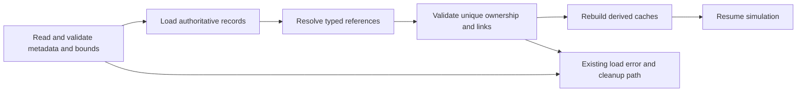

# R2MLVS14 - Savegame, Determinism and Lifecycle

## Global Mandatory Reading

> **Execution protocol**
>
> - Read this Global Mandatory Reading section before the first task and again
>   after every context compaction.
> - Before starting or resuming a task group, read the nearest preceding Area
>   Mandatory Reading block whose `Applies to` label includes that group. Area
>   blocks appear immediately before the first group they govern.
> - A referenced heading or exported symbol is authoritative. Global navigation
>   hints and Area line ranges are for navigation only; if they drift, relocate
>   the named section or symbol rather than expanding to the whole file.
> - Mandatory reading is non-transitive. Do not preload a linked file's own
>   Mandatory Reading, Consult on Demand, or Planning Provenance entries unless
>   this plan names them directly for the current area.
> - Do not read Consult on Demand or Planning Provenance merely because those
>   sources are listed. Use a Consult on Demand source only when its trigger
>   occurs.
> - No created source file, test file or JSON file should start with same prefix as a planning MD file (such as r2). Only MD files can have that prefix. No MD file should be created anywhere in source directories unless specifically asked.
> - After EVERY CONTEXT COMPACTION, you must add a note above the task group
>   which is currently in execution. The note will say: "Context has compacted
>   X times while executing this group.". If the compaction occurs before any
>   meaningful work was done (this can happen when there is a lot of baggage
>   from the previous compaction), then and ONLY then you can skip this step.
> - When exceeding 3 context compactions, YOU MUST ask yourself if you're not 
>   chewing more than we can handle :). Heck, plans change! :). In such a case, 
>   the way out is to split the group on the spot,
>   in the plan, into more groups, 
>   by appending B, C, D as a suffixes to those groups (splitting sub-groups 
>   themselves is also allowed). When you do this, create Local Mandatory
>   Reading areas so you can optimize your context only for the
>   ACTUAL task at hand.
>   Before starting or resuming a task group, read the nearest preceding Area
>   Mandatory Reading block whose `Applies to` label includes that group. Area
>   blocks appear immediately before the first group they govern.

| File name | Line Ranges | Description |
| --- | --- | --- |
| [docs/zz-reach2/upgrades/2026-10/r2mlvs-multilayer-vehicles-and-structures.md](r2mlvs-multilayer-vehicles-and-structures.md) | 296-300 | `AD-14` supplies the canonical gameplay/ownership decision for every group of this plan. It constrains feature-owned serialization, old-save compatibility and deterministic lifecycle repair; a consumer must not redefine it locally. |
| [src/map_layer.h](../../../../src/map_layer.h) | 78-85 | `MultiLayerMap` ownership preamble: `Map` owns packed storage/geometry and this controller owns layer semantics. Every group uses world tiles/explicit layer helpers; camera selection and ad hoc plane offsets cannot define gameplay. |
| [src/saveload/saveload.h](../../../../src/saveload/saveload.h) | 447-518 | `ChunkType`, `ChunkId`, `ChunkHandler` and handler aliases define save/load/fixup/preview ownership; every feature persists its own authoritative fields through this boundary. |

Status: Groups 1-6 initial M0 Schema Foundation delivered, including metadata/editor/legacy round trips, reference hooks and canonical diagnostics. [Schema evidence](r2mlvs14-a-schema-foundation.md) records the focused validation. Later feature-phase save/network acceptance and the full plan remain unfinished. Parent: [R2MLVS master](r2mlvs-multilayer-vehicles-and-structures.md).

**Artifact-layout migration (2026-10-09):** this plan consumes the parent [Development artifact layout](r2mlvs-multilayer-vehicles-and-structures.md#development-artifact-layout), implemented by [R2FC](r2fc-file-cleanup.md). It supersedes earlier docs asset/review/helper placement and fixed runtime-config destinations below. New native homes use `mlm/runtime/`, generated feature reviews use `mlm/reviews/`, logs remain under `logs/`, and reusable code/curated inputs keep their code/test owners. Paths and focused native/cold verification are complete; R2FC records the results and retained-input identities. Repository-relative executable commands run from the checkout root through their context-aware wrappers. Historical pass records remain dated evidence and are not new acceptance claims. No gameplay task is completed by this migration and the separate post-demo fixture-pruning gate remains.

## Outcome and Boundaries

The complete economy survives saves, multiplayer joins and entity removal without corruption, duplication or dependence on the visible layer.

## State ownership register

R2TBMF8 save handoff,2026-10-09:397 registers portal magazine storage in the existing native Depot pool and map identity fields, with ordinary native depot orders owning the selected destination.398 extends existing controller phase/reason fields for explicit ordinary-list control. Saved work anchors, cargo packets, work remainders and machinery identities remain with their original owners. Full loading cross-checks portal/depot identity and both directions of a paid starter-pocket job binding, including reused portals whose centre is open but surrounding cells are not. Actual397 return/parked files,398 moving-order and remote-reassignment files, nonmutating previews and malformed phase/reason/depot refusals are verified in [W](tbm-fixes/r2tbmf-w-order-control-notes.md#group8-closure) and its T/V handoffs. No fractional cargo transport was introduced.

| Authoritative state | Feature owner | Derived data rebuilt after load |
| --- | --- | --- |
| Gameplay profile, content identity, tuning, feature seeds, Deep/model/factory availability and explicit legacy/editor policies | 1 | Resolved capability/content/calendar lookups |
| Excavation, deposit reserve, claim, job progress/support | 2 | Survey/render caches and work queues |
| Sealed/commissioning portal and TBM access assignment | 3 | Normal and work-route connectivity caches |
| TBM state, cutter heading, area outline/pass progress, face, costs/remainders, wagon references | 4 | Vehicle display and route summaries |
| Exchange assignment, origin station, hauler/empty sets | 5 | Queue views; train caches after validated consist restoration |
| Mine/deposit binding, reserve consumption, processor inventory | 6 | Catchment and production UI caches |
| Orbital identity/position/motion, typed targets, transition phase | 8 | Spatial indexes and interpolation state |
| Payload ownership, immutable launch anchor, drop release position, target, pad queue, descent and service timers | 9 | Drop-zone/render previews |
| Launch hub memberships, collection radius, stock reservations and timed Surface handling jobs | 9 | Membership lookup, demand queues and collection overlay |
| Asteroid reserve, probe attachment and extraction remainder | 10 | Target search acceleration |
| Blueprint reservation, inventory, consumed inputs, assembly progress | 11 | Module adjacency and displayed capacity |
| Mirror target, service/coverage and output remainder | 12 | Farm mirror lookup and drawn beam |
| Tube vehicle capability/definition IDs, cargo/orders, service and paid-power demand | 16 | Route/reservation and power-availability caches |
| Vent identity/capacity/claim, utility connectivity, allocated heat, conversion/recipe remainders and export | 17 | Thermal/electrical distribution graphs and heat overlays |

Ordinary cargo packet/vehicle/station persistence should be reused where possible. Do not save a second independent count of the same physical cargo without a strict ownership/consistency rule.

## Public Handoff Contract

R2TBMF10-11 handoff,2026-10-09: save399 adds the geological hardness algorithm/seed to GEOS wire2. Saves through398 retain legacy layer/deposit hardness with version0/seed0, including after resaving. Regional generation consumes no Surface RNG and rendering reads authoritative hardness. [Z](tbm-fixes/r2tbmf-z-geology-notes.md#group10-closure) records actual legacy/new files, malformed preview/full-load refusals, preserved native content and a real399 network map transfer followed by450 synchronized frames. The broader master multiplayer matrix remains separate. [ZB](tbm-fixes/r2tbmf-zb-final-notes.md) links real accepted, mid-work, local staging, B construction/commissioning, withdrawal/parking, release and public-freight files for one machine; cargo remains in whole native units.

R2TBMF parking/release extension,2026-10-09:395 adds ReturnToPark/WaitToPark/Parked;396 adds ReturnToRelease/WaitToRelease/ReleasePending to the existing TBMP phase field. Earlier phase values, vehicle/job identities and394 work-rate migration retain their meanings. Both preview and full reading bound phases by the saved version. New cancellation preserves work/claims until physical withdrawal and delivery, while previously cancelled legacy work remains cancelled. Real395 parking and396 pending cancellation, release and public-connection loads retain actual vehicles and support same-machine reuse ([P](tbm-fixes/r2tbmf-p-parking-notes.md), [R](tbm-fixes/r2tbmf-r-release-notes.md#group7b-closure)); broader malformed/final network acceptance remains scoped to the fixing plan's final checks. No cargo fractions or new cargo fields are introduced.

Delivered foundation owner: `src/multilayer_state.h`, publishing `MultiLayerStateSchema` and `ValidateMultiLayerStateReferences`. Ground and electrical producer save/preview/fixup/Null/lifecycle evidence is delivered through current385; real multiplayer and later capsule/thermal/orbital families remain pending. Downstream consumers use these public owners, not private pools or copied tables.

`Schema Foundation Handoff`: the first reading area publishes empty-compatible profile/schema/version rules and reference validation exports before new world-state implementation. Feature plans add their own descriptors as they land. Final feature/network audits do not block this initial checkpoint.

## Implementation Tasks

Ground execution scope: [R2MLVS3MP](r2mlvs3mp-master-plan.md) schedules this plan's foundation and ground-family audits. For its scoped rows, require the actual content/geology/portal/TBM/exchange producers and, only for tube/riser rows, the relevant delivered tube/utility/geothermal producers. Orbital references in a shared area's entry list apply to orbital rows and final whole-epic closure, not to an independent ground audit. Validate every family actually present in the saved feature metadata; do not allocate surrogate objects for an absent family. Only fully covered original tasks/groups may be marked X; mixed-family tasks remain partial with their untested scope recorded.

Deepening pass, 2026-10-04: implementation groups use only SIMPLE, MEDIUM or HARD difficulty, with at most eight pending tasks each. Sketches describe proposed implementation contracts; verify the named earlier producers at each assumption gate. No gameplay or asset implementation is marked complete by this planning pass.

Groups are chronological and contain consecutive tasks of one difficulty. Each difficulty batch has at most eight tasks; area reading changes only when the implementation boundary or source of truth changes.

### Area Mandatory Reading - Schema and migration foundation

_Applies to Groups 1-6._

**Entry gate.** The following public contracts must exist before dependent implementation in this area: `src/multilayer_content.h`: `MultiLayerGameplayProfile`, `LayerVehicleCapability`, `GetMultiLayerContentProfile`, `CheckDeepLayerAvailability`, `UtilityPowerAccount`.
Verify each public file/export/schema field with `rg` in the current workspace and inspect its command/field ownership. For a same-plan contract, compile its type/signature fixture or validate its artifact after the preceding producer groups. For cross-plan behavior, also run the producer's focused executable boundary test; declarations alone cannot authorize dependent mutations or runtime claims.
If a required export is absent, stop the dependent implementation, mutation and runtime claims in Groups 1-6. Read-only characterization, source/range verification, test-case design and asset-template work that does not assume the missing behavior may continue.
Do not bypass this gate by copying private pool/tile state, inventing local IDs or cargo registries, using a historical plan as a delivered implementation, opening user-wide content stores, substituting a second utility/accounting authority, or adding an unreviewed fallback path. Finish the named producer or revise the shared contract and its direct consumers first.

| File name | Line Ranges | Description |
| --- | --- | --- |
| [src/saveload/map_sl.cpp](../../../../src/saveload/map_sl.cpp) | 30-100 | `_map_desc`, `MapFileTileCount`, `MAPSChunkHandler` distinguish stored layer count from live allocation and validate corrupt/missing planes. |
| [src/saveload/vehicle_sl.cpp](../../../../src/saveload/vehicle_sl.cpp) | 1119-1196 | `VEHSChunkHandler` and registration construct the vehicle class from saved type before member loading; protect old enum meanings and validate new references. |
| [src/command.cpp](../../../../src/command.cpp) | 301-328 | `CommandHelperBase::InternalExecuteValidateTestAndPrepExec` defines refusal/estimate before execution; no validation phase may consume inventory, RNG or funds. |
| `src/multilayer_content.h` (planned public contract; link after implementation) | Live definitions; no fixed range | [r2mlvs1-gameplay-contracts-and-content.md](r2mlvs1-gameplay-contracts-and-content.md) Groups 1-6, ending with Group 6's public-contract task, publish `MultiLayerGameplayProfile`, `LayerVehicleCapability`, `GetMultiLayerContentProfile`, `CheckDeepLayerAvailability`, `UtilityPowerAccount`. These exports/schema fields are authoritative for this area. Same-plan consumers follow those earlier groups; cross-plan consumers verify the producer's required implementation/tests as well. Proposed names alone do not prove delivery. |
| [src/saveload/saveload.cpp](../../../../src/saveload/saveload.cpp) | 223-314 | Complete `ChunkHandlers` registry fixes handler order and registration; allocate new IDs without changing legacy meanings. |

**ASSUMPTION: this was already built previously. If not, re-asses at runtime**. This applies only to the producer contracts named in this area's gate, after their listed producer groups have run. Verify their actual exports and focused tests before using the sketches below; proposed types and helper names in sketches are not evidence of delivered code.

**Foundation scope.** The first area consumes Draft Content and publishes schema/digest contracts for Content Freeze. It does not require completed feature pools, new vehicle kinds or the final runtime grid. Feature owners add concrete descriptors and focused mid-action tests as those implementations land.

### Group 1 - Schema and migration foundation

{{MEDIUM}}
- [X] 1.1 Assign each state field one owner and representation.
- [X] 1.2 Define stable typed references, valid ranges, limits, optional/invalid semantics and reference removal hooks before producers write data.

### Group 2 - Reserve schema identities and implement metadata scaffolding

{{HARD}}
- [X] 2.1 Inspect the current SaveLoadVersion and all registered chunk IDs, then allocate unique symbolic revisions/IDs. Preserve historical layer and vehicle meanings; never assume numeric 371 is still available.
- [X] 2.2 Define feature/profile metadata fields, size limits, required content identity and preview behavior from r2mlvs1 Draft Content. Implement an empty-compatible scaffold that can validate metadata without depending on feature pools not yet built.
- [X] 2.3 Add load/preview/fixup registration for the scaffold and legacy missing-chunk defaults. Identify the earliest supported point to reject missing/incompatible content before unsafe feature activation.
- [X] 2.4 Test empty new-profile metadata and old Surface/369/370 saves with unchanged legacy rules. Publish schema shape to Content Freeze; later feature records remain their owners responsibility.

### Group 3 - Schema and migration foundation

{{MEDIUM}}
- [X] 3.1 Define legacy load policy for Surface-only saves, versions 369/370 and existing content sets: preserve legacy free underground building and working portals under their saved compatibility mode. New profile generation starts solid; loading old infrastructure must not bury it.
- [X] 3.2 Keep an existing-world conversion tool out of initial scope unless separately designed with cargo/content compatibility and excavation reconstruction. Never auto-enable the new economy by merely changing a setting on load.

### Group 4 - Specify command encoding and canonical state digests

{{HARD}}
- [X] 4.1 Define typed wire fields for feature commands, enum validity, coordinate bounds and optional references. Preserve existing command/save meanings and reject malformed input before mutation.
- [X] 4.2 Define canonical digest order by feature kind and stable ID, then explicit integer fields: reserves, packet owner/quantity, job phase/progress, RNG state, fixed-point positions, leases and accounting remainders.
- [X] 4.3 Exclude pointers, padding, unordered iteration and derived visual/cache state. Give absent/empty records unambiguous encoding and include profile/schema version.
- [X] 4.4 Add a small digest fixture that changes one authoritative field at a time and ignores a presentation-only change; publish the extension points without pretending later feature state already exists.

### Group 5 - Schema and migration foundation

{{MEDIUM}}
- [X] 5.1 Add these fields to desync diagnostics.
- [X] 5.2 Include the 1980 Deep policy and later model/factory dates in profile/version compatibility. Calendar availability is derived from the simulation calendar and saved policy, never local wall time. Explicit legacy/editor exceptions must not leak into ordinary new games.

### Group 6 - Schema and migration foundation

{{HARD}}
- [X] 6.1 Publish `src/multilayer_state.h` with the exact exports/schema fields in `Public Handoff Contract`; document authoritative fields, invalid-ID semantics and command/estimate boundaries. Register any created C++ source in the existing build list. If the chosen implementation uses a different public location, update this contract and every direct consumer before declaring the producer ready.

M0 Foundation evidence: [schema/ownership, actual migration and digest record](r2mlvs14-a-schema-foundation.md). Groups 1-6 are complete; later feature/lifecycle/network audits remain unchecked. This handoff does not claim future feature pools or whole-world desync acceptance.

### Area Mandatory Reading - Feature persistence integration

_Applies to Groups 7-14._

**Entry gate.** The following public contracts must exist before dependent implementation in this area: `src/multilayer_state.h`: `MultiLayerStateSchema`, `ValidateMultiLayerStateReferences`.
Verify each public file/export/schema field with `rg` in the current workspace and inspect its command/field ownership. For a same-plan contract, compile its type/signature fixture or validate its artifact after the preceding producer groups. For cross-plan behavior, also run the producer's focused executable boundary test; declarations alone cannot authorize dependent mutations or runtime claims.
If a required export is absent, stop the dependent implementation, mutation and runtime claims in Groups 7-14. Read-only characterization, source/range verification, test-case design and asset-template work that does not assume the missing behavior may continue.
Do not bypass this gate by copying private pool/tile state, inventing local IDs or cargo registries, using a historical plan as a delivered implementation, opening user-wide content stores, substituting a second utility/accounting authority, or adding an unreviewed fallback path. Finish the named producer or revise the shared contract and its direct consumers first.

**Scoped integration gates.** The following producer dependencies apply only to the named implementation/test families. Verify each required public export and its focused producer test before those integrations; absent late producers do not block already independent features.

- `src/excavation.h` is required for the r2mlvs2 feature-specific descriptors/fixups/round-trips; other delivered features may be persisted/validated independently, and combined claims wait for all required producers in Groups 7-14 (only the named integration/subscenario). If absent, stop only that integration/subscenario and its passing claim. Other independent code, art, persistence and tests in this area may continue.
- `src/layer_portal_cmd.h` is required for the r2mlvs3 feature-specific descriptors/fixups/round-trips; other delivered features may be persisted/validated independently, and combined claims wait for all required producers in Groups 7-14 (only the named integration/subscenario). If absent, stop only that integration/subscenario and its passing claim. Other independent code, art, persistence and tests in this area may continue.
- `src/tbm.h` is required for the r2mlvs4 feature-specific descriptors/fixups/round-trips; other delivered features may be persisted/validated independently, and combined claims wait for all required producers in Groups 7-14 (only the named integration/subscenario). If absent, stop only that integration/subscenario and its passing claim. Other independent code, art, persistence and tests in this area may continue.
- `src/tbm_exchange.h` is required for the r2mlvs5 feature-specific descriptors/fixups/round-trips; other delivered features may be persisted/validated independently, and combined claims wait for all required producers in Groups 7-14 (only the named integration/subscenario). If absent, stop only that integration/subscenario and its passing claim. Other independent code, art, persistence and tests in this area may continue.
- `src/multilayer_industry.h` is required for the r2mlvs6 feature-specific descriptors/fixups/round-trips; other delivered features may be persisted/validated independently, and combined claims wait for all required producers in Groups 7-14 (only the named integration/subscenario). If absent, stop only that integration/subscenario and its passing claim. Other independent code, art, persistence and tests in this area may continue.
- `src/space.h` is required for the r2mlvs8 feature-specific descriptors/fixups/round-trips; other delivered features may be persisted/validated independently, and combined claims wait for all required producers in Groups 7-14 (only the named integration/subscenario). If absent, stop only that integration/subscenario and its passing claim. Other independent code, art, persistence and tests in this area may continue.
- `src/launch_center.h` is required for the r2mlvs9 feature-specific descriptors/fixups/round-trips; other delivered features may be persisted/validated independently, and combined claims wait for all required producers in Groups 7-14 (only the named integration/subscenario). If absent, stop only that integration/subscenario and its passing claim. Other independent code, art, persistence and tests in this area may continue.
- `src/asteroid.h` is required for the r2mlvs10 feature-specific descriptors/fixups/round-trips; other delivered features may be persisted/validated independently, and combined claims wait for all required producers in Groups 7-14 (only the named integration/subscenario). If absent, stop only that integration/subscenario and its passing claim. Other independent code, art, persistence and tests in this area may continue.
- `src/orbital_station.h` is required for the r2mlvs11 feature-specific descriptors/fixups/round-trips; other delivered features may be persisted/validated independently, and combined claims wait for all required producers in Groups 7-14 (only the named integration/subscenario). If absent, stop only that integration/subscenario and its passing claim. Other independent code, art, persistence and tests in this area may continue.
- `src/solar_power.h` is required for the r2mlvs12 feature-specific descriptors/fixups/round-trips; other delivered features may be persisted/validated independently, and combined claims wait for all required producers in Groups 7-14 (only the named integration/subscenario). If absent, stop only that integration/subscenario and its passing claim. Other independent code, art, persistence and tests in this area may continue.
- `src/transport_tube.h` is required for the r2mlvs16 feature-specific descriptors/fixups/round-trips; other delivered features may be persisted/validated independently, and combined claims wait for all required producers in Groups 7-14 (only the named integration/subscenario). If absent, stop only that integration/subscenario and its passing claim. Other independent code, art, persistence and tests in this area may continue.
- `src/geothermal.h` is required for the r2mlvs17 feature-specific descriptors/fixups/round-trips; other delivered features may be persisted/validated independently, and combined claims wait for all required producers in Groups 7-14 (only the named integration/subscenario). If absent, stop only that integration/subscenario and its passing claim. Other independent code, art, persistence and tests in this area may continue.

Do not emulate an absent producer with copied private state, fake inventories/energy, local IDs or a second registry/grid. A final combined closure/gallery/round-trip still waits for every required family; an independent passing case is not a pass for the missing integration.

| File name | Line Ranges | Description |
| --- | --- | --- |
| [src/industry.h](../../../../src/industry.h) | 75-106 | `ProducedCargo`, `AcceptedCargo`, `ProducedCargoes`, `AcceptedCargoes` expose bounded inventory and economy-time history; conserve materials and avoid narrow-counter overflow. |
| [src/cargopacket.h](../../../../src/cargopacket.h) | 458-489 | `VehicleCargoList::Append`, `AgeCargo`, `Stage`, `Return`, `Unload`, `Shift` move accountable packets; exchange/descent/processing must not clone packet age or feeder shares. |
| [src/network/network_command.cpp](../../../../src/network/network_command.cpp) | 256-288 | `NetworkExecuteLocalCommandQueue` executes agreed frame order/company authority; all jobs use deterministic simulation time. |
| `src/multilayer_state.h` (planned public contract; link after implementation) | Live definitions; no fixed range | [r2mlvs14-savegame-determinism-and-lifecycle.md](r2mlvs14-savegame-determinism-and-lifecycle.md) Groups 1-6, ending with Group 6's public-contract task, publish `MultiLayerStateSchema`, `ValidateMultiLayerStateReferences`. These exports/schema fields are authoritative for this area. Same-plan consumers follow those earlier groups; cross-plan consumers verify the producer's required implementation/tests as well. Proposed names alone do not prove delivery. |
| `src/excavation.h` (planned public contract; link after implementation) | Live definitions; no fixed range | [r2mlvs2-geology-and-excavation.md](r2mlvs2-geology-and-excavation.md) Groups 1-7, ending with Group 7's public-contract task, publish `ExcavationState`, `GeologyDeposit`, `ExcavationJob`, `CheckExcavatedFootprint`, `CommitExcavationCut`, `GeothermalVentField`. These exports/schema fields are authoritative for this area. Same-plan consumers follow those earlier groups; cross-plan consumers verify the producer's required implementation/tests as well. Proposed names alone do not prove delivery. Read this producer for the r2mlvs2 feature-specific descriptors/fixups/round-trips; other delivered features may be persisted/validated independently, and combined claims wait for all required producers in Groups 7-14 (only the named integration/subscenario); missing it blocks only that integration, not independent work. |
| [src/layer_portal_cmd.h](../../../../src/layer_portal_cmd.h) | Live definitions; no fixed range | [r2mlvs3-sealed-portals-and-deep-rail.md](r2mlvs3-sealed-portals-and-deep-rail.md) Groups 1-7, ending with Group 7's public-contract task, publish `LayerPortalWorkState`, `GetLayerPortalWorkState`, `CheckLayerPortalWorkAccess`, `CommissionLayerPortalTBM`. These exports/schema fields are authoritative for this area. Same-plan consumers follow those earlier groups; cross-plan consumers verify the producer's required implementation/tests as well. Proposed names alone do not prove delivery. Read this producer for the r2mlvs3 feature-specific descriptors/fixups/round-trips; other delivered features may be persisted/validated independently, and combined claims wait for all required producers in Groups 7-14 (only the named integration/subscenario); missing it blocks only that integration, not independent work. |
| `src/tbm.h` (planned public contract; link after implementation) | Live definitions; no fixed range | [r2mlvs4-tunnel-boring-machines.md](r2mlvs4-tunnel-boring-machines.md) Groups 1-5, ending with Group 5's public-contract task, publish `TBMProject`, `TBMWorkState`, `ValidateTBMAreaRoute`, `AdvanceTBMWork`. These exports/schema fields are authoritative for this area. Same-plan consumers follow those earlier groups; cross-plan consumers verify the producer's required implementation/tests as well. Proposed names alone do not prove delivery. Read this producer for the r2mlvs4 feature-specific descriptors/fixups/round-trips; other delivered features may be persisted/validated independently, and combined claims wait for all required producers in Groups 7-14 (only the named integration/subscenario); missing it blocks only that integration, not independent work. |
| `src/tbm_exchange.h` (planned public contract; link after implementation) | Live definitions; no fixed range | [r2mlvs5-spoil-wagons-and-haulage.md](r2mlvs5-spoil-wagons-and-haulage.md) Groups 1-5, ending with Group 5's public-contract task, publish `TBMExchangeAssignment`, `ValidateTBMWagonExchange`, `ExecuteTBMWagonExchange`. These exports/schema fields are authoritative for this area. Same-plan consumers follow those earlier groups; cross-plan consumers verify the producer's required implementation/tests as well. Proposed names alone do not prove delivery. Read this producer for the r2mlvs5 feature-specific descriptors/fixups/round-trips; other delivered features may be persisted/validated independently, and combined claims wait for all required producers in Groups 7-14 (only the named integration/subscenario); missing it blocks only that integration, not independent work. |
| `src/multilayer_industry.h` (planned public contract; link after implementation) | Live definitions; no fixed range | [r2mlvs6-mines-and-resource-chains.md](r2mlvs6-mines-and-resource-chains.md) Groups 1-6, ending with Group 6's public-contract task, publish `LayerIndustryCapability`, `ValidateMineDepositClaim`, `ProduceLayerMineCargo`, `PrepareLayerRecipeBatch`, `CommitLayerRecipeBatch`. These exports/schema fields are authoritative for this area. Same-plan consumers follow those earlier groups; cross-plan consumers verify the producer's required implementation/tests as well. Proposed names alone do not prove delivery. Read this producer for the r2mlvs6 feature-specific descriptors/fixups/round-trips; other delivered features may be persisted/validated independently, and combined claims wait for all required producers in Groups 7-14 (only the named integration/subscenario); missing it blocks only that integration, not independent work. |
| `src/space.h` (planned public contract; link after implementation) | Live definitions; no fixed range | [r2mlvs8-space-world-and-construction.md](r2mlvs8-space-world-and-construction.md) Groups 1-7, ending with Group 7's public-contract task, publish `SpaceVehicle`, `OrbitalBodyID`, `SpaceMission`, `SpaceStructure`, `SpaceTransition`. These exports/schema fields are authoritative for this area. Same-plan consumers follow those earlier groups; cross-plan consumers verify the producer's required implementation/tests as well. Proposed names alone do not prove delivery. Read this producer for the r2mlvs8 feature-specific descriptors/fixups/round-trips; other delivered features may be persisted/validated independently, and combined claims wait for all required producers in Groups 7-14 (only the named integration/subscenario); missing it blocks only that integration, not independent work. |
| `src/launch_center.h` (planned public contract; link after implementation) | Live definitions; no fixed range | [r2mlvs9-launch-centers-and-rockets.md](r2mlvs9-launch-centers-and-rockets.md) Groups 1-7, ending with Group 7's public-contract task, publish `LaunchCenterAnchor`, `LaunchCollectionHub`, `SurfaceHandlingJob`, `SpaceDescentJob`, `CanReleaseOrbitalCargo`, `CommitOrbitalCargoRelease`. These exports/schema fields are authoritative for this area. Same-plan consumers follow those earlier groups; cross-plan consumers verify the producer's required implementation/tests as well. Proposed names alone do not prove delivery. Read this producer for the r2mlvs9 feature-specific descriptors/fixups/round-trips; other delivered features may be persisted/validated independently, and combined claims wait for all required producers in Groups 7-14 (only the named integration/subscenario); missing it blocks only that integration, not independent work. |
| `src/asteroid.h` (planned public contract; link after implementation) | Live definitions; no fixed range | [r2mlvs10-asteroids-and-mining-probes.md](r2mlvs10-asteroids-and-mining-probes.md) Groups 1-7, ending with Group 7's public-contract task, publish `AsteroidBody`, `MiningProbeMission`, `AdvanceAsteroidMotion`, `AdvanceProbeMining`. These exports/schema fields are authoritative for this area. Same-plan consumers follow those earlier groups; cross-plan consumers verify the producer's required implementation/tests as well. Proposed names alone do not prove delivery. Read this producer for the r2mlvs10 feature-specific descriptors/fixups/round-trips; other delivered features may be persisted/validated independently, and combined claims wait for all required producers in Groups 7-14 (only the named integration/subscenario); missing it blocks only that integration, not independent work. |
| `src/orbital_station.h` (planned public contract; link after implementation) | Live definitions; no fixed range | [r2mlvs11-orbital-stations-and-manufacturing.md](r2mlvs11-orbital-stations-and-manufacturing.md) Groups 1-6, ending with Group 6's public-contract task, publish `OrbitalModule`, `OrbitalConstructionJob`, `ReserveOrbitalConstructionInputs`, `CommitOrbitalConstructionStep`. These exports/schema fields are authoritative for this area. Same-plan consumers follow those earlier groups; cross-plan consumers verify the producer's required implementation/tests as well. Proposed names alone do not prove delivery. Read this producer for the r2mlvs11 feature-specific descriptors/fixups/round-trips; other delivered features may be persisted/validated independently, and combined claims wait for all required producers in Groups 7-14 (only the named integration/subscenario); missing it blocks only that integration, not independent work. |
| `src/solar_power.h` (planned public contract; link after implementation) | Live definitions; no fixed range | [r2mlvs12-solar-farms-mirrors-and-eti.md](r2mlvs12-solar-farms-mirrors-and-eti.md) Groups 1-6, ending with Group 6's public-contract task, publish `SolarGenerationAccount`, `MirrorAssignment`, `ComputeMirrorSolarOutput`. These exports/schema fields are authoritative for this area. Same-plan consumers follow those earlier groups; cross-plan consumers verify the producer's required implementation/tests as well. Proposed names alone do not prove delivery. Read this producer for the r2mlvs12 feature-specific descriptors/fixups/round-trips; other delivered features may be persisted/validated independently, and combined claims wait for all required producers in Groups 7-14 (only the named integration/subscenario); missing it blocks only that integration, not independent work. |
| `src/transport_tube.h` (planned public contract; link after implementation) | Live definitions; no fixed range | [r2mlvs16-underground-transport-tubes.md](r2mlvs16-underground-transport-tubes.md) Groups 1-8, ending with Group 8's public-contract task, publish `TubeVehicleCapability`, `TubeTerminal`, `CheckTubeConstruction`, `ComputeTubePowerDemand`. These exports/schema fields are authoritative for this area. Same-plan consumers follow those earlier groups; cross-plan consumers verify the producer's required implementation/tests as well. Proposed names alone do not prove delivery. Read this producer for the r2mlvs16 feature-specific descriptors/fixups/round-trips; other delivered features may be persisted/validated independently, and combined claims wait for all required producers in Groups 7-14 (only the named integration/subscenario); missing it blocks only that integration, not independent work. |
| `src/geothermal.h` (planned public contract; link after implementation) | Live definitions; no fixed range | [r2mlvs17-geothermal-energy-and-industry.md](r2mlvs17-geothermal-energy-and-industry.md) Groups 1-7, ending with Group 7's public-contract task, publish `GeothermalHeatAllocation`, `GeothermalUtilityLink`, `AllocateVentHeat`, `ExportGeothermalPower`. These exports/schema fields are authoritative for this area. Same-plan consumers follow those earlier groups; cross-plan consumers verify the producer's required implementation/tests as well. Proposed names alone do not prove delivery. Read this producer for the r2mlvs17 feature-specific descriptors/fixups/round-trips; other delivered features may be persisted/validated independently, and combined claims wait for all required producers in Groups 7-14 (only the named integration/subscenario); missing it blocks only that integration, not independent work. |
| [src/saveload/saveload.cpp](../../../../src/saveload/saveload.cpp) | 2366-2400 | Complete `SlLoadChunks`, `SlLoadCheckChunks`, `SlFixPointers` show file-order reads versus registry-order fixups; validate at the appropriate phase. |
| [src/saveload/saveload.cpp](../../../../src/saveload/saveload.cpp) | 317-363 | Complete `SlNullPointers` and `SlError` define partial-load cleanup; new fixups must tolerate Null action and absent pools. |
| [src/saveload/saveload.cpp](../../../../src/saveload/saveload.cpp) | 3202-3298 | Complete `DoLoad` mutates the in-progress load world and reports reinitialization on failure; do not promise restoration of the prior live world. |
| `src/utility_power.h` (planned public contract; link after implementation) | Live definitions; no fixed range | [r2mlvs12](r2mlvs12-solar-farms-mirrors-and-eti.md) `Useful Power Handoff`, produced by its native-ledger, atomic-mutation and consumer-effect groups, supplies `PublishUtilityGeneration`, `AllocateUtilityPower`, `GetUtilityAllocation`, `UtilityGrantID`, `UtilityMutationKind`, `PrepareUtilityMutation`, `CommitUtilityMutation`. Verify its allocation, consume/release/layer-transfer, effect and save/retry fixtures before dependent power mutations; no private account writes or duplicate grid. |

**ASSUMPTION: this was already built previously. If not, re-asses at runtime**. This applies only to the producer contracts named in this area's gate, after their listed producer groups have run. Verify their actual exports and focused tests before using the sketches below; proposed types and helper names in sketches are not evidence of delivered code.

**Load-validation sketch.** The live loader determines when these phases can run; the sketch describes dependencies, not permission to arbitrarily reorder legacy chunks.

**ASSUMPTION: this was already built previously. If not, re-asses at runtime**. Each feature family supplies its own descriptors, public validator and mid-action fixture before that family's audit. Verify the actual producer tests; missing tube/geothermal or orbital code stops its dependent subscenario only. Do not invent absent records or claim combined save compatibility from an empty schema fixture.

**Utility persistence gate. ASSUMPTION: this was already built previously. If not, re-asses at runtime**. Audit the r2mlvs12 ledger only after its live descriptors and tests exist: source epochs/lineage, grant balances, mutation sequence, consume/release/transfer state and fixed-scale remainders. Preserve recipe inventory-owner discriminants and completed-but-awaiting-materialization jobs too. Missing producers stop only their subscenarios; never reconstruct consumed energy from caches.

**R2MLVS3MP scoped split, 2026-10-05.** Tasks 7.1-15.4 that span feature families are split into named portions: `-G` ground (master 6.5, closed at 11.2), `-T` tube/utility/first generator and riser (master 9.5/11.2) and `-O` orbital or later direct-heat (pending here, outside that queue). The exact rows and their gating exports are in [r2mlvs3mp-e](portal-tbm/r2mlvs3mp-e-scoped-gates.md#plan-14-groups-7-15). Record evidence against the portion label; a task is checked only when all its portions pass.

`-G` audit status (2026-10-05, R2MLVS3MP master 6.5): mapped row by row in [r2mlvs3mp-k](portal-tbm/r2mlvs3mp-k-ground-persistence-audit.md), with the ground lifecycle table for 15.1 and owner hooks for 15.4. Its evidence passes at the R2MLVS3MP end-of-Group-7 milestone. Open ground gaps G1-G6 are recorded there: real-file round trips of the 377/378 families, raw vehicle-chain links, corridor claims, the receiver next interval, straddling and spanning saves, and deposit claimants. No task in Groups 7-15 is checked; the `-T` and `-O` portions are still pending.

### Group 7 - Feature persistence integration

{{MEDIUM}}
- [ ] 7.1 Require each feature plan to deliver its state descriptors, after-load reference fixups and meaningful mid-action fixture alongside implementation.
- [X] 7.1G Verify delivered content/geology/portal/TBM/exchange and electrical ground descriptors/fixups against actual current mid-action files and focused producer boundaries. Orbital/tube/thermal rows remain pending.

### Group 8 - Feature persistence integration

{{SIMPLE}}
- [ ] 8.1 Collect a matrix of states covered, not just idle save samples.
- [X] 8.1G Publish the ground state/evidence matrix below, including real partial bend, capacity wait, spanning hauler, origin loss, electrical retirement/transfer/effect and supported legacy formats.

### Group 9 - Validate feature metadata before activating loaded records

{{HARD}}
- [ ] 9.1 Map the live chunk-loading/AfterLoad sequence and insert profile/map metadata validation before new feature code depends on it. Respect existing chunk order and pointer-fixup phases rather than calling runtime APIs on unresolved IDs.
- [ ] 9.2 Bound each new pool/array/shape/inventory length and validate raw numeric coordinates, enums and counters before allocation/use. Reject missing required content and impossible layer/feature combinations.
- [ ] 9.3 Use the loader existing failure cleanup/error path for an invalid in-progress world. Do not resume gameplay with partially validated records or promise restoration of the previous running world unless the loader actually supports it.
- [X] 9.1G Verify ground registry-order fixups and post-company/map/vehicle acceptance in `AfterLoadGame`; staged transport never becomes live authority before these owners validate.
- [X] 9.2G Verify current ground/utility scalar/count/reference refusals through focused owner checks and actual malformed native files; retain exact content/version policies.
- [X] 9.3G Execute actual read/fixup rejection through the normal game's Null cleanup. Preserve the existing in-progress-world failure semantics.

### Group 10 - Resolve references and unique inventory ownership

{{HARD}}
- [ ] 10.1 After all required objects load, resolve deposit/job, TBM/set/head and center/mission/module references through typed public validators. Check saved incarnation/deletion policy against pool ID reuse.
- [ ] 10.2 Implement new fixup handlers for the loader Null action too: partial-load cleanup must not dereference absent pools or replay normal reference validation on uninitialized records.
- [ ] 10.3 Construct a temporary ownership audit for each packet/inventory reservation: exactly one authoritative container owns the quantity and capacity reservations do not duplicate it.
- [ ] 10.4 Validate consist links, attachment leases, module dependencies and job references for duplicate ownership, invalid IDs and forbidden cycles. Reject or apply only the documented legacy repair; do not silently drop cargo.
- [ ] 10.5 Test one corrupt reference class at a time, including two heads claiming a wagon and two jobs claiming an input packet.
### Local Mandatory Reading - Completed ground ownership subset

_Applies to Group10B; supplement Feature persistence Area._

Read only actual `tbm_exchange_load.cpp` duplicate/reused-owner boundaries, current ground48-owner reader and the actual utility read/fixup Null logs linked in the evidence matrix. The original Group10 includes unselected orbital obligations and remains pending; this separate completed subset preserves the eight-task group limit.

### Group 10B - Completed ground ownership audit

{{HARD}}
- [X] 10.1G Resolve actual ground project/support/set/head/origin and utility references through their public validators, including stale/reused/duplicate claims.
- [X] 10.2G Verify ground numeric staging handlers tolerate real Null dispatch without dereferencing absent pools.
- [X] 10.3G Compare all48 present serialized ground owners, including physical packets/vehicles/industries and complete mine/processor/utility families; no second cargo balance is introduced.
- [X] 10.4G Verify actual consist/set ownership and retained utility source/consumer/link lineage, with no silent packet repair.
- [X] 10.5G Execute isolated ground missing/reused/shared wagon/project cases and malformed utility liveness/free-balance cases. Orbital input reservations remain outside this ground subset.

### Group 11 - Rebuild only derived caches after validation

{{HARD}}
- [ ] 11.1 Rebuild geology/spatial buckets, path/approach reservations and utility connectivity from validated authoritative fields in stable order.
- [ ] 11.2 Verify cache reconstruction cannot change cargo, reserves, consumed milestones or source generation totals. Saved active grants/leases remain authority where their contract says so.
- [ ] 11.3 Run one next-tick comparison per feature family after reload and a repeat load; pointer layout, render state and hash insertion order cannot change decisions.
- [X] 11.1G Verify ground derived train/support/route caches rebuild through the actual native application loader after owner validation.
- [X] 11.2G Preserve initial/next-transition ground packet, reserve, invoice and utility history, including exact accepted clock/RNG state on repeated loading.
- [X] 11.3G Compare current partial-bend, capacity-wait and spanning next transitions after one/two actual loads; independently verify staged cut/phase/exchange/utility continuation owners.

### Group 12 - Feature persistence integration

{{MEDIUM}}
- [ ] 12.1 Verify estimate/execute semantics for portal construction, excavation, wagon swaps, launch/deployment, construction consumption and mirror assignment. Failed estimates or retries cannot consume RNG, inventory or funds.
- [ ] 12.2 Verify saves during TBM cuts, straddling consists, queue waits, probe attachment, ascent/descent, partial modules and partial solar periods resume at the same simulation result.
- [X] 12.1G Verify ground portal/project/cut/exchange and electrical estimate/refusal/retry ownership with current focused producer tests.
- [X] 12.2G Verify actual partial cut/bend, loaded capacity wait and spanning-hauler files resume with unchanged current native owners and timing; keep orbital phases pending.

### Ground persistence evidence matrix

This scoped matrix closes the named G subsets, not mixed whole-profile tasks. Current saved inputs remain declared physical development fixtures; first-bootstrap and real host/client joins are separate requirements.

| State/boundary | Actual evidence and scope |
| --- | --- |
| Partial advancing45-degree bend/work | [Group13B current writer and two native loads](#group-13b---verify-current-ground-files-through-real-loading); heading4/cursor3/partial1; same next exchange after3,749 frames |
| Loaded capacity wait | [Native one/two loads](../../../../logs/r2mlvs3mp-z-a-ground-wagon-wait-checks.log); same vehicle packets and next exchange aftertwo frames |
| Real spanning hauler | [Current Deep one/two loads](../../../../logs/r2mlvs3mp-z-a-ground-current-spanning-checks.log); exact native physics and179-frame next exchange |
| Project/cut/phase/portal atomic references | [40,292 assertions/19 cases](../../../../logs/r2mlvs3mp-z-a-ground-reference-checks.log); unmatched exchange-save selector excluded from its passing scope |
| Exchange phase/ownership/corruption | [Correct exchange-load selector](../../../../logs/r2mlvs3mp-z-a-ground-exchange-reference-checks.log);35,009 assertions/five cases, including two actual heads claiming one set |
| Complete present owner families | [48-owner initial/next-exchange comparison](../../../../logs/r2mlvs3mp-z-a-ground-complete-owner-checks.log); packet/vehicle/company/clock/map/geology/project/exchange/receiver plus mine/processor/utility families |
| Actual removed Surface origin | [Current writer](../../../../logs/r2mlvs3mp-z-a-ground-origin-writer.log), [native one/two loads](../../../../logs/r2mlvs3mp-z-a-ground-lost-origin-checks.log); real station rebuilding and10,835-frame next exchange |
| Electrical owner lifetime/reference/cache continuation | [479 assertions/eight cases](../../../../logs/r2mlvs3mp-z-a-ground-state-owner-checks.log), [Group15B actual files and normal game](#group-15b---complete-delivered-electrical-company-ownership); older381..384 inputs remain immutable |
| Actual malformed full-load cleanup | [Normal read/fixup refusal and Null dispatch](../../../../logs/r2mlvs3mp-z-a-utility-null-checks.log), with UPLH/UPLD cleanup and no previous-world restoration promise |

Tube/thermal portions dispatched by master11.2 are skipped under GP-TG at these Groups7-12; their producers are absent across the separately recorded major gap. Orbital/descent/direct-heat tasks remain out of this master's scope. No skipped or unselected original whole task becomesX.

### Group 13 - Round-trip ground geometry and real wagon ownership

{{HARD}}
- [X] 13.1 Save during a TBM 45-degree bend/partial pass, a full-wagon pause and a spanning-layer hauler. Compare heading, route cursor, support, actual wagon IDs and Earth/Rock quantities.
- [X] 13.2 Verify loaded failure/cancellation states preserve supported retreat and the required Surface origin cycle. Include these fields in the canonical digest.
- [ ] 13.3 After tube delivery, round-trip all five capsule models with layer-local routes, power/service state and interchange cargo; retain the conventional mandatory spoil leg.

13.2 closure,2026-10-08: actual station loss/rebuild [writes90,345 assertions](../../../../logs/r2mlvs3mp-z-a-ground-origin-writer.log), then [one/two native loads](../../../../logs/r2mlvs3mp-z-a-ground-lost-origin-checks.log) resume the same exchange after10,835 frames. Actual cancel-command execution during partial bend work [writes10,045 assertions](../../../../logs/r2mlvs3mp-z-a-ground-cancel-writer.log); [native retreat/exchange](../../../../logs/r2mlvs3mp-z-a-ground-cancel-checks.log) matches2,380 frames, and [complete cancelled Surface-haul/disposal/empty-return](../../../../logs/r2mlvs3mp-z-a-ground-cancel-final-cycle-checks.log) matches3,478 frames after both loads. All48 present owner chunks include supported track, job/cursor/heading, actual wagon packets, final receiver/company history and clocks/RNG. Fresh current inputs remain immutable. The first complete-loop harness attempt rejected its empty presentation label despite an actual native pass; explicitly declaring headless yields the final two-process pass. Tube13.3 is skipped for master finalization under GP-TG; capsule code remains undelivered.

### Local Mandatory Reading - Current native ground snapshots

_Applies to Group13B; master11.2 ground round-trip proof._

Read this plan's Global/Feature persistence Area, actual `tbm_logistics_save.cpp` read-only writer/`RunUndergroundExcavationWorkflow`, `tbm_logistics_save_fixture.py` complete owner/current-format comparisons, and `tbm_logistics_runtime.cpp` native loader/full-game observer. Fresh385 snapshots must retain real source physics, heading, paid support, work cursor and cargo, with no repositioning. The immutable380 spanning input has serialized hauler acceleration48 while current native cache reconstruction produces16; keep that historical difference explicit and use a fresh current producer for exact initial physics claims. No arbitrary acceleration-ignore or source-byte patch is authorized. Prior `TBMMovingRig::ReloadOnBend` is only controller/support staging, not an actual serialized bend save.

### Group 13B - Verify current ground files through real loading

{{HARD}}
- [X] 13B.1 Record fresh current-version physical stopped/exchange/disposal/return/spanning and partial-bend snapshots through the actual native workflow and writer, preserving the original380 inputs and declared fixture setup.
- [X] 13B.2 Compare complete initial native owners/physics and the next legal transition after one/two actual application loads, including active bend heading/cursor/support and real wagon IDs/packets/invoices. Publish exact passing scope and retain any failed historical comparison.

13B closure,2026-10-08: [current Deep writer](../../../../logs/r2mlvs3mp-z-a-ground-current-writer.log) passes33,101 assertions and [Underground wide/bend writer](../../../../logs/r2mlvs3mp-z-a-ground-bend-writer-1.log) passes59,355. Fresh385 Deep states are `acceptance-ground-deep-385-a-*`; the wide source is `acceptance-ground-bend-385-b-*`. Actual partial-bend heading/work/cursor/support and wagon IDs survive two full application loads, with an identical next physical exchange after3,749 frames; [spanning](../../../../logs/r2mlvs3mp-z-a-ground-current-spanning-checks.log) compares179 frames. [Bend native passes](../../../../logs/r2mlvs3mp-z-a-ground-bend-checks.log) and [exact accepted owner/clock/RNG reconstruction](../../../../logs/r2mlvs3mp-z-a-ground-repeated-owners.log) retain current evidence. The original380 acceleration difference remains a failed historical exact-physics comparison. First loading may initialize the reduced fixture's unset company face; the already accepted save's repeated load has no such owner/clock/RNG exception. These are declared physical fixture round trips, not real bootstrap or host/client join.

Original13.1 also closes: the wide fixture's `await-exchange` records an actual loaded cutter in WaitForEmpties, with90t Earth/180t Rock and insufficient room for its next bounded cut. [Two native capacity-wait loads](../../../../logs/r2mlvs3mp-z-a-ground-wagon-wait-checks.log) preserve its inventory/owners and resume the same exchange aftertwo frames. The saved partial bend has actual heading4, cursor3 and partial work1. [Complete48-owner comparison](../../../../logs/r2mlvs3mp-z-a-ground-complete-owner-checks.log) additionally retains present mine/processor/utility families, rejecting partial families. This closes geometry/capacity/spanning evidence; failure/cancellation13.2 and absent tube13.3 remain separate.

### Group 14 - Round-trip descent, handling and energy ownership

{{HARD}}
- [ ] 14.1 Save off-center at the 20-tile drop boundary and during Surface handling with a pending member change. Verify release position, target incarnation, packet age/provenance and capacity reservations.
- [ ] 14.2 After geothermal delivery, save shared heat allocation, electrical export and direct-processing inputs/remainders. Compare one owner per thermal/electric unit and no second grid credit.
- [ ] 14.3 Compare normalized hashes and next-step ledgers for each independent delivered family. Full combined round-trip closure waits for every producer; a missing late family does not invalidate independent evidence.

- [X] 14.3G Preserve delivered electrical generation/consumption/transfer/lifetime and monotonic account identities through real files, including source/route loss, expiry, town effects and company retirement/reuse. Direct-heat/solar-mirror/orbital inventory portions of Group14 remain pending; absent tube/thermal rows use GP-TG.

### Area Mandatory Reading - Entity lifecycle and multiplayer

_Applies to Groups 15-22._

**Entry gate.** The following public contracts must exist before dependent implementation in this area: `src/multilayer_state.h`: `MultiLayerStateSchema`, `ValidateMultiLayerStateReferences`.
Verify each public file/export/schema field with `rg` in the current workspace and inspect its command/field ownership. For a same-plan contract, compile its type/signature fixture or validate its artifact after the preceding producer groups. For cross-plan behavior, also run the producer's focused executable boundary test; declarations alone cannot authorize dependent mutations or runtime claims.
If a required export is absent, stop the dependent implementation, mutation and runtime claims in Groups 15-22. Read-only characterization, source/range verification, test-case design and asset-template work that does not assume the missing behavior may continue.
Do not bypass this gate by copying private pool/tile state, inventing local IDs or cargo registries, using a historical plan as a delivered implementation, opening user-wide content stores, substituting a second utility/accounting authority, or adding an unreviewed fallback path. Finish the named producer or revise the shared contract and its direct consumers first.

| File name | Line Ranges | Description |
| --- | --- | --- |
| [src/network/network_server.cpp](../../../../src/network/network_server.cpp) | 670-687 | `ServerNetworkGameSocketHandler::SendSync` compares RNG seeds, not a full gameplay checksum; validate orbital/geology/cargo ledgers in addition to a no-desync result. |
| [src/timer/timer_game_calendar.h](../../../../src/timer/timer_game_calendar.h) | 15-39 | `TimerGameCalendar` technology-clock contract and date conversions govern 1980/model/factory introductions; economic/realtime scheduling cannot unlock a technology. |
| [src/tests/map_layer.cpp](../../../../src/tests/map_layer.cpp) | 293-322 | Complete Deep initialization test checks fence/terrain and unchanged RNG; new geology must preserve feature-disabled behavior. |
| `src/multilayer_state.h` (planned public contract; link after implementation) | Live definitions; no fixed range | [r2mlvs14-savegame-determinism-and-lifecycle.md](r2mlvs14-savegame-determinism-and-lifecycle.md) Groups 1-6, ending with Group 6's public-contract task, publish `MultiLayerStateSchema`, `ValidateMultiLayerStateReferences`. These exports/schema fields are authoritative for this area. Same-plan consumers follow those earlier groups; cross-plan consumers verify the producer's required implementation/tests as well. Proposed names alone do not prove delivery. |
| [src/network/network_client.cpp](../../../../src/network/network_client.cpp) | 847-909 | Complete `ReceiveServerMapDone` loads the actual joining snapshot; real join evidence must include post-load and subsequent matching-frame digests. |

**ASSUMPTION: this was already built previously. If not, re-asses at runtime**. This applies only to the producer contracts named in this area's gate, after their listed producer groups have run. Verify their actual exports and focused tests before using the sketches below; proposed types and helper names in sketches are not evidence of delivered code.

**Digest discipline.** Compare explicit serialized-style fields in a canonical stable order, not raw struct memory or only network RNG seeds. Keep failure fixtures narrow first, then combine them. A lifecycle policy row is complete only with an implemented hook and a test showing the post-event resource owner.

### Group 15 - Define lifecycle policy by reference family

{{HARD}}
- [ ] 15.1 For ground references, table sale/removal/cancellation/takeover effects on deposits, jobs, TBMs, wagon sets, bays and Surface origin stations. State refusal versus evacuation, fields changed and cargo owner after each event.
- [ ] 15.2 For orbital references, table center/body/module/farm/mirror/vehicle loss and ID reuse; specify reservation release and recoverable mission state before generic destructors truncate inventory.
- [ ] 15.3 For tube/utility references, table depot/interchange/power-link loss, vent claim changes and accounting grant cancellation. Distinguish derived disconnected networks from saved consumed resources.
- [ ] 15.4 Require each feature owner to implement/test its table rows via public lifecycle hooks. This audit records missing coverage instead of duplicating private repair code.

Delivered utility subset,2026-10-08: [public-hook lifecycle policy and coverage](portal-tbm/r2mlvs3mp-z-utility-lifecycle-policy.md) records tested electrical cancellation/whole-owner refusal, source retirement/new ID, actual portal sealing/demolition/reconnection, interval expiry and real-town authority/ID reuse. Ledger/recipe fixtures pass521 assertions/six cases; actual saved/native/normal-game proof is linked in the handoff. Upcoming tube/vent/operating-generator and company takeover/removal hooks are explicitly pending. The full15.3/15.4 tasks remain unchecked; master9.5A closes this delivered preparation subset and9.5B returns after actual producers.

### Local Mandatory Reading - Delivered electrical company lifecycle

_Applies to Group15B; master11.2 reference ownership audit._

Read this plan's Global/Entity lifecycle Area, `ChangeOwnershipOfCompanyItems` in `src/economy.cpp`, `UtilityPowerConsumer` and public lifecycle APIs in `src/utility_power.h`, source retirement/admission/validation in `src/utility_power.cpp`, and concrete UPLH/UPLD readers in `src/saveload/utility_power_sl.cpp`. Existing384 consumer wire `active` is reserved zero; reserve385/format5 to persist consumer retirement while explicitly reading381..384 as live consumers. Preserve actual lifetime settlement, original shares and monotonic IDs. Only unused grants expire; company reuse never reactivates tombstones. Read the corresponding row in [the lifecycle policy](portal-tbm/r2mlvs3mp-z-utility-lifecycle-policy.md). Tube/thermal company owners remain under GP-TG.

### Group 15B - Complete delivered electrical company ownership

{{HARD}}
- [X] 15B.1 Add a public bounded utility-company lifecycle hook to the actual takeover/removal owner. Transfer retained account ownership on takeover; retire physical links and expire only their unused imports. Removal retires owned sources/consumers and clears town eligibility while preserving settled history.
- [X] 15B.2 Persist inactive consumer tombstones in explicit385/format5 transport; reject usable retired balances/links and retain genuine381..384 readers.
- [X] 15B.3 Test actual company takeover/removal, deletion/ID reuse, stale proposal refusal and native save/preview/reload of retired settled accounts in focused fixtures. Publish the completed policy/evidence without claiming missing tube/thermal lifecycle.

15B closure,2026-10-08: `ChangeUtilityPowerCompanyOwnership` is called by actual `ChangeOwnershipOfCompanyItems` before tile ownership changes. Current live lineage transfers; earlier inactive company incarnations retain their historical owners. Deletion keeps monotonic source/consumer IDs and consumed lifetime use, expires unused slices, clears town eligibility and makes stale tickets refuse. Version385/UPLH5 uses the existing104-byte/25-field active scalar for consumer retirement; explicit381..384 readers preserve their genuine source bytes. [437 owner assertions/12 cases](../../../../logs/r2mlvs3mp-z-a-company-owner-checks-3.log), [actual native retirement/two reloads/corrupt previews/physical takeover](../../../../logs/r2mlvs3mp-z-a-company-native-checks-2.log), [four retained readers](../../../../logs/r2mlvs3mp-z-a-company-legacy-readers.log), and [ordinary game loading/resaving](../../../../logs/r2mlvs3mp-z-a-company-normal-checks.log) pass. [Debug game/test](../../../../logs/r2mlvs3mp-z-a-company-lifecycle-build-5.log) and [optimized game/test](../../../../logs/r2mlvs3mp-z-a-company-optimized-build.log) build. [Lifecycle policy](portal-tbm/r2mlvs3mp-z-utility-lifecycle-policy.md) and [public handoff](portal-tbm/r2mlvs3mp-x-useful-power-handoff.md) now describe current385 authority. This completes the delivered company row, not missing capsule/thermal owners or real join.

### Local Mandatory Reading - Ground lifecycle and real network audit

_Applies to Groups16-19 when dispatched by master11.3; read only selected ground scope._

Read this plan's Global/Entity lifecycle Area, current master11.3 and the completed ground/utility evidence above. For real networking inspect `NetworkExecuteLocalCommandQueue`, server `SendSync`, client `ReceiveServerMapDone`/`SafeLoad`, and `LogMultiLayerStateDiagnostics`/`ComputeMultiLayerStateDigest`. The workspace currently has crypto unit tests but no discovered ground host/client/join runner; verify actual callable APIs before planning one. The diagnostic feature digest is not automatically a complete vehicle/packet/clock network trace. Actual snapshot-transfer and agreed-frame evidence remain required. Keep first-initialization portrait/RNG behavior distinct from exact already-accepted baseline reloads. GP-TG applies only to missing tube/thermal subscenarios; it cannot silently replace a real ground join.

### Group 16 - Entity lifecycle and multiplayer

Goal finalization exception GP-NJ:16.2 real peer scenarios are skipped under the user's multi-group-gap permission; the absent harness/trace/scenario boundaries are recorded in [the final closure audit](portal-tbm/r2mlvs3mp-z-b-final-closure-audit.md#gp-nj-real-multiplayer-acceptance-requires-a-new-multi-group-harness). Orbital16.1 remains out of scope; independent ground lifecycle is verified below. No host/client pass is inferred.

{{MEDIUM}}
- [ ] 16.1 Exercise lost origin station, destroyed/removed exchange bay, mine depletion, launch center removal, asteroid deletion, module dependency removal and solar-farm replacement. No stale ID can silently bind to a newly allocated object.
- [ ] 16.2 Run host/client identical-command scenarios with different selected layers/viewports and rendering settings.
- [X] 16.1G Exercise delivered ground origin/bay/train/set/mine/processor/company loss and ownership/reuse boundaries, preserving actual cargo and refusing stale ownership. Current focused proof passes11,736 assertions/18 cases.

### Group 17 - Compare complete host and client simulation traces

Goal finalization exception GP-NJ:17.1-17.3 are skipped for this goal because complete actual peer/frame traces and their harness require the three new groups documented in [the audit](portal-tbm/r2mlvs3mp-z-b-final-closure-audit.md). They remain required and unchecked for engineering acceptance.

{{HARD}}
- [ ] 17.1 Run underground and orbital loops on a real host/client pair with identical commands and different selected layers/render settings. Collect canonical feature digests at agreed simulation ticks.
- [ ] 17.2 On divergence, narrow to the first feature/field mismatch and reproduce the responsible command/transition. RNG-only sync success is insufficient evidence for new inventories and positions.
- [ ] 17.3 Retain host/client logs, content hashes, seeds and normalized ledger outputs for the acceptance owner.

### Group 18 - Join while independent feature jobs are active

Goal finalization exception GP-NJ: ground18.1 and dependent combined18.3 are skipped for this goal; actual snapshot-transfer/join evidence is absent. Missing tube/thermal18.2 uses GP-TG; orbital18.2 and whole combined closure remain outside scope. Retained single-player files do not count as a join.

{{HARD}}
- [ ] 18.1 Prepare a host snapshot with active excavation and wagon waiting, then join a fresh client and compare reconstructed references, next-tick state and subsequent digests.
- [ ] 18.2 Repeat with probe mining, cargo descent and partial module assembly; then add delivered tube/geothermal jobs. Keep each subscenario independent so a failure has a bounded state surface.
- [ ] 18.3 Run the final combined join after all families pass independently. Single-player replay is useful diagnosis but cannot substitute for actual snapshot transfer and join.

### Group 19 - Entity lifecycle and multiplayer

Goal finalization exception GP-NJ:19.1 and the peer/dedicated/time-mode comparisons in19.2 are skipped with the required new network harness/trace/scenario groups. Existing actual headless/hidden single-player evidence remains scoped evidence; unsupported time-mode/network claims stay unchecked.

{{MEDIUM}}
- [ ] 19.1 Verify the joining snapshot and subsequent hashes; single-player command replay is not a substitute for join testing.
- [ ] 19.2 Check dedicated/headless play, pause/speed changes, supported economy time modes and bounded updates. GUI-less worlds must progress identically.

### Group 20 - Stress launch collection lifecycle with queued work

{{HARD}}
- [ ] 20.1 Replay member extension beyond range, unlink, station deletion and ownership changes while handling/descent is active, including overlapping launch zones.
- [ ] 20.2 Compare retained packet owners, reservations and explicit target selection after every command/retry; no deleted/reused station inherits a mission.
- [ ] 20.3 Test the exact 20-tile boundary with moved craft and reordered queued commands; execution uses current validated position.

### Group 21 - Stress tube and geothermal lifecycle across technology dates

Goal finalization exception GP-TG:21.1-21.3 tube/thermal consumer/topology/date scenarios are skipped for this goal because their actual producers are undelivered. Existing ground Deep/calendar guards are retained and do not establish capsule/thermal behavior.

{{HARD}}
- [ ] 21.1 Remove tube power/depot/interchange support through allowed/refused commands and verify cargo recovery plus deterministic network invalidation.
- [ ] 21.2 Exercise vent claim reuse and broken electrical risers during allocation/direct-processing; preserve already consumed heat and cancel only uncommitted grants.
- [ ] 21.3 Replay immediately before/on 1980 and later model/factory introductions in calendar time. Changing economic speed or retrying commands cannot bypass availability, TBM turn or heat-capacity rules.

### Group 22 - Entity lifecycle and multiplayer

{{SIMPLE}}
- [ ] 22.1 Record the implemented public exports, focused test commands/results and remaining runtime/art/network gaps in this plan; retain original supplied saves and repository-local evidence.
- [ ] 22.2 Update affected architecture/handoff documentation to describe delivered behavior and reconcile the parent index only when this plan's Completion Conditions are met. Keep every unfinished task unchecked.
- [X] 22.1G Record current ground/electrical exports, native/repeated/normal-game/corrupt-load evidence and exact remaining network/thermal/orbital gaps in [the final audit](portal-tbm/r2mlvs3mp-z-b-final-closure-audit.md).
- [X] 22.2G Update delivered map-layer/savegame/electrical handoffs through385; preserve full-plan and parent incompletion.

Ground documentation closure:48-owner physical continuation, genuine370/381..384 compatibility, actual utility company hooks/ID-reuse and full-load Null cleanup retain their source inputs and owning matrix. GP-TG/GP-NJ skip absent thermal/capsule and live join rows for this goal only; original22.1/22.2 full-family claims remain pending.

## Consult on Demand

| Trigger | File name | Start at | Expand only when | Consultation purpose |
| --- | --- | --- | --- | --- |
| A new chunk loads valid values but references remain invalid | [../../architecture/savegame/archi-savegame.md](../../architecture/savegame/archi-savegame.md) | `AfterLoadGame` | The feature-owned descriptor and pointer-fixup pass cannot explain the failure | Trace repair ordering and derived-cache rebuild; the architecture does not permit silently accepting malformed canonical state. |
| A required public export is absent and its owner/location is disputed | [r2mlvs-multilayer-vehicles-and-structures.md](r2mlvs-multilayer-vehicles-and-structures.md) | `Requirements and ownership` and `Plan Index` | The named producer confirms an intentional contract/ownership change | Find the responsible producer and reconcile its public handoff with direct consumers; the hub cannot substitute for missing implementation. |
| Current behavior contradicts a historical subsystem description | [../../architecture/map-layers/archi-map-layers.md](../../architecture/map-layers/archi-map-layers.md) | `Invariants` and the relevant named source in `Code map` | The live symbol and executable test do not explain the difference | Locate layer addressing or lifecycle rationale. Live code/tests govern delivered behavior; this architecture page does not prove future interfaces exist. |

## Planning Provenance

This is not an execution reading queue. Do not preload it after context compaction. It is non-transitive; ranges record planning use, not runtime authority.

| File name | Sections or Line Ranges used while planning | Planning contribution |
| --- | --- | --- |
| [docs/zz-reach2/architecture/initial-inventory.md](../../architecture/initial-inventory.md) | 185-220 | `Command as the only world mutation`, `Pool-indexed game objects`, `Tile map as a packed array` and `File-suffix modules` oriented command/pool/header ownership and source registration. This historical inventory is a location survey, not authority for current layer behavior. |
| [docs/zz-reach2/architecture/@archi-ttd-level0.md](../../architecture/@archi-ttd-level0.md) | 24-63 | `How the program fits together` and `Source and runtime boundaries` located shared simulation, data/presentation, CMake targets and subsystem handoffs used to choose the live reading sources. |
| [docs/zz-reach2/upgrades/2026-10/r2mlvs-multilayer-vehicles-and-structures.md](r2mlvs-multilayer-vehicles-and-structures.md) | 119-140 | `Requirements and ownership` assigned this plan's feature responsibilities; it shaped the decomposition without making every sibling plan a mandatory reading dependency. |
| [src/saveload/saveload.h](../../../../src/saveload/saveload.h) | 447-518 | The inspected live boundary helped separate characterization, public-contract production, implementation and acceptance batches. It materially constrained feature-owned serialization, old-save compatibility and deterministic lifecycle repair; this entry records planning influence rather than an additional reading obligation. |
| [User planning-format instructions](<C:/Users/Axonn/.codex/attachments/cd59b20a-3a96-4d54-b4bd-1e8f37639e7d/Pasted text.txt>) | `Global Mandatory Reading`, `Area Mandatory Reading`, `Consult on Demand`, `Planning Provenance`, `Final validation` | Supplies the exact protocol, chronological difficulty batches of at most eight tasks, reading gates and validation format. |
| [src/saveload/saveload.cpp](../../../../src/saveload/saveload.cpp) | 2366-2400; 3202-3298 | Deeper planning pass, 2026-10-04: Actual load/fixup ordering and failure cleanup constrained phased validation without promising world rollback. |

## Completion Conditions

Every long-running activity has tested authoritative persistence and safe reference lifecycle. Old supported worlds keep working with their original economy. Multiplayer replay and mid-activity joins agree across views, and no save/reference/action failure creates duplicate cargo, mineral reserves, wagons or power.
