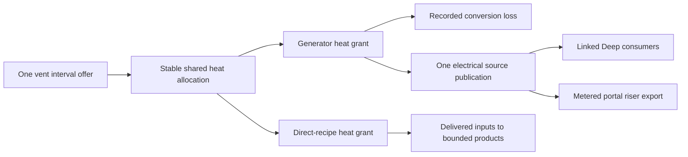

# R2MLVS17 - Geothermal Energy and Industry

## Global Mandatory Reading

> **Execution protocol**
>
> - Read this Global Mandatory Reading section before the first task and again
>   after every context compaction.
> - Before starting or resuming a task group, read the nearest preceding Area
>   Mandatory Reading block whose `Applies to` label includes that group. Area
>   blocks appear immediately before the first group they govern.
> - A referenced heading or exported symbol is authoritative. Global navigation
>   hints and Area line ranges are for navigation only; if they drift, relocate
>   the named section or symbol rather than expanding to the whole file.
> - Mandatory reading is non-transitive. Do not preload a linked file's own
>   Mandatory Reading, Consult on Demand, or Planning Provenance entries unless
>   this plan names them directly for the current area.
> - Do not read Consult on Demand or Planning Provenance merely because those
>   sources are listed. Use a Consult on Demand source only when its trigger
>   occurs.
> - No created source file, test file or JSON file should start with same prefix as a planning MD file (such as r2). Only MD files can have that prefix. No MD file should be created anywhere in source directories unless specifically asked.
> - After EVERY CONTEXT COMPACTION, you must add a note above the task group
>   which is currently in execution. The note will say: "Context has compacted
>   X times while executing this group.". If the compaction occurs before any
>   meaningful work was done (this can happen when there is a lot of baggage
>   from the previous compaction), then and ONLY then you can skip this step.
> - When exceeding 3 context compactions, YOU MUST ask yourself if you're not 
>   chewing more than we can handle :). Heck, plans change! :). In such a case, 
>   the way out is to split the group on the spot,
>   in the plan, into more groups, 
>   by appending B, C, D as a suffixes to those groups (splitting sub-groups 
>   themselves is also allowed). When you do this, create Local Mandatory
>   Reading areas so you can optimize your context only for the
>   ACTUAL task at hand.
>   Before starting or resuming a task group, read the nearest preceding Area
>   Mandatory Reading block whose `Applies to` label includes that group. Area
>   blocks appear immediately before the first group they govern.

| File name | Line Ranges | Description |
| --- | --- | --- |
| [docs/zz-reach2/upgrades/2026-10/r2mlvs-multilayer-vehicles-and-structures.md](r2mlvs-multilayer-vehicles-and-structures.md) | 310-316 | `AD-16` supplies the canonical gameplay/ownership decision for every group of this plan. It constrains one bounded thermal budget, explicit electricity export and later direct-heat recipes; a consumer must not redefine it locally. |
| [src/map_layer.h](../../../../src/map_layer.h) | 78-85 | `MultiLayerMap` ownership preamble: `Map` owns packed storage/geometry and this controller owns layer semantics. Every group uses world tiles/explicit layer helpers; camera selection and ad hoc plane offsets cannot define gameplay. |
| [src/timer/timer_game_calendar.h](../../../../src/timer/timer_game_calendar.h) | 15-39 | `TimerGameCalendar` technology-clock contract and date conversions govern 1980/model/factory introductions; economic/realtime scheduling cannot unlock a technology. |

Status: proposed; futuristic facilities below are game designs, not assertions of real industrial capabilities. Parent: [R2MLVS master](r2mlvs-multilayer-vehicles-and-structures.md). Depends on geology/1980 access from r2mlvs2/3, industry lifecycle from r2mlvs6 and the useful-power contract from r2mlvs1. r2mlvs16 consumes available electricity but does not require geothermal for its bootstrap.

## Outcome and Boundaries

Deep geothermal vents become useful energy sites and eventually host direct-heat factories.

## Proposed technology timeline

| Available from | Facility | Gameplay |
| --- | --- | --- |
| 1 January 1980 | Deep access, Vent Collector and Vent-Tap Powerhouse | Excavate/claim a vent, tap a bounded heat rate and turn it into electricity for Deep users or explicit Surface export |
| 2000 | Magma-Loop Power Station | A fictional advanced closed-loop installation with better heat-to-electric conversion, higher capital/service costs and larger footprint |
| 2010 | Geothermal Smelter | Use direct vent heat with delivered Iron/Copper/Nickel ore to produce Steel/Refined Metals; saved alternative recipes, no requirement to generate electricity first |
| 2030 | Lithothermal Battery Works | Use heat, Lithium/Cobalt and delivered Chemicals to manufacture Batteries near their mineral sources |
| 2045 | Mantle Forge | Use heat, Refined Metals and Electronics to manufacture Station Components/Robotics Parts for orbital construction |

These recipes reuse existing planned cargos, so vents/heat introduce no extra freight cargo slot. Exact dates after the 1980 access baseline, input quantities, conversion efficiencies and throughput are tuning proposals. Every plant requires transported construction/service inputs, sufficient heat, output space and paid operation. Conventional Surface processing remains available so the timeline never leaves a mineral without a receiver.

## Public Handoff Contract

Proposed public owner: `src/geothermal.h`. Publish `GeothermalHeatAllocation`, `GeothermalUtilityLink`, `AllocateVentHeat`, `ExportGeothermalPower`. These symbols are producer obligations, not existing code. Keep one authority for the fields/commands they expose; downstream plans consume the public contract rather than private pools or copied tables.

## Implementation Tasks

Deepening pass, 2026-10-04: implementation groups use only SIMPLE, MEDIUM or HARD difficulty, with at most eight pending tasks each. Sketches describe proposed implementation contracts; verify the named earlier producers at each assumption gate. No gameplay or asset implementation is marked complete by this planning pass.

Groups are chronological and contain consecutive tasks of one difficulty. Each difficulty batch has at most eight tasks; area reading changes only when the implementation boundary or source of truth changes.

### Area Mandatory Reading - Vent sites, heat and utilities

_Applies to Groups 1-7._

**Entry gate.** The following public contracts must exist before dependent implementation in this area: `src/multilayer_content.h`: `MultiLayerGameplayProfile`, `LayerVehicleCapability`, `GetMultiLayerContentProfile`, `CheckDeepLayerAvailability`, `UtilityPowerAccount`; `src/excavation.h`: `ExcavationState`, `GeologyDeposit`, `ExcavationJob`, `CheckExcavatedFootprint`, `CommitExcavationCut`, `GeothermalVentField`; `src/layer_portal_cmd.h`: `LayerPortalWorkState`, `GetLayerPortalWorkState`, `CheckLayerPortalWorkAccess`, `CommissionLayerPortalTBM`; `src/multilayer_industry.h`: `LayerIndustryCapability`, `ValidateMineDepositClaim`, `ProduceLayerMineCargo`, `PrepareLayerRecipeBatch`, `CommitLayerRecipeBatch`.
Verify each public file/export/schema field with `rg` in the current workspace and inspect its command/field ownership. For a same-plan contract, compile its type/signature fixture or validate its artifact after the preceding producer groups. For cross-plan behavior, also run the producer's focused executable boundary test; declarations alone cannot authorize dependent mutations or runtime claims.
If a required export is absent, stop the dependent implementation, mutation and runtime claims in Groups 1-7. Read-only characterization, source/range verification, test-case design and asset-template work that does not assume the missing behavior may continue.
Do not bypass this gate by copying private pool/tile state, inventing local IDs or cargo registries, using a historical plan as a delivered implementation, opening user-wide content stores, substituting a second utility/accounting authority, or adding an unreviewed fallback path. Finish the named producer or revise the shared contract and its direct consumers first.

| File name | Line Ranges | Description |
| --- | --- | --- |
| [src/industry_cmd.h](../../../../src/industry_cmd.h) | 18-28 | Industry construction/funding command declarations and `DEF_CMD_TRAIT` entries are the shared UI/script mutation boundary; availability must agree on every entry path. |
| [src/command.cpp](../../../../src/command.cpp) | 301-328 | `CommandHelperBase::InternalExecuteValidateTestAndPrepExec` defines refusal/estimate before execution; no validation phase may consume inventory, RNG or funds. |
| [src/core/random_func.hpp](../../../../src/core/random_func.hpp) | 24-43 | `Randomizer` and simulation versus interactive state constrain feature-seed generation: preserve Surface simulation RNG and exclude presentation randomness. |
| `src/multilayer_content.h` (planned public contract; link after implementation) | Live definitions; no fixed range | [r2mlvs1-gameplay-contracts-and-content.md](r2mlvs1-gameplay-contracts-and-content.md) Groups 1-6, ending with Group 6's public-contract task, publish `MultiLayerGameplayProfile`, `LayerVehicleCapability`, `GetMultiLayerContentProfile`, `CheckDeepLayerAvailability`, `UtilityPowerAccount`. These exports/schema fields are authoritative for this area. Same-plan consumers follow those earlier groups; cross-plan consumers verify the producer's required implementation/tests as well. Proposed names alone do not prove delivery. |
| `src/excavation.h` (planned public contract; link after implementation) | Live definitions; no fixed range | [r2mlvs2-geology-and-excavation.md](r2mlvs2-geology-and-excavation.md) Groups 1-7, ending with Group 7's public-contract task, publish `ExcavationState`, `GeologyDeposit`, `ExcavationJob`, `CheckExcavatedFootprint`, `CommitExcavationCut`, `GeothermalVentField`. These exports/schema fields are authoritative for this area. Same-plan consumers follow those earlier groups; cross-plan consumers verify the producer's required implementation/tests as well. Proposed names alone do not prove delivery. |
| [src/layer_portal_cmd.h](../../../../src/layer_portal_cmd.h) | Live definitions; no fixed range | [r2mlvs3-sealed-portals-and-deep-rail.md](r2mlvs3-sealed-portals-and-deep-rail.md) Groups 1-7, ending with Group 7's public-contract task, publish `LayerPortalWorkState`, `GetLayerPortalWorkState`, `CheckLayerPortalWorkAccess`, `CommissionLayerPortalTBM`. These exports/schema fields are authoritative for this area. Same-plan consumers follow those earlier groups; cross-plan consumers verify the producer's required implementation/tests as well. Proposed names alone do not prove delivery. |
| `src/multilayer_industry.h` (planned public contract; link after implementation) | Live definitions; no fixed range | [r2mlvs6-mines-and-resource-chains.md](r2mlvs6-mines-and-resource-chains.md) Groups 1-6, ending with Group 6's public-contract task, publish `LayerIndustryCapability`, `ValidateMineDepositClaim`, `ProduceLayerMineCargo`, `PrepareLayerRecipeBatch`, `CommitLayerRecipeBatch`. These exports/schema fields are authoritative for this area. Same-plan consumers follow those earlier groups; cross-plan consumers verify the producer's required implementation/tests as well. Proposed names alone do not prove delivery. |
| `src/utility_power.h` (planned public contract; link after implementation) | Live definitions; no fixed range | [r2mlvs12](r2mlvs12-solar-farms-mirrors-and-eti.md) `Useful Power Handoff`, produced by its native-ledger, atomic-mutation and consumer-effect groups, supplies `PublishUtilityGeneration`, `AllocateUtilityPower`, `GetUtilityAllocation`, `UtilityGrantID`, `UtilityMutationKind`, `PrepareUtilityMutation`, `CommitUtilityMutation`. Verify its allocation, consume/release/layer-transfer, effect and save/retry fixtures before dependent power mutations; no private account writes or duplicate grid. |

**ASSUMPTION: this was already built previously. If not, re-asses at runtime**. This applies only to the producer contracts named in this area's gate, after their listed producer groups have run. Verify their actual exports and focused tests before using the sketches below; proposed types and helper names in sketches are not evidence of delivered code.

**Ownership and allocation sketch.** Vents already belong to r2mlvs2. This plan adds claims/links and one shared heat allocator; r2mlvs12 owns the common electric ledger. No consumer gets a private copy of the vent capacity.



**ASSUMPTION: this was already built previously. If not, re-asses at runtime**. The existing gates supply geology, profile, portal and industry contracts; electrical export additionally requires r2mlvs12's tested `Useful Power Handoff`. Verify `src/utility_power.h` generation/allocation/query exports and focused tests before export/grid mutation. If absent, stop those dependent operations but continue heat-domain fixtures; do not invent a local grid or use coordinate catchment.

### Group 1 - Consume vent geology and bind excavated collectors

Goal-authorized skip (2026-10-08, master finalization): dispatched expansion work in this group is skipped under [finalization exception GP-TG](r2mlvs3mp-z-a-finalization-ledger.md#gp-tg-tube-and-geothermal-expansion-requires-major-gap-planning). Existing delivered prefixes stay complete; unimplemented profile work remains pending. No skipped task is markedX.

{{MEDIUM}}
- [ ] 1.1 Consume r2mlvs2 `GeothermalVentField` IDs, surveyed state and bounded source capacity; verify its guaranteed-vent/map-size fixture. Do not generate a second set of vents or overwrite geological source identity here.
- [ ] 1.2 Define this owner's collector/plant claim record referencing a vent, owner and utility endpoint. Validate full excavation, suitable footprint/access and shared Deep unlock before binding.
- [ ] 1.3 Test ordinary clearing and plant removal/rebuilding preserve the original vent ID/capacity; only the consumer claim changes. Discovery or a blueprint alone produces no heat/power.

### Group 2 - Produce one bounded thermal offer per interval

Goal-authorized skip (2026-10-08, master finalization): dispatched expansion work in this group is skipped under [finalization exception GP-TG](r2mlvs3mp-z-a-finalization-ledger.md#gp-tg-tube-and-geothermal-expansion-requires-major-gap-planning). Existing delivered prefixes stay complete; unimplemented profile work remains pending. No skipped task is markedX.

{{HARD}}
- [ ] 2.1 Convert the vent sustainable rate into an integer interval heat offer with one saved source remainder/epoch. Repeated update/query calls cannot create a second offer for the same interval.
- [ ] 2.2 Define consumer requests separately for generators and direct-heat recipes, with owner, connected endpoint, needed quantity and priority policy from the profile.
- [ ] 2.3 Specify allocation versus actual use, unused-grant release and closed-interval accounting. Save authoritative grants/cursor/remainders; do not infer consumed heat from an animation or a rebuilt graph.

### Group 3 - Allocate shared heat through explicit connected capacity

Goal-authorized skip (2026-10-08, master finalization): dispatched expansion work in this group is skipped under [finalization exception GP-TG](r2mlvs3mp-z-a-finalization-ledger.md#gp-tg-tube-and-geothermal-expansion-requires-major-gap-planning). Existing delivered prefixes stay complete; unimplemented profile work remains pending. No skipped task is markedX.

{{HARD}}
- [ ] 3.1 Build a deterministic allocation pass over eligible connected claims in stable priority/ID order, using a saved fair cursor only if the frozen policy requires it.
- [ ] 3.2 Bound every grant by the vent residual offer, request and explicit link/path residual capacity. Choose deterministic bounded routing on topology change; an optimal flow solver is unnecessary for the first release.
- [ ] 3.3 Reserve grants for generator and direct-processing participants from the same source budget. Prepare input/output constraints before requesting useful heat, so a full factory cannot consume heat it cannot use.
- [ ] 3.4 Test two generators plus a direct consumer, zero supply, partial requests and disconnected claims. Sum committed use plus unconsumed reservations never exceeds the interval offer.

### Group 4 - Build Deep utility links and invalidate connectivity

Goal-authorized skip (2026-10-08, master finalization): dispatched expansion work in this group is skipped under [finalization exception GP-TG](r2mlvs3mp-z-a-finalization-ledger.md#gp-tg-tube-and-geothermal-expansion-requires-major-gap-planning). Existing delivered prefixes stay complete; unimplemented profile work remains pending. No skipped task is markedX.

{{HARD}}
- [ ] 4.1 Add heat/electric utility link commands on fully excavated Deep footprints with owner/capacity and declared coexistence rules for road/rail/tube tiles; preserve their packed tile metadata.
- [ ] 4.2 Keep heat edges layer-local. A broken link yields a recoverable shortage or an explicitly paid backup source; catchment/coordinate proximity never supplies heat.
- [ ] 4.3 Build/rebuild derived connected-component/path caches on committed topology changes, with stable traversal and bounded work. Do not scan all rock-plane tiles per tick.
- [ ] 4.4 Test occupied/invalid construction, link removal during an uncommitted grant and reconnection; retain consumed energy and revoke/replan only unused reservations through the allocator.

### Group 5 - Export metered electricity through commissioned portals

Goal-authorized skip (2026-10-08, master finalization): dispatched expansion work in this group is skipped under [finalization exception GP-TG](r2mlvs3mp-z-a-finalization-ledger.md#gp-tg-tube-and-geothermal-expansion-requires-major-gap-planning). Existing delivered prefixes stay complete; unimplemented profile work remains pending. No skipped task is markedX.

{{HARD}}
- [ ] 5.1 Consume r2mlvs12 `Useful Power Handoff` and r2mlvs3 commissioned pair state. Validate both endpoint owners, date, excavation and electrical riser capacity before constructing an inter-layer link.
- [ ] 5.2 Route electricity through explicit paid riser edges, including any required intermediate layer links. Heat itself cannot cross a portal; a direct road elevator still leaves unrelated Underground terrain untouched.
- [ ] 5.3 Implement `ExportGeothermalPower` as a movement of metered electrical allocation with source identity/epoch, not a second generation event. Debit source allocation and publish destination availability once.
- [ ] 5.4 Test export bottleneck, closed/removed portal, full destination demand and retry/reload. Reject a pre-1980 or uncommissioned connection without partial endpoint mutation.

### Group 6 - Prove the first plant and riser bootstrap requirements

Goal-authorized skip (2026-10-08, master finalization): dispatched expansion work in this group is skipped under [finalization exception GP-TG](r2mlvs3mp-z-a-finalization-ledger.md#gp-tg-tube-and-geothermal-expansion-requires-major-gap-planning). Existing delivered prefixes stay complete; unimplemented profile work remains pending. No skipped task is markedX.

{{MEDIUM}}
- [ ] 6.1 List the collector/powerhouse/riser cash and construction inputs from r2mlvs1, with a Surface producer and conventional delivery vehicle for each; no Deep batteries/geothermal output/tube-only supply is allowed.
- [ ] 6.2 Work a 1980 commissioning ledger covering rail-origin excavation, spoil removal, plant/utility footprint and input delivery through valid rail/elevator routes.
- [ ] 6.3 Specify the first-plant acceptance fixture for the later completed definitions. Check the dependency graph here without claiming an operating generator before the next area builds it.
- [ ] 6.4 Retain the independent paid-grid tube service from r2mlvs12/16. Later geothermal substitution changes its source connection, not the ability to build the first tube.

### Group 7 - Publish heat allocation and electrical export APIs

Goal-authorized skip (2026-10-08, master finalization): dispatched expansion work in this group is skipped under [finalization exception GP-TG](r2mlvs3mp-z-a-finalization-ledger.md#gp-tg-tube-and-geothermal-expansion-requires-major-gap-planning). Existing delivered prefixes stay complete; unimplemented profile work remains pending. No skipped task is markedX.

{{HARD}}
- [ ] 7.1 Publish `src/geothermal.h` exports `GeothermalHeatAllocation`, `GeothermalUtilityLink`, `AllocateVentHeat`, `ExportGeothermalPower`, with source/claim IDs, grant epoch, units and cancellation ownership.
- [ ] 7.2 Document the public prepare/commit participant used by r2mlvs6 recipe batches and the common utility ledger. Profile1 owns definitions, geology2 owns vents, this plan owns heat, and12 owns shared electricity allocation.
- [ ] 7.3 Register source/build entries and publish focused shared-capacity/export fixtures. Actual plant recipes/functions are implemented next; API declarations alone do not prove them.

### Area Mandatory Reading - Plants and future production

_Applies to Groups 8-14._

**Entry gate.** The following public contracts must exist before dependent implementation in this area: `src/geothermal.h`: `GeothermalHeatAllocation`, `GeothermalUtilityLink`, `AllocateVentHeat`, `ExportGeothermalPower`.
Verify each public file/export/schema field with `rg` in the current workspace and inspect its command/field ownership. For a same-plan contract, compile its type/signature fixture or validate its artifact after the preceding producer groups. For cross-plan behavior, also run the producer's focused executable boundary test; declarations alone cannot authorize dependent mutations or runtime claims.
If a required export is absent, stop the dependent implementation, mutation and runtime claims in Groups 8-14. Read-only characterization, source/range verification, test-case design and asset-template work that does not assume the missing behavior may continue.
Do not bypass this gate by copying private pool/tile state, inventing local IDs or cargo registries, using a historical plan as a delivered implementation, opening user-wide content stores, substituting a second utility/accounting authority, or adding an unreviewed fallback path. Finish the named producer or revise the shared contract and its direct consumers first.

| File name | Line Ranges | Description |
| --- | --- | --- |
| [src/industrytype.h](../../../../src/industrytype.h) | 109-152 | `IndustrySpec` owns layouts, climate/availability, recipes and callbacks; layer capabilities must be explicit and not inferred from fallback graphics. |
| [src/industry.h](../../../../src/industry.h) | 75-106 | `ProducedCargo`, `AcceptedCargo`, `ProducedCargoes`, `AcceptedCargoes` expose bounded inventory and economy-time history; conserve materials and avoid narrow-counter overflow. |
| [src/industry_cmd.cpp](../../../../src/industry_cmd.cpp) | 1152-1240 | `ProduceIndustryGoodsHelper` and `ProduceIndustryGoods` expose complete rate/callback production paths; augment output once before authoritative monthly accounting. |
| `src/geothermal.h` (planned public contract; link after implementation) | Live definitions; no fixed range | [r2mlvs17-geothermal-energy-and-industry.md](r2mlvs17-geothermal-energy-and-industry.md) Groups 1-7, ending with Group 7's public-contract task, publish `GeothermalHeatAllocation`, `GeothermalUtilityLink`, `AllocateVentHeat`, `ExportGeothermalPower`. These exports/schema fields are authoritative for this area. Same-plan consumers follow those earlier groups; cross-plan consumers verify the producer's required implementation/tests as well. Proposed names alone do not prove delivery. |
| `src/multilayer_industry.h` (planned public contract; link after implementation) | Live definitions; no fixed range | r2mlvs6 `Publish layer-industry and recipe boundaries` declares `PrepareLayerRecipeBatch`/`CommitLayerRecipeBatch`; its production groups deliver the tested all-input inventory/utility participant contract. Geothermal extends that participant instead of duplicating recipes. |
| `src/utility_power.h` (planned public contract; link after implementation) | Live definitions; no fixed range | [r2mlvs12](r2mlvs12-solar-farms-mirrors-and-eti.md) `Useful Power Handoff`, produced by its native-ledger, atomic-mutation and consumer-effect groups, supplies `PublishUtilityGeneration`, `AllocateUtilityPower`, `GetUtilityAllocation`, `UtilityGrantID`, `UtilityMutationKind`, `PrepareUtilityMutation`, `CommitUtilityMutation`. Verify its allocation, consume/release/layer-transfer, effect and save/retry fixtures before dependent power mutations; no private account writes or duplicate grid. |
| `src/transport_tube.h` (planned public contract; link after implementation) | Live definitions; no fixed range | [r2mlvs16](r2mlvs16-underground-transport-tubes.md) `Publish tube construction and fleet contracts` supplies `TubeVehicleCapability`, `TubeTerminal`, `CheckTubeConstruction`, `ComputeTubePowerDemand`; verify its powered movement tests only before the tube-consuming integration. |
| [src/industry_cmd.cpp](../../../../src/industry_cmd.cpp) | 150-215 | Complete industry destructor clears tiles/references; settle geothermal grants and inventory before generic removal. |
| [src/economy.cpp](../../../../src/economy.cpp) | 1134-1167 | Complete `TriggerIndustryProduction` otherwise consumes inputs independently; exclude geothermal recipes from that duplicate production path. |
| [src/industry_cmd.cpp](../../../../src/industry_cmd.cpp) | 525-554 | Complete `TransportIndustryGoods` may remove unsent stock; reuse r2mlvs6 finite-output dispatch for geothermal products. |

**ASSUMPTION: this was already built previously. If not, re-asses at runtime**. This applies only to the producer contracts named in this area's gate, after their listed producer groups have run. Verify their actual exports and focused tests before using the sketches below; proposed types and helper names in sketches are not evidence of delivered code.

**Recipe/heat commit sketch (proposed).** The preceding allocator supplies grants; the shared industry batch executor owns all-input/output arithmetic.

```text
batch = prepare recipe against actual transported stock and every output capacity
grant = reserve heat for the feasible batch at the current vent epoch
if batch and grant remain valid:
    commit inputs + heat use + output + saved milestone exactly once
else:
    release only unconsumed grant; retain stock/progress according to contract
```

**ASSUMPTION: this was already built previously. If not, re-asses at runtime**. Verify r2mlvs6 `PrepareLayerRecipeBatch`/`CommitLayerRecipeBatch` tests before adding direct-processing mutations. A missing executor stops those plants; pure heat/generator tests may continue. The first generator fixture runs only after its definition/conversion is implemented in this area.

**Scoped tube gate. ASSUMPTION: this was already built previously. If not, re-asses at runtime**. Supplying live tube consumers needs the r2mlvs16 power-demand/movement contract and tests. If missing, stop only that integration; generators, direct-heat recipes and conventional freight remain independently testable. Do not emulate capsule demand as completed tube gameplay.

### Group 8 - Implement the two dated geothermal generators

Goal-authorized skip (2026-10-08, master finalization): dispatched expansion work in this group is skipped under [finalization exception GP-TG](r2mlvs3mp-z-a-finalization-ledger.md#gp-tg-tube-and-geothermal-expansion-requires-major-gap-planning). Existing delivered prefixes stay complete; unimplemented profile work remains pending. No skipped task is markedX.

{{HARD}}
- [ ] 8.1 Register the 1980 Vent-Tap Powerhouse with Surface-supplied construction inputs, bounded heat request, electrical efficiency, service cost and output capacity.
- [ ] 8.2 Implement checked heat-to-electric conversion with saved remainder and explicit losses. Commit heat use and electrical generation once through `PublishUtilityGeneration`; output congestion reduces/pauses the prepared conversion.
- [ ] 8.3 Register the 2000 Magma-Loop variant with its own footprint/capital/service/efficiency values on the same conversion implementation.
- [ ] 8.4 Run the previously specified 1980 first-collector/plant/riser bootstrap using actual Surface supply and compare one interval heat/useful power ledger for both models at valid dates.

### Group 9 - Bind direct heat to the shared batch executor

{{HARD}}
- [ ] 9.1 Consume r2mlvs6 `PrepareLayerRecipeBatch`/`CommitLayerRecipeBatch` and the previous heat API. Implement a geothermal inventory/utility participant, reusing the shared all-input algorithm.
- [ ] 9.2 Prepare all transported inputs/output headroom before reserving heat; revalidate the grant epoch/claim before commit. Commit inputs, heat use, output and progress once or retain them unchanged.
- [ ] 9.3 Persist recipe choice/version, reserved versus consumed quantities and work/conversion remainders. Test retry, missing one input, full one output and lost heat after preparation.
- [ ] 9.4 Record product provenance through the canonical source contract and consumed-input ledger. A direct-heat benefit must not also receive an unrecorded electricity subsidy.

### Group 10 - Implement the 2010 Geothermal Smelter

{{MEDIUM}}
- [ ] 10.1 Register the frozen Iron/Copper/Nickel alternative recipes producing Steel/Refined Metals, with explicit saved recipe selection and delivered input forms.
- [ ] 10.2 Bind the smelter to a connected heat claim, shared batch participant and bounded product inventory; transport ore in and products out by existing freight.
- [ ] 10.3 Test before/on 2010, one complete recipe of each supported alternative and a starved/full-buffer case. Compare with the earlier Surface receiver route.

### Group 11 - Implement the 2030 Lithothermal Battery Works

{{MEDIUM}}
- [ ] 11.1 Register the Lithium/Cobalt/Chemicals plus heat recipe using existing Batteries cargo, construction/service inputs and canonical date.
- [ ] 11.2 Run a delivered-input batch through the same participant; test missing Chemicals, insufficient heat and full Batteries output without consuming the other inputs.
- [ ] 11.3 Verify before/on 2030 and useful downstream battery transport. The original Surface battery plant remains a valid earlier source.

### Group 12 - Implement the 2045 Mantle Forge

{{MEDIUM}}
- [ ] 12.1 Register the Refined Metals/Electronics plus heat recipes for Station Components/Robotics Parts, with explicit alternative/product policy and no new duplicate cargo meanings.
- [ ] 12.2 Run one bounded batch and transport its product to a real Surface/orbital consumer; test heat competition with a generator and exhausted output space.
- [ ] 12.3 Verify before/on 2045 and demonstrate these supplies improve later manufacture without becoming a first-station/robot dependency.

### Group 13 - Plants and future production

Goal-authorized skip (2026-10-08, master finalization): dispatched expansion work in this group is skipped under [finalization exception GP-TG](r2mlvs3mp-z-a-finalization-ledger.md#gp-tg-tube-and-geothermal-expansion-requires-major-gap-planning). Existing delivered prefixes stay complete; unimplemented profile work remains pending. No skipped task is markedX.

{{MEDIUM}}
- [ ] 13.1 Keep input/output cargo accounting compatible with r2mlvs6 mines and Surface chains. One plant must not consume both a full heat allocation and an unrecorded electricity subsidy for the same production benefit.
- [ ] 13.2 Enforce availability at purchase/funding, commissioning, script commands, clone/conversion and production entry points. Before 1980, Deep operations remain locked; factories introduced later cannot be made early by reusing an older plant ID.
- [ ] 13.3 Integrate Deep electricity with facilities/tubes and explicit Surface export. Native/ETI modes choose one accounting authority; report exported electricity at a Surface adapter/riser without also crediting its Deep generator as an independent Surface supply. Solar mirrors never boost geothermal output.

### Group 14 - Recover plants and grants through lifecycle changes

Goal-authorized skip (2026-10-08, master finalization): dispatched expansion work in this group is skipped under [finalization exception GP-TG](r2mlvs3mp-z-a-finalization-ledger.md#gp-tg-tube-and-geothermal-expansion-requires-major-gap-planning). Existing delivered prefixes stay complete; unimplemented profile work remains pending. No skipped task is markedX.

{{HARD}}
- [ ] 14.1 Define shutdown, link loss and full storage as saved recoverable states that retain unconsumed inputs/products. Settle/release only the current uncommitted heat/electric grant.
- [ ] 14.2 Handle vent claim transfer, company takeover/bankruptcy and plant demolition through owner-checked public hooks before generic industry destruction. Removing a consumer never resets the natural vent.
- [ ] 14.3 Invalidate typed target references and affected connectivity before ID reuse; compare retained inventory/grants after a plant is rebuilt on the same tile.
- [ ] 14.4 Test one failure per lifecycle row and a combined shared-vent case so a removed claimant cannot retain its old allocation.

### Area Mandatory Reading - Controls, art and acceptance

_Applies to Groups 15-18._

**Entry gate.** The following public contracts must exist before dependent implementation in this area: `src/geothermal.h`: `GeothermalHeatAllocation`, `GeothermalUtilityLink`, `AllocateVentHeat`, `ExportGeothermalPower`.
Verify each public file/export/schema field with `rg` in the current workspace and inspect its command/field ownership. For a same-plan contract, compile its type/signature fixture or validate its artifact after the preceding producer groups. For cross-plan behavior, also run the producer's focused executable boundary test; declarations alone cannot authorize dependent mutations or runtime claims.
If a required export is absent, stop the dependent implementation, mutation and runtime claims in Groups 15-18. Read-only characterization, source/range verification, test-case design and asset-template work that does not assume the missing behavior may continue.
Do not bypass this gate by copying private pool/tile state, inventing local IDs or cargo registries, using a historical plan as a delivered implementation, opening user-wide content stores, substituting a second utility/accounting authority, or adding an unreviewed fallback path. Finish the named producer or revise the shared contract and its direct consumers first.

**Scoped integration gates.** The following producer dependencies apply only to the named implementation/test families. Verify each required public export and its focused producer test before those integrations; absent late producers do not block already independent features.

- `src/underground_gui.h` is required for the integration with the underground toolbar/controls in Group 15 (only the named integration/subscenario). If absent, stop only that integration/subscenario and its passing claim. Other independent code, art, persistence and tests in this area may continue.
- `src/transport_tube.h` is required for the tube-routing branch of the manufacturing supply chain; conventional freight can be tested independently in Group 15 (only the named integration/subscenario). If absent, stop only that integration/subscenario and its passing claim. Other independent code, art, persistence and tests in this area may continue.
- `src/solar_power.h` is required for the solar/native-ETI accounting subscenario; independent thermal-capacity/loss tests may proceed in Groups 16-17 (only the named integration/subscenario). If absent, stop only that integration/subscenario and its passing claim. Other independent code, art, persistence and tests in this area may continue.

Do not emulate an absent producer with copied private state, fake inventories/energy, local IDs or a second registry/grid. A final combined closure/gallery/round-trip still waits for every required family; an independent passing case is not a pass for the missing integration.

| File name | Line Ranges | Description |
| --- | --- | --- |
| [src/cargopacket.h](../../../../src/cargopacket.h) | 458-489 | `VehicleCargoList::Append`, `AgeCargo`, `Stage`, `Return`, `Unload`, `Shift` move accountable packets; exchange/descent/processing must not clone packet age or feeder shares. |
| [src/network/network_command.cpp](../../../../src/network/network_command.cpp) | 256-288 | `NetworkExecuteLocalCommandQueue` executes agreed frame order/company authority; all jobs use deterministic simulation time. |
| [src/network/network_server.cpp](../../../../src/network/network_server.cpp) | 670-687 | `ServerNetworkGameSocketHandler::SendSync` compares RNG seeds, not a full gameplay checksum; validate orbital/geology/cargo ledgers in addition to a no-desync result. |
| `src/geothermal.h` (planned public contract; link after implementation) | Live definitions; no fixed range | [r2mlvs17-geothermal-energy-and-industry.md](r2mlvs17-geothermal-energy-and-industry.md) Groups 1-7, ending with Group 7's public-contract task, publish `GeothermalHeatAllocation`, `GeothermalUtilityLink`, `AllocateVentHeat`, `ExportGeothermalPower`. These exports/schema fields are authoritative for this area. Same-plan consumers follow those earlier groups; cross-plan consumers verify the producer's required implementation/tests as well. Proposed names alone do not prove delivery. |
| `src/underground_gui.h` (planned public contract; link after implementation) | Live definitions; no fixed range | [r2mlvs7-underground-construction-and-fleet.md](r2mlvs7-underground-construction-and-fleet.md) Groups 1-5, ending with Group 5's public-contract task, publish `ShowUndergroundConstructionToolbar`, `BuildUndergroundVehicleFilter`. These exports/schema fields are authoritative for this area. Same-plan consumers follow those earlier groups; cross-plan consumers verify the producer's required implementation/tests as well. Proposed names alone do not prove delivery. Read this producer for the integration with the underground toolbar/controls in Group 15 (only the named integration/subscenario); missing it blocks only that integration, not independent work. |
| `src/solar_power.h` (planned public contract; link after implementation) | Live definitions; no fixed range | [r2mlvs12-solar-farms-mirrors-and-eti.md](r2mlvs12-solar-farms-mirrors-and-eti.md) Groups 1-6, ending with Group 6's public-contract task, publish `SolarGenerationAccount`, `MirrorAssignment`, `ComputeMirrorSolarOutput`. These exports/schema fields are authoritative for this area. Same-plan consumers follow those earlier groups; cross-plan consumers verify the producer's required implementation/tests as well. Proposed names alone do not prove delivery. Read this producer for the solar/native-ETI accounting subscenario; independent thermal-capacity/loss tests may proceed in Groups 16-17 (only the named integration/subscenario); missing it blocks only that integration, not independent work. |
| `src/transport_tube.h` (planned public contract; link after implementation) | Live definitions; no fixed range | [r2mlvs16-underground-transport-tubes.md](r2mlvs16-underground-transport-tubes.md) Groups 1-8, ending with Group 8's public-contract task, publish `TubeVehicleCapability`, `TubeTerminal`, `CheckTubeConstruction`, `ComputeTubePowerDemand`. These exports/schema fields are authoritative for this area. Same-plan consumers follow those earlier groups; cross-plan consumers verify the producer's required implementation/tests as well. Proposed names alone do not prove delivery. Read this producer for the tube-routing branch of the manufacturing supply chain; conventional freight can be tested independently in Group 15 (only the named integration/subscenario); missing it blocks only that integration, not independent work. |
| [Sprite Contract and delivery owner](r2mlvs13-graphics-and-asset-pipeline.md#public-handoff-contract) | Live definitions; no fixed range | `Sprite Contract Handoff` defines manifest fields `asset_id`, `consumer`, `directions`, `frames`, `anchor`, `source`; the matching authoring/conversion/runtime groups deliver actual assets. Verify the requested family and packed loading fixture before graphics integration; template/manifest publication alone is not final art. |

**ASSUMPTION: this was already built previously. If not, re-asses at runtime**. This applies only to the producer contracts named in this area's gate, after their listed producer groups have run. Verify their actual exports and focused tests before using the sketches below; proposed types and helper names in sketches are not evidence of delivered code.

**Scoped graphics gate. ASSUMPTION: this was already built previously. If not, re-asses at runtime**. Final graphics tasks in this area require the corresponding r2mlvs13 manifest entries, delivered sprites and packed loading fixture. Verify them before binding/review; if absent, stop only those art tasks and their acceptance claims, continue independent code/state tests, and never count placeholders as finished assets.

### Group 15 - Controls, art and acceptance

Goal-authorized skip (2026-10-08, master finalization): dispatched expansion work in this group is skipped under [finalization exception GP-TG](r2mlvs3mp-z-a-finalization-ledger.md#gp-tg-tube-and-geothermal-expansion-requires-major-gap-planning). Existing delivered prefixes stay complete; unimplemented profile work remains pending. No skipped task is markedX.

{{MEDIUM}}
- [ ] 15.1 Add vent surveys and heat-capacity overlays, utility links and calendar-aware plant tools to Underground Construction. Show allocated/available heat, electric conversion, direct-heat consumption and blocked reasons.
- [ ] 15.2 Deliver distinct vent/collector, two powerhouses, smelter, battery works, forge and utility sprites with construction/working/starved states. Smelter/furnace animation must reflect production state but never drive it.
- [ ] 15.3 Verify every Deep rail/elevator/construction/vehicle/plant path refuses operation on 31 December 1979 and unlocks on 1 January 1980.
- [ ] 15.4 Verify the 2000 Magma-Loop introduction boundary.
- [ ] 15.5 Verify the 2010 smelter, 2030 battery works and 2045 Mantle Forge introduction boundaries.
- [ ] 15.6 Repeat calendar boundary cases with varied economic time/simulation speed and explicit saved legacy/editor policies.
- [ ] 15.7 Run mineral mine -> tube/conventional freight -> geothermal smelter -> Surface or orbital supply chain.
- [ ] 15.8 Demonstrate a battery and Station Components/Robotics Parts chain at their later dates without cheat-supplied inputs.

### Group 16 - Verify shared thermal and grid accounting

{{HARD}}
- [ ] 16.1 Connect two generators and a direct smelter to one vent and compare each requested/granted/consumed quantity against the single offer, link capacities and conversion losses.
- [ ] 16.2 Disconnect one consumer/riser and verify predictable reassignment or unused-grant settlement at the declared epoch; no stale path or query creates extra heat.
- [ ] 16.3 After solar integration, test that only solar receives +300% and geothermal source/export is credited once under native/ETI authority. Missing mirror implementation leaves this combined case pending, not the basic heat tests.

### Group 17 - Verify saved geothermal work and hidden-layer replay

Goal-authorized skip (2026-10-08, master finalization): dispatched expansion work in this group is skipped under [finalization exception GP-TG](r2mlvs3mp-z-a-finalization-ledger.md#gp-tg-tube-and-geothermal-expansion-requires-major-gap-planning). Existing delivered prefixes stay complete; unimplemented profile work remains pending. No skipped task is markedX.

{{HARD}}
- [ ] 17.1 Round-trip vent claims, partial recipe inputs, grant/conversion remainders and failed utilities at mid-action points; compare the next allocation/production step.
- [ ] 17.2 Run matching replay/host-client state with Deep visible versus hidden and different presentation settings; compare per-source heat/electric and per-cargo inventories.
- [ ] 17.3 Repeat the 1980 and later introduction boundaries under different economic time modes, with explicit legacy/editor policies; no local clock or old plant ID bypasses the date.

### Group 18 - Controls, art and acceptance

{{SIMPLE}}
- [ ] 18.1 Record capacity/price/throughput comparisons for r2mlvs15.
- [ ] 18.2 Record the implemented public exports, focused test commands/results and remaining runtime/art/network gaps in this plan; retain original supplied saves and repository-local evidence.
- [ ] 18.3 Update affected architecture/handoff documentation to describe delivered behavior and reconcile the parent index only when this plan's Completion Conditions are met. Keep every unfinished task unchecked.

## Consult on Demand

| Trigger | File name | Start at | Expand only when | Consultation purpose |
| --- | --- | --- | --- | --- |
| Deep export gets credited twice or native/ETI town control conflicts | [r2mlvs12-solar-farms-mirrors-and-eti.md](r2mlvs12-solar-farms-mirrors-and-eti.md) | `Public Handoff Contract` and `ETI Feasibility Handoff` | Vent allocation and riser output ledgers are correct but Surface consumer totals/growth differ | Resolve the already selected solar/utility adapter authority; thermal generation is not mirror-eligible and cannot install a second grid owner. |
| A required public export is absent and its owner/location is disputed | [r2mlvs-multilayer-vehicles-and-structures.md](r2mlvs-multilayer-vehicles-and-structures.md) | `Requirements and ownership` and `Plan Index` | The named producer confirms an intentional contract/ownership change | Find the responsible producer and reconcile its public handoff with direct consumers; the hub cannot substitute for missing implementation. |
| Current behavior contradicts a historical subsystem description | [../../architecture/map-layers/archi-map-layers.md](../../architecture/map-layers/archi-map-layers.md) | `Invariants` and the relevant named source in `Code map` | The live symbol and executable test do not explain the difference | Locate layer addressing or lifecycle rationale. Live code/tests govern delivered behavior; this architecture page does not prove future interfaces exist. |

## Planning Provenance

This is not an execution reading queue. Do not preload it after context compaction. It is non-transitive; ranges record planning use, not runtime authority.

| File name | Sections or Line Ranges used while planning | Planning contribution |
| --- | --- | --- |
| [docs/zz-reach2/architecture/initial-inventory.md](../../architecture/initial-inventory.md) | 185-220 | `Command as the only world mutation`, `Pool-indexed game objects`, `Tile map as a packed array` and `File-suffix modules` oriented command/pool/header ownership and source registration. This historical inventory is a location survey, not authority for current layer behavior. |
| [docs/zz-reach2/architecture/@archi-ttd-level0.md](../../architecture/@archi-ttd-level0.md) | 24-63 | `How the program fits together` and `Source and runtime boundaries` located shared simulation, data/presentation, CMake targets and subsystem handoffs used to choose the live reading sources. |
| [docs/zz-reach2/upgrades/2026-10/r2mlvs-multilayer-vehicles-and-structures.md](r2mlvs-multilayer-vehicles-and-structures.md) | 119-140 | `Requirements and ownership` assigned this plan's feature responsibilities; it shaped the decomposition without making every sibling plan a mandatory reading dependency. |
| [src/timer/timer_game_calendar.h](../../../../src/timer/timer_game_calendar.h) | 15-39 | The inspected live boundary helped separate characterization, public-contract production, implementation and acceptance batches. It materially constrained one bounded thermal budget, explicit electricity export and later direct-heat recipes; this entry records planning influence rather than an additional reading obligation. |
| [User planning-format instructions](<C:/Users/Axonn/.codex/attachments/cd59b20a-3a96-4d54-b4bd-1e8f37639e7d/Pasted text.txt>) | `Global Mandatory Reading`, `Area Mandatory Reading`, `Consult on Demand`, `Planning Provenance`, `Final validation` | Supplies the exact protocol, chronological difficulty batches of at most eight tasks, reading gates and validation format. |
| [src/economy.cpp](../../../../src/economy.cpp) | 1134-1167 | Deeper planning pass, 2026-10-04: Legacy input conversion cannot own direct-heat recipes, so the plan consumes shared atomic recipe participants and explicit grants. |

## Completion Conditions

Deep opens in the proposed 1980 era; excavated geothermal sites then provide bounded useful energy. Later, visibly distinct fictional factories use direct heat and transported materials for useful products. Heat allocation, electrical export and recipes conserve resources across saves and competing consumers; no first facility requires its own future output.
