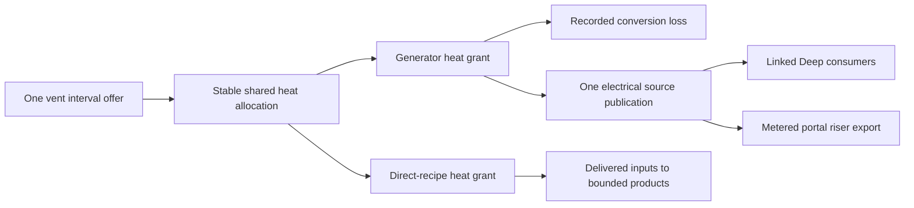

# R2MLVS18 - Geothermal Energy and Industry

## Global Mandatory Reading

> **Execution protocol**
>
> - Read this Global Mandatory Reading section before the first task and again
>   after every context compaction.
> - Before starting or resuming a task group, read the nearest preceding Area
>   Mandatory Reading block whose `Applies to` label includes that group. Area
>   blocks appear immediately before the first group they govern.
> - A referenced heading or exported symbol is authoritative. Global navigation
>   hints and Area line ranges are for navigation only; if they drift, relocate
>   the named section or symbol rather than expanding to the whole file.
> - Mandatory reading is non-transitive. Do not preload a linked file's own
>   Mandatory Reading, Consult on Demand, or Planning Provenance entries unless
>   this plan names them directly for the current area.
> - Do not read Consult on Demand or Planning Provenance merely because those
>   sources are listed. Use a Consult on Demand source only when its trigger
>   occurs.
> - No created source file, test file or JSON file should start with same prefix as a planning MD file (such as r2). Only MD files can have that prefix. No MD file should be created anywhere in source directories unless specifically asked.
> - After EVERY CONTEXT COMPACTION, you must add a note above the task group
>   which is currently in execution. The note will say: "Context has compacted
>   X times while executing this group.". If the compaction occurs before any
>   meaningful work was done (this can happen when there is a lot of baggage
>   from the previous compaction), then and ONLY then you can skip this step.
> - When exceeding 3 context compactions, YOU MUST ask yourself if you're not 
>   chewing more than we can handle :). Heck, plans change! :). In such a case, 
>   the way out is to split the group on the spot,
>   in the plan, into more groups, 
>   by appending B, C, D as a suffixes to those groups (splitting sub-groups 
>   themselves is also allowed). When you do this, create Local Mandatory
>   Reading areas so you can optimize your context only for the
>   ACTUAL task at hand.
>   Before starting or resuming a task group, read the nearest preceding Area
>   Mandatory Reading block whose `Applies to` label includes that group. Area
>   blocks appear immediately before the first group they govern.

| File name | Line Ranges | Description |
| --- | --- | --- |
| [docs/zz-reach2/upgrades/2026-10/r2mlvs-multilayer-vehicles-and-structures.md](r2mlvs-multilayer-vehicles-and-structures.md) | 310-316 | `AD-16` supplies the canonical gameplay/ownership decision for every group of this plan. It constrains one bounded thermal budget, explicit electricity export and later direct-heat recipes; a consumer must not redefine it locally. |
| [src/map_layer.h](../../../../src/map_layer.h) | 78-85 | `MultiLayerMap` ownership preamble: `Map` owns packed storage/geometry and this controller owns layer semantics. Every group uses world tiles/explicit layer helpers; camera selection and ad hoc plane offsets cannot define gameplay. |
| [src/timer/timer_game_calendar.h](../../../../src/timer/timer_game_calendar.h) | 15-39 | `TimerGameCalendar` technology-clock contract and date conversions govern 1980/model/factory introductions; economic/realtime scheduling cannot unlock a technology. |

Status: master10.3 resumed on2026-10-10 after commit `cbd9dc18a1` delivered TBM engineering and R2FC. Dispatched Groups1-7, including paid riser/export/native/Debug5 and bootstrap/public handoff6-7, are complete; master10.4 selected ground asset integration is active, currently Plan13 staged79C collector packing/display after verified passive generator geometry8B; remaining generator source55.3 resumes afterward. Natural vent handoff1.1, cold claims1.2/lifecycle1.3A, actual paid collector1B, shared native Heat2B, bounded source/request2, installed paths3B, connected allocation3 and live topology4 are delivered. Operating plant lifecycle1.3B returns after master10.6. Operating plant/transported bootstrap integration remains master10.6; futuristic facilities below are game designs, not assertions of real industrial capabilities. Parent: [R2MLVS master](r2mlvs-multilayer-vehicles-and-structures.md). Depends on geology/1980 access from r2mlvs2/3, industry lifecycle from r2mlvs6 and the useful-power contract from r2mlvs1. r2mlvs17 consumes available electricity but does not require geothermal for its bootstrap. Separate [TBM fixes](r2tbmf-tbm-fixes.md) retain only their recorded player-feedback acceptance task11.5.

**Artifact-layout migration (2026-10-09):** this plan consumes the parent [Development artifact layout](r2mlvs-multilayer-vehicles-and-structures.md#development-artifact-layout), implemented by [R2FC](r2fc-file-cleanup.md). It supersedes earlier docs asset/review/helper placement and fixed runtime-config destinations below. New native homes use `mlm/runtime/`, generated feature reviews use `mlm/reviews/`, logs remain under `logs/`, and reusable code/curated inputs keep their code/test owners. Paths and focused native/cold verification are complete; R2FC records the results and retained-input identities. Repository-relative executable commands run from the checkout root through their context-aware wrappers. Historical pass records remain dated evidence and are not new acceptance claims. No gameplay task is completed by this migration and the separate post-demo fixture-pruning gate remains.

## Outcome and Boundaries

Deep geothermal vents become useful energy sites and eventually host direct-heat factories.

## Proposed technology timeline

| Available from | Facility | Gameplay |
| --- | --- | --- |
| 1 January 1980 | Deep access, Vent Collector and Vent-Tap Powerhouse | Excavate/claim a vent, tap a bounded heat rate and turn it into electricity for Deep users or explicit Surface export |
| 2000 | Magma-Loop Power Station | A fictional advanced closed-loop installation with better heat-to-electric conversion, higher capital/service costs and larger footprint |
| 2010 | Geothermal Smelter | Use direct vent heat with delivered Iron/Copper/Nickel ore to produce Steel/Refined Metals; saved alternative recipes, no requirement to generate electricity first |
| 2030 | Lithothermal Battery Works | Use heat, Lithium/Cobalt and delivered Chemicals to manufacture Batteries near their mineral sources |
| 2045 | Mantle Forge | Use heat, Refined Metals and Electronics to manufacture Station Components/Robotics Parts for orbital construction |

These recipes reuse existing planned cargos, so vents/heat introduce no extra freight cargo slot. Exact dates after the 1980 access baseline, input quantities, conversion efficiencies and throughput are tuning proposals. Every plant requires transported construction/service inputs, sufficient heat, output space and paid operation. Conventional Surface processing remains available so the timeline never leaves a mineral without a receiver.

## Public Handoff Contract

Partial public owner: [`src/geothermal.h`](../../../../src/geothermal.h) now publishes `GeothermalSiteRequest`, `GeothermalSiteAdmission` and tested pure `PrepareGeothermalSite`, consuming actual natural IDs and frozen per-utility construction terms from `multilayer_bootstrap.h`. This cold geometry view creates no claim, delivered construction, heat or power. Cold `ClaimGeothermalSite`/`CancelGeothermalSite`, retained identities and independent388 GCSH/GCSD coordinate/source transport are delivered. Cold reservations protect their actual floor and cancel on company/world lifecycle; they do not supply constructed collectors. Delivered [`geothermal_collector.h`](../../../../src/geothermal_collector.h) publishes actual native construction/control/receipt/work and `IsGeothermalCollectorOperational`; `CmdBuildGeothermalCollector` charges full frozen capital through the ordinary command kernel, and independent389 GCBH/GCBD resolves native floor/stock/source references. Group2 adds actual `PublishGeothermalCollectorHeat`, `HasGeothermalHeatSources` and `PublishGeothermalHeatSources`, with one391 GCBD shared-meter reference and no private heat balance. [`geothermal_heat.h`](../../../../src/geothermal_heat.h) publishes pure typed `GeothermalHeatRequest`/`PrepareGeothermalHeatRequest`; endpoint admission alone proves no physical path or grant. The common synchronized driver closes heat/electrical intervals even without capsules, and operating plant lifecycle remains staged1.3B. Delivered [`geothermal_utility.h`](../../../../src/geothermal_utility.h) now publishes actual `GeothermalUtilityLink`, paid build/remove preparation, declared native collector ports and deterministic `FindGeothermalUtilityPath`, backed by shared392 local link records and topology. Still publish `GeothermalHeatAllocation`, `AllocateVentHeat`, `ExportGeothermalPower`. These symbols are producer obligations, not existing code. Keep one authority for the fields/commands they expose; downstream plans consume the public contract rather than private pools or copied tables.

Native riser construction/lifecycle/persistence prefix,2026-10-10: [`geothermal_riser.h`](../../../../src/geothermal_riser.h) publishes original-portal-bound `GeothermalRiserState`, `PrepareGeothermalRiserConstruction`, native stock receipt/work and `IsGeothermalRiserOperational`. `CmdBuildGeothermalRiser` in [`industry_cmd.h`](../../../../src/industry_cmd.h) uses ordinary capital settlement and complete native industry creation. Explicit same-pair connection/takeover callbacks preserve paid machinery, while demolition/abandonment permanently retires the original attachment. Native carrier final delivery retains surplus packets and feeder accounting. Version400 `GRSH`/`GRSD` retains original geometry/stamp/loss/work/receipt; native Industry remains the material/history owner. Independent copied preview, exact native reload/refusal/recovery and ordinary executable resave pass in both configurations. Construction readiness creates no numerical transfer link, electrical generation or export; original Group5 owns that next handoff.

## Implementation Tasks

Deepening pass, 2026-10-04: implementation groups use only SIMPLE, MEDIUM or HARD difficulty, with at most eight pending tasks each. Sketches describe proposed implementation contracts; verify the named earlier producers at each assumption gate. No gameplay or asset implementation is marked complete by this planning pass.

Groups are chronological and contain consecutive tasks of one difficulty. Each difficulty batch has at most eight tasks; area reading changes only when the implementation boundary or source of truth changes.

### Area Mandatory Reading - Vent sites, heat and utilities

_Applies to Groups 1-7._

**Entry gate.** The following public contracts must exist before dependent implementation in this area: `src/multilayer_content.h`: `MultiLayerGameplayProfile`, `LayerVehicleCapability`, `GetMultiLayerContentProfile`, `CheckDeepLayerAvailability`, `UtilityPowerAccount`; `src/excavation.h`: `ExcavationState`, `GeologyDeposit`, `ExcavationJob`, `CheckExcavatedFootprint`, `CommitExcavationCut`, `GeothermalVentField`; `src/layer_portal_cmd.h`: `LayerPortalWorkState`, `GetLayerPortalWorkState`, `CheckLayerPortalWorkAccess`, `CommissionLayerPortalTBM`; `src/multilayer_industry.h`: `LayerIndustryCapability`, `ValidateMineDepositClaim`, `ProduceLayerMineCargo`, `PrepareLayerRecipeBatch`, `CommitLayerRecipeBatch`.
Verify each public file/export/schema field with `rg` in the current workspace and inspect its command/field ownership. For a same-plan contract, compile its type/signature fixture or validate its artifact after the preceding producer groups. For cross-plan behavior, also run the producer's focused executable boundary test; declarations alone cannot authorize dependent mutations or runtime claims.
If a required export is absent, stop the dependent implementation, mutation and runtime claims in Groups 1-7. Read-only characterization, source/range verification, test-case design and asset-template work that does not assume the missing behavior may continue.
Do not bypass this gate by copying private pool/tile state, inventing local IDs or cargo registries, using a historical plan as a delivered implementation, opening user-wide content stores, substituting a second utility/accounting authority, or adding an unreviewed fallback path. Finish the named producer or revise the shared contract and its direct consumers first.

| File name | Line Ranges | Description |
| --- | --- | --- |
| [src/industry_cmd.h](../../../../src/industry_cmd.h) | 18-28 | Industry construction/funding command declarations and `DEF_CMD_TRAIT` entries are the shared UI/script mutation boundary; availability must agree on every entry path. |
| [src/command.cpp](../../../../src/command.cpp) | 301-328 | `CommandHelperBase::InternalExecuteValidateTestAndPrepExec` defines refusal/estimate before execution; no validation phase may consume inventory, RNG or funds. |
| [src/core/random_func.hpp](../../../../src/core/random_func.hpp) | 24-43 | `Randomizer` and simulation versus interactive state constrain feature-seed generation: preserve Surface simulation RNG and exclude presentation randomness. |
| `src/multilayer_content.h` (planned public contract; link after implementation) | Live definitions; no fixed range | [r2mlvs1-gameplay-contracts-and-content.md](r2mlvs1-gameplay-contracts-and-content.md) Groups 1-6, ending with Group 6's public-contract task, publish `MultiLayerGameplayProfile`, `LayerVehicleCapability`, `GetMultiLayerContentProfile`, `CheckDeepLayerAvailability`, `UtilityPowerAccount`. These exports/schema fields are authoritative for this area. Same-plan consumers follow those earlier groups; cross-plan consumers verify the producer's required implementation/tests as well. Proposed names alone do not prove delivery. |
| `src/excavation.h` (planned public contract; link after implementation) | Live definitions; no fixed range | [r2mlvs2-geology-and-excavation.md](r2mlvs2-geology-and-excavation.md) Groups 1-7, ending with Group 7's public-contract task, publish `ExcavationState`, `GeologyDeposit`, `ExcavationJob`, `CheckExcavatedFootprint`, `CommitExcavationCut`, `GeothermalVentField`. These exports/schema fields are authoritative for this area. Same-plan consumers follow those earlier groups; cross-plan consumers verify the producer's required implementation/tests as well. Proposed names alone do not prove delivery. |
| [src/layer_portal_cmd.h](../../../../src/layer_portal_cmd.h) | Live definitions; no fixed range | [r2mlvs3-sealed-portals-and-deep-rail.md](r2mlvs3-sealed-portals-and-deep-rail.md) Groups 1-7, ending with Group 7's public-contract task, publish `LayerPortalWorkState`, `GetLayerPortalWorkState`, `CheckLayerPortalWorkAccess`, `CommissionLayerPortalTBM`. These exports/schema fields are authoritative for this area. Same-plan consumers follow those earlier groups; cross-plan consumers verify the producer's required implementation/tests as well. Proposed names alone do not prove delivery. |
| `src/multilayer_industry.h` (planned public contract; link after implementation) | Live definitions; no fixed range | [r2mlvs6-mines-and-resource-chains.md](r2mlvs6-mines-and-resource-chains.md) Groups 1-6, ending with Group 6's public-contract task, publish `LayerIndustryCapability`, `ValidateMineDepositClaim`, `ProduceLayerMineCargo`, `PrepareLayerRecipeBatch`, `CommitLayerRecipeBatch`. These exports/schema fields are authoritative for this area. Same-plan consumers follow those earlier groups; cross-plan consumers verify the producer's required implementation/tests as well. Proposed names alone do not prove delivery. |
| `src/utility_power.h` (planned public contract; link after implementation) | Live definitions; no fixed range | [r2mlvs12](r2mlvs12-solar-farms-mirrors-and-eti.md) `Useful Power Handoff`, produced by its native-ledger, atomic-mutation and consumer-effect groups, supplies `PublishUtilityGeneration`, `AllocateUtilityPower`, `GetUtilityAllocation`, `UtilityGrantID`, `UtilityMutationKind`, `PrepareUtilityMutation`, `CommitUtilityMutation`. Verify its allocation, consume/release/layer-transfer, effect and save/retry fixtures before dependent power mutations; no private account writes or duplicate grid. |

**ASSUMPTION: this was already built previously. If not, re-asses at runtime**. This applies only to the producer contracts named in this area's gate, after their listed producer groups have run. Verify their actual exports and focused tests before using the sketches below; proposed types and helper names in sketches are not evidence of delivered code.

**Ownership and allocation sketch.** Vents already belong to r2mlvs2. This plan adds claims/links and one shared heat allocator; r2mlvs12 owns the common electric ledger. No consumer gets a private copy of the vent capacity.



**ASSUMPTION: this was already built previously. If not, re-asses at runtime**. The existing gates supply geology, profile, portal and industry contracts; electrical export additionally requires r2mlvs12's tested `Useful Power Handoff`. Verify `src/utility_power.h` generation/allocation/query exports and focused tests before export/grid mutation. If absent, stop those dependent operations but continue heat-domain fixtures; do not invent a local grid or use coordinate catchment.

### Local Mandatory Reading - Natural vent and site claims

_Applies to Group1; supplements the Vent sites, heat and utilities Area._

Read Global/AD-16, geology's `GeothermalVentField`, `FindGeothermalVentField`, `ValidateGeothermalVentFields`, `GetGeologyWorldState` and `CheckExcavatedFootprint`/`CheckExcavationConstruction`, shared Deep calendar admission and actual industry/cargo construction participants only when binding them. Natural source IDs/rates remain in geology. Native survey is public/free; vents currently have no separate surveyed-company bit (the mineral field is optional information). Do not add a second discovery registry or regenerate fields. Consume frozen [first utility construction](../../../zz-rhr/upgrades/2026-10/r2mlvs1-f-utility-and-transfer-contracts.md#group-19---direct-heat-and-early-power-bootstrap): collector3x3/STEL8 RFMT4 ELEC2/180,000/296ticks; powerhouse4x4/STEL12 RFMT8 ELEC4 BATY2/180,000/592; riser2x2/STEL4 RFMT4 ELEC2 BATY2/120,000/296. Site planning/claims must not impersonate paid finished construction or produce heat/electricity; actual operating plant proof remains master10.6. Retain source capacity through ordinary clearing, claim cancellation and rebuild. Scope later heat interval/link APIs to their actual owning groups rather than preloading their entire areas.

### Group 1 - Consume vent geology and bind excavated collectors

Resumed2026-10-08 after master10.2: consume actual natural vent identity/rate and publish validated site/collector claims before heat/utility foundations. The prior finalization skip is historical.

{{MEDIUM}}
- [X] 1.1 Consume r2mlvs2 `GeothermalVentField` IDs, the current public/free survey policy and bounded source capacity; verify its guaranteed-vent/map-size fixture. Do not generate a second set of vents or overwrite geological source identity here.
- [X] 1.2 Define this owner's collector/plant claim record referencing a vent, owner and utility endpoint. Validate full excavation, suitable footprint/access and shared Deep unlock before binding.
- [ ] 1.3 Test ordinary clearing and plant removal/rebuilding preserve the original vent ID/capacity; only the consumer claim changes. Discovery or a blueprint alone produces no heat/power. Whole1.3 closes only after both scoped rows below.
- [X] 1.3A Complete the cold site portion: native clearing/overbuild refusal, explicit cancellation/clearing/reclaim, company takeover/world reset and exact saved history preserve original natural ID/capacity/cavity, with no completed construction or heat/power.
- [ ] 1.3B After actual plant definitions and operation at master10.6, test the operating collector/plant removal/rebuild and original natural-source preservation through the actual native lifecycle hooks. Return with master10.7/9.5B; cold blueprint tests cannot close this row.

1.1 producer verification,2026-10-08: actual geology supplies a distinct stable-ID Deep vent at1MW on supported square/rectangular maps, leaves its cells solid and mineral identities intact, and restores capacity/ID through a saved cavity. Global Surface RNG remains unchanged; one-plane/unsupported maps refuse. Native information is public/free, with no vent-specific surveyed bit; do not copy the mineral `surveyed_companies` mask into another source authority. [Focused geology/profile/bootstrap/electrical/recipe boundaries](../../../../logs/r2mlvs3mp-z-h-geothermal-prerequisites-2.log) pass1,226 assertions/18 cases. First discovery/clearing grants no heat or electricity. **1.2 is current; Group1 and master10.3 remain unchecked for validated claims and lifecycle.**

1.2/1.3A closure,2026-10-08: actual bounded cold site claims retain original natural source/owner/boundary endpoint and full empty excavated floor/access under shared1980 policy. Duplicate/foreign/invalid geometry refuses; cold cancellation preserves monotonic IDs, natural capacity and the cavity. Native clearing/rail-overbuild, actual company takeover and world reset respect the planning owner. Independent388 GCSH/GCSD transport retains original/cancelled geometry and source references; copied preview uses saved local coordinates and decoded vent records rather than the live map. [Debug](../../../../logs/r2mlvs3mp-z-i-geothermal-reference-checks.log) and [optimized](../../../../logs/r2mlvs3mp-z-i-geothermal-optimized-checks.log) focused natural/site/lifecycle/metadata checks pass857 assertions/14 cases. [Actual388 files](../../../../logs/r2mlvs3mp-z-i-geothermal-site-native-checks-1.log) preserve claimed/cancelled identity, exact natural/electrical bytes, six malformed preview refusals and [ordinary game reload/resave](../../../../logs/r2mlvs3mp-z-i-geothermal-site-normal-loader.log); the input387 file remains hash-identical. The native cold fixture explicitly supplies test-open floor and claims no paid operating plant. [Debug](../../../../logs/r2mlvs3mp-z-i-geothermal-reference-build.log) and [optimized](../../../../logs/r2mlvs3mp-z-i-geothermal-optimized-build.log) targets build. Whole1.3/actual1.3B remains staged. **Group1B is current before Group2: thermal publication cannot consume a cold blueprint as a finished collector.**

### Local Mandatory Reading - Actual first collector construction

_Applies to Group1B._

Read Global/AD-16 and actual `geothermal.h` cold planning/388 handoff. Read frozen `GetMultiLayerGeothermalConstruction(Collector)`3x3/STEL8 RFMT4 ELEC2/180,000/296 and shared Deep date/footprint guards. Inspect existing native IIDS/TIDS industry definition/funding, actual Industry input stock and construction flags, bounded inventory/work participants, native industry tick/removal and lifecycle hooks. Publish the collector's real definition and actual construction participant before Group2 operational source offers; pure blueprints cannot authorize heat. Consume actual canonical industry/cargo/identity owners, with no local stand-in inventory, invented UtilityConsumerID or copied energy budget. First collector work is cash/material driven and requires no own electricity. Final Surface procurement/driven delivery/operating generator remains master10.6; final art remains10.4. Read later heat/recipe/plant internals only when their specific producer is active.

Context has compacted 1 times while executing this group.

### Group 1B - Construct a real collector before thermal publication

Scheduling repair2026-10-08: Group1's claim record was correctly cold, while Groups2/8 presumed an already constructed collector. Deliver its actual native construction here, before dependent heat offers, and retain the original later operating generator/plant-removal acceptance. No logical planning claim is promoted by a boolean shortcut.

{{HARD}}
- [X] 1B.1 Register the1980 native Vent Collector through canonical industry/tile definitions, with its frozen3x3 footprint, actual Surface-deliverable construction inputs and exclusive Deep capability. Generic production/automatic completion cannot create heat or construction for free.
- [X] 1B.2 Fund/build and complete the collector through the actual native industry/stock owner with the full180,000 capital and296 cash-driven work ticks. Revalidate/consume its cold planning reservation atomically; missing stock/cash/date/footprint or interrupted construction remains recoverable and produces no heat.
- [X] 1B.3 Persist and expose actual collector identity/source/owner/construction state, with native company/removal/reset hooks and original natural capacity preserved. Operational readiness must inspect actual completed native construction before a heat allocator can publish/use its source.
- [X] 1B.4 Verify actual native stock/work/capital admission, shortage/refusal/retry, save/load and lifecycle, retaining clearly labelled boundary fixtures. No collector or first plant requires geothermal electricity; actual transported bootstrap retains master10.6.

1B closure,2026-10-08: canonical1980 Deep collector IIDS/TIDS restores through the normal content loader and refuses altered/foreign/capacity/input definitions before writes. The ordinary synchronized funding command revalidates/consumes the original cold claim and settles180,000 once; that prepaid bill covers296 construction labour ticks, without an additional unfrozen work fee or electricity dependency. Actual Industry stocks/history receive preciselySTEL8 RFMT4 ELEC2; shortage retains arrived stock, and one whole receipt plus once-per-tick work completes all9 native cells. Generic tile growth, arrival conversion and random closure cannot complete/destroy it. Actual stock-aware demolition, company takeover/abandonment and reset preserve the original natural field and cavity. Independent389 GCBH/GCBD, feature16384 and canonical construction digest resolve actual native IDs/floor/stock/work/receipt/cold source/company after load; copied preview uses this file's native INDY IDs, cold rows and companies. [Debug](../../../../logs/r2mlvs3mp-z-j-collector-final-checks-1.log) and [optimized](../../../../logs/r2mlvs3mp-z-j-collector-optimized-checks.log) focused collector/affected-industry boundaries pass8,420 assertions/29 cases; both targets build. [Actual389 files](../../../../logs/r2mlvs3mp-z-j-collector-native-checks-1.log) prove exact funded/shortage/partial/completed reload,8 corrupt preview refusals and [ordinary completed reload/resave](../../../../logs/r2mlvs3mp-z-j-collector-normal-loader.log), preserving the retained388 input hash and original natural/electrical bytes. Boundary fixtures explicitly supply excavated floor/material delivery; actual paid Surface procurement/driven construction bootstrap remains master10.6. **Group2 is current; no thermal allocator or generator/export behavior is claimed.**

### Local Mandatory Reading - Native shared heat identities and accounting

_Applies to Group2B._

Read Global/AD-16, frozen [Group15 utility ownership](../../../zz-rhr/upgrades/2026-10/r2mlvs1-f-utility-and-transfer-contracts.md#group-15---one-conserved-utility-ledger), existing `UtilityEnergyDomain`/typedIDs and `UtilityHeatUse`, and actual `utility_power.h/.cpp` registration/publication/allocation/grant mutation/rotation/lifecycle/validation. Read its concrete `utility_power_sl.cpp` family, independent preview, native electrical/tube fixtures only as affected. One shared native owner allocates typed IDs and retains Heat/Electricity balances separately; Plan18 owns actual native source readiness, thermal network and whole physical consumers. Never cast GeothermalSiteID into a shared utility identity, manufacture a dummy electrical grant or copy heat energy into another private ledger. Existing electrical/mirror/export/effect APIs must refuse heat, while old valid electrical saves/carries/grants remain playable and unchanged. Only this native domain producer is active; collector source publication/heat routing remains Groups2-4.

Context has compacted 1 times while executing this group.

### Group 2B - Supply the missing shared native heat domain

Scheduling repair2026-10-08: pure frozen `UtilityPowerAccount` already names Heat, but actual native `RegisterUtilityPowerProducer`/consumer and saved validation admit Electricity only. Supply that shared producer before Group2 creates typed actual source offers/requests; no feature-local utility ID/energy registry substitutes for it.

{{HARD}}
- [X] 2B.1 Extend the shared native owner with actual Heat producer/consumer identities and immutable direct-recipe/generator roles, typed publication/allocation/settlement and strict domain separation. Preserve canonical ID/capacity/once-only interval/integer carry policy and electrical API refusals.
- [X] 2B.2 Persist authoritative domain/role/heat allocation/accounting in its existing utility family with an explicit new save boundary and independent preview; actual company/reset/source-loss hooks retain consumed quantities and retire only unused rights. Genuine pre-boundary electrical saves remain valid, with no implicit heat participant.
- [X] 2B.3 Run focused mixed-domain conservation/refusal/interval/carry/atomic settlement and native saved domain/role/legacy/corruption cases, with affected electrical/tube checks only as justified. Publish the actual shared handoff before Group2 source publication, retaining transported/native generator proof at10.6.

2B closure,2026-10-08: `utility_power.h/.cpp` issues Heat and Electricity identities through the same canonical native owner, with immutable direct-recipe/generator roles, separate once-only phases and typed publication/allocation/use/release. Stable ConsumerID allocation, integer source fractions, atomic whole-owner settlement, consumed history and actual company takeover/removal retain their original authority. Electrical publication/effects/export and thermal consumers refuse cross-domain substitution; no second energy registry exists. Explicit390 UPLD domain/revision6 UPLH phase bits and metadata32768 validate actual roles/domain/eligibility independently in copied preview; genuine389 electrical participants acquire no implicit heat. [Debug](../../../../logs/r2mlvs3mp-z-k-heat-reference-checks-2.log) and [optimized](../../../../logs/r2mlvs3mp-z-k-heat-optimized-checks.log) focused accounting/refusal/carry/lifecycle cases each pass1,247 assertions/23 cases. Affected tube power/native movement/recovery passes10,089 assertions/23 cases in [Debug](../../../../logs/r2mlvs3mp-z-k-heat-affected-tube-debug-checks.log) and [optimized](../../../../logs/r2mlvs3mp-z-k-heat-affected-tube-optimized-checks.log). [Native390 migration/reservation/expense/reload](../../../../logs/r2mlvs3mp-z-k-heat-native-checks-1.log) and ordinary game resave preserve the original389 file hash, natural/collector/cold/native/tube chunks and decoded electrical lineage; six intentionally malformed copies refuse preview without changing the live ledger. The physical collector-to-source association, tick scheduling, connected heat links and actual generator remain their upcoming groups. [Checkpoint and shared-domain handoff](../../../zz-rhr/upgrades/2026-10/portal-tbm/r2mlvs3mp-z-l-demo-checkpoint.md) publish the exact APIs and demo limits. **Group2 is current; master10.3 remains unchecked.**

### Local Mandatory Reading - Bounded thermal intervals and shared heat

_Applies to Groups2-3; supplements the Vent sites, heat and utilities Area._

Read Global/AD-16, this executing group and the frozen heat/interval/ID ownership paragraphs in [utility contracts](../../../zz-rhr/upgrades/2026-10/r2mlvs1-f-utility-and-transfer-contracts.md#group-15---one-conserved-utility-ledger), plus `multilayer_utility.h/.cpp` interval integration/thermal proposal contracts and focused tests. Verify actual `UtilityConsumerID`/producer/consumer registration and domains in `utility_power.h/.cpp` before binding any thermal participant; declarations/pure helpers are not a runtime identity issuer. Read `geothermal_collector.h` source readiness and actual original cold-source/native machinery references, geology's immutable vent rate and canonical tick/save owners. Cold claims, cancelled/unfinished/abandoned machinery and repeated interval queries cannot publish usable heat. The one common utility owner retains Heat and Electricity accounting in separate domains; geothermal owns actual source availability/thermal routing and whole physical consumers, with no copied energy ledger. Requests use actual shared utility identities, never a cast GeothermalSiteID or another private energy registry. Real physical link/connected-path construction belongs to Group4; do not publish proximity eligibility or free link capacity before that owner exists. Read later export/riser/plant internals only at their actual groups.

### Group 2 - Produce one bounded thermal offer per interval

Resumed2026-10-08 after actual collector1B: implement source intervals and separately typed requests before allocation. Earlier GP-TG finalization dispositions are historical; pending tasks below are active in the master queue.

{{HARD}}
- [X] 2.1 Convert the vent sustainable rate into an integer interval heat offer with one saved source remainder/epoch. Repeated update/query calls cannot create a second offer for the same interval.
- [X] 2.2 Define consumer requests separately for generators and direct-heat recipes, with owner, connected endpoint, needed quantity and priority policy from the profile.
- [X] 2.3 Specify allocation versus actual use, unused-grant release and closed-interval accounting. Save authoritative grants/cursor/remainders; do not infer consumed heat from an animation or a rebuilt graph.

Group2 closure,2026-10-08: actual completed machinery publishes the immutable vent rate through one shared native Heat meter, with saved epoch/millijoule carry and once-only publication. Pure typed generator/direct requests retain actual company/shared identity/Deep port/feasible quantity and stable ConsumerID priority; they never create proximity connectivity. The existing native pre-vehicle driver rotates both domains, including collector-only worlds, curtails unused offers and respects pause/date waits. Native removal expires only unused rights and rebuilding obtains a new meter without reviving prior grants or use. Explicit391 GCBD/revision2 GCBH stores only the shared reference; source/grants/carry/history remain in UPLH/UPLD. [Debug](../../../../logs/r2mlvs3mp-z-n-thermal-debug-checks-1.log) and [optimized](../../../../logs/r2mlvs3mp-z-n-thermal-optimized-checks.log) focused source/receipt/request/carry/reload/refusal boundaries each pass1,971 assertions/21 cases, and affected capsule power/movement/recovery each pass10,089/23. [Real files](../../../../logs/r2mlvs3mp-z-n-thermal-native-checks-1.log) prove genuine389/390 migration, actual association/reservation/whole expense, exact reload/next tick, six malformed previews and ordinary executable resave; original inputs/startup are preserved. Both configurations build. [Handoff and continuation](../../../zz-rhr/upgrades/2026-10/portal-tbm/r2mlvs3mp-z-n-thermal-interval-notes.md) distinguish accounting-only role participants from physical links/operating generators. **Group3B is current before Group3; master10.3 remains unchecked.**

### Local Mandatory Reading - Actual native utility paths before allocation

_Applies to Group3B; supplements the Vent sites, heat and utilities Area._

Read Global/AD-16, frozen Group15 utility identity/domain/priority and Group19 construction/bootstrap terms, plus the actual Group2 source/request/391 handoff. Inspect shared `utility_power.h/.cpp` link identity issuance and validation before extending it: its current `UtilityPowerLink` is a commissioned inter-layer electrical route, and cannot stand in for a Deep heat path. Any needed utility ID is issued by that owner, never a cast site ID or feature-local energy registry. Read only actual command traits, native excavation/occupied-tile/industry-port/road/rail/tube coexistence guards, source/company/world hooks and the feature-owned save/preview entry points. Geometry/topology caches may be rebuilt; installed paid path/identity/capacity/owner must survive real files. Freeze missing per-link tuning in its canonical utility/profile owner before commands consume it; first collector/plant/riser capital/input terms retain their original owners. Do not preload generator/export internals. Physical path preparation creates no source energy or consumer grant.

### Group 3B - Supply installed Deep utility paths before allocation

Scheduling repair,2026-10-08: original Group3 presumed eligible connected paths, while original Group4 built them later. Source intervals and typed requests now exist, but no `GeothermalUtilityLink` or native link command exists. Deliver the physical producer here before allocating heat; Group4's original tasks remain unchecked until construction, caches and its actual live-grant removal/reconnection cases all pass.

{{HARD}}
- [X] 3B.1 Define installed layer-local Heat/Electricity path ownership, canonical per-link capacity/cost and explicit native collector/future-consumer ports. Publish checked preparation over fully excavated Deep footprints, declaring road/rail/tube coexistence without changing their packed metadata or protected retreat. Resolve required typed link identity through the existing shared issuer; no source/consumer or energy registry is copied.
- [X] 3B.2 Implement actual synchronized build/remove commands and bounded installed-path records, with full date/company/funds/occupied/endpoint admission before mutation. Save their physical identities, capacities and geometry through an explicit feature boundary and independent preview; genuine older absence supplies no implicit connection.
- [X] 3B.3 Publish deterministic bounded connected-path/capacity queries and topology revisions from committed construction/removal/company/world changes. Traverse active installed links in stable order; no per-tick rock-plane scan, catchment eligibility or heat edge across layers. Derived caches never own energy or grants.
- [X] 3B.4 Verify real construction/refusal/coexistence/source-port/ownership, split/reconnect and native save/preview/legacy cases in focused bursts. Publish the usable producer for Group3. Original Group4's live uncommitted-grant invalidation/consumed-history rows return after Group3; no operating generator, free link capacity or numerical-only connected-loop claim is made here.

3B closure,2026-10-08: actual synchronized build/remove commands charge1,000/250 per installed cell through the ordinary kernel, preserving every native road/rail/tube field and refusing unsupported floors/ports, foreign ownership, occupancy, protected support and incompatible building overbuild. Shared link IDs retain separate Heat/Electricity local geometry/capacity/control and committed topology, with no new energy registry. Stable bounded path queries use actual installed endpoints; lifecycle/reset/load retain nonreused history and derived-only caches. Explicit392 revision7 UPLH/UPLD plus metadata65536 preserve genuine391 absence and validate independent copied geometry/domain/owner/rate/revision before full native port acceptance. Debug path checks pass1,041 assertions/nine cases; affected source/ledger/capsule checks pass12,060/44 and construction checks1,287/18. Optimized passes the combined14,388/71. [Final native suite](../../../../logs/r2mlvs3mp-z-o-utility-path-native-checks-3.log) proves actual paid five-cell construction, source port, split/repaired identity, exact reload, seven malformed previews and ordinary resave, preserving original391 input/startup and all original source/meter/stock rows. Both builds pass. [Handoff and continuation](../../../zz-rhr/upgrades/2026-10/portal-tbm/r2mlvs3mp-z-o-utility-path-notes.md) retain actual live-grant/operating plant limits. **Group3 is current; original Group4 and master10.3 remain unchecked.**

### Local Mandatory Reading - Connected allocation over installed native paths

_Applies to Groups3-4; supplements the Vent sites, heat and utilities Area._

Read Global/AD-16, Group2 source/request/391 handoff and the completed Group3B installed-path public APIs/evidence. Read the frozen Group15 stable ConsumerID policy and actual shared heat allocation/whole consume/release/rotation/save owner. Validate every grant against current operational source, real installed path and residual capacity; save authoritative route rights only where rebuilding a cache would lose them. Actual whole consumers prepare feasible input/output/auxiliary requirements before requesting heat. Topology changes revoke only unused rights, preserve consumed history and permit bounded deterministic replan; coordinates and a transient request never prove a path. Read generator/export internals only at their later groups.

Context has compacted 1 times while executing this group.

### Group 3 - Allocate shared heat through explicit connected capacity

Resumed2026-10-08 after actual bounded source intervals: connected allocation follows the inserted actual path producer3B, then Group4 returns for live topology integration. Numerical declarations or endpoint proximity supply no installed path. The earlier GP-TG finalization disposition is historical. No original task below is complete until its actual connected capacity and whole shared reservations are verified.

{{HARD}}
- [X] 3.1 Build a deterministic allocation pass over eligible connected claims in stable priority/ID order, using a saved fair cursor only if the frozen policy requires it.
- [X] 3.2 Bound every grant by the vent residual offer, request and explicit link/path residual capacity. Choose deterministic bounded routing on topology change; an optimal flow solver is unnecessary for the first release.
- [X] 3.3 Reserve grants for generator and direct-processing participants from the same source budget. Prepare input/output constraints before requesting useful heat, so a full factory cannot consume heat it cannot use.
- [X] 3.4 Test two generators plus a direct consumer, zero supply, partial requests and disconnected claims. Sum committed use plus unconsumed reservations never exceeds the interval offer.

Group3 closure,2026-10-09: actual completed source/installed port/path admission, common interval rate limits, stable ConsumerID/ProducerID priority and whole participant demand admission feed the sole native Heat reservation owner. Source/request/shared-cell residuals bound every grant; saturated cells permit bounded deterministic installed alternatives. Complete owner/role/commit refusal preserves cash and energy;393 GHTH/GHTD stores only exact original physical references, with independent copied preview and atomic native acceptance. [Final Debug](../../../../logs/r2mlvs3mp-z-p-heat-allocation-final-debug-checks.log) and [optimized](../../../../logs/r2mlvs3mp-z-p-heat-allocation-optimized-checks.log) active/affected source/path/ledger/capsule checks each pass13,614 assertions/51 cases; both game/test configurations build. [Native suite3](../../../../logs/r2mlvs3mp-z-p-heat-allocation-native-checks-3.log) proves genuine392 absence, connected grants, actual whole expense use, byte-exact reservation/use reload, native next-tick expiry, seven malformed previews and ordinary resave, preserving original source/stock/path/startup/input bytes. [Handoff](../../../zz-rhr/upgrades/2026-10/portal-tbm/r2mlvs3mp-z-p-heat-allocation-notes.md) distinguishes tested actual whole company expense participants from operating plant output at10.6. **Original Group4 is current for immediate unused-right topology invalidation and actual repaired recovery; master10.3 remains unchecked.**

### Group 4 - Build Deep utility links and invalidate connectivity

Resumed2026-10-09 after verified connected allocation3: the earlier finalization exception is historical. Actual paid construction/cache geometry has3B evidence; finish live unused-right invalidation, consumed-history retention and repaired recovery below before marking this original group complete.

{{HARD}}
- [X] 4.1 Add heat/electric utility link commands on fully excavated Deep footprints with owner/capacity and declared coexistence rules for road/rail/tube tiles; preserve their packed tile metadata.
- [X] 4.2 Keep heat edges layer-local. A broken link yields a recoverable shortage or an explicitly paid backup source; catchment/coordinate proximity never supplies heat.
- [X] 4.3 Build/rebuild derived connected-component/path caches on committed topology changes, with stable traversal and bounded work. Do not scan all rock-plane tiles per tick.
- [X] 4.4 Test occupied/invalid construction, link removal during an uncommitted grant and reconnection; retain consumed energy and revoke/replan only unused reservations through the allocator.

Group4 closure,2026-10-09: actual paid commands/coexistence and layer-local paths retain3B's native evidence. The shared owner now immediately expires only unused exact-path slices during Heat-cell/company loss, preserving consumed history and invalidating stale whole-use proposals. Fresh paid repair cannot revive old rights; next-interval allocation uses the new cell identity. Stable bounded component/canonical-path caches rebuild on committed topology and isolate residual exclusions. Native load settles older393 lost-path unused rights once, without regenerating energy or changing healthy files. [Debug](../../../../logs/r2mlvs3mp-z-q-heat-topology-final-debug-checks.log) and [optimized](../../../../logs/r2mlvs3mp-z-q-heat-topology-optimized-checks.log) each pass14,032 assertions/57 focused cases; both game/test targets build. [Native suite2](../../../../logs/r2mlvs3mp-z-q-heat-topology-native-checks-2.log) proves actual unused/part-used removal, exact reload, paid fresh repair/replan/use, legacy settlement/idempotence, seven malformed previews and ordinary resave. [Handoff](../../../zz-rhr/upgrades/2026-10/portal-tbm/r2mlvs3mp-z-q-heat-topology-notes.md) preserves exact scope and evidence. **The user initially stopped after this group for TBM feedback, then explicitly resumed the master at Group5. Its remaining tasks stay unchecked.**

### Local Mandatory Reading - Electrical risers and metered transfer

_Applies to Groups5B-5; supplements the Vent sites, heat and utilities Area._

Read Global/AD-16 and the frozen Group19 riser construction/rate contract in `../../../zz-rhr/upgrades/2026-10/r2mlvs1-f-utility-and-transfer-contracts.md`. Paid construction, original portal binding and installed routing are verified in5B/5.1/5.2. For5.3-5.4 read the [current paid-path extension](../../../zz-rhr/upgrades/2026-10/portal-tbm/r2mlvs3mp-x-useful-power-handoff.md#current-paid-path-extension), `utility_power_transfer.h`, `FindGeothermalElectricalPath` and the current checkpoint/next-feature sections of [Plan12 C](../../../zz-rhr/upgrades/2026-10/r2mlvs12-c-paid-path-native-notes.md). The complete shared403 producer owns original source/window/parent accounting, whole commit, expiry and native recovery. `PrepareUtilityMutation(TransferLayer)` is genuine-legacy compatibility only and refuses paid risers. Reuse actual native cable/machinery/commissioned incarnation references; no Heat may cross a layer and imported electrical grants cannot be regenerated. Re-enter shared owner internals only when modifying them. Native393 notes are historical. Actual operating generator/transported first-build proof remains10.6; a numerical link registration is not a completed paid riser.

Context has compacted 1 times while executing this group.

### Group 5B - Establish actual riser construction before electrical export

Current continuation: [riser construction notes](../../../zz-rhr/upgrades/2026-10/r2mlvs18-a-riser-construction-notes.md). Tasks5B.1-5B.4 are verified; original Group5/task5.1 is current. Existing prerequisite checks pass3,389 assertions/11 cases; construction/lifecycle/save and affected-owner evidence below establishes its named scope, with electrical export still pending.

Inserted2026-10-09 before original Group5: `RegisterUtilityPowerLink` supplies metering and commissioned-pair checks, but its public contract explicitly leaves physical funding to the feature builder. Original5.1 cannot close from that numerical registration. Develop this prerequisite in order, preserving the original export tasks below.

{{HARD}}
- [X] 5B.1 Publish/test pure complete riser admission: actual owner at both Connected housings, saved incarnation,1980 gate, source-side2x2 excavated machinery/loading space and real cardinal portal attachment. Publish the already frozen200-kW rate beside its construction terms; preview creates no building, materials, capacity or utility identity.
- [X] 5B.2 Add actual native riser machinery/funding through the existing industry/command owners. Charge120,000 once, retain real delivered STEL4/RFMT4/ELEC2/BATY2 stock and require296 once-only construction ticks before activating electrical transfer. Preserve ordinary portal traffic and both endpoint tiles.
- [X] 5B.3 Integrate company/removal/sealing/rebuild ownership and native cargo delivery. Unfinished/abandoned/removed machinery cannot activate a link; stored stock and prior consumed energy retain their existing owners.
- [X] 5B.4 Version/save actual construction, material receipt, complete machinery and original portal incarnation. Verify independent copied preview, malformed refusal, exact native reload and ordinary executable loading before completing the prerequisite.

5B.1 closure,2026-10-09: `geothermal_riser.h/.cpp` publishes pure two-endpoint/full-floor admission, with the frozen200-kW rate added to the content-owned construction terms. Actual native accepted portal geometry covers Deep/Underground rail, Underground/Surface relay and direct Deep/Surface elevator; direct access leaves intermediate geology solid. Both endpoint owners, calendar, Connected incarnation, complete excavated empty floor/access and cardinal attachment must agree. Optimized game/test targets build, and [focused admission/shared-ledger/frozen-contract checks](../../../../logs/r2mlvs3mp-z-r-riser-admission-final-checks.log) pass1,592 assertions/nine cases. [Notes](../../../zz-rhr/upgrades/2026-10/portal-tbm/r2mlvs3mp-z-r-riser-notes.md) distinguish admission from still-pending funding, delivered materials, persistence and export. **5B.2 is current; original5.1/master10.3 remain unchecked.**

5B.2 closure,2026-10-10: production native definitions/capability and `CmdBuildGeothermalRiser` now fund actual2x2 Industry machinery with120,000 ordinary once-only command settlement. Native accepted stock/history admits only the remaining STEL4/RFMT4/ELEC2/BATY2 bill; all four inputs commit together before exactly296 synchronized labour ticks. Pause/editor/date/duplicate calls retain paid work, and the original Connected portal incarnation governs availability. Both endpoint tiles/records and geological/electrical quantities remain unchanged; direct-elevator machinery leaves intermediate Underground solid. Optimized game/test targets build. [Construction checks](../../../../logs/geothermal/riser-construction/20261009-resume-01/construction-1.log) pass1,054 assertions/four cases; [affected boundaries](../../../../logs/geothermal/riser-construction/20261009-resume-01/affected-1.log) pass4,084/23. [Source/binary identities](../../../../logs/geothermal/riser-construction/20261009-resume-01/verification.json) bind these results to the compiled batch. Inputs explicitly supply open floor/accepted portal records and boundary material delivery, so no driven bootstrap, native persistence, electrical export or new Debug pass is claimed. Lifecycle/cargo hooks are wired but5B.3 remains unchecked until their actual owner/packet cases pass;5B.4 retains all real file/preview obligations.

5B.3 closure,2026-10-10: native connection/company callbacks now restamp only the same existing physical pair. Sealing suspends readiness; reopening resumes retained paid stock/work. Actual takeover preserves partial labour and native infrastructure exactly once. Native housing demolition and company abandonment set a permanent `portal_retired` marker, retaining the original reference/work/receipt even when a new portal reuses its coordinates and numeric revision. Machinery demolition releases only its binding; new funding starts a fresh unpaid material/work bill and charges capital again. Native carrier packets exercise final delivery: excess remains aboard with the same packet/source/feeder share, and completed/sealed/self-source refusals create no delivery income. Existing independently consumed utility history survives portal/machinery rebuild unchanged; this is no operating-export proof. Public approach admission also refuses machinery on a temporarily vacant door tile. Optimized game/test targets build; [active construction/lifecycle/delivery](../../../../logs/geothermal/riser-lifecycle/20261010-lifecycle-01/focused-1.log) passes2,447 assertions/10 cases, and [affected owners](../../../../logs/geothermal/riser-lifecycle/20261010-lifecycle-01/affected-1.log) pass4,560/29. [Source/binary identities](../../../../logs/geothermal/riser-lifecycle/20261010-lifecycle-01/verification.json) retain the exact batch. Portal/approach geometry now uses actual native commands on declared fixture-open floor, and delivery uses actual packet/payment owners; paid excavation and driven Surface bootstrap remain master10.6. Task5B.4 must persist the retained loss marker and exact current construction references before Group5 activation or native riser save acceptance is claimed.

5B.4 closure,2026-10-10: native400 `GRSH`/`GRSD` saves original paid machinery geometry, accepted portal incarnation, permanent housing-loss/abandonment marker, whole material receipt and exact synchronized labour stamp. Native Industry exclusively saves stock/history. Whole native floor/type/stage/stock/company/portal validation precedes construction publication. Preview copies this file's DATE clock, INDY shape/type, IIDS mapping and LPWK company/stamp, without consulting the live map/industry manager; exact native-family coverage refuses omitted machinery even with cleared count/metadata. Both game/test configurations build, and focused active/affected/metadata checks each total9,313 assertions/47 cases. Both native suites prove genuine388 absence, independent preview from a world without riser machinery, nine exact lifecycle reloads, immediate next-tick work, fourteen malformed previews, six full-load refusal/recovery cases and six ordinary executable resaves. Native-only bad stock/stage passes scalar preview but refuses full acceptance; all22 selected machinery/stock/portal/geology/heat/tube chunks remain exact in successful resaves. Debug exposed and fixed the earlier pure admission fixture's missing native road-type initialization. [Final source/binary/run identities](../../../../logs/geothermal/riser-persistence/20261010-persistence-01/verification.json) and [continuation](../../../zz-rhr/upgrades/2026-10/r2mlvs18-a-riser-construction-notes.md) retain exact evidence, initial diagnostics and fixture limits. No supplied input changed, no full regression or Git write ran, and no operating electrical export/bootstrap is inferred. **Group5/task5.1 is current; master10.3 remains unchecked.**

Context has compacted 2 times while executing this group.

### Group 5 - Export metered electricity through commissioned portals

Resumed2026-10-09 on the user's explicit return to the master. The earlier GP-TG finalization exception is historical. Verify the existing shared transfer producer and supply actual paid riser construction before claiming the exported runtime behavior below.

Completed Group5 continuation: [feature export notes](../../../zz-rhr/upgrades/2026-10/r2mlvs18-d-power-export-notes.md) extend [verified installed relay notes](../../../zz-rhr/upgrades/2026-10/r2mlvs18-c-electrical-relay-notes.md), following [paid electrical binding](../../../zz-rhr/upgrades/2026-10/r2mlvs18-b-riser-electrical-export-notes.md). Native machinery/persistence5B, paid electrical binding5.1 and installed relay geometry/402 persistence5.2 are verified. The complete shared403 [Plan12 Group8C producer](../../../zz-rhr/upgrades/2026-10/r2mlvs12-c-paid-path-native-notes.md) now delivers exact original lineage, atomic complete paid paths, descendant expiry, actual native/ordinary/malformed recovery and both-configuration closure; its [public handoff](../../../zz-rhr/upgrades/2026-10/portal-tbm/r2mlvs3mp-x-useful-power-handoff.md#current-paid-path-extension) is callable. **Feature export5.3 and actual native/Debug acceptance5.4 are verified**, consuming that producer without copied balances, serial partial transfers or the genuine-legacy one-hop operation. Both configurations pass35,615/94 focused assertions/cases for the shared prerequisite. Actual supplied boundary electricity proves no operating geothermal conversion or transported bootstrap; feature export5.3-5.4 is complete; bootstrap specification6 and public API7 remain master10.3.

{{HARD}}
- [X] 5.1 Consume r2mlvs12 `Useful Power Handoff` and r2mlvs3 commissioned pair state. Validate both endpoint owners, date, excavation and electrical riser capacity before constructing an inter-layer link.
- [X] 5.2 Route electricity through explicit paid riser edges, including any required intermediate layer links. Heat itself cannot cross a portal; a direct road elevator still leaves unrelated Underground terrain untouched.
- [X] 5.3 First execute [Plan12 Group8C](r2mlvs12-solar-farms-mirrors-and-eti.md#group-8c---preserve-original-electrical-lineage-across-paid-relay-paths), the shared-owner prerequisite for complete lineage/atomic relay/expiry/native transport. Then implement `ExportGeothermalPower` as a movement of metered electrical allocation with source identity/epoch, not a second generation event. Debit source allocation and publish destination availability once.
- [X] 5.4 Test export bottleneck, closed/removed portal, full destination demand and retry/reload. Reject a pre-1980 or uncommissioned connection without partial endpoint mutation.

5.1 closure,2026-10-10: `RegisterGeothermalRiserLink` binds one original completed Industry and immutable200-kW rate in the existing shared `ElectricalRiser` role, after actual bill/work/floor, both owned Connected/date-valid endpoints and registered electrical planes agree. Estimates and failed registration preserve native stock/cash/identity/sequence; different consumer IDs cannot stack one physical sender. Native sealing/company/machinery loss retires its original shared link before pool reuse. Generic roles cannot bypass an actual machinery binding by registration or saved-role downgrade; genuinely older roles without machinery retain their original behavior. Explicit401 UPLH revision8/27-field UPLD preserves typed machinery references, native afterload ordering and independent same-file construction/INDY/portal/date preview. Optimized game/test builds pass. [New binding cases](../../../../logs/geothermal/riser-electrical/20261010-electrical-01/link-optimized-1.log) pass2,607 assertions/four cases, [affected owners](../../../../logs/geothermal/riser-electrical/20261010-electrical-01/affected-optimized-1.log)8,748/34 and [typed Heat](../../../../logs/geothermal/riser-electrical/20261010-electrical-01/heat-optimized-1.log)324/five. Actual linked/relinked reload and ordinary resave, eight malformed previews, six failed full loads with valid recovery, nine retained construction/lifecycle reloads and explicit400 migration pass. Retained383 generic transfer additionally preserves81J generation/40J original-source import and its old re-export refusal. [Exact source/binary/run identities](../../../../logs/geothermal/riser-electrical/20261010-electrical-01/verification.json) retain immutable input hashes and the limited optimized scope. This binds physical readiness only: interval flow remains zero, local electrical relay and source lineage remain5.2-5.3, and operating generator/transported bootstrap remains master10.6. Debug for the completed Group5 batch is still pending. **5.2 is current; Group5/master10.3 remain unchecked.**

5.2 closure,2026-10-10: actual paid Underground electrical cells retain the existing200-kW/1,000 capital/250 removal contract and native road/rail/housing/machinery fields; Heat stays Deep-local. `FindGeothermalElectricalPath` quotes stable bounded original paid transitions and explicit inlet/relay cables, with conservative synchronized interval capacity and no energy mutation.402 UPLH revision9 retains27-field/107-byte UPLD and independently checks saved cell planes/addresses/company. Optimized game/test build3 passes; [relay checks](../../../../logs/geothermal/electrical-relay/20261010-relay-01/relay-optimized-2.log) pass3,517 assertions/six cases, and affected riser/shared/path/Heat boundaries total15,237/70. Native connected/split/fresh-repaired reload and ordinary resave preserve31 authority/map chunks; independent no-machinery preview, five malformed copies and six full refusal/recovery cases pass. Genuine401 paid binding,400 machinery,392 Deep utility and383 generic transfer load with unchanged input hashes. [Verified relay handoff](../../../zz-rhr/upgrades/2026-10/r2mlvs18-c-electrical-relay-notes.md) and [source/binary/run identities](../../../../logs/geothermal/electrical-relay/20261010-relay-01/verification.json) retain the native neutral-Industry ownership correction, missing-include diagnostic and unmatched selector correction. This closes physical routing only: no generation/import/flow, multi-hop settlement, new Debug pass or driven bootstrap is claimed. **5.3 is current; master10.3 remains unchecked.**

5.3 closure,2026-10-10: `geothermal.h` publishes reference-only `GeothermalPowerExportRequest`, pure `PrepareGeothermalPowerExport` and once-only `ExportGeothermalPower`. Discovery selects an actual installed paid path; the shared offer uses original publication durations, source slices, final demand and physical residuals, then seals the complete action. One shared commit retains original parents, debits the source and credits only the final request, with no generation or intermediate grant. Optimized game/test build2 succeeds. [Feature checks](../../../../logs/geothermal/power-export/20261010-export-01/feature-optimized-1.log) pass6,863 assertions/eight cases; affected shared/physical owners pass22,156/33 and Heat/tube boundaries6,047/12. [Implementation identities](../../../../logs/geothermal/power-export/20261010-export-01/implementation-verification.json) bind66 source files, optimized binaries and eight unchanged retained inputs. [Current notes](../../../zz-rhr/upgrades/2026-10/r2mlvs18-d-power-export-notes.md) retain the missing-include correction and selected-path scope. Task5.4 still requires actual feature-native retry/reload and both-configuration closure; operating geothermal generation and transported bootstrap remain10.6. **5.4 is current; master10.3 remains unchecked.**

5.4 closure,2026-10-10: optimized3 and Debug1 game/test builds pass without C++ warnings/errors. Both configurations pass35,563 assertions/54 focused feature/shared/physical/Heat/tube cases. Each actual feature writer calls the public prepare/export/replay boundary on the retained Deep4 world, producing twelve403 states; original digests and thirty-five selected authority chunks match the verified shared writer and each other across configurations. Each configuration passes twelve full native reloads/ordinary resaves, independent copied preview, actual original-source use after load, fresh feature export after paid repair, and seven malformed full-load refusals with valid recovery. Feature refusals cover missing allocation, Heat, bad actor/reference/quantity/epoch, full demand, physical bottleneck, closed/removed/uncommissioned/pre-1980 paths and modified/stale proposals without partial endpoint writes. [Final verification](../../../../logs/geothermal/power-export/20261010-export-01/verification.json) binds66 frozen source identities, four binaries, eight unchanged retained inputs and twelve native reports; [feature notes](../../../zz-rhr/upgrades/2026-10/r2mlvs18-d-power-export-notes.md) retain exact runs and scope. No schema change, full regression or Git write was needed. **Group5 is complete; Group6/bootstrap specification is current.** Operating generator/transported first-build acceptance remains master10.6, and master10.3 remains unchecked until6-7 deliver.

### Local Mandatory Reading - First plant bootstrap specification

_Applies to Group6; supplements the Vent sites, heat and utilities Area._

Read Global/AD-16, the frozen Group10 first-build ledger in `../../../zz-rhr/upgrades/2026-10/r2mlvs1-d-recipes-and-bootstrap.md`, Group19 construction/1980 terms in `../../../zz-rhr/upgrades/2026-10/r2mlvs1-f-utility-and-transfer-contracts.md`, the current R2TBMF pacing/spoil correction in `../../../zz-rhr/upgrades/2026-10/r2mlvs1-e-ground-and-space-budgets.md`, and the Surface supply/conventional carrier rows in [the ground producer handoff](../../../zz-rhr/upgrades/2026-10/portal-tbm/r2mlvs3mp-y-ground-producer-handoff.md). Inspect actual construction definitions/Surface production exports only to verify that the specified inputs and native delivery participants exist. Reuse the delivered portal/TBM excavation/spoil loop and independent paid-grid tube service; do not reread shared403 internals or claim an operating geothermal generator. This group specifies the later master10.6 first-build acceptance; Group7 follows before actual generator implementation.

### Group 6 - Prove the first plant and riser bootstrap requirements

Resumed2026-10-10 after complete Group5; the earlier finalization skip is historical. This group delivers the first-build specification; actual runtime procurement/generation/driven acceptance remains master10.6.

{{MEDIUM}}
- [X] 6.1 List the collector/powerhouse/riser cash and construction inputs from r2mlvs1, with a Surface producer and conventional delivery vehicle for each; no Deep batteries/geothermal output/tube-only supply is allowed.
- [X] 6.2 Work a 1980 commissioning ledger covering rail-origin excavation, spoil removal, plant/utility footprint and input delivery through valid rail/elevator routes.
- [X] 6.3 Specify the first-plant acceptance fixture for the later completed definitions. Check the dependency graph here without claiming an operating generator before the next area builds it.
- [X] 6.4 Retain the independent paid-grid tube service from r2mlvs12/17. Later geothermal substitution changes its source connection, not the ability to build the first tube.

6 closure,2026-10-10: [first-plant bootstrap specification](../../../zz-rhr/upgrades/2026-10/r2mlvs18-e-first-plant-bootstrap.md) publishes the frozen480,000/10,680 first collector/plant/riser bill, actual Surface factories and native model4/model5 deliveries, current TBM pacing/spoil/support/disposal and complete canonical-footprint receipt obligations. The selected rail route explicitly adds the separately paid upper riser:600,000 capital/13,500 seed,33 facility cells and1,480 retained construction ticks before Surface export. The worked ledger counts actual utilities, full excavation union, wagon cycles and prior native expenses; its normalized arithmetic is not a placement/runtime pass. The acyclic fixture requires actual paid procurement, driven delivery and heat conversion at10.6, with missing Surface order/custody explicitly assigned to staged [Plan6 Group13C](r2mlvs6-mines-and-resource-chains.md#group-13c---supply-paid-surface-bootstrap-cargo). Independent1970 paid-grid tube service remains available. Current bootstrap/actual Surface-supply boundary checks pass356 assertions/two cases; no operating generator, free input, final feedback or pruning approval is inferred. **Group7 is current; master10.3 remains unchecked.**

### Local Mandatory Reading - Public geothermal producer handoff

_Applies to Group7; supplements the Vent sites, heat and utilities Area._

Read Global/AD-16, the actual `geothermal.h`, `geothermal_heat.h`, `geothermal_utility.h` public types/signatures, the actual shared `UtilityGrantID`/whole settlement contract and the delivered Plan6 recipe participant. Read only [completed feature export scope](../../../zz-rhr/upgrades/2026-10/r2mlvs18-d-power-export-notes.md), [the current paid-path extension](../../../zz-rhr/upgrades/2026-10/portal-tbm/r2mlvs3mp-x-useful-power-handoff.md#current-paid-path-extension) and [bootstrap specification](../../../zz-rhr/upgrades/2026-10/r2mlvs18-e-first-plant-bootstrap.md) for units/cancellation/readiness. Publish callable public schemas without a copied quantity owner; preserve header dependency direction. Source/claim identity, epoch and original consume/release/cancellation authority must remain explicit. Operating plants/direct-heat recipes are upcoming owners, not delivered by these declarations.

### Group 7 - Publish heat allocation and electrical export APIs

Resumed2026-10-10 after completed Groups5-6. [Current public handoff](../../../zz-rhr/upgrades/2026-10/r2mlvs18-f-public-geothermal-handoff.md) records the source/signature/focused acceptance still in progress; the earlier finalization skip is historical.

{{HARD}}
- [X] 7.1 Publish `src/geothermal.h` exports `GeothermalHeatAllocation`, `GeothermalUtilityLink`, `AllocateVentHeat`, `ExportGeothermalPower`, with source/claim IDs, grant epoch, units and cancellation ownership.
- [X] 7.2 Document the public prepare/commit participant used by r2mlvs6 recipe batches and the common utility ledger. Profile1 owns definitions, geology2 owns vents, this plan owns heat, and12 owns shared electricity allocation.
- [X] 7.3 Register source/build entries and publish focused shared-capacity/export fixtures. Actual plant recipes/functions are implemented next; API declarations alone do not prove them.

7 closure,2026-10-10: `geothermal.h` now exposes complete Heat allocation/installed utility schemas and callable allocation/consume/export APIs. The unchanged admission enum moves to `geothermal_type.h` so specialist utility declarations no longer depend on the facade; CMake registers that header. A signature fixture checks complete schemas/exact public function types before any specialist fixture include. [Public handoff](../../../zz-rhr/upgrades/2026-10/r2mlvs18-f-public-geothermal-handoff.md) documents original source/claim/grant epoch, watt/joule/tick units, actual Heat/recipe whole participants and consume/release/cancellation ownership, preserving the shared owner for both quantity domains. Both game/test configurations build and pass11,510 focused assertions/20 cases each. Actual optimized/Debug feature writers retain the exact twelve checkpoint digests/thirty-five authority chunks from5.4; no schema or energy behavior changes. [Final identities](../../../../logs/geothermal/public-api/20261010-handoff-01/verification.json) bind67 sources, four binaries, eight unchanged retained inputs and both native reports. Direct-heat recipe13B, paid Surface procurement13C and actual operating generators/transported bootstrap remain their later owners. **Dispatched Groups1-7 are complete with operating lifecycle1.3B staged as recorded; master10.3 isX and10.4 selected ground art integration is next.**

### Area Mandatory Reading - Plants and future production

_Applies to Groups 8-14._

**Entry gate.** The following public contracts must exist before dependent implementation in this area: `src/geothermal.h`: `GeothermalHeatAllocation`, `GeothermalUtilityLink`, `AllocateVentHeat`, `ExportGeothermalPower`.
Verify each public file/export/schema field with `rg` in the current workspace and inspect its command/field ownership. For a same-plan contract, compile its type/signature fixture or validate its artifact after the preceding producer groups. For cross-plan behavior, also run the producer's focused executable boundary test; declarations alone cannot authorize dependent mutations or runtime claims.
If a required export is absent, stop the dependent implementation, mutation and runtime claims in Groups 8-14. Read-only characterization, source/range verification, test-case design and asset-template work that does not assume the missing behavior may continue.
Do not bypass this gate by copying private pool/tile state, inventing local IDs or cargo registries, using a historical plan as a delivered implementation, opening user-wide content stores, substituting a second utility/accounting authority, or adding an unreviewed fallback path. Finish the named producer or revise the shared contract and its direct consumers first.

| File name | Line Ranges | Description |
| --- | --- | --- |
| [src/industrytype.h](../../../../src/industrytype.h) | 109-152 | `IndustrySpec` owns layouts, climate/availability, recipes and callbacks; layer capabilities must be explicit and not inferred from fallback graphics. |
| [src/industry.h](../../../../src/industry.h) | 75-106 | `ProducedCargo`, `AcceptedCargo`, `ProducedCargoes`, `AcceptedCargoes` expose bounded inventory and economy-time history; conserve materials and avoid narrow-counter overflow. |
| [src/industry_cmd.cpp](../../../../src/industry_cmd.cpp) | 1152-1240 | `ProduceIndustryGoodsHelper` and `ProduceIndustryGoods` expose complete rate/callback production paths; augment output once before authoritative monthly accounting. |
| `src/geothermal.h` (planned public contract; link after implementation) | Live definitions; no fixed range | [r2mlvs18-geothermal-energy-and-industry.md](r2mlvs18-geothermal-energy-and-industry.md) Groups 1-7, ending with Group 7's public-contract task, publish `GeothermalHeatAllocation`, `GeothermalUtilityLink`, `AllocateVentHeat`, `ExportGeothermalPower`. These exports/schema fields are authoritative for this area. Same-plan consumers follow those earlier groups; cross-plan consumers verify the producer's required implementation/tests as well. Proposed names alone do not prove delivery. |
| `src/multilayer_industry.h` (planned public contract; link after implementation) | Live definitions; no fixed range | r2mlvs6 `Publish layer-industry and recipe boundaries` declares `PrepareLayerRecipeBatch`/`CommitLayerRecipeBatch`; its production groups deliver the tested all-input inventory/utility participant contract. Geothermal extends that participant instead of duplicating recipes. |
| `src/utility_power.h` (planned public contract; link after implementation) | Live definitions; no fixed range | [r2mlvs12](r2mlvs12-solar-farms-mirrors-and-eti.md) `Useful Power Handoff`, produced by its native-ledger, atomic-mutation and consumer-effect groups, supplies `PublishUtilityGeneration`, `AllocateUtilityPower`, `GetUtilityAllocation`, `UtilityGrantID`, `UtilityMutationKind`, `PrepareUtilityMutation`, `CommitUtilityMutation`. Verify its allocation, consume/release/layer-transfer, effect and save/retry fixtures before dependent power mutations; no private account writes or duplicate grid. |
| `src/transport_tube.h` (planned public contract; link after implementation) | Live definitions; no fixed range | [r2mlvs17](r2mlvs17-underground-transport-tubes.md) `Publish tube construction and fleet contracts` supplies `TubeVehicleCapability`, `TubeTerminal`, `CheckTubeConstruction`, `ComputeTubePowerDemand`; verify its powered movement tests only before the tube-consuming integration. |
| [src/industry_cmd.cpp](../../../../src/industry_cmd.cpp) | 150-215 | Complete industry destructor clears tiles/references; settle geothermal grants and inventory before generic removal. |
| [src/economy.cpp](../../../../src/economy.cpp) | 1134-1167 | Complete `TriggerIndustryProduction` otherwise consumes inputs independently; exclude geothermal recipes from that duplicate production path. |
| [src/industry_cmd.cpp](../../../../src/industry_cmd.cpp) | 525-554 | Complete `TransportIndustryGoods` may remove unsent stock; reuse r2mlvs6 finite-output dispatch for geothermal products. |

**ASSUMPTION: this was already built previously. If not, re-asses at runtime**. This applies only to the producer contracts named in this area's gate, after their listed producer groups have run. Verify their actual exports and focused tests before using the sketches below; proposed types and helper names in sketches are not evidence of delivered code.

**Recipe/heat commit sketch (proposed).** The preceding allocator supplies grants; the shared industry batch executor owns all-input/output arithmetic.

```text
batch = prepare recipe against actual transported stock and every output capacity
grant = reserve heat for the feasible batch at the current vent epoch
if batch and grant remain valid:
    commit inputs + heat use + output + saved milestone exactly once
else:
    release only unconsumed grant; retain stock/progress according to contract
```

**ASSUMPTION: this was already built previously. If not, re-asses at runtime**. Verify r2mlvs6 `PrepareLayerRecipeBatch`/`CommitLayerRecipeBatch` tests before adding direct-processing mutations. A missing executor stops those plants; pure heat/generator tests may continue. The first generator fixture runs only after its definition/conversion is implemented in this area.

**Scoped tube gate. ASSUMPTION: this was already built previously. If not, re-asses at runtime**. Supplying live tube consumers needs the r2mlvs17 power-demand/movement contract and tests. If missing, stop only that integration; generators, direct-heat recipes and conventional freight remain independently testable. Do not emulate capsule demand as completed tube gameplay.

### Local Mandatory Reading - Passive dated generator geometry

_Applies to staged Group8B before operating Group8; supplements Plants and future production Area._

Read AD-16, actual `MultiLayerGeothermalConstructionKind`/`GetMultiLayerGeothermalConstruction` in `src/multilayer_bootstrap.h/.cpp`, `PrepareGeothermalSite` and the current collector/riser native definitions. Read only existing `ExcavationFixture` geometry setup and the native IIDS/TIDS ownership used by the new focused fixture. The1980 Powerhouse already has a4x4/592-tick paid site contract; there is no registered operating generator or2000 physical descriptor. Publish immutable source geometry without adding a construction ordinal, runtime ID, cold claim permission or utility/recipe owner. Actual registration/conversion/availability remains operating Group8 at master10.6. Current source/save schemas stay unchanged.

Context has compacted 1 times while executing this group.

### Group 8B - Publish native generator geometry before source authoring

Staged prerequisite under master10.4 before Plan13 Groups55-56. This resolves their geometry/activation ordering without completing any operating Group8 task.

{{HARD}}
- [X] 8B.1 Publish a passive native physical descriptor for the1980/2000 designs, borrowing the existing first-Powerhouse construction terms and supplying the2000 canonical geometry. Preserve per-cell native world layout and existing saved construction ordinals.
- [X] 8B.2 Verify the1980 descriptor against actual full-footprint native site quotes/access/refusal and prove both descriptor queries preserve native managers, funds, geology, clocks, claims and utility state; an advanced descriptor grants no new construction admission.
- [X] 8B.3 Build both configurations once and run a focused combined geometry/site/definition/collector/geology/bootstrap burst. Freeze the two public source geometries and retain exact native evidence, then return to Plan13 task55.1; keep whole operating Group8 unchecked.

8B closure,2026-10-10: `GetGeothermalGeneratorGeometry` freezes both dated4x4/sixteen-cell world layouts and four native construction stages. The1980 descriptor borrows the actual existing Powerhouse contract; the2000 descriptor grants no construction admission. Actual full-floor quotes on all four access sides, refusal and native-owner purity pass with the related site/definition/collector/geology/bootstrap burst: **11,962 assertions/20 cases in each configuration**, both game/test targets built once, no compiler warnings/errors. [Native geometry identities](../../../../logs/geothermal/generator-geometry/20261010-native-01/verification.json) retain26 sources, five logs and four binaries. Public145/53,921 validation passes; packed metadata and actual GRF match HEAD, Save403 is unchanged. Return to Plan13 task55.1. No operating Group8 task is completed by this source prerequisite.

### Local Mandatory Reading - Dated operating generator activation

_Applies to original Group8 at master10.6; supplements Plants and future production Area._

Consume the verified passive geometry from8B and the complete Plan6 paid Surface procurement/transported bootstrap specification. Read actual shared Heat/allocation/utility publication, native industry construction/inventory/lifecycle and recipe owners named by the Area. Register/fund/work/convert both dated models using those owners and the frozen native cell layout; metadata/source art alone cannot complete any operating task below.

### Group 8 - Implement the two dated geothermal generators

Operating scope remains scheduled under resumed master10.6 after paid Surface procurement. Staged8B supplies source geometry only; the earlier finalization exception is historical and no operating task is completed by that prefix.

{{HARD}}
- [ ] 8.1 Register the 1980 Vent-Tap Powerhouse with Surface-supplied construction inputs, bounded heat request, electrical efficiency, service cost and output capacity.
- [ ] 8.2 Implement checked heat-to-electric conversion with saved remainder and explicit losses. Commit heat use and electrical generation once through `PublishUtilityGeneration`; output congestion reduces/pauses the prepared conversion.
- [ ] 8.3 Register the 2000 Magma-Loop variant with its own footprint/capital/service/efficiency values on the same conversion implementation.
- [ ] 8.4 Run the previously specified 1980 first-collector/plant/riser bootstrap using actual Surface supply and compare one interval heat/useful power ledger for both models at valid dates.

### Group 9 - Bind direct heat to the shared batch executor

{{HARD}}
- [ ] 9.1 Consume r2mlvs6 `PrepareLayerRecipeBatch`/`CommitLayerRecipeBatch` and the previous heat API. Implement a geothermal inventory/utility participant, reusing the shared all-input algorithm.
- [ ] 9.2 Prepare all transported inputs/output headroom before reserving heat; revalidate the grant epoch/claim before commit. Commit inputs, heat use, output and progress once or retain them unchanged.
- [ ] 9.3 Persist recipe choice/version, reserved versus consumed quantities and work/conversion remainders. Test retry, missing one input, full one output and lost heat after preparation.
- [ ] 9.4 Record product provenance through the canonical source contract and consumed-input ledger. A direct-heat benefit must not also receive an unrecorded electricity subsidy.

### Group 10 - Implement the 2010 Geothermal Smelter

{{MEDIUM}}
- [ ] 10.1 Register the frozen Iron/Copper/Nickel alternative recipes producing Steel/Refined Metals, with explicit saved recipe selection and delivered input forms.
- [ ] 10.2 Bind the smelter to a connected heat claim, shared batch participant and bounded product inventory; transport ore in and products out by existing freight.
- [ ] 10.3 Test before/on 2010, one complete recipe of each supported alternative and a starved/full-buffer case. Compare with the earlier Surface receiver route.

### Group 11 - Implement the 2030 Lithothermal Battery Works

{{MEDIUM}}
- [ ] 11.1 Register the Lithium/Cobalt/Chemicals plus heat recipe using existing Batteries cargo, construction/service inputs and canonical date.
- [ ] 11.2 Run a delivered-input batch through the same participant; test missing Chemicals, insufficient heat and full Batteries output without consuming the other inputs.
- [ ] 11.3 Verify before/on 2030 and useful downstream battery transport. The original Surface battery plant remains a valid earlier source.

### Group 12 - Implement the 2045 Mantle Forge

{{MEDIUM}}
- [ ] 12.1 Register the Refined Metals/Electronics plus heat recipes for Station Components/Robotics Parts, with explicit alternative/product policy and no new duplicate cargo meanings.
- [ ] 12.2 Run one bounded batch and transport its product to a real Surface/orbital consumer; test heat competition with a generator and exhausted output space.
- [ ] 12.3 Verify before/on 2045 and demonstrate these supplies improve later manufacture without becoming a first-station/robot dependency.

### Group 13 - Plants and future production

Goal-authorized skip (2026-10-08, master finalization): dispatched expansion work in this group is skipped under [finalization exception GP-TG](../../../zz-rhr/upgrades/2026-10/portal-tbm/r2mlvs3mp-z-a-finalization-ledger.md#gp-tg-tube-and-geothermal-expansion-requires-major-gap-planning). Existing delivered prefixes stay complete; unimplemented profile work remains pending. No skipped task is markedX.

{{MEDIUM}}
- [ ] 13.1 Keep input/output cargo accounting compatible with r2mlvs6 mines and Surface chains. One plant must not consume both a full heat allocation and an unrecorded electricity subsidy for the same production benefit.
- [ ] 13.2 Enforce availability at purchase/funding, commissioning, script commands, clone/conversion and production entry points. Before 1980, Deep operations remain locked; factories introduced later cannot be made early by reusing an older plant ID.
- [ ] 13.3 Integrate Deep electricity with facilities/tubes and explicit Surface export. Native/ETI modes choose one accounting authority; report exported electricity at a Surface adapter/riser without also crediting its Deep generator as an independent Surface supply. Solar mirrors never boost geothermal output.

### Group 14 - Recover plants and grants through lifecycle changes

Goal-authorized skip (2026-10-08, master finalization): dispatched expansion work in this group is skipped under [finalization exception GP-TG](../../../zz-rhr/upgrades/2026-10/portal-tbm/r2mlvs3mp-z-a-finalization-ledger.md#gp-tg-tube-and-geothermal-expansion-requires-major-gap-planning). Existing delivered prefixes stay complete; unimplemented profile work remains pending. No skipped task is markedX.

{{HARD}}
- [ ] 14.1 Define shutdown, link loss and full storage as saved recoverable states that retain unconsumed inputs/products. Settle/release only the current uncommitted heat/electric grant.
- [ ] 14.2 Handle vent claim transfer, company takeover/bankruptcy and plant demolition through owner-checked public hooks before generic industry destruction. Removing a consumer never resets the natural vent.
- [ ] 14.3 Invalidate typed target references and affected connectivity before ID reuse; compare retained inventory/grants after a plant is rebuilt on the same tile.
- [ ] 14.4 Test one failure per lifecycle row and a combined shared-vent case so a removed claimant cannot retain its old allocation.

### Area Mandatory Reading - Controls, art and acceptance

_Applies to Groups 15-18._

**Raster source workflow.** Vent, collector, generator, later plant and utility/riser originals use Plan13's [framed ImageGen prompt and extraction checks](r2mlvs13-graphics-and-asset-pipeline.md#framed-imagegen-sheets-and-safe-extraction) when created or corrected. Keep four whole building orientations inside separate pure-magenta source frames with transparent clearance and verified rectangular crops, or use one view per file. Preserve the actual paid footprint, equipment counts and construction/working/starved differences. The Vent-Tap trial is extraction-safe but rejected for duplicate NW equipment; it remains unapproved. Exclude frames before native slicing and keep model approval, packing and actual game display separate. Master10.4B collector display still precedes further generator authoring.

**Entry gate.** The following public contracts must exist before dependent implementation in this area: `src/geothermal.h`: `GeothermalHeatAllocation`, `GeothermalUtilityLink`, `AllocateVentHeat`, `ExportGeothermalPower`.
Verify each public file/export/schema field with `rg` in the current workspace and inspect its command/field ownership. For a same-plan contract, compile its type/signature fixture or validate its artifact after the preceding producer groups. For cross-plan behavior, also run the producer's focused executable boundary test; declarations alone cannot authorize dependent mutations or runtime claims.
If a required export is absent, stop the dependent implementation, mutation and runtime claims in Groups 15-18. Read-only characterization, source/range verification, test-case design and asset-template work that does not assume the missing behavior may continue.
Do not bypass this gate by copying private pool/tile state, inventing local IDs or cargo registries, using a historical plan as a delivered implementation, opening user-wide content stores, substituting a second utility/accounting authority, or adding an unreviewed fallback path. Finish the named producer or revise the shared contract and its direct consumers first.

**Scoped integration gates.** The following producer dependencies apply only to the named implementation/test families. Verify each required public export and its focused producer test before those integrations; absent late producers do not block already independent features.

- `src/underground_gui.h` is required for the integration with the underground toolbar/controls in Group 15 (only the named integration/subscenario). If absent, stop only that integration/subscenario and its passing claim. Other independent code, art, persistence and tests in this area may continue.
- `src/transport_tube.h` is required for the tube-routing branch of the manufacturing supply chain; conventional freight can be tested independently in Group 15 (only the named integration/subscenario). If absent, stop only that integration/subscenario and its passing claim. Other independent code, art, persistence and tests in this area may continue.
- `src/solar_power.h` is required for the solar/native-ETI accounting subscenario; independent thermal-capacity/loss tests may proceed in Groups 16-17 (only the named integration/subscenario). If absent, stop only that integration/subscenario and its passing claim. Other independent code, art, persistence and tests in this area may continue.

Do not emulate an absent producer with copied private state, fake inventories/energy, local IDs or a second registry/grid. A final combined closure/gallery/round-trip still waits for every required family; an independent passing case is not a pass for the missing integration.

| File name | Line Ranges | Description |
| --- | --- | --- |
| [src/cargopacket.h](../../../../src/cargopacket.h) | 458-489 | `VehicleCargoList::Append`, `AgeCargo`, `Stage`, `Return`, `Unload`, `Shift` move accountable packets; exchange/descent/processing must not clone packet age or feeder shares. |
| [src/network/network_command.cpp](../../../../src/network/network_command.cpp) | 256-288 | `NetworkExecuteLocalCommandQueue` executes agreed frame order/company authority; all jobs use deterministic simulation time. |
| [src/network/network_server.cpp](../../../../src/network/network_server.cpp) | 670-687 | `ServerNetworkGameSocketHandler::SendSync` compares RNG seeds, not a full gameplay checksum; validate orbital/geology/cargo ledgers in addition to a no-desync result. |
| `src/geothermal.h` (planned public contract; link after implementation) | Live definitions; no fixed range | [r2mlvs18-geothermal-energy-and-industry.md](r2mlvs18-geothermal-energy-and-industry.md) Groups 1-7, ending with Group 7's public-contract task, publish `GeothermalHeatAllocation`, `GeothermalUtilityLink`, `AllocateVentHeat`, `ExportGeothermalPower`. These exports/schema fields are authoritative for this area. Same-plan consumers follow those earlier groups; cross-plan consumers verify the producer's required implementation/tests as well. Proposed names alone do not prove delivery. |
| `src/underground_gui.h` (planned public contract; link after implementation) | Live definitions; no fixed range | [r2mlvs7-underground-construction-and-fleet.md](r2mlvs7-underground-construction-and-fleet.md) Groups 1-5, ending with Group 5's public-contract task, publish `ShowUndergroundConstructionToolbar`, `BuildUndergroundVehicleFilter`. These exports/schema fields are authoritative for this area. Same-plan consumers follow those earlier groups; cross-plan consumers verify the producer's required implementation/tests as well. Proposed names alone do not prove delivery. Read this producer for the integration with the underground toolbar/controls in Group 15 (only the named integration/subscenario); missing it blocks only that integration, not independent work. |
| `src/solar_power.h` (planned public contract; link after implementation) | Live definitions; no fixed range | [r2mlvs12-solar-farms-mirrors-and-eti.md](r2mlvs12-solar-farms-mirrors-and-eti.md) Groups 1-6, ending with Group 6's public-contract task, publish `SolarGenerationAccount`, `MirrorAssignment`, `ComputeMirrorSolarOutput`. These exports/schema fields are authoritative for this area. Same-plan consumers follow those earlier groups; cross-plan consumers verify the producer's required implementation/tests as well. Proposed names alone do not prove delivery. Read this producer for the solar/native-ETI accounting subscenario; independent thermal-capacity/loss tests may proceed in Groups 16-17 (only the named integration/subscenario); missing it blocks only that integration, not independent work. |
| `src/transport_tube.h` (planned public contract; link after implementation) | Live definitions; no fixed range | [r2mlvs17-underground-transport-tubes.md](r2mlvs17-underground-transport-tubes.md) Groups 1-8, ending with Group 8's public-contract task, publish `TubeVehicleCapability`, `TubeTerminal`, `CheckTubeConstruction`, `ComputeTubePowerDemand`. These exports/schema fields are authoritative for this area. Same-plan consumers follow those earlier groups; cross-plan consumers verify the producer's required implementation/tests as well. Proposed names alone do not prove delivery. Read this producer for the tube-routing branch of the manufacturing supply chain; conventional freight can be tested independently in Group 15 (only the named integration/subscenario); missing it blocks only that integration, not independent work. |
| [Sprite Contract and delivery owner](r2mlvs13-graphics-and-asset-pipeline.md#public-handoff-contract) | Live definitions; no fixed range | `Sprite Contract Handoff` defines manifest fields `asset_id`, `consumer`, `directions`, `frames`, `anchor`, `source`; the matching authoring/conversion/runtime groups deliver actual assets. Verify the requested family and packed loading fixture before graphics integration; template/manifest publication alone is not final art. |

**ASSUMPTION: this was already built previously. If not, re-asses at runtime**. This applies only to the producer contracts named in this area's gate, after their listed producer groups have run. Verify their actual exports and focused tests before using the sketches below; proposed types and helper names in sketches are not evidence of delivered code.

**Scoped graphics gate. ASSUMPTION: this was already built previously. If not, re-asses at runtime**. Final graphics tasks in this area require the corresponding r2mlvs13 manifest entries, delivered sprites and packed loading fixture. Verify them before binding/review; if absent, stop only those art tasks and their acceptance claims, continue independent code/state tests, and never count placeholders as finished assets.

### Group 15 - Controls, art and acceptance

Goal-authorized skip (2026-10-08, master finalization): dispatched expansion work in this group is skipped under [finalization exception GP-TG](../../../zz-rhr/upgrades/2026-10/portal-tbm/r2mlvs3mp-z-a-finalization-ledger.md#gp-tg-tube-and-geothermal-expansion-requires-major-gap-planning). Existing delivered prefixes stay complete; unimplemented profile work remains pending. No skipped task is markedX.

{{MEDIUM}}
- [ ] 15.1 Add vent surveys and heat-capacity overlays, utility links and calendar-aware plant tools to Underground Construction. Show allocated/available heat, electric conversion, direct-heat consumption and blocked reasons.
- [ ] 15.2 Deliver distinct vent/collector, two powerhouses, smelter, battery works, forge and utility sprites with construction/working/starved states. Smelter/furnace animation must reflect production state but never drive it.
- [ ] 15.3 Verify every Deep rail/elevator/construction/vehicle/plant path refuses operation on 31 December 1979 and unlocks on 1 January 1980.
- [ ] 15.4 Verify the 2000 Magma-Loop introduction boundary.
- [ ] 15.5 Verify the 2010 smelter, 2030 battery works and 2045 Mantle Forge introduction boundaries.
- [ ] 15.6 Repeat calendar boundary cases with varied economic time/simulation speed and explicit saved legacy/editor policies.
- [ ] 15.7 Run mineral mine -> tube/conventional freight -> geothermal smelter -> Surface or orbital supply chain.
- [ ] 15.8 Demonstrate a battery and Station Components/Robotics Parts chain at their later dates without cheat-supplied inputs.

### Group 16 - Verify shared thermal and grid accounting

{{HARD}}
- [ ] 16.1 Connect two generators and a direct smelter to one vent and compare each requested/granted/consumed quantity against the single offer, link capacities and conversion losses.
- [ ] 16.2 Disconnect one consumer/riser and verify predictable reassignment or unused-grant settlement at the declared epoch; no stale path or query creates extra heat.
- [ ] 16.3 After solar integration, test that only solar receives +300% and geothermal source/export is credited once under native/ETI authority. Missing mirror implementation leaves this combined case pending, not the basic heat tests.

### Group 17 - Verify saved geothermal work and hidden-layer replay

Goal-authorized skip (2026-10-08, master finalization): dispatched expansion work in this group is skipped under [finalization exception GP-TG](../../../zz-rhr/upgrades/2026-10/portal-tbm/r2mlvs3mp-z-a-finalization-ledger.md#gp-tg-tube-and-geothermal-expansion-requires-major-gap-planning). Existing delivered prefixes stay complete; unimplemented profile work remains pending. No skipped task is markedX.

{{HARD}}
- [ ] 17.1 Round-trip vent claims, partial recipe inputs, grant/conversion remainders and failed utilities at mid-action points; compare the next allocation/production step.
- [ ] 17.2 Run matching replay/host-client state with Deep visible versus hidden and different presentation settings; compare per-source heat/electric and per-cargo inventories.
- [ ] 17.3 Repeat the 1980 and later introduction boundaries under different economic time modes, with explicit legacy/editor policies; no local clock or old plant ID bypasses the date.

### Group 18 - Controls, art and acceptance

{{SIMPLE}}
- [ ] 18.1 Record capacity/price/throughput comparisons for r2mlvs16.
- [ ] 18.2 Record the implemented public exports, focused test commands/results and remaining runtime/art/network gaps in this plan; retain original supplied saves and repository-local evidence.
- [ ] 18.3 Update affected architecture/handoff documentation to describe delivered behavior and reconcile the parent index only when this plan's Completion Conditions are met. Keep every unfinished task unchecked.

## Consult on Demand

| Trigger | File name | Start at | Expand only when | Consultation purpose |
| --- | --- | --- | --- | --- |
| Deep export gets credited twice or native/ETI town control conflicts | [r2mlvs12-solar-farms-mirrors-and-eti.md](r2mlvs12-solar-farms-mirrors-and-eti.md) | `Public Handoff Contract` and `ETI Feasibility Handoff` | Vent allocation and riser output ledgers are correct but Surface consumer totals/growth differ | Resolve the already selected solar/utility adapter authority; thermal generation is not mirror-eligible and cannot install a second grid owner. |
| A required public export is absent and its owner/location is disputed | [r2mlvs-multilayer-vehicles-and-structures.md](r2mlvs-multilayer-vehicles-and-structures.md) | `Requirements and ownership` and `Plan Index` | The named producer confirms an intentional contract/ownership change | Find the responsible producer and reconcile its public handoff with direct consumers; the hub cannot substitute for missing implementation. |
| Current behavior contradicts a historical subsystem description | [../../architecture/map-layers/archi-map-layers.md](../../architecture/map-layers/archi-map-layers.md) | `Invariants` and the relevant named source in `Code map` | The live symbol and executable test do not explain the difference | Locate layer addressing or lifecycle rationale. Live code/tests govern delivered behavior; this architecture page does not prove future interfaces exist. |

## Planning Provenance

This is not an execution reading queue. Do not preload it after context compaction. It is non-transitive; ranges record planning use, not runtime authority.

| File name | Sections or Line Ranges used while planning | Planning contribution |
| --- | --- | --- |
| [docs/zz-reach2/architecture/initial-inventory.md](../../architecture/initial-inventory.md) | 185-220 | `Command as the only world mutation`, `Pool-indexed game objects`, `Tile map as a packed array` and `File-suffix modules` oriented command/pool/header ownership and source registration. This historical inventory is a location survey, not authority for current layer behavior. |
| [docs/zz-reach2/architecture/@archi-ttd-level0.md](../../architecture/@archi-ttd-level0.md) | 24-63 | `How the program fits together` and `Source and runtime boundaries` located shared simulation, data/presentation, CMake targets and subsystem handoffs used to choose the live reading sources. |
| [docs/zz-reach2/upgrades/2026-10/r2mlvs-multilayer-vehicles-and-structures.md](r2mlvs-multilayer-vehicles-and-structures.md) | 119-140 | `Requirements and ownership` assigned this plan's feature responsibilities; it shaped the decomposition without making every sibling plan a mandatory reading dependency. |
| [src/timer/timer_game_calendar.h](../../../../src/timer/timer_game_calendar.h) | 15-39 | The inspected live boundary helped separate characterization, public-contract production, implementation and acceptance batches. It materially constrained one bounded thermal budget, explicit electricity export and later direct-heat recipes; this entry records planning influence rather than an additional reading obligation. |
| [User planning-format instructions](<C:/Users/Axonn/.codex/attachments/cd59b20a-3a96-4d54-b4bd-1e8f37639e7d/Pasted text.txt>) | `Global Mandatory Reading`, `Area Mandatory Reading`, `Consult on Demand`, `Planning Provenance`, `Final validation` | Supplies the exact protocol, chronological difficulty batches of at most eight tasks, reading gates and validation format. |
| [src/economy.cpp](../../../../src/economy.cpp) | 1134-1167 | Deeper planning pass, 2026-10-04: Legacy input conversion cannot own direct-heat recipes, so the plan consumes shared atomic recipe participants and explicit grants. |

## Completion Conditions

Deep opens in the proposed 1980 era; excavated geothermal sites then provide bounded useful energy. Later, visibly distinct fictional factories use direct heat and transported materials for useful products. Heat allocation, electrical export and recipes conserve resources across saves and competing consumers; no first facility requires its own future output.
