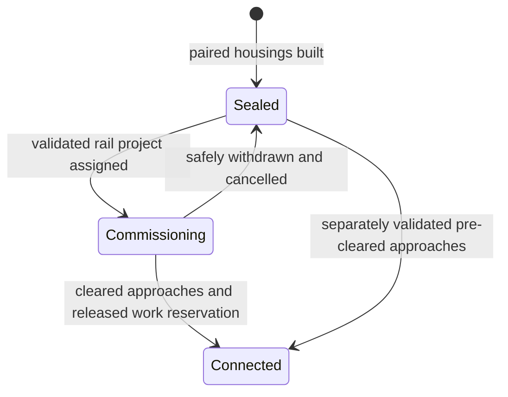

# R2MLVS3 - Sealed Portals and Deep Rail

## Global Mandatory Reading

> **Execution protocol**
>
> - Read this Global Mandatory Reading section before the first task and again
>   after every context compaction.
> - Before starting or resuming a task group, read the nearest preceding Area
>   Mandatory Reading block whose `Applies to` label includes that group. Area
>   blocks appear immediately before the first group they govern.
> - A referenced heading or exported symbol is authoritative. Global navigation
>   hints and Area line ranges are for navigation only; if they drift, relocate
>   the named section or symbol rather than expanding to the whole file.
> - Mandatory reading is non-transitive. Do not preload a linked file's own
>   Mandatory Reading, Consult on Demand, or Planning Provenance entries unless
>   this plan names them directly for the current area.
> - Do not read Consult on Demand or Planning Provenance merely because those
>   sources are listed. Use a Consult on Demand source only when its trigger
>   occurs.
> - No created source file, test file or JSON file should start with same prefix as a planning MD file (such as r2). Only MD files can have that prefix. No MD file should be created anywhere in source directories unless specifically asked.
> - After EVERY CONTEXT COMPACTION, you must add a note above the task group
>   which is currently in execution. The note will say: "Context has compacted
>   X times while executing this group.". If the compaction occurs before any
>   meaningful work was done (this can happen when there is a lot of baggage
>   from the previous compaction), then and ONLY then you can skip this step.
> - When exceeding 3 context compactions, YOU MUST ask yourself if you're not 
>   chewing more than we can handle :). Heck, plans change! :). In such a case, 
>   the way out is to split the group on the spot,
>   in the plan, into more groups, 
>   by appending B, C, D as a suffixes to those groups (splitting sub-groups 
>   themselves is also allowed). When you do this, create Local Mandatory
>   Reading areas so you can optimize your context only for the
>   ACTUAL task at hand.
>   Before starting or resuming a task group, read the nearest preceding Area
>   Mandatory Reading block whose `Applies to` label includes that group. Area
>   blocks appear immediately before the first group they govern.

| File name | Line Ranges | Description |
| --- | --- | --- |
| [docs/zz-reach2/upgrades/2026-10/r2mlvs-multilayer-vehicles-and-structures.md](r2mlvs-multilayer-vehicles-and-structures.md) | 204-212 | `AD-3` supplies the canonical gameplay/ownership decision for every group of this plan. It constrains paired sealed topology, rail-only commissioning and the 1980 Deep gate; a consumer must not redefine it locally. |
| [docs/zz-reach2/upgrades/2026-10/r2mlvs-multilayer-vehicles-and-structures.md](r2mlvs-multilayer-vehicles-and-structures.md) | 214-220 | `AD-4` supplies the canonical gameplay/ownership decision for every group of this plan. It constrains paired sealed topology, rail-only commissioning and the 1980 Deep gate; a consumer must not redefine it locally. |
| [src/map_layer.h](../../../../src/map_layer.h) | 78-85 | `MultiLayerMap` ownership preamble: `Map` owns packed storage/geometry and this controller owns layer semantics. Every group uses world tiles/explicit layer helpers; camera selection and ad hoc plane offsets cannot define gameplay. |
| [src/map_layer.h](../../../../src/map_layer.h) | 281-315 | `IsPortalPairAllowed`, `GetPortalTargetLayer`, `CheckLayerAllowsConstruction`, `CheckTilesShareLayer` define live connection/construction authority; new profile checks must preserve legacy behavior. |

Status: proposed. Parent: [R2MLVS master](r2mlvs-multilayer-vehicles-and-structures.md). Depends on r2mlvs2.

## Outcome and Boundaries

New portal exits begin blocked; a controlled rail commissioning path admits a TBM. Excavated Deep Underground gains rail access through Underground from the proposed 1 January 1980 calendar unlock.

## Public Handoff Contract

Proposed public owner: `src/layer_portal_cmd.h`. Publish `LayerPortalWorkState`, `GetLayerPortalWorkState`, `CheckLayerPortalWorkAccess`, `CommissionLayerPortalTBM`. These symbols are producer obligations, not existing code. Keep one authority for the fields/commands they expose; downstream plans consume the public contract rather than private pools or copied tables.

## Implementation Tasks

Deepening pass, 2026-10-04: implementation groups use only SIMPLE, MEDIUM or HARD difficulty, with at most eight pending tasks each. Sketches describe proposed implementation contracts; verify the named earlier producers at each assumption gate. No gameplay or asset implementation is marked complete by this planning pass.

Groups are chronological and contain consecutive tasks of one difficulty. Each difficulty batch has at most eight tasks; area reading changes only when the implementation boundary or source of truth changes.

### Area Mandatory Reading - Portal state and connection matrix

_Applies to Groups 1-7._

**Entry gate.** The following public contracts must exist before dependent implementation in this area: `src/multilayer_content.h`: `MultiLayerGameplayProfile`, `LayerVehicleCapability`, `GetMultiLayerContentProfile`, `CheckDeepLayerAvailability`, `UtilityPowerAccount`; `src/excavation.h`: `ExcavationState`, `GeologyDeposit`, `ExcavationJob`, `CheckExcavatedFootprint`, `CommitExcavationCut`, `GeothermalVentField`.
Verify each public file/export/schema field with `rg` in the current workspace and inspect its command/field ownership. For a same-plan contract, compile its type/signature fixture or validate its artifact after the preceding producer groups. For cross-plan behavior, also run the producer's focused executable boundary test; declarations alone cannot authorize dependent mutations or runtime claims.
If a required export is absent, stop the dependent implementation, mutation and runtime claims in Groups 1-7. Read-only characterization, source/range verification, test-case design and asset-template work that does not assume the missing behavior may continue.
Do not bypass this gate by copying private pool/tile state, inventing local IDs or cargo registries, using a historical plan as a delivered implementation, opening user-wide content stores, substituting a second utility/accounting authority, or adding an unreviewed fallback path. Finish the named producer or revise the shared contract and its direct consumers first.

| File name | Line Ranges | Description |
| --- | --- | --- |
| [src/map_layer.cpp](../../../../src/map_layer.cpp) | 95-139 | `MultiLayerMap::IsPortalPairAllowed` and `GetPortalTargetLayer` are complete live pair/destination rules; extend them profile-selectively for Deep rail. |
| [src/layer_portal_map.h](../../../../src/layer_portal_map.h) | 63-137 | `GetLayerPortalTargetLayer`, pair/kind and reservation accessors own the portal map representation; state changes must preserve paired topology and reservations. |
| [src/timer/timer_game_calendar.h](../../../../src/timer/timer_game_calendar.h) | 15-39 | `TimerGameCalendar` technology-clock contract and date conversions govern 1980/model/factory introductions; economic/realtime scheduling cannot unlock a technology. |
| [src/tests/map_layer.cpp](../../../../src/tests/map_layer.cpp) | 269-291 | Complete Deep road-only rule test is a legacy baseline; add profile-selective expectations rather than erasing Classic behavior. |
| `src/multilayer_content.h` (planned public contract; link after implementation) | Live definitions; no fixed range | [r2mlvs1-gameplay-contracts-and-content.md](r2mlvs1-gameplay-contracts-and-content.md) Groups 1-6, ending with Group 6's public-contract task, publish `MultiLayerGameplayProfile`, `LayerVehicleCapability`, `GetMultiLayerContentProfile`, `CheckDeepLayerAvailability`, `UtilityPowerAccount`. These exports/schema fields are authoritative for this area. Same-plan consumers follow those earlier groups; cross-plan consumers verify the producer's required implementation/tests as well. Proposed names alone do not prove delivery. |
| `src/excavation.h` (planned public contract; link after implementation) | Live definitions; no fixed range | [r2mlvs2-geology-and-excavation.md](r2mlvs2-geology-and-excavation.md) Groups 1-7, ending with Group 7's public-contract task, publish `ExcavationState`, `GeologyDeposit`, `ExcavationJob`, `CheckExcavatedFootprint`, `CommitExcavationCut`, `GeothermalVentField`. These exports/schema fields are authoritative for this area. Same-plan consumers follow those earlier groups; cross-plan consumers verify the producer's required implementation/tests as well. Proposed names alone do not prove delivery. |
| [src/layer_portal_cmd.cpp](../../../../src/layer_portal_cmd.cpp) | 438-503 | Complete `CmdBuildLayerPortal` is the current paired mutation boundary; its ordinary far-end clear must be replaced by restricted sealed-housing creation on solid rock. |
| [src/layer_portal_cmd.cpp](../../../../src/layer_portal_cmd.cpp) | 218-228 | `GetTileTrackStatus_LayerPortal` defines ordinary routing; sealed state hides its edge without altering pair geometry. |
| [src/layer_portal_map.h](../../../../src/layer_portal_map.h) | 200-212 | Complete `GetLayerPortalNextTile` remains the physical cross-layer neighbor authority; permission belongs to routing and work-access validation. |
| [src/layer_portal_cmd.cpp](../../../../src/layer_portal_cmd.cpp) | 349-360 | Complete `NotifyRailPortalChanged` updates signals and YAPF after both endpoint state changes commit. |
| [src/layer_portal_cmd.cpp](../../../../src/layer_portal_cmd.cpp) | 311-347 | Complete `VehicleEnterTile_LayerPortal` is the actual admission boundary; cached routes do not replace assigned-consist validation. |
| [src/pbs.cpp](../../../../src/pbs.cpp) | 150-202 | Complete `UnreserveRailTrack` requires existing track status during release; drain reservations before hiding a connected edge. |

**ASSUMPTION: this was already built previously. If not, re-asses at runtime**. This applies only to the producer contracts named in this area's gate, after their listed producer groups have run. Verify their actual exports and focused tests before using the sketches below; proposed types and helper names in sketches are not evidence of delivered code.

**Portal-state sketch (proposed).** State controls permission; stored pair geometry remains valid in every state. `GetLayerPortalNextTile` must continue to identify the paired endpoint even when ordinary routing refuses the connection.



```text
ordinary edge = paired state is Connected AND ordinary track/date rules pass
work entry    = assigned project + assigned TBM + valid commissioning pocket
physical next tile = existing paired-end geometry
```

### Group 1 - Portal state and connection matrix

{{MEDIUM}}
- [ ] 1.1 Extend the profile-specific construction/pair matrix to Underground <-> Deep rail.
- [ ] 1.2 Keep Surface <-> Underground rail/road and existing road elevators.
- [ ] 1.3 Preserve layer IDs and the direct elevator's untouched intervening tile.

### Group 2 - Define one saved portal work state per pair

{{HARD}}
- [ ] 2.1 Choose the canonical pair key from existing endpoint geometry; store Sealed/Commissioning/Connected, owner and assigned project/vehicle reference once. Both ends query that same authority.
- [ ] 2.2 Specify the restricted shaft/work-pocket footprint and which fields are derived connectivity/reservation caches. Do not mark its rock as generally excavated.
- [ ] 2.3 Add versioned descriptors and legacy defaults: existing legacy portals load as their previous usable connection, while new-profile unfinished pairs keep their saved work state.
- [ ] 2.4 Test pair queries from either endpoint, invalid/missing pair references and all three state round trips before routing consumes the state.

### Group 3 - Portal state and connection matrix

{{MEDIUM}}
- [ ] 3.1 Add an Underground rail destination picker and accurate command quotes.

### Group 4 - Preflight and create sealed pairs atomically

{{HARD}}
- [ ] 4.1 Extract a read-only build proposal validating both endpoints, target pair, owner, date, geology, occupied approaches and existing reservations. Quote all clearing/housing costs without changing either tile.
- [ ] 4.2 Replace the unconditional far-side ordinary-clear path for solid terrain with a narrowly scoped portal-housing operation. It may create the sealed shaft representation but cannot create an excavated chamber or expose a general excavation bypass.
- [ ] 4.3 Reserve fallible pair/work-state capacity before mutation, then commit both ends, work state and infrastructure accounting together. Test second-end failure and allocation failure leave the first end, funds and RNG unchanged.

### Group 5 - Expose sealed routing without losing physical pair geometry

{{HARD}}
- [ ] 5.1 Initialize portals into solid rock as Sealed. When approaches are already excavated, require a separate validated connection action; neither action grants excavation credit.
- [ ] 5.2 Make ordinary track-status and path/signal queries return no usable edge for Sealed/Commissioning pairs. Retain `GetLayerPortalNextTile` as the physical neighbor authority; do not break saved pair geometry to hide an edge.
- [ ] 5.3 Define `CheckLayerPortalWorkAccess` as a distinct vehicle/project-aware permission for the assigned TBM. Movement must recheck it so cached paths, force-proceed and followers cannot admit normal traffic.
- [ ] 5.4 Drain/release ordinary reservations while old track status is still valid before hiding an edge: `UnreserveRailTrack` asserts the track exists. Then commit connectivity and notify both ends through signal/pathfinder invalidation. Test a cached route and an unrelated train behind the TBM.

### Group 6 - Use the shared date gate on every Deep entry

{{HARD}}
- [ ] 6.1 Consume r2mlvs1 `CheckDeepLayerAvailability`; apply it to Underground/Deep rail build, activation and commissioning in both directions.
- [ ] 6.2 Apply the same query to Surface/Deep and Underground/Deep road elevator build, activation and entry. Test both endpoints so an ascent-side tool cannot bypass the rule.
- [ ] 6.3 Require the shared excavation/construction guard to cover Deep actions and publish operation-gate requirements for later mines/geothermal plants. Existing feature owners implement their actual production paths; do not claim those future paths are already wired.
- [ ] 6.4 Keep geological preview read-only while locked. Test legacy and saved editor exceptions separately from normal profile behavior and prove economy-speed changes do not alter the unlock.

### Group 7 - Publish portal work access and commissioning boundary

{{HARD}}
- [ ] 7.1 Publish `LayerPortalWorkState`, `GetLayerPortalWorkState` and `CheckLayerPortalWorkAccess` in existing `src/layer_portal_cmd.h`, with pair ownership, invalid-reference and read-only query rules.
- [ ] 7.2 Publish `CommissionLayerPortalTBM` request/result contract for portal-side validation, assigned project identity and controller handoff. The next area implements portal-side behavior; r2mlvs4 supplies actual TBM vehicle creation/work and r2mlvs5 the exchange behavior.
- [ ] 7.3 Compile the public contract fixture, register any new source and record exactly which behaviors are tested. If the public location changes, update all consumers before marking this handoff ready.

### Area Mandatory Reading - Commissioning and bootstrap

_Applies to Groups 8-12._

**Entry gate.** The following public contracts must exist before dependent implementation in this area: `src/layer_portal_cmd.h`: `LayerPortalWorkState`, `GetLayerPortalWorkState`, `CheckLayerPortalWorkAccess`, `CommissionLayerPortalTBM`.
Verify each public file/export/schema field with `rg` in the current workspace and inspect its command/field ownership. For a same-plan contract, compile its type/signature fixture or validate its artifact after the preceding producer groups. For cross-plan behavior, also run the producer's focused executable boundary test; declarations alone cannot authorize dependent mutations or runtime claims.
If a required export is absent, stop the dependent implementation, mutation and runtime claims in Groups 8-12. Read-only characterization, source/range verification, test-case design and asset-template work that does not assume the missing behavior may continue.
Do not bypass this gate by copying private pool/tile state, inventing local IDs or cargo registries, using a historical plan as a delivered implementation, opening user-wide content stores, substituting a second utility/accounting authority, or adding an unreviewed fallback path. Finish the named producer or revise the shared contract and its direct consumers first.

| File name | Line Ranges | Description |
| --- | --- | --- |
| [src/layer_portal_cmd.cpp](../../../../src/layer_portal_cmd.cpp) | 438-503 | `CmdBuildLayerPortal` validates and clears both ends before paired execution. Add sealing/availability atomically; never grant a free far-side cavern. |
| [src/train_cmd.h](../../../../src/train_cmd.h) | 18-27 | Build/sell/move/reverse train commands and traits are the public commissioning/rearrangement boundary; restrict specialist capabilities through every applicable command. |
| [src/layer_portal_cmd.cpp](../../../../src/layer_portal_cmd.cpp) | 218-228 | `GetTileTrackStatus_LayerPortal` is the ordinary traversable-edge contract; sealed ends must disappear from normal pathfinding and signals. |
| [src/layer_portal_cmd.h](../../../../src/layer_portal_cmd.h) | Live definitions; no fixed range | [r2mlvs3-sealed-portals-and-deep-rail.md](r2mlvs3-sealed-portals-and-deep-rail.md) Groups 1-7, ending with Group 7's public-contract task, publish `LayerPortalWorkState`, `GetLayerPortalWorkState`, `CheckLayerPortalWorkAccess`, `CommissionLayerPortalTBM`. These exports/schema fields are authoritative for this area. Same-plan consumers follow those earlier groups; cross-plan consumers verify the producer's required implementation/tests as well. Proposed names alone do not prove delivery. |
| [src/vehicle_cmd.cpp](../../../../src/vehicle_cmd.cpp) | 104-239 | Complete `CmdBuildVehicle` requires a depot and handles temporary estimate construction; commissioning must supply a valid factored construction boundary. |
| [src/layer_portal_cmd.cpp](../../../../src/layer_portal_cmd.cpp) | 362-418 | Complete `ClearTile_LayerPortal` owns paired demolition; occupied commissioning projects must be resolved/refused before either end changes. |

**ASSUMPTION: this was already built previously. If not, re-asses at runtime**. This applies only to the producer contracts named in this area's gate, after their listed producer groups have run. Verify their actual exports and focused tests before using the sketches below; proposed types and helper names in sketches are not evidence of delivered code.

**Staged integration.** The earlier portal groups supply state and public access checks. This area can implement those validations before a TBM exists. Actual purchase/entry, source-side wagon exchange and occupied-project lifecycle scenarios additionally consume r2mlvs4 `TBMProject`/`TBMWorkState` and r2mlvs5 `TBMExchangeAssignment`/`ExecuteTBMWagonExchange` once their producer implementations and boundary tests exist. **ASSUMPTION: this was already built previously. If not, re-asses at runtime**. For those integrations only, verify the public headers/tests; stop the dependent mutation/scenario if absent, continue pure portal tests, and never substitute fake wagons or a second project store.

Creation order: preflight both endpoints -> reserve required record capacity -> create paired housing/work state -> update accounting -> publish routing invalidation. Ordinary `LandscapeClear` cannot be used to bore the far side after r2mlvs2's solid-rock guard lands.

### Group 8 - Build portal-side commissioning validation

{{HARD}}
- [ ] 8.1 Add a portal-associated commissioning control/facility on accessible ground; require rail transport and conventional compatible railtype, excluding tubes and road/elevator origins.
- [ ] 8.2 Validate model/depth/date, full purchase/assembly footprint, free shaft, two cargo-specific wagon capacities and the required company-owned Surface origin station before reserving a project.
- [ ] 8.3 Define a depot-compatible commissioning construction boundary or factor a validated train-construction helper with r2mlvs4. `CmdBuildVehicle` requires a depot and its rail builder reads depot direction; never temporarily change the portal tile type to satisfy that precondition.
- [ ] 8.4 Define commissioning resource acquisition order and cancellation: acquire project/vehicle/packet capacity through the owning APIs before charging or assigning the pair. Keep r2mlvs4 vehicle creation as an explicit integration seam.
- [ ] 8.5 Publish initial-entry and source-side exchange constraints for r2mlvs4/5: first safe cut, backed retreat with actual wagons and unloaded/empty return must work before any underground exchange bay exists.

### Group 9 - Connect only a cleared and safely reserved pair

{{HARD}}
- [ ] 9.1 Implement a pure connection check for both excavated approaches, compatible track, cleared work reservations and current date/owner. Recheck immediately before changing work state.
- [ ] 9.2 Refuse an unsafe connectivity change while a train spans the pair; preserve each train-part position and reservation. If a safe occupied transition is supported, specify and test its exact reservation transfer rather than clearing reservations globally.
- [ ] 9.3 Commit the connected state once and invalidate both endpoints. Exercise a fully withdrawn TBM then normal freight, plus a spanning-consist refusal that leaves its route recoverable.

### Group 10 - Commissioning and bootstrap

{{MEDIUM}}
- [ ] 10.1 Apply blocked-exit behavior to road tunnels/elevators. They can connect excavated approaches but cannot commission TBMs or clear rock. Existing legacy portals retain prior behavior under their saved profile.

### Group 11 - Recover commissioning projects before lifecycle mutation

{{HARD}}
- [ ] 11.1 Define a transition table for cancel, remove, rail conversion, company transfer and blocked source approach. Separate an empty pair from a pair occupied by cutter/wagons.
- [ ] 11.2 For occupied/assigned pairs, refuse destructive changes until the controller reaches a recoverable stopped state; use the public project cancellation/reassignment contract, not direct vehicle-pool edits.
- [ ] 11.3 For an empty safe pair, release project/work claims and update both endpoint ownership/type/accounting together. Test failure at either endpoint never leaves a half-pair.
- [ ] 11.4 Integrate the table with the real r2mlvs4/5 controller/exchange once delivered; until then retain its dependent scenarios as pending and verify only the available portal-state boundary.

### Group 12 - Commissioning and bootstrap

{{MEDIUM}}
- [ ] 12.1 Do not treat tube guideways as eligible rail commissioning infrastructure or allow tube capsules through rail portals/elevators. Supply tube/utility interchanges on excavated accessible ground; a geothermal electrical riser may attach only to an already commissioned, date-valid portal through r2mlvs17.

### Area Mandatory Reading - Controls, art and acceptance

_Applies to Groups 13-18._

**Entry gate.** The following public contracts must exist before dependent implementation in this area: `src/layer_portal_cmd.h`: `LayerPortalWorkState`, `GetLayerPortalWorkState`, `CheckLayerPortalWorkAccess`, `CommissionLayerPortalTBM`.
Verify each public file/export/schema field with `rg` in the current workspace and inspect its command/field ownership. For a same-plan contract, compile its type/signature fixture or validate its artifact after the preceding producer groups. For cross-plan behavior, also run the producer's focused executable boundary test; declarations alone cannot authorize dependent mutations or runtime claims.
If a required export is absent, stop the dependent implementation, mutation and runtime claims in Groups 13-18. Read-only characterization, source/range verification, test-case design and asset-template work that does not assume the missing behavior may continue.
Do not bypass this gate by copying private pool/tile state, inventing local IDs or cargo registries, using a historical plan as a delivered implementation, opening user-wide content stores, substituting a second utility/accounting authority, or adding an unreviewed fallback path. Finish the named producer or revise the shared contract and its direct consumers first.

| File name | Line Ranges | Description |
| --- | --- | --- |
| [src/tests/map_layer.cpp](../../../../src/tests/map_layer.cpp) | 374-427 | Complete permitted/refused portal matrix tests currently restrict rail to Surface/Underground; add explicit new-profile and calendar cases. |
| [src/tests/map_layer.cpp](../../../../src/tests/map_layer.cpp) | 430-442 | Complete display-order test retains immutable Space=2 and Deep=3 storage meanings; future UI/profile work cannot reorder saved IDs. |
| [src/saveload/vehicle_sl.cpp](../../../../src/saveload/vehicle_sl.cpp) | 1119-1196 | `VEHSChunkHandler` and registration construct the vehicle class from saved type before member loading; protect old enum meanings and validate new references. |
| [src/layer_portal_cmd.h](../../../../src/layer_portal_cmd.h) | Live definitions; no fixed range | [r2mlvs3-sealed-portals-and-deep-rail.md](r2mlvs3-sealed-portals-and-deep-rail.md) Groups 1-7, ending with Group 7's public-contract task, publish `LayerPortalWorkState`, `GetLayerPortalWorkState`, `CheckLayerPortalWorkAccess`, `CommissionLayerPortalTBM`. These exports/schema fields are authoritative for this area. Same-plan consumers follow those earlier groups; cross-plan consumers verify the producer's required implementation/tests as well. Proposed names alone do not prove delivery. |
| [Sprite Contract and delivery owner](r2mlvs13-graphics-and-asset-pipeline.md#public-handoff-contract) | Live definitions; no fixed range | `Sprite Contract Handoff` defines manifest fields `asset_id`, `consumer`, `directions`, `frames`, `anchor`, `source`; the matching authoring/conversion/runtime groups deliver actual assets. Verify the requested family and packed loading fixture before graphics integration; template/manifest publication alone is not final art. |

**ASSUMPTION: this was already built previously. If not, re-asses at runtime**. This applies only to the producer contracts named in this area's gate, after their listed producer groups have run. Verify their actual exports and focused tests before using the sketches below; proposed types and helper names in sketches are not evidence of delivered code.

**Acceptance staging.** Portal matrix, date and empty-pair persistence checks can run before the fleet. First entry/retreat, spanning TBM consists and real wagon exchange require the r2mlvs4/5 public implementations described in the preceding integration gate; art review requires r2mlvs13's matching assets. Missing producers leave only those scenarios pending, with no synthetic runtime-pass claim.

**Scoped graphics gate. ASSUMPTION: this was already built previously. If not, re-asses at runtime**. Final graphics tasks in this area require the corresponding r2mlvs13 manifest entries, delivered sprites and packed loading fixture. Verify them before binding/review; if absent, stop only those art tasks and their acceptance claims, continue independent code/state tests, and never count placeholders as finished assets.

### Group 13 - Controls, art and acceptance

{{MEDIUM}}
- [ ] 13.1 Show sealed face, TBM-only commissioning and connected traffic states in portal preview, tooltip and sprites.

### Group 14 - Controls, art and acceptance

{{SIMPLE}}
- [ ] 14.1 Update road/elevator far-side errors to name excavation as the missing step.

### Group 15 - Controls, art and acceptance

{{MEDIUM}}
- [ ] 15.1 Test every allowed/refused layer pair, all four directions, Deep build tools, both-end removal/conversion and attempted road/elevator commissioning.
- [ ] 15.2 Run a TBM first-entry and retreat scenario, normal train refusal before opening, then freight crossing after opening.
- [ ] 15.3 Test reversal and signals with a consist spanning each new rail pair.

### Group 16 - Validate saved portal state and occupied references

{{HARD}}
- [ ] 16.1 Create separate Sealed, Commissioning and Connected fixtures and compare pair keys, work status, date policy and endpoint geometry after reload.
- [ ] 16.2 After r2mlvs4/5 integration, save with a TBM/wagons in the work pocket and with a train spanning the pair; check part positions, reservations and the next legal transition after reload.
- [ ] 16.3 Load original version-370 rail/road/elevator fixtures under legacy policy. Verify no state migration opens new solid rock or removes an existing usable legacy route.

### Group 17 - Controls, art and acceptance

{{MEDIUM}}
- [ ] 17.1 Test 31 December 1979 refusal and 1 January 1980 success through every Deep rail/elevator path, both build directions, scripting and commissioning.
- [ ] 17.2 Check a legacy pre-1980 save still follows its explicit compatibility mode and changing economy speed cannot unlock technology early.

### Group 18 - Controls, art and acceptance

{{SIMPLE}}
- [ ] 18.1 Record the implemented public exports, focused test commands/results and remaining runtime/art/network gaps in this plan; retain original supplied saves and repository-local evidence.
- [ ] 18.2 Update affected architecture/handoff documentation to describe delivered behavior and reconcile the parent index only when this plan's Completion Conditions are met. Keep every unfinished task unchecked.

## Consult on Demand

| Trigger | File name | Start at | Expand only when | Consultation purpose |
| --- | --- | --- | --- | --- |
| Converting one rail portal end changes its pair or consist incorrectly | [../../../../src/rail_cmd.cpp](../../../../src/rail_cmd.cpp) | `CmdConvertRail` | Pair validation or infrastructure/consist accounting fails after the new profile extension | Locate the live paired conversion contract; do not edit one end before whole-pair validation. |
| A required public export is absent and its owner/location is disputed | [r2mlvs-multilayer-vehicles-and-structures.md](r2mlvs-multilayer-vehicles-and-structures.md) | `Requirements and ownership` and `Plan Index` | The named producer confirms an intentional contract/ownership change | Find the responsible producer and reconcile its public handoff with direct consumers; the hub cannot substitute for missing implementation. |
| Current behavior contradicts a historical subsystem description | [../../architecture/map-layers/archi-map-layers.md](../../architecture/map-layers/archi-map-layers.md) | `Invariants` and the relevant named source in `Code map` | The live symbol and executable test do not explain the difference | Locate layer addressing or lifecycle rationale. Live code/tests govern delivered behavior; this architecture page does not prove future interfaces exist. |

## Planning Provenance

This is not an execution reading queue. Do not preload it after context compaction. It is non-transitive; ranges record planning use, not runtime authority.

| File name | Sections or Line Ranges used while planning | Planning contribution |
| --- | --- | --- |
| [docs/zz-reach2/architecture/initial-inventory.md](../../architecture/initial-inventory.md) | 185-220 | `Command as the only world mutation`, `Pool-indexed game objects`, `Tile map as a packed array` and `File-suffix modules` oriented command/pool/header ownership and source registration. This historical inventory is a location survey, not authority for current layer behavior. |
| [docs/zz-reach2/architecture/@archi-ttd-level0.md](../../architecture/@archi-ttd-level0.md) | 24-63 | `How the program fits together` and `Source and runtime boundaries` located shared simulation, data/presentation, CMake targets and subsystem handoffs used to choose the live reading sources. |
| [docs/zz-reach2/upgrades/2026-10/r2mlvs-multilayer-vehicles-and-structures.md](r2mlvs-multilayer-vehicles-and-structures.md) | 119-140 | `Requirements and ownership` assigned this plan's feature responsibilities; it shaped the decomposition without making every sibling plan a mandatory reading dependency. |
| [src/map_layer.h](../../../../src/map_layer.h) | 281-315 | The inspected live boundary helped separate characterization, public-contract production, implementation and acceptance batches. It materially constrained paired sealed topology, rail-only commissioning and the 1980 Deep gate; this entry records planning influence rather than an additional reading obligation. |
| [User planning-format instructions](<C:/Users/Axonn/.codex/attachments/cd59b20a-3a96-4d54-b4bd-1e8f37639e7d/Pasted text.txt>) | `Global Mandatory Reading`, `Area Mandatory Reading`, `Consult on Demand`, `Planning Provenance`, `Final validation` | Supplies the exact protocol, chronological difficulty batches of at most eight tasks, reading gates and validation format. |
| [src/pbs.cpp](../../../../src/pbs.cpp) | 150-202 | Deeper planning pass, 2026-10-04: Reservation-release assertions shaped state-change ordering and the separate assigned-TBM work permission. |

## Completion Conditions

Creating a tunnel never produces an immediately usable unexcavated network. A first TBM can safely enter and retreat without an underground depot. Deep rail and both elevator access routes obey the 1980 calendar unlock in the new profile; tube tracks cannot commission a TBM. Existing legacy routes retain their documented compatibility behavior.
