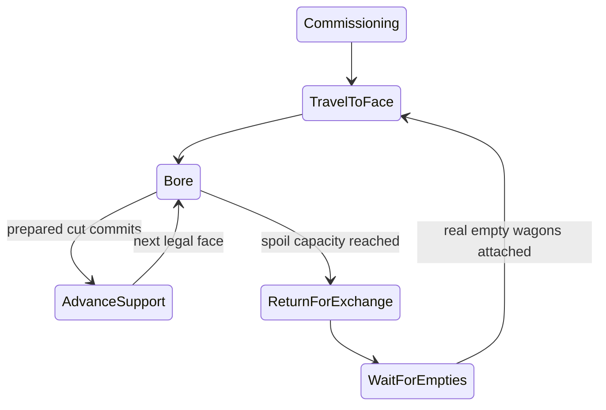

# R2MLVS4 - Tunnel Boring Machines

## Global Mandatory Reading

> **Execution protocol**
>
> - Read this Global Mandatory Reading section before the first task and again
>   after every context compaction.
> - Before starting or resuming a task group, read the nearest preceding Area
>   Mandatory Reading block whose `Applies to` label includes that group. Area
>   blocks appear immediately before the first group they govern.
> - A referenced heading or exported symbol is authoritative. Global navigation
>   hints and Area line ranges are for navigation only; if they drift, relocate
>   the named section or symbol rather than expanding to the whole file.
> - Mandatory reading is non-transitive. Do not preload a linked file's own
>   Mandatory Reading, Consult on Demand, or Planning Provenance entries unless
>   this plan names them directly for the current area.
> - Do not read Consult on Demand or Planning Provenance merely because those
>   sources are listed. Use a Consult on Demand source only when its trigger
>   occurs.
> - No created source file, test file or JSON file should start with same prefix as a planning MD file (such as r2). Only MD files can have that prefix. No MD file should be created anywhere in source directories unless specifically asked.
> - After EVERY CONTEXT COMPACTION, you must add a note above the task group
>   which is currently in execution. The note will say: "Context has compacted
>   X times while executing this group.". If the compaction occurs before any
>   meaningful work was done (this can happen when there is a lot of baggage
>   from the previous compaction), then and ONLY then you can skip this step.
> - When exceeding 3 context compactions, YOU MUST ask yourself if you're not 
>   chewing more than we can handle :). Heck, plans change! :). In such a case, 
>   the way out is to split the group on the spot,
>   in the plan, into more groups, 
>   by appending B, C, D as a suffixes to those groups (splitting sub-groups 
>   themselves is also allowed). When you do this, create Local Mandatory
>   Reading areas so you can optimize your context only for the
>   ACTUAL task at hand.
>   Before starting or resuming a task group, read the nearest preceding Area
>   Mandatory Reading block whose `Applies to` label includes that group. Area
>   blocks appear immediately before the first group they govern.

| File name | Line Ranges | Description |
| --- | --- | --- |
| [docs/zz-reach2/upgrades/2026-10/r2mlvs-multilayer-vehicles-and-structures.md](r2mlvs-multilayer-vehicles-and-structures.md) | 222-232 | `AD-5` supplies the canonical gameplay/ownership decision for every group of this plan. It constrains train-owned cutting, real spoil and maximum 45-degree advancing turns; a consumer must not redefine it locally. |
| [src/map_layer.h](../../../../src/map_layer.h) | 78-85 | `MultiLayerMap` ownership preamble: `Map` owns packed storage/geometry and this controller owns layer semantics. Every group uses world tiles/explicit layer helpers; camera selection and ad hoc plane offsets cannot define gameplay. |
| [src/train.h](../../../../src/train.h) | 120-148 | `Train::Tick`, `GetRunningCost`, `ConsistChanged` and acceleration declarations own simulation progress, costs and consist caches; view state cannot advance cutting. |

Status: in progress; sealed-solid commissioning, actual paid cuts, physical support movement, protected retreat and source-side haulage are delivered. Groups 8 and 11 close their movement/bend-continuation checks in the 2026-10-06 master audit. Recurring underground-bay logistics, occupied-file acceptance, complete economics, final art and actual tube/geothermal conversion remain open. Parent: [R2MLVS master](r2mlvs-multilayer-vehicles-and-structures.md). Depends on r2mlvs3 and r2mlvs1's wagon contract.

## Outcome and Boundaries

Deliver a real train that bores connected rock, advances on paid support track and accumulates Earth/Rock in attached wagons.

## Public Handoff Contract

Public owner: `src/tbm.h`. `TBMProject`, `TBMWorkState`, `ValidateTBMAreaRoute` and `AdvanceTBMWork` exist in code since R2MLVS3MP Group 3 (2026-10-05); their focused tests pass at the R2MLVS3MP milestones and the 2026-10-06 movement audit. Consumers may also use `GetTBMProjectForCutter`, `GetTBMWorkState`, `InspectTBMConsist`, `GetTBMConsistRole` and `MeasureTBMConsist`. `AdvanceTBMWork` observes physical face arrival and runs paid cuts with real support and wagon space. Ordinary train ticks carry the cutter and trailing parts through the assigned work pocket and paid support; actual Plan 5 source-side exchange/disposal/empty-return is delivered. `GetTBMCutterSteeringTarget` exposes only the live physical approach in TravelToFace/AdvanceSupport. Recurring underground-bay delivery is verified in Plan 5 Group 13B; actual depot-file and occupied-file acceptance remain pending. Keep one authority for the fields/commands they expose; downstream plans consume this public contract rather than private pools or copied tables.

Commissioning (Group 2.1, implemented 2026-10-05 in R2MLVS3MP master 6.6, verified at the end-of-Group-7 milestone): `TBMCommissionResult` and `CommissionTBMProject` in `src/tbm.h`, the command `CmdCommissionTBM` in `src/tbm_cmd.h`, and the active portal window control.

Acquisition and role contract (Group 2B, implemented 2026-10-05, focused tests pending the milestone build): `TBMConsistRequest`, `TBMAcquisitionError`, `TBMAcquisitionPlan`, `PrepareTBMAcquisition`, `TBMAcquisition`, `AcquireTBMConsist` and `GetTBMConsistRole` in `src/tbm.h`; site assembly through `BuildTBMConsistAtSite` in `src/train_cmd.h`. Preparation is pure. Acquisition holds stopped, hidden, unpublished parts and rolls them back unless released. It charges nothing and reserves no job; publication belongs to R2MLVS3MP Group 6.

Face work, cut participant and support (Groups 6-8, implemented 2026-10-05, focused tests pending the milestone build):
- Face work and its waits: `TBMFaceWork`, `AdvanceTBMFaceWork`, `IsTBMExchangeDue`, `CaptureTBMMaterial`, the spoil provenance contract, `TBMCutParticipant`, `IsTBMHoldingTrain` and `TBMPhaseInputs::work_wait`.
- Support: `TBMSupportClass`, `TBMSupportTile`, `GetTBMSupportTile`, `CaptureTBMSupport`, `PrepareTBMSupport`, `PlaceTBMSupport`, `IsTBMSupportUsable` and `IsTBMSupportTraversable`.
- Geology adds `EstimateExcavationCut`.
- Plan 5 may consume the provenance contract, `IsTBMExchangeDue` and the support classes. Physical support movement is verified by Group 8; remaining recurring-bay and full-file cases keep their own gates.

Project store and controls (Group 3, implemented 2026-10-05, focused tests pending the milestone build): `TBMProjectAction`, `TBMProjectError`, `GetTBMProject`, `GetTBMProjectForCutter`, `CaptureTBMProjects`, `GetNextTBMProjectID`, `ValidateTBMProject(s)`, `PublishTBMProject`, `ControlTBMProject`, `ComputeTBMProjectDigest` and the staged-load functions in `src/tbm.h`. The command `CmdControlTBMProject` is in `src/tbm_cmd.h` (appended `Commands::ControlTBMProject`). Save version 376 `TBMProjects` adds chunks `TBMH`/`TBMP` and feature bit `MULTILAYER_FEATURE_TBM_PROJECTS` (32). `PublishTBMProject` has no command trait; publication stays with R2MLVS3MP Group 6.

Recurring-machine/support handoff, 2026-10-06: `IsTBMConsistReusableAtPortal` and the existing acquisition owner validate an actual healthy empty stopped native chain at its original source. Reassignment preserves paid part/unit IDs and charges no second purchase; acquisition rollback deletes only newly purchased parts. `GetTBMWorkRailPath` publishes the pure canonical support path so ordinary commands can fund missing pieces on already excavated floor before assignment. Requested floor outside a new sweep must already be open. Planner/cut preflight refuse a depot building inside the physical sweep, and support reuses only the exact owned compatible permanent plain piece. Directional face goals require the canonical entry/exit piece at an existing junction. Plan 5 Group 13B verifies further commissioning, two real depot exchanges, Surface disposal/empty return and deterministic custody/cost replay.

## Implementation Tasks

Execution coordination: [R2MLVS3MP](r2mlvs3mp-master-plan.md) explicitly stages the remaining Group 2 acquisition/activation work around saved controller foundations, the actual cut/support implementation, Plan 5 exchange/receivers and recovery. Follow its named scopes instead of requiring complete live commissioning before writing the controller that supplies it. Original tasks remain unchecked until their entire behavior passes; declarations/isolated fixtures never count as complete runtime delivery.

Deepening pass, 2026-10-04: implementation groups use only SIMPLE, MEDIUM or HARD difficulty, with at most eight pending tasks each. Sketches describe proposed implementation contracts; verify the named earlier producers at each assumption gate. No gameplay or asset implementation is marked complete by this planning pass.

Groups are chronological and contain consecutive tasks of one difficulty. Each difficulty batch has at most eight tasks; area reading changes only when the implementation boundary or source of truth changes.

### Area Mandatory Reading - Vehicle and work orders

_Applies to Groups 1-5, including Group 2B._

**Entry gate.** The following public contracts must exist before dependent implementation in this area: `src/multilayer_content.h`: `MultiLayerGameplayProfile`, `LayerVehicleCapability`, `GetMultiLayerContentProfile`, `CheckDeepLayerAvailability`, `UtilityPowerAccount`; `src/excavation.h`: `ExcavationState`, `GeologyDeposit`, `ExcavationJob`, `CheckExcavatedFootprint`, `CommitExcavationCut`, `GeothermalVentField`; `src/layer_portal_cmd.h`: `LayerPortalWorkState`, `GetLayerPortalWorkState`, `CheckLayerPortalWorkAccess`, `CommissionLayerPortalTBM`.
Verify each public file/export/schema field with `rg` in the current workspace and inspect its command/field ownership. For a same-plan contract, compile its type/signature fixture or validate its artifact after the preceding producer groups. For cross-plan behavior, also run the producer's focused executable boundary test; declarations alone cannot authorize dependent mutations or runtime claims.
If a required export is absent, stop the dependent implementation, mutation and runtime claims in Groups 1-5. Read-only characterization, source/range verification, test-case design and asset-template work that does not assume the missing behavior may continue.
Do not bypass this gate by copying private pool/tile state, inventing local IDs or cargo registries, using a historical plan as a delivered implementation, opening user-wide content stores, substituting a second utility/accounting authority, or adding an unreviewed fallback path. Finish the named producer or revise the shared contract and its direct consumers first.

| File name | Line Ranges | Description |
| --- | --- | --- |
| [src/train_cmd.h](../../../../src/train_cmd.h) | 18-27 | Build/sell/move/reverse train commands and traits are the public commissioning/rearrangement boundary; restrict specialist capabilities through every applicable command. |
| [src/vehicle_cmd.h](../../../../src/vehicle_cmd.h) | 20-42 | Build/refit/clone/depot-autoreplace commands and traits expose all purchase paths; `CloneVehicle` is `NoTest`, so do not rely on a generic estimate to enforce capability/commissioning. |
| [src/train.h](../../../../src/train.h) | 152-174 | `GetNextUnit` and `GetPrevUnit` skip articulated/rear dual-headed parts; detach real wagon units without breaking engine-support structure. |
| `src/multilayer_content.h` (planned public contract; link after implementation) | Live definitions; no fixed range | [r2mlvs1-gameplay-contracts-and-content.md](r2mlvs1-gameplay-contracts-and-content.md) Groups 1-6, ending with Group 6's public-contract task, publish `MultiLayerGameplayProfile`, `LayerVehicleCapability`, `GetMultiLayerContentProfile`, `CheckDeepLayerAvailability`, `UtilityPowerAccount`. These exports/schema fields are authoritative for this area. Same-plan consumers follow those earlier groups; cross-plan consumers verify the producer's required implementation/tests as well. Proposed names alone do not prove delivery. |
| `src/excavation.h` (planned public contract; link after implementation) | Live definitions; no fixed range | [r2mlvs2-geology-and-excavation.md](r2mlvs2-geology-and-excavation.md) Groups 1-7, ending with Group 7's public-contract task, publish `ExcavationState`, `GeologyDeposit`, `ExcavationJob`, `CheckExcavatedFootprint`, `CommitExcavationCut`, `GeothermalVentField`. These exports/schema fields are authoritative for this area. Same-plan consumers follow those earlier groups; cross-plan consumers verify the producer's required implementation/tests as well. Proposed names alone do not prove delivery. |
| [src/layer_portal_cmd.h](../../../../src/layer_portal_cmd.h) | Live definitions; no fixed range | [r2mlvs3-sealed-portals-and-deep-rail.md](r2mlvs3-sealed-portals-and-deep-rail.md) Groups 1-7, ending with Group 7's public-contract task, publish `LayerPortalWorkState`, `GetLayerPortalWorkState`, `CheckLayerPortalWorkAccess`, `CommissionLayerPortalTBM`. These exports/schema fields are authoritative for this area. Same-plan consumers follow those earlier groups; cross-plan consumers verify the producer's required implementation/tests as well. Proposed names alone do not prove delivery. |
| [src/vehicle_cmd.cpp](../../../../src/vehicle_cmd.cpp) | 104-239 | Complete `CmdBuildVehicle` validates depot construction and cleans up estimate-time parts; TBM commissioning must use an explicit compatible construction boundary. |
| [src/order_type.h](../../../../src/order_type.h) | 49-62 | Complete `OrderType` enum has persisted meanings; a project controller cannot silently insert new values. |
| [src/order_base.h](../../../../src/order_base.h) | 28-72 | `Order` storage and accessors expose fixed-width type/destination fields; project identity belongs to the typed project command contract. |
| [src/order_cmd.h](../../../../src/order_cmd.h) | 17-33 | Public order commands/traits constrain UI and shared-order edits; project assignment must not hijack ordinary station destinations. |

**ASSUMPTION: this was already built previously. If not, re-asses at runtime**. This applies only to the producer contracts named in this area's gate, after their listed producer groups have run. Verify their actual exports and focused tests before using the sketches below; proposed types and helper names in sketches are not evidence of delivered code.

**Controller sketch (proposed).** The portal and geology producers in this area's gate supply commissioning access and validated pass data. Actual train construction is depot-oriented today; use the shared commissioning boundary agreed with r2mlvs3 instead of temporarily changing a portal's tile type.



Every phase also has a saved blocked/stopped reason and a supported recovery path. The diagram shows successful edges, not permission to skip their validation.

### Group 1 - Define cutter models and immutable consist roles

{{MEDIUM}}
- [X] 1.1 Add standard/deep-rated cutter definitions from the profile, with visible layers/date, speed/power, active/idle cost and compatible Earth/Rock wagon roles.
- [X] 1.2 Mark permanent cutter/support articulated units separately from exchangeable spoil wagons. Use real unit boundaries from `GetNextUnit`/`GetPrevUnit`; publish the allowed consist layout for r2mlvs5.
- [X] 1.3 Define the saved project record: cutter ID, heading, Surface origin station, portal, exchange bay and blocked reason. Reference the actual `ExcavationJob` for its sole current face/pass cursor/partial work; expose those through `TBMWorkState` without duplicating saved progress. Keep cached route lookup separate from authority.

Group 1 evidence (2026-10-05): `src/tbm.h` and `src/tbm_model.cpp` define two cutter tunings against the existing profile catalogue, explicit invalid defaults and the immutable cutter/articulated-support prefix followed by actual dedicated Earth/Rock wagon units. `InspectTBMConsist` uses actual whole-unit boundaries and refuses altered machinery, mixed cargo and foreign ownership. Debug `openttd_test` build passes; `[tbm-model],[tbm-consist]` passes 2 cases/43 assertions in `r2mlvs4-b-model-results.txt`. Initial producer boundary burst passes 13 cases/345 assertions. This definition group does not claim commissioning, saved-file loading or work progression; those remain later tasks.

### Group 2 - Commission only through the validated rail facility

{{HARD}}
- [X] 2.1 Consume r2mlvs3 commissioning validation and its chosen depot-compatible/factored train construction boundary. Create a cutter/support/wagon consist only after all IDs, funds, capacity and source-side access pass validation.
- [X] 2.1A Register the real cutter/hopper engine definitions through the existing persisted EIDS mapping, factor pure portal preflight and genuine train-part construction with explicit portal geometry, and test immutable articulated support without changing portal tile types. This is a stopped unpublished part primitive, not complete-project commissioning.
- [X] 2.1B Characterize the first solid-pocket dependency through the canonical pass/reservation APIs before enabling complete-project acquisition; retain refusal evidence and every dependent task unchecked.
- [X] 2.2 Apply the capability check to purchase, clone, autoreplace and script requests before allocating any part. Account for `CloneVehicle` being `NoTest`; failure must clean up new parts and preserve existing vehicles.
- [X] 2.3 Allow servicing at compatible depots without enabling purchase there. A new deep-rated cutter may be assembled at an accessible Underground rail commissioning portal; its facility/supply access must be physically reachable. Existing cutters travel normally to later projects. Prevent road/elevator commissioning and ordinary-depot cloning.
- [X] 2.4 Test one legal Surface commissioning plus wrong facility, wrong depth/date, partial-part allocation failure and service-only depot requests.

**Verified behavior gate, 2026-10-05.** The named public exports exist, but the cross-plan first-cut behavior is incomplete. `ValidateLayerPortalCommissioning` accepts an actual owned Sealed Surface/Underground rail pair with real profile/model/origin references. The same canonical advancing geometry passes `ValidateExcavationJobGeometry`, then `PrepareExcavationPass` and both estimate/execute `ReserveExcavationJob` refuse `MissingSupport` because the destination starter footprint remains Solid. Current `PrepareExcavationCut` additionally requires the previous footprint/retreat open and refuses still-solid portal metadata. The portal pocket currently grants geometry-only restricted occupancy, never a paid initial-support transaction. Painting a free starter room, bypassing these predicates or inserting another route/cargo owner would violate this plan's Area gate and master AD-5. Complete commissioning in 2.1 and Groups 3-22 remain unchecked at this snapshot. R2MLVS3MP now schedules the tested solid-starter contract and saved controller foundations before full commissioning activation; this historical refusal does not prohibit implementing those explicitly staged foundations.

Required producer reconciliation before completing 2.1: define and test one explicit portal-issued initial support/cut contract across the canonical planner, reservation and prepared geological cut APIs. It must charge every newly solid old/new swept cell, preserve physical portal metadata, prepare actual support and both wagon packet capacities before terrain/cash writes, and validate a safe source-side retreat without treating occupancy permission as excavated floor. Its accepted route/cursor/partial work must remain with the existing `ExcavationJob`; estimates remain pure. Follow R2MLVS3MP Groups 2-6 to stage acquisition, saved controller/work, exchange/receivers and recovery, then return to finish the complete-consist commissioning coordinator and activate its controls. The existing open-starter behavior is not evidence of that missing solid-starter operation.

Group 2 available boundary evidence: `r2mlvs4-g-gate-results.txt`, **8 focused cases/221 assertions**, including the sealed-start unchanged refusal, actual two-part articulated construction, real depot purchase/estimate/autoreplace refusals, `NoTest` clone refusal and the actual `ScriptVehicle::BuildVehicle` API through Game Script company/test scopes and the real command kernel. Both ends of an autoreplace mapping involving a cutter refuse; execution also protects every permanent machinery part before replacement estimates can allocate. This does not claim execution of a supplied Squirrel script or complete TBM commissioning. Debug `openttd_test` and `openttd` builds pass (`h`); the final script fixture build passes (`i`). Final art, saved TBM projects, simulation movement and paid cutting are not delivered by these prefix checks. Original inputs and pre-existing dirty files are retained; no Git write or full regression was run.

Final boundary follow-up: `r2mlvs4-k-final-results.txt` passes **8 cases/237 assertions**, including preservation of a real original stock engine/mapping and deliberate separation of logical model IDs from allocated engine IDs. Both Debug targets rebuild successfully (`r2mlvs4-j-final-build.log`). This supersedes the earlier available-boundary totals; the sealed-start refusal and all pending tasks remain unchanged.

Group 2 status (2026-10-05, R2MLVS3MP master 6.6): 2.1, 2.3 and 2.4 are implemented and verified at the R2MLVS3MP end-of-Group-7 milestone ([all 108 project tags](r2mlvs3mp-l-burst4-all-results.txt) pass).
- 2.1: `CommissionTBMProject` (`src/tbm_commission.cpp`) commissions as one transaction.
  - Pure checks first: `PrepareTBMAcquisition` (proof, definitions, route replay, pass and reservation quotes, pool, unit number, funds), then real receivers for both spoils at the origin (`CheckTBMOriginAdmission`), store capacity and the pair binding estimate.
  - Execution: `AcquireTBMConsist`, `ReserveExcavationJob`, `BindLayerPortalWorkCommissioning` (r2mlvs3), a `PublishTBMProject` estimate, then release and publication in the Commissioning phase. The two refusals after the reservation are unreachable once the estimates pass; their defensive rollback releases the binding and cancels and retires the job.
  - The command `CmdCommissionTBM` (`Commands::CommissionTBM`) takes a floor rectangle on the rock layer. It plans the canonical route for the actual consist from the door through `PreviewTBMArea`, accepting the one-cell working ring around the floor and housing, and charges the machinery and wagon price as `NewVehicles`.
  - `CommissionLayerPortalTBM` now hands the purchase to this transaction; without wagon counts it stays a portal-only quote that refuses as `ControllerUnavailable`.
- 2.3: depots may service a cutter (`VehicleServiceInDepot` leaves the project and its lock untouched) but never sell or clone one (2.2). Road and elevator portals refuse (rail-only preflight). An Underground-to-Deep pair uses the same path: `[tbm-commission]` commissions a Deep cutter at an Underground portal from 1 January 1980 (master 7.5).
- 2.4: `src/tests/tbm_commission.cpp` (`[tbm-commission]`): one legal Surface commissioning (quote unchanged, then one purchase and a refused second one, reload), seven refusals before any part exists, and the depot service case. A failure inside assembly is the existing `[tbm-acquisition]` case.
- Not covered here: the cutter stands stopped in Commissioning until it can drive into the pocket (master 7.3); an area-selection tool and price preview window (Group 16, master 8.7); script access (master 7.5).

### Group 2B - Prepare complete acquisition without premature activation

{{HARD}}
- [X] 2B.1 Consume the tested Plan 3 Group 8B/Plan 2 Group 14B starter handoff. Prepare complete model/unit IDs, actual whole-consist capacity/dimensions, funds, source access and canonical route/retreat terms before allocating a part.
- [X] 2B.2 Factor bounded acquisition and full rollback using the existing engine/train owners. Acquire unpublished cutter/support/wagon parts and project/job capacity before irreversible writes; failure preserves existing vehicles, funds, terrain, packets, RNG and pair state.
- [X] 2B.3 Test estimate, legal construction preparation and failure at each acquisition boundary with actual pool-owned units. Publish the controller's immutable role/assignment contract for Groups 3-5; fixture construction is not a normal-game first-cut or disposal claim.
- [X] 2B.4 Keep production commissioning/start activation guarded until Groups 3-15, the required Plan 5 source exchange/receivers and Group 17 recovery are implemented and tested. Return to original 2.1/2.3/2.4 and Plan 3 Group 8 at R2MLVS3MP Group 6 to complete acquisition/publication/control activation together.

**R2MLVS3MP status, 2026-10-05.** 2B.1-2B.4 are implemented and passed the [R2MLVS3MP milestone burst](r2mlvs3mp-g-burst4-all-results.txt) on 2026-10-05, so they are ticked. The burst found that articulated assembly re-arms the vehicle pool check one part at a time; `BuildTBMConsistAtSite` now re-arms it for each hopper.
- 2B.1: `PrepareTBMAcquisition` (`src/tbm_acquisition.cpp`). It checks the portal proof, the cutter and both hopper definitions (both roles need at least one wagon) and the train-length setting. It also derives the planner history size, ceil(length/16)+1 within 3..16, and checks that the route replays exactly from the housing with that history. Then it quotes the pass and reservation at the actual capacities, and checks pool, unit number, per-part site estimates and funds. Nothing is allocated.
- 2B.2: `AcquireTBMConsist` re-prepares and refuses `Stale` unless the plans are equal. It then calls `BuildTBMConsistAtSite`, verifies layout, length, parts and capacities, and hands the parts to a `TBMAcquisition` owner. Rollback deletes the chain (undoing unit number and group counts) and restores the random seeds. `BuildTBMConsistAtSite` validates the still-empty site once, because per-part revalidation would see the earlier parts as an obstruction. It couples each hopper through the factored `MoveRailVehicleParts`; `CmdMoveRailVehicle` behaviour is unchanged. `StopGlobalFollowVehicle` now returns early without a main window, so headless tests can delete rolled-back parts.
- 2B.3: tests in `src/tests/tbm_acquisition.cpp` (`[tbm-acquisition]`); `TBMEngineFixture` moved to `src/tests/tbm_fixture.h`. The role contract is `GetTBMConsistRole`. These are fixture constructions, not a normal-game first cut or disposal claim.
- 2B.4: `CommissionLayerPortalTBM` still reports `ControllerUnavailable`, and no command trait exposes acquisition.

### Group 3 - Choose the project command and order representation

{{HARD}}
- [X] 3.1 Use a typed `TBMProject` assignment and commands for boring steps, alongside normal train orders for travel/service. Inspect the current 4-bit order type and 16-bit destination; never cast a project ID into a StationID or silently extend saved enum meanings.
- [X] 3.2 Define how the project UI edits/starts/cancels work and how shared train orders interact with its private project assignment. Cloning shared travel orders must not clone ownership of an active cut.
- [X] 3.3 Add command encoding and versioned project serialization through the existing command/schema contracts. Round-trip assignment and orders independently before implementing work phases.

**R2MLVS3MP status, 2026-10-05.** 3.1-3.3 are implemented and passed the [R2MLVS3MP milestone burst](r2mlvs3mp-g-burst4-all-results.txt) on 2026-10-05. The focused burst is (`[tbm-project]`, `src/tests/tbm_project.cpp`).
- 3.1: inspected `OrderType`/`Order`. `Order::type` packs a 4-bit type with non-stop flags into 8 bits, and `Order::dest` is a 16-bit destination, so a 32-bit project ID cannot live in an order. Projects are typed records in their own store (`src/tbm_project.cpp`), keyed by `TBMProjectID` and bound to exactly one cutter and one job. The cutter keeps ordinary orders for travel and servicing; no order meaning changes.
- 3.2 (definition):
  - Project UI actions go only through `CmdControlTBMProject`. Pause sets `TBMBlockedReason::Stopped` and keeps the phase. Resume clears only a player pause; the controller re-derives its own wait reasons. Cancel is refused until Group 17 delivers recoverable cancellation.
  - Editing the area or route is Group 4.1 (preview, then acceptance through the geology owner).
  - Travel orders are edited with the ordinary order commands. Sharing or copying them moves no project, because assignment is looked up by cutter, and `CmdCloneVehicle` already refuses cutters.
- 3.3: the command arguments (typed ID plus one-byte action) use the ordinary command buffer. The save family stores every `TBMProject` field and the allocation cursor, never orders. Rows are structurally checked while reading and staged. They are validated against vehicles, geology and portal work only at the end of `AfterLoadGame`, after vehicle chains are rebuilt; a refusal fails the load. An explicitly invalid job, origin, portal or exchange loads only together with its matching blocked reason. Tests round-trip the command buffer, the staged store and orders separately. A binary save round trip with an actual commissioned consist needs the Group 6 publication path; it is scheduled with the Plan 14 ground audit (master 6.5).
- Lifecycle obligation for master 6.2/6.3/6.6: before production publication is enabled, selling, replacing or transferring a cutter with a project, and company removal, must update or remove the project. Otherwise the next load would refuse it.

### Group 4 - Implement saved work orders and state transitions

{{HARD}}
- [X] 4.1 Add Boring Project order data and area-outline selection. Consume the r2mlvs2 canonical route planner; preview generated passes, turn envelope, hardness, both spoil quantities and support cost before command acceptance.
- [X] 4.2 Implement Commissioning, TravelToFace, Bore, AdvanceSupport, ReturnForExchange, WaitForEmpties and Resume transitions one edge at a time, with explicit guards and one saved phase timer.
- [X] 4.2A Scoped split ([R2MLVS3MP 1.4](r2mlvs3mp-e-scoped-gates.md#plan-4-groups-2-5), executed at master 3.2): Commissioning, TravelToFace, Bore and AdvanceSupport edges plus the ReturnForExchange entry guard, with the one saved phase timer.
- [X] 4.2B Scoped split (master 5.5): ReturnForExchange completion, WaitForEmpties and Resume through the tested Plan 5 `ValidateTBMWagonExchange`/`ExecuteTBMWagonExchange`. Task 4.2 stays unchecked until 4.2A and 4.2B both pass.
- [X] 4.3 Add Stopped/Blocked/Servicing as resumable conditions without losing the previous work phase. Separate cutter heading from the train reversal flag so retreat never implies a new cutting direction.
- [X] 4.4 Persist the order/project/heading/timer references and test reload at TravelToFace and Bore entry; reject a missing origin station/project with a recoverable reason.

**R2MLVS3MP status, 2026-10-05 (4.2B).** 4.2B is implemented at master 5.5 and verified at the end-of-Group-7 milestone: ReturnForExchange becomes WaitForEmpties once the consist is admitted at its bay (`TBMPhaseInputs::at_exchange`, from the Plan 5 `CheckTBMExchangeParticipant`). WaitForEmpties becomes Resume once no exchange is due, which only an executed `ExecuteTBMWagonExchange` makes true. Resume becomes TravelToFace, or Completed after the final return. `IsTBMExchangeLive` now accepts a Plan 5 depot bay as well as the source portal. Tests: `[tbm-exchange-consumer]`, `[tbm-exchange-origin]`, and the adjusted `[tbm-phase]` hold case. 4.2 is checked now that 4.2A and 4.2B both pass. Milestone change: a commit at a frozen exchange breakpoint, or of the last cut, now goes straight to ReturnForExchange in the same step (`AdvanceTBMWork` re-evaluates the exchange after the commit) instead of first onto support it would not use.

**R2MLVS3MP status, 2026-10-05.** 4.1, 4.2A, 4.3 and 4.4 are implemented and passed the [R2MLVS3MP milestone burst](r2mlvs3mp-g-burst4-all-results.txt) on 2026-10-05. 4.2B (and so 4.2) stays with master 5.5. The focused burst is `[tbm-area]` in `src/tests/tbm_area.cpp` and `[tbm-phase]` in `src/tests/tbm_phase.cpp`.
- 4.1: `PreviewTBMArea` (`src/tbm_area.cpp`) takes a normalized, authorized outline, a start pose and a consist. It plans through `PlanExcavationRoute` only, then reports the passes, the turn envelope (swept cells outside the requested floor), a hardness count of newly solid swept cells, the whole-route Earth/Rock/support/cost/work, and the frozen pass terms at the consist's real capacities. It also returns a ready job proposal and the prospective job ID. Nothing is reserved. A partial plan requests only the floor it covers. Hardness uses the new geology helper `GetExcavationCellHardness`, which `QuoteExcavationCells` and `PrepareExcavationCut` now share. Consist sizing is the shared `GetTBMConsistDimensions`, so preview and acquisition agree on planning points and capacities; the accepted preview proposal passes `PrepareTBMAcquisition` unchanged.
- 4.2A: `StepTBMProjectPhase` (pure) and `AdvanceTBMProjectPhase` (store).
  - Edges: Commissioning to TravelToFace; TravelToFace to Bore at the face; Bore to AdvanceSupport when the cut commits; AdvanceSupport back to Bore.
  - ReturnForExchange is entered from Bore or AdvanceSupport only when an exchange is due and the job has frozen pass terms. Completion of ReturnForExchange is 4.2B.
  - One saved phase timer restarts on each phase change. Active or idle ticks accrue once per step. The revision changes only when the phase, reason or a reference changes.
- 4.3: a lost reference, a player pause (new `TBMBlockedReason::Paused`), a stopped, broken-down or servicing train each hold the current phase, and clearing the condition resumes that same phase. Pause is now distinct from `Stopped`, which mirrors the train. Heading is never read from the train, so reversing it changes nothing. `ObserveTBMPhaseInputs` reads only the train-side facts; Groups 6-8 will supply face, cut, support and exchange facts.
- 4.4: projects reload unchanged at TravelToFace and at Bore entry. On load, `NormalizeTBMProjectReferences` clears IDs that resolve to nothing (so a reused ID cannot rebind) and turns the first lost reference into its recoverable reason. An origin that stops qualifying becomes `MissingOrigin`; a retired job becomes `MissingProject`; a dangling cutter becomes `MissingCutter` with no part list. Validation now accepts any non-live but resolvable reference only while blocked; malformed records still fail the load.
- Lifecycle obligations for Group 17 / master 6.3: cancelling a job leaves a Commissioning pair pointing at the closed job, which portal load validation refuses. Cancellation must reconcile the pair, the job and the project together.

### Group 5 - Publish the TBM controller boundary

{{HARD}}
- [X] 5.1 Publish `src/tbm.h` with `TBMProject`, `TBMWorkState`, `ValidateTBMAreaRoute` and `AdvanceTBMWork`; describe owned fields and invalid references. `ValidateTBMAreaRoute` adapts the canonical geology planner to this actual consist, not a second planner.
- [X] 5.2 Specify exactly one simulation-tick call site per front engine and the command/estimate separation; identify work-controller behavior implemented in the next area versus already tested order/state behavior.
- [X] 5.3 Register source/build entries and compile a consumer fixture for r2mlvs5. If locations change, update all direct handoffs before claiming availability.

**R2MLVS3MP status, 2026-10-05.** 5.1-5.3 are implemented and passed the [R2MLVS3MP milestone burst](r2mlvs3mp-g-burst4-all-results.txt) on 2026-10-05. The focused burst is (`[tbm-consumer]`, `src/tests/tbm_consumer.cpp`).
- 5.1: the owned fields, invalid references and boundary are documented at the controller block in `src/tbm.h`. `GetTBMWorkState` projects face, cursor and partial work from the job without saving them twice. `ValidateTBMAreaRoute` runs the same preview body as `PreviewTBMArea`, with the train's measured length and capacities (`MeasureTBMConsist`); there is no second planner.
- 5.2: `AdvanceTBMWork` has exactly one call site, `Train::Tick`, once per front engine per tick, outside the doubled loco handler. Commands record intent only, and estimates are pure. Already tested by Groups 3-4: assignment, references, phases, conditions, timer, reload. Next area (Groups 6-8): the work facts. Until those exist, a started project holds in TravelToFace. The store stays empty in production until master Group 6, so the call has no effect in live games yet.
- 5.3: the sources are registered in `src/CMakeLists.txt`. The consumer fixture `src/tests/tbm_consumer.cpp` uses only the public header, as Plan 5 will. Locations did not change; Plan 5's `src/tbm.h` row now points here.

### Area Mandatory Reading - Boring and accounting

_Applies to Groups 6-15._

**Entry gate.** The following public contracts must exist before dependent implementation in this area: `src/tbm.h`: `TBMProject`, `TBMWorkState`, `ValidateTBMAreaRoute`, `AdvanceTBMWork`.
Verify each public file/export/schema field with `rg` in the current workspace and inspect its command/field ownership. For a same-plan contract, compile its type/signature fixture or validate its artifact after the preceding producer groups. For cross-plan behavior, also run the producer's focused executable boundary test; declarations alone cannot authorize dependent mutations or runtime claims.
If a required export is absent, stop the dependent implementation, mutation and runtime claims in Groups 6-15. Read-only characterization, source/range verification, test-case design and asset-template work that does not assume the missing behavior may continue.
Do not bypass this gate by copying private pool/tile state, inventing local IDs or cargo registries, using a historical plan as a delivered implementation, opening user-wide content stores, substituting a second utility/accounting authority, or adding an unreviewed fallback path. Finish the named producer or revise the shared contract and its direct consumers first.

| File name | Line Ranges | Description |
| --- | --- | --- |
| [src/train.h](../../../../src/train.h) | 45-72 | `ConsistChangeFlag`, `FreeTrainTrackReservation`, `TryPathReserve`, `NormalizeTrainVehInDepot` define cache/reservation rebuilding after actual wagon changes. |
| [src/cargopacket.h](../../../../src/cargopacket.h) | 458-489 | `VehicleCargoList::Append`, `AgeCargo`, `Stage`, `Return`, `Unload`, `Shift` move accountable packets; exchange/descent/processing must not clone packet age or feeder shares. |
| [src/command.cpp](../../../../src/command.cpp) | 301-328 | `CommandHelperBase::InternalExecuteValidateTestAndPrepExec` defines refusal/estimate before execution; no validation phase may consume inventory, RNG or funds. |
| `src/tbm.h` (planned public contract; link after implementation) | Live definitions; no fixed range | [r2mlvs4-tunnel-boring-machines.md](r2mlvs4-tunnel-boring-machines.md) Groups 1-5, ending with Group 5's public-contract task, publish `TBMProject`, `TBMWorkState`, `ValidateTBMAreaRoute`, `AdvanceTBMWork`. These exports/schema fields are authoritative for this area. Same-plan consumers follow those earlier groups; cross-plan consumers verify the producer's required implementation/tests as well. Proposed names alone do not prove delivery. |
| [src/train_cmd.cpp](../../../../src/train_cmd.cpp) | 4229-4256 | Complete `Train::Tick` calls the locomotive handler twice; work progression must run once for the front engine per simulation tick. |
| [src/train_cmd.cpp](../../../../src/train_cmd.cpp) | 4204-4227 | Complete `Train::GetRunningCost` supplies ordinary train costs; specialized accrual must not double charge. |
| [src/train_cmd.cpp](../../../../src/train_cmd.cpp) | 4305-4338 | Complete `Train::OnNewEconomyDay` debits accumulated running ticks; preserve saved state-duration accrual for nonzero stopped TBM costs. |
| [src/train_cmd.cpp](../../../../src/train_cmd.cpp) | 2030-2127 | Complete `ReverseTrainDirection` may reverse consist order; TBM backing must preserve cutter-facing authority and fixed support roles. |
| [src/cargopacket.cpp](../../../../src/cargopacket.cpp) | 246-285 | Complete `VehicleCargoList::Append` can merge packets and requires loading-state discipline; preflight capacity separately. |
| [src/source_type.h](../../../../src/source_type.h) | 19-56 | `SourceType`, `SourceID` and `Source` identity prohibit passing a TBM/project ID as an industry; preserve provenance via a declared canonical extension. |

**ASSUMPTION: this was already built previously. If not, re-asses at runtime**. This applies only to the producer contracts named in this area's gate, after their listed producer groups have run. Verify their actual exports and focused tests before using the sketches below; proposed types and helper names in sketches are not evidence of delivered code.

**Timing and transaction sketch.** `Train::Tick` invokes `TrainLocoHandler` twice. Advance the work controller at one front-engine tick boundary, not once per movement substep. The saved work accumulator is separate from sprite animation and from active/idle financial accrual.

```text
one simulation tick:
    accrue current state's running cost
    validate assigned face and add bounded work
    if cut ready:
        prepare rock + support + both spoil cargoes + funds
        acquire fallible storage
        revalidate -> commit once, or retain state and pause
```

**ASSUMPTION: this was already built previously. If not, re-asses at runtime**. The canonical pass planner, cut proposal and footprint checks were implemented in r2mlvs2; the preceding TBM groups provide saved orders and consist roles. Verify them before binding the actual train. r2mlvs5 exchange is still a later integration; `WaitForEmpties` may remain blocked until its real producer exists.

Context has compacted 1 times while executing this group.

### Group 6 - Advance bounded work against one reserved face

{{HARD}}
- [X] 6.1 Reserve the next face and supported retreat route through the r2mlvs2 job API. Check the assigned cutter, project and date; no other consist may advance that claim.
- [X] 6.2 Advance one saved fixed-point work accumulator once per front-engine simulation tick, using model/hardness speed and a bounded number of completed cuts per tick. Keep rendering and train movement substeps out of work timing.
- [X] 6.3 At a completed-work boundary, pause without consuming the completed-cut result if support, geometry, cash or either spoil type cannot fit. Publish a precise limiting reason and resume from the same cursor.

**R2MLVS3MP status, 2026-10-05.** 6.1-6.3 are implemented and passed the [R2MLVS3MP milestone burst](r2mlvs3mp-g-burst4-all-results.txt) on 2026-10-05. The focused burst is (`[tbm-work]`, `src/tests/tbm_work.cpp`).
- 6.1: the face is the job's reserved `route[cursor]`; no new reservation is made. `TBMCutParticipant::IsSupported` (`src/tbm_work.cpp`) admits work only for the store's own project for this cutter, its job and company, and a job that is unbound or bound to this cutter. Every cell of the loaded return path must carry usable rail (`IsTBMSupportUsable`). The date check is `IsTBMCutterAvailable` (profile, introduction, Deep gate); a refusal is the `LockedModel` wait.
- 6.2: `AdvanceTBMWork` (one call per front engine per tick, from `Train::Tick`) runs `AdvanceTBMFaceWork` only while the project is unblocked in Bore with no exchange due. Work per tick is the model rate with the saved `work_remainder`. Hardness enters through the cut's work requirement. Work is clipped to the cut's remaining requirement, and at most one cut commits per tick. The per-tick bound uses the new pure geology helper `EstimateExcavationCut` (`src/excavation.h`), which applies the same per-cell terms as `PrepareExcavationCut` to the unopened swept cells only. The full cut preparation runs only at the boundary.
- 6.3: at the boundary the controller names `EarthFull`, `RockFull`, `MissingSupport` or `InsufficientFunds`, in the geology owner's order, from the estimate and the real snapshot. Other geology refusals map to precise reasons (`GetTBMWorkWait`). The phase holds through `TBMPhaseInputs::work_wait`, the work stays at the requirement and nothing is banked. The next tick retries from the same cursor.

### Group 7 - Join geological cuts to real wagon inventory atomically

{{HARD}}
- [X] 7.1 Compute Earth and Rock yields from the canonical cut proposal and assign them to compatible attached wagon units in stable order. Validate each cargo capacity independently, with checked counts and a defined work-site source/age.
- [X] 7.2 Reject loading reservations or include them in `TotalCount` capacity; `Append` does not enforce capacity and may merge/delete its input packet pointer. Initialize work-face loading coordinates and canonical source/provenance before append. A project ID is not an IndustryID, and the required Surface destination is not automatically the packet first station.
- [X] 7.3 Acquire all required packet/support storage before terrain or cash changes. If packet allocation or a participant validation fails, release provisional resources and retain job/terrain/wagon state unchanged.
- [X] 7.4 Commit the r2mlvs2 cut, support installation, cargo packet insertion and work charge as one prepared operation; keep a single owning transaction boundary so neither controller nor geology debits reserve twice.
- [X] 7.5 Test exact-fill, Earth-full/Rock-free, Rock-full/Earth-free, pool exhaustion and save just before/after a cut. No infinite temporary hold or automatic Surface delivery is permitted.

**R2MLVS3MP status, 2026-10-05.** 7.1-7.5 are implemented and passed the [R2MLVS3MP milestone burst](r2mlvs3mp-g-burst4-all-results.txt) on 2026-10-05. The focused burst is `[tbm-work]`.
- 7.1: each spoil type fills the parts of its own role's wagon units, in chain order. Each capacity is checked independently, and no type borrows the other's space.
- 7.2: a part with a loading reservation offers no space, so spoil is appended only as kept cargo to a quiet list. The packet capacity is checked before `Append`. Provenance is declared in `src/tbm.h`:
  - the source is unknown (`Source::Invalid`), never a project or job ID;
  - `source_xy` is the cut's cutter position;
  - there is no first station;
  - age and feeder share are zero.
- 7.3: `TBMCutParticipant::Commit` re-prepares, then allocates every packet before any visible write. A refusal (`AllocationFailure`, a stale snapshot, or a support obstruction) returns before any write, so geology commits nothing. To test allocation refusal, the participant takes a packet budget; production passes no limit, and the pool capacity is always checked.
- 7.4: there is one transaction, `CommitExcavationCut`, with this participant. Inside it the participant lays support, appends spoil and debits the work charge once, as a construction expense. Geology then opens the cells and debits the reserves once.
- 7.5: covered by `src/tests/tbm_work.cpp`. Exact fill, Earth-full with Rock free and Rock-full with Earth free are tested by preloading one tonne too much and freeing it. Pool exhaustion uses a zero packet budget. Saves are reloaded through the staging boundary on both sides of the cut. Nothing is held anywhere except in the wagons; Surface delivery remains Plan 5's.

### Group 8 - Install charged support and preserve retreat

{{HARD}}
- [X] 8.1 Define the temporary rail/support metadata and profile restrictions: owner, allowed cutter/support/hauler classes, speed and conversion price. Preserve excavation state beneath the rail.
- [X] 8.2 Prepare support placement as part of the cut transaction, using the validated swept footprint. Only this scoped operation may install support while the target is still a work tile; ordinary rail tools remain blocked.
- [X] 8.3 After commit, update train-part positions, track/reservation caches and the supported return path. Test a support-placement failure leaves the cut uncommitted and a legal turn does not clip trailing wagons.

**R2MLVS3MP status, 2026-10-05.** 8.1 and 8.2 are implemented and passed the [R2MLVS3MP milestone burst](r2mlvs3mp-g-burst4-all-results.txt) on 2026-10-05. 8.3 is only in part (no part movement onto new support or reservations), so it stays unticked. The focused bursts are `[tbm-support]` (`src/tests/tbm_support.cpp`) and `[tbm-work]`.
- 8.1: `TBMSupportTile` (`src/tbm.h`, `src/tbm_support.cpp`) records the owner, the laying project, the laid pieces, the allowed classes (cutter, spoil wagon, hauler), the speed limit (`TBM_SUPPORT_MAX_SPEED`) and the conversion price (the rail type's build cost). It is saved in the new `TBMS` table of the version-376 TBM family; `TBMH` grows to 16 bytes with the support count. Load checks the metadata against real track. The track is an ordinary company railway tile; geology keeps the excavation state beneath it. Movement enforcement of the classes is Group 14.
- 8.2: `PrepareTBMSupport` plans each cut's pieces along an edge-connected path through the cutter positions. A corner advance passes through one side cell, and the pieces alternate corners. The piece at the portal mouth is the axis track. Each piece already points at the next planned position, so track never changes under the train. Support lies only on flat clear cells that this cut opens or that are already open. A route that passes over its own support again reuses the piece or adds a junction piece; it never merges with or replaces other track. `PlaceTBMSupport` runs only inside the participant's commit. Ordinary rail tools still refuse claimed work cells through the existing excavation guard. Conversion and removal of laid support are Group 9.
- 8.3 delivered:
  - track caches: YAPF and the signal buffer are notified per piece;
  - the supported return path: the retreat check in `IsSupported`;
  - the tests named in 8.3: an obstruction found inside the transaction leaves the cut uncommitted, and through a 90-degree turn made of two 45-degree advances every piece and every planned trailing consist point lies in opened ground.
- 8.3 closure, 2026-10-06: ordinary train ticks now drive the actual chain onto paid support and back through its magazine. `[tbm-movement]` checks every physical part after each complete tick: position and tile agree outside shaft/depot states, and ordinary rock-layer track is excavated and usable by the project. The two advancing bends and occupied-tail cancellation pass; `[tbm-corridor]` verifies reservation/admission protection. The existing transaction obstruction tests retain the uncommitted cut on support failure. `IsTBMHoldingTrain` holds only Bore/WaitForEmpties; AdvanceSupport steers to existing laid track, and arrival is observed from the actual cutter tile. Focused proof: [m](r2mlvs4-m-paid-support-bend-checks.log), 130,034 assertions / 24 cases; Debug test build [l](r2mlvs4-l-paid-support-bend-build.log).
- Lifecycle obligations: track removed by bankruptcy, by Group 9 removal or by other owners must update the registry (Groups 9, 15 and 17). A loaded row that no longer matches its track refuses the load.

### Group 9 - Boring and accounting

{{MEDIUM}}
- [X] 9.1 Define track conversion/removal and traversal by the cutter/support consist.

**R2MLVS3MP status, 2026-10-05.** 9.1 is implemented and passed the [R2MLVS3MP milestone burst](r2mlvs3mp-g-burst4-all-results.txt) on 2026-10-05. The focused burst is `[tbm-support]` (`src/tests/tbm_support.cpp`). The rules are declared at the Group 9 block in `src/tbm.h`.
- In use: while the laying project exists and is unfinished, ordinary removal, bulldozing, adding pieces, signals and rail-type conversion refuse with `STR_ERROR_TBM_SUPPORT_IN_USE` (`CheckTBMSupportChange` in `src/rail_cmd.cpp`). Company removal (the `Bankrupt` flag) is the exception.
- Released: removal drops each removed piece's metadata (`ReleaseTBMSupportPiece`) and leaves the cavity open. The new command `CmdConvertTBMSupport` (`Commands::ConvertTBMSupport`, `src/tbm_cmd.h`) keeps the track and removes its metadata and restriction, for the recorded conversion price. A merger moves the metadata owner with the track.
- Traversal: `GetTBMSupportClass` gives the project's machinery the Cutter class and its wagons the SpoilWagon class. Plan 5 haulers will add the Hauler class. `MayTBMSupportCarry` admits only the owner's parts of an allowed class. `Train::GetCurrentMaxSpeed` applies the support speed limit now; the class check at movement is Group 14.

### Group 10 - Bind canonical area passes to the actual train

{{HARD}}
- [X] 10.1 Call the already published r2mlvs2 outline/pass planner with this cutter/consist dimensions, support policy and separate spoil capacities. Store the accepted pass sequence and extra authorized turn-space cuts; do not duplicate route generation in the train controller.
- [X] 10.2 Check each advancing segment against the saved cutter heading: allow straight, left-45 and right-45 only. Require a different traversed segment; repeated stationary commands cannot accumulate rotation.
- [X] 10.3 Revalidate the complete cutter/support/wagon swept footprint before each advancing segment, including diagonal corner tiles, ownership changes and newly occupied boundaries.
- [X] 10.4 Charge all extra turn-space cuts as ordinary spoil-producing work through the same transaction. Reject 90/135/180-degree steps and disallow implicit excavation outside the previewed accepted area.

**R2MLVS3MP status, 2026-10-05.** 10.1-10.4 are implemented and passed the [R2MLVS3MP milestone burst](r2mlvs3mp-g-burst4-all-results.txt) on 2026-10-05. The focused burst is `[tbm-route]` (`src/tests/tbm_route.cpp`).
- 10.1: the accepted pass sequence and the turn space are the job created from the canonical preview (`PreviewTBMArea` / `ValidateTBMAreaRoute` with the measured consist, then `ReserveExcavationJob`). The job's route and authorized cells are the stored acceptance, and the controller never generates a route. Accepting a new area for an existing project is reassignment, which is Group 17.
- 10.2: `TBMProject::heading` is now set only by a committed advance (`TBMFaceWork::heading`). Before any work, the face step requires the cut to advance exactly one tile from the face along a heading no more than 45 degrees from the saved one; otherwise it waits with the new reason `IllegalTurn`. A stationary or repeated request cannot rotate the cutter.
- 10.3: at each commit, geology revalidates the whole swept envelope (claims, ownership, infrastructure). The participant also refuses any vehicle other than the consist's own parts in the envelope, as an `Obstruction`.
- 10.4: turn-space cells are swept cells, so the one cut transaction charges them like any other. Sharp steps are refused by the planner, by geology and by 10.2. Every swept cell must be authorized and claimed by the job, so there is no implicit excavation.

### Group 11 - Exercise area coverage and turning as a separate behavior

{{HARD}}
- [X] 11.1 Run a straight pass, a 90-degree change made from two advancing bends and an irregular chamber against the same route implementation; compare completed target tiles with the accepted outline.
- [X] 11.2 Test too-tight U-turns, solid diagonal corners and an obstruction introduced after planning. Pause at the previous safe support position and retain a valid retreat.
- [X] 11.3 Verify reversing backs along existing support without changing cutter-facing authority or allowing backwards cuts. Reload during a bend and continue with the same pass cursor and spoil ledger.

**R2MLVS3MP status, 2026-10-05.** 11.1-11.3 are written as tests and passed the [R2MLVS3MP milestone burst](r2mlvs3mp-g-burst4-all-results.txt) on 2026-10-05. 11.3 stays unticked: the consist is still on the source bay, where a reversal is a no-op (like a train wholly inside a depot), so reversing back along real support waits for consist movement in master Group 7. The focused burst is `[tbm-coverage]` (`src/tests/tbm_coverage.cpp`).

11.3 closure, 2026-10-06: `[tbm-movement]` drives the real consist through both advancing bends, physically backs along paid support and preserves the last committed cutting heading. The added continuation reloads unchanged project/support records at the producer staging boundary with the actual cutter on the first bend and partial work on the next cut. Project/geology/accounting digests, packet ownership and physical train state match before/after; the train completes the same remaining cut and backs safely. `[tbm-coverage]` retains the tight-turn, late-obstruction, forward-cut and exact partial-work ledger checks. All five focused tags pass in [m](r2mlvs4-m-paid-support-bend-checks.log), 130,034 assertions / 24 cases, under four seconds. This staging proof does not complete master 7.4's serialized occupied vehicle/file scenarios.
- 11.1: straight, two-bend and irregular-chamber floors are previewed through the canonical planner, published as real projects and bored to completion. Each swept cell is charged once; requested cells are open, and unswept accepted cells stay solid.
- 11.2: a U-turn inside a three-cell corridor refuses before anything is reserved. Corner advances cut both corner cells. A vehicle placed in the next envelope after planning pauses the cut at the previous position, with every retreat cell still supported.
- 11.3: whole-train reversal keeps the saved heading, and the same forward cut continues. A reload halfway through a bend resumes the same cursor, partial work and ledger.
- Support had to change for chamber routes that pass over their own support again. It now reuses the laid piece or adds a junction piece to the project's own support; other track still refuses.
- Real backing along support needs the consist in the pocket, so that case waits for master Group 7. Until then reversal is tested at the source bay.

### Group 12 - Accrue active and idle costs without tick duplication

{{HARD}}
- [X] 12.1 Choose saved per-state tick buckets or an accrued-money/remainder accumulator for active versus idle cost. Existing train running ticks omit fully stopped vehicles, so implement the specified nonzero idle charge explicitly.
- [X] 12.2 Charge recurring cost from accumulated state duration, independent of the final state at daily accounting. Debit per-cut support/work only in the cut transaction; never charge it again in `GetRunningCost`.
- [X] 12.3 On insufficient funds or bankruptcy, stop new cutting and preserve loaded wagons, paid cavities and safe retreat. Test a day containing active, blocked, stopped and servicing intervals plus a mid-day save/reload.

**R2MLVS3MP status, 2026-10-05.** 12.1-12.3 are implemented and passed the [R2MLVS3MP milestone burst](r2mlvs3mp-g-burst4-all-results.txt) on 2026-10-05. The focused burst is `[tbm-cost]` (`src/tests/tbm_cost.cpp`).
- 12.1: the saved buckets are `active_ticks`/`idle_ticks`, filled one tick per controller step, and `cost_remainder` carries the fraction. Idle includes stopped, broken down, servicing, paused, work waits and lost references, so stopped time is charged at the nonzero idle rate.
- 12.2: once per economy day, `Train::OnNewEconomyDay` calls `ChargeTBMProjectCosts`. It converts the buckets at the model's yearly rates, whatever the current state, debits train running cost and reduces the cutter's profit. While the cutter has a project, `Train::GetRunningCost` skips it; the native engines already define zero running cost. The per-cut charge is debited only inside the cut transaction.
- 12.3: insufficient cash for a cut is the `InsufficientFunds` wait (Group 6). A company in bankruptcy (`months_of_bankruptcy`) gets the same wait before any work, and wagons, cavities and support are left untouched. The rates are the model's base values; inflation and balance belong to Plan 15.

### Group 13 - Boring and accounting

{{MEDIUM}}
- [X] 13.1 Distinguish backing along completed support rail from changing the cutter's facing: retreat cannot enable backwards boring or bypass the 45-degree rule.

**R2MLVS3MP status, 2026-10-05.** 13.1 is implemented through Group 10's heading authority and passed the [R2MLVS3MP milestone burst](r2mlvs3mp-g-burst4-all-results.txt) on 2026-10-05. The focused bursts are `[tbm-backing]` (`src/tests/tbm_route.cpp`) and the reversal case in `[tbm-coverage]`. The train's facing and reversal are train state only. The cutting heading changes only with a committed advance, and a backwards saved heading waits as `IllegalTurn`. After backing away, TravelToFace cannot become Bore until the cutter is back at the face. Real backing along support in the pocket waits for master Group 7.

### Group 14 - Separate work reservations from ordinary freight

{{HARD}}
- [X] 14.1 Define the reserved work corridor and supported return path by project/consist identity. Integrate reservations with existing path reservation calls without exposing the solid work face as a generic rail edge.
- [X] 14.2 Refuse normal freight/force-proceed into the active pocket; permit only the assigned cutter and declared recovery movements. Apply the check to actual train parts at movement, not only order planning.
- [X] 14.3 Release claims in safe order after withdrawal, preserving any still-occupied support track. Test a waiting freight train, a blocked retreat and cancellation with the tail across a portal.

**R2MLVS3MP status, 2026-10-05.** 14.1 and 14.2 are implemented and passed the [R2MLVS3MP milestone burst](r2mlvs3mp-g-burst4-all-results.txt) on 2026-10-05. 14.3 passes by real movement in master Group 7B, with all 111 project tags ([burst](r2mlvs3mp-l-movement-burst3-all.txt)). The focused bursts are `[tbm-corridor]` (`src/tests/tbm_corridor.cpp`) and `[tbm-movement]` (`src/tests/tbm_movement.cpp`).
- 14.1: `GetTBMWorkCorridor` is the project's retreat path plus every support tile it laid, identified by project. Path finding integrates through the shared track follower: `CFollowTrackT::CanEnterNewTile` does not follow support for a train with a part the support may not carry. The solid face is only a dead end of the support track, never a route edge. The pair housing stays sealed by the portal owner.
- 14.2: `VehicleEnterTile_Rail` refuses the moving front of any train with a part the support may not carry. The check runs on actual train parts at movement, so force-proceed cannot bypass it. The project's own consist (machinery and wagons) is allowed; Plan 5 haulers will add their class.
- 14.3 delivered: support is released only when its project ends (Group 9). Released support under a train is still not removable. `IsTBMCorridorOccupied` lets cancellation wait for withdrawal. The waiting-freight case is the route and entry refusal.
- 14.3 by real movement (master Group 7B, `[tbm-movement]`):
  - Cancellation with the tail across the portal: a consist cancelled while it straddles the pair backs whole into its magazine, in the first cut and in the second cut with spoil aboard. Only then is the corridor free, and the project ends once its spoil is exchanged.
  - A blocked retreat: the player stops the train halfway back. The retreat holds, blocked Stopped, with every part in place for 200 ticks, then finishes once the train is started.
  - The waiting freight train: an ordinary train is turned back at the door while the project holds the pair. After the project retires, the pair is opened and the same freight train drives along the converted support to the end of the tunnel.

### Group 15 - Boring and accounting

{{MEDIUM}}
- [ ] 15.1 Allow cleared ground to become tubes, roads, terminals, mines, geothermal plants or open chambers after safe support-track removal/conversion. Final use need not contain rails. Never remove support under the TBM or strand it by completing a tube segment behind it. Deep cutting obeys the 1980 calendar gate.

**R2MLVS3MP status, 2026-10-05.** The shared removal/replacement and existing road and rail cases (master 4.7) are implemented and passed the [R2MLVS3MP milestone burst](r2mlvs3mp-g-burst4-all-results.txt) on 2026-10-05. 15.1 stays unticked until real tube and plant construction (master Group 10). The focused burst is `[tbm-reuse]` (`src/tests/tbm_reuse.cpp`).
- Support is never replaced in place: a level crossing or a waypoint on a support tile refuses with `STR_ERROR_TBM_SUPPORT_CONVERT_FIRST`. Station overbuild goes through rail removal and the Group 9 rules.
- After release, removal leaves an open clear cell that takes ordinary roads or rails, and conversion leaves ordinary track that may become a crossing.
- Removal under the cutter, or under any train, refuses (Groups 9 and 14).
- Deep cutting obeys the 1980 gate through `IsTBMCutterAvailable` and the geology `LockedDeep` refusal.
- Still pending, as master 4.7 says: tubes, terminals, mines, plants and the "never strand it behind a tube segment" check, which need the real tube and plant producers (master Group 10).

### Area Mandatory Reading - Recovery, presentation and acceptance

_Applies to Groups 16-22._

**Entry gate.** The following public contracts must exist before dependent implementation in this area: `src/tbm.h`: `TBMProject`, `TBMWorkState`, `ValidateTBMAreaRoute`, `AdvanceTBMWork`.
Verify each public file/export/schema field with `rg` in the current workspace and inspect its command/field ownership. For a same-plan contract, compile its type/signature fixture or validate its artifact after the preceding producer groups. For cross-plan behavior, also run the producer's focused executable boundary test; declarations alone cannot authorize dependent mutations or runtime claims.
If a required export is absent, stop the dependent implementation, mutation and runtime claims in Groups 16-22. Read-only characterization, source/range verification, test-case design and asset-template work that does not assume the missing behavior may continue.
Do not bypass this gate by copying private pool/tile state, inventing local IDs or cargo registries, using a historical plan as a delivered implementation, opening user-wide content stores, substituting a second utility/accounting authority, or adding an unreviewed fallback path. Finish the named producer or revise the shared contract and its direct consumers first.

**Scoped integration gates.** The following producer dependencies apply only to the named implementation/test families. Verify each required public export and its focused producer test before those integrations; absent late producers do not block already independent features.

- `src/tbm_exchange.h` is required for the exchange-bay recovery and real-wagon/recurring-haulage subscenario in Groups 16-17, 19 (only the named integration/subscenario). If absent, stop only that integration/subscenario and its passing claim. Other independent code, art, persistence and tests in this area may continue.

Do not emulate an absent producer with copied private state, fake inventories/energy, local IDs or a second registry/grid. A final combined closure/gallery/round-trip still waits for every required family; an independent passing case is not a pass for the missing integration.

| File name | Line Ranges | Description |
| --- | --- | --- |
| [src/saveload/vehicle_sl.cpp](../../../../src/saveload/vehicle_sl.cpp) | 1119-1196 | `VEHSChunkHandler` and registration construct the vehicle class from saved type before member loading; protect old enum meanings and validate new references. |
| [src/tests/map_layer.cpp](../../../../src/tests/map_layer.cpp) | 162-183 | Complete `Plane distances ignore the layer` test fixes projected geometry but grants no cross-layer transfer authority. |
| [src/timer/timer_game_calendar.h](../../../../src/timer/timer_game_calendar.h) | 15-39 | `TimerGameCalendar` technology-clock contract and date conversions govern 1980/model/factory introductions; economic/realtime scheduling cannot unlock a technology. |
| `src/tbm.h` (planned public contract; link after implementation) | Live definitions; no fixed range | [r2mlvs4-tunnel-boring-machines.md](r2mlvs4-tunnel-boring-machines.md) Groups 1-5, ending with Group 5's public-contract task, publish `TBMProject`, `TBMWorkState`, `ValidateTBMAreaRoute`, `AdvanceTBMWork`. These exports/schema fields are authoritative for this area. Same-plan consumers follow those earlier groups; cross-plan consumers verify the producer's required implementation/tests as well. Proposed names alone do not prove delivery. |
| `src/tbm_exchange.h` (planned public contract; link after implementation) | Live definitions; no fixed range | [r2mlvs5-spoil-wagons-and-haulage.md](r2mlvs5-spoil-wagons-and-haulage.md) Groups 1-5, ending with Group 5's public-contract task, publish `TBMExchangeAssignment`, `ValidateTBMWagonExchange`, `ExecuteTBMWagonExchange`. These exports/schema fields are authoritative for this area. Same-plan consumers follow those earlier groups; cross-plan consumers verify the producer's required implementation/tests as well. Proposed names alone do not prove delivery. Read this producer for the exchange-bay recovery and real-wagon/recurring-haulage subscenario in Groups 16-17, 19 (only the named integration/subscenario); missing it blocks only that integration, not independent work. |
| [Sprite Contract and delivery owner](r2mlvs13-graphics-and-asset-pipeline.md#public-handoff-contract) | Live definitions; no fixed range | `Sprite Contract Handoff` defines manifest fields `asset_id`, `consumer`, `directions`, `frames`, `anchor`, `source`; the matching authoring/conversion/runtime groups deliver actual assets. Verify the requested family and packed loading fixture before graphics integration; template/manifest publication alone is not final art. |

**ASSUMPTION: this was already built previously. If not, re-asses at runtime**. This applies only to the producer contracts named in this area's gate, after their listed producer groups have run. Verify their actual exports and focused tests before using the sketches below; proposed types and helper names in sketches are not evidence of delivered code.

**Scoped graphics gate. ASSUMPTION: this was already built previously. If not, re-asses at runtime**. Final graphics tasks in this area require the corresponding r2mlvs13 manifest entries, delivered sprites and packed loading fixture. Verify them before binding/review; if absent, stop only those art tasks and their acceptance claims, continue independent code/state tests, and never count placeholders as finished assets.

### Group 16 - Expose controller state and integrate matching assets

{{MEDIUM}}
- [ ] 16.1 Display face, pass progress, hardness, both spoil capacities, active/idle cost and one precise blocked reason from controller queries.
- [ ] 16.2 Integrate idle/boring/reversing/servicing graphics and sound events from r2mlvs13 after manifest/asset verification. Animation must consume state and never trigger work.
- [X] 16.3 Give the player a project's controls in the portal window (added 2026-10-05, R2MLVS3MP master 7.9), with stand-in visuals until 16.2 and master Group 8 deliver the art:
  - the corridor length to commission;
  - show the machine, start/stop it, pause/resume, cancel (confirmed) and retire, through `CmdControlTBMProject` with named refusals;
  - sell the withdrawn machine, and convert the released temporary track;
  - the phase, cut progress, hold reason, the spoil dug so far, and the next step the player should take.

  What the window offers comes from one tested query, so it never offers a step the commands refuse. 16.1's full display stays open.

Group 16 status (2026-10-05, R2MLVS3MP master 7.9): 16.3 passes with all 112 project tags
([burst](r2mlvs3mp-l-controls-burst2-all.txt)); 16.1 and 16.2 stay open for the full display and the art.
- `GetTBMPairControls` (`src/tbm_controls.cpp`) derives each offered control from the commands' own estimates, run
  as the asking company. It also derives the next step of the project's life, from commission to connected.
- The portal window (`src/layer_portal_gui.cpp`) has:
  - a corridor length from 2 to 60 cells for commissioning;
  - an origin choice that prefers a station with both receivers;
  - a project panel: phase and cuts, hold, Earth and Rock dug, the hauler, and the next step;
  - buttons: Machine, Start/Stop, Pause/Resume, Cancel (confirmed), Retire, Assign hauler, Release hauler, Sell
    machine and Make track permanent.
- `CmdControlTBMProject` names why an action is refused in the project's state.
- Found by reading the code while making the game playable: the game's daily service check would give an overdue
  cutter a depot order. The controller holds such a cutter as Servicing, and it can never reach a depot, so a long
  project would stall. The tests never met it, because they ran no daily steps. A cutter with a project is now exempt
  from automatic servicing, and its bay services it whenever it backs in. `[tbm-movement]` checks both rules, and
  `[tbm-controls]` runs the daily steps with every train overdue.

### Group 17 - Implement recoverable cancellation and reassignment

{{HARD}}
- [X] 17.1 Define cancellation at travel, partial-cut and full-wagon states: retain completed cavities/cargo, release only unused claims and route the cutter along supported retreat.
- [X] 17.2 Handle breakdown/service while boring as a saved pause; prevent cutter sale while it owns unrecovered wagons or occupies a sealed work pocket. Require safe withdrawal or explicit public project reassignment first.
- [X] 17.3 Handle lost exchange bay/origin station with a visible recovery state and explicit reassignment. Do not orphan the project or delete spoil to unblock it.
- [X] 17.4 Integrate r2mlvs5 recovery/exchange behavior when delivered; independent stop/retreat tests may run earlier, while full recurring haulage acceptance remains pending.

Group 17 status (2026-10-05): implemented and verified at the milestone (R2MLVS3MP master 6.3). Design: [r2mlvs3mp-j](r2mlvs3mp-j-lifecycle-design.md).
- 17.1: `TBMProjectAction::Cancel` now runs.
  - It cancels the project's own open job (`CancelExcavationJob`). Unfinished claimed cells return to rock; cavities, committed totals and the spoil aboard stay. No money moves.
  - A forward phase (Commissioning, TravelToFace, Bore, AdvanceSupport) turns to ReturnForExchange; a return or an exchange already under way goes on.
  - A cancelled job no longer cuts. It still anchors the return (`GetLiveTBMJob` accepts it), and the step sends every forward phase back. `IsTBMExchangeDue` is true while any spoil is aboard, and Resume ends the project Cancelled. Support stays in use until then.
  - The route back is the supported retreat path (`GetExcavationRetreatPath`, checked in `[tbm-coverage]`); driving along it is master Group 7B (Plan 3 Group 15).
- 17.2:
  - Breakdown and service are saved holds: no face work, and the hold survives a reload.
  - While its project record exists, the cutter consist cannot be sold or rearranged (Plan 5 Group 11).
  - New `TBMProjectAction::Retire` erases a finished project once its consist is withdrawn and empty and no hauler or loaded set depends on it. Withdrawn means stopped on its Source bay or in a rail depot, every part on one tile. The consist then becomes an ordinary train.
  - Retire withdraws the pair that still Commissions the job or cutter in the same action (r2mlvs3 Group 11.3, master 6.4); it is refused while the rock side is occupied or claimed.
  - Reassigning the consist to a new job is a new commissioning (master 6.6).
- 17.3: a lost origin or bay is a visible block (`MissingOrigin`/`MissingExchange`) with all the spoil aboard. `CmdSetTBMProjectOrigin` clears the first. `CmdSetTBMExchangeBay` may now replace a lost bay even with haulers queued, and they follow it; a working bay still cannot move under them.
- 17.4: a cancelled project with full wagons gives its spoil away through the real Plan 5 exchange; even short empties may take a last load. The hauler still takes that load to the origin after the project ends.
- Supporting change in r2mlvs3: a Commissioning work record may name a completed or cancelled job while its cutter returns (`ValidateLayerPortalWorkRecords`).
- Tests: `src/tests/tbm_recovery.cpp` (`[tbm-recovery]`). The pause/resume test in `tbm_project.cpp` now checks Retire instead of the old Cancel refusal.
- Master 6.5 additions, from the [ground audit](r2mlvs3mp-k-ground-persistence-audit.md):
  - `OnTBMTrainPartDeleted` clears a deleted cutter from its project (`MissingCutter`) and its pair at once, so a reused ID never rebinds. Cancel then ends such a project Cancelled at once, even when its job is already closed; Retire erases it.
  - `OnTBMStationDeleted` clears a deleted origin from projects and pairs at once (`MissingOrigin`).
  - New `[tbm-recovery]` cases: a deleted cutter, a deleted origin, and a cancelled project reloaded mid-return.

### Group 18 - Recovery, presentation and acceptance

{{HARD}}
- [X] 18.1 Test exact material conservation across partial cuts, capacity boundaries, mixed spoil ratios, cancellation, reversal and saves during work.

Group 18 status (2026-10-05, R2MLVS3MP master 7.6): verified at the milestone. `src/tests/tbm_conservation.cpp` (`[tbm-conservation]`) compares the job's committed Earth and Rock with the spoil counted aboard every vehicle, on every platform and at the receivers (stock, disposed, crushed). The two must agree:
- during a partial cut, which creates nothing;
- at the commit, which puts the whole cut aboard;
- through a save and reload, and a reversal of the working train, during the next cut;
- through cancellation mid-cut;
- through the exchange that the cancellation makes due;
- through every delivery visit.

Capacity boundaries (the frozen exchange breakpoints) and mixed ratios also appear in `[tbm-work]` and `[tbm-exchange-acceptance]`.

### Group 19 - Recovery, presentation and acceptance

{{MEDIUM}}
- [X] 19.1 Compare progress with the layer hidden and visible.
- [ ] 19.2 Demonstrate the first cut and return to the source-side commissioning exchange, then integrate a recurring underground-bay loop with r2mlvs5.

Group 19 status (2026-10-05, R2MLVS3MP master 7.7):
- 19.1 is checked, by audit rather than a paired run, because unit tests have no viewport to show or hide a layer
  ([audit](r2mlvs3mp-l-movement-layer-audit.txt)):
  - The layer view is `Viewport::layer`, view state that the simulation never reads.
  - Every read of it, and of `GetVehicleDisplayLayer`, outside the tests is in GUI code.
  - A part's hidden flag comes only from the portal point rule (FD-3) and the depot state.
  - So progress cannot differ with the layer shown or hidden. The movement and loop tags run with no viewport, and
    the loop replays the same trace.
- 19.2: the first half passes, the second stays open.
  - `[tbm-loop]` (`src/tests/tbm_movement.cpp`) drives the first cut and the return to the source-side exchange, for the
    rig's route, a bend with a mid-route exchange, and a project commissioned by command. Each run checks the ledger
    and wagon IDs at every transition.
  - The recurring underground-bay loop needs an underground network to the support corridor (master 7.1).

### Group 20 - Recovery, presentation and acceptance

{{SIMPLE}}
- [X] 20.1 Record time and full cost for a standard corridor and a harder Deep corridor. Hand the measurements to r2mlvs15 instead of declaring balance from nominal prices.

Group 20 status (2026-10-05, R2MLVS3MP master 7.8): the first-cut measurement ran at the milestone. `[tbm-measure]` commissions a standard and a Deep cutter through the command. The Deep consist is the smallest whose quote holds its pocket. It bores each first cut through the real controller, checks ticks, charge and spoil against the cut's quote, and reports the purchase, first-cut ticks, cost, spoil and running cost as `MLVS_TBM_MEASURE` lines. Measured (Debug build, fixture site, 1980; money in base currency units; `MLVS_TBM_MEASURE` lines of the `[tbm-measure]` run):

| Corridor | Hoppers (Earth/Rock) | Purchase | First-cut ticks | First-cut charge | First-cut spoil | Running cost over those ticks |
| --- | --- | --- | --- | --- | --- | --- |
| Standard | 2/2 | 400,000 | 888 | 360 | 216 t | 3,945 |
| Deep | 2/4 | 800,000 | 1,184 | 960 | 504 t | 11,397 |

The Deep cutter does 3/2 geological work per tick, so its 1,776 work ticks take 1,184 ticks. Handed to [r2mlvs15 Group 16.2](r2mlvs15-integrated-acceptance-and-balance.md#group-16---measure-complete-ground-project-economics). 20.1 stays open: whole-corridor time and cost with haulage and disposal need movement (master Group 7B, after 7.1).

20.1 closure, 2026-10-06: the shared visible workflow now supports a paid initial-logistics scenario. Actual command-kernel invoices buy the portal(s), origin, line/depot, two receivers and hauler/wagons; the player commissions, starts and delivers every cut through actual controls and native movement. Medium construction/running difficulty and unit inflation feed the canonical price owner. Both equal 36-cell swept projects complete nine cuts, with a real 74-tick stopped startup hold and two/three actual source-side exchanges. All native setup/purchase, cut/support, active/idle, haulage and disposal expenses balance against actual company cash. Results and starting conditions: [complete project ledger](r2mlvs4-t-complete-project-ledger.md). The focused economics case passes 26,630 assertions in under four seconds ([r](r2mlvs4-r-project-cost-checks.log), build [q](r2mlvs4-q-project-cost-build.log)); affected ordinary/editor workflows and script commissioning pass together, 27,534 assertions / four cases ([s](r2mlvs4-s-project-and-workflow-checks.log)). These measurements are handed to Plan 15; its saturation/payback/runner acceptance and master 7.1's recurring underground bay remain open.

**R2MLVS3MP note, 2026-10-05.** The solid starter charges the whole 3x3 pocket in cut 0 (12 cells, not 3). This supersedes the cleared-area assumption in [r2mlvs1-e](r2mlvs1-e-ground-and-space-budgets.md) line 32. Measure the larger first-cut cost and the minimum consist it implies (two Earth and two Rock hoppers on the soft-ground fixture site) ([r2mlvs3mp-f](r2mlvs3mp-f-solid-starter-contract.md#capacity-consequence)).

2026-10-06 native-mass revalidation: the Plan 5 real loader exposed weightless fixture spoil and a missing paid-cut physics refresh. Physical workflows now use the distributed spoil weight and native freight multiplier 1; each paid cut refreshes actual mass and acceleration. The updated [complete ledger](r2mlvs4-t-complete-project-ledger.md) records standard 10,620 ticks / 2,546,553 and Deep 32,926 / 3,154,099, with exactly balanced company invoices and unchanged spoil/swept geometry. The focused mass/shaft/economics/affected-workflow burst passes 139,580 assertions / 14 cases ([Plan 5 s](r2mlvs5-s-native-mass-and-shaft-checks.log)); this supersedes the first weightless measurements.

### Group 21 - Recovery, presentation and acceptance

{{HARD}}
- [ ] 21.1 Test legal 45-degree bends and a 90-degree change made from two advancing bends.
- [ ] 21.2 Test U-turn space, safe backing and refusal of stationary pivots or backwards boring.
- [ ] 21.3 Save/reload during a turn and compare cutter heading, pass progress and generated spoil.
- [ ] 21.4 Clear an irregular tube-terminal/geothermal-plant footprint, withdraw safely and replace temporary rail with its final non-rail use.

### Group 22 - Recovery, presentation and acceptance

{{SIMPLE}}
- [ ] 22.1 Record the implemented public exports, focused test commands/results and remaining runtime/art/network gaps in this plan; retain original supplied saves and repository-local evidence.
- [ ] 22.2 Update affected architecture/handoff documentation to describe delivered behavior and reconcile the parent index only when this plan's Completion Conditions are met. Keep every unfinished task unchecked.

## Consult on Demand

| Trigger | File name | Start at | Expand only when | Consultation purpose |
| --- | --- | --- | --- | --- |
| A bent or backing TBM loses reservations or disconnects its wagons | [../../architecture/pathfinder/archi-pathfinder-rail.md](../../architecture/pathfinder/archi-pathfinder-rail.md) | `Reservation` | Controller/cutter-heading tests pass but route reservation still differs | Locate actual reservation ownership and its train call sites; the note explains routing and does not authorize an arbitrary-track coupling bypass. |
| A required public export is absent and its owner/location is disputed | [r2mlvs-multilayer-vehicles-and-structures.md](r2mlvs-multilayer-vehicles-and-structures.md) | `Requirements and ownership` and `Plan Index` | The named producer confirms an intentional contract/ownership change | Find the responsible producer and reconcile its public handoff with direct consumers; the hub cannot substitute for missing implementation. |
| Current behavior contradicts a historical subsystem description | [../../architecture/map-layers/archi-map-layers.md](../../architecture/map-layers/archi-map-layers.md) | `Invariants` and the relevant named source in `Code map` | The live symbol and executable test do not explain the difference | Locate layer addressing or lifecycle rationale. Live code/tests govern delivered behavior; this architecture page does not prove future interfaces exist. |

## Planning Provenance

This is not an execution reading queue. Do not preload it after context compaction. It is non-transitive; ranges record planning use, not runtime authority.

| File name | Sections or Line Ranges used while planning | Planning contribution |
| --- | --- | --- |
| [docs/zz-reach2/architecture/initial-inventory.md](../../architecture/initial-inventory.md) | 185-220 | `Command as the only world mutation`, `Pool-indexed game objects`, `Tile map as a packed array` and `File-suffix modules` oriented command/pool/header ownership and source registration. This historical inventory is a location survey, not authority for current layer behavior. |
| [docs/zz-reach2/architecture/@archi-ttd-level0.md](../../architecture/@archi-ttd-level0.md) | 24-63 | `How the program fits together` and `Source and runtime boundaries` located shared simulation, data/presentation, CMake targets and subsystem handoffs used to choose the live reading sources. |
| [docs/zz-reach2/upgrades/2026-10/r2mlvs-multilayer-vehicles-and-structures.md](r2mlvs-multilayer-vehicles-and-structures.md) | 119-140 | `Requirements and ownership` assigned this plan's feature responsibilities; it shaped the decomposition without making every sibling plan a mandatory reading dependency. |
| [src/train.h](../../../../src/train.h) | 120-148 | The inspected live boundary helped separate characterization, public-contract production, implementation and acceptance batches. It materially constrained train-owned cutting, real spoil and maximum 45-degree advancing turns; this entry records planning influence rather than an additional reading obligation. |
| [User planning-format instructions](<C:/Users/Axonn/.codex/attachments/cd59b20a-3a96-4d54-b4bd-1e8f37639e7d/Pasted text.txt>) | `Global Mandatory Reading`, `Area Mandatory Reading`, `Consult on Demand`, `Planning Provenance`, `Final validation` | Supplies the exact protocol, chronological difficulty batches of at most eight tasks, reading gates and validation format. |
| [src/train_cmd.cpp](../../../../src/train_cmd.cpp) | 4229-4256; 4305-4338 | Deeper planning pass, 2026-10-04: Two locomotive substeps and daily billing motivated one work tick and saved active/idle cost accrual. |

## Completion Conditions

A commissioned TBM clears any reachable excavatable underground area for its intended use, turns at most 45 degrees per advancing segment and carries the resulting spoil in actual wagons. It cannot bore with full carriages or insufficient support/cash, cannot be spawned through other transport modes, and can recover safely from every stopped state. Heading, swept-footprint progress and cargo resume exactly after save/load.
