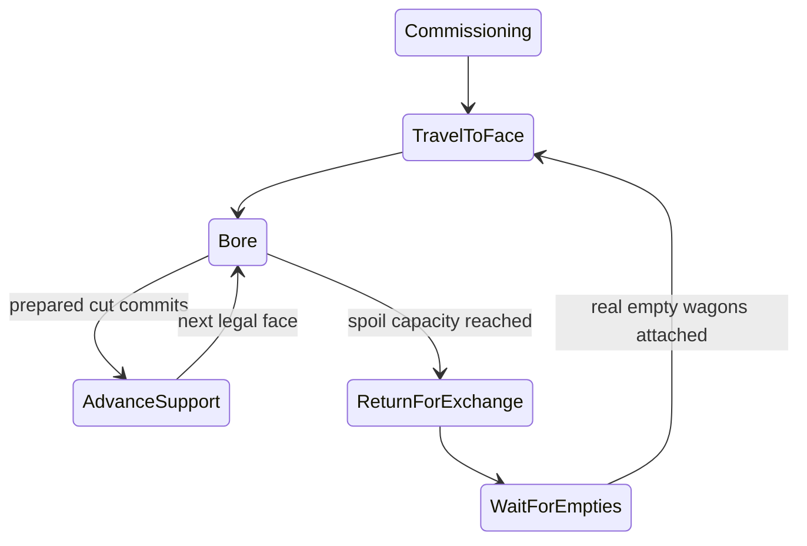

# R2MLVS4 - Tunnel Boring Machines

## Global Mandatory Reading

> **Execution protocol**
>
> - Read this Global Mandatory Reading section before the first task and again
>   after every context compaction.
> - Before starting or resuming a task group, read the nearest preceding Area
>   Mandatory Reading block whose `Applies to` label includes that group. Area
>   blocks appear immediately before the first group they govern.
> - A referenced heading or exported symbol is authoritative. Global navigation
>   hints and Area line ranges are for navigation only; if they drift, relocate
>   the named section or symbol rather than expanding to the whole file.
> - Mandatory reading is non-transitive. Do not preload a linked file's own
>   Mandatory Reading, Consult on Demand, or Planning Provenance entries unless
>   this plan names them directly for the current area.
> - Do not read Consult on Demand or Planning Provenance merely because those
>   sources are listed. Use a Consult on Demand source only when its trigger
>   occurs.
> - No created source file, test file or JSON file should start with same prefix as a planning MD file (such as r2). Only MD files can have that prefix. No MD file should be created anywhere in source directories unless specifically asked.
> - After EVERY CONTEXT COMPACTION, you must add a note above the task group
>   which is currently in execution. The note will say: "Context has compacted
>   X times while executing this group.". If the compaction occurs before any
>   meaningful work was done (this can happen when there is a lot of baggage
>   from the previous compaction), then and ONLY then you can skip this step.
> - When exceeding 3 context compactions, YOU MUST ask yourself if you're not 
>   chewing more than we can handle :). Heck, plans change! :). In such a case, 
>   the way out is to split the group on the spot,
>   in the plan, into more groups, 
>   by appending B, C, D as a suffixes to those groups (splitting sub-groups 
>   themselves is also allowed). When you do this, create Local Mandatory
>   Reading areas so you can optimize your context only for the
>   ACTUAL task at hand.
>   Before starting or resuming a task group, read the nearest preceding Area
>   Mandatory Reading block whose `Applies to` label includes that group. Area
>   blocks appear immediately before the first group they govern.

| File name | Line Ranges | Description |
| --- | --- | --- |
| [docs/zz-reach2/upgrades/2026-10/r2mlvs-multilayer-vehicles-and-structures.md](r2mlvs-multilayer-vehicles-and-structures.md) | 222-232 | `AD-5` supplies the canonical gameplay/ownership decision for every group of this plan. It constrains train-owned cutting, real spoil and maximum 45-degree advancing turns; a consumer must not redefine it locally. |
| [src/map_layer.h](../../../../src/map_layer.h) | 78-85 | `MultiLayerMap` ownership preamble: `Map` owns packed storage/geometry and this controller owns layer semantics. Every group uses world tiles/explicit layer helpers; camera selection and ad hoc plane offsets cannot define gameplay. |
| [src/train.h](../../../../src/train.h) | 120-148 | `Train::Tick`, `GetRunningCost`, `ConsistChanged` and acceleration declarations own simulation progress, costs and consist caches; view state cannot advance cutting. |

Status: proposed. Parent: [R2MLVS master](r2mlvs-multilayer-vehicles-and-structures.md). Depends on r2mlvs3 and r2mlvs1's wagon contract. r2mlvs5 completes the recurring haulage loop.

## Outcome and Boundaries

Deliver a real train that bores connected rock, advances on paid support track and accumulates Earth/Rock in attached wagons.

## Public Handoff Contract

Proposed public owner: `src/tbm.h`. Publish `TBMProject`, `TBMWorkState`, `ValidateTBMAreaRoute`, `AdvanceTBMWork`. These symbols are producer obligations, not existing code. Keep one authority for the fields/commands they expose; downstream plans consume the public contract rather than private pools or copied tables.

## Implementation Tasks

Deepening pass, 2026-10-04: implementation groups use only SIMPLE, MEDIUM or HARD difficulty, with at most eight pending tasks each. Sketches describe proposed implementation contracts; verify the named earlier producers at each assumption gate. No gameplay or asset implementation is marked complete by this planning pass.

Groups are chronological and contain consecutive tasks of one difficulty. Each difficulty batch has at most eight tasks; area reading changes only when the implementation boundary or source of truth changes.

### Area Mandatory Reading - Vehicle and work orders

_Applies to Groups 1-5._

**Entry gate.** The following public contracts must exist before dependent implementation in this area: `src/multilayer_content.h`: `MultiLayerGameplayProfile`, `LayerVehicleCapability`, `GetMultiLayerContentProfile`, `CheckDeepLayerAvailability`, `UtilityPowerAccount`; `src/excavation.h`: `ExcavationState`, `GeologyDeposit`, `ExcavationJob`, `CheckExcavatedFootprint`, `CommitExcavationCut`, `GeothermalVentField`; `src/layer_portal_cmd.h`: `LayerPortalWorkState`, `GetLayerPortalWorkState`, `CheckLayerPortalWorkAccess`, `CommissionLayerPortalTBM`.
Verify each public file/export/schema field with `rg` in the current workspace and inspect its command/field ownership. For a same-plan contract, compile its type/signature fixture or validate its artifact after the preceding producer groups. For cross-plan behavior, also run the producer's focused executable boundary test; declarations alone cannot authorize dependent mutations or runtime claims.
If a required export is absent, stop the dependent implementation, mutation and runtime claims in Groups 1-5. Read-only characterization, source/range verification, test-case design and asset-template work that does not assume the missing behavior may continue.
Do not bypass this gate by copying private pool/tile state, inventing local IDs or cargo registries, using a historical plan as a delivered implementation, opening user-wide content stores, substituting a second utility/accounting authority, or adding an unreviewed fallback path. Finish the named producer or revise the shared contract and its direct consumers first.

| File name | Line Ranges | Description |
| --- | --- | --- |
| [src/train_cmd.h](../../../../src/train_cmd.h) | 18-27 | Build/sell/move/reverse train commands and traits are the public commissioning/rearrangement boundary; restrict specialist capabilities through every applicable command. |
| [src/vehicle_cmd.h](../../../../src/vehicle_cmd.h) | 20-42 | Build/refit/clone/depot-autoreplace commands and traits expose all purchase paths; `CloneVehicle` is `NoTest`, so do not rely on a generic estimate to enforce capability/commissioning. |
| [src/train.h](../../../../src/train.h) | 152-174 | `GetNextUnit` and `GetPrevUnit` skip articulated/rear dual-headed parts; detach real wagon units without breaking engine-support structure. |
| `src/multilayer_content.h` (planned public contract; link after implementation) | Live definitions; no fixed range | [r2mlvs1-gameplay-contracts-and-content.md](r2mlvs1-gameplay-contracts-and-content.md) Groups 1-6, ending with Group 6's public-contract task, publish `MultiLayerGameplayProfile`, `LayerVehicleCapability`, `GetMultiLayerContentProfile`, `CheckDeepLayerAvailability`, `UtilityPowerAccount`. These exports/schema fields are authoritative for this area. Same-plan consumers follow those earlier groups; cross-plan consumers verify the producer's required implementation/tests as well. Proposed names alone do not prove delivery. |
| `src/excavation.h` (planned public contract; link after implementation) | Live definitions; no fixed range | [r2mlvs2-geology-and-excavation.md](r2mlvs2-geology-and-excavation.md) Groups 1-7, ending with Group 7's public-contract task, publish `ExcavationState`, `GeologyDeposit`, `ExcavationJob`, `CheckExcavatedFootprint`, `CommitExcavationCut`, `GeothermalVentField`. These exports/schema fields are authoritative for this area. Same-plan consumers follow those earlier groups; cross-plan consumers verify the producer's required implementation/tests as well. Proposed names alone do not prove delivery. |
| [src/layer_portal_cmd.h](../../../../src/layer_portal_cmd.h) | Live definitions; no fixed range | [r2mlvs3-sealed-portals-and-deep-rail.md](r2mlvs3-sealed-portals-and-deep-rail.md) Groups 1-7, ending with Group 7's public-contract task, publish `LayerPortalWorkState`, `GetLayerPortalWorkState`, `CheckLayerPortalWorkAccess`, `CommissionLayerPortalTBM`. These exports/schema fields are authoritative for this area. Same-plan consumers follow those earlier groups; cross-plan consumers verify the producer's required implementation/tests as well. Proposed names alone do not prove delivery. |
| [src/vehicle_cmd.cpp](../../../../src/vehicle_cmd.cpp) | 104-239 | Complete `CmdBuildVehicle` validates depot construction and cleans up estimate-time parts; TBM commissioning must use an explicit compatible construction boundary. |
| [src/order_type.h](../../../../src/order_type.h) | 49-62 | Complete `OrderType` enum has persisted meanings; a project controller cannot silently insert new values. |
| [src/order_base.h](../../../../src/order_base.h) | 28-72 | `Order` storage and accessors expose fixed-width type/destination fields; project identity belongs to the typed project command contract. |
| [src/order_cmd.h](../../../../src/order_cmd.h) | 17-33 | Public order commands/traits constrain UI and shared-order edits; project assignment must not hijack ordinary station destinations. |

**ASSUMPTION: this was already built previously. If not, re-asses at runtime**. This applies only to the producer contracts named in this area's gate, after their listed producer groups have run. Verify their actual exports and focused tests before using the sketches below; proposed types and helper names in sketches are not evidence of delivered code.

**Controller sketch (proposed).** The portal and geology producers in this area's gate supply commissioning access and validated pass data. Actual train construction is depot-oriented today; use the shared commissioning boundary agreed with r2mlvs3 instead of temporarily changing a portal's tile type.



Every phase also has a saved blocked/stopped reason and a supported recovery path. The diagram shows successful edges, not permission to skip their validation.

### Group 1 - Define cutter models and immutable consist roles

{{MEDIUM}}
- [ ] 1.1 Add standard/deep-rated cutter definitions from the profile, with visible layers/date, speed/power, active/idle cost and compatible Earth/Rock wagon roles.
- [ ] 1.2 Mark permanent cutter/support articulated units separately from exchangeable spoil wagons. Use real unit boundaries from `GetNextUnit`/`GetPrevUnit`; publish the allowed consist layout for r2mlvs5.
- [ ] 1.3 Define the saved project record: cutter ID, heading, current face, pass cursor, partial work, Surface origin station, portal, exchange bay and blocked reason. Keep cached route lookup separate from authority.

### Group 2 - Commission only through the validated rail facility

{{HARD}}
- [ ] 2.1 Consume r2mlvs3 commissioning validation and its chosen depot-compatible/factored train construction boundary. Create a cutter/support/wagon consist only after all IDs, funds, capacity and source-side access pass validation.
- [ ] 2.2 Apply the capability check to purchase, clone, autoreplace and script requests before allocating any part. Account for `CloneVehicle` being `NoTest`; failure must clean up new parts and preserve existing vehicles.
- [ ] 2.3 Allow servicing at compatible depots without enabling purchase there. A new deep-rated cutter may be assembled at an accessible Underground rail commissioning portal; its facility/supply access must be physically reachable. Existing cutters travel normally to later projects. Prevent road/elevator commissioning and ordinary-depot cloning.
- [ ] 2.4 Test one legal Surface commissioning plus wrong facility, wrong depth/date, partial-part allocation failure and service-only depot requests.

### Group 3 - Choose the project command and order representation

{{HARD}}
- [ ] 3.1 Use a typed `TBMProject` assignment and commands for boring steps, alongside normal train orders for travel/service. Inspect the current 4-bit order type and 16-bit destination; never cast a project ID into a StationID or silently extend saved enum meanings.
- [ ] 3.2 Define how the project UI edits/starts/cancels work and how shared train orders interact with its private project assignment. Cloning shared travel orders must not clone ownership of an active cut.
- [ ] 3.3 Add command encoding and versioned project serialization through the existing command/schema contracts. Round-trip assignment and orders independently before implementing work phases.

### Group 4 - Implement saved work orders and state transitions

{{HARD}}
- [ ] 4.1 Add Boring Project order data and area-outline selection. Consume the r2mlvs2 canonical route planner; preview generated passes, turn envelope, hardness, both spoil quantities and support cost before command acceptance.
- [ ] 4.2 Implement Commissioning, TravelToFace, Bore, AdvanceSupport, ReturnForExchange, WaitForEmpties and Resume transitions one edge at a time, with explicit guards and one saved phase timer.
- [ ] 4.3 Add Stopped/Blocked/Servicing as resumable conditions without losing the previous work phase. Separate cutter heading from the train reversal flag so retreat never implies a new cutting direction.
- [ ] 4.4 Persist the order/project/heading/timer references and test reload at TravelToFace and Bore entry; reject a missing origin station/project with a recoverable reason.

### Group 5 - Publish the TBM controller boundary

{{HARD}}
- [ ] 5.1 Publish `src/tbm.h` with `TBMProject`, `TBMWorkState`, `ValidateTBMAreaRoute` and `AdvanceTBMWork`; describe owned fields and invalid references. `ValidateTBMAreaRoute` adapts the canonical geology planner to this actual consist, not a second planner.
- [ ] 5.2 Specify exactly one simulation-tick call site per front engine and the command/estimate separation; identify work-controller behavior implemented in the next area versus already tested order/state behavior.
- [ ] 5.3 Register source/build entries and compile a consumer fixture for r2mlvs5. If locations change, update all direct handoffs before claiming availability.

### Area Mandatory Reading - Boring and accounting

_Applies to Groups 6-15._

**Entry gate.** The following public contracts must exist before dependent implementation in this area: `src/tbm.h`: `TBMProject`, `TBMWorkState`, `ValidateTBMAreaRoute`, `AdvanceTBMWork`.
Verify each public file/export/schema field with `rg` in the current workspace and inspect its command/field ownership. For a same-plan contract, compile its type/signature fixture or validate its artifact after the preceding producer groups. For cross-plan behavior, also run the producer's focused executable boundary test; declarations alone cannot authorize dependent mutations or runtime claims.
If a required export is absent, stop the dependent implementation, mutation and runtime claims in Groups 6-15. Read-only characterization, source/range verification, test-case design and asset-template work that does not assume the missing behavior may continue.
Do not bypass this gate by copying private pool/tile state, inventing local IDs or cargo registries, using a historical plan as a delivered implementation, opening user-wide content stores, substituting a second utility/accounting authority, or adding an unreviewed fallback path. Finish the named producer or revise the shared contract and its direct consumers first.

| File name | Line Ranges | Description |
| --- | --- | --- |
| [src/train.h](../../../../src/train.h) | 45-72 | `ConsistChangeFlag`, `FreeTrainTrackReservation`, `TryPathReserve`, `NormalizeTrainVehInDepot` define cache/reservation rebuilding after actual wagon changes. |
| [src/cargopacket.h](../../../../src/cargopacket.h) | 458-489 | `VehicleCargoList::Append`, `AgeCargo`, `Stage`, `Return`, `Unload`, `Shift` move accountable packets; exchange/descent/processing must not clone packet age or feeder shares. |
| [src/command.cpp](../../../../src/command.cpp) | 301-328 | `CommandHelperBase::InternalExecuteValidateTestAndPrepExec` defines refusal/estimate before execution; no validation phase may consume inventory, RNG or funds. |
| `src/tbm.h` (planned public contract; link after implementation) | Live definitions; no fixed range | [r2mlvs4-tunnel-boring-machines.md](r2mlvs4-tunnel-boring-machines.md) Groups 1-5, ending with Group 5's public-contract task, publish `TBMProject`, `TBMWorkState`, `ValidateTBMAreaRoute`, `AdvanceTBMWork`. These exports/schema fields are authoritative for this area. Same-plan consumers follow those earlier groups; cross-plan consumers verify the producer's required implementation/tests as well. Proposed names alone do not prove delivery. |
| [src/train_cmd.cpp](../../../../src/train_cmd.cpp) | 4229-4256 | Complete `Train::Tick` calls the locomotive handler twice; work progression must run once for the front engine per simulation tick. |
| [src/train_cmd.cpp](../../../../src/train_cmd.cpp) | 4204-4227 | Complete `Train::GetRunningCost` supplies ordinary train costs; specialized accrual must not double charge. |
| [src/train_cmd.cpp](../../../../src/train_cmd.cpp) | 4305-4338 | Complete `Train::OnNewEconomyDay` debits accumulated running ticks; preserve saved state-duration accrual for nonzero stopped TBM costs. |
| [src/train_cmd.cpp](../../../../src/train_cmd.cpp) | 2030-2127 | Complete `ReverseTrainDirection` may reverse consist order; TBM backing must preserve cutter-facing authority and fixed support roles. |
| [src/cargopacket.cpp](../../../../src/cargopacket.cpp) | 246-285 | Complete `VehicleCargoList::Append` can merge packets and requires loading-state discipline; preflight capacity separately. |
| [src/source_type.h](../../../../src/source_type.h) | 19-56 | `SourceType`, `SourceID` and `Source` identity prohibit passing a TBM/project ID as an industry; preserve provenance via a declared canonical extension. |

**ASSUMPTION: this was already built previously. If not, re-asses at runtime**. This applies only to the producer contracts named in this area's gate, after their listed producer groups have run. Verify their actual exports and focused tests before using the sketches below; proposed types and helper names in sketches are not evidence of delivered code.

**Timing and transaction sketch.** `Train::Tick` invokes `TrainLocoHandler` twice. Advance the work controller at one front-engine tick boundary, not once per movement substep. The saved work accumulator is separate from sprite animation and from active/idle financial accrual.

```text
one simulation tick:
    accrue current state's running cost
    validate assigned face and add bounded work
    if cut ready:
        prepare rock + support + both spoil cargoes + funds
        acquire fallible storage
        revalidate -> commit once, or retain state and pause
```

**ASSUMPTION: this was already built previously. If not, re-asses at runtime**. The canonical pass planner, cut proposal and footprint checks were implemented in r2mlvs2; the preceding TBM groups provide saved orders and consist roles. Verify them before binding the actual train. r2mlvs5 exchange is still a later integration; `WaitForEmpties` may remain blocked until its real producer exists.

### Group 6 - Advance bounded work against one reserved face

{{HARD}}
- [ ] 6.1 Reserve the next face and supported retreat route through the r2mlvs2 job API. Check the assigned cutter, project and date; no other consist may advance that claim.
- [ ] 6.2 Advance one saved fixed-point work accumulator once per front-engine simulation tick, using model/hardness speed and a bounded number of completed cuts per tick. Keep rendering and train movement substeps out of work timing.
- [ ] 6.3 At a completed-work boundary, pause without consuming the completed-cut result if support, geometry, cash or either spoil type cannot fit. Publish a precise limiting reason and resume from the same cursor.

### Group 7 - Join geological cuts to real wagon inventory atomically

{{HARD}}
- [ ] 7.1 Compute Earth and Rock yields from the canonical cut proposal and assign them to compatible attached wagon units in stable order. Validate each cargo capacity independently, with checked counts and a defined work-site source/age.
- [ ] 7.2 Reject loading reservations or include them in `TotalCount` capacity; `Append` does not enforce capacity and may merge/delete its input packet pointer. Initialize work-face loading coordinates and canonical source/provenance before append. A project ID is not an IndustryID, and the required Surface destination is not automatically the packet first station.
- [ ] 7.3 Acquire all required packet/support storage before terrain or cash changes. If packet allocation or a participant validation fails, release provisional resources and retain job/terrain/wagon state unchanged.
- [ ] 7.4 Commit the r2mlvs2 cut, support installation, cargo packet insertion and work charge as one prepared operation; keep a single owning transaction boundary so neither controller nor geology debits reserve twice.
- [ ] 7.5 Test exact-fill, Earth-full/Rock-free, Rock-full/Earth-free, pool exhaustion and save just before/after a cut. No infinite temporary hold or automatic Surface delivery is permitted.

### Group 8 - Install charged support and preserve retreat

{{HARD}}
- [ ] 8.1 Define the temporary rail/support metadata and profile restrictions: owner, allowed cutter/support/hauler classes, speed and conversion price. Preserve excavation state beneath the rail.
- [ ] 8.2 Prepare support placement as part of the cut transaction, using the validated swept footprint. Only this scoped operation may install support while the target is still a work tile; ordinary rail tools remain blocked.
- [ ] 8.3 After commit, update train-part positions, track/reservation caches and the supported return path. Test a support-placement failure leaves the cut uncommitted and a legal turn does not clip trailing wagons.

### Group 9 - Boring and accounting

{{MEDIUM}}
- [ ] 9.1 Define track conversion/removal and traversal by the cutter/support consist.

### Group 10 - Bind canonical area passes to the actual train

{{HARD}}
- [ ] 10.1 Call the already published r2mlvs2 outline/pass planner with this cutter/consist dimensions, support policy and separate spoil capacities. Store the accepted pass sequence and extra authorized turn-space cuts; do not duplicate route generation in the train controller.
- [ ] 10.2 Check each advancing segment against the saved cutter heading: allow straight, left-45 and right-45 only. Require a different traversed segment; repeated stationary commands cannot accumulate rotation.
- [ ] 10.3 Revalidate the complete cutter/support/wagon swept footprint before each advancing segment, including diagonal corner tiles, ownership changes and newly occupied boundaries.
- [ ] 10.4 Charge all extra turn-space cuts as ordinary spoil-producing work through the same transaction. Reject 90/135/180-degree steps and disallow implicit excavation outside the previewed accepted area.

### Group 11 - Exercise area coverage and turning as a separate behavior

{{HARD}}
- [ ] 11.1 Run a straight pass, a 90-degree change made from two advancing bends and an irregular chamber against the same route implementation; compare completed target tiles with the accepted outline.
- [ ] 11.2 Test too-tight U-turns, solid diagonal corners and an obstruction introduced after planning. Pause at the previous safe support position and retain a valid retreat.
- [ ] 11.3 Verify reversing backs along existing support without changing cutter-facing authority or allowing backwards cuts. Reload during a bend and continue with the same pass cursor and spoil ledger.

### Group 12 - Accrue active and idle costs without tick duplication

{{HARD}}
- [ ] 12.1 Choose saved per-state tick buckets or an accrued-money/remainder accumulator for active versus idle cost. Existing train running ticks omit fully stopped vehicles, so implement the specified nonzero idle charge explicitly.
- [ ] 12.2 Charge recurring cost from accumulated state duration, independent of the final state at daily accounting. Debit per-cut support/work only in the cut transaction; never charge it again in `GetRunningCost`.
- [ ] 12.3 On insufficient funds or bankruptcy, stop new cutting and preserve loaded wagons, paid cavities and safe retreat. Test a day containing active, blocked, stopped and servicing intervals plus a mid-day save/reload.

### Group 13 - Boring and accounting

{{MEDIUM}}
- [ ] 13.1 Distinguish backing along completed support rail from changing the cutter's facing: retreat cannot enable backwards boring or bypass the 45-degree rule.

### Group 14 - Separate work reservations from ordinary freight

{{HARD}}
- [ ] 14.1 Define the reserved work corridor and supported return path by project/consist identity. Integrate reservations with existing path reservation calls without exposing the solid work face as a generic rail edge.
- [ ] 14.2 Refuse normal freight/force-proceed into the active pocket; permit only the assigned cutter and declared recovery movements. Apply the check to actual train parts at movement, not only order planning.
- [ ] 14.3 Release claims in safe order after withdrawal, preserving any still-occupied support track. Test a waiting freight train, a blocked retreat and cancellation with the tail across a portal.

### Group 15 - Boring and accounting

{{MEDIUM}}
- [ ] 15.1 Allow cleared ground to become tubes, roads, terminals, mines, geothermal plants or open chambers after safe support-track removal/conversion. Final use need not contain rails. Never remove support under the TBM or strand it by completing a tube segment behind it. Deep cutting obeys the 1980 calendar gate.

### Area Mandatory Reading - Recovery, presentation and acceptance

_Applies to Groups 16-22._

**Entry gate.** The following public contracts must exist before dependent implementation in this area: `src/tbm.h`: `TBMProject`, `TBMWorkState`, `ValidateTBMAreaRoute`, `AdvanceTBMWork`.
Verify each public file/export/schema field with `rg` in the current workspace and inspect its command/field ownership. For a same-plan contract, compile its type/signature fixture or validate its artifact after the preceding producer groups. For cross-plan behavior, also run the producer's focused executable boundary test; declarations alone cannot authorize dependent mutations or runtime claims.
If a required export is absent, stop the dependent implementation, mutation and runtime claims in Groups 16-22. Read-only characterization, source/range verification, test-case design and asset-template work that does not assume the missing behavior may continue.
Do not bypass this gate by copying private pool/tile state, inventing local IDs or cargo registries, using a historical plan as a delivered implementation, opening user-wide content stores, substituting a second utility/accounting authority, or adding an unreviewed fallback path. Finish the named producer or revise the shared contract and its direct consumers first.

**Scoped integration gates.** The following producer dependencies apply only to the named implementation/test families. Verify each required public export and its focused producer test before those integrations; absent late producers do not block already independent features.

- `src/tbm_exchange.h` is required for the exchange-bay recovery and real-wagon/recurring-haulage subscenario in Groups 16-17, 19 (only the named integration/subscenario). If absent, stop only that integration/subscenario and its passing claim. Other independent code, art, persistence and tests in this area may continue.

Do not emulate an absent producer with copied private state, fake inventories/energy, local IDs or a second registry/grid. A final combined closure/gallery/round-trip still waits for every required family; an independent passing case is not a pass for the missing integration.

| File name | Line Ranges | Description |
| --- | --- | --- |
| [src/saveload/vehicle_sl.cpp](../../../../src/saveload/vehicle_sl.cpp) | 1119-1196 | `VEHSChunkHandler` and registration construct the vehicle class from saved type before member loading; protect old enum meanings and validate new references. |
| [src/tests/map_layer.cpp](../../../../src/tests/map_layer.cpp) | 162-183 | Complete `Plane distances ignore the layer` test fixes projected geometry but grants no cross-layer transfer authority. |
| [src/timer/timer_game_calendar.h](../../../../src/timer/timer_game_calendar.h) | 15-39 | `TimerGameCalendar` technology-clock contract and date conversions govern 1980/model/factory introductions; economic/realtime scheduling cannot unlock a technology. |
| `src/tbm.h` (planned public contract; link after implementation) | Live definitions; no fixed range | [r2mlvs4-tunnel-boring-machines.md](r2mlvs4-tunnel-boring-machines.md) Groups 1-5, ending with Group 5's public-contract task, publish `TBMProject`, `TBMWorkState`, `ValidateTBMAreaRoute`, `AdvanceTBMWork`. These exports/schema fields are authoritative for this area. Same-plan consumers follow those earlier groups; cross-plan consumers verify the producer's required implementation/tests as well. Proposed names alone do not prove delivery. |
| `src/tbm_exchange.h` (planned public contract; link after implementation) | Live definitions; no fixed range | [r2mlvs5-spoil-wagons-and-haulage.md](r2mlvs5-spoil-wagons-and-haulage.md) Groups 1-5, ending with Group 5's public-contract task, publish `TBMExchangeAssignment`, `ValidateTBMWagonExchange`, `ExecuteTBMWagonExchange`. These exports/schema fields are authoritative for this area. Same-plan consumers follow those earlier groups; cross-plan consumers verify the producer's required implementation/tests as well. Proposed names alone do not prove delivery. Read this producer for the exchange-bay recovery and real-wagon/recurring-haulage subscenario in Groups 16-17, 19 (only the named integration/subscenario); missing it blocks only that integration, not independent work. |
| [Sprite Contract and delivery owner](r2mlvs13-graphics-and-asset-pipeline.md#public-handoff-contract) | Live definitions; no fixed range | `Sprite Contract Handoff` defines manifest fields `asset_id`, `consumer`, `directions`, `frames`, `anchor`, `source`; the matching authoring/conversion/runtime groups deliver actual assets. Verify the requested family and packed loading fixture before graphics integration; template/manifest publication alone is not final art. |

**ASSUMPTION: this was already built previously. If not, re-asses at runtime**. This applies only to the producer contracts named in this area's gate, after their listed producer groups have run. Verify their actual exports and focused tests before using the sketches below; proposed types and helper names in sketches are not evidence of delivered code.

**Scoped graphics gate. ASSUMPTION: this was already built previously. If not, re-asses at runtime**. Final graphics tasks in this area require the corresponding r2mlvs13 manifest entries, delivered sprites and packed loading fixture. Verify them before binding/review; if absent, stop only those art tasks and their acceptance claims, continue independent code/state tests, and never count placeholders as finished assets.

### Group 16 - Expose controller state and integrate matching assets

{{MEDIUM}}
- [ ] 16.1 Display face, pass progress, hardness, both spoil capacities, active/idle cost and one precise blocked reason from controller queries.
- [ ] 16.2 Integrate idle/boring/reversing/servicing graphics and sound events from r2mlvs13 after manifest/asset verification. Animation must consume state and never trigger work.

### Group 17 - Implement recoverable cancellation and reassignment

{{HARD}}
- [ ] 17.1 Define cancellation at travel, partial-cut and full-wagon states: retain completed cavities/cargo, release only unused claims and route the cutter along supported retreat.
- [ ] 17.2 Handle breakdown/service while boring as a saved pause; prevent cutter sale while it owns unrecovered wagons or occupies a sealed work pocket. Require safe withdrawal or explicit public project reassignment first.
- [ ] 17.3 Handle lost exchange bay/origin station with a visible recovery state and explicit reassignment. Do not orphan the project or delete spoil to unblock it.
- [ ] 17.4 Integrate r2mlvs5 recovery/exchange behavior when delivered; independent stop/retreat tests may run earlier, while full recurring haulage acceptance remains pending.

### Group 18 - Recovery, presentation and acceptance

{{HARD}}
- [ ] 18.1 Test exact material conservation across partial cuts, capacity boundaries, mixed spoil ratios, cancellation, reversal and saves during work.

### Group 19 - Recovery, presentation and acceptance

{{MEDIUM}}
- [ ] 19.1 Compare progress with the layer hidden and visible.
- [ ] 19.2 Demonstrate the first cut and return to the source-side commissioning exchange, then integrate a recurring underground-bay loop with r2mlvs5.

### Group 20 - Recovery, presentation and acceptance

{{SIMPLE}}
- [ ] 20.1 Record time and full cost for a standard corridor and a harder Deep corridor. Hand the measurements to r2mlvs15 instead of declaring balance from nominal prices.

### Group 21 - Recovery, presentation and acceptance

{{HARD}}
- [ ] 21.1 Test legal 45-degree bends and a 90-degree change made from two advancing bends.
- [ ] 21.2 Test U-turn space, safe backing and refusal of stationary pivots or backwards boring.
- [ ] 21.3 Save/reload during a turn and compare cutter heading, pass progress and generated spoil.
- [ ] 21.4 Clear an irregular tube-terminal/geothermal-plant footprint, withdraw safely and replace temporary rail with its final non-rail use.

### Group 22 - Recovery, presentation and acceptance

{{SIMPLE}}
- [ ] 22.1 Record the implemented public exports, focused test commands/results and remaining runtime/art/network gaps in this plan; retain original supplied saves and repository-local evidence.
- [ ] 22.2 Update affected architecture/handoff documentation to describe delivered behavior and reconcile the parent index only when this plan's Completion Conditions are met. Keep every unfinished task unchecked.

## Consult on Demand

| Trigger | File name | Start at | Expand only when | Consultation purpose |
| --- | --- | --- | --- | --- |
| A bent or backing TBM loses reservations or disconnects its wagons | [../../architecture/pathfinder/archi-pathfinder-rail.md](../../architecture/pathfinder/archi-pathfinder-rail.md) | `Reservation` | Controller/cutter-heading tests pass but route reservation still differs | Locate actual reservation ownership and its train call sites; the note explains routing and does not authorize an arbitrary-track coupling bypass. |
| A required public export is absent and its owner/location is disputed | [r2mlvs-multilayer-vehicles-and-structures.md](r2mlvs-multilayer-vehicles-and-structures.md) | `Requirements and ownership` and `Plan Index` | The named producer confirms an intentional contract/ownership change | Find the responsible producer and reconcile its public handoff with direct consumers; the hub cannot substitute for missing implementation. |
| Current behavior contradicts a historical subsystem description | [../../architecture/map-layers/archi-map-layers.md](../../architecture/map-layers/archi-map-layers.md) | `Invariants` and the relevant named source in `Code map` | The live symbol and executable test do not explain the difference | Locate layer addressing or lifecycle rationale. Live code/tests govern delivered behavior; this architecture page does not prove future interfaces exist. |

## Planning Provenance

This is not an execution reading queue. Do not preload it after context compaction. It is non-transitive; ranges record planning use, not runtime authority.

| File name | Sections or Line Ranges used while planning | Planning contribution |
| --- | --- | --- |
| [docs/zz-reach2/architecture/initial-inventory.md](../../architecture/initial-inventory.md) | 185-220 | `Command as the only world mutation`, `Pool-indexed game objects`, `Tile map as a packed array` and `File-suffix modules` oriented command/pool/header ownership and source registration. This historical inventory is a location survey, not authority for current layer behavior. |
| [docs/zz-reach2/architecture/@archi-ttd-level0.md](../../architecture/@archi-ttd-level0.md) | 24-63 | `How the program fits together` and `Source and runtime boundaries` located shared simulation, data/presentation, CMake targets and subsystem handoffs used to choose the live reading sources. |
| [docs/zz-reach2/upgrades/2026-10/r2mlvs-multilayer-vehicles-and-structures.md](r2mlvs-multilayer-vehicles-and-structures.md) | 119-140 | `Requirements and ownership` assigned this plan's feature responsibilities; it shaped the decomposition without making every sibling plan a mandatory reading dependency. |
| [src/train.h](../../../../src/train.h) | 120-148 | The inspected live boundary helped separate characterization, public-contract production, implementation and acceptance batches. It materially constrained train-owned cutting, real spoil and maximum 45-degree advancing turns; this entry records planning influence rather than an additional reading obligation. |
| [User planning-format instructions](<C:/Users/Axonn/.codex/attachments/cd59b20a-3a96-4d54-b4bd-1e8f37639e7d/Pasted text.txt>) | `Global Mandatory Reading`, `Area Mandatory Reading`, `Consult on Demand`, `Planning Provenance`, `Final validation` | Supplies the exact protocol, chronological difficulty batches of at most eight tasks, reading gates and validation format. |
| [src/train_cmd.cpp](../../../../src/train_cmd.cpp) | 4229-4256; 4305-4338 | Deeper planning pass, 2026-10-04: Two locomotive substeps and daily billing motivated one work tick and saved active/idle cost accrual. |

## Completion Conditions

A commissioned TBM clears any reachable excavatable underground area for its intended use, turns at most 45 degrees per advancing segment and carries the resulting spoil in actual wagons. It cannot bore with full carriages or insufficient support/cash, cannot be spawned through other transport modes, and can recover safely from every stopped state. Heading, swept-footprint progress and cargo resume exactly after save/load.
