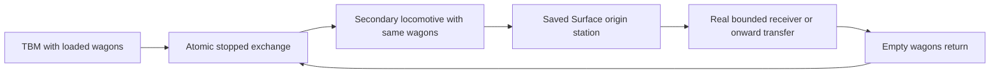

# R2MLVS5 - Spoil Wagons and Haulage

## Global Mandatory Reading

> **Execution protocol**
>
> - Read this Global Mandatory Reading section before the first task and again
>   after every context compaction.
> - Before starting or resuming a task group, read the nearest preceding Area
>   Mandatory Reading block whose `Applies to` label includes that group. Area
>   blocks appear immediately before the first group they govern.
> - A referenced heading or exported symbol is authoritative. Global navigation
>   hints and Area line ranges are for navigation only; if they drift, relocate
>   the named section or symbol rather than expanding to the whole file.
> - Mandatory reading is non-transitive. Do not preload a linked file's own
>   Mandatory Reading, Consult on Demand, or Planning Provenance entries unless
>   this plan names them directly for the current area.
> - Do not read Consult on Demand or Planning Provenance merely because those
>   sources are listed. Use a Consult on Demand source only when its trigger
>   occurs.
> - No created source file, test file or JSON file should start with same prefix as a planning MD file (such as r2). Only MD files can have that prefix. No MD file should be created anywhere in source directories unless specifically asked.
> - After EVERY CONTEXT COMPACTION, you must add a note above the task group
>   which is currently in execution. The note will say: "Context has compacted
>   X times while executing this group.". If the compaction occurs before any
>   meaningful work was done (this can happen when there is a lot of baggage
>   from the previous compaction), then and ONLY then you can skip this step.
> - When exceeding 3 context compactions, YOU MUST ask yourself if you're not 
>   chewing more than we can handle :). Heck, plans change! :). In such a case, 
>   the way out is to split the group on the spot,
>   in the plan, into more groups, 
>   by appending B, C, D as a suffixes to those groups (splitting sub-groups 
>   themselves is also allowed). When you do this, create Local Mandatory
>   Reading areas so you can optimize your context only for the
>   ACTUAL task at hand.
>   Before starting or resuming a task group, read the nearest preceding Area
>   Mandatory Reading block whose `Applies to` label includes that group. Area
>   blocks appear immediately before the first group they govern.

| File name | Line Ranges | Description |
| --- | --- | --- |
| [docs/zz-reach2/upgrades/2026-10/r2mlvs-multilayer-vehicles-and-structures.md](r2mlvs-multilayer-vehicles-and-structures.md) | 234-240 | `AD-6` supplies the canonical gameplay/ownership decision for every group of this plan. It constrains atomic real-wagon movement and the mandatory Surface origin/disposal leg; a consumer must not redefine it locally. |
| [src/map_layer.h](../../../../src/map_layer.h) | 78-85 | `MultiLayerMap` ownership preamble: `Map` owns packed storage/geometry and this controller owns layer semantics. Every group uses world tiles/explicit layer helpers; camera selection and ad hoc plane offsets cannot define gameplay. |
| [src/train_cmd.h](../../../../src/train_cmd.h) | 18-27 | Build/sell/move/reverse train commands and traits are the public commissioning/rearrangement boundary; restrict specialist capabilities through every applicable command. |

Status: native exchange, hauler/queue, Surface receiver, persistence/lifecycle foundations, driven source-side loop and 12 actual source-file families are delivered. Groups 13A/13AB/13AC close source 13.2A; the recurring underground-bay consumer is delivered in Group 13B; its actual files remain pending in Group 13C. Parent: [R2MLVS master](r2mlvs-multilayer-vehicles-and-structures.md). Depends on r2mlvs4.

## Outcome and Boundaries

A second locomotive physically takes the TBM's loaded carriages to its originating Surface station and returns empty capacity.

## Public Handoff Contract

Proposed public owner: `src/tbm_exchange.h`. Publish `TBMExchangeAssignment`, `ValidateTBMWagonExchange`, `ExecuteTBMWagonExchange`. Delivered in code 2026-10-05 (R2MLVS3MP Group 5), with focused tests pending until the next milestone: `TBMExchangeAssignment` {id, project, hauler, bay, set, phase, wait, phase_ticks, exchanges, revision}, one per hauler, with the `TBMWagonSet` {id, project, wagons, state, visited_origin, revision} it carries; `TBMExchangeProposal ValidateTBMWagonExchange(const TBMExchangeRequest &)` (pure estimate, trial restored); `TBMExchangeProposal ExecuteTBMWagonExchange(const TBMExchangeRequest &)` (atomic commit). Assignments and sets are saved since version `TBMExchange` (378) and published by `AcceptLoadedTBMExchange` at the end of `AfterLoadGame`. Lifecycle (Group 11): `OnTBMExchangeTrainPartDeleted`, `CheckTBMTrainRearrangement`, `CheckTBMRailVehicleSale`, `CheckTBMRefit`, `IsTBMReplacementLocked`, `CheckTBMExchangeBayRemoval`/`ReleaseTBMExchangeBay`, and `ChangeTBMOwnership` in `src/tbm.h`. The Surface receivers' public owner is `src/spoil_receiver.h` (`GetSpoilReceiverRoomAt`, `AdmitSpoilToReceiver`, `GetSpoilReceiver`, `CaptureSpoilReceivers`), saved since version `SpoilReceivers`. Keep one authority for the fields/commands they expose; downstream plans consume the public contract rather than private pools or copied tables.

## Implementation Tasks

Deepening pass, 2026-10-04: implementation groups use only SIMPLE, MEDIUM or HARD difficulty, with at most eight pending tasks each. Sketches describe proposed implementation contracts; verify the named earlier producers at each assumption gate. No gameplay or asset implementation is marked complete by this planning pass.

Groups are chronological and contain consecutive tasks of one difficulty. Each difficulty batch has at most eight tasks; area reading changes only when the implementation boundary or source of truth changes.

### Area Mandatory Reading - Controlled exchange facility

_Applies to Groups 1-5._

**Entry gate.** The following public contracts must exist before dependent implementation in this area: `src/multilayer_content.h`: `MultiLayerGameplayProfile`, `LayerVehicleCapability`, `GetMultiLayerContentProfile`, `CheckDeepLayerAvailability`, `UtilityPowerAccount`; `src/excavation.h`: `ExcavationState`, `GeologyDeposit`, `ExcavationJob`, `CheckExcavatedFootprint`, `CommitExcavationCut`, `GeothermalVentField`; `src/layer_portal_cmd.h`: `LayerPortalWorkState`, `GetLayerPortalWorkState`, `CheckLayerPortalWorkAccess`, `CommissionLayerPortalTBM`; `src/tbm.h`: `TBMProject`, `TBMWorkState`, `ValidateTBMAreaRoute`, `AdvanceTBMWork`.
Verify each public file/export/schema field with `rg` in the current workspace and inspect its command/field ownership. For a same-plan contract, compile its type/signature fixture or validate its artifact after the preceding producer groups. For cross-plan behavior, also run the producer's focused executable boundary test; declarations alone cannot authorize dependent mutations or runtime claims.
If a required export is absent, stop the dependent implementation, mutation and runtime claims in Groups 1-5. Read-only characterization, source/range verification, test-case design and asset-template work that does not assume the missing behavior may continue.
Do not bypass this gate by copying private pool/tile state, inventing local IDs or cargo registries, using a historical plan as a delivered implementation, opening user-wide content stores, substituting a second utility/accounting authority, or adding an unreviewed fallback path. Finish the named producer or revise the shared contract and its direct consumers first.

| File name | Line Ranges | Description |
| --- | --- | --- |
| [src/train.h](../../../../src/train.h) | 152-174 | `GetNextUnit` and `GetPrevUnit` skip articulated/rear dual-headed parts; detach real wagon units without breaking engine-support structure. |
| [src/train.h](../../../../src/train.h) | 45-72 | `ConsistChangeFlag`, `FreeTrainTrackReservation`, `TryPathReserve`, `NormalizeTrainVehInDepot` define cache/reservation rebuilding after actual wagon changes. |
| [src/train_cmd.cpp](../../../../src/train_cmd.cpp) | 1192-1234 | `ArrangeTrains` is a static rearrangement implementation, not an exported exchange contract. Inspect it only for the new controlled public exchange producer. |
| [src/train_cmd.cpp](../../../../src/train_cmd.cpp) | 1262-1455 | `CmdMoveRailVehicle` requires both heads stopped inside the same depot and restores trial rearrangement on failure/nonexecution. Preserve that guard and cache/order/group repair. |
| `src/multilayer_content.h` (planned public contract; link after implementation) | Live definitions; no fixed range | [r2mlvs1-gameplay-contracts-and-content.md](r2mlvs1-gameplay-contracts-and-content.md) Groups 1-6, ending with Group 6's public-contract task, publish `MultiLayerGameplayProfile`, `LayerVehicleCapability`, `GetMultiLayerContentProfile`, `CheckDeepLayerAvailability`, `UtilityPowerAccount`. These exports/schema fields are authoritative for this area. Same-plan consumers follow those earlier groups; cross-plan consumers verify the producer's required implementation/tests as well. Proposed names alone do not prove delivery. |
| `src/excavation.h` (planned public contract; link after implementation) | Live definitions; no fixed range | [r2mlvs2-geology-and-excavation.md](r2mlvs2-geology-and-excavation.md) Groups 1-7, ending with Group 7's public-contract task, publish `ExcavationState`, `GeologyDeposit`, `ExcavationJob`, `CheckExcavatedFootprint`, `CommitExcavationCut`, `GeothermalVentField`. These exports/schema fields are authoritative for this area. Same-plan consumers follow those earlier groups; cross-plan consumers verify the producer's required implementation/tests as well. Proposed names alone do not prove delivery. |
| [src/layer_portal_cmd.h](../../../../src/layer_portal_cmd.h) | Live definitions; no fixed range | [r2mlvs3-sealed-portals-and-deep-rail.md](r2mlvs3-sealed-portals-and-deep-rail.md) Groups 1-7, ending with Group 7's public-contract task, publish `LayerPortalWorkState`, `GetLayerPortalWorkState`, `CheckLayerPortalWorkAccess`, `CommissionLayerPortalTBM`. These exports/schema fields are authoritative for this area. Same-plan consumers follow those earlier groups; cross-plan consumers verify the producer's required implementation/tests as well. Proposed names alone do not prove delivery. |
| `src/tbm.h` (planned public contract; link after implementation) | Live definitions; no fixed range | [r2mlvs4-tunnel-boring-machines.md](r2mlvs4-tunnel-boring-machines.md) Groups 1-5, ending with Group 5's public-contract task, publish `TBMProject`, `TBMWorkState`, `ValidateTBMAreaRoute`, `AdvanceTBMWork`. These exports/schema fields are authoritative for this area. Same-plan consumers follow those earlier groups; cross-plan consumers verify the producer's required implementation/tests as well. Proposed names alone do not prove delivery. Delivered in code 2026-10-05 (R2MLVS3MP Group 3), with focused tests pending; the export list and the not-yet-delivered work facts are in the [Plan 4 Public Handoff Contract](r2mlvs4-tunnel-boring-machines.md#public-handoff-contract). |
| [src/train_cmd.cpp](../../../../src/train_cmd.cpp) | 911-941 | Complete train-link backup/restore helpers restore chain order only; projected exchange validation must also preserve cargo and metadata. |
| [src/train_cmd.cpp](../../../../src/train_cmd.cpp) | 1235-1260 | Complete `NormaliseTrainHead` triggers consist/group repairs; capacity-changing effects must be validated before any cargo loss. |
| [src/autoreplace_cmd.cpp](../../../../src/autoreplace_cmd.cpp) | 103-133 | Complete `CheckCargoCapacity` can move/truncate surplus; exchange cannot invoke it as a cargo-loss fallback. |
| [src/group_cmd.cpp](../../../../src/group_cmd.cpp) | 793-816 | Complete `UpdateTrainGroupID` makes wagon groups follow the head; preserve engine groups and keep set identity separate. |

**ASSUMPTION: this was already built previously. If not, re-asses at runtime**. This applies only to the producer contracts named in this area's gate, after their listed producer groups have run. Verify their actual exports and focused tests before using the sketches below; proposed types and helper names in sketches are not evidence of delivered code.

**Exchange sketch (proposed).** Existing `CmdMoveRailVehicle` performs trial rearrangement, validation, then head/group/order/capacity repairs. The new exchange needs the same invariants across *both* legs as one operation; calling the command twice does not make the pair atomic.

```cpp
// Conceptual helper names to be implemented by this plan.
const ExchangeProposal proposal = DescribeExchange(tbm, hauler, wagon_sets);
if (auto error = ValidateWholeExchange(proposal)) return error;
if (!execute) return proposal.cost;
// All fallible validation/allocation precedes public side effects.
CommitBothConsistsAndAssignment(proposal);
// Cargo stays on the same WagonID; no packet transfer is needed for coupling.
```

Keep loaded units' capacity stable through callbacks. Restoring next/previous pointers alone is not enough after group statistics, orders, cargo capacity or caches have changed.

### Group 1 - Build the controlled exchange location

{{HARD}}
- [X] 1.1 Implement the bay on a fully excavated footprint with approach length and rail compatibility. Define its functional rearrangement tile so both entire consists can satisfy same-location stopped-depot semantics.
- [X] 1.2 Reserve the bay by project and participating train heads; refuse crashed, moving, wrong-owner or partly outside consists before touching their chains.
- [X] 1.3 Keep `CmdMoveRailVehicle` ordinary depot guard intact. Identify reusable internal rearrangement/validation primitives and expose a restricted exchange boundary instead of adding general on-track coupling.

**R2MLVS3MP status, 2026-10-05.** 1.1-1.3 are implemented; design in [r2mlvs3mp-h](r2mlvs3mp-h-exchange-design.md). Code: `src/tbm_exchange.h`/`.cpp` (`ResolveTBMExchangeBay`, `CheckTBMExchangeParticipant`, the assignment store) and `CmdSetTBMExchangeBay`/`CmdAssignTBMHauler`/`CmdReleaseTBMHauler` (traits in `src/tbm_cmd.h`). Each hauler has one assignment; since Group 7 several haulers queue for one bay, and only one of them exchanges at a time. The source bay is the project's portal key; a depot bay is an excavated rock-layer company depot with an approach of ceil(cutter consist length / TILE_SIZE) straight tiles. Admission needs every part on the bay tile in `Track::Depot`, `cur_speed == 0` and no crash; the player's stop flag is not required, because the controller holds the cutter. The ordinary guard is kept: `IsStoppedInDepot` needs a genuine depot tile, so trains standing in the depot state on a portal site never pass it (milestone correction: an earlier note said they did), and `MoveRailVehicleParts` checks the genuine depot tile as well. The restricted primitive is `ExchangeRailWagonUnits` in `src/train_cmd.cpp`. Assignments live in memory until Group 10. Test: `src/tests/tbm_exchange_bay.cpp` (`[tbm-exchange-bay]`). Verified at the R2MLVS3MP end-of-Group-7 milestone (2026-10-05): [all 108 project tags](r2mlvs3mp-l-burst4-all-results.txt) pass.

### Group 2 - Describe both resulting consists before mutation

{{HARD}}
- [X] 2.1 Enumerate loaded spoil units, empty replacement units, fixed cutter/support parts and secondary locomotive using real articulated/dual-head unit boundaries. Store an ordered ID list for each original and proposed consist.
- [X] 2.2 Validate railtype/coupling callbacks, maximum resulting lengths, per-wagon cargo capacities and ownership for both final consists. Require stable Keep cargo with no loading/unloading reservations; reject refits or callback capacity changes that would discard loaded cargo.
- [X] 2.3 Validate empty Earth/Rock capacity independently against the project cut/return contract. Require an assigned secondary locomotive; the cutter cannot satisfy its own haulage leg.
- [X] 2.4 Create a pure exchange proposal and snapshot every authoritative field affected by any trial rearrangement, including head orders/group identity; estimate must restore all changes and consume no RNG.

**R2MLVS3MP status, 2026-10-05.** 2.1-2.4 are implemented in `DescribeTBMWagonExchange`/`ValidateTBMWagonExchange`. Every exchangeable unit of the cutter leaves; the empties are the hauler's empty ERTH/ROCK hopper units, Earth then Rock. Loaded parts must hold only Keep cargo. The capacity rule against the frozen terms is skipped after the final cut, when the cutter only gives its spoil away. The trial relinks both final chains and runs the shared `CheckTrainAttachment` plus a capacity check that mirrors `ConsistChanged(CCF_ARRANGE)`'s truncation, then restores both chains. Test: `src/tests/tbm_exchange_proposal.cpp` (`[tbm-exchange-proposal]`). Verified at the R2MLVS3MP end-of-Group-7 milestone (2026-10-05): [all 108 project tags](r2mlvs3mp-l-burst4-all-results.txt) pass.

### Group 3 - Commit one wagon exchange with complete recovery

{{HARD}}
- [X] 3.1 Factor a transaction that moves the designated loaded wagon units to the hauler and empties to the cutter. Preserve the same wagon IDs and their attached cargo lists; no copying through hidden storage.
- [X] 3.2 Validate the complete two-way result before public side effects. A sequence of independently successful `CmdMoveRailVehicle` calls is insufficient: either make commit non-failing after preparation or restore all chains/caches/metadata on any later failure.
- [X] 3.3 After successful chain mutation, normalize subtypes/heads, rebuild consist caches/reservations, preserve engine orders/groups and publish one assignment update. Wagon group/cache follows its new head through canonical rules; set identity stays independent. Avoid capacity-repair code that silently truncates cargo, including truncation inside `ConsistChanged(CCF_ARRANGE)` before `CheckCargoCapacity`.
- [X] 3.4 Test an estimate and an injected failure after the first proposed leg; compare wagon order, heads, packet counts/age/refits, orders, groups, RNG and assignment IDs before/after.
- [X] 3.5 Repeat a successful mixed Earth/Rock exchange and confirm exactly one head owns each wagon and each packet remains attached to the same wagon.

**R2MLVS3MP status, 2026-10-05.** 3.1-3.5 are implemented: `ExecuteTBMWagonExchange` validates, then commits through `ExchangeRailWagonUnits`, whose commit is the non-failing bookkeeping of an ordinary move without `CheckCargoCapacity`. The commit hands the wagon sets over once: the cutter's units become the hauler's Loaded set and the hauler's empties the cutter's Assigned set (Group 7). Test: `src/tests/tbm_exchange_commit.cpp` (`[tbm-exchange-commit]`); the injected failure is a too-long hauler after the cutter's leg has passed. Verified at the R2MLVS3MP end-of-Group-7 milestone (2026-10-05): [all 108 project tags](r2mlvs3mp-l-burst4-all-results.txt) pass.

### Group 4 - Reuse the exchange at the commissioning origin

{{HARD}}
- [X] 4.1 Map the portal commissioning-side bay to the same stopped-consist proposal/commit contract. Document approach/retreat geometry and where the waiting hauler/empties fit without requiring an underground bay.
- [X] 4.2 Implement a pure origin/route admission contract requiring the saved Surface station and real receivers for both spoil types or onward transfer. Receiver construction and live disposal are implemented in the following haulage area; keep that runtime admission/scenario pending until then.
- [X] 4.3 Validate the commissioning-side exchange with already-created real train/wagon boundary fixtures and the restricted work route. Defer first-cut-to-disposal runtime acceptance to the final M1 group after receivers exist; fixture construction does not prove that complete loop.
- [X] 4.4 Test insufficient initial empty capacity and an obstructed source-side bay; pause without opening free rock or deleting spoil. Only after this works enable the recurring underground-bay variant.

**R2MLVS3MP status, 2026-10-05.** 4.1-4.4 are implemented. The source bay is the cutter's assembly site on the Surface source portal; the hauler waits there wholly in the depot-like state. `CheckTBMOriginAdmission` needs the company's Surface railway station to accept both ERTH and ROCK, which only real receivers give. Since Group 8, real receivers in the station's catchment give that acceptance; without them it refuses `NoReceiver`. The Plan 4 4.2B edges drive the source-side exchange; the depot bay is the recurring variant. Test: `src/tests/tbm_exchange_origin.cpp` (`[tbm-exchange-origin]`). Driving either train into a bay waits for master Group 7; Group 6 drives the hauler's phases from where it stands. Verified at the R2MLVS3MP end-of-Group-7 milestone (2026-10-05): [all 108 project tags](r2mlvs3mp-l-burst4-all-results.txt) pass.

### Group 5 - Controlled exchange facility

{{HARD}}
- [X] 5.1 Publish `src/tbm_exchange.h` with the exact exports/schema fields in `Public Handoff Contract`; document authoritative fields, invalid-ID semantics and command/estimate boundaries. Register any created C++ source in the existing build list. If the chosen implementation uses a different public location, update this contract and every direct consumer before declaring the producer ready.

**R2MLVS3MP status, 2026-10-05.** 5.1 is implemented: `src/tbm_exchange.h` publishes `TBMExchangeAssignment`, `ValidateTBMWagonExchange` and `ExecuteTBMWagonExchange` at the contracted location, with the bay, admission, assignment and origin-admission helpers beside them. `src/tbm_exchange.cpp` is in `src/CMakeLists.txt`. Direct consumer: Plan 4 task 4.2B (`StepTBMProjectPhase`, `ObserveTBMPhaseInputs`, `IsTBMExchangeLive`). Test: `src/tests/tbm_exchange_consumer.cpp` (`[tbm-exchange-consumer]`, compile-time signatures and the 4.2B edges). Verified at the R2MLVS3MP end-of-Group-7 milestone (2026-10-05): [all 108 project tags](r2mlvs3mp-l-burst4-all-results.txt) pass.

### Area Mandatory Reading - Hauler orders and disposal

_Applies to Groups 6-9._

**Entry gate.** The following public contracts must exist before dependent implementation in this area: `src/tbm_exchange.h`: `TBMExchangeAssignment`, `ValidateTBMWagonExchange`, `ExecuteTBMWagonExchange`.
Verify each public file/export/schema field with `rg` in the current workspace and inspect its command/field ownership. For a same-plan contract, compile its type/signature fixture or validate its artifact after the preceding producer groups. For cross-plan behavior, also run the producer's focused executable boundary test; declarations alone cannot authorize dependent mutations or runtime claims.
If a required export is absent, stop the dependent implementation, mutation and runtime claims in Groups 6-9. Read-only characterization, source/range verification, test-case design and asset-template work that does not assume the missing behavior may continue.
Do not bypass this gate by copying private pool/tile state, inventing local IDs or cargo registries, using a historical plan as a delivered implementation, opening user-wide content stores, substituting a second utility/accounting authority, or adding an unreviewed fallback path. Finish the named producer or revise the shared contract and its direct consumers first.

| File name | Line Ranges | Description |
| --- | --- | --- |
| [src/cargopacket.h](../../../../src/cargopacket.h) | 458-489 | `VehicleCargoList::Append`, `AgeCargo`, `Stage`, `Return`, `Unload`, `Shift` move accountable packets; exchange/descent/processing must not clone packet age or feeder shares. |
| [src/cargopacket.h](../../../../src/cargopacket.h) | 596-603 | `StationCargoList::Reserve`, `Load`, `Truncate`, `Reroute` provide bounded station moves and destination reservations; hub inventory has one physical owner. |
| [src/economy_base.h](../../../../src/economy_base.h) | 20-38 | `CargoPayment`, `PayTransfer`, `PayFinalDelivery` own transport income. Visiting an origin station, a descent, or handling transfer is not automatic final payment. |
| `src/tbm_exchange.h` (planned public contract; link after implementation) | Live definitions; no fixed range | [r2mlvs5-spoil-wagons-and-haulage.md](r2mlvs5-spoil-wagons-and-haulage.md) Groups 1-5, ending with Group 5's public-contract task, publish `TBMExchangeAssignment`, `ValidateTBMWagonExchange`, `ExecuteTBMWagonExchange`. These exports/schema fields are authoritative for this area. Same-plan consumers follow those earlier groups; cross-plan consumers verify the producer's required implementation/tests as well. Proposed names alone do not prove delivery. |
| [src/economy.cpp](../../../../src/economy.cpp) | 1022-1073 | Complete `DeliverGoodsToIndustry` may accept a bounded subset; reserve the actual intake before spoil packet removal. |
| [src/cargoaction.cpp](../../../../src/cargoaction.cpp) | 107-119 | Complete `CargoDelivery::operator()` removes its requested count after payment; the bounded-disposal path must pass only guaranteed accepted quantities. |

**ASSUMPTION: this was already built previously. If not, re-asses at runtime**. This applies only to the producer contracts named in this area's gate, after their listed producer groups have run. Verify their actual exports and focused tests before using the sketches below; proposed types and helper names in sketches are not evidence of delivered code.

**Haulage sketch.** The earlier exchange groups provide actual wagon movement and stable set IDs. Disposal is a later separate event; the mandatory origin visit is evidence of route completion, never a synonym for payment or consumption.



### Group 6 - Drive one assigned hauler through its saved cycle

{{HARD}}
- [X] 6.1 Consume r2mlvs4 project-command and ordinary travel-order separation. Bind one project, secondary locomotive and explicit wagon-set IDs; validate Surface origin and preserve unrelated/shared user orders.
- [X] 6.2 Implement AwaitExchange -> CollectLoaded -> VisitOrigin -> DisposeOrTransfer -> ReturnEmpties as saved assignment phases. Each transition verifies actual location, actual wagon IDs and cargo emptiness rather than trusting the previous head ID.
- [X] 6.3 Define cancellation/manual-order intervention at each phase as a recoverable pause with existing cargo intact. Test one complete cycle after the next receiver groups are ready; test independent phase guards earlier.

**R2MLVS3MP status, 2026-10-05.** 6.1-6.3 are implemented in `src/tbm_exchange.cpp`; design in [r2mlvs3mp-h](r2mlvs3mp-h-exchange-design.md). `AssignTBMHauler` binds one project, one company locomotive that is not a cutter, and the explicit wagon IDs of the set it brings. It refuses `MissingOrigin` unless the project's Surface railway station is valid. The cycle never writes orders: it observes where the train is, so the player's own and shared orders stay as they are. `AdvanceTBMHauler` runs once per tick from `Train::Tick` and moves through ReturnEmpties -> AwaitExchange -> CollectLoaded -> VisitOrigin -> DisposeOrTransfer -> ReturnEmpties. `ObserveTBMHaulerInputs` checks each edge against the hauler's location, the head of every set wagon and cargo emptiness. The exchange runs in the hauler's own step while the cutter waits, and `IsTBMHaulerHeld` keeps the hauler in the bay meanwhile. These interventions hold the phase with a saved wait reason and the cargo intact: a stop away from the bay, a crash, a missing set wagon, a lost origin or a lost project. Releasing a loaded hauler leaves its set Loaded; a new assignment resumes VisitOrigin, or DisposeOrTransfer once the origin was visited. A finished project's final load is still hauled. Test: `src/tests/tbm_hauler_cycle.cpp` (`[tbm-hauler-cycle]`). Disposal is a stand-in (emptying the wagons) in this test; the complete cycle with real disposal is Group 12's two-cycle test. Verified at the R2MLVS3MP end-of-Group-7 milestone (2026-10-05): [all 108 project tags](r2mlvs3mp-l-burst4-all-results.txt) pass.

### Group 7 - Queue wagon sets independently of train heads

{{HARD}}
- [X] 7.1 Give a set/assignment a stable saved identity and ordered wagon IDs independent of its current locomotive. Track loaded, assigned, returning-empty and available states with exclusive ownership.
- [X] 7.2 Implement a deterministic queue ordered by accepted request sequence and stable IDs. Start with one active exchange per bay; prevent two haulers reserving the same set.
- [X] 7.3 Extend from the single-set loop to multiple sets/haulers after its fixture passes. Test head changes, full versus empty cargo validation, cancellation and queue reload without duplicated claims.

**R2MLVS3MP status, 2026-10-05.** 7.1-7.3 are implemented. `TBMWagonSet` {id, project, wagons, state, visited_origin, revision} is a stable identity holding ordered unit IDs, independent of any head. Its states are Available, Assigned (on the cutter), Loaded and ReturningEmpty. A wagon belongs to at most one set, and a set to at most one assignment. `AssignTBMHauler` refuses `Reserved` when the wagons belong to a carried set, the cutter's Assigned set, another project's set or two sets, and `WrongWagons` when the set is not wholly aboard. Several haulers queue for one bay. `GetTBMExchangeTurn` gives the turn to the lowest assignment ID (accepted request order) whose hauler is admitted and carries no spoil, so one exchange runs per bay and the others wait `OccupiedBay`. A loaded set moved to another locomotive in a genuine depot keeps its ID and order, and the new head's assignment adopts it. A returning set with cargo aboard cannot await the exchange. Tests: `src/tests/tbm_wagon_sets.cpp` (`[tbm-wagon-sets]`) and the queue and cancellation cases in `[tbm-exchange-bay]`. Queue reload without duplicated claims is in `[tbm-exchange-load]` (Group 10). Verified at the R2MLVS3MP end-of-Group-7 milestone (2026-10-05): [all 108 project tags](r2mlvs3mp-l-burst4-all-results.txt) pass.

### Group 8 - Enforce the Surface origin leg and real disposal

{{HARD}}
- [X] 8.1 Record whether each loaded set has visited the project origin on its current loaded cycle; validate a company-owned Surface replacement on explicit reassignment. A below-ground sink cannot satisfy this leg.
- [X] 8.2 Implement capacity-limited Earth reclamation/disposal and Rock crusher/disposal receivers from the frozen content recipes. These minimal Surface spoil sinks belong to this M1 owner; do not wait for r2mlvs6 mine factories.
- [X] 8.3 At origin arrival, reserve exact receiver capacity before packet removal or fee settlement. `CargoDelivery` removes the requested amount while `PayFinalDelivery` returns no accepted count; adapt this boundary for bounded spoil rather than trusting the acceptance flag. Keep the refused remainder in wagons or transfer onward; visiting the station alone consumes nothing.
- [X] 8.4 Keep tube conversion after safe TBM/hauler withdrawal and the mandatory conventional wagon haul. A capsule or underground dump cannot substitute for the recorded Surface journey.

**R2MLVS3MP status, 2026-10-05.** 8.1-8.4 are implemented; design in [r2mlvs3mp-i](r2mlvs3mp-i-receiver-design.md).
- 8.1: each loaded set records `visited_origin` for its current cycle (Group 6). `CmdSetTBMProjectOrigin` (`SetTBMProjectOrigin`, Plan 4 owner) replaces the origin only with a company Surface railway station, and earlier visits are kept. `MayTBMSpoilLeaveVehicle` (in `PrepareUnload`) keeps spoil aboard in three cases: the train is a cutter, the Loaded set is away from its carrier, or the set has not yet visited the origin.
- 8.2: `src/spoil_receiver.h`/`.cpp`. The Earth reclamation site and the Rock crusher are native first-party industries, installed after GRF polishing beside the TBM engines (`InitialiseSpoilReceiverDefinitions`). They use the package's GRF ID, so the package file and every retained save are unchanged. `AdvanceSpoilReceiver` runs the frozen recipes per 74-tick interval: stock up to 1,024 t; intake 32 t (Earth) or 64 t (Rock); 8 t batches; 6 t aggregate and 2 t residue per crushing batch. A full aggregate store pauses crushing. `CmdSetSpoilReceiverMode` lets the founder choose surplus disposal. The art is a placeholder (original coal-mine and iron-mine tiles) until Plan 13 Groups 37-38.
- 8.3: before `Unload`, `LoadUnloadVehicle` limits spoil marked for delivery to the station's receiver room (`GetSpoilReceiverRoomAt`). The rest becomes Keep, or Transfer on an unload or transfer order. `DeliverGoodsToIndustry` admits exactly that room through `AdmitSpoilToReceiver`, which charges the fee once. `TriggerIndustryProduction` leaves receiver stock alone.
- 8.4: an explicit rule in `CmdBuildIndustry` keeps receivers on the Surface; tube conversion stays with master Group 10.
- Receiver state is saved (`SaveLoadVersion::SpoilReceivers`, chunks `SPRH`/`SPRR`, `MULTILAYER_FEATURE_SPOIL_RECEIVERS`). It is staged on load and accepted after `AfterLoadGame`.
- Tests: `src/tests/spoil_receiver_definition.cpp`, `_intake.cpp`, `_leg.cpp`, `_load.cpp` and `_delivery.cpp` (`[spoil-receiver-*]`). The delivery test unloads a real hauler through `PrepareUnload`/`LoadUnloadStation`.
- Not here: a receiver window beyond the ordinary industry window, and aggregate consumption (a later construction owner). Verified at the R2MLVS3MP end-of-Group-7 milestone (2026-10-05): [all 108 project tags](r2mlvs3mp-l-burst4-all-results.txt) pass.

### Group 9 - Account for spoil delivery and expose logistics stalls

{{HARD}}
- [X] 9.1 Define disposal fees, crusher production and any allowed final-delivery revenue at the actual accepted quantity. Preserve feeder-share/age/provenance through transfer; no payment solely for origin visitation or layer crossing.
- [X] 9.2 Test repeated transfer orders, company-owned receiver loops, partial acceptance and one loaded set visiting the origin twice. Final delivery/disposal can settle a quantity only once.
- [X] 9.3 Publish waiting reasons for no empties/hauler, occupied bay, blocked line, saturated receiver or lost origin. Pause new excavation through the TBM public controller while preserving already-loaded recovery movement.

**R2MLVS3MP status, 2026-10-05.** 9.1-9.3 are implemented.
- 9.1: fees are charged at intake for exactly the admitted tonnes and the mode current then: Earth 2, crushing 3, surplus disposal 4 Money units per tonne. Crushing records aggregate and residue per batch. ERTH and ROCK pay no freight, so neither a final delivery, a transfer's feeder share nor an origin visit earns anything. Transfers go through the ordinary packet path, so feeder share, age and source stay with each packet.
- 9.2: the tests cover partial acceptance, one loaded set visiting the origin twice, a transfer order at the origin and an ordinary carrier taking the spoil on, all to the company's own receivers. Each tonne is settled once, when a receiver admits it.
- 9.3: `GetTBMLogisticsWait` (`src/tbm_exchange.h`) publishes NoHauler, NoEmpties, OccupiedBay, BlockedLine (the hauler's pathfinder is lost), SaturatedReceiver and LostOrigin. Haulers hold the new waits BlockedLine and SaturatedReceiver (the second at the origin, while no receiver there has room for the spoil aboard). `AdvanceTBMFaceWork` waits `LogisticsStall`, a new `TBMBlockedReason`, while `IsTBMLogisticsStalled` holds (saturated receiver, lost route or lost origin). The face is only worked in Bore, so the return for exchange, the exchange and the haul go on.
- A lost origin also blocks Plan 4's whole controller as `MissingOrigin`. Recovery is `CmdSetTBMProjectOrigin`.
- Tests: `src/tests/spoil_receiver_stall.cpp` (`[spoil-receiver-stall]`), `spoil_receiver_accounting.cpp` (`[spoil-receiver-accounting]`) and the delivery cases in `[spoil-receiver-delivery]`.
- NoEmpties is reached through the step at a breakpoint before a route's last cut: a hauler one Earth hopper short waits there and nothing moves (`[tbm-exchange-acceptance]`, added at the milestone). Verified at the R2MLVS3MP end-of-Group-7 milestone (2026-10-05): [all 108 project tags](r2mlvs3mp-l-burst4-all-results.txt) pass.

### Area Mandatory Reading - Lifecycle and acceptance

_Applies to Groups 10-14._

**Entry gate.** The following public contracts must exist before dependent implementation in this area: `src/tbm_exchange.h`: `TBMExchangeAssignment`, `ValidateTBMWagonExchange`, `ExecuteTBMWagonExchange`.
Verify each public file/export/schema field with `rg` in the current workspace and inspect its command/field ownership. For a same-plan contract, compile its type/signature fixture or validate its artifact after the preceding producer groups. For cross-plan behavior, also run the producer's focused executable boundary test; declarations alone cannot authorize dependent mutations or runtime claims.
If a required export is absent, stop the dependent implementation, mutation and runtime claims in Groups 10-14. Read-only characterization, source/range verification, test-case design and asset-template work that does not assume the missing behavior may continue.
Do not bypass this gate by copying private pool/tile state, inventing local IDs or cargo registries, using a historical plan as a delivered implementation, opening user-wide content stores, substituting a second utility/accounting authority, or adding an unreviewed fallback path. Finish the named producer or revise the shared contract and its direct consumers first.

| File name | Line Ranges | Description |
| --- | --- | --- |
| [src/saveload/vehicle_sl.cpp](../../../../src/saveload/vehicle_sl.cpp) | 1119-1196 | `VEHSChunkHandler` and registration construct the vehicle class from saved type before member loading; protect old enum meanings and validate new references. |
| [src/network/network_command.cpp](../../../../src/network/network_command.cpp) | 256-288 | `NetworkExecuteLocalCommandQueue` executes agreed frame order/company authority; all jobs use deterministic simulation time. |
| [src/network/network_server.cpp](../../../../src/network/network_server.cpp) | 670-687 | `ServerNetworkGameSocketHandler::SendSync` compares RNG seeds, not a full gameplay checksum; validate orbital/geology/cargo ledgers in addition to a no-desync result. |
| `src/tbm_exchange.h` (planned public contract; link after implementation) | Live definitions; no fixed range | [r2mlvs5-spoil-wagons-and-haulage.md](r2mlvs5-spoil-wagons-and-haulage.md) Groups 1-5, ending with Group 5's public-contract task, publish `TBMExchangeAssignment`, `ValidateTBMWagonExchange`, `ExecuteTBMWagonExchange`. These exports/schema fields are authoritative for this area. Same-plan consumers follow those earlier groups; cross-plan consumers verify the producer's required implementation/tests as well. Proposed names alone do not prove delivery. |

**ASSUMPTION: this was already built previously. If not, re-asses at runtime**. This applies only to the producer contracts named in this area's gate, after their listed producer groups have run. Verify their actual exports and focused tests before using the sketches below; proposed types and helper names in sketches are not evidence of delivered code.

Context has compacted 1 times while executing this group.

### Group 10 - Persist assignment and queue state

{{HARD}}
- [X] 10.1 Serialize stable assignments, wagon-set IDs, origin-visited cycle state, queue order and wait reason with typed references. Rebuild head/location lookup from actual consists after load.
- [X] 10.2 Keep the exchange atomic within one simulation action so saves observe before or after, never a half-swap. If implementation introduces persistent shunting phases, revise the schema and each recovery test before using them.
- [X] 10.3 Round-trip every wait state and validate missing/reused vehicle IDs without attaching a wagon to two projects. Verify actual packet lists remain authoritative.

Group 10 status (2026-10-05): implemented and verified at the R2MLVS3MP end-of-Group-7 milestone ([all 108 project tags](r2mlvs3mp-l-burst4-all-results.txt) pass).
- 10.1: version `TBMExchange` (378) saves four chunks in `src/saveload/tbm_exchange_sl.cpp`:
  - `TBXH`, a header with the format, both identity cursors and the row counts;
  - `TBXA`, the assignments, in identity order (which is also the bay's queue order), with phase, wait, timer, exchanges and revision;
  - `TBXS`, the sets, with state, origin-visited flag and revision;
  - `TBXW`, each set's wagon unit IDs in chain order.

  Rows are checked for bounds and known values, then staged. `AcceptLoadedTBMExchange` publishes them only after `AcceptLoadedTBMProjects`, against the rebuilt vehicles. Nothing is repaired: any mismatch refuses the save. The head and wagon lookups search the published store, so there is nothing to rebuild.
- The metadata flag `MULTILAYER_FEATURE_TBM_EXCHANGE` (128) is set while either cursor is non-zero. It requires `MULTILAYER_FEATURE_TBM_PROJECTS`. The canonical digest uses `MultiLayerCanonicalKind::Exchange`.
- 10.2: the exchange is a single call inside the hauler's step, and nothing about it is saved part-way. A save therefore sees the store either before or after the swap, and both reload.
- 10.3: the store holds wagon IDs only. Packets stay in the vehicles' own cargo lists.
  - Each phase × wait pair round-trips unchanged.
  - These refuse: a missing hauler, or a hauler ID used by the cutter or by a wagon; one hauler with two assignments; a missing project; a missing wagon, or a wagon ID used by an engine; a wagon in two sets or owned by another company; the cutter's set off the cutter; a carried Assigned set; a missing carried set; an identity at or beyond its cursor; sets out of order; an empty set.
- Tests: `src/tests/tbm_exchange_load.cpp` (`[tbm-exchange-load]`). The five Python save fixtures now also accept versions 377 and 378.
- Real-file round trips of these chunks need a save with a live project; they come with master 7.4 (audit gap G1 in [r2mlvs3mp-k](r2mlvs3mp-k-ground-persistence-audit.md)).

### Group 11 - Handle fleet and company lifecycle around assignments

{{HARD}}
- [X] 11.1 Define autoreplace/refit admission for assigned units; validate replacement Earth/Rock capacity and fixed support compatibility before replacing any part.
- [X] 11.2 Handle vehicle sale, changed lengths and articulated/dual-headed replacements by pausing/revalidating the assignment. Refuse sale of loaded unrecovered wagons unless a declared cargo-preserving recovery path exists.
- [X] 11.3 Refuse unsafe bay removal before any consist or cargo mutation. Cancel only unoccupied reservations; retain an alternate supported recovery route for occupied projects.
- [X] 11.4 On takeover/bankruptcy, transfer or safely suspend project/set ownership through the common lifecycle contract. Test mismatched owners and lost origin station without deleting cargo or stealing a set.

Group 11 status (2026-10-05): implemented and verified at the milestone. Design: [r2mlvs3mp-j](r2mlvs3mp-j-lifecycle-design.md).
- 11.1:
  - While its project record exists, a cutter consist is locked against ordinary moves, sale, refit and autoreplace (`STR_ERROR_TBM_CONSIST_LOCKED`).
  - Wagon-set units refuse refit (`STR_ERROR_TBM_SET_REFIT`).
  - Autoreplace and autorenew skip any train with an assigned hauler or a set unit, so no replacement renews the identities a set depends on.
  - The TBM hoppers already have an empty refit mask.
- 11.2:
  - A set unit that carries spoil cannot be sold (`STR_ERROR_TBM_SPOIL_ABOARD`).
  - The locomotive and empty units can be sold. The declared recovery for a sold locomotive: its loaded wagons stay in the depot, and coupling them to another locomotive and assigning it adopts the set.
  - Lengths, coupling and capacity are checked again at every exchange.
  - `Vehicle::PreDestructor` calls `OnTBMExchangeTrainPartDeleted`, so a deleted hauler, wagon or cutter leaves the store at once. No saved record names a deleted vehicle, and a reused ID joins nothing.
- 11.3: a project's depot bay can be removed only after the ordinary vehicle check, and only while every unfinished project using it can fall back to its Source bay (`STR_ERROR_TBM_EXCHANGE_BAY_IN_USE` otherwise). Projects and queued haulers then move to that bay. Bankruptcy and flooding never refuse.
- 11.4: `ChangeOwnershipOfCompanyItems` calls `ChangeTBMOwnership`.
  - A merger moves projects and their excavation jobs (`ChangeExcavationJobOwnership`) to the buyer.
  - A removal erases the company's projects and exchange records and leaves its jobs as explicit orphans.
- Not covered here:
  - Releasing a finished project's consist (project retirement) and clearing the project's own cutter reference at deletion time belong to Plan 4 Group 17 (master 6.3). Both are now delivered (masters 6.3 and 6.5).
  - Transferring a Commissioning portal pair on merger belongs to Plan 3 Group 11 (master 6.4).
- Tests: `src/tests/tbm_exchange_lifecycle.cpp` (`[tbm-exchange-lifecycle]`).

### Group 12 - Lifecycle and acceptance

{{MEDIUM}}
- [X] 12.1 Test mixed Earth/Rock wagons, insufficient empty capacity, competing haulers, blocked exits and cancellation at every wait state.
- [X] 12.2 Verify unchanged wagon IDs and packet totals before/after repeated cycles.

Group 12 status (2026-10-05): implemented and verified at the milestone.
- 12.1 is covered by these tests:
  - releasing the hauler in every hold the step can reach (Stopped, Crashed, WrongWagons, LostOrigin, BlockedLine, SaturatedReceiver, OccupiedBay) keeps every wagon, packet and set, and a new assignment adopts the set again;
  - short empties: `tbm_exchange_origin.cpp`;
  - competing haulers: `tbm_wagon_sets.cpp`;
  - blocked lines: `spoil_receiver_stall.cpp`.

  NoEmpties is reached at a breakpoint before the last cut (a milestone case in `tbm_exchange_acceptance.cpp`). LostProject cannot be reached through the step: company removal erases the assignment together with the project.
- 12.2: two complete cycles with real receivers, on a bending route whose first exchange breakpoint comes before its last cut, bring the same wagon units back to each train. No vehicle or set is created. Every tonne cut is with the receivers, either processed or in stock.
  - The cutter cannot drive onto its next support yet, so the test reloads the project into Bore between the cycles, like the other multi-cut rigs.
  - The exchange store is carried across that reload as a save would carry it.
- Tests: `src/tests/tbm_exchange_acceptance.cpp` (`[tbm-exchange-acceptance]`).

### Group 13 - Demonstrate and reload the complete M1 logistics loop

{{HARD}}
- [X] 13.1 Run commission -> cut -> fill -> real wagon exchange -> secondary train to Surface origin -> bounded disposal -> empty return -> boring resumes. Record each wagon ID and separate Earth/Rock ledger at every transition.
- [ ] 13.2 Save/reload at each logistics wait state and with the hauler spanning layers. Resume to the same next exchange and compare packet age, quantities, assignment cycle and cost.
- [X] 13.3 Replay the same commands from the same fixture and compare the normalized state/ledger trace, not only RNG synchronization. Retain evidence for r2mlvs15; blocked art/network review remains explicitly pending.
- [X] 13.4 Expose the hauler to the player (added 2026-10-05, R2MLVS3MP master 7.9). Assign a hauler to a project by clicking one of the player's trains, and release it, through `CmdAssignTBMHauler`/`CmdReleaseTBMHauler`, which name their refusal. Show the hauler's phase and wait reason, and say what it needs: one empty hopper per cutter hopper of each kind, and an order to the origin. A finished project no longer draws its hauler back into the bay, and a hauler can always leave a finished project's bay, so the last delivery cannot strand it. Test the whole loop driven only through the controls the window offers.

Group 13 status (2026-10-05, R2MLVS3MP master 7.1): 13.1 and 13.3 pass by real movement, with all 111 project tags
([burst](r2mlvs3mp-l-movement-burst3-all.txt)). The tests are `[tbm-loop]` in `src/tests/tbm_movement.cpp`. Both
trains drive themselves through the game's vehicle step, and the hauler has one ordinary order, to the origin.
- 13.1, "A project commissioned by command carries its whole route to the origin"
  ([trace](r2mlvs3mp-l-movement-run17-loops.txt)):
  - The pair is built and commissioned through the player's commands, which charge the purchase.
  - The command plans a 6-cut route whose spoil overflows one load.
  - The cutter bores four cuts and backs into its bay, where it swaps its loaded wagons for the hauler's empties.
  - It goes back and bores cuts 5 and 6. Meanwhile the hauler delivers the first load to the real receivers at their
    bounded intake and returns empty.
  - The second exchange gives the cutter its original wagons back, and the hauler delivers the last load.
  - A second case runs the same cycle on the rig's bend.
  - Every transition records both trains' wagon IDs and the Earth/Rock ledger. At each one, every committed tonne must
    be in exactly one place: aboard a train, on a platform, or received.
  - Each exchange must come at its frozen breakpoint, and every committed tonne must reach a receiver.
- 13.3: "The source loop replays the same trace from the same fixture" runs the commissioned loop twice from the same
  seeded fixture. The traces must match: phases, wagon IDs and ledger at every transition, with their ticks. The traces
  are kept for r2mlvs15 ([commissioned and bend](r2mlvs3mp-l-movement-run17-loops.txt),
  [straight route](r2mlvs3mp-l-movement-run10-loop.txt)). Art and network review remain pending.
- 13.2 stays open: the saves at each wait state and with the hauler spanning layers belong to master 7.4.

- 13.4 (master 7.9), `[tbm-controls]` in `src/tests/tbm_movement.cpp`, passes with all 112 project tags
  ([burst](r2mlvs3mp-l-controls-burst2-all.txt)):
  - The portal window assigns the clicked train and releases it. The commands name their refusals (finished
    project, lost origin or bay, the machine itself, a reserved train or hopper, a train that is no hauler).
  - The window shows the hauler's phase and wait, or what a hauler needs.
  - `IsTBMHaulerAdmittedAtBay` admits the hauler of a finished project only while a part of it still stands on the
    key, so after the last delivery it is never drawn back in. `MayTBMTrainLeaveMagazine` lets it leave a finished
    project's bay in any phase. Release is offered only once the hauler is outside the bay.
  - The test plays a commissioned project's whole life through the window's controls. The game's daily train
    steps run as well, with a real service interval and every train overdue.

2026-10-06 continuation: the source/bay producer burst `[tbm-loop],[tbm-exchange-bay]` passes 251,896 assertions / eight cases ([a](r2mlvs5-a-source-and-bay-producer-checks.log)). The original source-loop 13.1/13.3 evidence remains valid. Whole file task 13.2 is split below into source and depot families; its parent stays unchecked until both pass. Group 13B adds the master-required recurring underground consumer, which the retained boundary/source tests do not prove.

### Local Mandatory Reading - Actual source logistics files

_Applies to Group 13A; supplements Lifecycle and acceptance above._

Read the delivered exchange/receiver/project public handoffs and actual `TBXA`/`TBXS`/`TBXW`, project/support, `VEHS`/orders and receiver serialization/fixups. Read `LayerSaveFileSink` / `LayerSaveContent`, the native fleet full-save fixture's dense original-plus-native EIDS setup and distributed cargo slots, and the repository-local real loader harness. Scenarios must reach their saved waits by actual controls/commands, physical movement and supported lifecycle events; enumerate genuinely reachable waits separately from guarded refusals. Retain original files and compare packet identity/age/quantity, assignments, receivers, money and the next actual exchange after loading. No copied-row restoration can complete this group.

Context has compacted 1 times while executing this group.

### Group 13A - Save and resume actual source-side logistics

{{HARD}}
- [X] 13.2A Reach and write actual source-side logistics waits and a hauler spanning layers, load them through the real game, and resume to the same next exchange with exact wagon/packet, cycle and cost ledgers. For an irreversible native crash, compare the same delayed native cleanup and actual cargo-destruction receipts; a wreck has no repair or exchange transition. Document command-guarded unreachable combinations without inventing a runtime state; retain their focused refusal evidence.
- [X] 13A.1 Complete the native stopped-startup, AwaitExchange, actual Surface disposal, post-delivery empty return and spanning source files. Verify full physical cache reconstruction and the same next actual exchange after one and two real application loads, including packets, geology, controller, receivers and company expenses. Groups 13AB/13AC close the remaining wait/lifecycle portion before parent 13.2A can be checked.

13A.1 closure, 2026-10-06: five immutable `source-fixed-deep-*` inputs come from actual commands and physical movement. Each passes the real application/content loader and normal game-loop continuation after one and two loads. Vehicle fields reconstruct exactly, and 35 authoritative vehicle/packet/order/project/geology/receiver/company/time/RNG chunks match at the next atomic exchange. Native frame counts: stopped 2,164; AwaitExchange 2; disposal 10,125; post-delivery empty return 462; spanning 179. The optimized playable game builds with paired language packs ([z](r2mlvs5-z-optimized-mass-and-shaft-build.log)). Detailed fixes, exact inputs and per-case two-process logs: [f](r2mlvs5-f-source-file-continuation.md). Whole 13.2A stays pending for Groups 13AB/13AC, and whole 13.2 also requires depot files in 13C.

### Local Mandatory Reading - Recoverable physical source stalls

_Applies to Group 13AB._

Read only actual station removal/rebuild, `OnTBMStationDeleted` / `SetTBMProjectOrigin`, receiver construction/removal/intake, ordinary rail removal/rebuild and native pathfinder lost-state reporting. Read `ObserveTBMHaulerInputs`, the relevant `StepTBMHaulerPhase` branches and the delivered Group 13A application-loader observer. Reach each stall by supported construction/control/lifecycle commands, recover through the same owners, and preserve original inputs plus native invoices and packet ages. A staged wait enum or manually positioned train does not establish reachability.

### Group 13AB - Save and recover actual source-side stalls

{{HARD}}
- [X] 13AB.1 Reach a genuine lost Surface origin through native removal, save/load the wait and rebuild/rebind a legal origin before the same next actual exchange.
- [X] 13AB.2 Reach unavailable receiver room through actual bounded intake or supported receiver loss, save/load the saturation wait and restore real intake before physical empty return and the next exchange.
- [X] 13AB.3 Reach a blocked ordinary haulage line through legal route interruption, save/load the native wait and repair the actual route before the next exchange.

13AB.1 closure, 2026-10-06: native paid demolition removes the unoccupied Surface platform while a real loaded set travels there. The saved assignment reaches LostOrigin through the normal tick owner; all loaded wagons remain physically attached. Ordinary station construction reuses the nearby deleted sign and retained rail without requiring optional distant joining. The complete paid physical producer passes 90,341 assertions ([af](r2mlvs5-af-origin-reuse-checks.log)). One and two actual application loads, followed by owning recovery commands, reach exchange 2 in exactly 10,835 frames with exact physical vehicle reconstruction and 35 identical authoritative next-exchange chunks ([ah-1](r2mlvs5-ah-lost-origin-1.log), [ah-2](r2mlvs5-ah-lost-origin-2.log)). Original source and startup bytes are retained. Current work is 13AB.2; 13AB.3 and whole source/depot closure remain pending.

13AB.2 closure, 2026-10-06: the normal paid Deep delivery itself reaches the frozen per-interval receiver limit. Its saved SaturatedReceiver wait retains actual loaded packets; no stock, timer or vehicle state is manufactured. Ordinary receiver ticks reopen intake, dispose the same load and permit physical empty return before another exchange. The producer passes 57,415 assertions ([aj](r2mlvs5-aj-receiver-stall-writer.log)). One and two actual application loads resume to exchange 2 after exactly 9,940 frames, with exact vehicle reconstruction and 35 identical authoritative next-exchange chunks ([ak-1](r2mlvs5-ak-saturated-receiver-1.log), [ak-2](r2mlvs5-ak-saturated-receiver-2.log)). Current work is 13AB.3.

13AB.3 closure, 2026-10-06: an owned paid fork in the already accessible Underground approach invokes native route finding; ordinary demolition then removes one existing Surface rail tile during a loaded trip. The hauler is demonstrably not lost before demolition. Its actual BlockedLine wait retains attached loaded packets. Paid repair and the normal reverse command bring the real train through a fresh route decision; no lost flag, order, position or phase is edited. The producer passes 92,338 assertions ([at](r2mlvs5-at-valid-line-writer.log)). The accepted immutable input is `source-route-deep-blocked-line.sav`; the earlier zero-budget prototype is retained but does not establish this scope. One and two actual application loads repair/reverse through owning commands and reach exchange 2 after exactly 11,154 frames, with exact vehicle reconstruction and 35 identical next-exchange chunks ([aw-1](r2mlvs5-aw-blocked-line-1.log), [aw-2](r2mlvs5-aw-blocked-line-2.log)). Group 13AB is complete; current source closure is Group 13AC.

### Local Mandatory Reading - Source wait reachability and lifecycle guards

_Applies to Group 13AC._

Read the exact public assignment, wagon-set, queue, rearrangement, sale, refit, crash/deletion and retirement guards, plus their focused refusal tests. Audit only remaining LostProject/Crashed/WrongWagons/NoEmpties/OccupiedBay combinations. Where normal commands can reach a wait, drive and reload it with supported recovery; where guards prohibit it, retain precise command refusal evidence rather than writing fabricated runtime fields. Read the delivered 13A/13AB file comparisons only for final source-family closure.

Context has compacted 1 times while executing this group.

### Group 13AC - Resolve remaining source waits and close their files

{{HARD}}
- [X] 13AC.1 Audit the remaining lifecycle/capacity/queue waits, physically drive and reload reachable combinations and document guarded combinations with focused native refusal evidence.
- [X] 13AC.2 Verify packet identity/age/quantity, cycles, actual next transitions and invoices across all delivered source-file families, then close parent 13.2A only when 13A.1 and Groups 13AB/13AC pass.

13AC closure, 2026-10-06: ordinary detach/recouple, short-empties cancellation, two real FIFO haulers and an actual forced-proceed collision establish the remaining reachable waits. LostProject is protected by synchronous retirement/deletion and missing-reference load refusals. Twelve immutable actual source families preserve initial packet/custody/invoice owners and the same next legal native transition after one and two complete application loads; all 35 next-state owner chunks match without exclusions. The collision led to a production fix for signal updates while deleting a hidden portal-magazine unit. Native crash destruction is explicitly recorded (24 Earth / 480 Rock tonnes), with surviving cargo balanced against paid generation. The only declared initial reconstruction adjustment is the reduced scenario's previously unset manager face/style and its normal native RNG draws. Focused guard/portal checks pass 73,786 assertions / 24 cases; Debug and optimized playable builds pass. Exact inputs, per-family logs, guard names and reconstruction limits: [be](r2mlvs5-be-wait-reachability.md), [cc](r2mlvs5-cc-source-owner-reconstruction.log). Source 13.2A closes; recurring depot consumer/files remain 13B/13C, so parent 13.2 and master 7.1 stay pending.

### Local Mandatory Reading - Recurring underground depot consumer

_Applies to Group 13B._

Read `ResolveTBMExchangeBay`, `CmdSetTBMExchangeBay`, `SetTBMProjectExchangeBay`, reassignment validation, `GetTBMHaulerSteeringTarget`, actual cutter forward/backing destinations and ordinary depot entry/restart. Use the existing paid clear/withdraw/convert workflow before depot/network construction; inspect only the actual rail/portal/retreat owners at any geometry refusal. Preserve the assigned pair, full straight bay approach, existing Surface origin and a hauler route that never passes an active cutter. Add no private registry, cargo buffer or forced vehicle position/phase.

Context has compacted 1 times while executing this group.

### Group 13B - Drive recurring underground-bay exchanges

{{HARD}}
- [X] 13B.1 Complete paid starter clearing and safely prepare a genuine owned underground depot bay, its whole-consist approach and a separate Connected haulage route to the existing Surface origin. Record the first project's charged geology and complete initial construction invoices; retain the further project's charged geology/spoil/cost totals at 13B.3 after its assignment in 13B.2.
- [X] 13B.2 Reassign a legal further cut and select the genuine depot through owning commands; complete any missing native cutter return/hauler empty-return steering and safe depot release while preserving ordinary restrictions.
- [X] 13B.3 Drive repeated underground-depot exchanges, Surface disposal and empty return with actual trains. Record exact wagon/packet custody, both spoil ledgers, receiver receipts and costs at every transition; no source-side substitute completes this scope.
- [X] 13B.4 Replay the same native command/step schedule from the same declared scenario and compare normalized full state/quantity/cost traces; preserve evidence for Plan 15.

13B.1 closure, 2026-10-06: the actual paid wide clearing project opens the first depot/network floor and physically disposes all 366 Earth / 732 Rock tonnes. Native initial logistics cost 2,101,454; complete first-project expenditure is 491,771, including 1,830 in canonical paid work/support. The machine is withdrawn and its project retires through the owning command; its original real consist remains stopped for further commissioning. Released support becomes permanent track before ordinary depot/network construction. A separate real Connected rail portal and paid western Surface route reach the existing origin without passing the future southern cutter faces. Native subsequent construction/control invoices total 11,070 and balance exactly against cash. The real original consist validates the entire straight depot approach through `ResolveTBMExchangeBay`. Normal per-frame `UpdateLandscapingLimits` replenishes the declared native default company allowance; no balance is reset after refusal. Focused proof passes 19,039 assertions / one case in 2.868 seconds ([cy](r2mlvs5-cy-paid-depot-foundation-checks.log)). The remaining recurring scope is closed below; actual depot files remain Group 13C. Continuation: [cd](r2mlvs5-cd-recurring-depot.md).

13B.2-13B.4 closure, 2026-10-06: the existing commissioning command reuses only the same owned healthy empty machine withdrawn in its Sealed source magazine after ordinary retirement. Quote/preflight and rollback preserve all actual parts, money, geology and project state; another live assignment, ordinary hauler or wrong length refuses ([dn](r2mlvs5-dn-native-reuse-and-floor-guard-checks.log), 20,153 assertions / 11 cases). Recommissioning costs no second purchase. The pure canonical rail path is funded on existing floor through ordinary commands, and depot buildings are excluded from cutter sweeps. Directional cutter goals preserve the actual planned entry/exit at old junctions; empty hauler return uses the real depot door. The native loop executes two genuine depot exchanges, mandatory Surface visits/disposal, physical empty return and final completed-job disposal ([ee](r2mlvs5-ee-recurring-depot-checks.log), 83,771 assertions / one case). The further job generates 180 Earth / 360 Rock tonnes with 900 charged work/support, and subsequent construction/control costs total 12,770.

Two declared fresh native worlds replay the identical command/frame schedule. Every frame checks sole packet custody, both generated-spoil balances against real vehicles/platforms/receiver receipts, and native expense categories against company cash. All 63 transition records match: whole physical parts, ordered packet identities/age/provenance, queue/set state, receiver intake/timers/fees, pending running costs, every expense category and complete geology/project/support/exchange/receiver digests ([ei](r2mlvs5-ei-complete-depot-trace-checks.log), 378,756 assertions / one case in 46.102 seconds). Final native cash is 7,330,957 after explicit final operating-cost billing. This completes the driven/replay consumer; actual-file depot reconstruction remains unchecked in 13C. Continuation: [cd](r2mlvs5-cd-recurring-depot.md).

### Local Mandatory Reading - Actual underground-bay logistics files

_Applies to Group 13C._

Read Group 13A's actual file transport/loader boundary and Group 13B's delivered depot consumer, then only the selected exchange/vehicle/reference fixups and observed waits. Preserve complete depot/pair geometry, packet custody, pending costs and the next legal physical transition through actual loading. A source-bay file does not establish depot reconstruction; preserve immutable inputs and use distinct outputs.

### Group 13C - Save and resume the recurring depot loop

{{HARD}}
- [ ] 13.2B Reach and round-trip actual recurring-depot logistics waits and a hauler spanning its layer connection, then resume to the same next exchange with exact packet age/quantity, assignment cycle and cost. Close parent 13.2 only after 13.2A and this scope both pass.

### Group 14 - Lifecycle and acceptance

{{SIMPLE}}
- [ ] 14.1 Record the implemented public exports, focused test commands/results and remaining runtime/art/network gaps in this plan; retain original supplied saves and repository-local evidence.
- [ ] 14.2 Update affected architecture/handoff documentation to describe delivered behavior and reconcile the parent index only when this plan's Completion Conditions are met. Keep every unfinished task unchecked.

## Consult on Demand

| Trigger | File name | Start at | Expand only when | Consultation purpose |
| --- | --- | --- | --- | --- |
| Transferred spoil shows incorrect feeder credit or final income | [../../architecture/economy/archi-cargo-payment.md](../../architecture/economy/archi-cargo-payment.md) | `Feeder share` | Packet identity and acceptance ledgers match but the displayed/settled income does not | Explain transfer/final share arithmetic; live CargoPayment remains authoritative and origin-station arrival is not disposal. |
| A required public export is absent and its owner/location is disputed | [r2mlvs-multilayer-vehicles-and-structures.md](r2mlvs-multilayer-vehicles-and-structures.md) | `Requirements and ownership` and `Plan Index` | The named producer confirms an intentional contract/ownership change | Find the responsible producer and reconcile its public handoff with direct consumers; the hub cannot substitute for missing implementation. |
| Current behavior contradicts a historical subsystem description | [../../architecture/map-layers/archi-map-layers.md](../../architecture/map-layers/archi-map-layers.md) | `Invariants` and the relevant named source in `Code map` | The live symbol and executable test do not explain the difference | Locate layer addressing or lifecycle rationale. Live code/tests govern delivered behavior; this architecture page does not prove future interfaces exist. |

## Planning Provenance

This is not an execution reading queue. Do not preload it after context compaction. It is non-transitive; ranges record planning use, not runtime authority.

| File name | Sections or Line Ranges used while planning | Planning contribution |
| --- | --- | --- |
| [docs/zz-reach2/architecture/initial-inventory.md](../../architecture/initial-inventory.md) | 185-220 | `Command as the only world mutation`, `Pool-indexed game objects`, `Tile map as a packed array` and `File-suffix modules` oriented command/pool/header ownership and source registration. This historical inventory is a location survey, not authority for current layer behavior. |
| [docs/zz-reach2/architecture/@archi-ttd-level0.md](../../architecture/@archi-ttd-level0.md) | 24-63 | `How the program fits together` and `Source and runtime boundaries` located shared simulation, data/presentation, CMake targets and subsystem handoffs used to choose the live reading sources. |
| [docs/zz-reach2/upgrades/2026-10/r2mlvs-multilayer-vehicles-and-structures.md](r2mlvs-multilayer-vehicles-and-structures.md) | 119-140 | `Requirements and ownership` assigned this plan's feature responsibilities; it shaped the decomposition without making every sibling plan a mandatory reading dependency. |
| [src/train_cmd.h](../../../../src/train_cmd.h) | 18-27 | The inspected live boundary helped separate characterization, public-contract production, implementation and acceptance batches. It materially constrained atomic real-wagon movement and the mandatory Surface origin/disposal leg; this entry records planning influence rather than an additional reading obligation. |
| [User planning-format instructions](<C:/Users/Axonn/.codex/attachments/cd59b20a-3a96-4d54-b4bd-1e8f37639e7d/Pasted text.txt>) | `Global Mandatory Reading`, `Area Mandatory Reading`, `Consult on Demand`, `Planning Provenance`, `Final validation` | Supplies the exact protocol, chronological difficulty batches of at most eight tasks, reading gates and validation format. |
| [src/train_cmd.cpp](../../../../src/train_cmd.cpp) | 1235-1260; 1262-1455 | Deeper planning pass, 2026-10-04: Trial link restoration and normalization side effects required whole-exchange validation without cargo truncation. |

## Completion Conditions

The observed secondary train carries the same loaded wagons that were behind the TBM. Full spoil stops excavation, empty return restarts it, disposal has a real receiver/cost, and no depot trick or save transition creates cargo, wagons or money. General track shunting remains outside this plan.
