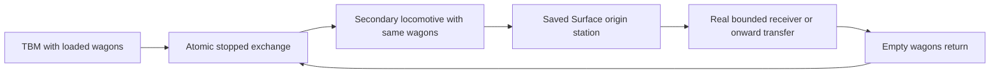

# R2MLVS5 - Spoil Wagons and Haulage

## Global Mandatory Reading

> **Execution protocol**
>
> - Read this Global Mandatory Reading section before the first task and again
>   after every context compaction.
> - Before starting or resuming a task group, read the nearest preceding Area
>   Mandatory Reading block whose `Applies to` label includes that group. Area
>   blocks appear immediately before the first group they govern.
> - A referenced heading or exported symbol is authoritative. Global navigation
>   hints and Area line ranges are for navigation only; if they drift, relocate
>   the named section or symbol rather than expanding to the whole file.
> - Mandatory reading is non-transitive. Do not preload a linked file's own
>   Mandatory Reading, Consult on Demand, or Planning Provenance entries unless
>   this plan names them directly for the current area.
> - Do not read Consult on Demand or Planning Provenance merely because those
>   sources are listed. Use a Consult on Demand source only when its trigger
>   occurs.
> - No created source file, test file or JSON file should start with same prefix as a planning MD file (such as r2). Only MD files can have that prefix. No MD file should be created anywhere in source directories unless specifically asked.
> - After EVERY CONTEXT COMPACTION, you must add a note above the task group
>   which is currently in execution. The note will say: "Context has compacted
>   X times while executing this group.". If the compaction occurs before any
>   meaningful work was done (this can happen when there is a lot of baggage
>   from the previous compaction), then and ONLY then you can skip this step.
> - When exceeding 3 context compactions, YOU MUST ask yourself if you're not 
>   chewing more than we can handle :). Heck, plans change! :). In such a case, 
>   the way out is to split the group on the spot,
>   in the plan, into more groups, 
>   by appending B, C, D as a suffixes to those groups (splitting sub-groups 
>   themselves is also allowed). When you do this, create Local Mandatory
>   Reading areas so you can optimize your context only for the
>   ACTUAL task at hand.
>   Before starting or resuming a task group, read the nearest preceding Area
>   Mandatory Reading block whose `Applies to` label includes that group. Area
>   blocks appear immediately before the first group they govern.

| File name | Line Ranges | Description |
| --- | --- | --- |
| [docs/zz-reach2/upgrades/2026-10/r2mlvs-multilayer-vehicles-and-structures.md](r2mlvs-multilayer-vehicles-and-structures.md) | 234-240 | `AD-6` supplies the canonical gameplay/ownership decision for every group of this plan. It constrains atomic real-wagon movement and the mandatory Surface origin/disposal leg; a consumer must not redefine it locally. |
| [src/map_layer.h](../../../../src/map_layer.h) | 78-85 | `MultiLayerMap` ownership preamble: `Map` owns packed storage/geometry and this controller owns layer semantics. Every group uses world tiles/explicit layer helpers; camera selection and ad hoc plane offsets cannot define gameplay. |
| [src/train_cmd.h](../../../../src/train_cmd.h) | 18-27 | Build/sell/move/reverse train commands and traits are the public commissioning/rearrangement boundary; restrict specialist capabilities through every applicable command. |

Status: proposed. Parent: [R2MLVS master](r2mlvs-multilayer-vehicles-and-structures.md). Depends on r2mlvs4. This is a major train-operation feature, not a cosmetic loading animation.

## Outcome and Boundaries

A second locomotive physically takes the TBM's loaded carriages to its originating Surface station and returns empty capacity.

## Public Handoff Contract

Proposed public owner: `src/tbm_exchange.h`. Publish `TBMExchangeAssignment`, `ValidateTBMWagonExchange`, `ExecuteTBMWagonExchange`. These symbols are producer obligations, not existing code. Keep one authority for the fields/commands they expose; downstream plans consume the public contract rather than private pools or copied tables.

## Implementation Tasks

Deepening pass, 2026-10-04: implementation groups use only SIMPLE, MEDIUM or HARD difficulty, with at most eight pending tasks each. Sketches describe proposed implementation contracts; verify the named earlier producers at each assumption gate. No gameplay or asset implementation is marked complete by this planning pass.

Groups are chronological and contain consecutive tasks of one difficulty. Each difficulty batch has at most eight tasks; area reading changes only when the implementation boundary or source of truth changes.

### Area Mandatory Reading - Controlled exchange facility

_Applies to Groups 1-5._

**Entry gate.** The following public contracts must exist before dependent implementation in this area: `src/multilayer_content.h`: `MultiLayerGameplayProfile`, `LayerVehicleCapability`, `GetMultiLayerContentProfile`, `CheckDeepLayerAvailability`, `UtilityPowerAccount`; `src/excavation.h`: `ExcavationState`, `GeologyDeposit`, `ExcavationJob`, `CheckExcavatedFootprint`, `CommitExcavationCut`, `GeothermalVentField`; `src/layer_portal_cmd.h`: `LayerPortalWorkState`, `GetLayerPortalWorkState`, `CheckLayerPortalWorkAccess`, `CommissionLayerPortalTBM`; `src/tbm.h`: `TBMProject`, `TBMWorkState`, `ValidateTBMAreaRoute`, `AdvanceTBMWork`.
Verify each public file/export/schema field with `rg` in the current workspace and inspect its command/field ownership. For a same-plan contract, compile its type/signature fixture or validate its artifact after the preceding producer groups. For cross-plan behavior, also run the producer's focused executable boundary test; declarations alone cannot authorize dependent mutations or runtime claims.
If a required export is absent, stop the dependent implementation, mutation and runtime claims in Groups 1-5. Read-only characterization, source/range verification, test-case design and asset-template work that does not assume the missing behavior may continue.
Do not bypass this gate by copying private pool/tile state, inventing local IDs or cargo registries, using a historical plan as a delivered implementation, opening user-wide content stores, substituting a second utility/accounting authority, or adding an unreviewed fallback path. Finish the named producer or revise the shared contract and its direct consumers first.

| File name | Line Ranges | Description |
| --- | --- | --- |
| [src/train.h](../../../../src/train.h) | 152-174 | `GetNextUnit` and `GetPrevUnit` skip articulated/rear dual-headed parts; detach real wagon units without breaking engine-support structure. |
| [src/train.h](../../../../src/train.h) | 45-72 | `ConsistChangeFlag`, `FreeTrainTrackReservation`, `TryPathReserve`, `NormalizeTrainVehInDepot` define cache/reservation rebuilding after actual wagon changes. |
| [src/train_cmd.cpp](../../../../src/train_cmd.cpp) | 1192-1234 | `ArrangeTrains` is a static rearrangement implementation, not an exported exchange contract. Inspect it only for the new controlled public exchange producer. |
| [src/train_cmd.cpp](../../../../src/train_cmd.cpp) | 1262-1455 | `CmdMoveRailVehicle` requires both heads stopped inside the same depot and restores trial rearrangement on failure/nonexecution. Preserve that guard and cache/order/group repair. |
| `src/multilayer_content.h` (planned public contract; link after implementation) | Live definitions; no fixed range | [r2mlvs1-gameplay-contracts-and-content.md](r2mlvs1-gameplay-contracts-and-content.md) Groups 1-6, ending with Group 6's public-contract task, publish `MultiLayerGameplayProfile`, `LayerVehicleCapability`, `GetMultiLayerContentProfile`, `CheckDeepLayerAvailability`, `UtilityPowerAccount`. These exports/schema fields are authoritative for this area. Same-plan consumers follow those earlier groups; cross-plan consumers verify the producer's required implementation/tests as well. Proposed names alone do not prove delivery. |
| `src/excavation.h` (planned public contract; link after implementation) | Live definitions; no fixed range | [r2mlvs2-geology-and-excavation.md](r2mlvs2-geology-and-excavation.md) Groups 1-7, ending with Group 7's public-contract task, publish `ExcavationState`, `GeologyDeposit`, `ExcavationJob`, `CheckExcavatedFootprint`, `CommitExcavationCut`, `GeothermalVentField`. These exports/schema fields are authoritative for this area. Same-plan consumers follow those earlier groups; cross-plan consumers verify the producer's required implementation/tests as well. Proposed names alone do not prove delivery. |
| [src/layer_portal_cmd.h](../../../../src/layer_portal_cmd.h) | Live definitions; no fixed range | [r2mlvs3-sealed-portals-and-deep-rail.md](r2mlvs3-sealed-portals-and-deep-rail.md) Groups 1-7, ending with Group 7's public-contract task, publish `LayerPortalWorkState`, `GetLayerPortalWorkState`, `CheckLayerPortalWorkAccess`, `CommissionLayerPortalTBM`. These exports/schema fields are authoritative for this area. Same-plan consumers follow those earlier groups; cross-plan consumers verify the producer's required implementation/tests as well. Proposed names alone do not prove delivery. |
| `src/tbm.h` (planned public contract; link after implementation) | Live definitions; no fixed range | [r2mlvs4-tunnel-boring-machines.md](r2mlvs4-tunnel-boring-machines.md) Groups 1-5, ending with Group 5's public-contract task, publish `TBMProject`, `TBMWorkState`, `ValidateTBMAreaRoute`, `AdvanceTBMWork`. These exports/schema fields are authoritative for this area. Same-plan consumers follow those earlier groups; cross-plan consumers verify the producer's required implementation/tests as well. Proposed names alone do not prove delivery. |
| [src/train_cmd.cpp](../../../../src/train_cmd.cpp) | 911-941 | Complete train-link backup/restore helpers restore chain order only; projected exchange validation must also preserve cargo and metadata. |
| [src/train_cmd.cpp](../../../../src/train_cmd.cpp) | 1235-1260 | Complete `NormaliseTrainHead` triggers consist/group repairs; capacity-changing effects must be validated before any cargo loss. |
| [src/autoreplace_cmd.cpp](../../../../src/autoreplace_cmd.cpp) | 103-133 | Complete `CheckCargoCapacity` can move/truncate surplus; exchange cannot invoke it as a cargo-loss fallback. |
| [src/group_cmd.cpp](../../../../src/group_cmd.cpp) | 793-816 | Complete `UpdateTrainGroupID` makes wagon groups follow the head; preserve engine groups and keep set identity separate. |

**ASSUMPTION: this was already built previously. If not, re-asses at runtime**. This applies only to the producer contracts named in this area's gate, after their listed producer groups have run. Verify their actual exports and focused tests before using the sketches below; proposed types and helper names in sketches are not evidence of delivered code.

**Exchange sketch (proposed).** Existing `CmdMoveRailVehicle` performs trial rearrangement, validation, then head/group/order/capacity repairs. The new exchange needs the same invariants across *both* legs as one operation; calling the command twice does not make the pair atomic.

```cpp
// Conceptual helper names to be implemented by this plan.
const ExchangeProposal proposal = DescribeExchange(tbm, hauler, wagon_sets);
if (auto error = ValidateWholeExchange(proposal)) return error;
if (!execute) return proposal.cost;
// All fallible validation/allocation precedes public side effects.
CommitBothConsistsAndAssignment(proposal);
// Cargo stays on the same WagonID; no packet transfer is needed for coupling.
```

Keep loaded units' capacity stable through callbacks. Restoring next/previous pointers alone is not enough after group statistics, orders, cargo capacity or caches have changed.

### Group 1 - Build the controlled exchange location

{{HARD}}
- [ ] 1.1 Implement the bay on a fully excavated footprint with approach length and rail compatibility. Define its functional rearrangement tile so both entire consists can satisfy same-location stopped-depot semantics.
- [ ] 1.2 Reserve the bay by project and participating train heads; refuse crashed, moving, wrong-owner or partly outside consists before touching their chains.
- [ ] 1.3 Keep `CmdMoveRailVehicle` ordinary depot guard intact. Identify reusable internal rearrangement/validation primitives and expose a restricted exchange boundary instead of adding general on-track coupling.

### Group 2 - Describe both resulting consists before mutation

{{HARD}}
- [ ] 2.1 Enumerate loaded spoil units, empty replacement units, fixed cutter/support parts and secondary locomotive using real articulated/dual-head unit boundaries. Store an ordered ID list for each original and proposed consist.
- [ ] 2.2 Validate railtype/coupling callbacks, maximum resulting lengths, per-wagon cargo capacities and ownership for both final consists. Require stable Keep cargo with no loading/unloading reservations; reject refits or callback capacity changes that would discard loaded cargo.
- [ ] 2.3 Validate empty Earth/Rock capacity independently against the project cut/return contract. Require an assigned secondary locomotive; the cutter cannot satisfy its own haulage leg.
- [ ] 2.4 Create a pure exchange proposal and snapshot every authoritative field affected by any trial rearrangement, including head orders/group identity; estimate must restore all changes and consume no RNG.

### Group 3 - Commit one wagon exchange with complete recovery

{{HARD}}
- [ ] 3.1 Factor a transaction that moves the designated loaded wagon units to the hauler and empties to the cutter. Preserve the same wagon IDs and their attached cargo lists; no copying through hidden storage.
- [ ] 3.2 Validate the complete two-way result before public side effects. A sequence of independently successful `CmdMoveRailVehicle` calls is insufficient: either make commit non-failing after preparation or restore all chains/caches/metadata on any later failure.
- [ ] 3.3 After successful chain mutation, normalize subtypes/heads, rebuild consist caches/reservations, preserve engine orders/groups and publish one assignment update. Wagon group/cache follows its new head through canonical rules; set identity stays independent. Avoid capacity-repair code that silently truncates cargo, including truncation inside `ConsistChanged(CCF_ARRANGE)` before `CheckCargoCapacity`.
- [ ] 3.4 Test an estimate and an injected failure after the first proposed leg; compare wagon order, heads, packet counts/age/refits, orders, groups, RNG and assignment IDs before/after.
- [ ] 3.5 Repeat a successful mixed Earth/Rock exchange and confirm exactly one head owns each wagon and each packet remains attached to the same wagon.

### Group 4 - Reuse the exchange at the commissioning origin

{{HARD}}
- [ ] 4.1 Map the portal commissioning-side bay to the same stopped-consist proposal/commit contract. Document approach/retreat geometry and where the waiting hauler/empties fit without requiring an underground bay.
- [ ] 4.2 Implement a pure origin/route admission contract requiring the saved Surface station and real receivers for both spoil types or onward transfer. Receiver construction and live disposal are implemented in the following haulage area; keep that runtime admission/scenario pending until then.
- [ ] 4.3 Validate the commissioning-side exchange with already-created real train/wagon boundary fixtures and the restricted work route. Defer first-cut-to-disposal runtime acceptance to the final M1 group after receivers exist; fixture construction does not prove that complete loop.
- [ ] 4.4 Test insufficient initial empty capacity and an obstructed source-side bay; pause without opening free rock or deleting spoil. Only after this works enable the recurring underground-bay variant.

### Group 5 - Controlled exchange facility

{{HARD}}
- [ ] 5.1 Publish `src/tbm_exchange.h` with the exact exports/schema fields in `Public Handoff Contract`; document authoritative fields, invalid-ID semantics and command/estimate boundaries. Register any created C++ source in the existing build list. If the chosen implementation uses a different public location, update this contract and every direct consumer before declaring the producer ready.

### Area Mandatory Reading - Hauler orders and disposal

_Applies to Groups 6-9._

**Entry gate.** The following public contracts must exist before dependent implementation in this area: `src/tbm_exchange.h`: `TBMExchangeAssignment`, `ValidateTBMWagonExchange`, `ExecuteTBMWagonExchange`.
Verify each public file/export/schema field with `rg` in the current workspace and inspect its command/field ownership. For a same-plan contract, compile its type/signature fixture or validate its artifact after the preceding producer groups. For cross-plan behavior, also run the producer's focused executable boundary test; declarations alone cannot authorize dependent mutations or runtime claims.
If a required export is absent, stop the dependent implementation, mutation and runtime claims in Groups 6-9. Read-only characterization, source/range verification, test-case design and asset-template work that does not assume the missing behavior may continue.
Do not bypass this gate by copying private pool/tile state, inventing local IDs or cargo registries, using a historical plan as a delivered implementation, opening user-wide content stores, substituting a second utility/accounting authority, or adding an unreviewed fallback path. Finish the named producer or revise the shared contract and its direct consumers first.

| File name | Line Ranges | Description |
| --- | --- | --- |
| [src/cargopacket.h](../../../../src/cargopacket.h) | 458-489 | `VehicleCargoList::Append`, `AgeCargo`, `Stage`, `Return`, `Unload`, `Shift` move accountable packets; exchange/descent/processing must not clone packet age or feeder shares. |
| [src/cargopacket.h](../../../../src/cargopacket.h) | 596-603 | `StationCargoList::Reserve`, `Load`, `Truncate`, `Reroute` provide bounded station moves and destination reservations; hub inventory has one physical owner. |
| [src/economy_base.h](../../../../src/economy_base.h) | 20-38 | `CargoPayment`, `PayTransfer`, `PayFinalDelivery` own transport income. Visiting an origin station, a descent, or handling transfer is not automatic final payment. |
| `src/tbm_exchange.h` (planned public contract; link after implementation) | Live definitions; no fixed range | [r2mlvs5-spoil-wagons-and-haulage.md](r2mlvs5-spoil-wagons-and-haulage.md) Groups 1-5, ending with Group 5's public-contract task, publish `TBMExchangeAssignment`, `ValidateTBMWagonExchange`, `ExecuteTBMWagonExchange`. These exports/schema fields are authoritative for this area. Same-plan consumers follow those earlier groups; cross-plan consumers verify the producer's required implementation/tests as well. Proposed names alone do not prove delivery. |
| [src/economy.cpp](../../../../src/economy.cpp) | 1022-1073 | Complete `DeliverGoodsToIndustry` may accept a bounded subset; reserve the actual intake before spoil packet removal. |
| [src/cargoaction.cpp](../../../../src/cargoaction.cpp) | 107-119 | Complete `CargoDelivery::operator()` removes its requested count after payment; the bounded-disposal path must pass only guaranteed accepted quantities. |

**ASSUMPTION: this was already built previously. If not, re-asses at runtime**. This applies only to the producer contracts named in this area's gate, after their listed producer groups have run. Verify their actual exports and focused tests before using the sketches below; proposed types and helper names in sketches are not evidence of delivered code.

**Haulage sketch.** The earlier exchange groups provide actual wagon movement and stable set IDs. Disposal is a later separate event; the mandatory origin visit is evidence of route completion, never a synonym for payment or consumption.



### Group 6 - Drive one assigned hauler through its saved cycle

{{HARD}}
- [ ] 6.1 Consume r2mlvs4 project-command and ordinary travel-order separation. Bind one project, secondary locomotive and explicit wagon-set IDs; validate Surface origin and preserve unrelated/shared user orders.
- [ ] 6.2 Implement AwaitExchange -> CollectLoaded -> VisitOrigin -> DisposeOrTransfer -> ReturnEmpties as saved assignment phases. Each transition verifies actual location, actual wagon IDs and cargo emptiness rather than trusting the previous head ID.
- [ ] 6.3 Define cancellation/manual-order intervention at each phase as a recoverable pause with existing cargo intact. Test one complete cycle after the next receiver groups are ready; test independent phase guards earlier.

### Group 7 - Queue wagon sets independently of train heads

{{HARD}}
- [ ] 7.1 Give a set/assignment a stable saved identity and ordered wagon IDs independent of its current locomotive. Track loaded, assigned, returning-empty and available states with exclusive ownership.
- [ ] 7.2 Implement a deterministic queue ordered by accepted request sequence and stable IDs. Start with one active exchange per bay; prevent two haulers reserving the same set.
- [ ] 7.3 Extend from the single-set loop to multiple sets/haulers after its fixture passes. Test head changes, full versus empty cargo validation, cancellation and queue reload without duplicated claims.

### Group 8 - Enforce the Surface origin leg and real disposal

{{HARD}}
- [ ] 8.1 Record whether each loaded set has visited the project origin on its current loaded cycle; validate a company-owned Surface replacement on explicit reassignment. A below-ground sink cannot satisfy this leg.
- [ ] 8.2 Implement capacity-limited Earth reclamation/disposal and Rock crusher/disposal receivers from the frozen content recipes. These minimal Surface spoil sinks belong to this M1 owner; do not wait for r2mlvs6 mine factories.
- [ ] 8.3 At origin arrival, reserve exact receiver capacity before packet removal or fee settlement. `CargoDelivery` removes the requested amount while `PayFinalDelivery` returns no accepted count; adapt this boundary for bounded spoil rather than trusting the acceptance flag. Keep the refused remainder in wagons or transfer onward; visiting the station alone consumes nothing.
- [ ] 8.4 Keep tube conversion after safe TBM/hauler withdrawal and the mandatory conventional wagon haul. A capsule or underground dump cannot substitute for the recorded Surface journey.

### Group 9 - Account for spoil delivery and expose logistics stalls

{{HARD}}
- [ ] 9.1 Define disposal fees, crusher production and any allowed final-delivery revenue at the actual accepted quantity. Preserve feeder-share/age/provenance through transfer; no payment solely for origin visitation or layer crossing.
- [ ] 9.2 Test repeated transfer orders, company-owned receiver loops, partial acceptance and one loaded set visiting the origin twice. Final delivery/disposal can settle a quantity only once.
- [ ] 9.3 Publish waiting reasons for no empties/hauler, occupied bay, blocked line, saturated receiver or lost origin. Pause new excavation through the TBM public controller while preserving already-loaded recovery movement.

### Area Mandatory Reading - Lifecycle and acceptance

_Applies to Groups 10-14._

**Entry gate.** The following public contracts must exist before dependent implementation in this area: `src/tbm_exchange.h`: `TBMExchangeAssignment`, `ValidateTBMWagonExchange`, `ExecuteTBMWagonExchange`.
Verify each public file/export/schema field with `rg` in the current workspace and inspect its command/field ownership. For a same-plan contract, compile its type/signature fixture or validate its artifact after the preceding producer groups. For cross-plan behavior, also run the producer's focused executable boundary test; declarations alone cannot authorize dependent mutations or runtime claims.
If a required export is absent, stop the dependent implementation, mutation and runtime claims in Groups 10-14. Read-only characterization, source/range verification, test-case design and asset-template work that does not assume the missing behavior may continue.
Do not bypass this gate by copying private pool/tile state, inventing local IDs or cargo registries, using a historical plan as a delivered implementation, opening user-wide content stores, substituting a second utility/accounting authority, or adding an unreviewed fallback path. Finish the named producer or revise the shared contract and its direct consumers first.

| File name | Line Ranges | Description |
| --- | --- | --- |
| [src/saveload/vehicle_sl.cpp](../../../../src/saveload/vehicle_sl.cpp) | 1119-1196 | `VEHSChunkHandler` and registration construct the vehicle class from saved type before member loading; protect old enum meanings and validate new references. |
| [src/network/network_command.cpp](../../../../src/network/network_command.cpp) | 256-288 | `NetworkExecuteLocalCommandQueue` executes agreed frame order/company authority; all jobs use deterministic simulation time. |
| [src/network/network_server.cpp](../../../../src/network/network_server.cpp) | 670-687 | `ServerNetworkGameSocketHandler::SendSync` compares RNG seeds, not a full gameplay checksum; validate orbital/geology/cargo ledgers in addition to a no-desync result. |
| `src/tbm_exchange.h` (planned public contract; link after implementation) | Live definitions; no fixed range | [r2mlvs5-spoil-wagons-and-haulage.md](r2mlvs5-spoil-wagons-and-haulage.md) Groups 1-5, ending with Group 5's public-contract task, publish `TBMExchangeAssignment`, `ValidateTBMWagonExchange`, `ExecuteTBMWagonExchange`. These exports/schema fields are authoritative for this area. Same-plan consumers follow those earlier groups; cross-plan consumers verify the producer's required implementation/tests as well. Proposed names alone do not prove delivery. |

**ASSUMPTION: this was already built previously. If not, re-asses at runtime**. This applies only to the producer contracts named in this area's gate, after their listed producer groups have run. Verify their actual exports and focused tests before using the sketches below; proposed types and helper names in sketches are not evidence of delivered code.

### Group 10 - Persist assignment and queue state

{{HARD}}
- [ ] 10.1 Serialize stable assignments, wagon-set IDs, origin-visited cycle state, queue order and wait reason with typed references. Rebuild head/location lookup from actual consists after load.
- [ ] 10.2 Keep the exchange atomic within one simulation action so saves observe before or after, never a half-swap. If implementation introduces persistent shunting phases, revise the schema and each recovery test before using them.
- [ ] 10.3 Round-trip every wait state and validate missing/reused vehicle IDs without attaching a wagon to two projects. Verify actual packet lists remain authoritative.

### Group 11 - Handle fleet and company lifecycle around assignments

{{HARD}}
- [ ] 11.1 Define autoreplace/refit admission for assigned units; validate replacement Earth/Rock capacity and fixed support compatibility before replacing any part.
- [ ] 11.2 Handle vehicle sale, changed lengths and articulated/dual-headed replacements by pausing/revalidating the assignment. Refuse sale of loaded unrecovered wagons unless a declared cargo-preserving recovery path exists.
- [ ] 11.3 Refuse unsafe bay removal before any consist or cargo mutation. Cancel only unoccupied reservations; retain an alternate supported recovery route for occupied projects.
- [ ] 11.4 On takeover/bankruptcy, transfer or safely suspend project/set ownership through the common lifecycle contract. Test mismatched owners and lost origin station without deleting cargo or stealing a set.

### Group 12 - Lifecycle and acceptance

{{MEDIUM}}
- [ ] 12.1 Test mixed Earth/Rock wagons, insufficient empty capacity, competing haulers, blocked exits and cancellation at every wait state.
- [ ] 12.2 Verify unchanged wagon IDs and packet totals before/after repeated cycles.

### Group 13 - Demonstrate and reload the complete M1 logistics loop

{{HARD}}
- [ ] 13.1 Run commission -> cut -> fill -> real wagon exchange -> secondary train to Surface origin -> bounded disposal -> empty return -> boring resumes. Record each wagon ID and separate Earth/Rock ledger at every transition.
- [ ] 13.2 Save/reload at each logistics wait state and with the hauler spanning layers. Resume to the same next exchange and compare packet age, quantities, assignment cycle and cost.
- [ ] 13.3 Replay the same commands from the same fixture and compare the normalized state/ledger trace, not only RNG synchronization. Retain evidence for r2mlvs15; blocked art/network review remains explicitly pending.

### Group 14 - Lifecycle and acceptance

{{SIMPLE}}
- [ ] 14.1 Record the implemented public exports, focused test commands/results and remaining runtime/art/network gaps in this plan; retain original supplied saves and repository-local evidence.
- [ ] 14.2 Update affected architecture/handoff documentation to describe delivered behavior and reconcile the parent index only when this plan's Completion Conditions are met. Keep every unfinished task unchecked.

## Consult on Demand

| Trigger | File name | Start at | Expand only when | Consultation purpose |
| --- | --- | --- | --- | --- |
| Transferred spoil shows incorrect feeder credit or final income | [../../architecture/economy/archi-cargo-payment.md](../../architecture/economy/archi-cargo-payment.md) | `Feeder share` | Packet identity and acceptance ledgers match but the displayed/settled income does not | Explain transfer/final share arithmetic; live CargoPayment remains authoritative and origin-station arrival is not disposal. |
| A required public export is absent and its owner/location is disputed | [r2mlvs-multilayer-vehicles-and-structures.md](r2mlvs-multilayer-vehicles-and-structures.md) | `Requirements and ownership` and `Plan Index` | The named producer confirms an intentional contract/ownership change | Find the responsible producer and reconcile its public handoff with direct consumers; the hub cannot substitute for missing implementation. |
| Current behavior contradicts a historical subsystem description | [../../architecture/map-layers/archi-map-layers.md](../../architecture/map-layers/archi-map-layers.md) | `Invariants` and the relevant named source in `Code map` | The live symbol and executable test do not explain the difference | Locate layer addressing or lifecycle rationale. Live code/tests govern delivered behavior; this architecture page does not prove future interfaces exist. |

## Planning Provenance

This is not an execution reading queue. Do not preload it after context compaction. It is non-transitive; ranges record planning use, not runtime authority.

| File name | Sections or Line Ranges used while planning | Planning contribution |
| --- | --- | --- |
| [docs/zz-reach2/architecture/initial-inventory.md](../../architecture/initial-inventory.md) | 185-220 | `Command as the only world mutation`, `Pool-indexed game objects`, `Tile map as a packed array` and `File-suffix modules` oriented command/pool/header ownership and source registration. This historical inventory is a location survey, not authority for current layer behavior. |
| [docs/zz-reach2/architecture/@archi-ttd-level0.md](../../architecture/@archi-ttd-level0.md) | 24-63 | `How the program fits together` and `Source and runtime boundaries` located shared simulation, data/presentation, CMake targets and subsystem handoffs used to choose the live reading sources. |
| [docs/zz-reach2/upgrades/2026-10/r2mlvs-multilayer-vehicles-and-structures.md](r2mlvs-multilayer-vehicles-and-structures.md) | 119-140 | `Requirements and ownership` assigned this plan's feature responsibilities; it shaped the decomposition without making every sibling plan a mandatory reading dependency. |
| [src/train_cmd.h](../../../../src/train_cmd.h) | 18-27 | The inspected live boundary helped separate characterization, public-contract production, implementation and acceptance batches. It materially constrained atomic real-wagon movement and the mandatory Surface origin/disposal leg; this entry records planning influence rather than an additional reading obligation. |
| [User planning-format instructions](<C:/Users/Axonn/.codex/attachments/cd59b20a-3a96-4d54-b4bd-1e8f37639e7d/Pasted text.txt>) | `Global Mandatory Reading`, `Area Mandatory Reading`, `Consult on Demand`, `Planning Provenance`, `Final validation` | Supplies the exact protocol, chronological difficulty batches of at most eight tasks, reading gates and validation format. |
| [src/train_cmd.cpp](../../../../src/train_cmd.cpp) | 1235-1260; 1262-1455 | Deeper planning pass, 2026-10-04: Trial link restoration and normalization side effects required whole-exchange validation without cargo truncation. |

## Completion Conditions

The observed secondary train carries the same loaded wagons that were behind the TBM. Full spoil stops excavation, empty return restarts it, disposal has a real receiver/cost, and no depot trick or save transition creates cargo, wagons or money. General track shunting remains outside this plan.
