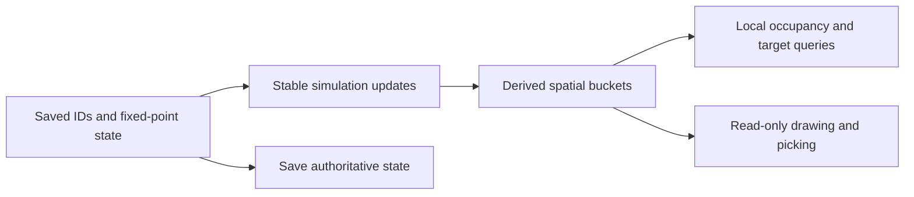

# R2MLVS8 - Space World and Construction

## Global Mandatory Reading

> **Execution protocol**
>
> - Read this Global Mandatory Reading section before the first task and again
>   after every context compaction.
> - Before starting or resuming a task group, read the nearest preceding Area
>   Mandatory Reading block whose `Applies to` label includes that group. Area
>   blocks appear immediately before the first group they govern.
> - A referenced heading or exported symbol is authoritative. Global navigation
>   hints and Area line ranges are for navigation only; if they drift, relocate
>   the named section or symbol rather than expanding to the whole file.
> - Mandatory reading is non-transitive. Do not preload a linked file's own
>   Mandatory Reading, Consult on Demand, or Planning Provenance entries unless
>   this plan names them directly for the current area.
> - Do not read Consult on Demand or Planning Provenance merely because those
>   sources are listed. Use a Consult on Demand source only when its trigger
>   occurs.
> - No created source file, test file or JSON file should start with same prefix as a planning MD file (such as r2). Only MD files can have that prefix. No MD file should be created anywhere in source directories unless specifically asked.
> - After EVERY CONTEXT COMPACTION, you must add a note above the task group
>   which is currently in execution. The note will say: "Context has compacted
>   X times while executing this group.". If the compaction occurs before any
>   meaningful work was done (this can happen when there is a lot of baggage
>   from the previous compaction), then and ONLY then you can skip this step.
> - When exceeding 3 context compactions, YOU MUST ask yourself if you're not 
>   chewing more than we can handle :). Heck, plans change! :). In such a case, 
>   the way out is to split the group on the spot,
>   in the plan, into more groups, 
>   by appending B, C, D as a suffixes to those groups (splitting sub-groups 
>   themselves is also allowed). When you do this, create Local Mandatory
>   Reading areas so you can optimize your context only for the
>   ACTUAL task at hand.
>   Before starting or resuming a task group, read the nearest preceding Area
>   Mandatory Reading block whose `Applies to` label includes that group. Area
>   blocks appear immediately before the first group they govern.

| File name | Line Ranges | Description |
| --- | --- | --- |
| [docs/zz-reach2/upgrades/2026-10/r2mlvs-multilayer-vehicles-and-structures.md](r2mlvs-multilayer-vehicles-and-structures.md) | 256-262 | `AD-9` supplies the canonical gameplay/ownership decision for every group of this plan. It constrains stable orbital IDs/controllers and explicit timed transitions; a consumer must not redefine it locally. |
| [src/map_layer.h](../../../../src/map_layer.h) | 78-85 | `MultiLayerMap` ownership preamble: `Map` owns packed storage/geometry and this controller owns layer semantics. Every group uses world tiles/explicit layer helpers; camera selection and ad hoc plane offsets cannot define gameplay. |
| [src/vehicle_type.h](../../../../src/vehicle_type.h) | 21-39 | `VehicleType` includes `Effect = CompanyEnd` and persisted numeric ordering; a Space fleet cannot silently renumber Effect/Disaster or historical company vehicle types. |

Status: proposed. Parent: [R2MLVS master](r2mlvs-multilayer-vehicles-and-structures.md). Depends on r2mlvs1 and r2mlvs15 `Schema Foundation Handoff`.

## Current dispatch - Native orbital mining, 2026-10-12

The underground queue remains paused. GroupP1 delivered persistent geometry,
field motion and the survey preview. The user's continuation request advances
GroupP2: the canonical fifth company vehicle category and finite orbital mining.
This bounded producer leaves launch-center construction, physical rockets,
Surface descent and service/repeat work to their original entry gates. Prepared
demo purchases retire survey records; they grant no free Surface facilities.

### Area Mandatory Reading - Preview foundation

_Applies to Group P1 only._ Read parent AD-9/AD-11 and I-3/I-5/I-7/I-9,
`map_layer.h` ownership preamble, `multilayer_state.h` schema/validation,
`vehicle_type.h` persisted enum and `vehicle_func.h` tick/render boundaries.
Consume the existing selected-profile and save-foundation exports/tests.
Shared Q16 geometry and reflection use Group10's tables unchanged. Read
Plan10 GroupP1 before implementing the field consumer.

### Group P1 - Persistent body motion and an explicitly staged survey preview

{{HARD}}

- [X] P1.1 Publish `space.h` with `OrbitalBodyID`, `SpaceMotion`, shared Q16 band/reflection helpers and a bounded derived spatial index. These are the preview's exact producer exports; full `SpaceVehicle`/structure/transition exports remain pending.
- [X] P1.2 Tick the field once from synchronized simulation, independent of camera/layer selection; persist exact motion/remainders/IDs and rebuild only derived indexing after load. New saves require the versioned family; genuine older saves retain an empty Space layer.
- [X] P1.3 Add saved `SpaceSurveyPreview` records for explicitly predeployed model15 demonstration craft. They pursue, attach, survey, detach and repeat without consuming reserves or creating cargo/payment. They are not company Vehicle/Engine entries, cannot be purchased or launched, and have no Surface descent. Keep old VehicleType bytes, arrays, commands and aircraft logic unchanged; full native fleet integration stays in Groups1-7.
- [X] P1.4 Draw and inspect these entities on the actual Space viewport, provide a launchable ordinary saved demo and verify hidden-view motion, edge/corner reflection, deterministic pursuit/attachment and exact save/reload continuation. Identify preview art and economic boundaries in the player guide.

**Delivered preview handoff,2026-10-12:** `space.h` owns typed body/survey IDs,
Q16 motion and the16-tile derived buckets; clustered bucket removal is constant
work per moved ID, with stable sorted query results. `asteroid.h` owns the one
finite field and survey controllers. `ASTR` version404 stores the generated
records, motion fractions, survey slots/phases and feature seed; `MLMD` requires
the matching field bit/root. Preview loading validates copied candidate data
without borrowing the running world. The native tick advances bodies before
survey decisions; viewing/rendering cannot advance work or consume RNG.

Focused producer evidence: `[space-preview]` plus existing state/content gates
pass3,402 assertions/eight cases in RelWithDebInfo and Debug. Each featured
checkpoint passes ordinary exact orbital resave and2,000 native continuation
ticks in both configurations, including paused and hidden-view phases. Actual
ordinary graphical captures and the inspector render successfully. The original
eight underground checkpoints preserve27 native owner chunks each; the retained
M0/M1 loader matches3,561 sprites/anchors/pixel hashes exactly (60,559 assertions).
Only the new11-sprite preview block is appended after native offset3588.
See `src/tests/fixtures/demos/space/demo-checkpoints.json`, the
[walkthrough](d3sp-space-survey.md), and `logs/space-preview-verification.json`.
This handoff authorizes GroupP1 consumers only; original full-fleet entry gates
remain unsatisfied and their checkboxes remain pending.

`SpaceSurveyPreview` is confined to explicitly prepared demo worlds. It is a
survey controller, never a parallel vehicle/cargo/engine registry. Later native
fleet commissioning must retire these demonstration records explicitly rather
than grant free vehicles, stock or Surface facilities. Asteroid records remain
the sole finite resource authority for the eventual mining controller.

### Area Mandatory Reading - Native orbital mining increment

_Applies to Group P2 only._ This staged producer revision follows the user's
request to continue functionality after P1. Read the Global section, parent
AD-9/AD-11, the delivered P1 exports, and
[native compatibility matrix](space-vehicle-compatibility.md). Entry producers:
state/content focused gates, canonical Vehicle/Engine/EIDS/CAPA ownership,
`space.h` Q16 geometry and the one `AsteroidField`. Consume actual native owners;
no second fleet, engine or cargo registry is allowed. This increment exports
`SpaceVehicle`, `SpaceMission`, `CmdSetSpaceMission` and finite body leases.
Explicit test/demo setup retires survey records and debits native purchases;
it is not rocket commissioning. Cargo remains in the vehicle at orbital home.
Missing launch-center/structure/descent producers stay outside P2; the original
full-fleet/full-loop entry gates and checkboxes remain in force.

Context has compacted 1 times while executing this group.

### Group P2 - Native owned probes and finite orbital extraction

{{HARD}}

- [X] P2.1 Preserve historical vehicle bytes and fleet window identities; add explicit dense company indexing, canonical Space engine/class and versioned VEHS/ASTR/CAPA persistence. Reject unsupported ordinary purchase/order/clone/script/NewGRF paths.
- [X] P2.2 Pursue moving bodies with a frozen adaptive timeout, lease one slot in native VehicleID order, mine 2 tonnes per 74 working ticks into a 20-tonne canonical packet hold, debit finite reserves and native company operating costs, and return with cargo intact.
- [X] P2.3 Provide synchronized owner-validated assign/recall commands and a native Space inspector. Prepare purchased fleet snapshots; identify retained cargo and pending launch/descent/service work in the walkthrough.
- [X] P2.4 Verify actual native contention, all resource classes, conservation/full-hold refusal/fleet bounds, cancellation/retargeting, costs/cargo age, paused/hidden ticks, old-save compatibility and exact reload continuation in both build configurations.

**Delivered native mining handoff, 2026-10-12:** `SpaceVehicle` is saved native
vehicle type6, with dense company slot4 and canonical Engine/EIDS, group/unit,
operating-account and VehicleCargoList/CAPA owners. Historical bytes0..5 and
old fleet-window numbers retain their meanings. `SpaceMission` and
`CmdSetSpaceMission` provide owner-validated moving-target pursuit, bounded
approach, exclusive native-ID leases, partial extraction and recall/retarget.
The field ticks before native vehicles; each extraction credits packets before
debiting finite reserves. Version405 saves body leases, native mission/hold
state and Asteroid provenance. Load validation rejects orphan leases, duplicate
packet ownership, legacy-byte aliases and fleets above the64-probe bound.

Focused state/content/motion/index tests pass 3,818 assertions in nine cases in
RelWithDebInfo and Debug. All three checkpoints pass ordinary exact orbital
resave and two independent 2,200-tick native continuations per configuration;
ASTR/VEHS/CAPA/PLYR outputs match exactly. Native setup tests in both builds
exercise paid purchases, simultaneous arrival, loaded recall, incompatible
retarget refusal, resumed mining, costs, ageing and reserve/hold conservation.
Paused and hidden-view checks pass. All three corrupt-save cases reject in both
builds; all eight underground demos preserve27 native owner chunks each.
Ordinary graphical inspector captures pass for approach, partial work and full
holds in both builds. Older404 survey and new-world population checks remain
supported. See `src/tests/fixtures/demos/space/mining-checkpoints.json`,
`logs/space-mining-verification.json` and the [walkthrough](d3sp-space-survey.md).

This handoff exports native orbital mining only. The explicit demo purchase
retires preview controllers and charges120,000 for three probes; it does not
commission rockets. Full20-tonne holds wait at orbital staging. The next producer
is Plan9's Surface launch center and20-tile circular drop zone, then saved
cargo descent and Surface handling. No delivery income, automatic repeat,
service producer, free Surface facility or final space-art completion is claimed.
Original full-fleet/full-loop groups retain their own pending acceptance gates.

**Artifact-layout migration (2026-10-09):** this plan consumes the parent [Development artifact layout](r2mlvs-multilayer-vehicles-and-structures.md#development-artifact-layout), implemented by [R2FC](r2fc-file-cleanup.md). It supersedes earlier docs asset/review/helper placement and fixed runtime-config destinations below. New native homes use `mlm/runtime/`, generated feature reviews use `mlm/reviews/`, logs remain under `logs/`, and reusable code/curated inputs keep their code/test owners. Paths and focused native/cold verification are complete; R2FC records the results and retained-input identities. Repository-relative executable commands run from the checkout root through their context-aware wrappers. Historical pass records remain dated evidence and are not new acceptance claims. No gameplay task is completed by this migration and the separate post-demo fixture-pruning gate remains.

## Outcome and Boundaries

Provide deterministic Space entities, vehicle control and construction semantics without treating vacuum as ordinary land or asteroids as moving map industries.

**User revision,2026-10-12:** consume the shared
[Space economy contract](r2mlvs1-d-recipes-and-bootstrap.md#space-economy-revision---2026-10-12).
Mining, survey and construction probes share the native Space vehicle owner,
with typed ordered moving-body/blueprint/station destinations. Initially all
commission through an Earth launch center; later a completed orbital Assembly
may construct them with Steel/Goods, capacity, time and funds. A Fund
Industry-style Space build window places inert blueprints and shows missing
Steel/Goods, delivered stock and assigned construction probes. Placing a
blueprint activates no station function. Plan11 owns material consumption and
processing; Plan10 owns survey disclosure and probe actions. Preserve the
existing geometry/Vehicle/Engine/cargo authority and version new saved order,
role, knowledge and construction fields. This revision is pending implementation.

## Public Handoff Contract

Public owners: `src/space.h` supplies `OrbitalBodyID` and shared geometry;
`src/space_vehicle.h` supplies `SpaceVehicle` and `SpaceMission`;
`src/space_transition.h` supplies `SpaceTransition`; `src/space_structure.h`
supplies `SpaceStructure`. Consume these native owners rather than copied
registries. Their presence does not complete the remaining behavior/acceptance
tasks or publish operational station facilities.

**Owner locations reconciled for Group13B,2026-10-13:** shared body geometry
remains in `space.h`; native craft/mission live in `space_vehicle.h`, transitions
in `space_transition.h`, and static identity/occupancy in `space_structure.h`.
The latter contains Plan11's `OrbitalConstructionJob` from `orbital_station.h`.
Group13B is verified in RelWithDebInfo. Its static phases are Blueprint,
FrameComplete (awaiting operational activation), and Cancelled. Consumers must
not interpret any of these phases as an active Dock/Storage/Assembly/Utility.

## Implementation Tasks

Deepening pass, 2026-10-04: implementation groups use only SIMPLE, MEDIUM or HARD difficulty, with at most eight pending tasks each. Sketches describe proposed implementation contracts; verify the named earlier producers at each assumption gate. No gameplay or asset implementation is marked complete by this planning pass.

Groups are chronological and contain consecutive tasks of one difficulty. Each difficulty batch has at most eight tasks; area reading changes only when the implementation boundary or source of truth changes.

### Area Mandatory Reading - Vehicle model and compatibility spike

_Applies to Groups 1-7._

**Entry gate.** The following public contracts must exist before dependent implementation in this area: `src/multilayer_content.h`: `MultiLayerGameplayProfile`, `LayerVehicleCapability`, `GetMultiLayerContentProfile`, `CheckDeepLayerAvailability`, `UtilityPowerAccount`; `src/multilayer_state.h`: `MultiLayerStateSchema`, `ValidateMultiLayerStateReferences`.
Verify each public file/export/schema field with `rg` in the current workspace and inspect its command/field ownership. For a same-plan contract, compile its type/signature fixture or validate its artifact after the preceding producer groups. For cross-plan behavior, also run the producer's focused executable boundary test; declarations alone cannot authorize dependent mutations or runtime claims.
If a required export is absent, stop the dependent implementation, mutation and runtime claims in Groups 1-7. Read-only characterization, source/range verification, test-case design and asset-template work that does not assume the missing behavior may continue.
Do not bypass this gate by copying private pool/tile state, inventing local IDs or cargo registries, using a historical plan as a delivered implementation, opening user-wide content stores, substituting a second utility/accounting authority, or adding an unreviewed fallback path. Finish the named producer or revise the shared contract and its direct consumers first.

| File name | Line Ranges | Description |
| --- | --- | --- |
| [src/vehicle_func.h](../../../../src/vehicle_func.h) | 231-249 | Both `IsCompanyBuildableVehicleType` overloads currently use the company-range bound; a Space model must fit explicit ownership/accounting rules. |
| [src/company_base.h](../../../../src/company_base.h) | 32-55 | `CompanyInfrastructure` owns per-mode infrastructure counters; decide how orbital facilities count without silently treating them as ordinary airports. |
| [src/company_base.h](../../../../src/company_base.h) | 142-148 | `group_all`, `group_default`, `freeunits` are category-indexed company fleet declarations; adding Space must update the same identity/statistics owner. |
| [src/saveload/vehicle_sl.cpp](../../../../src/saveload/vehicle_sl.cpp) | 1119-1196 | `VEHSChunkHandler` and registration construct the vehicle class from saved type before member loading; protect old enum meanings and validate new references. |
| [src/vehicle_func.h](../../../../src/vehicle_func.h) | 192-204 | `VehicleServiceInDepot`, `CallVehicleTicks`, `ResetVehicleHash`, `ViewportAddVehicles` are public tick/service/spatial-render boundaries for orbital vehicles. |
| `src/multilayer_content.h` (planned public contract; link after implementation) | Live definitions; no fixed range | [r2mlvs1-gameplay-contracts-and-content.md](r2mlvs1-gameplay-contracts-and-content.md) Groups 1-6, ending with Group 6's public-contract task, publish `MultiLayerGameplayProfile`, `LayerVehicleCapability`, `GetMultiLayerContentProfile`, `CheckDeepLayerAvailability`, `UtilityPowerAccount`. These exports/schema fields are authoritative for this area. Same-plan consumers follow those earlier groups; cross-plan consumers verify the producer's required implementation/tests as well. Proposed names alone do not prove delivery. |
| `src/multilayer_state.h` (planned public contract; link after implementation) | Live definitions; no fixed range | [r2mlvs15-savegame-determinism-and-lifecycle.md](r2mlvs15-savegame-determinism-and-lifecycle.md) Groups 1-6, ending with Group 6's public-contract task, publish `MultiLayerStateSchema`, `ValidateMultiLayerStateReferences`. These exports/schema fields are authoritative for this area. Same-plan consumers follow those earlier groups; cross-plan consumers verify the producer's required implementation/tests as well. Proposed names alone do not prove delivery. |
| [src/vehicle_type.h](../../../../src/vehicle_type.h) | 97-103 | Complete `VehicleTypeIndexArray` aliases raw enum indexing; append-only storage IDs require an explicit dense company mapping. |
| [src/vehiclelist.cpp](../../../../src/vehiclelist.cpp) | 19-33 | Complete `VehicleListIdentifier::ToWindowNumber` packs only two type bits; revise encoding without list-window collisions. |
| [src/newgrf.cpp](../../../../src/newgrf.cpp) | 1883-1897 | Complete `GetGrfSpecFeature` recognizes four company types; native Space must reject unsupported features rather than invent NewGRF IDs. |
| [src/vehicle.cpp](../../../../src/vehicle.cpp) | 988-1117 | Complete `CallVehicleTicks` owns tick dispatch and explicit cargo-age branches; new Space cargo must age deterministically. |

**ASSUMPTION: this was already built previously. If not, re-asses at runtime**. This applies only to the producer contracts named in this area's gate, after their listed producer groups have run. Verify their actual exports and focused tests before using the sketches below; proposed types and helper names in sketches are not evidence of delivered code.

**Compatibility sketch (proposed).** A Space company mode is distinct from its serialized `VehicleType` byte. Existing `Effect = CompanyEnd` makes inserting Space before that marker unsafe without a complete migration. The candidate below preserves old wire/save meanings and introduces an explicit dense company index; validate every indexed consumer before selecting it.

```text
saved vehicle meaning: Train=0, Road=1, Ship=2, Aircraft=3, Effect=4, Disaster=5
proposed appended Space meaning: 6
company index: Train->0, Road->1, Ship->2, Aircraft->3, Space->4
Effect/Disaster: no company index
```

Treat this as the spike's working design, not an existing enum/API. The final matrix must include scripts, command serialization, engine identity and old-save loading as well as UI lists.

### Group 1 - Inventory saved type and company-mode assumptions

{{MEDIUM}}
- [X] 1.1 Record current vehicle/engine enum values and every `CompanyEnd`, `VehicleTypeIndexArray` and four-mode array/switch used by company accounting, groups, unit numbers and build lists. Separate persisted bytes from runtime indexing.
- [X] 1.2 Audit order destinations, depot/service paths, network command fields, script mode enums, NewGRF feature maps and CargoDist mode buckets. Give each assumption an owner and a preserve/extend/reject policy.
- [X] 1.3 Publish a compatibility matrix with existing Train/Road/Ship/Aircraft/Effect/Disaster meanings and required old-save fixtures. Do not change the enum until the corresponding decoder/index strategy is explicit.

### Group 2 - Choose explicit Space identity and dense company indexing

{{HARD}}
- [ ] 2.1 Spike the preferred dedicated company-owned `SpaceVehicle`. Working candidate: keep existing saved values 0..5 and append a distinct Space value; replace range-only company tests with explicit company-type enumeration and a dense company-mode index.
- [ ] 2.2 Prototype company statistics/unit allocation and one engine definition using that mapping. If a different internal enum arrangement is required, add versioned save/wire translation before changing values; never reinterpret historical Effect/Disaster bytes.
- [ ] 2.3 Freeze runtime type, saved type, company index, expense bucket and unsupported NewGRF/script mapping independently. Add compile/runtime fixtures proving every existing type maps identically and only the new type occupies the new company slot.

### Group 3 - Extend company and packed fleet identity safely

{{HARD}}
- [ ] 3.1 Implement explicit company-type iteration and dense-index conversion for statistics, groups and free unit IDs. Replace raw indexing at each call site; Effect/Disaster must never acquire company counts or unit numbers.
- [ ] 3.2 Revise the two-bit `VehicleListIdentifier` window encoding or provide a distinct explicit Space identifier. Test round trips and collisions for every category and list kind.
- [ ] 3.3 Replace string/sprite offset arithmetic with explicit mapping where appended type 6 cannot address four-entry tables. Append/version any new expense meanings rather than shift existing saved expense categories.
- [ ] 3.4 Run old-fleet group/list/accounting fixtures before introducing the new engine class, then exercise an empty Space company list.

### Group 4 - Add canonical Space engine and vehicle materialization

{{HARD}}
- [ ] 4.1 Extend the canonical Engine metadata variant/native definitions with Space properties; do not create an untracked engine registry or reuse Aircraft data. Reject unsupported NewGRF feature/callback mappings explicitly.
- [ ] 4.2 Add the selected Space vehicle/controller class with owner, cargo and primary-vehicle semantics; register construction and saved-class dispatch. Facility-specific purchase behavior remains with r2mlvs9/11.
- [ ] 4.3 Make the saved type decoder version-aware: historical unsupported byte 6 is still corrupt in a pre-Space save, while valid old types 0..5 retain class meaning. Add minimal descriptors and pointer fixup.
- [ ] 4.4 Load a fixture of each old class plus the new class and verify engine/vehicle identity and ownership without invoking aircraft flight logic.

### Group 5 - Integrate Space tick, cargo ageing and baseline costs

{{HARD}}
- [ ] 5.1 Tick stationary/moving orbital units once from the existing virtual dispatch. Add Space explicitly to cargo-age scheduling and any service/sound policy branches that currently name only four ordinary types.
- [ ] 5.2 Implement running cost accrual, service state and sale through the canonical company/vehicle systems. Test cargo age advances while Space is hidden and no view change affects motion.
- [ ] 5.3 Save/reload one stationary and one moving cargo unit beside ordinary aircraft; compare next-tick position, cargo age, company accounts and IDs. Verify selection via a minimal display/picking adapter; full presentation follows the later area.

### Group 6 - Define typed mission targets and order ownership

{{HARD}}
- [ ] 6.1 Define discriminated targets for moving `OrbitalBodyID`, station, construction blueprint and Surface recovery-center references. Use generation-checked pool references; never truncate a body ID into a station-only order field.
- [ ] 6.2 Add bounded typed order queues and dedicated commands beside ordinary vehicle management. Support Visit, Survey, Mine, Deliver/Construct, Unload and Return/Service with probe-role/owner checks; specify shared-order/clone behavior without bypassing commissioning.
- [ ] 6.3 Define recoverable invalid/removed-target transitions and serialize queue/index, target kind/ID/generation, phase, partial work and timer. A reused pool slot cannot inherit an old order; editing/cancelling preserves cargo and grants no completed scan/build.

### Local Mandatory Reading - Native typed queue increment

_Applies to Group6B._ Read Global and the Vehicle model and compatibility Area,
`space_vehicle.h`, `space_orders.h`, their command traits and native tick, plus
`space_order_sl.cpp`/`multilayer_sl.cpp` and current state/content producer tests.
Consume existing native Vehicle/Engine/CAPA, body and launch-center owners.
Absent structure/blueprint/scan/descent/service producers authorize no proxy
pool or mutation. Original Group6 remains the complete action/UI contract;
this staged increment publishes the bounded queue for those business owners.

Context has compacted 1 times while executing this group.

### Group 6B - Persist typed native queues and execute existing producers

{{HARD}}

- [X] 6B.1 Publish discriminated Body/Structure/Blueprint/LaunchCenter targets,
  append-only actions, bounded native queues and monotonic Vehicle generations.
  Commands check company, vehicle generation, roles, live target and queue bounds
  before mutation; shared orders and ordinary clone/purchase remain refused.
- [X] 6B.2 Execute Visit and Mine through existing native motion/extraction,
  without taking a mining lease for Visit. Retain cargo on edits/removal;
  unavailable actions retain an explicit saved block rather than grant survey,
  construction, unloading or service. Keep empty legacy queues' behavior exact.
- [X] 6B.3 Save `SPOR` separately from existing `VEHS`, including identity cursor,
  queue/index/blocked/started/timer/work. Verify actual interrupted native
  continuation, ordinary resave, independent previews, malformed records and
  missing-target recovery in both builds, retaining original input identities.

Candidate owner: `SpaceVehicle::space_orders` and `generation` hold the only live
queue/identity; `space_orders.h` exports typed records, pure role/transport
validation, capture/install and native execution. `CmdEditSpaceOrder` is a
synchronized primitive-field command. Edits restart the queue, release only
the edited vehicle's lease and retain packets/cost carry; cancellation grants
no completed action. Empty queues delegate the exact previous mining FSM.

`SPOR` save410 is a bounded separate family. Genuine older vehicles acquire
generation=`VehicleID+1` and empty queues, preserving all old `VEHS` fields.
Later allocations use the saved monotonic cursor. Unavailable station/blueprint
producers are never resolved through a shadow pool; such commands refuse.
Return/Service and Unload may target a valid owned center, but cannot service or
release cargo until the actual business producers exist. Missing/generation-
changed targets block with cargo intact. Native model19/20 commissioning,
survey/construction work, real delivery/service and role-aware order UI remain
unfinished in original Group6 and Plans9-11. The old single-mission inspector
still uses its original assign/recall command; move it to the generation-checked
order path before closing the complete command/UI contract.

Both builds pass6,204 assertions/35 focused cases, plus actual prepared and two
independent2,200-tick native continuations, an exact ordinary paused resave,
15 full-load corrupt refusals,13 independent preview refusals and recoverable
missing-body blocking. Wrong native engine categories refuse without committing
queue state. Reports: `logs/space-content-orders-verification.json` and
`mlm/reviews/space/orders-verify/20261012-191228-0eae44dca5/reports/space-orders-verification.json`
(Release), `mlm/reviews/space/orders-verify/20261012-191228-81b990a242/reports/space-orders-verification.json`
(Debug). Original Group6 remains pending for the complete action and UI support.

**Coordinated414 extension,2026-10-13; verified in both configurations.**
Plan9 Group11B and Plan10 Group12B append `Craft` after the existing four target
kinds, using the same native VehicleID and nonzero incarnation. The native queue
and rocket transition share one navigation resolver; missing/reused targets
remain explicit stale references. Append waits for pending returns, service and
pods without changing old enum meanings. `SPFL` reserves a separate resupply
receipt in flag bit3; historical deployment bit2 keeps its meaning and row size.
Earlier versions refuse these new target/block/receipt values. Independent414
preview copies native `VEHS` owner/position fields and the `SPOR` incarnation
cursor; it must not consult the running fleet. No second vehicle/stock registry
or implicit old-save allowance is introduced. Existing413 producer evidence is
in `logs/space-survey-verification.json`; new414 contracts, native resupply and
repeat, independent corrupt previews and eight genuine413 migrations pass in
both configurations. Current evidence is indexed by
`logs/space-resupply-verification.json`. The complete action/UI and original
structure/blueprint producer requirements remain pending; further work is
paused after this batch at the user's request.

### Group 7 - Vehicle model and compatibility spike

{{HARD}}
- [ ] 7.1 Publish `src/space.h` with the exact exports/schema fields in `Public Handoff Contract`; document authoritative fields, invalid-ID semantics and command/estimate boundaries. Register any created C++ source in the existing build list. If the chosen implementation uses a different public location, update this contract and every direct consumer before declaring the producer ready.

### Area Mandatory Reading - Orbital world and construction

_Applies to Groups 8-17._

**Entry gate.** The following public contracts must exist before dependent implementation in this area: `src/space.h`: `SpaceVehicle`, `OrbitalBodyID`, `SpaceMission`, `SpaceStructure`, `SpaceTransition`.
Verify each public file/export/schema field with `rg` in the current workspace and inspect its command/field ownership. For a same-plan contract, compile its type/signature fixture or validate its artifact after the preceding producer groups. For cross-plan behavior, also run the producer's focused executable boundary test; declarations alone cannot authorize dependent mutations or runtime claims.
If a required export is absent, stop the dependent implementation, mutation and runtime claims in Groups 8-17. Read-only characterization, source/range verification, test-case design and asset-template work that does not assume the missing behavior may continue.
Do not bypass this gate by copying private pool/tile state, inventing local IDs or cargo registries, using a historical plan as a delivered implementation, opening user-wide content stores, substituting a second utility/accounting authority, or adding an unreviewed fallback path. Finish the named producer or revise the shared contract and its direct consumers first.

| File name | Line Ranges | Description |
| --- | --- | --- |
| [src/map_func.h](../../../../src/map_func.h) | 29-53 | `TileBase` and `TileExtended` are the complete packed storage layouts. New excavation bits require an explicit ownership budget; do not allocate heavyweight objects per tile. |
| [src/core/random_func.hpp](../../../../src/core/random_func.hpp) | 24-43 | `Randomizer` and simulation versus interactive state constrain feature-seed generation: preserve Surface simulation RNG and exclude presentation randomness. |
| [src/tests/map_layer.cpp](../../../../src/tests/map_layer.cpp) | 162-183 | Complete `Plane distances ignore the layer` test fixes projected geometry but grants no cross-layer transfer authority. |
| [src/command.cpp](../../../../src/command.cpp) | 301-328 | `CommandHelperBase::InternalExecuteValidateTestAndPrepExec` defines refusal/estimate before execution; no validation phase may consume inventory, RNG or funds. |
| `src/space.h` (planned public contract; link after implementation) | Live definitions; no fixed range | [r2mlvs8-space-world-and-construction.md](r2mlvs8-space-world-and-construction.md) Groups 1-7, ending with Group 7's public-contract task, publish `SpaceVehicle`, `OrbitalBodyID`, `SpaceMission`, `SpaceStructure`, `SpaceTransition`. These exports/schema fields are authoritative for this area. Same-plan consumers follow those earlier groups; cross-plan consumers verify the producer's required implementation/tests as well. Proposed names alone do not prove delivery. |

**ASSUMPTION: this was already built previously. If not, re-asses at runtime**. This applies only to the producer contracts named in this area's gate, after their listed producer groups have run. Verify their actual exports and focused tests before using the sketches below; proposed types and helper names in sketches are not evidence of delivered code.

**World/transition sketch.** Earlier groups provide the selected vehicle type and typed mission records. Separate static footprint claims, moving-body approach slots and presentation interpolation; one saved entity position owns simulation geometry.



For cargo transitions, require `source owns -> saved transition owns -> destination owns` with exactly one owner at every save point. A geometry-only release check here does not authorize delivery to a future launch center.

### Group 8 - Create stable orbital entities and coordinate conversion

{{HARD}}

#### Coordinate and motion defaults

| Setting | Default |
| --- | --- |
| Coordinate precision | 65,536 integer units/tile (Q16). |
| Supported plane dimensions | 64-4,096 tiles per axis, powers of two; validate imported geometry separately. |
| Motion update interval | One synchronized simulation tick; 74 ticks per economy-day tuning unit. |

Configure these through the planned immutable `MultiLayerSpaceTuning` record in [src/multilayer_content.h](../../../../src/multilayer_content.h) / [src/multilayer_content.cpp](../../../../src/multilayer_content.cpp), exposed by the selected profile. Band and edge values are in Group 10. These are proposed defaults, not delivered motion code.

- [ ] 8.1 Create typed persistent body/structure IDs with owner, authoritative fixed-point position and explicit invalid/deleted-reference handling. Body IDs must address 14,336 live bodies plus invalid/deleted states, matching r2mlvs10's population maximum. Asteroids later use this identity; they are not Industry tiles.
- [ ] 8.2 Implement the Coordinate and motion defaults' Q16 tile units and supported bounds through the selected profile, with checked conversion to/from Space plane coordinates and existing stacked world helpers. Document enough wide arithmetic for distance, velocity and interpolation endpoints.
- [ ] 8.3 Define deterministic velocity/phase state independent of render interpolation. Test equal plane positions on Surface/Space map to different world tiles without changing stable layer IDs.

### Group 9 - Index orbital entities with bounded deterministic work

{{HARD}}
- [ ] 9.1 Implement a derived bucket/spatial index for drawing, picking and local occupancy queries. Authoritative ID/position records remain the save source; rebuild the index after load.
- [ ] 9.2 Update only moved entities and affected buckets. Use sorted stable IDs for simulation queries; do not let hash iteration or viewport culling determine motion/target selection.
- [ ] 9.3 Set measurable active-entity and neighborhood-work limits supporting r2mlvs10 Group 2's explicit population table, including 10,240 bodies on the largest Normal map and 14,336 on Dense; test clustered entities and map-edge buckets without all-pairs or full-plane scans.

### Group 10 - Partition drift, construction and approach occupancy

{{HARD}}

#### Shared Space geometry and motion defaults

These are initial profile defaults for this group and shared with [r2mlvs10's asteroid tuning](r2mlvs10-asteroids-and-mining-probes.md#movement-trajectory-defaults). They establish one coordinate/band/edge authority; neither these records nor Space motion are implemented by this documentation change. Configure them through a planned immutable `MultiLayerSpaceTuning` record in [src/multilayer_content.h](../../../../src/multilayer_content.h) / [src/multilayer_content.cpp](../../../../src/multilayer_content.cpp), exposed by the selected `MultiLayerGameplayProfile`.

| Parameter | Default | Semantics |
| --- | --- | --- |
| Asteroid travel strip | Full plane width; middle half of plane height | Strip tiles have `floor(H/4) <= y < floor(3H/4)`. Static module footprints and their exclusion regions stay outside the strip; free craft may cross it through the shared occupancy rules. |
| Maximum body-plus-attached-craft envelope radius | 2 tiles | All asteroid sizes/slots fit this bound; changing it requires rechecking safe center bounds and placement capacity. |
| Admissible body-center tile rectangle | `2 <= x < W - 2`; `floor(H/4) + 2 <= y < floor(3H/4) - 2` | Reserve the envelope margin at map/strip boundaries. Integer tile-center coordinates are used; the continuous reflection rectangle joins the first and last admissible tile centers. |
| Admissible center area | `(W - 4) * (floor(3H/4) - floor(H/4) - 4)` tiles | Use this area for placement-capacity checks. r2mlvs10 Group 2 chooses total bodies from its explicit map-count table; this area does not set that count. |
| Body edge behavior | Reflection, no wrap | At a reached/crossed center boundary, mirror any overshoot and reverse that axis's velocity. Both axes reflect on a corner; retain fractional travel remainder. Bound maximum step by the selected body's speed. |
| Body/attachment transform | Translation only | Reflect velocity without rotating the body or changing its saved attachment offset; update attached craft after body motion. The envelope margin prevents a latched craft crossing the strip edge. |
| Static safety / impact damage | Travel-strip separation / none | Construction cannot intrude into the strip. No gravity, impacts or random turns are introduced. |

For a 64 x 64 plane, the strip occupies rows 16..47, admissible body centers occupy columns 2..61 and rows 18..45, and center area is `60 * 28 = 1,680` tiles. This group must validate this layout against actual body/slot envelopes, first station footprints and launch/drop access before claiming the geometry ready. The 4-tile placement grid has 15 columns and 7 rows here: 105 positions, enough for r2mlvs10's 6/10/14-body Sparse/Normal/Dense settings. Changes to these defaults must revalidate placement capacity and motion examples; they must not silently lower the population table's counts.

- [ ] 10.1 Implement the Shared Space geometry and motion defaults' middle-half travel strip and 2-tile center margin alongside buildable static structure regions and dock approach/exclusion cells in plane coordinates. Validate actual body/attachment envelopes, first station placement and launch/drop approach access at supported map sizes; publish the usable center area and grid capacity for asteroid placement checks; population counts come from r2mlvs10 Group 2's table.
- [ ] 10.2 Implement the shared reflection rule with saved velocity/remainders, including exact boundary arrival, a corner and maximum single-tick overshoot. Attached offsets remain translation-only; no wrap, orbital integrator or impact damage. Publish worked fixtures for r2mlvs10 to consume unchanged.
- [ ] 10.3 Define which moving craft may enter a body approach/attachment region and which reservations exclude static construction. Distinguish a body position from a structure footprint so they cannot reserve one tile via incompatible authorities.
- [ ] 10.4 Test band-edge drift, a blueprint touching the exclusion boundary and a blocked approach; failures retain object position/inventory rather than destroying either participant.

### Group 11 - Allocate dock and approach slots deterministically

{{HARD}}
- [ ] 11.1 Represent docking/approach reservations by facility/body ID, slot ID, craft ID and request tick. Resolve simultaneous requests using stable ID order and one owner per slot.
- [ ] 11.2 Implement waiting, admission, release and cancellation over local occupancy queries. A craft with no available slot waits at a valid staging position; it cannot push another entity aside.
- [ ] 11.3 Test two craft requesting one slot, removal of the target and reload while queued. Publish the approach contract for r2mlvs9/10/11 without requiring their final vehicles yet.

### Group 12 - Orbital world and construction

{{MEDIUM}}
- [ ] 12.1 Add Space Construction controls for docking/sites, modules, processing, assembly and mirrors. Replace ordinary land/rail/road/water/airport/terraform controls on Space; keep layer/view/navigation controls.

### Group 13 - Reserve blueprint footprints without granting functionality

{{HARD}}
- [ ] 13.1 Add a Fund Industry-style Space station/module selector with footprint preview, cash and Steel/Goods required/delivered/missing. Validate layer, owner, static occupancy and approach exclusions; quote placement without creating inventory or a working module.
- [ ] 13.2 Reserve footprint/anchor identity atomically with a typed blueprint record. Cancellation releases only its own reservation; an overlapping command refuses before either blueprint changes.
- [ ] 13.3 Publish delivered-inventory and completion prerequisites to r2mlvs11. That owner performs assembly/function; a reservation alone never creates storage, power or a free station.

### Local Mandatory Reading - Native blueprint and delivered construction batch

_Applies to Group13B._ Read this Global block, Group10's geometry table,
`space.h`, `space_orders.h`, `multilayer_space_content.h`, `hub_cargo.h`,
`space_manifest.h` and the native Space save/preview owners. The structure
export moves to `src/space_structure.h`; Plan11's `src/orbital_station.h`
owns the job contained by that structure, with no second station or cargo
registry. Plan10 Group8C consumes these exact public owners. Implement and
validate this producer/consumer batch together, respecting the user's batched
build instruction. Declarations alone grant no delivered-runtime claim.

Context has compacted 1 times while executing this group.

### Group 13B - Persist blueprint occupancy and physical construction inputs

{{HARD}}

- [X] 13B.1 Add bounded native, generation-checked structure identities, pure static footprint/approach admission outside the asteroid strip, and paid empty Core blueprint placement.
- [X] 13B.2 Connect Plan11's saved packet job and Plan10 Construct orders; preserve actual materials through partial delivery, cancellation, company changes and interrupted work. A finished frame grants no operational station functions until the activation producer is delivered.
- [X] 13B.3 Version the owner with genuine older-empty migration, independent copied preview validation, canonical digest and native command/save/replay tests. Exercise overlapping sites and stale references without changing an existing owner.

**Verified frame-owner checkpoint,2026-10-13; paused at user request.**
Save415 adds bounded `SPST` identity/job transport. The actual native window,
paid placement, typed orders, packet transfers,740 work ticks and one-time
16-STEL/24-GOOD consumption pass in RelWithDebInfo. Two paid builders share
one deterministic work slot. Both partial-delivery and partial-work cancellation
retain packets for actual return/collection; takeover, company-ID reuse and
company removal preserve the job's accountable inventory. Eighteen saved owner
families match across interrupted continuation; twelve corruptions reject in
both full load and independent preview. Genuine414 loading leaves the new
owner empty and preserves all seventeen older owner families. The contract
selection passes804 assertions/23 cases. Native paid resupply, survey and
descent regressions pass too. Evidence: `logs/space-construction-verification.json`.
Debug validation is deferred to the next substantial batch, respecting build
costs and the requested stop. Operational Core activation, module facilities,
final art and network acceptance remain pending; this is not full Plan8 completion.

### Group 14 - Implement saved cross-layer transition phases

{{HARD}}
- [ ] 14.1 Define `SpaceTransition` with source/destination typed references, ownership, phase, remaining simulation ticks and one authority for entity/cargo location. Distinguish a vehicle transition from a cargo-only descent job.
- [ ] 14.2 Implement start, advance, completion and cancellation/recovery with validation before location ownership moves. Exactly one phase owns cargo; reload cannot repeat a completed transfer.
- [ ] 14.3 Expose transition queries/commands for later rockets and descent owners, while ground movement remains through `GetLayerPortalNextTile`. Test target deletion, insufficient receiving capacity and save immediately before/after completion using boundary fixtures.

### Group 15 - Orbital world and construction

{{MEDIUM}}
- [ ] 15.1 Support the launch-center's 20-tile circular release target as a region distinct from its exact docking/servicing point.

### Group 16 - Provide a pure fixed-point release-region predicate

{{HARD}}
- [ ] 16.1 Implement a reusable Space-plane circular-region check using inclusive squared distance and a radius of 20 tiles converted to the chosen units. Widen before subtract/multiply and prove no overflow at supported map bounds.
- [ ] 16.2 Test center, cardinal boundary, diagonal just-inside/outside and sub-tile positions. A 41x41 box or stacked-Y distance is incorrect.
- [ ] 16.3 Publish the geometry predicate and release-position field; r2mlvs9 `CanReleaseOrbitalCargo` later adds actual launch-center ownership/capacity/selection. Do not create a duplicate center registry here.

### Group 17 - Orbital world and construction

{{MEDIUM}}
- [ ] 17.1 Route/picking overlays must not confuse the orbital drop zone with the independent Surface collection area.

### Area Mandatory Reading - Rendering, persistence and acceptance

_Applies to Groups 18-21._

**Entry gate.** The following public contracts must exist before dependent implementation in this area: `src/space.h`: `SpaceVehicle`, `OrbitalBodyID`, `SpaceMission`, `SpaceStructure`, `SpaceTransition`.
Verify each public file/export/schema field with `rg` in the current workspace and inspect its command/field ownership. For a same-plan contract, compile its type/signature fixture or validate its artifact after the preceding producer groups. For cross-plan behavior, also run the producer's focused executable boundary test; declarations alone cannot authorize dependent mutations or runtime claims.
If a required export is absent, stop the dependent implementation, mutation and runtime claims in Groups 18-21. Read-only characterization, source/range verification, test-case design and asset-template work that does not assume the missing behavior may continue.
Do not bypass this gate by copying private pool/tile state, inventing local IDs or cargo registries, using a historical plan as a delivered implementation, opening user-wide content stores, substituting a second utility/accounting authority, or adding an unreviewed fallback path. Finish the named producer or revise the shared contract and its direct consumers first.

| File name | Line Ranges | Description |
| --- | --- | --- |
| [src/map_layer_gui.h](../../../../src/map_layer_gui.h) | 67-73 | `GetVehicleDisplayLayer` is the public visible/pickable-layer contract; keep ordinary aircraft/ships/disasters on Surface and place orbital units explicitly. |
| [src/tests/map_layer.cpp](../../../../src/tests/map_layer.cpp) | 430-442 | Complete display-order test retains immutable Space=2 and Deep=3 storage meanings; future UI/profile work cannot reorder saved IDs. |
| [src/network/network_command.cpp](../../../../src/network/network_command.cpp) | 256-288 | `NetworkExecuteLocalCommandQueue` executes agreed frame order/company authority; all jobs use deterministic simulation time. |
| `src/space.h` (planned public contract; link after implementation) | Live definitions; no fixed range | [r2mlvs8-space-world-and-construction.md](r2mlvs8-space-world-and-construction.md) Groups 1-7, ending with Group 7's public-contract task, publish `SpaceVehicle`, `OrbitalBodyID`, `SpaceMission`, `SpaceStructure`, `SpaceTransition`. These exports/schema fields are authoritative for this area. Same-plan consumers follow those earlier groups; cross-plan consumers verify the producer's required implementation/tests as well. Proposed names alone do not prove delivery. |
| [src/map_layer_gui.cpp](../../../../src/map_layer_gui.cpp) | 140-164 | Complete `GetVehicleDisplayLayer` controls drawing/picking layer; retain Surface behavior for ordinary ships/aircraft. |
| [src/vehicle.cpp](../../../../src/vehicle.cpp) | 659-688 | Complete viewport-hash update/reset functions are presentation indexing, separate from saved orbital occupancy. |
| [src/vehicle.cpp](../../../../src/vehicle.cpp) | 1244-1305 | Complete `CheckClickOnVehicle` is the live picking boundary; add Space without making interpolation authoritative. |
| [Sprite Contract and delivery owner](r2mlvs13-graphics-and-asset-pipeline.md#public-handoff-contract) | Live definitions; no fixed range | `Sprite Contract Handoff` defines manifest fields `asset_id`, `consumer`, `directions`, `frames`, `anchor`, `source`; the matching authoring/conversion/runtime groups deliver actual assets. Verify the requested family and packed loading fixture before graphics integration; template/manifest publication alone is not final art. |

**ASSUMPTION: this was already built previously. If not, re-asses at runtime**. This applies only to the producer contracts named in this area's gate, after their listed producer groups have run. Verify their actual exports and focused tests before using the sketches below; proposed types and helper names in sketches are not evidence of delivered code.

**Scoped graphics gate. ASSUMPTION: this was already built previously. If not, re-asses at runtime**. Final graphics tasks in this area require the corresponding r2mlvs13 manifest entries, delivered sprites and packed loading fixture. Verify them before binding/review; if absent, stop only those art tasks and their acceptance claims, continue independent code/state tests, and never count placeholders as finished assets.

### Group 18 - Integrate Space display, picking and follow behavior

{{HARD}}
- [ ] 18.1 Extend `GetVehicleDisplayLayer` explicitly for orbital phases while keeping ordinary aircraft/ships on Surface. Update spatial hashing/viewport filtering so one entity draws and picks in exactly its current layer.
- [ ] 18.2 Add sprite bounds, shadows/effects and click detection for stationary/moving orbital objects; presentation interpolation must not change authoritative occupancy.
- [ ] 18.3 Add vehicle follow and small-map overlays, including a saved cross-layer transition. Test main and extra views plus hidden-layer ticks; no view operation moves the craft.

### Group 19 - Reconstruct orbital authority and caches after load

{{HARD}}
- [ ] 19.1 Serialize vehicle/entity/mission/transition authority with typed IDs and fixed-point values; apply the frozen old-type decoding strategy before creating a class.
- [ ] 19.2 Load records, resolve/validate references, then rebuild spatial buckets, occupancy and approach reservations in stable order. Keep interpolation caches derived and exclude them from gameplay decisions.
- [ ] 19.3 Compare next-tick state before/after save and a network join with moving, queued and transitioning units. Exercise invalid target references without mistaking a reused ID for the original target.

### Group 20 - Rendering, persistence and acceptance

{{MEDIUM}}
- [ ] 20.1 Test ordinary construction refusals by commands and toolbar, overlapping blueprints, map edges, hidden layers, view-follow crossing and invalid targets.
- [ ] 20.2 Compare fixed-tick entity states across visible/hidden views and command replay.
- [ ] 20.3 Measure entity scaling and network-join reconstruction before downstream fleets grow.
- [ ] 20.4 Integrate final controls, blueprint/occupancy overlays and Space object picking with r2mlvs13 assets.
- [ ] 20.5 Keep placeholders explicitly temporary.

### Group 21 - Rendering, persistence and acceptance

{{SIMPLE}}
- [ ] 21.1 Record the implemented public exports, focused test commands/results and remaining runtime/art/network gaps in this plan; retain original supplied saves and repository-local evidence.
- [ ] 21.2 Update affected architecture/handoff documentation to describe delivered behavior and reconcile the parent index only when this plan's Completion Conditions are met. Keep every unfinished task unchecked.

## Consult on Demand

| Trigger | File name | Start at | Expand only when | Consultation purpose |
| --- | --- | --- | --- | --- |
| A new Space category loads as an effect or disaster | [../../../../src/saveload/vehicle_sl.cpp](../../../../src/saveload/vehicle_sl.cpp) | `VEHSChunkHandler` | The persisted enum conversion and engine/type definition appear correct but object construction differs | Inspect class materialization before member load; preserve historical saved numeric IDs instead of reinterpreting the old object. |
| A required public export is absent and its owner/location is disputed | [r2mlvs-multilayer-vehicles-and-structures.md](r2mlvs-multilayer-vehicles-and-structures.md) | `Requirements and ownership` and `Plan Index` | The named producer confirms an intentional contract/ownership change | Find the responsible producer and reconcile its public handoff with direct consumers; the hub cannot substitute for missing implementation. |
| Current behavior contradicts a historical subsystem description | [../../architecture/map-layers/archi-map-layers.md](../../architecture/map-layers/archi-map-layers.md) | `Invariants` and the relevant named source in `Code map` | The live symbol and executable test do not explain the difference | Locate layer addressing or lifecycle rationale. Live code/tests govern delivered behavior; this architecture page does not prove future interfaces exist. |

## Planning Provenance

This is not an execution reading queue. Do not preload it after context compaction. It is non-transitive; ranges record planning use, not runtime authority.

| File name | Sections or Line Ranges used while planning | Planning contribution |
| --- | --- | --- |
| [docs/zz-reach2/architecture/initial-inventory.md](../../architecture/initial-inventory.md) | 185-220 | `Command as the only world mutation`, `Pool-indexed game objects`, `Tile map as a packed array` and `File-suffix modules` oriented command/pool/header ownership and source registration. This historical inventory is a location survey, not authority for current layer behavior. |
| [docs/zz-reach2/architecture/@archi-ttd-level0.md](../../architecture/@archi-ttd-level0.md) | 24-63 | `How the program fits together` and `Source and runtime boundaries` located shared simulation, data/presentation, CMake targets and subsystem handoffs used to choose the live reading sources. |
| [docs/zz-reach2/upgrades/2026-10/r2mlvs-multilayer-vehicles-and-structures.md](r2mlvs-multilayer-vehicles-and-structures.md) | 119-140 | `Requirements and ownership` assigned this plan's feature responsibilities; it shaped the decomposition without making every sibling plan a mandatory reading dependency. |
| [src/vehicle_type.h](../../../../src/vehicle_type.h) | 21-39 | The inspected live boundary helped separate characterization, public-contract production, implementation and acceptance batches. It materially constrained stable orbital IDs/controllers and explicit timed transitions; this entry records planning influence rather than an additional reading obligation. |
| [User planning-format instructions](<C:/Users/Axonn/.codex/attachments/cd59b20a-3a96-4d54-b4bd-1e8f37639e7d/Pasted text.txt>) | `Global Mandatory Reading`, `Area Mandatory Reading`, `Consult on Demand`, `Planning Provenance`, `Final validation` | Supplies the exact protocol, chronological difficulty batches of at most eight tasks, reading gates and validation format. |
| [src/vehiclelist.cpp](../../../../src/vehiclelist.cpp) | 19-33 | Deeper planning pass, 2026-10-04: Two-bit fleet window identities exposed a compatibility task separate from save enums and dense company indices. |

## Completion Conditions

Space has a coherent build and vehicle model, persistent identity and deterministic motion. Rockets/probes can be implemented without abusing aircraft terrain flight or renumbering old save values. Ordinary land construction is unavailable on Space at both UI and command levels.
