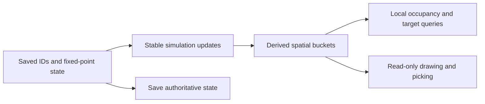

# R2MLVS8 - Space World and Construction

## Global Mandatory Reading

> **Execution protocol**
>
> - Read this Global Mandatory Reading section before the first task and again
>   after every context compaction.
> - Before starting or resuming a task group, read the nearest preceding Area
>   Mandatory Reading block whose `Applies to` label includes that group. Area
>   blocks appear immediately before the first group they govern.
> - A referenced heading or exported symbol is authoritative. Global navigation
>   hints and Area line ranges are for navigation only; if they drift, relocate
>   the named section or symbol rather than expanding to the whole file.
> - Mandatory reading is non-transitive. Do not preload a linked file's own
>   Mandatory Reading, Consult on Demand, or Planning Provenance entries unless
>   this plan names them directly for the current area.
> - Do not read Consult on Demand or Planning Provenance merely because those
>   sources are listed. Use a Consult on Demand source only when its trigger
>   occurs.
> - No created source file, test file or JSON file should start with same prefix as a planning MD file (such as r2). Only MD files can have that prefix. No MD file should be created anywhere in source directories unless specifically asked.
> - After EVERY CONTEXT COMPACTION, you must add a note above the task group
>   which is currently in execution. The note will say: "Context has compacted
>   X times while executing this group.". If the compaction occurs before any
>   meaningful work was done (this can happen when there is a lot of baggage
>   from the previous compaction), then and ONLY then you can skip this step.
> - When exceeding 3 context compactions, YOU MUST ask yourself if you're not 
>   chewing more than we can handle :). Heck, plans change! :). In such a case, 
>   the way out is to split the group on the spot,
>   in the plan, into more groups, 
>   by appending B, C, D as a suffixes to those groups (splitting sub-groups 
>   themselves is also allowed). When you do this, create Local Mandatory
>   Reading areas so you can optimize your context only for the
>   ACTUAL task at hand.
>   Before starting or resuming a task group, read the nearest preceding Area
>   Mandatory Reading block whose `Applies to` label includes that group. Area
>   blocks appear immediately before the first group they govern.

| File name | Line Ranges | Description |
| --- | --- | --- |
| [docs/zz-reach2/upgrades/2026-10/r2mlvs-multilayer-vehicles-and-structures.md](r2mlvs-multilayer-vehicles-and-structures.md) | 256-262 | `AD-9` supplies the canonical gameplay/ownership decision for every group of this plan. It constrains stable orbital IDs/controllers and explicit timed transitions; a consumer must not redefine it locally. |
| [src/map_layer.h](../../../../src/map_layer.h) | 78-85 | `MultiLayerMap` ownership preamble: `Map` owns packed storage/geometry and this controller owns layer semantics. Every group uses world tiles/explicit layer helpers; camera selection and ad hoc plane offsets cannot define gameplay. |
| [src/vehicle_type.h](../../../../src/vehicle_type.h) | 21-39 | `VehicleType` includes `Effect = CompanyEnd` and persisted numeric ordering; a Space fleet cannot silently renumber Effect/Disaster or historical company vehicle types. |

Status: proposed. Parent: [R2MLVS master](r2mlvs-multilayer-vehicles-and-structures.md). Depends on r2mlvs1 and r2mlvs14 `Schema Foundation Handoff`.

## Outcome and Boundaries

Provide deterministic Space entities, vehicle control and construction semantics without treating vacuum as ordinary land or asteroids as moving map industries.

## Public Handoff Contract

Proposed public owner: `src/space.h`. Publish `SpaceVehicle`, `OrbitalBodyID`, `SpaceMission`, `SpaceStructure`, `SpaceTransition`. These symbols are producer obligations, not existing code. Keep one authority for the fields/commands they expose; downstream plans consume the public contract rather than private pools or copied tables.

## Implementation Tasks

Deepening pass, 2026-10-04: implementation groups use only SIMPLE, MEDIUM or HARD difficulty, with at most eight pending tasks each. Sketches describe proposed implementation contracts; verify the named earlier producers at each assumption gate. No gameplay or asset implementation is marked complete by this planning pass.

Groups are chronological and contain consecutive tasks of one difficulty. Each difficulty batch has at most eight tasks; area reading changes only when the implementation boundary or source of truth changes.

### Area Mandatory Reading - Vehicle model and compatibility spike

_Applies to Groups 1-7._

**Entry gate.** The following public contracts must exist before dependent implementation in this area: `src/multilayer_content.h`: `MultiLayerGameplayProfile`, `LayerVehicleCapability`, `GetMultiLayerContentProfile`, `CheckDeepLayerAvailability`, `UtilityPowerAccount`; `src/multilayer_state.h`: `MultiLayerStateSchema`, `ValidateMultiLayerStateReferences`.
Verify each public file/export/schema field with `rg` in the current workspace and inspect its command/field ownership. For a same-plan contract, compile its type/signature fixture or validate its artifact after the preceding producer groups. For cross-plan behavior, also run the producer's focused executable boundary test; declarations alone cannot authorize dependent mutations or runtime claims.
If a required export is absent, stop the dependent implementation, mutation and runtime claims in Groups 1-7. Read-only characterization, source/range verification, test-case design and asset-template work that does not assume the missing behavior may continue.
Do not bypass this gate by copying private pool/tile state, inventing local IDs or cargo registries, using a historical plan as a delivered implementation, opening user-wide content stores, substituting a second utility/accounting authority, or adding an unreviewed fallback path. Finish the named producer or revise the shared contract and its direct consumers first.

| File name | Line Ranges | Description |
| --- | --- | --- |
| [src/vehicle_func.h](../../../../src/vehicle_func.h) | 231-249 | Both `IsCompanyBuildableVehicleType` overloads currently use the company-range bound; a Space model must fit explicit ownership/accounting rules. |
| [src/company_base.h](../../../../src/company_base.h) | 32-55 | `CompanyInfrastructure` owns per-mode infrastructure counters; decide how orbital facilities count without silently treating them as ordinary airports. |
| [src/company_base.h](../../../../src/company_base.h) | 142-148 | `group_all`, `group_default`, `freeunits` are category-indexed company fleet declarations; adding Space must update the same identity/statistics owner. |
| [src/saveload/vehicle_sl.cpp](../../../../src/saveload/vehicle_sl.cpp) | 1119-1196 | `VEHSChunkHandler` and registration construct the vehicle class from saved type before member loading; protect old enum meanings and validate new references. |
| [src/vehicle_func.h](../../../../src/vehicle_func.h) | 192-204 | `VehicleServiceInDepot`, `CallVehicleTicks`, `ResetVehicleHash`, `ViewportAddVehicles` are public tick/service/spatial-render boundaries for orbital vehicles. |
| `src/multilayer_content.h` (planned public contract; link after implementation) | Live definitions; no fixed range | [r2mlvs1-gameplay-contracts-and-content.md](r2mlvs1-gameplay-contracts-and-content.md) Groups 1-6, ending with Group 6's public-contract task, publish `MultiLayerGameplayProfile`, `LayerVehicleCapability`, `GetMultiLayerContentProfile`, `CheckDeepLayerAvailability`, `UtilityPowerAccount`. These exports/schema fields are authoritative for this area. Same-plan consumers follow those earlier groups; cross-plan consumers verify the producer's required implementation/tests as well. Proposed names alone do not prove delivery. |
| `src/multilayer_state.h` (planned public contract; link after implementation) | Live definitions; no fixed range | [r2mlvs14-savegame-determinism-and-lifecycle.md](r2mlvs14-savegame-determinism-and-lifecycle.md) Groups 1-6, ending with Group 6's public-contract task, publish `MultiLayerStateSchema`, `ValidateMultiLayerStateReferences`. These exports/schema fields are authoritative for this area. Same-plan consumers follow those earlier groups; cross-plan consumers verify the producer's required implementation/tests as well. Proposed names alone do not prove delivery. |
| [src/vehicle_type.h](../../../../src/vehicle_type.h) | 97-103 | Complete `VehicleTypeIndexArray` aliases raw enum indexing; append-only storage IDs require an explicit dense company mapping. |
| [src/vehiclelist.cpp](../../../../src/vehiclelist.cpp) | 19-33 | Complete `VehicleListIdentifier::ToWindowNumber` packs only two type bits; revise encoding without list-window collisions. |
| [src/newgrf.cpp](../../../../src/newgrf.cpp) | 1883-1897 | Complete `GetGrfSpecFeature` recognizes four company types; native Space must reject unsupported features rather than invent NewGRF IDs. |
| [src/vehicle.cpp](../../../../src/vehicle.cpp) | 988-1117 | Complete `CallVehicleTicks` owns tick dispatch and explicit cargo-age branches; new Space cargo must age deterministically. |

**ASSUMPTION: this was already built previously. If not, re-asses at runtime**. This applies only to the producer contracts named in this area's gate, after their listed producer groups have run. Verify their actual exports and focused tests before using the sketches below; proposed types and helper names in sketches are not evidence of delivered code.

**Compatibility sketch (proposed).** A Space company mode is distinct from its serialized `VehicleType` byte. Existing `Effect = CompanyEnd` makes inserting Space before that marker unsafe without a complete migration. The candidate below preserves old wire/save meanings and introduces an explicit dense company index; validate every indexed consumer before selecting it.

```text
saved vehicle meaning: Train=0, Road=1, Ship=2, Aircraft=3, Effect=4, Disaster=5
proposed appended Space meaning: 6
company index: Train->0, Road->1, Ship->2, Aircraft->3, Space->4
Effect/Disaster: no company index
```

Treat this as the spike's working design, not an existing enum/API. The final matrix must include scripts, command serialization, engine identity and old-save loading as well as UI lists.

### Group 1 - Inventory saved type and company-mode assumptions

{{MEDIUM}}
- [ ] 1.1 Record current vehicle/engine enum values and every `CompanyEnd`, `VehicleTypeIndexArray` and four-mode array/switch used by company accounting, groups, unit numbers and build lists. Separate persisted bytes from runtime indexing.
- [ ] 1.2 Audit order destinations, depot/service paths, network command fields, script mode enums, NewGRF feature maps and CargoDist mode buckets. Give each assumption an owner and a preserve/extend/reject policy.
- [ ] 1.3 Publish a compatibility matrix with existing Train/Road/Ship/Aircraft/Effect/Disaster meanings and required old-save fixtures. Do not change the enum until the corresponding decoder/index strategy is explicit.

### Group 2 - Choose explicit Space identity and dense company indexing

{{HARD}}
- [ ] 2.1 Spike the preferred dedicated company-owned `SpaceVehicle`. Working candidate: keep existing saved values 0..5 and append a distinct Space value; replace range-only company tests with explicit company-type enumeration and a dense company-mode index.
- [ ] 2.2 Prototype company statistics/unit allocation and one engine definition using that mapping. If a different internal enum arrangement is required, add versioned save/wire translation before changing values; never reinterpret historical Effect/Disaster bytes.
- [ ] 2.3 Freeze runtime type, saved type, company index, expense bucket and unsupported NewGRF/script mapping independently. Add compile/runtime fixtures proving every existing type maps identically and only the new type occupies the new company slot.

### Group 3 - Extend company and packed fleet identity safely

{{HARD}}
- [ ] 3.1 Implement explicit company-type iteration and dense-index conversion for statistics, groups and free unit IDs. Replace raw indexing at each call site; Effect/Disaster must never acquire company counts or unit numbers.
- [ ] 3.2 Revise the two-bit `VehicleListIdentifier` window encoding or provide a distinct explicit Space identifier. Test round trips and collisions for every category and list kind.
- [ ] 3.3 Replace string/sprite offset arithmetic with explicit mapping where appended type 6 cannot address four-entry tables. Append/version any new expense meanings rather than shift existing saved expense categories.
- [ ] 3.4 Run old-fleet group/list/accounting fixtures before introducing the new engine class, then exercise an empty Space company list.

### Group 4 - Add canonical Space engine and vehicle materialization

{{HARD}}
- [ ] 4.1 Extend the canonical Engine metadata variant/native definitions with Space properties; do not create an untracked engine registry or reuse Aircraft data. Reject unsupported NewGRF feature/callback mappings explicitly.
- [ ] 4.2 Add the selected Space vehicle/controller class with owner, cargo and primary-vehicle semantics; register construction and saved-class dispatch. Facility-specific purchase behavior remains with r2mlvs9/11.
- [ ] 4.3 Make the saved type decoder version-aware: historical unsupported byte 6 is still corrupt in a pre-Space save, while valid old types 0..5 retain class meaning. Add minimal descriptors and pointer fixup.
- [ ] 4.4 Load a fixture of each old class plus the new class and verify engine/vehicle identity and ownership without invoking aircraft flight logic.

### Group 5 - Integrate Space tick, cargo ageing and baseline costs

{{HARD}}
- [ ] 5.1 Tick stationary/moving orbital units once from the existing virtual dispatch. Add Space explicitly to cargo-age scheduling and any service/sound policy branches that currently name only four ordinary types.
- [ ] 5.2 Implement running cost accrual, service state and sale through the canonical company/vehicle systems. Test cargo age advances while Space is hidden and no view change affects motion.
- [ ] 5.3 Save/reload one stationary and one moving cargo unit beside ordinary aircraft; compare next-tick position, cargo age, company accounts and IDs. Verify selection via a minimal display/picking adapter; full presentation follows the later area.

### Group 6 - Define typed mission targets and order ownership

{{HARD}}
- [ ] 6.1 Define a discriminated mission target for moving `OrbitalBodyID`, static `SpaceStructure` and future Surface recovery-center reference. Do not store these typed IDs in a station-only order field.
- [ ] 6.2 Choose dedicated mission commands alongside ordinary vehicle management; specify shared-order/clone behavior and validate target kind/owner before assigning a mission.
- [ ] 6.3 Define recoverable invalid/removed-target transitions and serialize target kind, ID, phase and timer. A stale pool slot must not silently target a new object reusing the index.

### Group 7 - Vehicle model and compatibility spike

{{HARD}}
- [ ] 7.1 Publish `src/space.h` with the exact exports/schema fields in `Public Handoff Contract`; document authoritative fields, invalid-ID semantics and command/estimate boundaries. Register any created C++ source in the existing build list. If the chosen implementation uses a different public location, update this contract and every direct consumer before declaring the producer ready.

### Area Mandatory Reading - Orbital world and construction

_Applies to Groups 8-17._

**Entry gate.** The following public contracts must exist before dependent implementation in this area: `src/space.h`: `SpaceVehicle`, `OrbitalBodyID`, `SpaceMission`, `SpaceStructure`, `SpaceTransition`.
Verify each public file/export/schema field with `rg` in the current workspace and inspect its command/field ownership. For a same-plan contract, compile its type/signature fixture or validate its artifact after the preceding producer groups. For cross-plan behavior, also run the producer's focused executable boundary test; declarations alone cannot authorize dependent mutations or runtime claims.
If a required export is absent, stop the dependent implementation, mutation and runtime claims in Groups 8-17. Read-only characterization, source/range verification, test-case design and asset-template work that does not assume the missing behavior may continue.
Do not bypass this gate by copying private pool/tile state, inventing local IDs or cargo registries, using a historical plan as a delivered implementation, opening user-wide content stores, substituting a second utility/accounting authority, or adding an unreviewed fallback path. Finish the named producer or revise the shared contract and its direct consumers first.

| File name | Line Ranges | Description |
| --- | --- | --- |
| [src/map_func.h](../../../../src/map_func.h) | 29-53 | `TileBase` and `TileExtended` are the complete packed storage layouts. New excavation bits require an explicit ownership budget; do not allocate heavyweight objects per tile. |
| [src/core/random_func.hpp](../../../../src/core/random_func.hpp) | 24-43 | `Randomizer` and simulation versus interactive state constrain feature-seed generation: preserve Surface simulation RNG and exclude presentation randomness. |
| [src/tests/map_layer.cpp](../../../../src/tests/map_layer.cpp) | 162-183 | Complete `Plane distances ignore the layer` test fixes projected geometry but grants no cross-layer transfer authority. |
| [src/command.cpp](../../../../src/command.cpp) | 301-328 | `CommandHelperBase::InternalExecuteValidateTestAndPrepExec` defines refusal/estimate before execution; no validation phase may consume inventory, RNG or funds. |
| `src/space.h` (planned public contract; link after implementation) | Live definitions; no fixed range | [r2mlvs8-space-world-and-construction.md](r2mlvs8-space-world-and-construction.md) Groups 1-7, ending with Group 7's public-contract task, publish `SpaceVehicle`, `OrbitalBodyID`, `SpaceMission`, `SpaceStructure`, `SpaceTransition`. These exports/schema fields are authoritative for this area. Same-plan consumers follow those earlier groups; cross-plan consumers verify the producer's required implementation/tests as well. Proposed names alone do not prove delivery. |

**ASSUMPTION: this was already built previously. If not, re-asses at runtime**. This applies only to the producer contracts named in this area's gate, after their listed producer groups have run. Verify their actual exports and focused tests before using the sketches below; proposed types and helper names in sketches are not evidence of delivered code.

**World/transition sketch.** Earlier groups provide the selected vehicle type and typed mission records. Separate static footprint claims, moving-body approach slots and presentation interpolation; one saved entity position owns simulation geometry.



For cargo transitions, require `source owns -> saved transition owns -> destination owns` with exactly one owner at every save point. A geometry-only release check here does not authorize delivery to a future launch center.

### Group 8 - Create stable orbital entities and coordinate conversion

{{HARD}}
- [ ] 8.1 Create typed persistent body/structure IDs with owner, authoritative fixed-point position and explicit invalid/deleted-reference handling. Asteroids later use this identity; they are not Industry tiles.
- [ ] 8.2 Choose fixed-point units and bounds for supported maps, with checked conversion to/from Space plane coordinates and existing stacked world helpers. Document enough wide arithmetic for distance, velocity and interpolation endpoints.
- [ ] 8.3 Define deterministic velocity/phase state independent of render interpolation. Test equal plane positions on Surface/Space map to different world tiles without changing stable layer IDs.

### Group 9 - Index orbital entities with bounded deterministic work

{{HARD}}
- [ ] 9.1 Implement a derived bucket/spatial index for drawing, picking and local occupancy queries. Authoritative ID/position records remain the save source; rebuild the index after load.
- [ ] 9.2 Update only moved entities and affected buckets. Use sorted stable IDs for simulation queries; do not let hash iteration or viewport culling determine motion/target selection.
- [ ] 9.3 Set measurable active-entity and neighborhood-work limits; test clustered entities and map-edge buckets without all-pairs or full-plane scans.

### Group 10 - Partition drift, construction and approach occupancy

{{HARD}}
- [ ] 10.1 Define the initial asteroid travel band, buildable static structure regions and dock approach/exclusion cells in plane coordinates. Validate that supported map sizes still permit first station placement and launch/drop approach access.
- [ ] 10.2 Specify deterministic edge behavior for slow drifting bodies, including a corner and maximum single-tick overshoot. Prefer a bounded reflection/wrap rule with saved velocity; no orbital integrator or impact damage.
- [ ] 10.3 Define which moving craft may enter a body approach/attachment region and which reservations exclude static construction. Distinguish a body position from a structure footprint so they cannot reserve one tile via incompatible authorities.
- [ ] 10.4 Test band-edge drift, a blueprint touching the exclusion boundary and a blocked approach; failures retain object position/inventory rather than destroying either participant.

### Group 11 - Allocate dock and approach slots deterministically

{{HARD}}
- [ ] 11.1 Represent docking/approach reservations by facility/body ID, slot ID, craft ID and request tick. Resolve simultaneous requests using stable ID order and one owner per slot.
- [ ] 11.2 Implement waiting, admission, release and cancellation over local occupancy queries. A craft with no available slot waits at a valid staging position; it cannot push another entity aside.
- [ ] 11.3 Test two craft requesting one slot, removal of the target and reload while queued. Publish the approach contract for r2mlvs9/10/11 without requiring their final vehicles yet.

### Group 12 - Orbital world and construction

{{MEDIUM}}
- [ ] 12.1 Add Space Construction controls for docking/sites, modules, processing, assembly and mirrors. Replace ordinary land/rail/road/water/airport/terraform controls on Space; keep layer/view/navigation controls.

### Group 13 - Reserve blueprint footprints without granting functionality

{{HARD}}
- [ ] 13.1 Validate a Space blueprint footprint against layer, ownership, static occupancy and approach exclusions; quote placement without allocating inventory or producing a working module.
- [ ] 13.2 Reserve footprint/anchor identity atomically with a typed blueprint record. Cancellation releases only its own reservation; an overlapping command refuses before either blueprint changes.
- [ ] 13.3 Publish delivered-inventory and completion prerequisites to r2mlvs11. That owner performs assembly/function; a reservation alone never creates storage, power or a free station.

### Group 14 - Implement saved cross-layer transition phases

{{HARD}}
- [ ] 14.1 Define `SpaceTransition` with source/destination typed references, ownership, phase, remaining simulation ticks and one authority for entity/cargo location. Distinguish a vehicle transition from a cargo-only descent job.
- [ ] 14.2 Implement start, advance, completion and cancellation/recovery with validation before location ownership moves. Exactly one phase owns cargo; reload cannot repeat a completed transfer.
- [ ] 14.3 Expose transition queries/commands for later rockets and descent owners, while ground movement remains through `GetLayerPortalNextTile`. Test target deletion, insufficient receiving capacity and save immediately before/after completion using boundary fixtures.

### Group 15 - Orbital world and construction

{{MEDIUM}}
- [ ] 15.1 Support the launch-center's 20-tile circular release target as a region distinct from its exact docking/servicing point.

### Group 16 - Provide a pure fixed-point release-region predicate

{{HARD}}
- [ ] 16.1 Implement a reusable Space-plane circular-region check using inclusive squared distance and a radius of 20 tiles converted to the chosen units. Widen before subtract/multiply and prove no overflow at supported map bounds.
- [ ] 16.2 Test center, cardinal boundary, diagonal just-inside/outside and sub-tile positions. A 41x41 box or stacked-Y distance is incorrect.
- [ ] 16.3 Publish the geometry predicate and release-position field; r2mlvs9 `CanReleaseOrbitalCargo` later adds actual launch-center ownership/capacity/selection. Do not create a duplicate center registry here.

### Group 17 - Orbital world and construction

{{MEDIUM}}
- [ ] 17.1 Route/picking overlays must not confuse the orbital drop zone with the independent Surface collection area.

### Area Mandatory Reading - Rendering, persistence and acceptance

_Applies to Groups 18-21._

**Entry gate.** The following public contracts must exist before dependent implementation in this area: `src/space.h`: `SpaceVehicle`, `OrbitalBodyID`, `SpaceMission`, `SpaceStructure`, `SpaceTransition`.
Verify each public file/export/schema field with `rg` in the current workspace and inspect its command/field ownership. For a same-plan contract, compile its type/signature fixture or validate its artifact after the preceding producer groups. For cross-plan behavior, also run the producer's focused executable boundary test; declarations alone cannot authorize dependent mutations or runtime claims.
If a required export is absent, stop the dependent implementation, mutation and runtime claims in Groups 18-21. Read-only characterization, source/range verification, test-case design and asset-template work that does not assume the missing behavior may continue.
Do not bypass this gate by copying private pool/tile state, inventing local IDs or cargo registries, using a historical plan as a delivered implementation, opening user-wide content stores, substituting a second utility/accounting authority, or adding an unreviewed fallback path. Finish the named producer or revise the shared contract and its direct consumers first.

| File name | Line Ranges | Description |
| --- | --- | --- |
| [src/map_layer_gui.h](../../../../src/map_layer_gui.h) | 67-73 | `GetVehicleDisplayLayer` is the public visible/pickable-layer contract; keep ordinary aircraft/ships/disasters on Surface and place orbital units explicitly. |
| [src/tests/map_layer.cpp](../../../../src/tests/map_layer.cpp) | 430-442 | Complete display-order test retains immutable Space=2 and Deep=3 storage meanings; future UI/profile work cannot reorder saved IDs. |
| [src/network/network_command.cpp](../../../../src/network/network_command.cpp) | 256-288 | `NetworkExecuteLocalCommandQueue` executes agreed frame order/company authority; all jobs use deterministic simulation time. |
| `src/space.h` (planned public contract; link after implementation) | Live definitions; no fixed range | [r2mlvs8-space-world-and-construction.md](r2mlvs8-space-world-and-construction.md) Groups 1-7, ending with Group 7's public-contract task, publish `SpaceVehicle`, `OrbitalBodyID`, `SpaceMission`, `SpaceStructure`, `SpaceTransition`. These exports/schema fields are authoritative for this area. Same-plan consumers follow those earlier groups; cross-plan consumers verify the producer's required implementation/tests as well. Proposed names alone do not prove delivery. |
| [src/map_layer_gui.cpp](../../../../src/map_layer_gui.cpp) | 140-164 | Complete `GetVehicleDisplayLayer` controls drawing/picking layer; retain Surface behavior for ordinary ships/aircraft. |
| [src/vehicle.cpp](../../../../src/vehicle.cpp) | 659-688 | Complete viewport-hash update/reset functions are presentation indexing, separate from saved orbital occupancy. |
| [src/vehicle.cpp](../../../../src/vehicle.cpp) | 1244-1305 | Complete `CheckClickOnVehicle` is the live picking boundary; add Space without making interpolation authoritative. |
| [Sprite Contract and delivery owner](r2mlvs13-graphics-and-asset-pipeline.md#public-handoff-contract) | Live definitions; no fixed range | `Sprite Contract Handoff` defines manifest fields `asset_id`, `consumer`, `directions`, `frames`, `anchor`, `source`; the matching authoring/conversion/runtime groups deliver actual assets. Verify the requested family and packed loading fixture before graphics integration; template/manifest publication alone is not final art. |

**ASSUMPTION: this was already built previously. If not, re-asses at runtime**. This applies only to the producer contracts named in this area's gate, after their listed producer groups have run. Verify their actual exports and focused tests before using the sketches below; proposed types and helper names in sketches are not evidence of delivered code.

**Scoped graphics gate. ASSUMPTION: this was already built previously. If not, re-asses at runtime**. Final graphics tasks in this area require the corresponding r2mlvs13 manifest entries, delivered sprites and packed loading fixture. Verify them before binding/review; if absent, stop only those art tasks and their acceptance claims, continue independent code/state tests, and never count placeholders as finished assets.

### Group 18 - Integrate Space display, picking and follow behavior

{{HARD}}
- [ ] 18.1 Extend `GetVehicleDisplayLayer` explicitly for orbital phases while keeping ordinary aircraft/ships on Surface. Update spatial hashing/viewport filtering so one entity draws and picks in exactly its current layer.
- [ ] 18.2 Add sprite bounds, shadows/effects and click detection for stationary/moving orbital objects; presentation interpolation must not change authoritative occupancy.
- [ ] 18.3 Add vehicle follow and small-map overlays, including a saved cross-layer transition. Test main and extra views plus hidden-layer ticks; no view operation moves the craft.

### Group 19 - Reconstruct orbital authority and caches after load

{{HARD}}
- [ ] 19.1 Serialize vehicle/entity/mission/transition authority with typed IDs and fixed-point values; apply the frozen old-type decoding strategy before creating a class.
- [ ] 19.2 Load records, resolve/validate references, then rebuild spatial buckets, occupancy and approach reservations in stable order. Keep interpolation caches derived and exclude them from gameplay decisions.
- [ ] 19.3 Compare next-tick state before/after save and a network join with moving, queued and transitioning units. Exercise invalid target references without mistaking a reused ID for the original target.

### Group 20 - Rendering, persistence and acceptance

{{MEDIUM}}
- [ ] 20.1 Test ordinary construction refusals by commands and toolbar, overlapping blueprints, map edges, hidden layers, view-follow crossing and invalid targets.
- [ ] 20.2 Compare fixed-tick entity states across visible/hidden views and command replay.
- [ ] 20.3 Measure entity scaling and network-join reconstruction before downstream fleets grow.
- [ ] 20.4 Integrate final controls, blueprint/occupancy overlays and Space object picking with r2mlvs13 assets.
- [ ] 20.5 Keep placeholders explicitly temporary.

### Group 21 - Rendering, persistence and acceptance

{{SIMPLE}}
- [ ] 21.1 Record the implemented public exports, focused test commands/results and remaining runtime/art/network gaps in this plan; retain original supplied saves and repository-local evidence.
- [ ] 21.2 Update affected architecture/handoff documentation to describe delivered behavior and reconcile the parent index only when this plan's Completion Conditions are met. Keep every unfinished task unchecked.

## Consult on Demand

| Trigger | File name | Start at | Expand only when | Consultation purpose |
| --- | --- | --- | --- | --- |
| A new Space category loads as an effect or disaster | [../../../../src/saveload/vehicle_sl.cpp](../../../../src/saveload/vehicle_sl.cpp) | `VEHSChunkHandler` | The persisted enum conversion and engine/type definition appear correct but object construction differs | Inspect class materialization before member load; preserve historical saved numeric IDs instead of reinterpreting the old object. |
| A required public export is absent and its owner/location is disputed | [r2mlvs-multilayer-vehicles-and-structures.md](r2mlvs-multilayer-vehicles-and-structures.md) | `Requirements and ownership` and `Plan Index` | The named producer confirms an intentional contract/ownership change | Find the responsible producer and reconcile its public handoff with direct consumers; the hub cannot substitute for missing implementation. |
| Current behavior contradicts a historical subsystem description | [../../architecture/map-layers/archi-map-layers.md](../../architecture/map-layers/archi-map-layers.md) | `Invariants` and the relevant named source in `Code map` | The live symbol and executable test do not explain the difference | Locate layer addressing or lifecycle rationale. Live code/tests govern delivered behavior; this architecture page does not prove future interfaces exist. |

## Planning Provenance

This is not an execution reading queue. Do not preload it after context compaction. It is non-transitive; ranges record planning use, not runtime authority.

| File name | Sections or Line Ranges used while planning | Planning contribution |
| --- | --- | --- |
| [docs/zz-reach2/architecture/initial-inventory.md](../../architecture/initial-inventory.md) | 185-220 | `Command as the only world mutation`, `Pool-indexed game objects`, `Tile map as a packed array` and `File-suffix modules` oriented command/pool/header ownership and source registration. This historical inventory is a location survey, not authority for current layer behavior. |
| [docs/zz-reach2/architecture/@archi-ttd-level0.md](../../architecture/@archi-ttd-level0.md) | 24-63 | `How the program fits together` and `Source and runtime boundaries` located shared simulation, data/presentation, CMake targets and subsystem handoffs used to choose the live reading sources. |
| [docs/zz-reach2/upgrades/2026-10/r2mlvs-multilayer-vehicles-and-structures.md](r2mlvs-multilayer-vehicles-and-structures.md) | 119-140 | `Requirements and ownership` assigned this plan's feature responsibilities; it shaped the decomposition without making every sibling plan a mandatory reading dependency. |
| [src/vehicle_type.h](../../../../src/vehicle_type.h) | 21-39 | The inspected live boundary helped separate characterization, public-contract production, implementation and acceptance batches. It materially constrained stable orbital IDs/controllers and explicit timed transitions; this entry records planning influence rather than an additional reading obligation. |
| [User planning-format instructions](<C:/Users/Axonn/.codex/attachments/cd59b20a-3a96-4d54-b4bd-1e8f37639e7d/Pasted text.txt>) | `Global Mandatory Reading`, `Area Mandatory Reading`, `Consult on Demand`, `Planning Provenance`, `Final validation` | Supplies the exact protocol, chronological difficulty batches of at most eight tasks, reading gates and validation format. |
| [src/vehiclelist.cpp](../../../../src/vehiclelist.cpp) | 19-33 | Deeper planning pass, 2026-10-04: Two-bit fleet window identities exposed a compatibility task separate from save enums and dense company indices. |

## Completion Conditions

Space has a coherent build and vehicle model, persistent identity and deterministic motion. Rockets/probes can be implemented without abusing aircraft terrain flight or renumbering old save values. Ordinary land construction is unavailable on Space at both UI and command levels.
