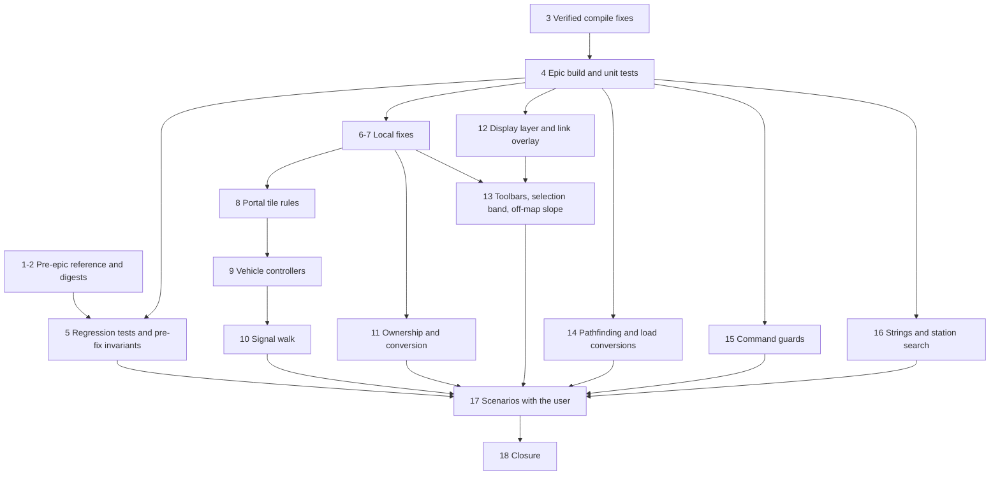
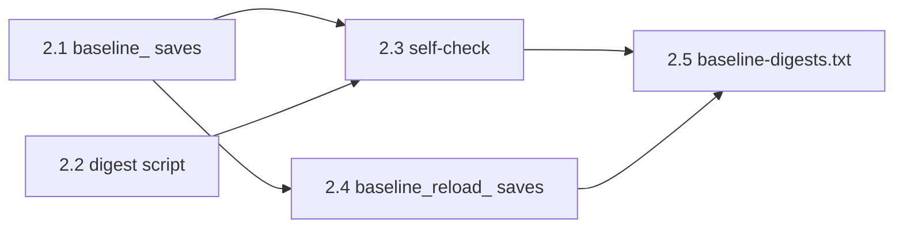
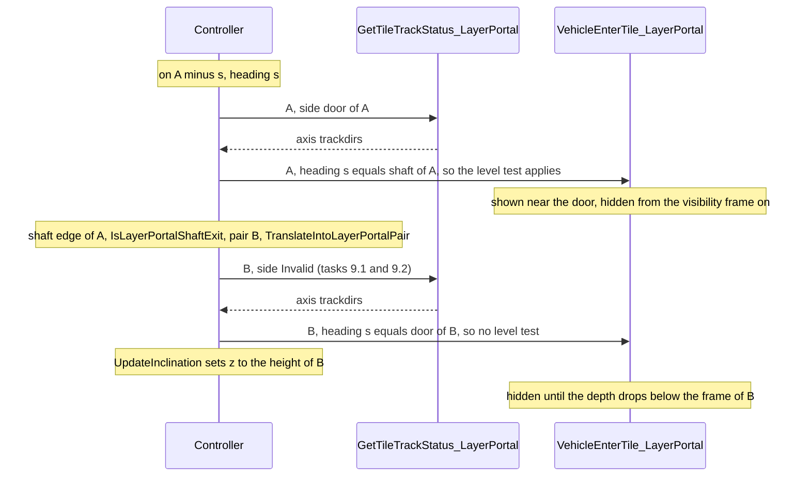
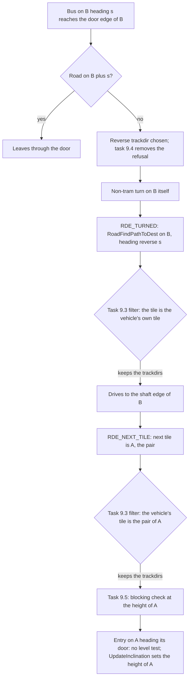
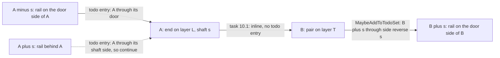
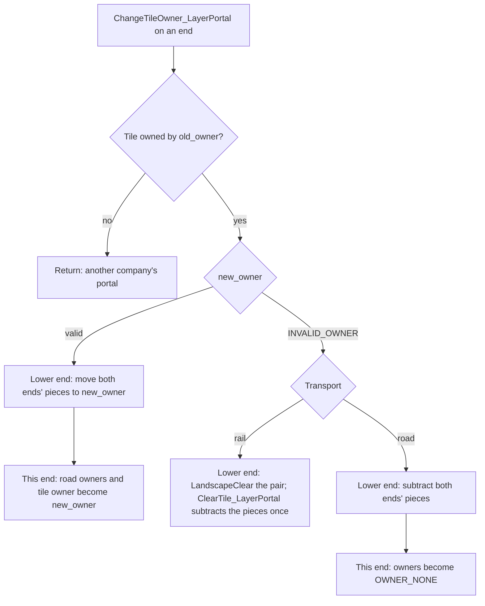
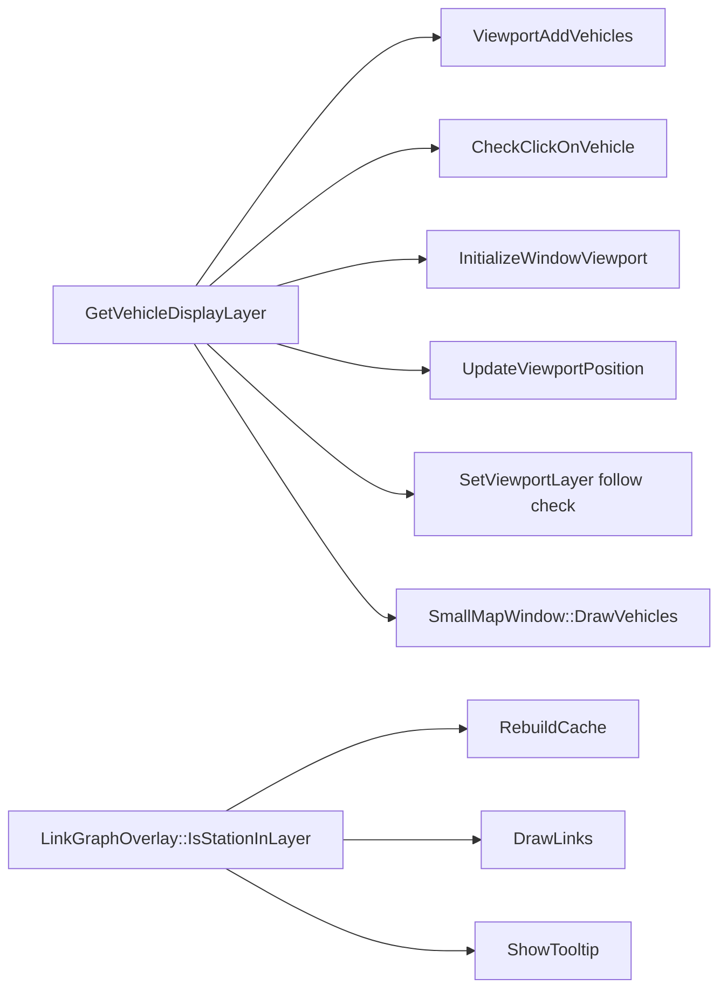

# R2RVM Plan - Review Fixes for the Multi-Layered Map (R2MLM)

## Global Mandatory Reading

> **Execution protocol**
>
> - Read this Global Mandatory Reading section before the first task and again
>   after every context compaction.
> - Before starting or resuming a task group, read the nearest preceding Area
>   Mandatory Reading block whose `Applies to` label includes that group. Area
>   blocks appear immediately before the first group they govern.
> - A referenced heading or exported symbol is authoritative. Global navigation
>   hints and Area line ranges are for navigation only; if they drift, relocate
>   the named section or symbol rather than expanding to the whole file.
> - Mandatory reading is non-transitive. Do not preload a linked file's own
>   Mandatory Reading, Consult on Demand, or Planning Provenance entries unless
>   this plan names them directly for the current area.
> - Do not read Consult on Demand or Planning Provenance merely because those
>   sources are listed. Use a Consult on Demand source only when its trigger
>   occurs.
> - No created source file, test file or JSON file should start with same prefix as a planning MD file (such as r2). Only MD files can have that prefix. No MD file should be created anywhere in source directories unless specifically asked.
> - After EVERY CONTEXT COMPACTION, you must add a note above the task group
>   which is currently in execution. The note will say: "Context has compacted
>   X times while executing this group.". If the compaction occurs before any
>   meaningful work was done (this can happen when there is a lot of baggage
>   from the previous compaction), then and ONLY then you can skip this step.
> - When exceeding 3 context compactions, YOU MUST ask yourself if you're not 
>   chewing more than we can handle :). Heck, plans change! :). In such a case, 
>   the way out is to split the group on the spot,
>   in the plan, into more groups, 
>   by appending B, C, D as a suffixes to those groups (splitting sub-groups 
>   themselves is also allowed). When you do this, create Local Mandatory
>   Reading areas so you can optimize your context only for the
>   ACTUAL task at hand.
>   Before starting or resuming a task group, read the nearest preceding Area
>   Mandatory Reading block whose `Applies to` label includes that group. Area
>   blocks appear immediately before the first group they govern.

| File name | Line Ranges | Description |
| --- | --- | --- |
| [r2rvm-review-map.md](r2rvm-review-map.md) | 438-504 | `## Fix Decisions`, FD-1 to FD-12. These are the authoritative designs for every fix: the vertical shaft crossing, visibility as a function of position, door-only connections, the signal walk, ownership accounting, layer of an interaction, display layer of a vehicle, surface-only conversions, the two-tile guard, savegame layer counts and the evidence rule. Every task names its FD. Where an FD and a finding's "Fix" bullet differ, the FD wins. An FD never overrides a master-plan AD. |
| [r2rvm-review-map.md](r2rvm-review-map.md) | 133-165 | `### Severity index`: the finding IDs (C-1, H-1 to H-5, M-1 to M-11, L-1 to L-12) every task cites, the task that fixes each, and the Status column Group 18 fills. Read a finding's own `####` section only when the current Area block points to it. |
| [r2rvm-review-map.md](r2rvm-review-map.md) | 559-603 | `### Commands used by every group`: the Bash variables, the configure, build and test commands (with `/nodeReuse:false`), the error and warning extraction, and the rules for starting `openttd.exe`. When a task says "build Debug" or "run the unit tests", it means exactly these commands. |
| [r2mlm-multi-layered-map.md](r2mlm-multi-layered-map.md) | 66-76, 99-102, 119-128 | `### AD-2 Stacked-plane addressing`, `### AD-8 Cross-layer movement only through layer portals` and `## Cross-plan Invariants` I-1 to I-8. AD-2 means a tile's layer is implicit in its `TileIndex`, so no command or pool gains a layer field. AD-8 means `GetLayerPortalNextTile` is the only cross-layer step and portals have no wormhole state. Every fix must keep I-1 to I-8 true. I-6 and I-7 are proven by Groups 5 and 18. |
| [r2mlm-multi-layered-map.md](r2mlm-multi-layered-map.md) | 158-164 | `## Engineering Conventions`: the `//comment` style with no space, Javadoc on every function and parameter, OpenTTD naming, file registration, **never** `git checkout`, `git reset` or `git stash`, never move or delete files, and English-only strings. They bind every edit in this plan, including the snippets below. |
| [r2mlm-multi-layered-map.md](r2mlm-multi-layered-map.md) | 166-177 | `## Build and Test Commands`: the Build Tools 2022 CMake path, the standalone vcpkg at `D:\Codez\Tools\vcpkg` (never the one bundled with Build Tools), and the configure command. `### Commands used by every group` below adds the flags this plan needs. Do not use any other toolchain. |
| [src/map_func.h](../../../../src/map_func.h) | 457-498 | `TileY` (stacked), `TilePlaneY`, `GetTileLayer`, `TileXYL`: the addressing primitives every fix uses. Plane-relative logic uses `TilePlaneY` and `TileXYL`, never `TileY` against `Map::MaxY()`. |
| [src/map_layer.h](../../../../src/map_layer.h) | 188-198, 261-281 | `MultiLayerMap::TileInLayer`, `MultiLayerMap::GetPortalTargetLayer` and `CheckLayerAllowsConstruction`: the controller boundary. Gameplay never adds `Map::PlaneSize()` to a tile by hand, and Surface pairs only with Underground in version 1. |

## Outcome

This plan turns the 2026-10-03 code review of the R2MLM epic into executable work. When it is done:

- a pre-epic reference build, its test results and baseline digests exist;
- the epic tree builds in Debug and RelWithDebInfo, its unit tests pass, and its regression tests match the pre-epic results;
- every finding below is fixed or explicitly deferred by the user;
- vehicles cross portals at any height;
- I-6 and I-7 have recorded evidence.

The r2mlm10 acceptance plan can start afterwards.

The master plan stays the authority for architecture, conventions and build commands. This plan executes master-plan tasks 1.3 to 1.8 by reference. Where those tasks assumed a pre-epic tree, it adapts them: the epic code was already in the working tree before the baseline was captured, so Group 1 builds the reference from a `git archive HEAD` export.

Every group is SIMPLE or MEDIUM and holds at most eight tasks. A task gives the code to write, written against the epic code as it stood on 2026-10-03. Where a snippet depends on an earlier task, the task carries an ASSUMPTION note; if that earlier work is missing or looks different, re-assess before pasting.

## Review Findings

### Scope and method

- **Reviewed:** every source change of the epic: 109 modified files (+2652 / -701 lines) and the 9 new files (`map_layer*`, `layer_portal*`, `src/tests/map_layer.cpp`).
- **Measured against:** the master plan [r2mlm-multi-layered-map.md](r2mlm-multi-layered-map.md) (AD-1 to AD-12, I-1 to I-8) and the intent of sub-plans r2mlm1 to r2mlm10.
- **Method:** code reading. I followed the paths of the tile loop, world generation, savegame, follower, YAPF, train and road vehicle controllers, signals, PBS and viewport, back to the unchanged OpenTTD code they call.
- **Built afterwards:** the review itself built and ran nothing. A probe build the same day compiled the tree and ran its unit tests; see `### Verification status`.
- **Not reviewed:** helper scripts in `tools/`, generated art in `assets/`, and the prose of the architecture pages.
- **Line links** in the findings point at the tree as it was reviewed. Group 3 adds nine lines near the top of `layer_portal_cmd.cpp`, so from then on its links are nine lines early.

### Verification status

At review time no line of this epic had been compiled or executed. The sub-plans repeat "The build waits on the toolchain".

A probe build ran later on 2026-10-03:

- **Set-up:** a copy of the working tree in `build-probe-tree/` (gitignored), configured without vcpkg, so PNG, zlib and liblzma were missing. A Debug build of `openttd` and `openttd_test` with Visual Studio Build Tools 2022.
- **Build result:** the epic did not compile as written. Nine behaviour-neutral edits made it build after four rounds:
  - missing includes in seven files;
  - a missing command-traits include and callback in `network_command.cpp`, which made the compiler crash (C1001);
  - the road tile struct that `table/road_land.h` needs;
  - `class Window` declared where the definition is `struct Window`, which links as a different symbol (LNK2019);
  - two globals used before their declaration;
  - two `CommandCost::AddCost` calls that need an rvalue.
- **Unit tests:** 2 of 103 failed. The portal test did not reset the road types before building a road end. Two new picker windows had an `ini_key` without a sticky or default-size box, which `test_window_desc` rejects. With both fixed, 103 of 103 passed in Debug.
- **Not covered:** the four `regression_` tests (their saves need liblzma), RelWithDebInfo, and every game run. The only epic change inside a `#ifdef WITH_*` block is in `town_cmd.cpp` under `WITH_ASSERT`, which Debug compiles.
- Group 3 applies exactly these edits. Group 4 repeats the build and the tests with vcpkg.

Master-plan Group 1 stands at:

- tasks 1.1 and 1.2 done: `build/` is configured with the standalone vcpkg (master-plan task 1.2, last note);
- no build, no baseline saves;
- `tools/savegame_plane_digest.py` and `tools/baseline-digests.txt` do not exist.

Master-plan task 1.6 cannot be run as written:

- The epic code already sits in the working tree, so it would capture a post-epic baseline.
- Its `scripts/on_dedicated.scr` runs inside `NetworkServerStart` ([network.cpp:966](../../../../src/network/network.cpp#L966)), which `SwitchToMode` calls before it generates or loads the world ([openttd.cpp:1032](../../../../src/openttd.cpp#L1032)). Its `save` would store the map that existed before generation. `scripts/game_start.scr` runs from `OnStartGame` once the game exists ([openttd.cpp:847](../../../../src/openttd.cpp#L847)).

Groups 1 and 2 of this plan avoid both problems.

As a result:

- **I-6** (bit-identical surface for the same seed) and **I-7** (save round-trip) are unverified.
- Every r2mlm10 acceptance run (multiplayer, save matrix, performance) is open.
- The `[x]` marks in the sub-plans record that the code was written, not that it works.

### Summary

The foundation is sound:

- Stacked-plane addressing, `TilePlaneY`, the per-plane void fence and plane distances are applied consistently.
- Viewport and pick filtering by layer is thorough.
- Construction gating covers every build command.
- The savegame extension is backward compatible.

The portal layer (r2mlm7 to r2mlm9) is where most of the defects are:

- The headline feature, vehicles crossing layers, does not work on a normal map (C-1).
- Removing, re-owning and converting portals have correctness bugs (H-1, H-2, M-2, M-8).
- Road vehicles can freeze permanently next to an elevator (H-4).
- Trains and road vehicles can enter a portal from behind (H-5).
- One savegame path is memory-unsafe with untrusted input (H-3).
- Once C-1 is fixed, a road vehicle stepping through the shaft can land on a vehicle waiting just inside the pair (M-10).
- A crafted portal command on a Space tile stops every build that has asserts (M-11).

### Severity index

| ID | Severity | Finding | Fixed by | Status |
| --- | --- | --- | --- | --- |
| C-1 | Critical | Portals cannot be crossed unless the surface end is at height 0 | 8.1, 8.2; verified 17.2 | Open |
| H-1 | High | Rail portal removal reads cleared bits and updates the wrong sides | 6.1; verified 17.5 | Open |
| H-2 | High | Owner change moves other companies' portal infrastructure; double subtraction on bankruptcy | 11.2, 11.3, 11.7; verified 17.6 | Open |
| H-3 | High | Savegame layer count is trusted (heap overflow) | 6.5, 6.6, 6.7 | Open |
| H-4 | High | Road vehicles freeze instead of turning around at elevators | 9.4; verified 17.3 | Open |
| H-5 | High | A portal can be entered from behind | 8.3, 9.1, 9.2, 9.3, 10.1; verified 17.4 | Open |
| M-1 | Medium | Signal update starting on a portal walks one direction only | 10.2; verified 17.5 | Open |
| M-2 | Medium | Wrong removal price sign; far-end reservation ignored | 6.2, 6.3; verified 17.8 | Open |
| M-3 | Medium | Ownerless road elevators cannot be removed | 11.3, 11.4; verified 17.6 | Open |
| M-4 | Medium | `_map_file_layers` stale for original TTD saves | 7.1 | Open |
| M-5 | Medium | Extra-viewport building uses the main viewport's layer | 13.3, 13.4, 13.5; verified 17.7 | Open |
| M-6 | Medium | Smallmap draws stray cross-layer link lines | 12.5, 12.6, 12.7; verified 17.7 | Open |
| M-7 | Medium | Smallmap pushes its layer onto the main view | 7.4; verified 17.7 | Open |
| M-8 | Medium | Road conversion converts one elevator end only | 11.5, 11.6; verified 17.8 | Open |
| M-9 | Medium | Three full planes stored and ticked in every game (plan level) | 18.2 (decision) | Open |
| M-10 | Medium | Road vehicles stepping through the shaft miss a vehicle waiting on the pair | 9.5; verified 17.3 | Open |
| M-11 | Medium | A portal command on Space passes `MapLayer::Invalid` to `TileInLayer` | 6.4; verified 17.7 | Open |
| L-1 | Low | `GetSlopePixelZOutsideMap` drops its layer | 13.6, 13.7 | Open |
| L-2 | Low | Split toolbars lose Subsidies | r2mlm11 (Subsidies); 18.3 (Pause and Fast-forward decision) | Open |
| L-3 | Low | String hygiene | 16.1 to 16.4 | Open |
| L-4 | Low | `CalcClosestStationTile` clamps stacked Y | 14.1 | Open |
| L-5 | Low | Road YAPF slope penalty across an elevator | 14.2 | Open |
| L-6 | Low | `TileVirtXYClampedToMap` clamps into lower layers | 12.2, 14.3 | Open |
| L-7 | Low | Dead code in `ClearPathReservation` | 7.2 | Open |
| L-8 | Low | Stale comments | 7.3 | Open |
| L-9 | Low | Two-tile commands accept cross-layer pairs | 15.1 to 15.7 | Open |
| L-10 | Low | Conversions run over freshly created planes | 14.4, 14.5, 14.6 | Open |
| L-11 | Low | Style nits (macro-case function, kd-tree special case, reservation drawing, AD-3 wording) | 11.1, 16.5; rest 18.5 | Open |
| L-12 | Low | Road elevator button skips `can_build` gating | 13.2 | Open |

### Critical findings

#### C-1 Portals cannot be crossed unless the surface end is at height 0

- **Where:**
  - Underground base height is 0: [map_layer.cpp:72](../../../../src/map_layer.cpp#L72).
  - `CheckPortalEnd` requires flat land but not equal heights: [layer_portal_cmd.cpp:305-315](../../../../src/layer_portal_cmd.cpp#L305-L315).
  - The z test in `VehicleEnterTile_LayerPortal`: [layer_portal_cmd.cpp:203-204](../../../../src/layer_portal_cmd.cpp#L203-L204).
- **What:**
  1. A surface end at height `h >= 1` is paired with an underground end at height 0.
  2. `VehicleEnterTile_LayerPortal` refuses entry when `abs(GetSlopePixelZ(x, y) - v->z_pos) > 2`. This test is copied from tunnel mouths, where heights match.
  3. Both controllers call `VehicleEnterTile` after moving the vehicle onto the pair tile, but before `z_pos` is updated:
     - train: [train_cmd.cpp:3576](../../../../src/train_cmd.cpp#L3576), with z updated only at [3661](../../../../src/train_cmd.cpp#L3661);
     - road vehicle: [roadveh_cmd.cpp:1320](../../../../src/roadveh_cmd.cpp#L1320).
- **Effect:**
  - **Train front engine:** goes to `invalid_rail` and reverses at full speed at the shaft. The reservation it made into the underground is left behind.
  - **Road vehicle:** `cur_speed = 0; return false` every tick. It stays at the shaft edge forever and blocks the elevator.
  - **Train wagons:** if a wagon (not the front) ever gets `CannotEnter` here, `invalid_rail` calls `FatalError("Disconnecting train")` ([train_cmd.cpp:3705](../../../../src/train_cmd.cpp#L3705)).
  - **Scope:** on standard maps, essentially no portal works.
- **Fix:** FD-1 and FD-3, tasks 8.1 and 8.2.

### High findings

#### H-1 Removing a rail portal reads portal bits from a tile that is already cleared

- **Where:** [layer_portal_cmd.cpp:286-291](../../../../src/layer_portal_cmd.cpp#L286-L291), which calls `NotifyRailPortalChanged` ([246-252](../../../../src/layer_portal_cmd.cpp#L246-L252)) after `DoClearSquare(tile)`.
- **What:**
  - `NotifyRailPortalChanged` calls `GetLayerPortalShaftDirection(tile)` on what is now a Clear tile.
  - The pair is queued with `AddSideToSignalBuffer(pair, ReverseDiagDir(shaft))`, which is the pair's **shaft** side. The pair's door is `shaft`.
- **Effect:**
  - **Debug builds:** removing any rail portal hits the `IsLayerPortalTile` assert.
  - **Release builds:** signals beside both former doors keep their old state.
- **Fix:** task 6.1.

#### H-2 Owner change moves infrastructure of portals the old owner does not own, and subtracts twice on bankruptcy

- **Where:** [layer_portal_cmd.cpp:143-186](../../../../src/layer_portal_cmd.cpp#L143-L186).
- **What:**
  1. `ChangeTileOwner_LayerPortal` calls `TransferPortalInfrastructure` before the `IsTileOwner(tile, old_owner)` check.
  2. `ChangeOwnershipOfCompanyItems` calls `ChangeTileOwner` on every tile of the map ([economy.cpp:480](../../../../src/economy.cpp#L480)).
  3. So on every merger, each portal of every company has its pieces moved from `old_owner` to `new_owner`.
  4. On bankruptcy, rail pieces are subtracted twice: first by `TransferPortalInfrastructure`, then again inside `ClearTile_LayerPortal` ([278-285](../../../../src/layer_portal_cmd.cpp#L278-L285)).
- **Effect:**
  - Wrong infrastructure counts and wrong maintenance costs.
  - Infrastructure is recomputed on every load (`AfterLoadCompanyStats`), so a client that joins later computes different counts than the server. With infrastructure maintenance on, company money diverges, which is a desync risk. `CheckCaches` reports the mismatch.
- **Fix:** FD-6, tasks 11.2, 11.3 and 11.7.

#### H-3 The savegame layer count is trusted and sizes the plane reads

- **Where:** [map_sl.cpp:39-43](../../../../src/saveload/map_sl.cpp#L39-L43) and [map_sl.cpp:71-73](../../../../src/saveload/map_sl.cpp#L71-L73).
- **What:** `_map_file_layers = _map_layers` comes straight from the file, while storage is allocated for `MAX_MAP_LAYERS`.
- **Effect:**
  - `layers > 3` writes past the tile arrays: a heap overflow.
  - It is reachable from a crafted save, or from a malicious server during map transfer.
- **Fix:** FD-11, tasks 6.5 to 6.7.

#### H-4 Road vehicles freeze permanently instead of turning around at elevators

- **Where:** [roadveh_cmd.cpp:1238-1242](../../../../src/roadveh_cmd.cpp#L1238-L1242).
- **What:** a U-turn is refused when `IsLayerPortalTile(v->tile) || IsLayerPortalTile(tile)`, where `tile` is the next tile. Two cases follow:
  - **In front of the door:** a bus on the ordinary road tile before a door, whose path says "turn back", stops forever.
  - **On the elevator:** a bus on an elevator whose far door leads to no road stops on the elevator and blocks it. This is the normal state during construction.
  - Meanwhile the follower's `TryReverse` still plans U-turns there, so the pathfinder and the controller disagree.
- **Fix:** FD-2 and FD-3, task 9.4.

#### H-5 A portal can be entered from behind and driven through on one layer

- **Where:**
  - [layer_portal_cmd.cpp:130](../../../../src/layer_portal_cmd.cpp#L130) answers track-status queries from the shaft side.
  - Only the follower refuses a same-layer entry through the shaft ([follow_track.hpp:383-397](../../../../src/pathfinder/follow_track.hpp#L383-L397)).
- **What:**
  - `TrainCheckIfLineEnds` and `TrainController` query track status with the shaft side, so a train enters an end from behind and leaves through its door.
  - `RoadFindPathToDest` returns the single reachable trackdir without pathfinding, so road vehicles do the same.
  - The signal walk treats such an entry as "came up the shaft".
- **Fix:** FD-4 and FD-5, tasks 8.3, 9.1 to 9.3 and 10.1.

### Medium findings

#### M-1 A signal update that starts on a portal tile explores only one direction

- **Where:** [signal.cpp:531-535](../../../../src/signal.cpp#L531-L535).
- **What:** both entries pushed for a portal start walk toward the pair's door.
- **Effect:** an update queued on one end only leaves that end's door-side block stale. Examples are a train crashed or removed on the portal, and PBS `SetSignalsOnBothDir`.
- **Fix:** FD-5, task 10.2.

#### M-2 Portal removal: wrong price sign, and the far end's reservation is ignored

- **Price sign:** [layer_portal_cmd.cpp:296](../../../../src/layer_portal_cmd.cpp#L296) returns `-_price[Price::ClearTunnel] * 4`, so removing a portal pays the player.
- **Reservation:** [layer_portal_cmd.cpp:268](../../../../src/layer_portal_cmd.cpp#L268) checks only the clicked end.
- **Fix:** tasks 6.2 and 6.3.

#### M-3 Ownerless road elevators can never be removed

- **Where:** [layer_portal_cmd.cpp:181](../../../../src/layer_portal_cmd.cpp#L181) and [260](../../../../src/layer_portal_cmd.cpp#L260).
- **What:** after bankruptcy a road elevator becomes `OWNER_NONE`, and `CheckTileOwnership` then refuses every company.
- **Fix:** FD-6, tasks 11.3 and 11.4.

#### M-4 `_map_file_layers` is stale when loading original TTD saves

- **Where:**
  - only the TTO path resets it: [oldloader_sl.cpp:1536-1538](../../../../src/saveload/oldloader_sl.cpp#L1536-L1538);
  - TTD saves go through `InitializeGame` at [saveload.cpp:3341](../../../../src/saveload/saveload.cpp#L3341);
  - the value is used by [afterload.cpp:572-575](../../../../src/saveload/afterload.cpp#L572-L575).
- **Effect:** after a 3-layer save has been loaded in the session, a TTD save keeps all-zero Underground and Space planes, with no void fence. This breaks I-2.
- **Fix:** FD-11, task 7.1.

#### M-5 Building in an extra viewport uses the main viewport's layer

- **Where:**
  - portal target: [rail_gui.cpp:754](../../../../src/rail_gui.cpp#L754) and [road_gui.cpp:724](../../../../src/road_gui.cpp#L724);
  - selection: `MainViewportBandY` in [viewport.cpp:2184](../../../../src/viewport.cpp#L2184), used by `SetSelectionTilesDirty` and `CalcRaildirsDrawstyle` (asserts at [3209](../../../../src/viewport.cpp#L3209) and [3244](../../../../src/viewport.cpp#L3244)).
- **Effect:**
  - **Portal:** refused in an extra viewport.
  - **Diagonal rail drag:** asserts in Debug; in Release it snaps to the main view's layer.
  - **Highlights:** redraw is clamped to the wrong band.
- **Fix:** FD-7, tasks 13.3 to 13.5.

#### M-6 The smallmap draws stray lines for cross-layer links

- **Where:** [smallmap_gui.cpp:1541](../../../../src/smallmap_gui.cpp#L1541) returns the sentinel `{INT32_MIN / 2, INT32_MIN / 2}`.
- **What:** only `ShowTooltip` checks the sentinel. `RebuildCache` and `DrawLinks` ([linkgraph_gui.cpp:284-291](../../../../src/linkgraph/linkgraph_gui.cpp#L284-L291)) do not.
- **Effect:** stray lines, and signed overflow in `Blitter::DrawLineGeneric`.
- **Fix:** FD-8, tasks 12.5 to 12.7.

#### M-7 The smallmap pushes its own layer onto the main view

- **Where:** `SmallMapCenterOnCurrentPos` calls `SetViewportLayer(main, this->layer)` ([smallmap_gui.cpp:1519-1520](../../../../src/smallmap_gui.cpp#L1519-L1520)), and `ScrollMainWindowTo` calls it when the view is already at the target ([smallmap_gui.cpp:2222](../../../../src/smallmap_gui.cpp#L2222)).
- **Effect:** a second click on an underground station flips the main view back to the smallmap's layer.
- **Fix:** task 7.4.

#### M-8 Road conversion converts only one end of an elevator

- **Where:** the portal case in `CmdConvertRoad` ([road_cmd.cpp:2550-2553](../../../../src/road_cmd.cpp#L2550-L2553), [2603-2604](../../../../src/road_cmd.cpp#L2603-L2604)). Rail converts both ends ([rail_cmd.cpp:1782-1819](../../../../src/rail_cmd.cpp#L1782-L1819)).
- **What:** the two ends are on different layers, and a conversion drag stays in one layer, so it never contains both. The comment "Both ends are visited" is never true.
- **Effect:** the two ends end up with mismatched road types, and vehicles get stuck.
- **Fix:** tasks 11.5 and 11.6.

#### M-9 Every game now stores and ticks three full planes (plan level)

- **Facts:**
  - `InitializeGame` and every load allocate `MAX_MAP_LAYERS` ([misc.cpp:100](../../../../src/misc.cpp#L100)).
  - Tile memory triples: about 768 MB for 4096 x 4096.
  - The tile loop does three times the work, and every `Map::Iterate()` walks three planes.
  - Space has no content in version 1.
- **Next step:** a decision for the user in task 18.2.

#### M-10 A road vehicle stepping through the shaft does not see a vehicle waiting just inside the pair

- **Found:** while the traversal groups were detailed on 2026-10-03. It is hidden behind C-1 today, because no vehicle crosses a shaft between ends of different height yet.
- **Where:**
  - `FindClosestBlockingRoadVeh` skips a candidate whose height differs from the searching vehicle's current `z_pos` by 6 or more ([roadveh_cmd.cpp:659](../../../../src/roadveh_cmd.cpp#L659)).
  - On a shaft step, `IndividualRoadVehicleController` calls `RoadVehFindCloseTo` for the first position on the pair before `UpdateInclination` moves the vehicle to the pair's height ([roadveh_cmd.cpp:1310-1318](../../../../src/roadveh_cmd.cpp#L1310-L1318), [1378](../../../../src/roadveh_cmd.cpp#L1378)).
- **What:** with ends one height level (8 px) or more apart, vehicles standing at the pair's entry are not seen.
- **Effect:**
  - The incoming vehicle is placed on or just behind the waiting one, and they overlap on screen.
  - If they share a position, each finds the other blocking and both stop. They stay stopped until the 1480-tick drive-through fallback in `RoadVehFindCloseTo` ([roadveh_cmd.cpp:702-711](../../../../src/roadveh_cmd.cpp#L702-L711)) lets one pass.
  - A queue for a busy stop beyond an elevator then stalls for about 20 days at a time.
- **Fix:** FD-1 (height at the target point), task 9.5.

#### M-11 A portal command on a Space tile passes `MapLayer::Invalid` to `TileInLayer`

- **Found:** while the view-layer tasks were detailed on 2026-10-03.
- **Where:** the layer check of `CmdBuildLayerPortal` ([layer_portal_cmd.cpp:339-344](../../../../src/layer_portal_cmd.cpp#L339-L344)).
- **What:**
  1. The command accepts `target_layer` when it equals `MultiLayerMap::GetPortalTargetLayer(GetTileLayer(tile))`.
  2. For a Space tile that value is `MapLayer::Invalid`, so a command that sends `MapLayer::Invalid` passes the check.
  3. `MultiLayerMap::TileInLayer(tile, MapLayer::Invalid)` then asserts `IsValidLayer`. The construction gate in `CheckPortalEnd` runs only after it.
- **Effect:**
  - Today the GUI never sends it: the buttons are disabled while the main view shows Space, and the placement code breaks on `Invalid`.
  - A modified client can send it. The server and every client that executes it stop on the assert. Asserts are on in Debug, and in every other configuration unless `OPTION_USE_ASSERTS` is turned off ([cmake/Options.cmake:59](../../../../cmake/Options.cmake#L59)).
  - FD-7 takes the target layer from the clicked tile. After task 13.3 an ordinary click on a Space tile would send it, so task 6.4 must land first.
- **Fix:** FD-7, task 6.4.

### Low findings

#### L-1 `GetSlopePixelZOutsideMap` drops its `layer` argument

[landscape.cpp:343](../../../../src/landscape.cpp#L343) passes `INVALID_TILE` to the Void proc. [void_cmd.cpp:41](../../../../src/void_cmd.cpp#L41) then reads `_viewport_draw_layer`, which is set at draw time and never reset. This is view-only, so I-4 holds.

#### L-2 Split toolbars lose Subsidies

`arrange14` and `arrange15` ([toolbar_gui.cpp:1578-1646](../../../../src/toolbar_gui.cpp#L1578-L1646)) no longer contain `WID_TN_SUBSIDIES`. For 15 to 20 buttons, Pause and Fast-forward appear in one row only. This follows r2mlm1 task 4.3. The Subsidies half is planned in [r2mlm11-split-toolbar-subsidies.md](r2mlm11-split-toolbar-subsidies.md), the fix the user chose on 2026-10-03. The Pause and Fast-forward half is open.

#### L-3 String hygiene

- Two tooltips sit inside the `###length 32` block ([english.txt:385](../../../../src/lang/english.txt#L385)).
- Captions concatenate `" - "` ([viewport_gui.cpp:73](../../../../src/viewport_gui.cpp#L73), [smallmap_gui.cpp:1562](../../../../src/smallmap_gui.cpp#L1562)).
- `STR_ERROR_LAYER_PORTAL_NEEDS_FLAT_LAND` duplicates `STR_ERROR_FLAT_LAND_REQUIRED`.

#### L-4 `CalcClosestStationTile` clamps the stacked Y

[pathfinder_func.h:34-46](../../../../src/pathfinder/pathfinder_func.h#L34-L46). For a station on another layer, the target is always the station's north or south edge row.

#### L-5 Road YAPF charges a slope-up penalty for riding an elevator up

`SlopeCost` in [yapf_road.cpp:37-54](../../../../src/pathfinder/yapf/yapf_road.cpp#L37-L54) compares heights across the layer jump.

#### L-6 `TileVirtXYClampedToMap` now clamps into lower layers

[map.cpp:100-112](../../../../src/map.cpp#L100-L112). Aircraft positions south of the surface map resolve to Underground tiles. The Big UFO spawns at `y = Map::MaxX() * TILE_SIZE - 1` ([disaster_vehicle.cpp:854](../../../../src/disaster_vehicle.cpp#L854)), so on maps wider than tall it is drawn only in the Underground view.

#### L-7 Dead code in `ClearPathReservation`

[train_cmd.cpp:2462-2468](../../../../src/train_cmd.cpp#L2462-L2468) computes an unused `pair`.

#### L-8 Stale comments

[map.cpp:51](../../../../src/map.cpp#L51) and [map_func.h:242](../../../../src/map_func.h#L242) still say live games use one layer.

#### L-9 Two-tile commands accept a start and an end on different layers

Rail and road drags, canal, area clear and house area. The void fence and the per-tile checks stop the walk today; an explicit guard states the intent.

#### L-10 Missing planes are created before the old-version conversions run

[afterload.cpp:572](../../../../src/saveload/afterload.cpp#L572). Every legacy conversion pass then runs over freshly written modern-format tiles. The passes checked are harmless today, but the arrangement is fragile.

#### L-11 Style and smaller nits

- `LAYER_PORTAL_TRACKBIT_FACTOR` is a function named like a macro.
- `ForAllStationsRadius` special-cases the band end ([station_kdtree.h:46-54](../../../../src/station_kdtree.h#L46-L54)).
- Portal reservations are neither drawn nor dirty-marked.
- AD-3 places "the per-layer tile loop" in `MultiLayerMap`, but it lives in `RunTileLoop`.

#### L-12 The road elevator button skips the `can_build` gate

[road_gui.cpp:422-425](../../../../src/road_gui.cpp#L422-L425).

### Conformance with the master plan

| Item | Status | Notes |
| --- | --- | --- |
| AD-1 vocabulary | Met | `MapLayer`, `MAX_MAP_LAYERS == 3`, names and stand-in icons. |
| AD-2 stacked planes | Met | `TileY` stacked, `TilePlaneY`, `GetTileLayer`, `TileXYL`; `IsInnerTile` per plane. |
| AD-3 two controllers | Mostly | `WrapToMap` replaced by `WrapToLayer`; the tile loop lives in `RunTileLoop` (L-11). |
| AD-4 independent layers | Met in code | Random-free initialisers, with a Debug assert on `_random.state`. |
| AD-5 plane distances | Mostly | `CalcClosestStationTile` missed (L-4). |
| AD-6 every layer ticks | Met | Cost as in M-9. |
| AD-7 view state | Met | L-1 is view-only. |
| AD-8 portals | Not met | C-1, H-5, H-1, H-2, M-10, M-11. |
| AD-9 savegame | Met, with defects | H-3, M-4. |
| AD-10 graphics | Not started | Stand-ins only. |
| AD-11 staging | Superseded as planned | Three live layers since r2mlm4. |
| AD-12 scope | Met | Construction gating on every build command. |
| I-1, I-2, I-5, I-8 | Unit tests pass | Probe build, Debug, 2026-10-03, with the Group 3 edits. |
| I-3, I-4 | Met | See L-1. |
| I-6, I-7 | Unverified | Groups 5 and 18. |

### Test coverage gaps

[src/tests/map_layer.cpp](../../../../src/tests/map_layer.cpp) covers addressing identities, void fences, neighbour steps, distances, layer iteration, initialisation and the portal neighbour map.

It does not cover:

- portal commands and their infrastructure counts (H-1, H-2, M-2, M-11);
- a vehicle crossing a portal above height 0 (C-1);
- savegame round-trip and a corrupt `layers` value (H-3, M-4);
- the signal state on both sides of a portal (M-1);
- a road vehicle at a dead end beyond an elevator (H-4);
- a queue of road vehicles across an elevator whose ends differ in height (M-10).

Groups 6, 8 and 15 add unit tests for the pure parts. Group 17 covers the rest by scenario runs (FD-12).

### What is done well

- The stacked-plane choice is applied with discipline. `TilePlaneY` / `TileXYL` are used at every plane-relative site, and tile areas, spirals and the k-d tree search are bounded to the layer.
- Surface generation paths are pinned to the surface, and non-surface initialisation asserts that it draws no random numbers.
- The savegame change is minimal and backward compatible.
- Construction gating through `CheckLayerAllowsConstruction` runs before any cost is computed.
- Viewport filtering covers tiles, vehicles, signs, text effects, link overlays and clicks.

## Fix Decisions

These decisions refine how AD-8 and AD-9 are implemented. They do not change any AD. If an FD contradicts an AD, the AD wins until the user approves a change.

- **FD-1 Shaft crossing is a vertical relocation (C-1, M-10).**
  - Portal ends may sit at different heights.
  - `VehicleEnterTile_LayerPortal` applies its level test (`abs(z) > 2` gives `CannotEnter`) only when the vehicle moves toward the shaft, `vdir == GetLayerPortalShaftDirection(tile)`. That vehicle came through the door from a neighbour of the same height, or is moving inside the end.
  - A vehicle moving in the door direction has arrived through the shaft or is already on the end. The controller's `UpdateInclination` re-derives its `z_pos` right after the entry call.
  - The one-time speed effect of the z jump (`AffectSpeedByZChange`, `RoadZPosAffectSpeed`) is accepted.
  - A check that compares heights at the point a vehicle is about to occupy uses the height at that point, not the vehicle's current height. On the shaft step the only such check is the road vehicle blocking search (`RoadVehFindCloseTo`, M-10). Trains test collisions after their height is updated, so they need nothing.
- **FD-2 Road vehicles turn around at portals like at any road end (H-4).** The controller's U-turn refusal is removed. This matches the follower's `TryReverse`. Visibility after the turn follows FD-3.
- **FD-3 Visibility is a function of position (C-1, FD-2).**
  - `IsHiddenInLayerPortal(shaft, x, y)` is true when the point's depth from the door edge, measured along the shaft heading, is at least `_tunnel_visibility_frame[shaft]`.
  - For a vehicle heading straight in or out, this gives exactly the tunnel frames. It also stays right while a road vehicle turns or a train reverses on the end, when the heading is sideways or flips.
  - `VehicleEnterTile_LayerPortal` sets or clears `VehState::Hidden` from it on every call.
  - The tunnel sound and the elevator sound still play only on the call where the state changes from shown to hidden.
- **FD-4 A portal end connects through its door to its own layer, and through its shaft to its pair only (H-5).**
  - `GetTileTrackStatus_LayerPortal` returns nothing for `side == GetLayerPortalShaftDirection(tile)`. It answers the door side and `DiagDirection::Invalid`.
  - `TrainController` (new-tile branch) and `TrainCheckIfLineEnds` recognise the shaft step with `IsLayerPortalShaftExit(old_tile, exitdir)` and query the pair with `DiagDirection::Invalid`.
  - `RoadFindPathToDest` clears the trackdirs of a portal tile entered by movement `enterdir` unless one of three holds:
    - `enterdir == GetLayerPortalShaftDirection(tile)`: through the door;
    - `v->tile` is that tile's pair: out of the shaft;
    - `v->tile == tile`: the end of a turn on the end itself, which `RDE_TURNED` asks for.

    It follows the depot and road-stop filters already in that function.
  - This replaces "An end offers the axis track (or axis road) in both directions" in r2mlm7 `## Portal Contract`.
- **FD-5 Signal walk through a portal (H-5, M-1).**
  - In `ExploreSegment`, portal case:
    - When `enterdir == GetLayerPortalDoorDirection(tile)`: record a train on either end, then continue inline out of the pair's door. Set `oldtile = pair`, `exitdir = GetLayerPortalDoorDirection(pair)`, `tile = TileAddByDiagDir(pair, exitdir)` and `enterdir = ReverseDiagDir(exitdir)`, and reach the `MaybeAddToTodoSet` call at the end of the loop body.
    - Any other `enterdir` is no connection (`continue`).
  - In `UpdateSignalsInBuffer`, portal case:
    - push `(tile, door)`;
    - push `(door neighbour, ReverseDiagDir(door))`.

    This mirrors the generic Railway case.
- **FD-6 Portal ownership and infrastructure (H-2, M-3).**
  - Rail pieces belong to the tile owner. Road pieces belong to the road owner, which is always kept equal to the tile owner.
  - Each end counts `LAYER_PORTAL_TRACKBIT_FACTOR(transport)` pieces (renamed `GetLayerPortalPieceCount` in task 11.1). The pair is counted once, from the lower `TileIndex`, as in `AfterLoadCompanyStats`.
  - `ChangeTileOwner_LayerPortal` acts only on an end owned by `old_owner`:
    - valid `new_owner`: the lower end transfers the pair's pieces, and each end sets its own owners;
    - `INVALID_OWNER`, rail: the lower end clears the pair with `LandscapeClear`, and `ClearTile_LayerPortal` does the accounting, with no prior transfer;
    - `INVALID_OWNER`, road: the lower end subtracts the pieces, and each end becomes `OWNER_NONE`.
  - Removing a road portal uses `CheckAllowRemoveRoad` ownership rules, so `OWNER_NONE` ends can be removed by anyone.
- **FD-7 An interaction's layer comes from its tile or world point, never from the main viewport (M-5, M-11).**
  - The portal target is `MultiLayerMap::GetPortalTargetLayer(GetTileLayer(tile))`.
  - The selection band is the layer of `_thd.selstart` (drags) or `_thd.pos` (highlight), found with `GetLayerOfWorldY`.
  - Portal and elevator buttons are enabled when `MultiLayerMap::GetLayerCount() > 1`.
  - The command refuses a tile whose layer has no portal pair (Space) before it computes the pair, so `TileInLayer` never receives `MapLayer::Invalid`.
- **FD-8 One helper decides a vehicle's display layer, and overlays skip off-layer stations (M-6, L-6).**
  - `GetVehicleDisplayLayer(const Vehicle *v)` in `src/map_layer_gui.cpp` returns:
    - Surface for Aircraft, Ship and Disaster;
    - `GetLayerOfWorldY(v->y_pos)` for Effect;
    - `GetTileLayer(v->tile)` otherwise.
  - The link-graph overlay skips every link whose either station is not on the overlay window's layer. There are no sentinel coordinates.
- **FD-9 Old-version conversions touch the surface only (L-10).**
  - Every `Map::Iterate()` loop in `AfterLoadGame` inside an `IsSavegameVersionBefore(v)` guard with `v < SaveLoadVersion::MapLayers` iterates `MultiLayerMap::IterateLayer(MapLayer::Surface)`.
  - Unguarded loops keep `Map::Iterate()`.
  - The missing-plane initialisation stays where it is.
  - This supersedes the `C1 kept` rows for `afterload.cpp` in the r2mlm3 call-site ledger.
- **FD-10 Two-tile commands stay in one layer (L-9).** `CommandCost CheckTilesShareLayer(TileIndex a, TileIndex b)` in `src/map_layer.h` returns `CMD_ERROR` when the layers differ. Every command that takes two corner or end tiles calls it before any other check.
- **FD-11 Savegame layer counts (H-3, M-4).**
  - `MultiLayerMap::IsStorableLayerCount(uint n)` is true for `1 <= n <= MAX_MAP_LAYERS`. `ValidateLayerCount` and both `MAPS` handlers use it; the handlers call `SlErrorCorrupt` on failure.
  - `_map_file_layers` is reset to 1 in `InitializeGame`, which both load paths call (`saveload.cpp` 3237 and 3341).
- **FD-12 Evidence.**
  - Pure helpers and tile-level procs are unit-tested in `src/tests/map_layer.cpp` on hand-built tiles, as the existing portal test does.
  - A unit test must not need the Company, Vehicle or Station pools. If one would, stop writing it and add the check to Group 17.
  - Command, vehicle, signal and ownership behaviour is verified by the Group 17 scenarios, in a Debug build with the desync cache check active.

## Implementation Tasks

Line numbers in the Area blocks and snippets of Groups 4 to 18 are those of the tree after Group 3. The probe copy `build-probe-tree/src` had exactly that state on 2026-10-03. Every later edit shifts them, so relocate by the named symbol.

How the groups depend on each other:



| Group | Name | Tag | Tasks |
| --- | --- | --- | --- |
| 1 | Pre-epic export and reference build | MEDIUM | 7 |
| 2 | Baseline saves and surface digests | MEDIUM | 6 |
| 3 | Verified compile fixes | SIMPLE | 8 |
| 4 | Epic build and unit tests | MEDIUM | 5 |
| 5 | Regression tests and pre-fix invariants | MEDIUM | 6 |
| 6 | Portal removal, portal command and savegame layer count | SIMPLE | 8 |
| 7 | Game reset, dead code and smallmap layer | SIMPLE | 5 |
| 8 | Portal tile rules | MEDIUM | 5 |
| 9 | Vehicle controllers at the shaft | MEDIUM | 6 |
| 10 | Signal walk and reservations | MEDIUM | 5 |
| 11 | Ownership, infrastructure and conversion | MEDIUM | 8 |
| 12 | Vehicle display layer and link overlay | MEDIUM | 8 |
| 13 | Toolbars, selection band and off-map slope | MEDIUM | 8 |
| 14 | Pathfinding, aircraft clamp and surface-only conversions | MEDIUM | 7 |
| 15 | Two-tile command guards | SIMPLE | 8 |
| 16 | Strings and station search | SIMPLE | 6 |
| 17 | Scenario runs with the user | MEDIUM | 8 |
| 18 | Closure and hand-off | SIMPLE | 7 |

### Commands used by every group

Run every command in Git Bash, from the repository root `D:\Codez\Sandbox\OpenTTD` unless the task names another folder. Define these variables once per shell:

```bash
CMAKE="/c/Program Files (x86)/Microsoft Visual Studio/2022/BuildTools/Common7/IDE/CommonExtensions/Microsoft/CMake/CMake/bin/cmake.exe"
CTEST="/c/Program Files (x86)/Microsoft Visual Studio/2022/BuildTools/Common7/IDE/CommonExtensions/Microsoft/CMake/CMake/bin/ctest.exe"
TOOLS=/d/Codez/Sandbox/OpenTTD/docs/zz-reach2/upgrades/2026-10/tools
```

- **Configure**, only where a task says so. It uses the standalone vcpkg of master plan `## Build and Test Commands`:
  ```bash
  "$CMAKE" -S . -B build -G "Visual Studio 17 2022" -A x64 \
    -DCMAKE_GENERATOR_INSTANCE="C:/Program Files (x86)/Microsoft Visual Studio/2022/BuildTools" \
    -DCMAKE_TOOLCHAIN_FILE="D:/Codez/Tools/vcpkg/scripts/buildsystems/vcpkg.cmake" \
    -DVCPKG_TARGET_TRIPLET=x64-windows-static 2>&1 | tee configure.log
  ```
- **Build Debug** (for **Build RelWithDebInfo**, replace both `Debug` words):
  ```bash
  #/nodeReuse:false stops MSBuild from leaving idle worker processes behind. Idle workers blocked an installer on this machine.
  "$CMAKE" --build build --config Debug --target openttd openttd_test --parallel -- /nodeReuse:false 2>&1 | tee build/build-Debug.log
  echo "build exit ${PIPESTATUS[0]}"
  ```
  MSBuild compiles every source even when some fail, but links only when all compile. Link errors therefore appear only once the compile errors are gone.
- **Errors and warnings of a build log:**
  ```bash
  #Distinct compiler and linker errors, without the MSBuild node prefix and the project suffix.
  grep -E ': (fatal )?error (C|LNK)[0-9]+' build/build-Debug.log | sed -E 's/^ *[0-9]+>//; s/ \[[^]]*\.vcxproj\]$//' | sort -u
  #Number of distinct warnings.
  grep -E ': warning C[0-9]+' build/build-Debug.log | sed -E 's/^ *[0-9]+>//; s/ \[[^]]*\.vcxproj\]$//' | sort -u | wc -l
  ```
- **Run the unit tests** (Debug; use `-C RelWithDebInfo` for the other build):
  ```bash
  #The four regression_ tests need the baseset and the regression_files target. Groups 1 and 5 run them on their own.
  "$CTEST" --test-dir build -C Debug --output-on-failure -E "^regression_"
  ```
- **"Build Debug and run the unit tests"**, the last task of most groups, means the two commands above. Record under the task: the build exit code, the number of distinct warnings, and "N of N passed" or the names of the failing tests.
- **Starting `openttd.exe`:**
  - Tell the user before the first start in a task, and close the game when the check is done.
  - Start it only from a `build/` folder that has `baseset/`. On 2026-10-03 a start from a folder without it showed the user an error dialog.
  - The first dedicated run (`-D`) may raise a Windows Firewall prompt. The user may cancel it; the server only has to run locally.
- **Scripted saves:**
  - `scripts/game_start.scr` in the working folder runs after a game is generated or loaded (`OnStartGame`).
  - With `-c <file>`, the working folder is also the personal folder, so `save <name>` writes `save/<name>.sav` under the working folder.
  - After each scripted run, empty the script with `: > scripts/game_start.scr`. Never delete it. An empty script is harmless; a leftover `quit` would end every later game started from that folder.

### Area Mandatory Reading - Pre-epic reference

_Applies to Groups 1-2._

**Entry gate:**
- **Required:**
  - master-plan tasks 1.1 and 1.2 are checked;
  - `D:\Codez\Tools\vcpkg\vcpkg.exe` and the Build Tools `cmake.exe` exist.
- **How to verify:** read both checkboxes, then `ls` both paths.
- **If absent:** stop every group, because each one ends with a build. Ask the user to restore the missing tool (master plan `## Build and Test Commands`).
- **Forbidden fallbacks:**
  - no other toolchain (Visual Studio Community, MinGW, clang), and not the vcpkg bundled with Build Tools;
  - no edits to `vcpkg.json`;
  - no build without vcpkg. It lacks zlib and liblzma, so it can neither write the saves the digests read nor load the regression saves. The probe build of 2026-10-03 showed both.

| File name | Line Ranges | Description |
| --- | --- | --- |
| [r2mlm-multi-layered-map.md](r2mlm-multi-layered-map.md) | 192-212 | `### Group 1 - Toolchain and baseline`, tasks 1.1 to 1.8. Their text is authoritative for the seeds, map sizes, digest script spec (1.7) and digest file (1.8). Group 1 here runs tasks 1.3 to 1.5 against an exported pre-epic tree, and Group 2 runs tasks 1.6 to 1.8. |
| [r2rvm-review-map.md](r2rvm-review-map.md) | 77-112 | `### Verification status`: why the baseline must come from an export, and why the scripted saves use `game_start.scr` instead of the `on_dedicated.scr` of master-plan task 1.6. |
| [src/saveload/map_sl.cpp](../../../../src/saveload/map_sl.cpp) | 391-405 | `map_chunk_handlers`: `MAPS`, then the RIFF planes `MAPT` to `MAP8`. These are exactly the planes the digest hashes, and their payload length shows how many layers a save holds. |
| [media/baseset/openttd/CMakeLists.txt](../../../../media/baseset/openttd/CMakeLists.txt) | 1-5 | The cached `openttd.grf` is used when NFORenum and GRFCodec are absent, so the export builds without those tools. |
| [cmake/scripts/Regression.cmake](../../../../cmake/scripts/Regression.cmake) | 37-64 | How a regression test runs: `openttd.exe -x -c regression/regression.cfg -g <test.sav> -snull -mnull -vnull:ticks=30000`. A start that prints nothing fails with "Regression did not output anything". |
| [src/openttd.cpp](../../../../src/openttd.cpp) | 838-848 | `OnStartGame` runs `scripts/game_start.scr` after a new game and after a load. Every scripted save of this plan relies on it. |

### Group 1 - Pre-epic export and reference build

{{MEDIUM}}
- [ ] 1.1 In the repository, run `git log -1 --format=%H%n%s` and `git diff --stat HEAD -- src`. Confirm that HEAD is `886ef09a09` (or record the actual hash) and that the diff lists the epic's files. Together they prove that HEAD's `src/` is pre-epic. If HEAD already contains epic source changes, stop this group and ask the user for the pre-epic commit.
- [ ] 1.2 Export HEAD into the sibling folder `D:\Codez\Sandbox\OpenTTD-baseline`. Use only `git archive`, never `git checkout`, `git worktree` or `git stash`:
  ```bash
  mkdir -p /d/Codez/Sandbox/OpenTTD-baseline
  git -C /d/Codez/Sandbox/OpenTTD archive --format=tar HEAD | tar -x -C /d/Codez/Sandbox/OpenTTD-baseline
  ls /d/Codez/Sandbox/OpenTTD-baseline/src/map_func.h
  ```
  If the folder already holds an export of the same HEAD, reuse it and say so under this task.
- [ ] 1.3 In `D:\Codez\Sandbox\OpenTTD-baseline`, run the configure of `### Commands used by every group`. vcpkg builds its 13 packages again for this folder (about 9 minutes on 2026-10-03). It must end with exit 0 and "Build files have been written". If version detection fails because the export has no `.git`, use Consult on Demand.
- [ ] 1.4 In the export, build RelWithDebInfo and then Debug (logs `build/build-RelWithDebInfo.log` and `build/build-Debug.log`). Both must end with no error. Under this task, record the number of distinct warnings of each config. They are the pre-epic warning baseline that master-plan task 1.3 intended.
- [ ] 1.5 In the export, run the unit tests for Debug and for RelWithDebInfo. Record "N of N passed" for each config, and the name of any failing test. They are the pre-epic test baseline that master-plan task 1.4 intended. A pre-epic failure is not this plan's to fix: record it and continue.
- [ ] 1.6 Copy (never move) the original graphics and sounds into the export's `build/baseset/`, then check the title screen:
  ```bash
  B=/d/Codez/Sandbox/OpenTTD-baseline/build
  mkdir -p "$B/baseset"
  cp "/d/Codez/Sandbox/OpenTTD/!kit/TTD/"{trg1.grf,trgc.grf,trgh.grf,trgi.grf,sample.cat,gm.cat} "$B/baseset/"
  #trgt.grf comes from !kit/TT: the copy in !kit/TTD does not match the expected MD5 (master-plan task 1.5 note).
  cp "/d/Codez/Sandbox/OpenTTD/!kit/TT/trgt.grf" "$B/baseset/"
  ls "$B/baseset"
  ```
  Tell the user, start `RelWithDebInfo/openttd.exe` from the export's `build/`, confirm that the title screen shows no missing-graphics warning, and close the game.
- [ ] 1.7 In the export, build the regression files and run the four regression tests:
  ```bash
  "$CMAKE" --build build --config RelWithDebInfo --target regression_files -- /nodeReuse:false
  "$CTEST" --test-dir build -C RelWithDebInfo --output-on-failure -R "^regression_" 2>&1 | tee build/regression-RelWithDebInfo.log
  ```
  Record the pass or fail result of each of the four tests. This is the reference for task 5.2.

### Group 2 - Baseline saves and surface digests

Master-plan task 1.6 puts the save commands in `scripts/on_dedicated.scr`. That script runs before the world exists, so this group uses `scripts/game_start.scr` (`### Verification status`). The digest script is given in full under `#### Digest script`, so task 2.2 is a copy.



> ASSUMPTION: this was already built previously. If not, re-asses at runtime. Depends on: Group 1 (an export with a RelWithDebInfo build and `build/baseset/`).

{{MEDIUM}}
- [ ] 2.1 Generate the four baseline worlds with the export's dedicated server. Map sizes are exponents: 8 is 256 tiles, 9 is 512 and 10 is 1024.
  ```bash
  cd /d/Codez/Sandbox/OpenTTD-baseline/build
  mkdir -p scripts
  for size in "8 8" "9 10"; do
  	set -- $size
  	printf '[game_creation]\nmap_x = %s\nmap_y = %s\n' "$1" "$2" > baseline.cfg
  	for seed in 1234 98765; do
  		printf 'save baseline_%s_%sx%s\nquit\n' "$seed" "$1" "$2" > scripts/game_start.scr
  		./RelWithDebInfo/openttd.exe -D -x -c baseline.cfg -G "$seed"
  	done
  done
  : > scripts/game_start.scr
  ls -l save/
  ```
  `save/` must hold `baseline_1234_8x8.sav`, `baseline_98765_8x8.sav`, `baseline_1234_9x10.sav` and `baseline_98765_9x10.sav`. Record the folder under this task as `SAVES_BASE=/d/Codez/Sandbox/OpenTTD-baseline/build/save`, and set that variable in every later shell that uses it.
- [ ] 2.2 Create `docs/zz-reach2/upgrades/2026-10/tools/savegame_plane_digest.py` with exactly the content of `#### Digest script` below. If the file already exists, compare it with that content. Keep the existing file only if it prints the same fields in the same order; otherwise replace it, and say so under this task.
- [ ] 2.3 Self-check the script on one save:
  ```bash
  python "$TOOLS/savegame_plane_digest.py" "$SAVES_BASE/baseline_1234_8x8.sav"
  ```
  Expected: exit 0, one `file ... version N` line, then ten lines `MAPT`, `MAPH`, `MAPO`, `MAP2`, `M3LO`, `M3HI`, `MAP5`, `MAPE`, `MAP7`, `MAP8` in that order. Each reads `length 65536 hashed 65536`, except `MAP2` and `MAP8`, which read `131072`. On 2026-10-03 the script read the four saves in `regression/` (versions 211 to 365) this way. If the output differs, use Consult on Demand.
- [ ] 2.4 Write the I-7 reference: load each baseline save in the export and save it again. `AfterLoadGame` may rewrite some surface bits even without the epic, so task 5.5 compares the epic's upgraded saves with these, not with the generated ones.
  ```bash
  cd /d/Codez/Sandbox/OpenTTD-baseline/build
  for name in 1234_8x8 98765_8x8 1234_9x10 98765_9x10; do
  	printf 'save baseline_reload_%s\nquit\n' "$name" > scripts/game_start.scr
  	./RelWithDebInfo/openttd.exe -D -x -c baseline.cfg -g "save/baseline_$name.sav"
  done
  : > scripts/game_start.scr
  ```
  `-g` loads the save with its own map size, so the content of `baseline.cfg` does not matter here. `save/` must now also hold the four `baseline_reload_` saves.
- [ ] 2.5 Execute master-plan task 1.8 on all eight saves:
  ```bash
  : > "$TOOLS/baseline-digests.txt"
  for save in baseline_1234_8x8 baseline_98765_8x8 baseline_1234_9x10 baseline_98765_9x10 \
  		baseline_reload_1234_8x8 baseline_reload_98765_8x8 baseline_reload_1234_9x10 baseline_reload_98765_9x10; do
  	python "$TOOLS/savegame_plane_digest.py" "$SAVES_BASE/$save.sav" >> "$TOOLS/baseline-digests.txt"
  done
  grep -c sha256 "$TOOLS/baseline-digests.txt"
  ```
  The count must be 80. Under this task, record whether each `baseline_reload_` digest equals its `baseline_` digest. If `baseline-digests.txt` existed before and came from an epic build (see the notes under master-plan task 1.6), say under master-plan task 1.8 that it was replaced.
- [ ] 2.6 In the master plan, check tasks 1.6 to 1.8 with the note "pre-epic baseline from a `git archive HEAD` export, r2rvm Groups 1-2; `scripts/game_start.scr` replaces `on_dedicated.scr`, which runs before the world exists". Leave tasks 1.3 to 1.5 to Groups 4 and 5.

#### Digest script

Content of `docs/zz-reach2/upgrades/2026-10/tools/savegame_plane_digest.py`:

```python
"""Print the length and SHA-256 of every map plane chunk (MAPT to MAP8) of an OpenTTD save.

Usage: python savegame_plane_digest.py <save> [--tiles N]

With --tiles N only the first N tiles of each plane are hashed: N bytes of an
8-bit plane, 2N bytes of MAP2 and MAP8. That makes the surface plane of a
layered save comparable with the single plane of a pre-epic save.
"""

import argparse
import hashlib
import lzma
import sys
import zlib

#Bytes one tile takes in each map plane chunk, in the order map_sl.cpp saves them.
PLANE_BYTES = {
    b"MAPT": 1, b"MAPH": 1, b"MAPO": 1, b"MAP2": 2, b"M3LO": 1,
    b"M3HI": 1, b"MAP5": 1, b"MAPE": 1, b"MAP7": 1, b"MAP8": 2,
}

#ChunkType values from saveload.h. Riff carries a 28-bit length; the others are gamma-length records.
CHUNK_RIFF = 0
CHUNK_RECORDS = (1, 2, 3, 4)


class Reader:
    """Sequential reader over the decompressed chunk stream."""

    def __init__(self, data):
        """Start at the first byte.

        @param data Decompressed chunk stream.
        """
        self.data = data
        self.pos = 0

    def take(self, count):
        """Read a run of bytes.

        @param count How many bytes to read.
        @return The bytes.
        """
        #A chunk that claims more bytes than the stream holds means the parse went wrong.
        if self.pos + count > len(self.data):
            raise ValueError(f"read of {count} bytes at offset {self.pos} runs past the end of the stream")
        chunk = self.data[self.pos:self.pos + count]
        self.pos += count
        return chunk

    def byte(self):
        """Read one byte.

        @return The byte value.
        """
        return self.take(1)[0]

    def gamma(self):
        """Read a simple gamma length, exactly as SlReadSimpleGamma does.

        @return The decoded value.
        """
        i = self.byte()
        #Each leading 1 bit announces one more byte, up to the 32-bit form.
        if i & 0x80:
            i &= ~0x80
            if i & 0x40:
                i &= ~0x40
                if i & 0x20:
                    i &= ~0x20
                    if i & 0x10:
                        if i & 0x08:
                            raise ValueError("unsupported gamma")
                        i = self.byte()
                    i = (i << 8) | self.byte()
                i = (i << 8) | self.byte()
            i = (i << 8) | self.byte()
        return i


def read_stream(path):
    """Read a save and decompress its chunk stream.

    @param path Save file.
    @return The savegame version and the decompressed chunk stream.
    """
    with open(path, "rb") as f:
        raw = f.read()
    tag = raw[0:4]
    version = int.from_bytes(raw[4:6], "big")
    payload = raw[8:]
    #The tag names the compressor (SaveLoadFormatTag in saveload.cpp). LZO saves are not supported.
    if tag == b"OTTX":
        return version, lzma.decompress(payload)
    if tag == b"OTTZ":
        return version, zlib.decompress(payload)
    if tag == b"OTTN":
        return version, payload
    raise ValueError(f"unsupported save format {tag!r}; save with savegame_format lzma, zlib or none")


def main():
    """Print one header line, then one line per map plane chunk.

    @return Process exit code.
    """
    parser = argparse.ArgumentParser(description="Hash the map planes of an OpenTTD save.")
    parser.add_argument("save", help="path of the .sav file")
    parser.add_argument("--tiles", type=int, default=None, help="hash only the first N tiles of each plane")
    args = parser.parse_args()

    version, stream = read_stream(args.save)
    print(f"file {args.save} version {version}")
    reader = Reader(stream)
    while True:
        chunk_id = reader.take(4)
        #Four zero bytes end the chunk stream.
        if chunk_id == b"\0\0\0\0":
            break
        m = reader.byte()
        chunk_type = m & 0x0F
        if chunk_type == CHUNK_RIFF:
            #The high nibble of the type byte holds length bits 24 to 27.
            length = ((m >> 4) << 24) | (reader.byte() << 16) | (reader.byte() << 8) | reader.byte()
            payload = reader.take(length)
            #Only map planes are reported. Other RIFF chunks are skipped.
            if chunk_id in PLANE_BYTES:
                part = payload if args.tiles is None else payload[:args.tiles * PLANE_BYTES[chunk_id]]
                print(f"{chunk_id.decode()} length {length} hashed {len(part)} sha256 {hashlib.sha256(part).hexdigest()}")
            continue
        if chunk_type not in CHUNK_RECORDS:
            raise ValueError(f"chunk {chunk_id!r} has unknown type {chunk_type}")
        #Array and table chunks are records with a gamma length (bytes + 1). Gamma 0 ends the chunk.
        while True:
            length = reader.gamma()
            if length == 0:
                break
            reader.take(length - 1)
    return 0


if __name__ == "__main__":
    sys.exit(main())
```

Output fields, separated by spaces: `$1` chunk id, `$3` full payload length, `$5` hashed bytes, `$7` SHA-256. The comparisons in Group 5 use `$1` and `$7` only.

### Area Mandatory Reading - Compile fixes and epic build

_Applies to Groups 3-4._

**Entry gate:**
- **Required:** `build/CMakeCache.txt` exists in the repository (master-plan task 1.2 configured it).
- **How to verify:** `ls build/CMakeCache.txt`.
- **If absent:** run the configure of `### Commands used by every group` in the repository first. If it fails, compare the error with the notes under master-plan task 1.2 and ask the user to apply the matching fix.
- **Forbidden fallbacks:** the same as for Groups 1-2. Never copy files from the export or from `build-probe-tree/` into `src/`; type every edit.

| File name | Line Ranges | Description |
| --- | --- | --- |
| [r2rvm-review-map.md](r2rvm-review-map.md) | 77-112 | `### Verification status`: what the probe build of 2026-10-03 compiled, which nine edits it needed, and which two unit tests failed. Group 3 replays those edits; Group 4 expects a clean build and 103 passing unit tests in Debug. |
| [src/CMakeLists.txt](../../../../src/CMakeLists.txt) | 255-277 | `add_files` entries for `layer_portal_*` and `map_layer*`. A missing or misnamed entry gives an unresolved external. |
| [src/landscape.cpp](../../../../src/landscape.cpp) | 54-91 | The `extern` procs list and `_tile_type_procs`: `_tile_type_layer_portal_procs` sits at index 11, followed by four `nullptr` up to `TileType::MaxSize` (16). A link error naming the portal procs, or a size error in this table, points here. |
| [src/tile_type.h](../../../../src/tile_type.h) | 48-64 | `TileType` with `LayerPortal` before `End`, and the `static_assert` against `MaxSize`. |

### Group 3 - Verified compile fixes

These are exactly the edits the probe build needed. Each one is behaviour-neutral. The table lists the error each one removes, so a build log can be matched to a task.

| Fix | Task | File | Error it removes |
| --- | --- | --- | --- |
| F1 | 3.1 | `layer_portal_cmd.h` | C2061 `DiagDirection` at line 31 |
| F2 | 3.2 | `layer_portal_cmd.cpp` | 101 errors from `table/road_land.h`; undeclared `STR_*`, `DrawGroundSprite`, `MarkTileDirtyByTile`; C2665 on `AddCost` |
| F3 | 3.3 | `network/network_command.cpp` | C1001 internal compiler error and C2027 `CommandTraits<Commands::BuildLayerPortal>` undefined |
| F4, F5 | 3.4 | `industry_cmd.cpp`, `object_cmd.cpp`, `rail_cmd.cpp`, `road_cmd.cpp` | `CheckLayerAllowsConstruction` and `LAYER_PORTAL_TRACKBIT_FACTOR` not found |
| F6 | 3.5 | `rail_gui.cpp`, `road_gui.cpp` | the direction globals undeclared; C2665 on `Post` |
| F8 | 3.6 | `rail_gui.cpp`, `road_gui.cpp` | unit test `test_window_desc` (an `ini_key` needs a sticky or default-size box) |
| F7 | 3.7 | `map_layer_gui.h` | LNK2019 `ViewportData::CancelFollow(class Window const &)`; warning C4099 |
| F9 | 3.8 | `tests/map_layer.cpp` | unit test `Layer portal neighbour mapping and relocation` (`SetRoadTypes` refuses `ROADTYPE_ROAD`) |

{{SIMPLE}}
- [ ] 3.1 F1: in `src/layer_portal_cmd.h`, add `#include "direction_type.h"` on the line after `#include "command_type.h"`.
- [ ] 3.2 F2: in `src/layer_portal_cmd.cpp`, make the include block end exactly like this. The added lines are `viewport_func.h`, the `DrawRoadTileStruct` block and `table/strings.h`:
  ```cpp
  #include "map_layer_gui.h"
  #include "viewport_func.h"

  #include "table/track_land.h"
  /** One sprite of a road tile layout. table/road_land.h needs it; the layout is the one in road_cmd.cpp. */
  struct DrawRoadTileStruct {
  	uint16_t image;
  	uint8_t subcoord_x;
  	uint8_t subcoord_y;
  };

  #include "table/road_land.h"
  #include "table/sprites.h"
  #include "table/strings.h"

  #include "safeguards.h"
  ```
  Then, in `CmdBuildLayerPortal`, replace both `cost.AddCost(cleared);` with `cost.AddCost(std::move(cleared));`. `AddCost` takes `CommandCost&&` or `const Money&`. The second `cleared = ...` assignment after the first move is valid, because it assigns a new value.
- [ ] 3.3 F3: in `src/network/network_command.cpp`, add `#include "../layer_portal_cmd.h"` on the line after `#include "../landscape_cmd.h"`. Then append the callback as the last entry of `_callback_tuple`:
  ```cpp
  	&CcMoveWaypointName,
  	&CcBuildLayerPortal
  );
  ```
  Only append. The index of every existing callback travels over the network, so none may move.
- [ ] 3.4 F4 and F5: add one include line in each of four files:
  - `src/industry_cmd.cpp`: `#include "map_layer.h"` after `#include "map_func.h"`;
  - `src/object_cmd.cpp`: `#include "map_layer.h"` after `#include "landscape_cmd.h"`;
  - `src/rail_cmd.cpp` and `src/road_cmd.cpp`: `#include "layer_portal_cmd.h"` after `#include "layer_portal_map.h"`.
- [ ] 3.5 F6: move each picker global above its first use.
  - In `src/rail_gui.cpp`, cut these two lines from above `struct BuildRailLayerPortalWindow` and paste them on the line after `static SignalType _cur_signal_type;          ///< set the signal type (for signal GUI)`:
    ```cpp
    /** Mouth direction chosen in the rail portal picker. */
    static DiagDirection _rail_portal_mouth_direction = DiagDirection::NE;
    ```
  - In `src/road_gui.cpp`, cut the two lines of `_road_elevator_door_direction` ("Door direction chosen in the road elevator picker.") from above `struct BuildRoadElevatorWindow` and paste them on the line after `static DiagDirection _road_depot_orientation;`.
  - Also remove the blank line each cut leaves behind, so one blank line separates the previous function from the struct comment.
- [ ] 3.6 F8: in the same two files, change the `ini_key` of the picker window descriptions to `{}`, because these windows have neither a sticky nor a default-size box:
  - `_build_rail_portal_desc`: `WindowPosition::Automatic, "build_rail_layer_portal", 0, 0,` becomes `WindowPosition::Automatic, {}, 0, 0,`;
  - `_build_road_elevator_desc`: `WindowPosition::Automatic, "build_road_elevator", 0, 0,` becomes `WindowPosition::Automatic, {}, 0, 0,`.
- [ ] 3.7 F7: in `src/map_layer_gui.h`, change `class Window;` to `struct Window;`. MSVC encodes `class` and `struct` differently in symbol names, so the forward declaration must match the definition in `window_gui.h`.
- [ ] 3.8 F9: in `src/tests/map_layer.cpp`, add `#include "../road.h"` after `#include "../road_type.h"`. In the test case `Layer portal neighbour mapping and relocation`, insert these two lines directly before `MakeRoadLayerPortal(surface, OWNER_NONE, DiagDirection::SE, MapLayer::Underground, ROADTYPE_ROAD);`:
  ```cpp
  	//Road type masks are game state. The test sets the original types so SetRoadTypes accepts ROADTYPE_ROAD.
  	ResetRoadTypes();
  ```

### Group 4 - Epic build and unit tests

> ASSUMPTION: this was already built previously. If not, re-asses at runtime. Depends on: Group 3 (all nine edits). If a Group 3 task was skipped, the build reports the error that the Group 3 table names for it.

{{MEDIUM}}
- [ ] 4.1 Build Debug in the repository and list the errors of `build/build-Debug.log`. The expected result is exit 0 and an empty error list, as in the probe build. Record the result under this task. If the list is empty, write "not needed: clean build" under task 4.2 and check it.
- [ ] 4.2 For each remaining error, apply the first rule that fits, then build Debug again:
  1. The error names a file of the Group 3 table: compare that file with its task. If `build-probe-tree/src` still exists, `diff` the file against its probe copy.
  2. Otherwise, fix it only if the fix is in the "Allowed" column below.
  3. Otherwise, add a finding to `## Review Findings` and `### Severity index`, and ask the user when it blocks the build.

  | Allowed (behaviour-neutral) | Not allowed (record a finding instead) |
  | --- | --- |
  | Add a missing `#include` from the symbol table below | Change a condition, constant, loop bound or returned value |
  | Correct a misspelt identifier to the existing one with the same meaning | Remove or bypass a check or an assert |
  | Qualify an enum value (`Axis::X`, `DiagDirection::NE`), or add a `static_cast` that keeps the value | Choose between two plausible meanings of a call |
  | Adapt a call to the existing OpenTTD signature when only one mapping keeps the intent | Add a new branch, parameter, global or file |
  | Add `static`, `inline`, `const` or a forward declaration | Edit a file the epic did not create or change |

  | Symbol | Declared in |
  | --- | --- |
  | `MapLayer`, `MAX_MAP_LAYERS` | `map_layer_type.h` |
  | `Map::PlaneSize`, `Map::LayerCount`, `Map::WrapToLayer`, `TilePlaneY`, `GetTileLayer`, `TileXYL` | `map_func.h` (includes `map_layer_type.h`) |
  | `MultiLayerMap`, `MapLayerGround`, `MapLayerConstruction`, `MapLayerRules`, `CheckLayerAllowsConstruction` | `map_layer.h` (includes `map_func.h`, `command_type.h`) |
  | `GetMapLayerName`, `GetMapLayerIcon`, `GetNextMapLayer`, `GetLayerOfWorldY`, `SetViewportLayer`, `CycleMainViewportLayer` | `map_layer_gui.h` |
  | `_viewport_draw_layer` | `viewport_func.h` |
  | `IsLayerPortalTile` to `GetLayerPortalNextTile`, `MakeRailLayerPortal`, `MakeRoadLayerPortal` | `layer_portal_map.h` (includes `tile_map.h`, `map_layer.h`, `rail_map.h`, `road_map.h`) |
  | `LAYER_PORTAL_TRACKBIT_FACTOR`, `CmdBuildLayerPortal`, `CcBuildLayerPortal`, `TranslateIntoLayerPortalPair` | `layer_portal_cmd.h` |
  | `TileType::LayerPortal` | `tile_type.h` |
  | `_tile_type_layer_portal_procs` | defined at the end of `layer_portal_cmd.cpp`, declared `extern` in `landscape.cpp` |
  | `Commands::BuildLayerPortal` | `command_type.h`; the trait comes from `layer_portal_cmd.h` |

  For link errors: an unresolved symbol defined in a new `.cpp` means a missing `add_files` entry or a `static` that must go; a duplicate symbol means an `inline` missing in a header. For a file the call-site migration touched, read its ledger row (Consult on Demand) before you decide that a fix is not neutral.
- [ ] 4.3 Build RelWithDebInfo in the repository. It must end with no error. Compare its number of distinct warnings with the RelWithDebInfo count of task 1.4, and list every warning that is new. Fix each new warning in a file the epic touched if the fix is in the "Allowed" column of task 4.2; otherwise record it here with a one-line reason. Warning C4099 (`Window`) must be gone after task 3.7.
- [ ] 4.4 Run the unit tests for Debug and for RelWithDebInfo. Expected: every test passes (103 of 103 in Debug on the probe). For a failure, decide whether the test or the code is wrong. Fix a wrong test. For wrong code, add a finding; if it blocks Groups 6 to 16, ask the user.
- [ ] 4.5 In the master plan, check tasks 1.3 and 1.4 with the note "the tree already contained the epic; the pre-epic numbers are in r2rvm tasks 1.4 and 1.5, the epic numbers in r2rvm tasks 4.3 and 4.4".

### Area Mandatory Reading - Regression tests and pre-fix invariants

_Applies to Group 5._

**Entry gate:**
- **Required:** `tools/baseline-digests.txt` exists and holds the eight saves of tasks 2.1 and 2.4.
- **How to verify:** `grep -c '^file ' "$TOOLS/baseline-digests.txt"` prints 8.
- **If absent:** stop tasks 5.4 and 5.5. Tasks 5.1 to 5.3 and 5.6 may continue.
- **Forbidden fallback:** never produce or replace the baseline with the epic build.

| File name | Line Ranges | Description |
| --- | --- | --- |
| [src/saveload/map_sl.cpp](../../../../src/saveload/map_sl.cpp) | 22-89 | `_map_layers`, `_map_file_layers`, `_map_desc` (the `layers` field from `SaveLoadVersion::MapLayers`), `MapFileTileCount` and `MAPSChunkHandler`. They explain why an epic save's plane payload is three planes long while a pre-epic save holds one. |
| [src/saveload/saveload.h](../../../../src/saveload/saveload.h) | 428 | `SaveLoadVersion::MapLayers` (369), the version that separates pre-epic from epic saves in task 5.5. |
| [src/script/api/script_map.cpp](../../../../src/script/api/script_map.cpp) | 23-27 | `ScriptMap::GetMapSize` returns one plane (class C9 of the call-site migration). The regression AI prints map sizes, so this is why its expected output should still match in task 5.2. |
| [r2mlm-multi-layered-map.md](r2mlm-multi-layered-map.md) | 255 | Master-plan task 4.5, the manual layer-button cycle reused as the smoke check in task 5.6. It is executed here but not checked in the master plan. |

### Group 5 - Regression tests and pre-fix invariants

> ASSUMPTION: this was already built previously. If not, re-asses at runtime. Depends on: Group 4 (a clean RelWithDebInfo build in the repository) and Group 2 (the baseline saves and digests).

{{MEDIUM}}
- [ ] 5.1 Execute master-plan task 1.5 for the repository's `build/`: run the copy commands of task 1.6 with `B=/d/Codez/Sandbox/OpenTTD/build`. Tell the user, start `RelWithDebInfo/openttd.exe` from `build/`, confirm the title screen shows no missing-graphics warning, and close it. Check master-plan task 1.5.
- [ ] 5.2 Build `regression_files` and run the four regression tests in the repository, with the commands of task 1.7. Compare each result with task 1.7. A test that passed in the export and fails here is a finding. Record the first differing lines of its output under that finding.
- [ ] 5.3 Generate the four epic worlds in the repository's `build/` with the loop of task 2.1. Change the folder to `/d/Codez/Sandbox/OpenTTD/build` and the save prefix from `baseline_` to `epic_`. Record `SAVES_EPIC=/d/Codez/Sandbox/OpenTTD/build/save`.
- [ ] 5.4 I-6: compare the surface planes. One plane is 65536 tiles at 8x8 and 524288 at 9x10.
  ```bash
  for item in 1234_8x8:65536 98765_8x8:65536 1234_9x10:524288 98765_9x10:524288; do
  	name=${item%%:*}; tiles=${item##*:}
  	python "$TOOLS/savegame_plane_digest.py" "$SAVES_BASE/baseline_$name.sav" | awk '/sha256/ {print $1, $7}' > build/baseline_$name.hashes
  	python "$TOOLS/savegame_plane_digest.py" "$SAVES_EPIC/epic_$name.sav" --tiles $tiles | awk '/sha256/ {print $1, $7}' > build/epic_$name.hashes
  	diff build/baseline_$name.hashes build/epic_$name.hashes && echo "I-6 pass $name"
  done
  ```
  Record the four results. A difference does not stop Groups 6 to 16, but it becomes a Critical finding that must be fixed before Group 18.
- [ ] 5.5 I-7: upgrade and round-trip each baseline save in the epic build:
  ```bash
  cd /d/Codez/Sandbox/OpenTTD/build
  for name in 1234_8x8 98765_8x8 1234_9x10 98765_9x10; do
  	printf 'save upgraded_%s\nquit\n' "$name" > scripts/game_start.scr
  	./RelWithDebInfo/openttd.exe -D -x -c baseline.cfg -g "$SAVES_BASE/baseline_$name.sav"
  	printf 'save roundtrip_%s\nquit\n' "$name" > scripts/game_start.scr
  	./RelWithDebInfo/openttd.exe -D -x -c baseline.cfg -g "save/upgraded_$name.sav"
  done
  : > scripts/game_start.scr
  ```
  For each name, hash `upgraded_` and `roundtrip_` with `--tiles` set to one plane, as in task 5.4, and compare both with `baseline_reload_` (not `baseline_`). Pass when both match, and when the `length` of every 8-bit plane is three planes (196608 at 8x8, 1572864 at 9x10). Record the eight results.
- [ ] 5.6 With the user, run master-plan task 4.5 as a smoke check in a new game started from `build/`, and record the outcome here. Do not check master-plan task 4.5.

### Area Mandatory Reading - Local fixes

_Applies to Groups 6-7._

**Entry gate:**
- **Required:** Group 4 is checked, and the Debug build of the repository succeeds.
- **How to verify:** build Debug.
- **If absent:** stop Groups 6 to 18, because an edit that cannot be built cannot be verified.
- **Forbidden fallback:** never copy files from the export or revert epic files to make the build pass.

| File name | Line Ranges | Description |
| --- | --- | --- |
| [r2rvm-review-map.md](r2rvm-review-map.md) | 190-199, 252-256, 326-338, 214-221, 264-271, 291-295, 368-370, 372-374 | Findings H-1, M-2, M-11, H-3, M-4, M-7, L-7 and L-8, the defects these groups fix. H-1 includes the wrong pair side. |
| [r2mlm7-layer-portal-foundation.md](r2mlm7-layer-portal-foundation.md) | 66 | `## Portal Contract`, **Directions** bullet: the door of each end faces the reverse of its shaft, so the pair's door is the clicked end's shaft direction. Task 6.1 relies on this. |
| [src/layer_portal_cmd.cpp](../../../../src/layer_portal_cmd.cpp) | 250-306, 338-356 | `NotifyRailPortalChanged` and `ClearTile_LayerPortal` (removal order, signal notifications, reservation check, return price), then the parameter and layer checks of `CmdBuildLayerPortal`. Tasks 6.1 to 6.4 edit them. |
| [src/map_layer.h](../../../../src/map_layer.h) | 234-238 | Declaration of `MultiLayerMap::ValidateLayerCount`. `IsStorableLayerCount` is added next to it (FD-11). |
| [src/map_layer.cpp](../../../../src/map_layer.cpp) | 76-86 | `MultiLayerMap::ValidateLayerCount`, rewritten to use the new predicate. |
| [src/saveload/map_sl.cpp](../../../../src/saveload/map_sl.cpp) | 10-20, 45-89 | The includes, and `MAPSChunkHandler::Save`, `Load` and `LoadCheck`: where the file's `layers` value is read and must be validated before `_map_file_layers` is set. |
| [src/tests/map_layer.cpp](../../../../src/tests/map_layer.cpp) | 49-59 | The test case `Map::Allocate layer count`, after which task 6.7 adds its test. |
| [src/misc.cpp](../../../../src/misc.cpp) | 38-39, 93-101 | The file's `extern` lines, and `InitializeGame` with its `Map::Allocate(..., MAX_MAP_LAYERS)`: the single reset point for `_map_file_layers`. |
| [src/saveload/saveload.cpp](../../../../src/saveload/saveload.cpp) | 3234-3237, 3339-3341 | Both load paths (OpenTTD format and old TTD/TTO) call `InitializeGame(256, 256, true, true)`. This is why the reset there covers every load. |
| [src/train_cmd.cpp](../../../../src/train_cmd.cpp) | 2432-2480 | `ClearPathReservation` with the portal branch whose unused `pair` task 7.2 removes. |
| [src/map.cpp](../../../../src/map.cpp) | 34-52 | `Map::Allocate` and its stale comment at line 51 (task 7.3). |
| [src/map_func.h](../../../../src/map_func.h) | 237-244 | The Javadoc of `Map::Allocate` with the stale `@param layer_count` (task 7.3). |
| [src/smallmap_gui.cpp](../../../../src/smallmap_gui.cpp) | 1514-1531, 1777-1782, 2211-2225 | `SmallMapWindow::SmallMapCenterOnCurrentPos`, the smallmap's own layer button, and `ScrollMainWindowTo`: the path through which the smallmap overrides the main view's layer (M-7). |

### Group 6 - Portal removal, portal command and savegame layer count

> ASSUMPTION: this was already built previously. If not, re-asses at runtime. Depends on: task 3.2, which moved every line of `layer_portal_cmd.cpp` below the includes down by nine. The snippets quote the code itself, so find them by text.

{{SIMPLE}}
- [ ] 6.1 H-1: in the Execute branch of `ClearTile_LayerPortal`, replace
  ```cpp
  		if (transport == TransportType::Rail) {
  			NotifyRailPortalChanged(tile, owner);
  			AddSideToSignalBuffer(pair, ReverseDiagDir(shaft), owner);
  			YapfNotifyTrackLayoutChange(pair, DiagDirToDiagTrack(shaft));
  		}
  ```
  with
  ```cpp
  		if (transport == TransportType::Rail) {
  			//H-1: both ends are Clear now, so the saved shaft gives the doors. The pair's door faces the clicked end's shaft direction.
  			Track track = DiagDirToDiagTrack(shaft);
  			AddSideToSignalBuffer(tile, ReverseDiagDir(shaft), owner);
  			AddSideToSignalBuffer(pair, shaft, owner);
  			YapfNotifyTrackLayoutChange(tile, track);
  			YapfNotifyTrackLayoutChange(pair, track);
  		}
  ```
  Keep `NotifyRailPortalChanged`: `CmdBuildLayerPortal` still calls it on live portal tiles.
- [ ] 6.2 M-2: in the last line of `ClearTile_LayerPortal`, remove the minus sign, so it reads `return CommandCost(ExpensesType::Construction, _price[Price::ClearTunnel] * 4);`. Removing a tunnel charges `_price[Price::ClearTunnel]` the same way.
- [ ] 6.3 M-2: in `ClearTile_LayerPortal`, replace the reservation check with:
  ```cpp
  	//M-2: a train may have reserved through either end, so both ends are checked.
  	if (GetLayerPortalTransportType(tile) == TransportType::Rail && (HasLayerPortalReservation(tile) || HasLayerPortalReservation(pair))) {
  		return CommandCost(STR_ERROR_TRAIN_IN_THE_WAY);
  	}
  ```
  `pair` is already declared at the top of the function.
- [ ] 6.4 M-11, FD-7: in `CmdBuildLayerPortal`, replace
  ```cpp
  	//Version 1 pairs Surface with Underground only.
  	if (!IsValidTile(tile) || target_layer != MultiLayerMap::GetPortalTargetLayer(GetTileLayer(tile))) {
  		return CommandCost(STR_ERROR_CAN_T_BUILD_LAYER_PORTAL);
  	}
  ```
  with
  ```cpp
  	//Version 1 pairs Surface with Underground only. M-11: a layer without a pair (Space) is refused here, so TileInLayer never receives MapLayer::Invalid.
  	if (!IsValidTile(tile)) return CommandCost(STR_ERROR_CAN_T_BUILD_LAYER_PORTAL);
  	MapLayer expected_target = MultiLayerMap::GetPortalTargetLayer(GetTileLayer(tile));
  	if (expected_target == MapLayer::Invalid || target_layer != expected_target) {
  		return CommandCost(STR_ERROR_CAN_T_BUILD_LAYER_PORTAL);
  	}
  ```
- [ ] 6.5 H-3, FD-11: in `src/map_layer.h`, add this inside `struct MultiLayerMap`, directly before the Javadoc of `ValidateLayerCount`:
  ```cpp
  	/**
  	 * Whether a layer count can be stored by this build.
  	 * FD-11: a savegame value outside this range is corrupt, never a reason to read past the planes.
  	 * @param layer_count Layer count to test.
  	 * @return True for 1 to MAX_MAP_LAYERS.
  	 */
  	static constexpr bool IsStorableLayerCount(uint layer_count)
  	{
  		return layer_count >= 1 && layer_count <= MAX_MAP_LAYERS;
  	}

  ```
  Then, in `src/map_layer.cpp`, change the test inside `MultiLayerMap::ValidateLayerCount` to `if (!MultiLayerMap::IsStorableLayerCount(layer_count)) {`. Keep its comment and its `FatalError`.
- [ ] 6.6 H-3, FD-11: in `src/saveload/map_sl.cpp`:
  - add `#include "../map_layer.h"` after `#include "../map_func.h"`;
  - in `MAPSChunkHandler::Load`, directly before `_map_file_layers = _map_layers;`, insert:
    ```cpp
    		//H-3: the file's count sizes every plane read, so a count this build cannot store is a corrupt file.
    		if (!MultiLayerMap::IsStorableLayerCount(_map_layers)) SlErrorCorrupt("Invalid map layer count");
    ```
  - in `MAPSChunkHandler::LoadCheck`, insert the same two lines directly before `_load_check_data.map_size_x = _map_dim_x;`.

  `SlErrorCorrupt` throws, so the load stops before any plane is read. It is declared in `saveload_error.hpp`, which the file already includes.
- [ ] 6.7 FD-11, FD-12: in `src/tests/map_layer.cpp`, add this test case after `Map::Allocate layer count`:
  ```cpp
  //FD-11: a savegame layer count is storable only from one layer up to every layer this build knows.
  TEST_CASE("Storable layer counts")
  {
  	CHECK_FALSE(MultiLayerMap::IsStorableLayerCount(0));
  	CHECK(MultiLayerMap::IsStorableLayerCount(1));
  	CHECK(MultiLayerMap::IsStorableLayerCount(MAX_MAP_LAYERS));
  	CHECK_FALSE(MultiLayerMap::IsStorableLayerCount(MAX_MAP_LAYERS + 1));
  	CHECK_FALSE(MultiLayerMap::IsStorableLayerCount(255));
  }
  ```
- [ ] 6.8 Build Debug and run the unit tests. The new test case `Storable layer counts` must be in the pass list. Record the result under this task.

### Group 7 - Game reset, dead code and smallmap layer

{{SIMPLE}}
- [ ] 7.1 M-4, FD-11: in `src/misc.cpp`:
  - add `extern uint8_t _map_file_layers;` on the line after `extern void MakeNewgameSettingsLive();`;
  - in `InitializeGame`, directly after `Map::Allocate(size_x, size_y, MAX_MAP_LAYERS);`, insert:
    ```cpp
    	//M-4: no file has been read for this game yet. A MAPS chunk sets the real count; an old TTD save has none, so its missing planes are initialised.
    	_map_file_layers = 1;
    ```
  `afterload.cpp` and `oldloader_sl.cpp` declare the same `extern` locally, so no header changes.
- [ ] 7.2 L-7: in `ClearPathReservation` (`src/train_cmd.cpp`), replace
  ```cpp
  		UnreserveRailTrack(tile, TrackdirToTrack(track_dir));
  		if (IsLayerPortalShaftExit(tile, dir)) {
  			[[maybe_unused]] TileIndex pair = GetLayerPortalNextTile(tile, dir);
  		}
  ```
  with the single line `		UnreserveRailTrack(tile, TrackdirToTrack(track_dir));`. Keep the comment above it. `dir` is still used by the tunnel and station branches.
- [ ] 7.3 L-8: replace two stale comments.
  - `src/map.cpp`, in `Map::Allocate`: `//One layer for a live game. Tests may ask for every layer this build knows.` becomes `//Live games store every layer (MAX_MAP_LAYERS). Tests may ask for fewer.`
  - `src/map_func.h`, in the Javadoc of `Map::Allocate`: `@param layer_count How many layers to store. Live games stay at 1 until a later plan.` becomes `@param layer_count How many layers to store. Live games store MAX_MAP_LAYERS; the default of 1 serves tests.`
- [ ] 7.4 M-7: in `SmallMapWindow::SmallMapCenterOnCurrentPos` (`src/smallmap_gui.cpp`), replace the line `SetViewportLayer(main, this->layer);` with:
  ```cpp
  		//M-7: the smallmap follows the main view's layer to centre on it. It never pushes its own layer onto the main view.
  		if (this->layer != main->viewport->layer) {
  			this->layer = main->viewport->layer;
  			this->GetWidget<NWidgetCore>(WID_SM_MAP_LAYER)->SetSprite(GetMapLayerIcon(this->layer));
  		}
  ```
  The function already ends with `this->SetDirty();`. `ScrollMainWindowTo` needs no change: it now only re-centres the smallmap.
- [ ] 7.5 Build Debug and run the unit tests, and record the result under this task.

### Area Mandatory Reading - Portal tile rules

_Applies to Group 8._

| File name | Line Ranges | Description |
| --- | --- | --- |
| [r2rvm-review-map.md](r2rvm-review-map.md) | 169-186, 232-241 | Findings C-1 and H-5: the call order of entry check and height update, and the back entry that the track-status side rule must close. FD-1, FD-3 and FD-4 (Global) prescribe the fixes. |
| [r2mlm7-layer-portal-foundation.md](r2mlm7-layer-portal-foundation.md) | 63-72 | `## Portal Contract`: pair, directions, neighbour mapping, relocation and visibility frames. FD-1, FD-3 and FD-4 refine its Relocation, Visibility and Track and road bits bullets; the other bullets are unchanged. |
| [src/layer_portal_map.h](../../../../src/layer_portal_map.h) | 40-61, 176-199 | `GetLayerPortalShaftDirection`, `GetLayerPortalDoorDirection`, `IsLayerPortalShaftExit` and `GetLayerPortalNextTile`: the direction vocabulary every snippet below uses. |
| [src/layer_portal_cmd.h](../../../../src/layer_portal_cmd.h) | 38-44 | The declaration of `TranslateIntoLayerPortalPair`, after which task 8.1 declares the visibility helper. |
| [src/layer_portal_cmd.cpp](../../../../src/layer_portal_cmd.cpp) | 51-72, 132-142, 209-248 | The `_tunnel_visibility_frame` extern and `TranslateIntoLayerPortalPair`, then `GetTileTrackStatus_LayerPortal` (side rule) and `VehicleEnterTile_LayerPortal` (level test, visibility, sounds). |
| [src/tunnelbridge_cmd.cpp](../../../../src/tunnelbridge_cmd.cpp) | 1966-2035 | `_tunnel_visibility_frame` and the tunnel branch of `VehicleEnterTile_TunnelBridge`: the frame arithmetic and sound triggers the portal mirrors. |
| [src/tests/map_layer.cpp](../../../../src/tests/map_layer.cpp) | 10-26, 250-296 | The includes and `Layer portal neighbour mapping and relocation`: the hand-built-portal pattern task 8.4 reuses without pools (FD-12). |

### Group 8 - Portal tile rules

A vehicle crossing from `A` (shaft `s`) to its pair `B` (shaft `reverse s`), with the changes of Groups 8 and 9:



Depth is measured from the door edge along the shaft heading. It is the tunnel "frame" of a vehicle heading into the shaft:

| Shaft | Coordinate read | Door edge at | Depth | Hidden from depth |
| --- | --- | --- | --- | --- |
| NE | x | `x & 15 == 15` | `15 - (x & 15)` | 12 |
| SE | y | `y & 15 == 0` | `y & 15` | 8 |
| SW | x | `x & 15 == 0` | `x & 15` | 8 |
| NW | y | `y & 15 == 15` | `15 - (y & 15)` | 12 |

> ASSUMPTION: this was already built previously. If not, re-asses at runtime. Depends on: Group 3 leaving `GetTileTrackStatus_LayerPortal` and `VehicleEnterTile_LayerPortal` as the epic wrote them (lines 132-142 and 209-248 after Group 3). If a compile fix reshaped them, apply the same rules to the new shape.

{{MEDIUM}}
- [ ] 8.1 FD-3: add the depth and visibility helpers.
  - In `layer_portal_cmd.h`, after `TranslateIntoLayerPortalPair`:
    ```cpp
    /**
     * Whether a vehicle at a point on a portal end is inside the shaft, so it is not drawn.
     * @param shaft Shaft direction of the end.
     * @param x World X of the point.
     * @param y World Y of the point.
     * @return True from the tunnel visibility frame of that shaft to the shaft edge.
     */
    bool IsHiddenInLayerPortal(DiagDirection shaft, int x, int y);
    ```
  - In `layer_portal_cmd.cpp`, after `TranslateIntoLayerPortalPair`:
    ```cpp
    /**
     * Distance of a point from the door edge of a portal end, measured along the shaft heading.
     * @param shaft Shaft direction of the end.
     * @param x World X of the point.
     * @param y World Y of the point.
     * @return 0 at the door edge, TILE_SIZE - 1 at the shaft edge.
     */
    static uint8_t GetLayerPortalDepth(DiagDirection shaft, int x, int y)
    {
    	uint8_t pos = static_cast<uint8_t>((DiagDirToAxis(shaft) == Axis::X ? x : y) & TILE_UNIT_MASK);
    	//NE and NW head towards smaller coordinates, so their door edge is the high end of the tile.
    	if (shaft == DiagDirection::NE || shaft == DiagDirection::NW) return static_cast<uint8_t>(TILE_SIZE - 1 - pos);
    	return pos;
    }

    /**
     * Whether a vehicle at a point on a portal end is inside the shaft, so it is not drawn.
     * The point alone decides, so a turn or a reversal on the end keeps the state right.
     * @param shaft Shaft direction of the end.
     * @param x World X of the point.
     * @param y World Y of the point.
     * @return True from the tunnel visibility frame of that shaft to the shaft edge.
     */
    bool IsHiddenInLayerPortal(DiagDirection shaft, int x, int y)
    {
    	return GetLayerPortalDepth(shaft, x, y) >= _tunnel_visibility_frame[shaft];
    }
    ```
- [ ] 8.2 C-1, FD-1, FD-3: replace the body of `VehicleEnterTile_LayerPortal` with:
  ```cpp
  /** @copydoc VehicleEnterTileProc */
  static VehicleEnterTileStates VehicleEnterTile_LayerPortal(Vehicle *v, TileIndex tile, int x, int y)
  {
  	TransportType transport = GetLayerPortalTransportType(tile);
  	//Each end accepts only its own transport. A road elevator refuses trams.
  	if (transport == TransportType::Rail && v->type != VehicleType::Train) return VehicleEnterTileState::CannotEnter;
  	if (transport == TransportType::Road) {
  		if (v->type != VehicleType::Road) return VehicleEnterTileState::CannotEnter;
  		if (RoadTypeIsTram(RoadVehicle::From(v)->roadtype)) return VehicleEnterTileState::CannotEnter;
  	}

  	const DiagDirection shaft = GetLayerPortalShaftDirection(tile);
  	const DiagDirection vdir = DirToDiagDir(v->GetMovingDirection());

  	//FD-1: heading into the shaft, the vehicle came through the door at this end's height. Heading out, it came through the shaft, and the controller sets its new height right after this call.
  	if (vdir == shaft && abs(GetSlopePixelZ(x, y, true) - v->z_pos) > 2) return VehicleEnterTileState::CannotEnter;

  	//Steam engines play the tunnel sound one step past the door. The track stays the axis track, never a wormhole.
  	if (transport == TransportType::Rail && vdir == shaft && v->IsMovingFront() && GetLayerPortalDepth(shaft, x, y) == 1) {
  		Train *t = Train::From(v);
  		if (!PlayVehicleSound(t, VehicleSoundEvent::Tunnel) && RailVehInfo(t->engine_type)->engclass == EngineClass::Steam) {
  			SndPlayVehicleFx(SND_05_TRAIN_THROUGH_TUNNEL, v);
  		}
  	}

  	//FD-3: the point decides visibility. Only the change from shown to hidden plays the elevator sound.
  	bool hidden = IsHiddenInLayerPortal(shaft, x, y);
  	if (hidden && !v->vehstatus.Test(VehState::Hidden)) {
  		//Road works is the mechanical stand-in for the elevator ride.
  		if (transport == TransportType::Road && v->IsFrontEngine()) SndPlayTileFx(SND_21_ROAD_WORKS, tile);
  		v->vehstatus.Set(VehState::Hidden);
  	} else if (!hidden && v->vehstatus.Test(VehState::Hidden)) {
  		v->vehstatus.Reset(VehState::Hidden);
  	}
  	return {};
  }
  ```
  The old `z == 0` condition on unhiding goes away. A vehicle heading out of the shaft is never level-tested, and the height of the point no longer decides visibility. The transport checks now run first; they used to run after the level test, which made no difference to the result.
- [ ] 8.3 H-5, FD-4: in `GetTileTrackStatus_LayerPortal`, replace the side line and its comment with:
  ```cpp
  	//FD-4: on its own layer an end is reached only through its door. The shaft side answers nothing; a step through the shaft asks with no side.
  	if (side != DiagDirection::Invalid && side != GetLayerPortalDoorDirection(tile)) return {};
  ```
- [ ] 8.4 FD-12: add `#include "../tile_cmd.h"` to `src/tests/map_layer.cpp` (and `#include "../track_func.h"` if the build asks for it), and append:
  ```cpp
  /**
   * FD-3 and FD-4 on a hand-built pair: which part of an end hides a vehicle, and which sides answer a track query.
   */
  TEST_CASE("Layer portal visibility and track status")
  {
  	Map::Allocate(64, 64, MAX_MAP_LAYERS);
  	//Road type masks are game state. The original types let SetRoadTypes accept ROADTYPE_ROAD.
  	ResetRoadTypes();
  	TileIndex surface = TileXYL(10, 10, MapLayer::Surface);
  	TileIndex underground = TileXYL(10, 10, MapLayer::Underground);
  	const int base_x = static_cast<int>(TileX(surface) * TILE_SIZE);
  	const int base_y = static_cast<int>(TileY(surface) * TILE_SIZE);
  	const int tile_size = static_cast<int>(TILE_SIZE);

  	for (DiagDirection shaft : {DiagDirection::NE, DiagDirection::SE, DiagDirection::SW, DiagDirection::NW}) {
  		//Walk from the door edge to the shaft edge: hidden starts once and never ends.
  		TileIndexDiffC step = TileIndexDiffCByDiagDir(shaft);
  		bool was_hidden = false;
  		int hidden_count = 0;
  		for (int depth = 0; depth < tile_size; depth++) {
  			//SE and SW head to larger coordinates, so their door edge is the low end of the tile.
  			int along = (step.x + step.y > 0) ? depth : tile_size - 1 - depth;
  			int x = base_x + (step.x != 0 ? along : 5);
  			int y = base_y + (step.y != 0 ? along : 5);
  			bool hidden = IsHiddenInLayerPortal(shaft, x, y);
  			CHECK((hidden || !was_hidden));
  			//The position across the axis never matters.
  			CHECK(IsHiddenInLayerPortal(shaft, x + (step.x == 0 ? 7 : 0), y + (step.y == 0 ? 7 : 0)) == hidden);
  			was_hidden = hidden;
  			if (hidden) hidden_count++;
  		}
  		//The tunnel frames hide the last 4 units of NE and NW ends and the last 8 of SE and SW ends.
  		CHECK(hidden_count == ((shaft == DiagDirection::NE || shaft == DiagDirection::NW) ? 4 : 8));

  		//Rail: the door side and a query without a side see the axis; every other side sees nothing.
  		MakeRailLayerPortal(surface, OWNER_NONE, shaft, MapLayer::Underground, RAILTYPE_RAIL);
  		MakeRailLayerPortal(underground, OWNER_NONE, ReverseDiagDir(shaft), MapLayer::Surface, RAILTYPE_RAIL);
  		TrackdirBits axis = TrackBitsToTrackdirBits(DiagDirToDiagTrack(shaft));
  		CHECK(GetTileTrackStatus(surface, TransportType::Rail, RoadTramType::Invalid).trackdirs == axis);
  		for (DiagDirection side : {DiagDirection::NE, DiagDirection::SE, DiagDirection::SW, DiagDirection::NW}) {
  			TrackdirBits expected = (side == ReverseDiagDir(shaft)) ? axis : TrackdirBits{};
  			CHECK(GetTileTrackStatus(surface, TransportType::Rail, RoadTramType::Invalid, side).trackdirs == expected);
  		}
  		CHECK(GetTileTrackStatus(surface, TransportType::Road, RoadTramType::Road).trackdirs.None());

  		//Road: the same sides, and trams see nothing.
  		MakeRoadLayerPortal(surface, OWNER_NONE, shaft, MapLayer::Underground, ROADTYPE_ROAD);
  		MakeRoadLayerPortal(underground, OWNER_NONE, ReverseDiagDir(shaft), MapLayer::Surface, ROADTYPE_ROAD);
  		CHECK(GetTileTrackStatus(surface, TransportType::Road, RoadTramType::Road, ReverseDiagDir(shaft)).trackdirs == axis);
  		CHECK(GetTileTrackStatus(surface, TransportType::Road, RoadTramType::Road, shaft).trackdirs.None());
  		CHECK(GetTileTrackStatus(surface, TransportType::Road, RoadTramType::Tram).trackdirs.None());
  	}
  }
  ```
  `openttd_test` links `openttd_lib`, so `GetTileTrackStatus` reaches the portal proc. `road.h`, which declares `ResetRoadTypes`, is already included (task 3.8). Build `axis` the same way the tile proc builds its trackdirs; if Group 4 changed that expression, mirror the new one.
- [ ] 8.5 Build Debug and run the unit tests, and record the result under this task. The new test case must be in the pass list.

### Area Mandatory Reading - Vehicle controllers at the shaft

_Applies to Group 9._

**Entry gate:**
- **Required:** Group 8 is checked, so `GetTileTrackStatus_LayerPortal` refuses the shaft side and `VehicleEnterTile_LayerPortal` level-tests only vehicles heading into the shaft.
- **How to verify:** read the side line of `GetTileTrackStatus_LayerPortal` and the `vdir == shaft` test in `VehicleEnterTile_LayerPortal`.
- **If absent:** finish Group 8 first. Tasks 9.3 and 9.4 do not depend on it and may start.
- **Forbidden fallback:** never special-case the shaft side inside the controllers instead of in the tile proc. The follower, the signal walk and the controllers must all see the same answer.

| File name | Line Ranges | Description |
| --- | --- | --- |
| [r2rvm-review-map.md](r2rvm-review-map.md) | 223-230, 232-241, 313-324 | Findings H-4, H-5 and M-10: the two freeze cases, the back-entry paths in the controllers, and the height blind spot at the shaft step. FD-1, FD-2 and FD-4 (Global) prescribe the fixes. |
| [src/train_cmd.cpp](../../../../src/train_cmd.cpp) | 3421-3451, 4017-4042 | The new-tile branch of `TrainController` with its shaft relocation and track query, and the next-tile query of `TrainCheckIfLineEnds`. Tasks 9.1 and 9.2 change only the `side` argument. |
| [src/roadveh_cmd.cpp](../../../../src/roadveh_cmd.cpp) | 638-714 | `RoadVehFindData`, `FindClosestBlockingRoadVeh` (height test at 659) and `RoadVehFindCloseTo`, which task 9.5 changes. |
| [src/roadveh_cmd.cpp](../../../../src/roadveh_cmd.cpp) | 902-955 | The tile filters of `RoadFindPathToDest`. Task 9.3 adds the portal filter after the road-stop filter. |
| [src/roadveh_cmd.cpp](../../../../src/roadveh_cmd.cpp) | 1216-1330, 1382-1412 | The `RDE_NEXT_TILE` step (next tile, path choice, the U-turn refusal task 9.4 deletes, the non-tram turn on `v->tile`, the blocking check and the entry call) and the `RDE_TURNED` step, which calls `RoadFindPathToDest` on the vehicle's own tile. |
| [src/pathfinder/follow_track.hpp](../../../../src/pathfinder/follow_track.hpp) | 214-229, 383-397, 482-499 | `FollowTileExit` portal step, the portal clause of `CanEnterNewTile`, and `TryReverse`. The controllers must agree with these: entry through the door, or through the shaft only after crossing a pair. |

### Group 9 - Vehicle controllers at the shaft

The road vehicle case behind H-4: a bus on `B` whose door has no road beyond it, with the changes of this group.



{{MEDIUM}}
- [ ] 9.1 H-5, FD-4: in the new-tile branch of `TrainController`, query the pair without a side. Replace the block from `DiagDirection moving = ...` to the `GetTileTrackStatus` line with:
  ```cpp
  				/* A shaft exit is relocated onto the pair. DiagdirBetweenTiles cannot see across layers. */
  				DiagDirection moving = DirToDiagDir(v->GetMovingDirection());
  				bool shaft_step = IsLayerPortalShaftExit(gp.old_tile, moving);
  				if (shaft_step) {
  					TranslateIntoLayerPortalPair(gp.old_tile, gp.x, gp.y);
  					gp.new_tile = GetLayerPortalPairTile(gp.old_tile);
  					enterdir = moving;
  				} else {
  					/* Determine what direction we're entering the new tile from */
  					enterdir = DiagdirBetweenTiles(gp.old_tile, gp.new_tile);
  				}
  				assert(IsValidDiagDirection(enterdir));

  				/* Get the status of the tracks in the new tile and mask
  				 * away the bits that aren't reachable. */
  				//FD-4: the pair is entered through its shaft, a side its track status refuses, so that query has no side.
  				DiagDirection side = shaft_step ? DiagDirection::Invalid : ReverseDiagDir(enterdir);
  				TrackStatus ts = GetTileTrackStatus(gp.new_tile, TransportType::Rail, RoadTramType::Invalid, side);
  ```
  > ASSUMPTION: this was already built previously. If not, re-asses at runtime. Depends on: task 8.3. Without it the old side still works for the pair, and this change does nothing visible until 8.3 lands.
- [ ] 9.2 H-5, FD-4: in `TrainCheckIfLineEnds`, replace the two lines after the "Calculate next tile" comment with:
  ```cpp
  	TileIndex tile = GetLayerPortalNextTile(moving_front->tile, dir);
  	//FD-4: the pair is entered through its shaft, a side its track status refuses, so that query has no side.
  	DiagDirection side = IsLayerPortalShaftExit(moving_front->tile, dir) ? DiagDirection::Invalid : ReverseDiagDir(dir);

  	/* Determine the track status on the next tile */
  	TrackStatus ts = GetTileTrackStatus(tile, TransportType::Rail, RoadTramType::Invalid, side);
  ```
  A train behind an end (on the shaft side, same layer) now gets nothing from its query. It treats the end as the line end and stops or reverses there, as at any buffer stop.
  > ASSUMPTION: this was already built previously. If not, re-asses at runtime. Depends on: task 8.3.
- [ ] 9.3 H-5, FD-4: in `RoadFindPathToDest`, extend the filter chain after the road-stop branch (the `}` before the "The above lookups should be moved" comment):
  ```cpp
  	} else if (IsLayerPortalTile(tile)) {
  		//FD-4: an end is entered through its door, out of the shaft from its pair, or by finishing a turn on the end itself.
  		bool through_door = enterdir == GetLayerPortalShaftDirection(tile);
  		bool from_pair = v->tile == GetLayerPortalPairTile(tile);
  		if (!through_door && !from_pair && v->tile != tile) ts.trackdirs.Reset();
  	}
  ```
  `enterdir` here is the heading of the step. A vehicle that moves in direction `shaft` arrives through the door, so the door test compares with the shaft direction. With no trackdir left, the function already returns the reverse trackdir, and the vehicle turns on its current tile instead of entering from behind.
- [ ] 9.4 H-4, FD-2: delete this block and its comment from the `RDE_NEXT_TILE` branch of `IndividualRoadVehicleController`:
  ```cpp
  		//An elevator is a drive-through. A U-turn on it is refused and the vehicle waits.
  		if (IsReversingRoadTrackdir(dir) && (IsLayerPortalTile(v->tile) || IsLayerPortalTile(tile))) {
  			v->cur_speed = 0;
  			return false;
  		}
  ```
  The generic code below it already turns a non-tram vehicle on `v->tile`, because a portal is not a normal road tile. Trams never reach a portal: the tile proc offers them no trackdirs.
- [ ] 9.5 M-10, FD-1: make the blocking search use the height at the searched point.
  - Add a field to `RoadVehFindData`, after `y`:
    ```cpp
    	int z; ///< Height the searching vehicle has at (x, y).
    ```
  - In `FindClosestBlockingRoadVeh`, compare with that height:
    ```cpp
    	/* Not close when at a different height or when going in a different direction. */
    	if (abs(v->z_pos - rvf->z) >= 6 || v->direction != rvf->dir) return;
    ```
  - In `RoadVehFindCloseTo`, after `rvf.y = y;`:
    ```cpp
    	//M-10: a shaft step lands on the pair, whose height may differ. Look for blockers at the height the vehicle will have there.
    	rvf.z = GetTileLayer(TileVirtXY(x, y)) != GetTileLayer(v->tile) ? GetSlopePixelZ(x, y, true) : v->z_pos;
    ```
  `RoadVehFindData` is used only in `roadveh_cmd.cpp` (declared at 638, filled at 678), so no other initialiser needs the field. Off the shaft step the layers are equal, and the search behaves exactly as before.
  > ASSUMPTION: this was already built previously. If not, re-asses at runtime. Depends on: task 8.2. Before it, no vehicle crossed between ends of different height, so the blind spot could not occur.
- [ ] 9.6 Build Debug and run the unit tests. Then grep `src/train_cmd.cpp` for `GetTileTrackStatus(` and confirm that the only calls passing a side are the two changed in 9.1 and 9.2. Record both results under this task.

### Area Mandatory Reading - Signal walk and reservations

_Applies to Group 10._

| File name | Line Ranges | Description |
| --- | --- | --- |
| [r2rvm-review-map.md](r2rvm-review-map.md) | 232-241, 245-250 | Findings H-5 (the signal part: a shaft-side entry treated as a shaft crossing) and M-1 (a start on a portal walks one way). FD-5 (Global) prescribes the fix. |
| [src/signal.cpp](../../../../src/signal.cpp) | 207-249 | `CheckAddToTodoSet` and `MaybeAddToTodoSet`: adding an entry removes its reverse, and the assert forbids adding an entry already present. |
| [src/signal.cpp](../../../../src/signal.cpp) | 275-286, 364-372 | The `ExploreSegment` loop head (`oldtile`, `exitdir`) and the station case: the straight-piece pattern the portal case copies. |
| [src/signal.cpp](../../../../src/signal.cpp) | 403-434 | The current portal case and the closing `MaybeAddToTodoSet(tile, enterdir, oldtile, exitdir)` that task 10.1 relies on. |
| [src/signal.cpp](../../../../src/signal.cpp) | 511-578 | `UpdateSignalsInBuffer` and its start switch: the portal case task 10.2 rewrites, and the Railway case it mirrors. |
| [src/pbs.cpp](../../../../src/pbs.cpp) | 44-46, 137-141, 195-197, 344-347, 394-397, 421-422 | The portal branches of `GetReservedTrackbits`, `TryReserveRailTrack`, `UnreserveRailTrack`, `FollowTrainReservation`, `GetTrainForReservation` and `IsSafeWaitingPosition`, checked in task 10.4. |
| [src/train_cmd.cpp](../../../../src/train_cmd.cpp) | 2432-2480, 2486-2546 | `ClearPathReservation` and `FreeTrainTrackReservation`, checked in task 10.4. |

### Group 10 - Signal walk and reservations

A todo entry `(tile, d)` means "the walk enters `tile` through its side `d`". Adding an entry with `MaybeAddToTodoSet` removes its reverse, `(oldtile, exitdir)`, so no edge is walked twice. Task 10.1 treats the pair as one straight piece with two sides, the two doors, exactly like a station tile. The pair itself never gets a todo entry.



> ASSUMPTION: this was already built previously. If not, re-asses at runtime. Depends on: task 6.1 (removal queues the two former door sides on cleared tiles) and tasks 9.1 and 9.2 (no train enters an end from behind, so a shaft-side signal entry has no train to find).

{{MEDIUM}}
- [ ] 10.1 H-5, FD-5: replace the `TileType::LayerPortal` case of `ExploreSegment` with:
  ```cpp
  			case TileType::LayerPortal: {
  				if (GetTileOwner(tile) != owner) continue;
  				if (GetLayerPortalTransportType(tile) != TransportType::Rail) continue;
  				//FD-5: the door is the only side an end shares with its own layer. The shaft side leads nowhere on this layer.
  				if (enterdir != GetLayerPortalDoorDirection(tile)) continue;
  				TileIndex pair = GetLayerPortalPairTile(tile);
  				//A train on either end occupies the block.
  				if (!flags.Test(SigFlag::Train) && (HasVehicleOnTile(tile, IsTrainAndNotInDepot) || HasVehicleOnTile(pair, IsTrainAndNotInDepot))) flags.Set(SigFlag::Train);
  				//Cross the pair as one straight piece and leave by the pair's door.
  				oldtile = pair;
  				exitdir = GetLayerPortalDoorDirection(pair);
  				tile = TileAddByDiagDir(pair, exitdir);
  				enterdir = ReverseDiagDir(exitdir);
  				break;
  			}
  ```
  `oldtile` is a plain local set at the top of the loop body, so assigning it is allowed. The closing `MaybeAddToTodoSet(tile, enterdir, oldtile, exitdir)` then adds the pair's door neighbour and removes `(pair, door of pair)`, the walk in the other direction. `DiagDirection::Invalid` never reaches this case: it fails the door test and continues.
- [ ] 10.2 M-1, FD-5: replace the `TileType::LayerPortal` case of `UpdateSignalsInBuffer` with:
  ```cpp
  			case TileType::LayerPortal: {
  				assert(GetLayerPortalTransportType(tile) == TransportType::Rail);
  				//FD-5: start at the door and walk both ways from it, like a plain rail tile. The pair is reached through the door entry.
  				DiagDirection door = GetLayerPortalDoorDirection(tile);
  				_tbdset.Add(tile, door);
  				_tbdset.Add(TileAddByDiagDir(tile, door), ReverseDiagDir(door));
  				break;
  			}
  ```
  The queued side `dir` is ignored, because an end has one block. When a caller queued both axis sides (`AddTrackToSignalBuffer`), the second globset entry walks the same block again. That is harmless.
- [ ] 10.3 Confirm the caller audit below against the code: grep `src/` for `AddSideToSignalBuffer(`, `AddTrackToSignalBuffer(`, `SetSignalsOnBothDir(` and `UpdateSignalsOnSegment(`. Line numbers are from 2026-10-03, so relocate each row by its call text. Record "confirmed" or the difference under this task.

  | Caller (line on 2026-10-03) | Starts on | Portal start possible? | Lands in |
  | --- | --- | --- | --- |
  | `train_cmd.cpp` 2106 (reversal) and 4097 (`TrainLocoHandler`): `UpdateSignalsOnSegment(moving_front->tile, dir, ...)` | the moving front's tile | yes | task 10.2 case; the side is ignored |
  | `train_cmd.cpp` 3524 (`TrainController`, red signal ahead): `UpdateSignalsOnSegment(v->tile, enterdir, ...)` | the front's tile | yes | task 10.2 case |
  | `train_cmd.cpp` 3807 (`DeleteLastWagon`): `SetSignalsOnBothDir(tile, track, ...)` | the tile a removed wagon stood on | yes | task 10.2 case, twice (both axis sides) |
  | `layer_portal_cmd.cpp` `NotifyRailPortalChanged` (build) | both new ends | yes | task 10.2 case |
  | `layer_portal_cmd.cpp` `ClearTile_LayerPortal` (removal, after task 6.1) | the two cleared tiles, door sides | no, the tiles are Clear | `default` branch, which steps to the former door neighbours |
  | `train_cmd.cpp` 2385, 2392, 2425 and `vehicle.cpp` 1593 | a depot tile | no | — |
  | `train_cmd.cpp` 2533, 3192, `economy.cpp` 492, `rail_cmd.cpp` 1556 | a rail tile with signals | no | — |
  | `rail_cmd.cpp` 608, 750-755, 1057, 1225, 1874, `station_cmd.cpp` 1592, 1808, `tunnelbridge_cmd.cpp` 599, 802, 924-925, 1022-1023 | rail, depot, station or tunnel tiles | not as the start; a door neighbour can push `(end, door)` | `ExploreSegment` portal case, task 10.1 |
- [ ] 10.4 Confirm that portal reservations need no change, by checking each expected answer below against the code. If an answer is wrong, record a finding. Fix it here only when the fix is one line; otherwise add it to Group 17 as a scenario check.
  - `TryReserveRailTrack` sets an end's bit only when it is free, and `UnreserveRailTrack` clears it (`pbs.cpp` 137-141, 195-197).
  - `ClearPathReservation` frees only the end the last wagon left. The pair is freed when the last wagon leaves the pair (after task 7.2, the portal branch is one `UnreserveRailTrack` call).
  - `FreeTrainTrackReservation` follows with `CFollowTrackRail`, which steps through the shaft (`is_portal`). Each reserved end ahead is freed through `ClearPathReservation`. `free_tile` is true for a front on a portal, because a portal is neither a station nor a tunnel.
  - `FollowTrainReservation` and `GetTrainForReservation` also look for trains on the pair (`pbs.cpp` 344-347, 394-397).
  - `IsSafeWaitingPosition` never accepts a portal end (`pbs.cpp` 421-422), so no path reservation ends inside a shaft.
  > ASSUMPTION: this was already built previously. If not, re-asses at runtime. Depends on: task 7.2 (dead code removed from `ClearPathReservation`).
- [ ] 10.5 Build Debug and run the unit tests, and record the result under this task.

### Area Mandatory Reading - Ownership and conversion

_Applies to Group 11._

| File name | Line Ranges | Description |
| --- | --- | --- |
| [r2rvm-review-map.md](r2rvm-review-map.md) | 201-212, 258-262, 297-302 | Findings H-2, M-3 and M-8: the merger and bankruptcy accounting errors, the ownerless elevator, and one-end road conversion. FD-6 (Global) prescribes the fix. |
| [src/layer_portal_cmd.h](../../../../src/layer_portal_cmd.h) | 20-30 | `LAYER_PORTAL_TRACKBIT_FACTOR`, which task 11.1 renames. |
| [src/layer_portal_cmd.cpp](../../../../src/layer_portal_cmd.cpp) | 144-195, 263-306, 367-383 | `TransferPortalInfrastructure` and `ChangeTileOwner_LayerPortal`, `ClearTile_LayerPortal`, and the build accounting in `CmdBuildLayerPortal`. Tasks 11.2 to 11.4 rewrite the first three. |
| [src/saveload/company_sl.cpp](../../../../src/saveload/company_sl.cpp) | 233-247 | The portal case of `AfterLoadCompanyStats`: the authoritative recount (rail by tile owner, road by road owner, lower tile only) that runtime accounting must match. |
| [src/economy.cpp](../../../../src/economy.cpp) | 478-482 | `ChangeOwnershipOfCompanyItems` calls `ChangeTileOwner` on every tile. This is why the ownership test must come first. |
| [src/road_cmd.cpp](../../../../src/road_cmd.cpp) | 181-196, 259-276 | `UpdateCompanyRoadInfrastructure` (skips an owner that is not a company, dirties the window) and `CheckAllowRemoveRoad` (the `OWNER_NONE` rule FD-6 adopts). |
| [src/road_cmd.cpp](../../../../src/road_cmd.cpp) | 2464-2500, 2513-2700 | `CanConvertUnownedRoadType`, `ConvertRoadTypeOwner` and `CmdConvertRoad`: the switch with the portal case, the ownership and town checks, the generic branch with the dead portal piece count, and the tunnel branch that converts both ends. |
| [src/road_internal.h](../../../../src/road_internal.h) | 18 | The declaration of `CheckAllowRemoveRoad`, which `layer_portal_cmd.cpp` must include. |
| [src/rail_cmd.cpp](../../../../src/rail_cmd.cpp) | 1783-1820 | The portal case of `CmdConvertRail`: the both-ends pattern task 11.5 copies for road. |

### Group 11 - Ownership, infrastructure and conversion

How an owner change reaches each end after tasks 11.2 and 11.3. `ChangeOwnershipOfCompanyItems` visits every tile in index order, so the lower end of a pair always comes first:



> ASSUMPTION: this was already built previously. If not, re-asses at runtime. Depends on: tasks 6.1 to 6.3, which already changed `ClearTile_LayerPortal` (door-side signal updates, both-end reservation check, positive price). Task 11.4 replaces the whole function and keeps those changes.

{{MEDIUM}}
- [ ] 11.1 L-11: rename `LAYER_PORTAL_TRACKBIT_FACTOR` to `GetLayerPortalPieceCount`, keeping its Javadoc. Use the editor's replace-all in each file that `grep -rln LAYER_PORTAL_TRACKBIT_FACTOR src` lists. On 2026-10-03 that was nine uses in five files: `layer_portal_cmd.h` (the definition), `layer_portal_cmd.cpp` (five), `rail_cmd.cpp`, `road_cmd.cpp` and `saveload/company_sl.cpp`. Afterwards the grep must print nothing. The snippets below use the new name.
- [ ] 11.2 H-2, FD-6: replace `TransferPortalInfrastructure`, including its Javadoc, with:
  ```cpp
  /**
   * Move the infrastructure pieces of a portal pair from one owner to another.
   * FD-6, the rule AfterLoadCompanyStats counts by: rail pieces belong to the tile owner, road pieces to the road owner,
   * which is always the tile owner. Each end counts GetLayerPortalPieceCount pieces, and the lower tile index counts the pair.
   * @param tile The end whose owner change is being processed.
   * @param pair The other end.
   * @param old_owner Owner that loses the pieces.
   * @param new_owner Owner that gains the pieces, or INVALID_OWNER when the pieces are dropped.
   */
  static void TransferPortalInfrastructure(TileIndex tile, TileIndex pair, Owner old_owner, Owner new_owner)
  {
  	//The higher end is skipped, so the pair moves once.
  	if (tile > pair) return;
  	TransportType transport = GetLayerPortalTransportType(tile);
  	uint pieces = GetLayerPortalPieceCount(transport) * 2;
  	if (transport == TransportType::Rail) {
  		RailType rt = GetRailType(tile);
  		//An owner that is not a company has no counters to change.
  		if (Company *from = Company::GetIfValid(old_owner); from != nullptr) {
  			from->infrastructure.rail[rt] -= pieces;
  			DirtyCompanyInfrastructureWindows(old_owner);
  		}
  		if (Company *to = Company::GetIfValid(new_owner); to != nullptr) {
  			to->infrastructure.rail[rt] += pieces;
  			DirtyCompanyInfrastructureWindows(new_owner);
  		}
  	} else {
  		//UpdateCompanyRoadInfrastructure skips an owner that is not a company and dirties the window itself.
  		RoadType rt = GetRoadTypeRoad(tile);
  		UpdateCompanyRoadInfrastructure(rt, old_owner, -static_cast<int>(pieces));
  		UpdateCompanyRoadInfrastructure(rt, new_owner, static_cast<int>(pieces));
  	}
  }
  ```
- [ ] 11.3 H-2, M-3, FD-6: replace the body of `ChangeTileOwner_LayerPortal` with:
  ```cpp
  /** @copydoc ChangeTileOwnerProc */
  static void ChangeTileOwner_LayerPortal(TileIndex tile, Owner old_owner, Owner new_owner)
  {
  	//H-2: this proc runs for every tile of the map, so an end that old_owner does not own is left alone.
  	if (!IsTileOwner(tile, old_owner)) return;

  	TileIndex pair = GetLayerPortalPairTile(tile);
  	TransportType transport = GetLayerPortalTransportType(tile);
  	if (new_owner == INVALID_OWNER) {
  		//A rail pair is removed together, by the lower end. ClearTile_LayerPortal subtracts its pieces, so nothing is transferred first.
  		if (transport == TransportType::Rail) {
  			if (tile < pair) {
  				[[maybe_unused]] CommandCost ret = Command<Commands::LandscapeClear>::Do({DoCommandFlag::Execute, DoCommandFlag::Bankrupt}, tile);
  				assert(ret.Succeeded());
  			}
  			return;
  		}
  		//M-3: a road pair stays and becomes ownerless. The lower end drops the pieces of both ends.
  		TransferPortalInfrastructure(tile, pair, old_owner, INVALID_OWNER);
  		SetRoadOwner(tile, RoadTramType::Road, OWNER_NONE);
  		SetRoadOwner(tile, RoadTramType::Tram, OWNER_NONE);
  		SetTileOwner(tile, OWNER_NONE);
  		return;
  	}

  	TransferPortalInfrastructure(tile, pair, old_owner, new_owner);
  	//The road owners follow the tile owner, as MakeRoadLayerPortal set them.
  	if (transport == TransportType::Road) {
  		SetRoadOwner(tile, RoadTramType::Road, new_owner);
  		SetRoadOwner(tile, RoadTramType::Tram, new_owner);
  	}
  	SetTileOwner(tile, new_owner);
  }
  ```
  The higher end of a rail pair is a Clear tile by the time the walk reaches it, so its own proc does nothing.
- [ ] 11.4 M-3, FD-6: add `#include "road_internal.h"` after `#include "road_func.h"` in `layer_portal_cmd.cpp`. Then replace the whole of `ClearTile_LayerPortal` with:
  ```cpp
  /** @copydoc ClearTileProc */
  static CommandCost ClearTile_LayerPortal(TileIndex tile, DoCommandFlags flags)
  {
  	if (flags.Test(DoCommandFlag::Auto)) return CommandCost(STR_ERROR_MUST_REMOVE_LAYER_PORTAL_FIRST);

  	TileIndex pair = GetLayerPortalPairTile(tile);
  	TransportType transport = GetLayerPortalTransportType(tile);
  	//FD-6: a road end follows the road removal rules, so anyone may remove an ownerless elevator. A rail end needs its owner.
  	if (transport == TransportType::Road) {
  		RoadBits axis_road = AxisToRoadBits(DiagDirToAxis(GetLayerPortalShaftDirection(tile)));
  		CommandCost ownership = CheckAllowRemoveRoad(tile, axis_road, GetRoadOwner(tile, RoadTramType::Road), RoadTramType::Road, flags, false);
  		if (ownership.Failed()) return ownership;
  	} else {
  		CommandCost ownership = CheckTileOwnership(tile);
  		if (ownership.Failed()) return ownership;
  	}

  	CommandCost blocked = EnsureNoVehicleOnGround(tile);
  	if (blocked.Failed()) return blocked;
  	blocked = EnsureNoVehicleOnGround(pair);
  	if (blocked.Failed()) return blocked;

  	//M-2: a train may have reserved through either end, so both ends are checked.
  	if (transport == TransportType::Rail && (HasLayerPortalReservation(tile) || HasLayerPortalReservation(pair))) {
  		return CommandCost(STR_ERROR_TRAIN_IN_THE_WAY);
  	}

  	if (flags.Test(DoCommandFlag::Execute)) {
  		Owner owner = GetTileOwner(tile);
  		DiagDirection shaft = GetLayerPortalShaftDirection(tile);
  		//FD-6: rail pieces belong to the tile owner and road pieces to the road owner, the rule AfterLoadCompanyStats counts by.
  		uint pieces = GetLayerPortalPieceCount(transport) * 2;
  		if (transport == TransportType::Rail) {
  			if (Company *c = Company::GetIfValid(owner); c != nullptr) {
  				c->infrastructure.rail[GetRailType(tile)] -= pieces;
  				DirtyCompanyInfrastructureWindows(owner);
  			}
  		} else {
  			//UpdateCompanyRoadInfrastructure skips an owner that is not a company.
  			UpdateCompanyRoadInfrastructure(GetRoadTypeRoad(tile), GetRoadOwner(tile, RoadTramType::Road), -static_cast<int>(pieces));
  		}
  		DoClearSquare(tile);
  		DoClearSquare(pair);
  		if (transport == TransportType::Rail) {
  			//H-1: both ends are Clear now, so the saved shaft gives the doors. The pair's door faces the clicked end's shaft direction.
  			Track track = DiagDirToDiagTrack(shaft);
  			AddSideToSignalBuffer(tile, ReverseDiagDir(shaft), owner);
  			AddSideToSignalBuffer(pair, shaft, owner);
  			YapfNotifyTrackLayoutChange(tile, track);
  			YapfNotifyTrackLayoutChange(pair, track);
  		}
  	}

  	//One price for the pair, the same multiple used when the pair was built.
  	return CommandCost(ExpensesType::Construction, _price[Price::ClearTunnel] * 4);
  }
  ```
  Bankruptcy still works for rail: `ChangeOwnershipOfCompanyItems` sets `_current_company` to the old owner while it runs, so `CheckTileOwnership` passes.
- [ ] 11.5 M-8: in `CmdConvertRoad`, insert this branch after the town-rating block and directly before the comment `/* Vehicle on the tile when not converting normal <-> powered`:
  ```cpp
  		//M-8: an elevator converts as one pair, like a tunnel. Its ends are on different layers, so a drag never holds both.
  		if (tt == TileType::LayerPortal) {
  			TileIndex endtile = GetLayerPortalPairTile(cur_tile);
  			//Convert the pair once, from the lower tile, so test and execute stay in step.
  			if (endtile < cur_tile && tilearea.Contains(endtile)) continue;
  			if (!HasPowerOnRoad(from_type, to_type)) {
  				CommandCost ret = EnsureNoVehicleOnGround(cur_tile);
  				if (ret.Succeeded()) ret = EnsureNoVehicleOnGround(endtile);
  				if (ret.Failed()) {
  					error = std::move(ret);
  					continue;
  				}
  			}
  			//Each end counts its own pieces, so the pair moves twice that.
  			uint num_pieces = GetLayerPortalPieceCount(TransportType::Road) * 2;
  			found_convertible_road = true;
  			cost.AddCost(num_pieces * RoadConvertCost(from_type, to_type));
  			if (flags.Test(DoCommandFlag::Execute)) {
  				//The road owner of both ends is the same company, so one call moves the pair's pieces.
  				if (owner == _current_company) ConvertRoadTypeOwner(cur_tile, num_pieces, owner, from_type, to_type);
  				SetRoadType(cur_tile, rtt, to_type);
  				SetRoadType(endtile, rtt, to_type);
  				MarkTileDirtyByTile(cur_tile);
  				MarkTileDirtyByTile(endtile);
  				//Road vehicles on either end get their new road type properties.
  				for (TileIndex end : {cur_tile, endtile}) {
  					for (Vehicle *v : VehiclesOnTile(end)) {
  						if (v->type == VehicleType::Road) include(affected_rvs, RoadVehicle::From(v)->First());
  					}
  				}
  			}
  			continue;
  		}
  ```
  A tram type never reaches it: `GetRoadType(cur_tile, RoadTramType::Tram)` is `INVALID_ROADTYPE` on a portal, and the loop skips the tile earlier.
- [ ] 11.6 M-8: clean up what task 11.5 made dead in `CmdConvertRoad`:
  - in the switch, replace the comment `//Both ends are visited. Each end keeps its own road type bits.` with `//An elevator converts as a pair, in its own branch below.`;
  - in the generic branch, delete the last `else if` of the piece count:
    ```cpp
    			} else if (tt == TileType::LayerPortal) {
    				num_pieces = GetLayerPortalPieceCount(TransportType::Road);
    ```
    so that the chain ends with the road depot case and its closing `}`.
- [ ] 11.7 FD-6: check each answer below against the code and record "confirmed" or the difference under this task. Fix a difference only if it is in a function this group changed; otherwise record a finding.

  | Place | Owner charged | Pieces | Expected after this group |
  | --- | --- | --- | --- |
  | `AfterLoadCompanyStats` (authority) | rail: tile owner; road: road owner | `GetLayerPortalPieceCount` × 2, lower end only | unchanged |
  | `CmdBuildLayerPortal` | `_current_company`, which `MakeRailLayerPortal` and `MakeRoadLayerPortal` write as tile and road owner | × 2 | unchanged |
  | `ClearTile_LayerPortal` | rail: tile owner; road: road owner | × 2 | task 11.4 |
  | `ChangeTileOwner_LayerPortal` via `TransferPortalInfrastructure` | old and new owner, lower end only | × 2 | tasks 11.2, 11.3 |
  | `CmdConvertRail`, portal case | `GetTileOwner(cur_tile)` | × 2, once per pair | unchanged |
  | `CmdConvertRoad`, portal branch | road owner, through `ConvertRoadTypeOwner` | × 2, once per pair | task 11.5 |
- [ ] 11.8 Build Debug and run the unit tests, and record the result under this task.

### Area Mandatory Reading - Vehicle display layer and link overlay

_Applies to Group 12._

| File name | Line Ranges | Description |
| --- | --- | --- |
| [r2rvm-review-map.md](r2rvm-review-map.md) | 284-289, 364-366 | Findings M-6 (the sentinel coordinate and stray link lines) and L-6 (aircraft and the Big UFO classified by a clamped tile). FD-8 (Global) prescribes the fix. |
| [src/map_layer_gui.h](../../../../src/map_layer_gui.h) | 13-57 | The includes, the `struct Window` forward declaration and the view-layer API, where `GetVehicleDisplayLayer` is declared. |
| [src/map_layer_gui.cpp](../../../../src/map_layer_gui.cpp) | 10-22, 71-126 | The includes, `GetLayerOfWorldY` (after which the helper is defined) and `SetViewportLayer` with its follow check. |
| [src/vehicle.cpp](../../../../src/vehicle.cpp) | 1187-1197, 1277-1286 | The layer filters in `ViewportAddVehicles` and `CheckClickOnVehicle`, two copies FD-8 replaces. |
| [src/viewport.cpp](../../../../src/viewport.cpp) | 244-252, 2017-2028 | The vehicle-focus layer in `InitializeWindowViewport` and the follow layer in `UpdateViewportPosition`, two more copies. |
| [src/smallmap_gui.cpp](../../../../src/smallmap_gui.cpp) | 639-666, 970-976, 1486-1512, 1538-1550, 1777-1782, 2227-2236 | `SmallMapWindow` with its protected `layer` and `overlay`, the `DrawVehicles` filter, the public section and constructor, `GetStationMiddle` with the sentinel, the layer button, and `GetSmallMapStationMiddle`. |
| [src/smallmap_gui.h](../../../../src/smallmap_gui.h) | 10-37 | The smallmap's exported functions, where `GetSmallMapLayer` is declared. |
| [src/linkgraph/linkgraph_gui.h](../../../../src/linkgraph/linkgraph_gui.h) | 41-105 | `LinkGraphOverlay`: its window, cache and protected helpers. |
| [src/linkgraph/linkgraph_gui.cpp](../../../../src/linkgraph/linkgraph_gui.cpp) | 72-120, 279-296, 367-380, 420-433 | `RebuildCache`, `DrawLinks`, the head of `ShowTooltip` and `GetStationMiddle`: every place FD-8 filters by layer. |

### Group 12 - Vehicle display layer and link overlay

Four copies of the "which layer shows this vehicle" rule disagree today: `vehicle.cpp` treats disasters by world Y, the viewport and smallmap code by tile. FD-8 puts the rule in one function and makes aircraft, ships and disasters surface vehicles. The overlay then filters by station layer instead of reading a sentinel point.



{{MEDIUM}}
- [ ] 12.1 FD-8: in `src/map_layer_gui.h`, add `struct Vehicle;` on the line after `struct Window;`. Then add this declaration after the one of `GetLayerOfWorldY`:
  ```cpp
  /**
   * Layer whose views draw a vehicle and accept clicks on it.
   * FD-8: aircraft, ships and disasters belong to the surface. Effects use their world Y. Every other vehicle uses its tile.
   * @param v Vehicle to place.
   * @return The layer that shows the vehicle.
   */
  MapLayer GetVehicleDisplayLayer(const Vehicle *v);
  ```
  `Vehicle` is declared as `struct` in `vehicle_base.h`, so the forward declaration must say `struct` (task 3.7 explains why).
- [ ] 12.2 FD-8, L-6: in `src/map_layer_gui.cpp`, add the definition after `GetLayerOfWorldY`. The file already includes `vehicle_base.h`.
  ```cpp
  /**
   * Layer whose views draw a vehicle and accept clicks on it.
   * FD-8: aircraft, ships and disasters belong to the surface. Effects use their world Y. Every other vehicle uses its tile.
   * @param v Vehicle to place.
   * @return The layer that shows the vehicle.
   */
  MapLayer GetVehicleDisplayLayer(const Vehicle *v)
  {
  	switch (v->type) {
  		//L-6: flying and sailing vehicles stay on the surface, even when their position lies south of the surface band.
  		case VehicleType::Aircraft:
  		case VehicleType::Ship:
  		case VehicleType::Disaster:
  			return MapLayer::Surface;

  		//An effect has no tile of its own that matters. Its world point decides.
  		case VehicleType::Effect:
  			return GetLayerOfWorldY(v->y_pos);

  		default:
  			//A vehicle that is not on the map yet has no tile, so its world point decides.
  			if (v->tile == INVALID_TILE) return GetLayerOfWorldY(v->y_pos);
  			return GetTileLayer(v->tile);
  	}
  }
  ```
- [ ] 12.3 FD-8: in `src/vehicle.cpp`, replace both copies of the rule.
  - In `ViewportAddVehicles`, replace
    ```cpp
    				MapLayer vehicle_layer = (v->type == VehicleType::Effect || v->type == VehicleType::Disaster || v->tile == INVALID_TILE)
    					? GetLayerOfWorldY(v->y_pos) : GetTileLayer(v->tile);
    				if (vehicle_layer != _viewport_draw_layer) {
    ```
    with `				if (GetVehicleDisplayLayer(v) != _viewport_draw_layer) {`. Keep the comment above it.
  - In `CheckClickOnVehicle`, replace the same two `vehicle_layer` lines and `if (vehicle_layer != vp.layer) {` with `				if (GetVehicleDisplayLayer(v) != vp.layer) {`. Keep the comment "A click must not select a vehicle drawn in another layer." directly above the `if`.
- [ ] 12.4 FD-8: replace the other four copies, each with a call of the helper:
  - `src/viewport.cpp`, `InitializeWindowViewport`: `vp->layer = (veh->tile == INVALID_TILE) ? GetLayerOfWorldY(veh->y_pos) : GetTileLayer(veh->tile);` becomes `vp->layer = GetVehicleDisplayLayer(veh);`.
  - `src/viewport.cpp`, `UpdateViewportPosition`: `MapLayer vehicle_layer = (veh->tile == INVALID_TILE) ? GetLayerOfWorldY(veh->y_pos) : GetTileLayer(veh->tile);` becomes `MapLayer vehicle_layer = GetVehicleDisplayLayer(veh);`.
  - `src/map_layer_gui.cpp`, `SetViewportLayer`: `if (veh->tile == INVALID_TILE || GetTileLayer(veh->tile) != layer) vp->CancelFollow(*w);` becomes `if (GetVehicleDisplayLayer(veh) != layer) vp->CancelFollow(*w);`.
  - `src/smallmap_gui.cpp`, `DrawVehicles`: the two lines `MapLayer vehicle_layer = ...;` and `if (vehicle_layer != this->layer) continue;` become `if (GetVehicleDisplayLayer(v) != this->layer) continue;`.

  Afterwards `grep -rn 'GetLayerOfWorldY(v->y_pos)\|GetLayerOfWorldY(veh->y_pos)' src` lists only `map_layer_gui.cpp`.
- [ ] 12.5 M-6, FD-8: let the overlay ask a smallmap for its layer.
  - `src/smallmap_gui.h`: add `#include "map_layer_type.h"` after `#include "core/geometry_type.hpp"`, and `MapLayer GetSmallMapLayer(const Window *w);` after the declaration of `GetSmallMapStationMiddle`.
  - `src/smallmap_gui.cpp`: in `class SmallMapWindow`, directly after `friend class NWidgetSmallmapDisplay;` in the `public:` section, add:
    ```cpp

    	/**
    	 * Layer this smallmap shows.
    	 * @return The shown layer.
    	 */
    	MapLayer GetLayer() const
    	{
    		return this->layer;
    	}
    ```
  - At the end of `src/smallmap_gui.cpp`, after `GetSmallMapStationMiddle`, add:
    ```cpp

    /**
     * Layer a smallmap window shows.
     * @param w The smallmap window.
     * @return The layer of that smallmap.
     */
    MapLayer GetSmallMapLayer(const Window *w)
    {
    	return static_cast<const SmallMapWindow *>(w)->GetLayer();
    }
    ```
- [ ] 12.6 M-6, FD-8: give `LinkGraphOverlay` one layer test and use it while caching.
  - `src/linkgraph/linkgraph_gui.h`, in the `protected:` section after `Point GetStationMiddle(const Station *st) const;`:
    ```cpp
    	MapLayer GetLayer() const;
    	bool IsStationInLayer(const Station *st) const;
    ```
    `MapLayer` is known there through `window_gui.h`, which includes `viewport_type.h` and `map_layer_type.h`.
  - `src/linkgraph/linkgraph_gui.cpp`, after `LinkGraphOverlay::GetStationMiddle`:
    ```cpp

    /**
     * Layer of the window this overlay draws into.
     * FD-8: a viewport shows its own layer, and a smallmap shows the layer chosen on it.
     * @return The layer whose stations and links are shown.
     */
    MapLayer LinkGraphOverlay::GetLayer() const
    {
    	if (this->window->viewport != nullptr) return this->window->viewport->layer;
    	/* assume this is a smallmap */
    	return GetSmallMapLayer(this->window);
    }

    /**
     * Whether a station is on the layer this overlay shows.
     * @param st Station to test.
     * @return True when the station sign is on the shown layer.
     */
    bool LinkGraphOverlay::IsStationInLayer(const Station *st) const
    {
    	return GetTileLayer(st->xy) == this->GetLayer();
    }
    ```
  - In `LinkGraphOverlay::RebuildCache`, after `if (sta->spread.IsEmpty()) continue;` add:
    ```cpp
    		//FD-8: a station on another layer has no place in this window.
    		if (!this->IsStationInLayer(sta)) continue;
    ```
    and after `if (stb->spread.IsEmpty()) continue;` add `				if (!this->IsStationInLayer(stb)) continue;`.
- [ ] 12.7 M-6, FD-8: filter the drawing and the tooltip, then remove the sentinel.
  - `DrawLinks`: replace the comment and the line `if (this->window->viewport != nullptr && GetTileLayer(from->xy) != this->window->viewport->layer) continue;` with:
    ```cpp
    		//FD-8: a link is drawn only when both stations are on the shown layer. The cache may predate a layer change.
    		if (!this->IsStationInLayer(from)) continue;
    ```
    and replace `if (this->window->viewport != nullptr && GetTileLayer(Station::Get(j.first)->xy) != this->window->viewport->layer) continue;` with `			if (!this->IsStationInLayer(Station::Get(j.first))) continue;`.
  - `ShowTooltip`: replace
    ```cpp
    		Point pta = this->GetStationMiddle(Station::Get(i->first));
    		//A station the smallmap is not showing has no line to measure.
    		if (pta.x <= INT32_MIN / 4) continue;
    ```
    with
    ```cpp
    		const Station *sta = Station::Get(i->first);
    		//FD-8: a station on another layer has no line to measure.
    		if (!this->IsStationInLayer(sta)) continue;
    		Point pta = this->GetStationMiddle(sta);
    ```
    and replace the two lines `Point ptb = this->GetStationMiddle(Station::Get(j->first));` and `if (ptb.x <= INT32_MIN / 4) continue;` with:
    ```cpp
    			const Station *stb = Station::Get(j->first);
    			if (!this->IsStationInLayer(stb)) continue;
    			Point ptb = this->GetStationMiddle(stb);
    ```
  - `SmallMapWindow::GetStationMiddle`: delete the comment "A station in another layer has no place on this smallmap." and the sentinel `return` below it.
  - Mark the cache dirty whenever a layer changes:
    - `SmallMapWindow::OnClick`, case `WID_SM_MAP_LAYER`: add `this->overlay->SetDirty();` before `this->SetDirty();`;
    - `SmallMapCenterOnCurrentPos`: inside the `if` that task 7.4 added, add `this->overlay->SetDirty();` after the `SetSprite` line;
    - `SetViewportLayer` (`src/map_layer_gui.cpp`): inside `if (old != layer) {`, after the follow check, add
      ```cpp
      		//FD-8: the link overlay cached the stations of the old layer.
      		if (vp->overlay != nullptr) vp->overlay->SetDirty();
      ```
      and add `#include "linkgraph/linkgraph_gui.h"` to the includes of `map_layer_gui.cpp`, so `LinkGraphOverlay` is a complete type there.

  The smallmap creates its overlay in its constructor before `SmallMapCenterOnCurrentPos` runs, so `this->overlay` is never null in those two places.
  > ASSUMPTION: this was already built previously. If not, re-asses at runtime. Depends on: task 7.4 (the layer `if` in `SmallMapCenterOnCurrentPos`).
- [ ] 12.8 Build Debug and run the unit tests. Then grep `src` for `INT32_MIN / 2` and `INT32_MIN / 4`: neither may appear in `smallmap_gui.cpp` or `linkgraph_gui.cpp`. Record both results under this task.

### Area Mandatory Reading - Toolbars, selection band and off-map slope

_Applies to Group 13._

| File name | Line Ranges | Description |
| --- | --- | --- |
| [r2rvm-review-map.md](r2rvm-review-map.md) | 273-282, 326-338, 342-344, 391-393 | Findings M-5, M-11, L-1 and L-12: where view code still uses the main viewport's layer, the command guard the toolbar change relies on, the dropped layer argument, and the ungated elevator button. FD-7 (Global) prescribes the fixes. |
| [src/rail_gui.cpp](../../../../src/rail_gui.cpp) | 479-510, 523-537, 755-761 | `BuildRailToolbarWindow::OnInvalidateData`, `OnInit` and the `WID_RAT_BUILD_LAYER_PORTAL` placement. The constructor calls `OnInvalidateData` after `OnInit`, so the `can_build` gate lives in `OnInvalidateData`. |
| [src/road_gui.cpp](../../../../src/road_gui.cpp) | 384-443, 445-462, 725-731 | `BuildRoadToolbarWindow::OnInvalidateData` with its `can_build` gating, `OnInit`, and the `WID_ROT_LAYER_ELEVATOR` placement. |
| [src/map_layer_gui.cpp](../../../../src/map_layer_gui.cpp) | 119-125 | The toolbar invalidations at the end of `SetViewportLayer`, whose comment task 13.3 updates. |
| [src/viewport.cpp](../../../../src/viewport.cpp) | 2172-2302 | The doc comment of `SetSelectionTilesDirty`, `MainViewportBandY` wedged between them, and `SetSelectionTilesDirty` with its straight and diagonal branches. |
| [src/viewport.cpp](../../../../src/viewport.cpp) | 3118-3145, 3147-3250 | `CheckUnderflow` and `CheckOverflow`, then the forced-direction clamps and asserts of `CalcRaildirsDrawstyle`. |
| [src/landscape.cpp](../../../../src/landscape.cpp) | 328-345 | `GetSlopePixelZOutsideMap`, which task 13.6 makes compute the off-map height with its own layer. |
| [src/tile_map.h](../../../../src/tile_map.h) | 44-49 | `TileHeightOutsideMap`: its `y` is the stacked tile row, and it clamps into the given layer's band. |
| [src/void_cmd.cpp](../../../../src/void_cmd.cpp) | 35-45 | `GetSlopePixelZ_Void` and its `_viewport_draw_layer` fallback, replaced in task 13.7. |

### Group 13 - Toolbars, selection band and off-map slope

> ASSUMPTION: this was already built previously. If not, re-asses at runtime. Depends on: task 6.4. Task 13.3 makes a click on a Space tile send `MapLayer::Invalid`, which only the task 6.4 guard refuses safely.

{{MEDIUM}}
- [ ] 13.1 FD-7: rail toolbar enable rule.
  - `OnInvalidateData`: replace `bool portal_ok = can_build && MultiLayerMap::GetPortalTargetLayer(GetMainWindow()->viewport->layer) != MapLayer::Invalid;` with:
    ```cpp
    		//FD-7: a portal can be placed from any viewport, so the button depends on the game having layers, not on the main view's layer.
    		bool portal_ok = can_build && MultiLayerMap::GetLayerCount() > 1;
    ```
  - `OnInit`: replace `bool portal_ok = MultiLayerMap::GetPortalTargetLayer(GetMainWindow()->viewport->layer) != MapLayer::Invalid;` with `bool portal_ok = MultiLayerMap::GetLayerCount() > 1;`.
- [ ] 13.2 FD-7, L-12: road toolbar enable rule.
  - `OnInvalidateData`: replace the `if (RoadTypeIsRoad(this->roadtype)) { ... }` block of the elevator with:
    ```cpp
    		//The elevator exists only on the road toolbar. FD-7 and L-12: it needs layers and the same vehicle gate as the depot and the stops.
    		if (RoadTypeIsRoad(this->roadtype)) {
    			bool enabled = can_build && MultiLayerMap::GetLayerCount() > 1;
    			this->SetWidgetDisabledState(WID_ROT_LAYER_ELEVATOR, !enabled);
    		}
    ```
  - `OnInit`: in its elevator block, replace `bool enabled = MultiLayerMap::GetPortalTargetLayer(GetMainWindow()->viewport->layer) != MapLayer::Invalid;` with `bool enabled = MultiLayerMap::GetLayerCount() > 1;`.
- [ ] 13.3 M-5, FD-7: take the target layer from the clicked tile.
  - `src/rail_gui.cpp`, case `WID_RAT_BUILD_LAYER_PORTAL`: replace the two lines `MapLayer target = MultiLayerMap::GetPortalTargetLayer(GetMainWindow()->viewport->layer);` and `if (target == MapLayer::Invalid) break;` with:
    ```cpp
    				//FD-7: the other end's layer follows from the clicked tile, so any viewport can place a portal. The command refuses a layer without a pair.
    				MapLayer target = MultiLayerMap::GetPortalTargetLayer(GetTileLayer(tile));
    ```
  - `src/road_gui.cpp`, case `WID_ROT_LAYER_ELEVATOR`: the same replacement.
  - `src/map_layer_gui.cpp`, `SetViewportLayer`: replace the comment `//The road elevator button is enabled only when the viewed layer has a pair.` with `//Build toolbars refresh their buttons. Since FD-7 the portal buttons depend on the layer count only.`
- [ ] 13.4 M-5, FD-7: in `src/viewport.cpp`, add the band helper directly above the comment block that starts with "Marks the selected tiles as dirty." (above `MainViewportBandY`):
  ```cpp
  /**
   * World Y where one layer's band begins.
   * FD-7: a selection lives in the layer of its own tiles, not in the main viewport's layer.
   * @param layer Layer whose band is wanted.
   * @return Pixel Y of the north edge of that band.
   */
  static int GetLayerBandY(MapLayer layer)
  {
  	return static_cast<int>(to_underlying(layer)) * static_cast<int>(Map::SizeY()) * static_cast<int>(TILE_SIZE);
  }

  ```
  Then, in `SetSelectionTilesDirty`:
  - replace `int band_y = MainViewportBandY();` with
    ```cpp
    		//FD-7: clamp to the band of the layer the highlighted tile is on.
    		int band_y = GetLayerBandY(GetLayerOfWorldY(_thd.pos.y));
    ```
  - in the diagonal branch, add directly before `for (int a = -interval_a; a != a_size + interval_a; a += interval_a) {`:
    ```cpp
    		//FD-7: the rotated selection lives in the layer of its anchor tile.
    		int band_tile_y = GetLayerBandY(GetLayerOfWorldY(_thd.pos.y)) / static_cast<int>(TILE_SIZE);
    ```
    and replace `int plane_y = static_cast<int>(y) - MainViewportBandY() / static_cast<int>(TILE_SIZE);` with `int plane_y = static_cast<int>(y) - band_tile_y;`.
- [ ] 13.5 M-5, FD-7: in `CalcRaildirsDrawstyle`, run the vanilla clamps on a band-relative `y`. In the `VPM_FIX_HORIZONTAL` branch, replace the five lines after `/* Make sure we do not overflow the map! */` with:
  ```cpp
  					//FD-7: clamp inside the layer the drag started in. y is measured from that layer's band while the vanilla clamps run.
  					int band_y = GetLayerBandY(GetLayerOfWorldY(_thd.selstart.y));
  					y -= band_y;
  					CheckUnderflow(x, y, 1);
  					CheckUnderflow(y, x, 1);
  					CheckOverflow(x, y, (Map::MaxX() - 1) * TILE_SIZE, 1);
  					CheckOverflow(y, x, (Map::MaxY() - 1) * TILE_SIZE, 1);
  					assert(x >= 0 && y >= 0 && x <= (int)(Map::MaxX() * TILE_SIZE) && y <= (int)(Map::MaxY() * TILE_SIZE));
  					y += band_y;
  ```
  In the `VPM_FIX_VERTICAL` branch, make the same replacement with `-1` instead of `1` as the last argument of all four calls. Both blocks sit inside an `else { }`, so the local `band_y` is allowed. The underflow clamp now also stops at the band's north edge, which the epic's version did not. Finally, delete `MainViewportBandY` and its Javadoc ("World Y where the main viewport's layer begins."). `grep -n MainViewportBandY src/viewport.cpp` must print nothing, and the "Marks the selected tiles as dirty." comment must sit directly above `SetSelectionTilesDirty` again.
- [ ] 13.6 L-1: in `GetSlopePixelZOutsideMap` (`src/landscape.cpp`), add ` * @param layer Layer whose band and edge heights are used.` to the Javadoc after the `@param y` line. Replace the `else` branch
  ```cpp
  	} else {
  		return _tile_type_procs[TileType::Void]->get_slope_pixel_z_proc(INVALID_TILE, x, y, false);
  	}
  ```
  with
  ```cpp
  	} else {
  		//L-1: past this layer's band, the edge heights of this layer decide. The unsigned arithmetic is the one the Void proc uses.
  		uint ux = static_cast<uint>(x);
  		uint uy = static_cast<uint>(y);
  		auto [tileh, z] = GetTilePixelSlopeOutsideMap(ux >> 4, uy >> 4, layer);
  		return z + GetPartialPixelZ(ux & 0xF, uy & 0xF, tileh);
  	}
  ```
  The Void proc receives `x` and `y` as `uint`, so the casts keep its exact result for negative coordinates.
- [ ] 13.7 L-1: in `GetSlopePixelZ_Void` (`src/void_cmd.cpp`), replace
  ```cpp
  	//A real void tile uses its own layer. A coordinate past the map uses the layer being drawn.
  	MapLayer layer = (tile != INVALID_TILE) ? GetTileLayer(tile) : _viewport_draw_layer;
  ```
  with
  ```cpp
  	//A real void tile uses its own layer. Since L-1 no caller passes INVALID_TILE; if one does, the surface is the safe answer.
  	MapLayer layer = (tile != INVALID_TILE) ? GetTileLayer(tile) : MapLayer::Surface;
  ```
  Then `grep -rn 'get_slope_pixel_z_proc(INVALID_TILE' src` must print nothing. Leave the `viewport_func.h` include in place.
- [ ] 13.8 Build Debug and run the unit tests, and record the result under this task.

### Area Mandatory Reading - Pathfinding and load conversions

_Applies to Group 14._

| File name | Line Ranges | Description |
| --- | --- | --- |
| [r2rvm-review-map.md](r2rvm-review-map.md) | 356-358, 360-362, 364-366, 380-382 | Findings L-4, L-5, L-6 and L-10. FD-9 (Global) governs L-10. |
| [src/pathfinder/pathfinder_func.h](../../../../src/pathfinder/pathfinder_func.h) | 16-47 | `CalcClosestStationTile`, whose clamp becomes plane-based in the station's layer. |
| [src/pathfinder/yapf/yapf_road.cpp](../../../../src/pathfinder/yapf/yapf_road.cpp) | 37-54 | `CYapfCostRoadT::SlopeCost`, which must ignore a layer jump. |
| [src/map.cpp](../../../../src/map.cpp) | 93-112 | `TileVirtXYClampedToMap`, which gains a layer parameter defaulting to Surface. |
| [src/map_func.h](../../../../src/map_func.h) | 445 | The declaration of `TileVirtXYClampedToMap`. |
| [src/aircraft_cmd.cpp](../../../../src/aircraft_cmd.cpp) | 114-126, 1357 | The two `TileVirtXYClampedToMap` callers (`FindNearestHangar`, the crash news location). They stay on the surface default. |
| [src/saveload/afterload.cpp](../../../../src/saveload/afterload.cpp) | 162-164, 567-576, 652-653, 934-946 | `ConvertTownOwner` and its guarded call, the missing-plane initialisation that FD-9 keeps in place, and the one unguarded station loop that keeps `Map::Iterate()`. |
| [r2mlm3-layer-call-site-migration.md](r2mlm3-layer-call-site-migration.md) | 237-298 | The `afterload.cpp` rows of the call-site ledger (`C1`, `kept`), which FD-9 supersedes and task 14.6 updates. |

### Group 14 - Pathfinding, aircraft clamp and surface-only conversions

{{MEDIUM}}
- [ ] 14.1 L-4: in `CalcClosestStationTile` (`src/pathfinder/pathfinder_func.h`), clamp inside the station's plane. Replace the code from `uint minx = TileX(ta.tile);` to the `return` with:
  ```cpp
  	uint minx = TileX(ta.tile);  // topmost corner of station
  	//L-4: the station area lives in one layer, so its rows are counted inside that plane.
  	uint miny = TilePlaneY(ta.tile);
  	uint maxx = minx + ta.w - 1; // lowermost corner of station
  	uint maxy = miny + ta.h - 1;

  	/* we are going the aim for the x coordinate of the closest corner
  	 * but if we are between those coordinates, we will aim for our own x coordinate */
  	uint x = ClampU(TileX(tile), minx, maxx);

  	/* same for y coordinate, see above comment */
  	uint y = ClampU(TilePlaneY(tile), miny, maxy);

  	/* return the tile of our target coordinates */
  	return TileXYL(x, y, GetTileLayer(ta.tile));
  ```
  For a station on the vehicle's own layer the result is the same tile as before.
- [ ] 14.2 L-5: at the top of `SlopeCost` in `src/pathfinder/yapf/yapf_road.cpp`, before `/* height of the center of the current tile */`, add:
  ```cpp
  		//L-5: an elevator ride changes the layer, and the heights of two layers are not a slope.
  		if (GetTileLayer(tile) != GetTileLayer(next_tile)) return 0;
  ```
- [ ] 14.3 L-6: give `TileVirtXYClampedToMap` a layer.
  - `src/map_func.h`: change the declaration to `TileIndex TileVirtXYClampedToMap(int x, int y, MapLayer layer = MapLayer::Surface);`.
  - `src/map.cpp`: replace the function, including its Javadoc, with:
    ```cpp
    /**
     * Get a tile from the virtual XY-coordinate.
     * Coordinates outside of one layer's band are clamped to that layer's edge.
     * @param x The virtual x coordinate of the tile.
     * @param y The virtual y coordinate of the tile, in the stacked world space of all layers.
     * @param layer Layer the result is clamped to. Aircraft fly over the surface, so their callers keep the default.
     * @return The TileIndex calculated by the coordinate, clamped to the bounds of that layer.
     */
    TileIndex TileVirtXYClampedToMap(int x, int y, MapLayer layer)
    {
    	//L-6: world Y is stacked, one band of Map::SizeY() rows per layer. Only the asked layer's band is a valid result.
    	int band_top = static_cast<int>(to_underlying(layer)) * static_cast<int>(Map::SizeY());
    	int plane_y = Clamp<int>(y / static_cast<int>(TILE_SIZE) - band_top, 0, static_cast<int>(Map::MaxY()));
    	int tile_x = Clamp<int>(x / static_cast<int>(TILE_SIZE), 0, static_cast<int>(Map::MaxX()));
    	return TileXYL(static_cast<uint>(tile_x), static_cast<uint>(plane_y), layer);
    }
    ```
  The two aircraft callers stay unchanged and now always get a surface tile.
- [ ] 14.4 FD-9: confirm the loop list before editing:
  ```bash
  awk '/Map::Iterate\(\)/ {print NR}' src/saveload/afterload.cpp | tr '\n' ' '
  ```
  Expected, 52 lines: `164 622 639 666 863 880 936 943 1013 1069 1099 1139 1204 1235 1317 1361 1415 1499 1531 1565 1579 1660 1720 1748 1765 1808 1870 1904 1926 1935 1982 2003 2027 2114 2126 2142 2297 2309 2441 2486 2525 2572 2611 2920 2989 3024 3049 3242 3249 3344 3352 3423`.
  - Line 164 is in `ConvertTownOwner`, called only under the guard at line 653.
  - Line 943 is the station loop after the closing brace of the `IncreaseStationTypeFieldSize` guard. It runs for every save, so it keeps `Map::Iterate()`.
  - Every other line sits inside an `IsSavegameVersionBefore` or `IsSavegameVersionBeforeOrAt` guard of a version older than `SaveLoadVersion::MapLayers`.

  No earlier group of this plan edits `afterload.cpp`. If the list still differs, open each differing line, classify it by these three rules, and record the new list under this task.
- [ ] 14.5 FD-9: from the repository root, run the command of `#### FD-9 loop rewrite` below. It rewrites the 51 guarded loops and must print `51 loops rewritten`. Then `grep -c 'Map::Iterate()' src/saveload/afterload.cpp` must print 1. Add two comments; neither changes code:
  - after the closing `}` of the loop `for (uint layer_index = _map_file_layers; ...)`: `	//FD-9: the version-gated conversions below read files that hold one plane, so they walk the surface only.`
  - directly above the remaining `for (const auto t : Map::Iterate()) {`: `	//FD-9: this loop runs for every save. Stations exist on every layer, so it walks every plane.`

  `afterload.cpp` already includes `map_layer.h`.
- [ ] 14.6 FD-9: from the repository root, run the command of `#### FD-9 ledger update` below. It must print `52 rows updated`. The ledger's line numbers are those of the r2mlm3 migration; row `afterload.cpp:941` is the loop now near line 944.
- [ ] 14.7 Build Debug and run the unit tests, then build RelWithDebInfo. Repeat tasks 5.3 to 5.5 with the save prefix `fd9_` instead of `epic_` (and `fd9_upgraded_`, `fd9_roundtrip_`), so the evidence of Group 5 stays. Confirm the digests still match and record both results.

#### FD-9 loop rewrite

Run as is, in Git Bash. Splitting on `\n` keeps the file's CRLF line endings, and the assert stops before writing if any listed line lacks the loop.

```bash
python - <<'EOF'
path = "src/saveload/afterload.cpp"
lines = [164, 622, 639, 666, 863, 880, 936, 1013, 1069, 1099, 1139, 1204, 1235, 1317, 1361, 1415, 1499, 1531,
	1565, 1579, 1660, 1720, 1748, 1765, 1808, 1870, 1904, 1926, 1935, 1982, 2003, 2027, 2114, 2126, 2142,
	2297, 2309, 2441, 2486, 2525, 2572, 2611, 2920, 2989, 3024, 3049, 3242, 3249, 3344, 3352, 3423]
with open(path, "rb") as f:
	data = f.read().split(b"\n")
for n in lines:
	#Only a line that holds the expected loop is rewritten.
	assert b"Map::Iterate()" in data[n - 1], n
for n in lines:
	data[n - 1] = data[n - 1].replace(b"Map::Iterate()", b"MultiLayerMap::IterateLayer(MapLayer::Surface)")
with open(path, "wb") as f:
	f.write(b"\n".join(data))
print(len(lines), "loops rewritten")
EOF
```

#### FD-9 ledger update

Run as is, in Git Bash. The ledger file uses LF line endings.

```bash
python - <<'EOF'
path = "docs/zz-reach2/upgrades/2026-10/r2mlm3-layer-call-site-migration.md"
old = "| C1 | kept | The conversion repairs every stored tile. Old files hold one plane. |"
with open(path, encoding="utf-8") as f:
	rows = f.read().split("\n")
count = 0
for i, row in enumerate(rows):
	#Only the afterload.cpp loop rows that still carry the old single-plane rationale change.
	if row.startswith("| src/saveload/afterload.cpp:") and "| Map::Iterate() |" in row and row.endswith(old):
		if row.startswith("| src/saveload/afterload.cpp:941 "):
			rows[i] = row[:-len(old)] + "| C1 | kept | Runs for every save. Stations exist on every layer, so it walks every plane (FD-9). |"
		else:
			rows[i] = row[:-len(old)] + "| C1 | migrated | FD-9: a version-gated conversion reads a one-plane file, so it walks the surface only (r2rvm task 14.5). |"
		count += 1
with open(path, "w", encoding="utf-8", newline="\n") as f:
	f.write("\n".join(rows))
print(count, "rows updated")
EOF
```

### Area Mandatory Reading - Command guards, strings and station search

_Applies to Groups 15-16._

| File name | Line Ranges | Description |
| --- | --- | --- |
| [r2rvm-review-map.md](r2rvm-review-map.md) | 350-354, 376-378, 384-389 | Findings L-3, L-9 and L-11. FD-10 (Global) governs L-9. |
| [src/map_layer.h](../../../../src/map_layer.h) | 275-283 | `CheckLayerAllowsConstruction` at the end of the header, after which task 15.1 declares `CheckTilesShareLayer`. |
| [src/map_layer.cpp](../../../../src/map_layer.cpp) | 10-22, 176-195 | The includes (no `command_func.h` yet) and `CheckLayerAllowsConstruction`, after which the new function goes. |
| [src/rail_cmd.cpp](../../../../src/rail_cmd.cpp) | 899, 1304, 1593 | `CmdRailTrackHelper`, `CmdSignalTrackHelper`, `CmdConvertRail`. |
| [src/road_cmd.cpp](../../../../src/road_cmd.cpp) | 986, 1083, 2513 | `CmdBuildLongRoad`, `CmdRemoveLongRoad` (returns a tuple), `CmdConvertRoad`. |
| [src/station_cmd.cpp](../../../../src/station_cmd.cpp) | 1854, 1887, 2504 | `CmdRemoveFromRailStation`, `CmdRemoveFromRailWaypoint`, `CmdRemoveFromRoadWaypoint`. |
| [src/landscape.cpp](../../../../src/landscape.cpp) | 762-764 | `CmdClearArea`, which returns `{ CommandCost, Money }`. |
| [src/terraform_cmd.cpp](../../../../src/terraform_cmd.cpp) | 330-332 | `CmdLevelLand`, which returns `{ CommandCost, Money, TileIndex }`. |
| [src/lang/english.txt](../../../../src/lang/english.txt) | 384-420, 790, 986, 5150, 5416 | The strings Group 16 edits: the main-toolbar tooltip block (`###length 32`, ordered by widget id), `STR_SMALLMAP_CAPTION`, `STR_EXTRA_VIEWPORT_TITLE`, `STR_ERROR_FLAT_LAND_REQUIRED` and the duplicate `STR_ERROR_LAYER_PORTAL_NEEDS_FLAT_LAND`. |
| [src/smallmap_gui.cpp](../../../../src/smallmap_gui.cpp) | 1558-1566 | `SmallMapWindow::GetWidgetString`, the caption concatenation. |
| [src/viewport_gui.cpp](../../../../src/viewport_gui.cpp) | 68-77 | The extra viewport's `GetWidgetString`, the other concatenation. |
| [src/station_kdtree.h](../../../../src/station_kdtree.h) | 28-63 | `ForAllStationsRadius`, which task 16.5 simplifies without changing results. |

### Group 15 - Two-tile command guards

Every guard is the same statement, placed as the first statement of the command body, with the two tile parameters its task names. For `CmdRailTrackHelper` it reads:

```cpp
	//FD-10: an area or a drag stays in one layer.
	if (CommandCost layer = CheckTilesShareLayer(tile, end_tile); layer.Failed()) return layer;
```

`CheckTilesShareLayer` range-checks both tiles itself, so it may come before the command's own `>= Map::Size()` check.

A command that returns a tuple returns `{ layer, 0 }` or `{ layer, 0, INVALID_TILE }` instead, matching its existing `CMD_ERROR` returns. Every file below already includes `map_layer.h`.

{{SIMPLE}}
- [ ] 15.1 FD-10: add the guard function.
  - `src/map_layer.h`, after the declaration of `CheckLayerAllowsConstruction`:
    ```cpp

    /**
     * Refuse a command whose two corner or end tiles lie on different layers.
     * @param a First corner or end tile.
     * @param b Second corner or end tile.
     * @return An empty cost when both tiles are on the map and share a layer, otherwise CMD_ERROR.
     */
    CommandCost CheckTilesShareLayer(TileIndex a, TileIndex b);
    ```
  - `src/map_layer.cpp`: add `#include "command_func.h"` after `#include "company_func.h"`, and at the end of the file:
    ```cpp

    /**
     * Refuse a command whose two corner or end tiles lie on different layers.
     * FD-10: an area or a drag stays in one layer, so its walk never has to cross a void fence to find out.
     * @param a First corner or end tile.
     * @param b Second corner or end tile.
     * @return An empty cost when both tiles are on the map and share a layer, otherwise CMD_ERROR.
     */
    CommandCost CheckTilesShareLayer(TileIndex a, TileIndex b)
    {
    	//A tile past the map has no layer, so it can never share one.
    	if (a >= Map::Size() || b >= Map::Size()) return CMD_ERROR;
    	if (GetTileLayer(a) != GetTileLayer(b)) return CMD_ERROR;
    	return CommandCost();
    }
    ```
  - `src/tests/map_layer.cpp`, at the end:
    ```cpp

    //FD-10: two tiles share a layer only when both are on the map and on the same plane.
    TEST_CASE("CheckTilesShareLayer")
    {
    	Map::Allocate(64, 64, MAX_MAP_LAYERS);
    	TileIndex surface_a = TileXYL(3, 4, MapLayer::Surface);
    	TileIndex surface_b = TileXYL(60, 61, MapLayer::Surface);
    	TileIndex underground = TileXYL(3, 4, MapLayer::Underground);
    	CHECK(CheckTilesShareLayer(surface_a, surface_b).Succeeded());
    	CHECK(CheckTilesShareLayer(underground, underground).Succeeded());
    	CHECK(CheckTilesShareLayer(surface_a, underground).Failed());
    	CHECK(CheckTilesShareLayer(surface_a, TileIndex{Map::Size()}).Failed());
    }
    ```
- [ ] 15.2 FD-10: `src/rail_cmd.cpp`:
  - `CmdRailTrackHelper`: `CheckTilesShareLayer(tile, end_tile)`;
  - `CmdSignalTrackHelper`: `CheckTilesShareLayer(tile, end_tile)`;
  - `CmdConvertRail`: `CheckTilesShareLayer(tile, area_start)`.

  The helpers cover `CmdBuildRailroadTrack`, `CmdRemoveRailroadTrack`, `CmdBuildSignalTrack` and `CmdRemoveSignalTrack`, which only forward to them.
- [ ] 15.3 FD-10: `src/road_cmd.cpp`:
  - `CmdBuildLongRoad`: `CheckTilesShareLayer(start_tile, end_tile)`;
  - `CmdRemoveLongRoad`: `CheckTilesShareLayer(start_tile, end_tile)`, returning `{ layer, 0 }`;
  - `CmdConvertRoad`: `CheckTilesShareLayer(tile, area_start)`.
- [ ] 15.4 FD-10: `src/station_cmd.cpp`: `CmdRemoveFromRailStation`, `CmdRemoveFromRailWaypoint` and `CmdRemoveFromRoadWaypoint`, each with `CheckTilesShareLayer(start, end)`.
- [ ] 15.5 FD-10: the two tuple commands:
  - `CmdClearArea` (`src/landscape.cpp`): `CheckTilesShareLayer(tile, start_tile)`, returning `{ layer, 0 }`;
  - `CmdLevelLand` (`src/terraform_cmd.cpp`): `CheckTilesShareLayer(tile, start_tile)`, returning `{ layer, 0, INVALID_TILE }`.
- [ ] 15.6 FD-10: the remaining five, each with `CheckTilesShareLayer(tile, start_tile)` unless stated:
  - `CmdPlaceHouseArea` (`src/town_cmd.cpp`);
  - `CmdPlantTree` (`src/tree_cmd.cpp`);
  - `CmdBuildBridge` (`src/tunnelbridge_cmd.cpp`): `CheckTilesShareLayer(tile_start, tile_end)`;
  - `CmdBuildCanal` (`src/water_cmd.cpp`);
  - `CmdBuildObjectArea` (`src/object_cmd.cpp`).
- [ ] 15.7 FD-10: confirm that no two-tile command is left:
  ```bash
  grep -rnE '^(CommandCost|std::tuple<[^>]*>|static CommandCost) Cmd[A-Za-z]+\([^)]*TileIndex [a-z_]+,[^)]*TileIndex ' src --include=*.cpp | sed -E 's/\(.*//'
  ```
  On 2026-10-03 it listed 20 functions: the 16 of tasks 15.2 to 15.6 and the four rail wrappers named in task 15.2. Record any other function under this task, with its guard or the reason it is exempt.
- [ ] 15.8 Build Debug and run the unit tests. The test case `CheckTilesShareLayer` must be in the pass list. Record the result under this task.

### Group 16 - Strings and station search

{{SIMPLE}}
- [ ] 16.1 L-3: in `src/lang/english.txt`, end the `###length 32` block after its 32nd string, `STR_TOOLBAR_TOOLTIP_SWITCH_TOOLBAR`. Insert these two lines between it and `STR_TOOLBAR_TOOLTIP_MAP_LAYER_CURRENT`:
  ```text

  # Tooltips of the map layer button that name the shown layer
  ```
  The 32 strings of the block are indexed by toolbar widget, so the order inside it must not change.
- [ ] 16.2 L-3: smallmap caption.
  - `src/lang/english.txt`: add this line after `STR_SMALLMAP_CAPTION`:
    ```text
    STR_SMALLMAP_CAPTION_WITH_LAYER                                 :{WHITE}Map - {STRING} - {STRING}
    ```
  - `src/smallmap_gui.cpp`, case `WID_SM_CAPTION`: `return GetString(STR_SMALLMAP_CAPTION_WITH_LAYER, STR_SMALLMAP_TYPE_CONTOURS + to_underlying(this->map_type), GetMapLayerName(this->layer));`

  Keep `STR_SMALLMAP_CAPTION`: 64 translations carry it, and strgen warns for every translated string that `english.txt` no longer has.
- [ ] 16.3 L-3: extra viewport caption.
  - `src/lang/english.txt`: add this line after `STR_EXTRA_VIEWPORT_TITLE`:
    ```text
    STR_EXTRA_VIEWPORT_TITLE_WITH_LAYER                             :{WHITE}Viewport {COMMA} - {STRING}
    ```
  - `src/viewport_gui.cpp`, case `WID_EV_CAPTION`: `return GetString(STR_EXTRA_VIEWPORT_TITLE_WITH_LAYER, this->window_number + 1, GetMapLayerName(this->viewport->layer));`

  Keep `STR_EXTRA_VIEWPORT_TITLE` for the same reason.
- [ ] 16.4 L-3: in `CheckPortalEnd` (`src/layer_portal_cmd.cpp`), replace `STR_ERROR_LAYER_PORTAL_NEEDS_FLAT_LAND` with `STR_ERROR_FLAT_LAND_REQUIRED`. Then delete the line `STR_ERROR_LAYER_PORTAL_NEEDS_FLAT_LAND ...` from `src/lang/english.txt`. The epic added it, and no translation has it. `grep -rn STR_ERROR_LAYER_PORTAL_NEEDS_FLAT_LAND src` must print nothing.
- [ ] 16.5 L-11: in `ForAllStationsRadius` (`src/station_kdtree.h`), compute the exclusive end row the same way as the start row, and drop the layer filter the box already enforces. Replace the code from `y1 = ...` to the end of the `FindContained` call with:
  ```cpp
  	//C6: the tree stores stacked Y, so the box is this layer's band, expressed through TileXYL.
  	y1 = static_cast<uint16_t>(TileY(TileXYL(0, static_cast<uint>(y_start), layer)));
  	//The exclusive end row. At the band's end it is the next layer's first row, or the end of storage for the last layer.
  	y2 = static_cast<uint16_t>(TileY(TileXYL(0, static_cast<uint>(y_end), layer)));

  	//The box holds only rows of this layer, so every station found has its sign in this layer.
  	_station_kdtree.FindContained(x1, y1, x2, y2, [&](StationID id) {
  		func(Station::Get(id));
  	});
  ```
  `TileXYL` has no asserts, and `TileXYL(0, Map::SizeY(), layer)` is the first tile of the next band, so the results are identical. Keep the lines that compute `layer`, `plane_y`, `y_start`, `y_end`, `x1` and `x2`.
- [ ] 16.6 Build Debug and run the unit tests. Start the game from `build/` once (tell the user), open the smallmap and an extra viewport, and confirm both captions show the layer name. Record both results under this task.

### Area Mandatory Reading - Scenario verification and closure

_Applies to Groups 17-18._

**Entry gate:**
- **Required:** Groups 3 to 16 are checked, and the latest Debug build passes the unit tests.
- **How to verify:** read the checkboxes, then build Debug and run the unit tests.
- **If absent:** stop Group 17 and tasks 18.1 and 18.4 to 18.7. Tasks 18.2 and 18.3 (user decisions) may continue.
- **Forbidden fallbacks:**
  - never mark a scenario passed by code reading;
  - never run scenarios in RelWithDebInfo instead of Debug, because the asserts are part of the evidence;
  - never use AI or GameScript companies as a substitute for the user's runs.

| File name | Line Ranges | Description |
| --- | --- | --- |
| [r2rvm-review-map.md](r2rvm-review-map.md) | 415-428 | `### Test coverage gaps`: behaviours unit tests cannot reach, each covered by one scenario in Group 17. |
| [r2mlm7-layer-portal-foundation.md](r2mlm7-layer-portal-foundation.md) | 68-71 | `## Portal Contract` bullets Relocation, Visibility, Tile bits, and Track and road bits. Task 18.4 rewrites Relocation, Visibility, and Track and road bits per FD-1, FD-3 and FD-4. |
| [r2mlm10-multi-layer-acceptance.md](r2mlm10-multi-layer-acceptance.md) | 180-186 | `## Completion Conditions` of the acceptance plan. Group 17 must not duplicate its multiplayer, savegame-matrix or performance runs; it proves only the review fixes. |
| [r2mlm-multi-layered-map.md](r2mlm-multi-layered-map.md) | 148-156, 285-291 | `## Deferred Points` (where open findings go) and `### Group 7`, whose task 7.3 remains the master plan's own two-year traffic run. |
| [r2mlm11-split-toolbar-subsidies.md](r2mlm11-split-toolbar-subsidies.md) | 47-66 | `## Outcome and Boundaries`: the Subsidies half of L-2 is planned there, and the Pause and Fast-forward half is out of its scope. Task 18.3 asks the user only about that half. |
| [src/cachecheck.cpp](../../../../src/cachecheck.cpp) | 37-40, 60-72 | `CheckCaches` runs only when `IsVisibleSeverity(Facility::Desync, Severity::Warning)` is true, and logs `infrastructure cache mismatch`. This is the evidence for scenario S5. |
| [src/console_cmds.cpp](../../../../src/console_cmds.cpp) | 1091-1134 | `ConResetCompany`: removes a company through `ChangeOwnershipOfCompanyItems`; server only, so S5 needs a local multiplayer server. |
| [src/toolbar_gui.cpp](../../../../src/toolbar_gui.cpp) | 1578-1646 | `arrange14` and `arrange15` with their `static_assert`s, edited only if the user answers task 18.3 with a change. |

### Group 17 - Scenario runs with the user

{{MEDIUM}}
- [ ] 17.1 Prepare the Debug runs: the baseset in `build/baseset/` (task 5.1), a 256x256 temperate game, and the desync cache check enabled (`-d desync=2`, or the level found through Consult on Demand). Tell the user where the debug output appears.
- [ ] 17.2 S1 (C-1, FD-1, FD-3), with the user:
  - build a rail portal whose surface end is at height 3 or more, with a surface station and an underground station;
  - run one train for one in-game year at fast forward;
  - save while the train is in the shaft, reload, and run one more month.

  Pass: the train crosses both ways, is hidden only inside the shaft frames, and no assert fires.
- [ ] 17.3 S2 (H-4, M-10, FD-1, FD-2, FD-3), with the user:
  - build a road elevator whose surface end is at height 2 or more;
  - send a bus through it while the underground door has no road;
  - then connect road and a stop underground, and run four or more buses so that they queue back through the elevator.

  Pass: the bus turns around underground, returns visible and never freezes. After the connection the buses pass through, no two buses overlap at the shaft, and the queue never stalls.
- [ ] 17.4 S3 (H-5, FD-4, FD-5), with the user: lay rail and road up to the shaft side of a portal, connected to the network.

  Pass: no vehicle enters a portal from its shaft side, and the signal block behind the shaft stays independent of the portal block.
- [ ] 17.5 S4 (M-1, H-1, FD-5), with the user:
  - put block signals beside both doors and let a train cross;
  - then remove the portal while those signals are in place.

  Pass: both blocks free after the train leaves; the removal raises no assert and the neighbouring signals update.
- [ ] 17.6 S5 (H-2, M-3, FD-6), with the user:
  - start a local multiplayer server, and use the change-company cheat to build rail and road portals for two companies;
  - run `reset_company` on one of them.

  Pass: no `infrastructure cache mismatch` in the debug output, the other company's infrastructure window is unchanged, and the ownerless road elevator can be removed. If a company buy-out can be arranged, repeat it as a merger and record the result.
- [ ] 17.7 S6 (M-5, M-6, M-7, M-11, FD-7, FD-8), with the user:
  - with the main view on Surface, open an extra viewport on Underground and build a rail portal and a diagonal rail drag there;
  - switch the extra viewport to Space and click a tile with the rail portal tool;
  - show the cargo-flow overlay on the smallmap for a cross-layer route;
  - with the smallmap on Surface, click an underground station in the station list twice.

  Pass: builds land in the viewed layer, the Space click is refused with an error message and no assert, no stray link line appears, and the main view stays on Underground.
- [ ] 17.8 S7 (M-2, M-8), with the user:
  - remove a portal;
  - try to remove a rail portal while a train has reserved through its far end;
  - convert road on one elevator end.

  Pass: removal charges money, the reserved removal is refused, and both ends change road type.

### Group 18 - Closure and hand-off

{{SIMPLE}}
- [ ] 18.1 Build RelWithDebInfo, then repeat tasks 5.3 to 5.5 on the final build with the save prefix `final_`. Record the I-6 and I-7 evidence (the digest lines) under this task.
- [ ] 18.2 M-9: ask the user whether the cost of three full planes (memory and tick time) is accepted for version 1, and record the answer. If it is not, add the chosen mitigation to master plan `## Deferred Points`; it is not implemented here.
- [ ] 18.3 L-2: the Subsidies half belongs to r2mlm11 (master-plan task 2.5). Ask the user whether the Pause and Fast-forward half (these buttons appear in one row only for 15 to 20 buttons) is accepted or deferred, and record the answer. If the user wants a change, apply it in `toolbar_gui.cpp` keeping the `static_assert`s, then build Debug.
- [ ] 18.4 Rewrite the Relocation, Visibility, and Track and road bits bullets of r2mlm7 `## Portal Contract` per FD-1, FD-3 and FD-4. Ask the user before adding any sentence to master-plan AD-8.
- [ ] 18.5 Fill the Status column of `### Severity index` with `Fixed (task x.y)`, `Deferred (user, date)` or `Open` for every row. That includes the L-11 reservation-drawing nit, which waits for the r2mlm9 art swap.
- [ ] 18.6 Copy every `Open` or `Deferred` finding, with its ID, to master plan `## Deferred Points`.
- [ ] 18.7 Add a note under master plan `### Group 7` that the r2rvm fixes are in and r2mlm10 may start. Do not check master-plan tasks this plan did not execute.

## Consult on Demand

| Trigger | File name | Start at | Expand only when | Consultation purpose |
| --- | --- | --- | --- | --- |
| The configure fails in task 1.3 or before Group 3, and no note under master-plan task 1.2 matches | [COMPILING.md](../../../../COMPILING.md) | `## Windows` | The error names a missing library or toolchain component | Find the documented dependency list. It does not authorise editing `vcpkg.json` or switching toolchains. |
| Configuring the `git archive` export fails or reports an unusable version because there is no `.git` folder | [cmake/scripts/FindVersion.cmake](../../../../cmake/scripts/FindVersion.cmake) | The `.ottdrev` branch (line 106) | Configure aborts in version detection | Decide whether a `.ottdrev` file in the export is needed. Build-metadata authority only; never copy `.git` into the export. |
| The self-check of task 2.3 stops with an error, misses a plane, or prints other lengths | [docs/zz-reach2/architecture/savegame/archi-savegame.md](../../architecture/savegame/archi-savegame.md) | `## The container` (line 9) and `## Chunk stream` (line 90) | The failing chunk is not a map plane, or the error names a gamma or a type | Cross-check the header, the gamma encoding and the chunk types the script implements. |
| The architecture page and the script disagree about a chunk layout | [src/saveload/saveload.cpp](../../../../src/saveload/saveload.cpp) | `SlReadSimpleGamma` (line 484) and `SlLoadChunk` | The page alone does not settle it | Cross-check against the live code, which is authoritative. |
| A dedicated run in task 2.1, 2.4, 5.3, 5.5, 14.7 or 18.1 ends without writing its save | [src/openttd.cpp](../../../../src/openttd.cpp) | `OnStartGame` (line 838) and `SwitchToMode` (line 1009) | The server starts, but `scripts/game_start.scr` does not run for that start mode | Confirm which start paths call `OnStartGame`. Diagnosis only; never move the save commands to `on_dedicated.scr`. |
| An error in task 4.2 is in a file of the Group 3 table, and `build-probe-tree/src` still exists | The probe copy of the file, under `build-probe-tree/src/` | The function the error names | The error is in lines Group 3 changed | Compare with the copy the probe build compiled. It is a scratch copy that may be gone; never copy it over `src/`. |
| A compile error in a modified file in task 4.2 cannot be classified as behaviour-neutral or not | [r2mlm3-layer-call-site-migration.md](r2mlm3-layer-call-site-migration.md) | `## Call-site Ledger` (line 68), the row of that file and line | The row's class is `C2` or `C3` (the call site was rewritten) | Learn what the migrated line was meant to do, so the fix keeps that intent. The ledger is history; the live code is authority. |
| A regression test fails in task 5.2 but passed in task 1.7 | [regression/](../../../../regression), the failing test's `result.txt` | The first line that differs from the test's output | The difference is a map size, a tile index or a tile count | Decide whether the script-visible map changed. The `C9` rows of the r2mlm3 ledger state that scripts see one plane. |
| A surface digest differs in task 5.4, 14.7 or 18.1 | [r2mlm3-layer-call-site-migration.md](r2mlm3-layer-call-site-migration.md) | `## Call-site Ledger` (line 68) | The differing plane points at a world-generation file listed in the ledger | Find which migrated call site changed generation. The ledger is history; the live code is authority. |
| `-d desync=2` produces no cache-check output in Group 17 | [src/debug.cpp](../../../../src/debug.cpp) | The facility and severity parsing for `-d` | The level-to-severity mapping is still unclear | Find the level that makes `IsVisibleSeverity(Facility::Desync, Severity::Warning)` true. |
| A Debug assert fires in `CheckAddToTodoSet` or `UpdateSignalsInBuffer` during S3 or S4 | [src/signal.cpp](../../../../src/signal.cpp) | The station case of `ExploreSegment` (lines 364-372) | The asserting entry names a portal tile or a door neighbour | Compare the portal case with the straight-piece pattern. The walk must leave one todo entry per door and none for the pair. |
| YAPF asserts `n.estimate >= n.parent->estimate` or reaches the closed-node `NOT_REACHED` during S1 to S3 | [docs/zz-reach2/architecture/pathfinder/archi-pathfinder.md](../../architecture/pathfinder/archi-pathfinder.md) | `## Node expansion` (lines 178-247) | The failing node lies on a portal segment | Understand estimate consistency across the shaft. AD-5 stays the authority. |
| The road vehicle's turn on a portal looks different from a normal road-end turn in S2 | [docs/zz-reach2/architecture/vehicles/road-vehicles.md](../../architecture/vehicles/road-vehicles.md) | `## One step` | The difference involves drive-data frames, not visibility | Compare with the standard turn-around path. Diagnosis only. |
| A train shows or hides at the wrong point after reversing on a portal in S1 | [docs/zz-reach2/architecture/vehicles/trains.md](../../architecture/vehicles/trains.md) | `## One step` | The wrong state survives the next tile step | Confirm that `UpdateStatusAfterSwap` calls `VehicleEnterTile` after a reversal, so FD-3 recomputes the state. Diagnosis only. |
| The user cannot trigger a company buy-out for S5 | [src/economy.cpp](../../../../src/economy.cpp) | `CmdBuyCompany` (line 2020) | A hostile-takeover setting or condition is needed | Learn how a merger can be triggered in a local game. Scenario set-up only. |
| No original TTD savegame is available to exercise the M-4 load path (`!kit/TT` holds TTO saves only) | [src/saveload/oldloader_sl.cpp](../../../../src/saveload/oldloader_sl.cpp) | `LoadOldMapPart1` (line 1532) | The user supplies a TTD save | Confirm the TTD path leaves `_map_file_layers` to `InitializeGame`. Otherwise record M-4 as verified by reading. |
| A fix decision appears to contradict an AD | [r2mlm-multi-layered-map.md](r2mlm-multi-layered-map.md) | `## Architecture Decisions` | The conflict is in a concrete symbol, not wording | Decide whether the FD or the AD changes. The AD wins unless the user approves. |
| A desync appears in S5 | [docs/zz-reach2/architecture/desync/archi-desync.md](../../architecture/desync/archi-desync.md) | `## When dumps and logs are written` | The dump shows divergence in tile, company or vehicle data | Capture and replay the desync. Diagnosis procedure only. |

## Planning Provenance

This table records what shaped this plan:

- It is not an execution reading queue.
- It must not be preloaded after context compaction.
- It is non-transitive.
- Its line ranges record planning use, not runtime authority.

| File name | Sections or Line Ranges used while planning | Planning contribution |
| --- | --- | --- |
| [r2rvm-review-map.md](r2rvm-review-map.md) | `## Review Findings` (the review of 2026-10-03) | Source of every finding ID, severity and location. It drove the split into FDs, the grouping by difficulty, and the order: reference first, build, local fixes, then traversal, signals, ownership, view, guards, scenarios. |
| [r2mlm-multi-layered-map.md](r2mlm-multi-layered-map.md) | 66-76, 99-102, 119-128, 148-177, 192-212, 255, 285-291 | ADs and invariants the FDs must respect; conventions and build commands reused by reference, including the standalone vcpkg; Group 1, whose baseline must come from an export and whose task 1.2 is done; tasks 4.5 and 7.3, which are not duplicated. |
| `build-probe-tree/` (scratch copy, gitignored) | `src/`, `build/build-round2.log` to `build-round5.log`, `ctest-debug-2.log` | The probe build of 2026-10-03: the nine edits of Group 3, the error each removed, and 103 of 103 unit tests passing in Debug. Its line numbers are the "after Group 3" numbers used from Group 4 on. |
| [src/network/network.cpp](../../../../src/network/network.cpp), [src/openttd.cpp](../../../../src/openttd.cpp) | network.cpp 919-968; openttd.cpp 838-848, 1009-1040 | `on_dedicated.scr` runs inside `NetworkServerStart`, before the world exists; `game_start.scr` runs from `OnStartGame` after a new game or a load. This replaced master-plan task 1.6's script. |
| [src/fileio.cpp](../../../../src/fileio.cpp) | 958-1017 | With `-c`, the working folder becomes the personal folder, so scripted saves land in `build/save/` and the export's saves stay apart from the epic's. |
| [regression/](../../../../regression) | The four `test.sav` files | The digest script read them all (versions 211 to 365, `OTTX`), which validated its gamma and chunk handling before any baseline save exists. |
| [cmake/Options.cmake](../../../../cmake/Options.cmake), [cmake/scripts/Regression.cmake](../../../../cmake/scripts/Regression.cmake) | Options 59; Regression 37-64 | Asserts are on by default, which set the severity of M-11. The regression run needs liblzma and a baseset, which placed it in Groups 1 and 5. |
| [r2mlm7-layer-portal-foundation.md](r2mlm7-layer-portal-foundation.md) | 49-72 | `## Outcome and Boundaries` and `## Portal Contract`: the portal semantics FD-1, FD-3 and FD-4 refine, and the exported names that stay stable apart from the rename in task 11.1. |
| [r2mlm3-layer-call-site-migration.md](r2mlm3-layer-call-site-migration.md) | 237-298, 595-616 | The 52 `C1 kept` rows of `afterload.cpp` loops and their single-plane rationale, which FD-9 supersedes and task 14.6 rewrites. |
| [r2mlm10-multi-layer-acceptance.md](r2mlm10-multi-layer-acceptance.md) | 180-186 | Acceptance scope that Group 17 must not duplicate. |
| [r2mlm11-split-toolbar-subsidies.md](r2mlm11-split-toolbar-subsidies.md) | 47-66 | The user's 2026-10-03 fix for the Subsidies half of L-2, which reduced task 18.3 to the Pause and Fast-forward question. |
| [src/saveload/saveload.cpp](../../../../src/saveload/saveload.cpp) | 484-507, 2229-2240, 3228-3240, 3334-3341 | The gamma decoder and RIFF length the digest script mirrors, and both load paths calling `InitializeGame`, which made it the single reset point in FD-11. |
| [src/layer_portal_cmd.cpp](../../../../src/layer_portal_cmd.cpp) | 1-416 (after Group 3) | The whole portal command file, read to write the snippets of Groups 6, 8 and 11 against its current shape, including the M-11 order of `TileInLayer` before `CheckPortalEnd`. |
| [src/train_cmd.cpp](../../../../src/train_cmd.cpp) | 1646-1679, 2432-2546, 3386-3716, 3975-4051 | `UpdateStatusAfterSwap` calls `VehicleEnterTile` after a reversal, which made a position-only visibility rule (FD-3) safe. The reservation clearing needs no change (task 10.4). The controller and line-end code are the only train queries that pass a side (tasks 9.1, 9.2). |
| [src/roadveh_cmd.cpp](../../../../src/roadveh_cmd.cpp) | 638-714, 902-1011, 1067-1143, 1160-1595 | The blocking search and its height test, which revealed M-10. `RDE_TURNED` asks `RoadFindPathToDest` for the vehicle's own tile, which added `v->tile == tile` to FD-4. In-tile frames call `VehicleEnterTile` every step, which FD-3 relies on. A turn on any tile with road is supported, which led to FD-2. |
| [src/pathfinder/follow_track.hpp](../../../../src/pathfinder/follow_track.hpp) | 205-499 | The follower queries road and rail without a side and refuses a same-layer shaft entry, so the FD-4 side rule does not change pathfinding. |
| [src/signal.cpp](../../../../src/signal.cpp) | 1-710 | The todo-set assert, the half-edge removal and the LIFO exploration. They led to the inline continuation in FD-5 instead of queuing the pair, and to the caller audit of task 10.3. |
| [src/pbs.cpp](../../../../src/pbs.cpp) | 30-50, 130-200, 330-425 | Per-end reservation bits and pair checks, which made task 10.4 a confirmation rather than a change. |
| [src/road_cmd.cpp](../../../../src/road_cmd.cpp), [src/saveload/company_sl.cpp](../../../../src/saveload/company_sl.cpp) | road_cmd 182-300, 2464-2700; company_sl 225-250 | `CheckAllowRemoveRoad` treats `OWNER_NONE` road as removable by anyone (FD-6). `ConvertRoadTypeOwner` and the tunnel branch gave the pair pattern of task 11.5. `AfterLoadCompanyStats` fixed the piece rule of task 11.7. |
| [src/smallmap_gui.cpp](../../../../src/smallmap_gui.cpp), [src/linkgraph/linkgraph_gui.cpp](../../../../src/linkgraph/linkgraph_gui.cpp), [src/map_layer_gui.cpp](../../../../src/map_layer_gui.cpp) | smallmap 639-666, 960-990, 1486-1570, 1777-1782, 2200-2236; linkgraph 10-135, 270-300, 360-440; map_layer_gui 10-135 | The overlay's only layer knowledge was the sentinel point and a viewport-only filter, and the smallmap creates its overlay before it first centres. This shaped tasks 12.5 to 12.7. |
| [src/viewport.cpp](../../../../src/viewport.cpp), [src/landscape.cpp](../../../../src/landscape.cpp), [src/tile_map.cpp](../../../../src/tile_map.cpp) | viewport 236-256, 2012-2032, 2172-2310, 3140-3262; landscape 320-346; tile_map 72-88 | The remaining main-viewport band uses and the clamps around them (tasks 13.4, 13.5), and the stacked-Y convention of `GetTilePixelSlopeOutsideMap` (task 13.6). |
| [src/saveload/afterload.cpp](../../../../src/saveload/afterload.cpp) | Every `Map::Iterate()` line and its nearest version guard; 150-166, 566-580, 932-946 | 52 loops: 50 directly guarded, one in `ConvertTownOwner` guarded by its caller, one unguarded. The list of task 14.4 comes from this scan; the commands of task 14.5 and 14.6 were run on copies. |
| [src/landscape.cpp](../../../../src/landscape.cpp) | 54-91, 582-585 | The procs table sizing, and `GetTileTrackStatus` defaulting `side` to `DiagDirection::Invalid`. |
| [CMakeLists.txt](../../../../CMakeLists.txt) | 244-296 | `openttd_test` links `openttd_lib`, so the task 8.4 test can call `GetTileTrackStatus` on hand-built tiles. |
| [src/strgen/strgen_base.cpp](../../../../src/strgen/strgen_base.cpp) | 536-540 | A translated string missing from `english.txt` only warns, which is why tasks 16.2 and 16.3 keep the old caption strings rather than delete them. |
| [src/cachecheck.cpp](../../../../src/cachecheck.cpp) | 37-72 | The infrastructure cache check that makes S5 observable without code changes. |
| [src/console_cmds.cpp](../../../../src/console_cmds.cpp) | 1091-1134 | `reset_company` as the server-side trigger for the bankruptcy path in S5. |
| [!kit/TT](../../../../!kit/TT) | File list | Only TTO saves exist, which limits the M-4 evidence to reading unless the user supplies a TTD save. |

## Completion Conditions

- Every task of Groups 1 to 18 is checked, and every row of `### Severity index` reads `Fixed (task x.y)` or a user-approved `Deferred`.
- The epic tree builds in Debug and RelWithDebInfo. The unit tests pass, including the new test cases of tasks 6.7, 8.4 and 15.1. The regression tests match the results of task 1.7. Every warning above the task 1.4 baseline is recorded and justified.
- I-6 and I-7 evidence from task 18.1 matches the pre-epic baseline of Group 2.
- Scenarios S1 to S7 passed in Debug with no assert and no cache mismatch.
- r2mlm7 `## Portal Contract` reflects FD-1, FD-3 and FD-4. Master-plan tasks 1.3 to 1.8 are checked with the notes of tasks 2.6, 4.5 and 5.1.
