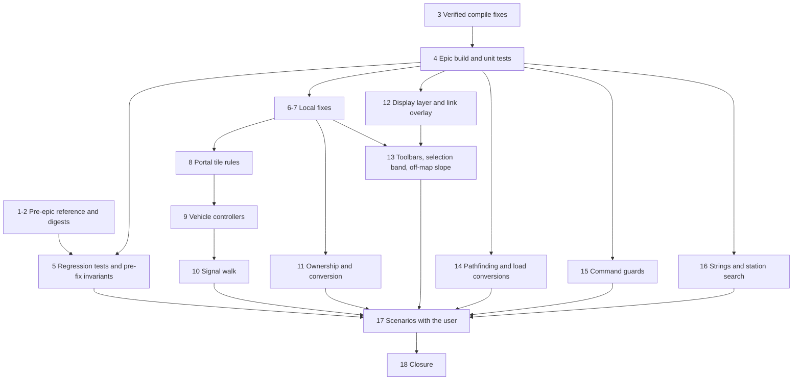
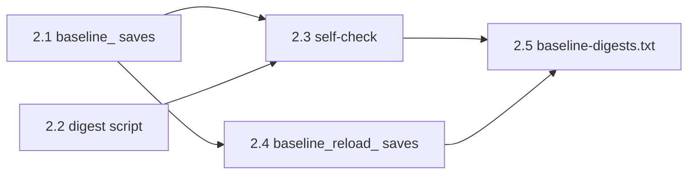

# R2RVM Plan - Review Fixes for the Multi-Layered Map (R2MLM)

## Global Mandatory Reading

> **Execution protocol**
>
> - Read this Global Mandatory Reading section before the first task and again
>   after every context compaction.
> - Before starting or resuming a task group, read the nearest preceding Area
>   Mandatory Reading block whose `Applies to` label includes that group. Area
>   blocks appear immediately before the first group they govern.
> - A referenced heading or exported symbol is authoritative. Global navigation
>   hints and Area line ranges are for navigation only; if they drift, relocate
>   the named section or symbol rather than expanding to the whole file.
> - Mandatory reading is non-transitive. Do not preload a linked file's own
>   Mandatory Reading, Consult on Demand, or Planning Provenance entries unless
>   this plan names them directly for the current area.
> - Do not read Consult on Demand or Planning Provenance merely because those
>   sources are listed. Use a Consult on Demand source only when its trigger
>   occurs.
> - No created source file, test file or JSON file should start with same prefix as a planning MD file (such as r2). Only MD files can have that prefix. No MD file should be created anywhere in source directories unless specifically asked.
> - After EVERY CONTEXT COMPACTION, you must add a note above the task group
>   which is currently in execution. The note will say: "Context has compacted
>   X times while executing this group.". If the compaction occurs before any
>   meaningful work was done (this can happen when there is a lot of baggage
>   from the previous compaction), then and ONLY then you can skip this step.
> - When exceeding 3 context compactions, YOU MUST ask yourself if you're not 
>   chewing more than we can handle :). Heck, plans change! :). In such a case, 
>   the way out is to split the group on the spot,
>   in the plan, into more groups, 
>   by appending B, C, D as a suffixes to those groups (splitting sub-groups 
>   themselves is also allowed). When you do this, create Local Mandatory
>   Reading areas so you can optimize your context only for the
>   ACTUAL task at hand.
>   Before starting or resuming a task group, read the nearest preceding Area
>   Mandatory Reading block whose `Applies to` label includes that group. Area
>   blocks appear immediately before the first group they govern.

| File name | Line Ranges | Description |
| --- | --- | --- |
| [r2rvm-review-map.md](r2rvm-review-map.md) | 448-514 | `## Fix Decisions`, FD-1 to FD-12. These are the authoritative designs for every fix: the vertical shaft crossing, visibility as a function of position, door-only connections, the signal walk, ownership accounting, layer of an interaction, display layer of a vehicle, surface-only conversions, the two-tile guard, savegame layer counts and the evidence rule. Every task names its FD. Where an FD and a finding's "Fix" bullet differ, the FD wins. An FD never overrides a master-plan AD. |
| [r2rvm-review-map.md](r2rvm-review-map.md) | 141-175 | `### Severity index`: the finding IDs (C-1, H-1 to H-5, M-1 to M-11, L-1 to L-12) every task cites, the task that fixes each, and the Status column that Group 18 (in r2rvm2) fills. Read a finding's own `####` section only when the current Area block points to it. |
| [r2rvm-review-map.md](r2rvm-review-map.md) | 569-659 | `### Commands used by every group`: the Bash variables, the configure, build and test commands (with `/nodeReuse:false`), the error and warning extraction, and the rules for starting `openttd.exe`. When a task says "build Debug" or "run the unit tests", it means exactly these commands. |
| [r2rvm-review-map.md](r2rvm-review-map.md) | 661-672 | `### Comment and header rules`: the user's rules of 2026-10-03 for file headers (a related `archi-*.md` or `r*.md` page), Javadoc, business comments on compound `if`s and non-trivial loops, and scratch file names. Every file this plan and r2rvm2 create or modify follows them. |
| [r2mlm-multi-layered-map.md](r2mlm-multi-layered-map.md) | 65-75, 98-101, 118-127 | `### AD-2 Stacked-plane addressing`, `### AD-8 Cross-layer movement only through layer portals` and `## Cross-plan Invariants` I-1 to I-8. AD-2 means a tile's layer is implicit in its `TileIndex`, so no command or pool gains a layer field. AD-8 means `GetLayerPortalNextTile` is the only cross-layer step and portals have no wormhole state. Every fix must keep I-1 to I-8 true. I-6 and I-7 are proven by Group 5 here and Group 18 in r2rvm2. |
| [r2mlm-multi-layered-map.md](r2mlm-multi-layered-map.md) | 141-147 | `## Engineering Conventions`: the `//comment` style with no space, Javadoc on every function and parameter, OpenTTD naming, file registration, **never** `git checkout`, `git reset` or `git stash`, never move or delete files, and English-only strings. They bind every edit in this plan, including the snippets below. |
| [r2mlm-multi-layered-map.md](r2mlm-multi-layered-map.md) | 149-170 | `## Build and Test Commands`: the Build Tools 2022 CMake path, the standalone vcpkg at `D:\Codez\Tools\vcpkg` (never the one bundled with Build Tools), and the configure command. `### Commands used by every group` below adds the flags this plan needs. Do not use any other toolchain. |
| [src/map_func.h](../../../../src/map_func.h) | 457-498 | `TileY` (stacked), `TilePlaneY`, `GetTileLayer`, `TileXYL`: the addressing primitives every fix uses. Plane-relative logic uses `TilePlaneY` and `TileXYL`, never `TileY` against `Map::MaxY()`. |
| [src/map_layer.h](../../../../src/map_layer.h) | 188-198, 272-292 | `MultiLayerMap::TileInLayer`, `MultiLayerMap::GetPortalTargetLayer` and `CheckLayerAllowsConstruction`: the controller boundary. Gameplay never adds `Map::PlaneSize()` to a tile by hand, and Surface pairs only with Underground in version 1. |

## Outcome

This plan turns the 2026-10-03 code review of the R2MLM epic into executable work. It is split in two files:

- **This file:** the review, the fix decisions, the commands every group uses, and Groups 1 to 7: the pre-epic reference, the epic build, the regression run and the local fixes.
- **[r2rvm2-review-map-2.md](r2rvm2-review-map-2.md):** Groups 8 to 18: the behaviour fixes, the scenario runs with the user and the closure.

Group and task numbers run on across both files, so a task number names one task in either file. Tasks from 8.1 on are in r2rvm2.

When both files are done:

- a pre-epic reference build, its test results and baseline digests exist;
- the epic tree builds in Debug and RelWithDebInfo, its unit tests pass, and its regression tests match the pre-epic results;
- every finding below is fixed or explicitly deferred by the user;
- vehicles cross portals at any height;
- I-6 and I-7 have recorded evidence.

The r2mlm10 acceptance plan can start afterwards.

The master plan stays the authority for architecture, conventions and build commands. This plan executes master-plan tasks 1.3 to 1.8 by reference. Where those tasks assumed a pre-epic tree, it adapts them. The epic was written, and then committed as `add192d73d`, before any baseline was captured. So Group 1 builds the reference from a `git archive` export of its parent, `886ef09a09`. On 2026-10-03, after this plan was done, the master plan lost its tasks: their results are in its `## Build and Test Commands` and `## Baseline Data`, and their text is in commit `d4abc0a7dc`.

Every group is SIMPLE or MEDIUM and holds at most eight tasks. A task gives the code to write, written against the epic code as it stood on 2026-10-03. Where a snippet depends on an earlier task, the task carries an ASSUMPTION note; if that earlier work is missing or looks different, re-assess before pasting.

## Review Findings

### Scope and method

- **Reviewed:** every source change of the epic: 109 modified files (+2652 / -701 lines) and the 9 new files (`map_layer*`, `layer_portal*`, `src/tests/map_layer.cpp`).
- **Measured against:** the master plan [r2mlm-multi-layered-map.md](r2mlm-multi-layered-map.md) (AD-1 to AD-12, I-1 to I-8) and the intent of sub-plans r2mlm1 to r2mlm10.
- **Method:** code reading. I followed the paths of the tile loop, world generation, savegame, follower, YAPF, train and road vehicle controllers, signals, PBS and viewport, back to the unchanged OpenTTD code they call.
- **Built afterwards:** the review itself built and ran nothing. A probe build the same day compiled the tree and ran its unit tests; see `### Verification status`.
- **Not reviewed:** helper scripts in `tools/`, generated art in `assets/`, and the prose of the architecture pages.
- **Line links** in the findings point at the tree as it was reviewed. Group 3 adds nine lines near the top of `layer_portal_cmd.cpp`, so from then on its links are nine lines early.

### Verification status

At review time no line of this epic had been compiled or executed. The sub-plans repeat "The build waits on the toolchain".

A probe build ran later on 2026-10-03:

- **Set-up:** a copy of the working tree in `build-probe-tree/` (gitignored), configured without vcpkg, so PNG, zlib and liblzma were missing. A Debug build of `openttd` and `openttd_test` with Visual Studio Build Tools 2022.
- **Build result:** the epic did not compile as written. Nine behaviour-neutral edits made it build after four rounds:
  - missing includes in seven files;
  - a missing command-traits include and callback in `network_command.cpp`, which made the compiler crash (C1001);
  - the road tile struct that `table/road_land.h` needs;
  - `class Window` declared where the definition is `struct Window`, which links as a different symbol (LNK2019);
  - two globals used before their declaration;
  - two `CommandCost::AddCost` calls that need an rvalue.
- **Unit tests:** 2 of 103 failed. The portal test did not reset the road types before building a road end. Two new picker windows had an `ini_key` without a sticky or default-size box, which `test_window_desc` rejects. With both fixed, 103 of 103 passed in Debug.
- **Not covered:** the four `regression_` tests (their saves need liblzma), RelWithDebInfo, and every game run. The only epic change inside a `#ifdef WITH_*` block is in `town_cmd.cpp` under `WITH_ASSERT`, which Debug compiles.
- Group 3 applies exactly these edits. Group 4 repeats the build and the tests with vcpkg.

Master-plan Group 1 stands at:

- tasks 1.1 and 1.2 done: `build/` is configured with the standalone vcpkg (master-plan task 1.2, last note);
- no build, no baseline saves;
- `tools/savegame_plane_digest.py` and `tools/baseline-digests.txt` do not exist.

Master-plan task 1.6 cannot be run as written:

- The epic is committed in HEAD (`add192d73d`, on top of `886ef09a09`), so it would capture a post-epic baseline.
- Its `scripts/on_dedicated.scr` runs inside `NetworkServerStart` ([network.cpp:966](../../../../src/network/network.cpp#L966)), which `SwitchToMode` calls before it generates or loads the world ([openttd.cpp:1032](../../../../src/openttd.cpp#L1032)). Its `save` would store the map that existed before generation. `scripts/game_start.scr` runs from `OnStartGame` once the game exists ([openttd.cpp:847](../../../../src/openttd.cpp#L847)).

Groups 1 and 2 of this plan avoid both problems.

As a result:

- **I-6** (bit-identical surface for the same seed) and **I-7** (save round-trip) are unverified.
- Every r2mlm10 acceptance run (multiplayer, save matrix, performance) is open.
- The `[x]` marks in the sub-plans record that the code was written, not that it works.

### Summary

The foundation is sound:

- Stacked-plane addressing, `TilePlaneY`, the per-plane void fence and plane distances are applied consistently.
- Viewport and pick filtering by layer is thorough.
- Construction gating covers every build command.
- The savegame extension is backward compatible.

The portal layer (r2mlm7 to r2mlm9) is where most of the defects are:

- The headline feature, vehicles crossing layers, does not work on a normal map (C-1).
- Removing, re-owning and converting portals have correctness bugs (H-1, H-2, M-2, M-8).
- Road vehicles can freeze permanently next to an elevator (H-4).
- Trains and road vehicles can enter a portal from behind (H-5).
- One savegame path is memory-unsafe with untrusted input (H-3).
- Once C-1 is fixed, a road vehicle stepping through the shaft can land on a vehicle waiting just inside the pair (M-10).
- A crafted portal command on a Space tile stops every build that has asserts (M-11).

### Severity index

Tasks 1.1 to 7.5 are in this file; tasks from 8.1 on are in [r2rvm2-review-map-2.md](r2rvm2-review-map-2.md).

| ID | Severity | Finding | Fixed by | Status |
| --- | --- | --- | --- | --- |
| C-1 | Critical | Portals cannot be crossed unless the surface end is at height 0 | 8.1, 8.2; verified 17.2 | Open |
| H-1 | High | Rail portal removal reads cleared bits and updates the wrong sides | 6.1; verified 17.5 | Open |
| H-2 | High | Owner change moves other companies' portal infrastructure; double subtraction on bankruptcy | 11.2, 11.3, 11.7; verified 17.6 | Open |
| H-3 | High | Savegame layer count is trusted (heap overflow) | 6.5, 6.6, 6.7 | Open |
| H-4 | High | Road vehicles freeze instead of turning around at elevators | 9.4; verified 17.3 | Open |
| H-5 | High | A portal can be entered from behind | 8.3, 9.1, 9.2, 9.3, 10.1; verified 17.4 | Open |
| M-1 | Medium | Signal update starting on a portal walks one direction only | 10.2; verified 17.5 | Open |
| M-2 | Medium | Wrong removal price sign; far-end reservation ignored | 6.2, 6.3; verified 17.8 | Open |
| M-3 | Medium | Ownerless road elevators cannot be removed | 11.3, 11.4; verified 17.6 | Open |
| M-4 | Medium | `_map_file_layers` stale for original TTD saves | 7.1 | Open |
| M-5 | Medium | Extra-viewport building uses the main viewport's layer | 13.3, 13.4, 13.5; verified 17.7 | Open |
| M-6 | Medium | Smallmap draws stray cross-layer link lines | 12.5, 12.6, 12.7; verified 17.7 | Open |
| M-7 | Medium | Smallmap pushes its layer onto the main view | 7.4; verified 17.7 | Open |
| M-8 | Medium | Road conversion converts one elevator end only | 11.5, 11.6; verified 17.8 | Open |
| M-9 | Medium | Three full planes stored and ticked in every game (plan level) | 18.2 (decision) | Open |
| M-10 | Medium | Road vehicles stepping through the shaft miss a vehicle waiting on the pair | 9.5; verified 17.3 | Open |
| M-11 | Medium | A portal command on Space passes `MapLayer::Invalid` to `TileInLayer` | 6.4; verified 17.7 | Open |
| L-1 | Low | `GetSlopePixelZOutsideMap` drops its layer | 13.6, 13.7 | Open |
| L-2 | Low | Split toolbars lose Subsidies | r2mlm11 (Subsidies); 18.3 (Pause and Fast-forward decision) | Open |
| L-3 | Low | String hygiene | 16.1 to 16.4 | Open |
| L-4 | Low | `CalcClosestStationTile` clamps stacked Y | 14.1 | Open |
| L-5 | Low | Road YAPF slope penalty across an elevator | 14.2 | Open |
| L-6 | Low | `TileVirtXYClampedToMap` clamps into lower layers | 12.2, 14.3 | Open |
| L-7 | Low | Dead code in `ClearPathReservation` | 7.2 | Open |
| L-8 | Low | Stale comments | 7.3 | Open |
| L-9 | Low | Two-tile commands accept cross-layer pairs | 15.1 to 15.7 | Open |
| L-10 | Low | Conversions run over freshly created planes | 14.4, 14.5, 14.6 | Open |
| L-11 | Low | Style nits (macro-case function, kd-tree special case, reservation drawing, AD-3 wording) | 11.1, 16.5; rest 18.5 | Open |
| L-12 | Low | Road elevator button skips `can_build` gating | 13.2 | Open |

### Critical findings

#### C-1 Portals cannot be crossed unless the surface end is at height 0

- **Where:**
  - Underground base height is 0: [map_layer.cpp:72](../../../../src/map_layer.cpp#L72).
  - `CheckPortalEnd` requires flat land but not equal heights: [layer_portal_cmd.cpp:305-315](../../../../src/layer_portal_cmd.cpp#L305-L315).
  - The z test in `VehicleEnterTile_LayerPortal`: [layer_portal_cmd.cpp:203-204](../../../../src/layer_portal_cmd.cpp#L203-L204).
- **What:**
  1. A surface end at height `h >= 1` is paired with an underground end at height 0.
  2. `VehicleEnterTile_LayerPortal` refuses entry when `abs(GetSlopePixelZ(x, y) - v->z_pos) > 2`. This test is copied from tunnel mouths, where heights match.
  3. Both controllers call `VehicleEnterTile` after moving the vehicle onto the pair tile, but before `z_pos` is updated:
     - train: [train_cmd.cpp:3576](../../../../src/train_cmd.cpp#L3576), with z updated only at [3661](../../../../src/train_cmd.cpp#L3661);
     - road vehicle: [roadveh_cmd.cpp:1320](../../../../src/roadveh_cmd.cpp#L1320).
- **Effect:**
  - **Train front engine:** goes to `invalid_rail` and reverses at full speed at the shaft. The reservation it made into the underground is left behind.
  - **Road vehicle:** `cur_speed = 0; return false` every tick. It stays at the shaft edge forever and blocks the elevator.
  - **Train wagons:** if a wagon (not the front) ever gets `CannotEnter` here, `invalid_rail` calls `FatalError("Disconnecting train")` ([train_cmd.cpp:3705](../../../../src/train_cmd.cpp#L3705)).
  - **Scope:** on standard maps, essentially no portal works.
- **Fix:** FD-1 and FD-3, tasks 8.1 and 8.2.

### High findings

#### H-1 Removing a rail portal reads portal bits from a tile that is already cleared

- **Where:** [layer_portal_cmd.cpp:286-291](../../../../src/layer_portal_cmd.cpp#L286-L291), which calls `NotifyRailPortalChanged` ([246-252](../../../../src/layer_portal_cmd.cpp#L246-L252)) after `DoClearSquare(tile)`.
- **What:**
  - `NotifyRailPortalChanged` calls `GetLayerPortalShaftDirection(tile)` on what is now a Clear tile.
  - The pair is queued with `AddSideToSignalBuffer(pair, ReverseDiagDir(shaft))`, which is the pair's **shaft** side. The pair's door is `shaft`.
- **Effect:**
  - **Debug builds:** removing any rail portal hits the `IsLayerPortalTile` assert.
  - **Release builds:** signals beside both former doors keep their old state.
- **Fix:** task 6.1.

#### H-2 Owner change moves infrastructure of portals the old owner does not own, and subtracts twice on bankruptcy

- **Where:** [layer_portal_cmd.cpp:143-186](../../../../src/layer_portal_cmd.cpp#L143-L186).
- **What:**
  1. `ChangeTileOwner_LayerPortal` calls `TransferPortalInfrastructure` before the `IsTileOwner(tile, old_owner)` check.
  2. `ChangeOwnershipOfCompanyItems` calls `ChangeTileOwner` on every tile of the map ([economy.cpp:480](../../../../src/economy.cpp#L480)).
  3. So on every merger, each portal of every company has its pieces moved from `old_owner` to `new_owner`.
  4. On bankruptcy, rail pieces are subtracted twice: first by `TransferPortalInfrastructure`, then again inside `ClearTile_LayerPortal` ([278-285](../../../../src/layer_portal_cmd.cpp#L278-L285)).
- **Effect:**
  - Wrong infrastructure counts and wrong maintenance costs.
  - Infrastructure is recomputed on every load (`AfterLoadCompanyStats`), so a client that joins later computes different counts than the server. With infrastructure maintenance on, company money diverges, which is a desync risk. `CheckCaches` reports the mismatch.
- **Fix:** FD-6, tasks 11.2, 11.3 and 11.7.

#### H-3 The savegame layer count is trusted and sizes the plane reads

- **Where:** [map_sl.cpp:39-43](../../../../src/saveload/map_sl.cpp#L39-L43) and [map_sl.cpp:71-73](../../../../src/saveload/map_sl.cpp#L71-L73).
- **What:** `_map_file_layers = _map_layers` comes straight from the file, while storage is allocated for `MAX_MAP_LAYERS`.
- **Effect:**
  - `layers > 3` writes past the tile arrays: a heap overflow.
  - It is reachable from a crafted save, or from a malicious server during map transfer.
- **Fix:** FD-11, tasks 6.5 to 6.7.

#### H-4 Road vehicles freeze permanently instead of turning around at elevators

- **Where:** [roadveh_cmd.cpp:1238-1242](../../../../src/roadveh_cmd.cpp#L1238-L1242).
- **What:** a U-turn is refused when `IsLayerPortalTile(v->tile) || IsLayerPortalTile(tile)`, where `tile` is the next tile. Two cases follow:
  - **In front of the door:** a bus on the ordinary road tile before a door, whose path says "turn back", stops forever.
  - **On the elevator:** a bus on an elevator whose far door leads to no road stops on the elevator and blocks it. This is the normal state during construction.
  - Meanwhile the follower's `TryReverse` still plans U-turns there, so the pathfinder and the controller disagree.
- **Fix:** FD-2 and FD-3, task 9.4.

#### H-5 A portal can be entered from behind and driven through on one layer

- **Where:**
  - [layer_portal_cmd.cpp:130](../../../../src/layer_portal_cmd.cpp#L130) answers track-status queries from the shaft side.
  - Only the follower refuses a same-layer entry through the shaft ([follow_track.hpp:383-397](../../../../src/pathfinder/follow_track.hpp#L383-L397)).
- **What:**
  - `TrainCheckIfLineEnds` and `TrainController` query track status with the shaft side, so a train enters an end from behind and leaves through its door.
  - `RoadFindPathToDest` returns the single reachable trackdir without pathfinding, so road vehicles do the same.
  - The signal walk treats such an entry as "came up the shaft".
- **Fix:** FD-4 and FD-5, tasks 8.3, 9.1 to 9.3 and 10.1.

### Medium findings

#### M-1 A signal update that starts on a portal tile explores only one direction

- **Where:** [signal.cpp:531-535](../../../../src/signal.cpp#L531-L535).
- **What:** both entries pushed for a portal start walk toward the pair's door.
- **Effect:** an update queued on one end only leaves that end's door-side block stale. Examples are a train crashed or removed on the portal, and PBS `SetSignalsOnBothDir`.
- **Fix:** FD-5, task 10.2.

#### M-2 Portal removal: wrong price sign, and the far end's reservation is ignored

- **Price sign:** [layer_portal_cmd.cpp:296](../../../../src/layer_portal_cmd.cpp#L296) returns `-_price[Price::ClearTunnel] * 4`, so removing a portal pays the player.
- **Reservation:** [layer_portal_cmd.cpp:268](../../../../src/layer_portal_cmd.cpp#L268) checks only the clicked end.
- **Fix:** tasks 6.2 and 6.3.

#### M-3 Ownerless road elevators can never be removed

- **Where:** [layer_portal_cmd.cpp:181](../../../../src/layer_portal_cmd.cpp#L181) and [260](../../../../src/layer_portal_cmd.cpp#L260).
- **What:** after bankruptcy a road elevator becomes `OWNER_NONE`, and `CheckTileOwnership` then refuses every company.
- **Fix:** FD-6, tasks 11.3 and 11.4.

#### M-4 `_map_file_layers` is stale when loading original TTD saves

- **Where:**
  - only the TTO path resets it: [oldloader_sl.cpp:1536-1538](../../../../src/saveload/oldloader_sl.cpp#L1536-L1538);
  - TTD saves go through `InitializeGame` at [saveload.cpp:3341](../../../../src/saveload/saveload.cpp#L3341);
  - the value is used by [afterload.cpp:572-575](../../../../src/saveload/afterload.cpp#L572-L575).
- **Effect:** after a 3-layer save has been loaded in the session, a TTD save keeps all-zero Underground and Space planes, with no void fence. This breaks I-2.
- **Fix:** FD-11, task 7.1.

#### M-5 Building in an extra viewport uses the main viewport's layer

- **Where:**
  - portal target: [rail_gui.cpp:754](../../../../src/rail_gui.cpp#L754) and [road_gui.cpp:724](../../../../src/road_gui.cpp#L724);
  - selection: `MainViewportBandY` in [viewport.cpp:2184](../../../../src/viewport.cpp#L2184), used by `SetSelectionTilesDirty` and `CalcRaildirsDrawstyle` (asserts at [3209](../../../../src/viewport.cpp#L3209) and [3244](../../../../src/viewport.cpp#L3244)).
- **Effect:**
  - **Portal:** refused in an extra viewport.
  - **Diagonal rail drag:** asserts in Debug; in Release it snaps to the main view's layer.
  - **Highlights:** redraw is clamped to the wrong band.
- **Fix:** FD-7, tasks 13.3 to 13.5.

#### M-6 The smallmap draws stray lines for cross-layer links

- **Where:** [smallmap_gui.cpp:1541](../../../../src/smallmap_gui.cpp#L1541) returns the sentinel `{INT32_MIN / 2, INT32_MIN / 2}`.
- **What:** only `ShowTooltip` checks the sentinel. `RebuildCache` and `DrawLinks` ([linkgraph_gui.cpp:284-291](../../../../src/linkgraph/linkgraph_gui.cpp#L284-L291)) do not.
- **Effect:** stray lines, and signed overflow in `Blitter::DrawLineGeneric`.
- **Fix:** FD-8, tasks 12.5 to 12.7.

#### M-7 The smallmap pushes its own layer onto the main view

- **Where:** `SmallMapCenterOnCurrentPos` calls `SetViewportLayer(main, this->layer)` ([smallmap_gui.cpp:1519-1520](../../../../src/smallmap_gui.cpp#L1519-L1520)), and `ScrollMainWindowTo` calls it when the view is already at the target ([smallmap_gui.cpp:2222](../../../../src/smallmap_gui.cpp#L2222)).
- **Effect:** a second click on an underground station flips the main view back to the smallmap's layer.
- **Fix:** task 7.4.

#### M-8 Road conversion converts only one end of an elevator

- **Where:** the portal case in `CmdConvertRoad` ([road_cmd.cpp:2550-2553](../../../../src/road_cmd.cpp#L2550-L2553), [2603-2604](../../../../src/road_cmd.cpp#L2603-L2604)). Rail converts both ends ([rail_cmd.cpp:1782-1819](../../../../src/rail_cmd.cpp#L1782-L1819)).
- **What:** the two ends are on different layers, and a conversion drag stays in one layer, so it never contains both. The comment "Both ends are visited" is never true.
- **Effect:** the two ends end up with mismatched road types, and vehicles get stuck.
- **Fix:** tasks 11.5 and 11.6.

#### M-9 Every game now stores and ticks three full planes (plan level)

- **Facts:**
  - `InitializeGame` and every load allocate `MAX_MAP_LAYERS` ([misc.cpp:100](../../../../src/misc.cpp#L100)).
  - Tile memory triples: about 768 MB for 4096 x 4096.
  - The tile loop does three times the work, and every `Map::Iterate()` walks three planes.
  - Space has no content in version 1.
- **Next step:** a decision for the user in task 18.2.

#### M-10 A road vehicle stepping through the shaft does not see a vehicle waiting just inside the pair

- **Found:** while the traversal groups were detailed on 2026-10-03. It is hidden behind C-1 today, because no vehicle crosses a shaft between ends of different height yet.
- **Where:**
  - `FindClosestBlockingRoadVeh` skips a candidate whose height differs from the searching vehicle's current `z_pos` by 6 or more ([roadveh_cmd.cpp:659](../../../../src/roadveh_cmd.cpp#L659)).
  - On a shaft step, `IndividualRoadVehicleController` calls `RoadVehFindCloseTo` for the first position on the pair before `UpdateInclination` moves the vehicle to the pair's height ([roadveh_cmd.cpp:1310-1318](../../../../src/roadveh_cmd.cpp#L1310-L1318), [1378](../../../../src/roadveh_cmd.cpp#L1378)).
- **What:** with ends one height level (8 px) or more apart, vehicles standing at the pair's entry are not seen.
- **Effect:**
  - The incoming vehicle is placed on or just behind the waiting one, and they overlap on screen.
  - If they share a position, each finds the other blocking and both stop. They stay stopped until the 1480-tick drive-through fallback in `RoadVehFindCloseTo` ([roadveh_cmd.cpp:702-711](../../../../src/roadveh_cmd.cpp#L702-L711)) lets one pass.
  - A queue for a busy stop beyond an elevator then stalls for about 20 days at a time.
- **Fix:** FD-1 (height at the target point), task 9.5.

#### M-11 A portal command on a Space tile passes `MapLayer::Invalid` to `TileInLayer`

- **Found:** while the view-layer tasks were detailed on 2026-10-03.
- **Where:** the layer check of `CmdBuildLayerPortal` ([layer_portal_cmd.cpp:339-344](../../../../src/layer_portal_cmd.cpp#L339-L344)).
- **What:**
  1. The command accepts `target_layer` when it equals `MultiLayerMap::GetPortalTargetLayer(GetTileLayer(tile))`.
  2. For a Space tile that value is `MapLayer::Invalid`, so a command that sends `MapLayer::Invalid` passes the check.
  3. `MultiLayerMap::TileInLayer(tile, MapLayer::Invalid)` then asserts `IsValidLayer`. The construction gate in `CheckPortalEnd` runs only after it.
- **Effect:**
  - Today the GUI never sends it: the buttons are disabled while the main view shows Space, and the placement code breaks on `Invalid`.
  - A modified client can send it. The server and every client that executes it stop on the assert. Asserts are on in Debug, and in every other configuration unless `OPTION_USE_ASSERTS` is turned off ([cmake/Options.cmake:59](../../../../cmake/Options.cmake#L59)).
  - FD-7 takes the target layer from the clicked tile. After task 13.3 an ordinary click on a Space tile would send it, so task 6.4 must land first.
- **Fix:** FD-7, task 6.4.

### Low findings

#### L-1 `GetSlopePixelZOutsideMap` drops its `layer` argument

[landscape.cpp:343](../../../../src/landscape.cpp#L343) passes `INVALID_TILE` to the Void proc. [void_cmd.cpp:41](../../../../src/void_cmd.cpp#L41) then reads `_viewport_draw_layer`, which is set at draw time and never reset. This is view-only, so I-4 holds.

#### L-2 Split toolbars lose Subsidies

- **Fix:** the Subsidies half by [r2mlm11](r2mlm11-split-toolbar-subsidies.md) (Towns menu entry); the Pause and Fast-forward half stays open. Implementation is staged; split-width checks are pending.

`arrange14` and `arrange15` ([toolbar_gui.cpp:1578-1646](../../../../src/toolbar_gui.cpp#L1578-L1646)) no longer contain `WID_TN_SUBSIDIES`. For 15 to 20 buttons, Pause and Fast-forward appear in one row only. This follows r2mlm1 task 4.3. The Subsidies half is planned in [r2mlm11-split-toolbar-subsidies.md](r2mlm11-split-toolbar-subsidies.md), the fix the user chose on 2026-10-03. The Pause and Fast-forward half is open.

#### L-3 String hygiene

- Two tooltips sit inside the `###length 32` block ([english.txt:385](../../../../src/lang/english.txt#L385)).
- Captions concatenate `" - "` ([viewport_gui.cpp:73](../../../../src/viewport_gui.cpp#L73), [smallmap_gui.cpp:1562](../../../../src/smallmap_gui.cpp#L1562)).
- `STR_ERROR_LAYER_PORTAL_NEEDS_FLAT_LAND` duplicates `STR_ERROR_FLAT_LAND_REQUIRED`.

#### L-4 `CalcClosestStationTile` clamps the stacked Y

[pathfinder_func.h:34-46](../../../../src/pathfinder/pathfinder_func.h#L34-L46). For a station on another layer, the target is always the station's north or south edge row.

#### L-5 Road YAPF charges a slope-up penalty for riding an elevator up

`SlopeCost` in [yapf_road.cpp:37-54](../../../../src/pathfinder/yapf/yapf_road.cpp#L37-L54) compares heights across the layer jump.

#### L-6 `TileVirtXYClampedToMap` now clamps into lower layers

[map.cpp:100-112](../../../../src/map.cpp#L100-L112). Aircraft positions south of the surface map resolve to Underground tiles. The Big UFO spawns at `y = Map::MaxX() * TILE_SIZE - 1` ([disaster_vehicle.cpp:854](../../../../src/disaster_vehicle.cpp#L854)), so on maps wider than tall it is drawn only in the Underground view.

#### L-7 Dead code in `ClearPathReservation`

[train_cmd.cpp:2462-2468](../../../../src/train_cmd.cpp#L2462-L2468) computes an unused `pair`.

#### L-8 Stale comments

[map.cpp:51](../../../../src/map.cpp#L51) and [map_func.h:242](../../../../src/map_func.h#L242) still say live games use one layer.

#### L-9 Two-tile commands accept a start and an end on different layers

Rail and road drags, canal, area clear and house area. The void fence and the per-tile checks stop the walk today; an explicit guard states the intent.

#### L-10 Missing planes are created before the old-version conversions run

[afterload.cpp:572](../../../../src/saveload/afterload.cpp#L572). Every legacy conversion pass then runs over freshly written modern-format tiles. The passes checked are harmless today, but the arrangement is fragile.

#### L-11 Style and smaller nits

- `LAYER_PORTAL_TRACKBIT_FACTOR` is a function named like a macro.
- `ForAllStationsRadius` special-cases the band end ([station_kdtree.h:46-54](../../../../src/station_kdtree.h#L46-L54)).
- Portal reservations are neither drawn nor dirty-marked.
- AD-3 places "the per-layer tile loop" in `MultiLayerMap`, but it lives in `RunTileLoop`.

#### L-12 The road elevator button skips the `can_build` gate

[road_gui.cpp:422-425](../../../../src/road_gui.cpp#L422-L425).

### Conformance with the master plan

| Item | Status | Notes |
| --- | --- | --- |
| AD-1 vocabulary | Met | `MapLayer`, `MAX_MAP_LAYERS == 3`, names and stand-in icons. |
| AD-2 stacked planes | Met | `TileY` stacked, `TilePlaneY`, `GetTileLayer`, `TileXYL`; `IsInnerTile` per plane. |
| AD-3 two controllers | Mostly | `WrapToMap` replaced by `WrapToLayer`; the tile loop lives in `RunTileLoop` (L-11). |
| AD-4 independent layers | Met in code | Random-free initialisers, with a Debug assert on `_random.state`. |
| AD-5 plane distances | Mostly | `CalcClosestStationTile` missed (L-4). |
| AD-6 every layer ticks | Met | Cost as in M-9. |
| AD-7 view state | Met | L-1 is view-only. |
| AD-8 portals | Not met | C-1, H-5, H-1, H-2, M-10, M-11. |
| AD-9 savegame | Met, with defects | H-3, M-4. |
| AD-10 graphics | Not started | Stand-ins only. |
| AD-11 staging | Superseded as planned | Three live layers since r2mlm4. |
| AD-12 scope | Met | Construction gating on every build command. |
| I-1, I-2, I-5, I-8 | Unit tests pass | Probe build, Debug, 2026-10-03, with the Group 3 edits. |
| I-3, I-4 | Met | See L-1. |
| I-6, I-7 | Unverified | Groups 5 and 18. |

### Test coverage gaps

[src/tests/map_layer.cpp](../../../../src/tests/map_layer.cpp) covers addressing identities, void fences, neighbour steps, distances, layer iteration, initialisation and the portal neighbour map.

It does not cover:

- portal commands and their infrastructure counts (H-1, H-2, M-2, M-11);
- a vehicle crossing a portal above height 0 (C-1);
- savegame round-trip and a corrupt `layers` value (H-3, M-4);
- the signal state on both sides of a portal (M-1);
- a road vehicle at a dead end beyond an elevator (H-4);
- a queue of road vehicles across an elevator whose ends differ in height (M-10).

Groups 6, 8 and 15 add unit tests for the pure parts. Group 17 covers the rest by scenario runs (FD-12).

### What is done well

- The stacked-plane choice is applied with discipline. `TilePlaneY` / `TileXYL` are used at every plane-relative site, and tile areas, spirals and the k-d tree search are bounded to the layer.
- Surface generation paths are pinned to the surface, and non-surface initialisation asserts that it draws no random numbers.
- The savegame change is minimal and backward compatible.
- Construction gating through `CheckLayerAllowsConstruction` runs before any cost is computed.
- Viewport filtering covers tiles, vehicles, signs, text effects, link overlays and clicks.

## Fix Decisions

These decisions refine how AD-8 and AD-9 are implemented. They do not change any AD. If an FD contradicts an AD, the AD wins until the user approves a change.

- **FD-1 Shaft crossing is a vertical relocation (C-1, M-10).**
  - Portal ends may sit at different heights.
  - `VehicleEnterTile_LayerPortal` applies its level test (`abs(z) > 2` gives `CannotEnter`) only when the vehicle moves toward the shaft, `vdir == GetLayerPortalShaftDirection(tile)`. That vehicle came through the door from a neighbour of the same height, or is moving inside the end.
  - A vehicle moving in the door direction has arrived through the shaft or is already on the end. The controller's `UpdateInclination` re-derives its `z_pos` right after the entry call.
  - The one-time speed effect of the z jump (`AffectSpeedByZChange`, `RoadZPosAffectSpeed`) is accepted.
  - A check that compares heights at the point a vehicle is about to occupy uses the height at that point, not the vehicle's current height. On the shaft step the only such check is the road vehicle blocking search (`RoadVehFindCloseTo`, M-10). Trains test collisions after their height is updated, so they need nothing.
- **FD-2 Road vehicles turn around at portals like at any road end (H-4).** The controller's U-turn refusal is removed. This matches the follower's `TryReverse`. Visibility after the turn follows FD-3.
- **FD-3 Visibility is a function of position (C-1, FD-2).**
  - `IsHiddenInLayerPortal(shaft, x, y)` is true when the point's depth from the door edge, measured along the shaft heading, is at least `_tunnel_visibility_frame[shaft]`.
  - For a vehicle heading straight in or out, this gives exactly the tunnel frames. It also stays right while a road vehicle turns or a train reverses on the end, when the heading is sideways or flips.
  - `VehicleEnterTile_LayerPortal` sets or clears `VehState::Hidden` from it on every call.
  - The tunnel sound and the elevator sound still play only on the call where the state changes from shown to hidden.
- **FD-4 A portal end connects through its door to its own layer, and through its shaft to its pair only (H-5).**
  - `GetTileTrackStatus_LayerPortal` returns nothing for `side == GetLayerPortalShaftDirection(tile)`. It answers the door side and `DiagDirection::Invalid`.
  - `TrainController` (new-tile branch) and `TrainCheckIfLineEnds` recognise the shaft step with `IsLayerPortalShaftExit(old_tile, exitdir)` and query the pair with `DiagDirection::Invalid`.
  - `RoadFindPathToDest` clears the trackdirs of a portal tile entered by movement `enterdir` unless one of three holds:
    - `enterdir == GetLayerPortalShaftDirection(tile)`: through the door;
    - `v->tile` is that tile's pair: out of the shaft;
    - `v->tile == tile`: the end of a turn on the end itself, which `RDE_TURNED` asks for.

    It follows the depot and road-stop filters already in that function.
  - This replaces "An end offers the axis track (or axis road) in both directions" in r2mlm7 `## Portal Contract`.
- **FD-5 Signal walk through a portal (H-5, M-1).**
  - In `ExploreSegment`, portal case:
    - When `enterdir == GetLayerPortalDoorDirection(tile)`: record a train on either end, then continue inline out of the pair's door. Set `oldtile = pair`, `exitdir = GetLayerPortalDoorDirection(pair)`, `tile = TileAddByDiagDir(pair, exitdir)` and `enterdir = ReverseDiagDir(exitdir)`, and reach the `MaybeAddToTodoSet` call at the end of the loop body.
    - Any other `enterdir` is no connection (`continue`).
  - In `UpdateSignalsInBuffer`, portal case:
    - push `(tile, door)`;
    - push `(door neighbour, ReverseDiagDir(door))`.

    This mirrors the generic Railway case.
- **FD-6 Portal ownership and infrastructure (H-2, M-3).**
  - Rail pieces belong to the tile owner. Road pieces belong to the road owner, which is always kept equal to the tile owner.
  - Each end counts `LAYER_PORTAL_TRACKBIT_FACTOR(transport)` pieces (renamed `GetLayerPortalPieceCount` in task 11.1). The pair is counted once, from the lower `TileIndex`, as in `AfterLoadCompanyStats`.
  - `ChangeTileOwner_LayerPortal` acts only on an end owned by `old_owner`:
    - valid `new_owner`: the lower end transfers the pair's pieces, and each end sets its own owners;
    - `INVALID_OWNER`, rail: the lower end clears the pair with `LandscapeClear`, and `ClearTile_LayerPortal` does the accounting, with no prior transfer;
    - `INVALID_OWNER`, road: the lower end subtracts the pieces, and each end becomes `OWNER_NONE`.
  - Removing a road portal uses `CheckAllowRemoveRoad` ownership rules, so `OWNER_NONE` ends can be removed by anyone.
- **FD-7 An interaction's layer comes from its tile or world point, never from the main viewport (M-5, M-11).**
  - The portal target is `MultiLayerMap::GetPortalTargetLayer(GetTileLayer(tile))`.
  - The selection band is the layer of `_thd.selstart` (drags) or `_thd.pos` (highlight), found with `GetLayerOfWorldY`.
  - Portal and elevator buttons are enabled when `MultiLayerMap::GetLayerCount() > 1`.
  - The command refuses a tile whose layer has no portal pair (Space) before it computes the pair, so `TileInLayer` never receives `MapLayer::Invalid`.
- **FD-8 One helper decides a vehicle's display layer, and overlays skip off-layer stations (M-6, L-6).**
  - `GetVehicleDisplayLayer(const Vehicle *v)` in `src/map_layer_gui.cpp` returns:
    - Surface for Aircraft, Ship and Disaster;
    - `GetLayerOfWorldY(v->y_pos)` for Effect;
    - `GetTileLayer(v->tile)` otherwise.
  - The link-graph overlay skips every link whose either station is not on the overlay window's layer. There are no sentinel coordinates.
- **FD-9 Old-version conversions touch the surface only (L-10).**
  - Every `Map::Iterate()` loop in `AfterLoadGame` inside an `IsSavegameVersionBefore(v)` guard with `v < SaveLoadVersion::MapLayers` iterates `MultiLayerMap::IterateLayer(MapLayer::Surface)`.
  - Unguarded loops keep `Map::Iterate()`.
  - The missing-plane initialisation stays where it is.
  - This supersedes the `C1 kept` rows for `afterload.cpp` in the r2mlm3 call-site ledger.
- **FD-10 Two-tile commands stay in one layer (L-9).** `CommandCost CheckTilesShareLayer(TileIndex a, TileIndex b)` in `src/map_layer.h` returns `CMD_ERROR` when the layers differ. Every command that takes two corner or end tiles calls it before any other check.
- **FD-11 Savegame layer counts (H-3, M-4).**
  - `MultiLayerMap::IsStorableLayerCount(uint n)` is true for `1 <= n <= MAX_MAP_LAYERS`. `ValidateLayerCount` and both `MAPS` handlers use it; the handlers call `SlErrorCorrupt` on failure.
  - `_map_file_layers` is reset to 1 in `InitializeGame`, which both load paths call (`saveload.cpp` 3237 and 3341).
- **FD-12 Evidence.**
  - Pure helpers and tile-level procs are unit-tested in `src/tests/map_layer.cpp` on hand-built tiles, as the existing portal test does.
  - A unit test must not need the Company, Vehicle or Station pools. If one would, stop writing it and add the check to Group 17.
  - Command, vehicle, signal and ownership behaviour is verified by the Group 17 scenarios, in a Debug build with the desync cache check active.

## Implementation Tasks

Line numbers in the Area blocks and snippets of Groups 4 to 7, and of every group in r2rvm2, are those of the tree after Group 3. The probe copy `build-probe-tree/src` had exactly that state on 2026-10-03. Every later edit shifts them, so relocate by the named symbol.

How the groups of both files depend on each other. Groups 8 to 18 are in [r2rvm2-review-map-2.md](r2rvm2-review-map-2.md).



| Group | Name | Tag | Tasks | File |
| --- | --- | --- | --- | --- |
| 1 | Pre-epic export and reference build | MEDIUM | 7 | this file |
| 2 | Baseline saves and surface digests | MEDIUM | 6 | this file |
| 3 | Verified compile fixes | SIMPLE | 8 | this file |
| 4 | Epic build and unit tests | MEDIUM | 5 | this file |
| 5 | Regression tests and pre-fix invariants | MEDIUM | 6 | this file |
| 6 | Portal removal, portal command and savegame layer count | SIMPLE | 8 | this file |
| 7 | Game reset, dead code and smallmap layer | SIMPLE | 5 | this file |
| 8 | Portal tile rules | MEDIUM | 5 | r2rvm2 |
| 9 | Vehicle controllers at the shaft | MEDIUM | 6 | r2rvm2 |
| 10 | Signal walk and reservations | MEDIUM | 5 | r2rvm2 |
| 11 | Ownership, infrastructure and conversion | MEDIUM | 8 | r2rvm2 |
| 12 | Vehicle display layer and link overlay | MEDIUM | 8 | r2rvm2 |
| 13 | Toolbars, selection band and off-map slope | MEDIUM | 8 | r2rvm2 |
| 14 | Pathfinding, aircraft clamp and surface-only conversions | MEDIUM | 7 | r2rvm2 |
| 15 | Two-tile command guards | SIMPLE | 8 | r2rvm2 |
| 16 | Strings and station search | SIMPLE | 6 | r2rvm2 |
| 17 | Scenario runs with the user | MEDIUM | 8 | r2rvm2 |
| 18 | Closure and hand-off | SIMPLE | 7 | r2rvm2 |

### Commands used by every group

Run every command in Git Bash, from the repository root `D:\Codez\Sandbox\OpenTTD` unless the task names another folder. Define these variables once per shell:

```bash
CMAKE="/c/Program Files (x86)/Microsoft Visual Studio/2022/BuildTools/Common7/IDE/CommonExtensions/Microsoft/CMake/CMake/bin/cmake.exe"
CTEST="/c/Program Files (x86)/Microsoft Visual Studio/2022/BuildTools/Common7/IDE/CommonExtensions/Microsoft/CMake/CMake/bin/ctest.exe"
TOOLS=/d/Codez/Sandbox/OpenTTD/docs/zz-reach2/upgrades/2026-10/tools
```

- **Configure**, only where a task says so. It uses the standalone vcpkg of master plan `## Build and Test Commands`:
  ```bash
  "$CMAKE" -S . -B build -G "Visual Studio 17 2022" -A x64 \
    -DCMAKE_GENERATOR_INSTANCE="C:/Program Files (x86)/Microsoft Visual Studio/2022/BuildTools" \
    -DCMAKE_TOOLCHAIN_FILE="D:/Codez/Tools/vcpkg/scripts/buildsystems/vcpkg.cmake" \
    -DVCPKG_TARGET_TRIPLET=x64-windows-static 2>&1 | tee configure.log
  ```
- **Build Debug** (for **Build RelWithDebInfo**, replace both `Debug` words):
  ```bash
  #/nodeReuse:false stops MSBuild from leaving idle worker processes behind. Idle workers blocked an installer on this machine.
  "$CMAKE" --build build --config Debug --target openttd openttd_test --parallel -- /nodeReuse:false 2>&1 | tee build/build-Debug.log
  echo "build exit ${PIPESTATUS[0]}"
  ```
  MSBuild compiles every source even when some fail, but links only when all compile. Link errors therefore appear only once the compile errors are gone.
- **Errors and warnings of a build log:**
  ```bash
  #Distinct compiler and linker errors, without the MSBuild node prefix and the project suffix.
  grep -E ': (fatal )?error (C|LNK)[0-9]+' build/build-Debug.log | sed -E 's/^ *[0-9]+>//; s/ \[[^]]*\.vcxproj\]$//' | sort -u
  #Number of distinct warnings.
  grep -E ': warning C[0-9]+' build/build-Debug.log | sed -E 's/^ *[0-9]+>//; s/ \[[^]]*\.vcxproj\]$//' | sort -u | wc -l
  ```
- **Run the unit tests** (Debug; use `-C RelWithDebInfo` for the other build):
  ```bash
  #The four regression_ tests need the baseset and the regression_files target. Groups 1 and 5 run them on their own.
  "$CTEST" --test-dir build -C Debug --output-on-failure -E "^regression_"
  ```
- **Run the regression tests** (needs the `regression_files` target and `build/baseset/`):
  ```bash
  #Regression.cmake starts its copy of the exe by bare name. The agent's shell sets NoDefaultCurrentDirectoryInExePath=1, which hides the working folder from that lookup, so every test fails in half a second with "Regression did not output anything" (2026-10-03).
  env -u NoDefaultCurrentDirectoryInExePath "$CTEST" --test-dir build -C RelWithDebInfo --output-on-failure -R "^regression_" 2>&1 | tee build/regression-RelWithDebInfo.log
  ```
- **"Build Debug and run the unit tests"**, the last task of most groups, means the two commands above. Record under the task: the build exit code, the number of distinct warnings, and "N of N passed" or the names of the failing tests.
- **Starting `openttd.exe`:**
  - Tell the user before the first start in a task, and close the game when the check is done.
  - Start it only from a `build/` folder that has `baseset/`. On 2026-10-03 a start from a folder without it showed the user an error dialog.
  - The first dedicated run (`-D`) may raise a Windows Firewall prompt. The user may cancel it; the server only has to run locally.
  - To check a screen without the user, capture the game window itself and view the PNG. Use `PrintWindow`, never a copy of the screen: on 2026-10-03 a screen copy caught the user's Start menu over the game. Run it in PowerShell, with `$build` and `$shot` set for the task. The image is a scratch file, named like one, for example `r2rvm-b-title-epic.png` next to the plan:
    ```powershell
    #Start the game, wait for its window, capture that window only, then close the game.
    Add-Type -AssemblyName System.Drawing
    Add-Type @'
    using System;
    using System.Runtime.InteropServices;
    public static class WinCap {
    	[StructLayout(LayoutKind.Sequential)] public struct RECT { public int Left, Top, Right, Bottom; }
    	[DllImport("user32.dll")] public static extern bool GetWindowRect(IntPtr hWnd, out RECT rect);
    	[DllImport("user32.dll")] public static extern bool PrintWindow(IntPtr hWnd, IntPtr hdc, uint flags);
    }
    '@
    $build = 'D:\Codez\Sandbox\OpenTTD\build'
    $shot = 'D:\Codez\Sandbox\OpenTTD\docs\zz-reach2\upgrades\2026-10\r2rvm-b-title-epic.png'
    $p = Start-Process -FilePath "$build\RelWithDebInfo\openttd.exe" -ArgumentList '-c','baseline.cfg' -WorkingDirectory $build -PassThru
    #Wait up to 40 seconds for the main window, then 12 more for the title game to draw.
    $deadline = (Get-Date).AddSeconds(40)
    while ((Get-Date) -lt $deadline -and -not $p.HasExited) { $p.Refresh(); if ($p.MainWindowHandle -ne [IntPtr]::Zero) { break }; Start-Sleep -Milliseconds 500 }
    Start-Sleep -Seconds 12
    $p.Refresh()
    if ($p.HasExited) { "process exited early with code $($p.ExitCode)" } else {
    	$r = New-Object WinCap+RECT
    	[void][WinCap]::GetWindowRect($p.MainWindowHandle, [ref]$r)
    	$bmp = New-Object System.Drawing.Bitmap ($r.Right - $r.Left), ($r.Bottom - $r.Top)
    	$g = [System.Drawing.Graphics]::FromImage($bmp)
    	$hdc = $g.GetHdc()
    	#Flag 2 (PW_RENDERFULLCONTENT) also captures a window that another window covers.
    	[void][WinCap]::PrintWindow($p.MainWindowHandle, $hdc, 2)
    	$g.ReleaseHdc($hdc)
    	$bmp.Save($shot, [System.Drawing.Imaging.ImageFormat]::Png)
    	$g.Dispose(); $bmp.Dispose()
    	Stop-Process -Id $p.Id -Force
    }
    ```
    A fresh `-c` config shows the "Participate in automated survey?" question on the title screen. That is expected, not a warning.
- **Scripted saves:**
  - `scripts/game_start.scr` in the working folder runs after a game is generated or loaded (`OnStartGame`).
  - With `-c <file>`, the working folder is also the personal folder, so `save <name>` writes `save/<name>.sav` under the working folder.
  - After each scripted run, empty the script with `: > scripts/game_start.scr`. Never delete it. An empty script is harmless; a leftover `quit` would end every later game started from that folder.
- **Dedicated runs** go through `tools/run_dedicated.sh <build dir> <config> <log file> <arguments>`:
  - A plain `openttd.exe -D` opens a console window of its own and writes most output there, so a redirect keeps one line. On 2026-10-03 the user saw those windows flash during Groups 2 and 5.
  - The script runs `openttd_console.exe`, a copy marked as a console program with `editbin`, as `Regression.cmake` does. It redoes the copy after every build. No window appears, and the whole output goes to the log.
  - It adds `-D -x -d misc=3,net=3,sl=2,sprite=1,script=2` (`OTTD_DEBUG` overrides the levels) and a 600-second limit (`OTTD_TIMEOUT`). Logs go to `dedicated-logs/` in the build folder.
  - Example, from the build folder: `bash "$TOOLS/run_dedicated.sh" "$PWD" RelWithDebInfo dedicated-logs/epic_1234_8x8.log -c baseline.cfg -G 1234`.

### Comment and header rules

The user set these rules on 2026-10-03, when execution started. They apply to every file this plan and r2rvm2 create or modify, on top of master plan `## Engineering Conventions`:

- **File header.** The `@file` block names at least one related page: the subsystem's `archi-*.md` under `docs/zz-reach2/architecture/` and, for multi-layer code, `map-layers/archi-map-layers.md`. A file the epic created also names the sub-plan that created it. The `@see` goes on the existing `@file` line, so the line numbers this plan quotes stay valid:
  ```cpp
  /** @file rail_cmd.cpp Handling of rail tiles. @see docs/zz-reach2/architecture/landscape/rail-tiles.md, docs/zz-reach2/architecture/map-layers/archi-map-layers.md */
  ```
  A Python script names its pages in the module docstring, and a data file in a first `#` comment line.
- **Javadoc** on every function, class and struct a task creates or changes, with every parameter and the return value explained. Struct members get `///<` comments.
- **Business comments** on every `if` with more than one condition (why it matters and what it affects in the bigger picture) and on every loop that is not trivial.
- **Scratch files** go next to the plan, named `r2rvm-a-...`, `r2rvm-b-...` in creation order (`r2rvm2-a-...` for the second file). Only MD files may carry the `r2` prefix, so a scratch script goes to `%TEMP%` under a name without it, and a lasting script goes to `tools/` (for example `tools/run_dedicated.sh`). Long `python - <<'EOF'` heredocs fail in the agent shell on 2026-10-03 with "unexpected EOF while looking for matching", so a script longer than a few lines is written to a file first.

### Area Mandatory Reading - Pre-epic reference

_Applies to Groups 1-2._

**Entry gate:**
- **Required:**
  - master-plan tasks 1.1 and 1.2 are checked;
  - `D:\Codez\Tools\vcpkg\vcpkg.exe` and the Build Tools `cmake.exe` exist.
- **How to verify:** read both checkboxes, then `ls` both paths.
- **If absent:** stop every group, because each one ends with a build. Ask the user to restore the missing tool (master plan `## Build and Test Commands`).
- **Forbidden fallbacks:**
  - no other toolchain (Visual Studio Community, MinGW, clang), and not the vcpkg bundled with Build Tools;
  - no edits to `vcpkg.json`;
  - no build without vcpkg. It lacks zlib and liblzma, so it can neither write the saves the digests read nor load the regression saves. The probe build of 2026-10-03 showed both.

| File name | Line Ranges | Description |
| --- | --- | --- |
| [r2mlm-multi-layered-map.md](r2mlm-multi-layered-map.md) | 172-180 | `## Baseline Data`: the results of the former master-plan Group 1, tasks 1.1 to 1.8. Their text was authoritative for the seeds, map sizes, digest script spec (1.7) and digest file (1.8), and is in commit `d4abc0a7dc`. Group 1 here ran tasks 1.3 to 1.5 against an exported pre-epic tree, and Group 2 ran tasks 1.6 to 1.8. |
| [r2rvm-review-map.md](r2rvm-review-map.md) | 85-120 | `### Verification status`: why the baseline must come from an export, and why the scripted saves use `game_start.scr` instead of the `on_dedicated.scr` of master-plan task 1.6. |
| [src/saveload/map_sl.cpp](../../../../src/saveload/map_sl.cpp) | 391-405 | `map_chunk_handlers`: `MAPS`, then the RIFF planes `MAPT` to `MAP8`. These are exactly the planes the digest hashes, and their payload length shows how many layers a save holds. |
| [media/baseset/openttd/CMakeLists.txt](../../../../media/baseset/openttd/CMakeLists.txt) | 1-5 | The cached `openttd.grf` is used when NFORenum and GRFCodec are absent, so the export builds without those tools. |
| [cmake/scripts/Regression.cmake](../../../../cmake/scripts/Regression.cmake) | 37-64 | How a regression test runs: `openttd.exe -x -c regression/regression.cfg -g <test.sav> -snull -mnull -vnull:ticks=30000`. A start that prints nothing fails with "Regression did not output anything". |
| [src/openttd.cpp](../../../../src/openttd.cpp) | 838-848 | `OnStartGame` runs `scripts/game_start.scr` after a new game and after a load. Every scripted save of this plan relies on it. |

### Group 1 - Pre-epic export and reference build

{{MEDIUM}}
- [x] 1.1 In the repository, confirm which commit is pre-epic:
  ```bash
  git log --oneline -3
  git rev-parse --short=10 add192d73d^
  git diff --stat 886ef09a09^ 886ef09a09 -- src | tail -1
  git diff --stat 886ef09a09 add192d73d -- src | tail -1
  ```
  Expected, as on 2026-10-03:
  - the epic commit `add192d73d` ("First draft of multi-layered map.") has the parent `886ef09a09`;
  - the first diff prints nothing, because `886ef09a09` changed documents only;
  - the second diff ends with `104 files changed, 3436 insertions(+), 380 deletions(-)`.

  Together they prove that the `src/` of `886ef09a09` is pre-epic. If any of these differs, stop this group and ask the user for the pre-epic commit.
  - 2026-10-03, done: HEAD `add192d73d`, parent `886ef09a09`; the first diff printed nothing; the second printed `104 files changed, 3436 insertions(+), 380 deletions(-)`.
- [x] 1.2 Export `886ef09a09` into the sibling folder `D:\Codez\Sandbox\OpenTTD-baseline`. Use only `git archive`, never `git checkout`, `git worktree` or `git stash`:
  ```bash
  mkdir -p /d/Codez/Sandbox/OpenTTD-baseline
  git -C /d/Codez/Sandbox/OpenTTD archive --format=tar 886ef09a09 | tar -x -C /d/Codez/Sandbox/OpenTTD-baseline
  ls /d/Codez/Sandbox/OpenTTD-baseline/src/map_func.h
  ```
  If the folder already holds an export of the same commit, reuse it and say so under this task.
  - 2026-10-03, done: new export of `886ef09a09`. It has no `map_layer.h` and no `TilePlaneY`, so it is pre-epic. `!kit/` is not tracked, so it is not in the export; task 1.6 copies from the repository's `!kit/`.
- [x] 1.3 In `D:\Codez\Sandbox\OpenTTD-baseline`, run the configure of `### Commands used by every group`. vcpkg builds its 13 packages again for this folder (about 9 minutes on 2026-10-03). It must end with exit 0 and "Build files have been written". If version detection fails because the export has no `.git`, use Consult on Demand.
  - 2026-10-03, done: exit 0 in 32 seconds; vcpkg restored all 13 packages from its binary cache (`%LOCALAPPDATA%\vcpkg\archives`). Without `.git`, `FindVersion.cmake` warns once and the build is named `norev0000`. Configure did not abort, so no `.ottdrev` was needed. The name only labels the build; savegames are versioned by `SAVEGAME_VERSION`.
- [x] 1.4 In the export, build RelWithDebInfo and then Debug (logs `build/build-RelWithDebInfo.log` and `build/build-Debug.log`). Both must end with no error. Under this task, record the number of distinct warnings of each config. They are the pre-epic warning baseline that master-plan task 1.3 intended.
  - 2026-10-03, done: RelWithDebInfo exit 0 (5 min 50 s), Debug exit 0 (4 min 46 s). No errors, and 0 distinct compiler warnings in each config. The only `warning` lines in the logs are the CMake version notice of task 1.3.
- [x] 1.5 In the export, run the unit tests for Debug and for RelWithDebInfo. Record "N of N passed" for each config, and the name of any failing test. They are the pre-epic test baseline that master-plan task 1.4 intended. A pre-epic failure is not this plan's to fix: record it and continue.
  - 2026-10-03, done: 94 of 94 passed in Debug and 94 of 94 in RelWithDebInfo (about 10 s each). The epic adds 9 test cases, so task 4.4 expects 103.
- [x] 1.6 Copy (never move) the original graphics and sounds into the export's `build/baseset/`, then check the title screen:
  ```bash
  B=/d/Codez/Sandbox/OpenTTD-baseline/build
  mkdir -p "$B/baseset"
  cp "/d/Codez/Sandbox/OpenTTD/!kit/TTD/"{trg1.grf,trgc.grf,trgh.grf,trgi.grf,sample.cat,gm.cat} "$B/baseset/"
  #trgt.grf comes from !kit/TT: the copy in !kit/TTD does not match the expected MD5 (master-plan task 1.5 note).
  cp "/d/Codez/Sandbox/OpenTTD/!kit/TT/trgt.grf" "$B/baseset/"
  ls "$B/baseset"
  ```
  Tell the user, start `RelWithDebInfo/openttd.exe` from the export's `build/`, confirm that the title screen shows no missing-graphics warning, and close the game.
  - 2026-10-03, done: the seven files match the `[md5s]` of `orig_dos.obg`, `orig_dos.obs` and `orig_dos.obm`, the check `CheckExternalFiles` makes. Started with `-c baseline.cfg` (written early with the 8x8 content of task 2.1), so the user's own `openttd.cfg` stayed untouched. The window capture [r2rvm-a-title-baseline.png](r2rvm-a-title-baseline.png) shows the title game in the original graphics, no warning, and only the first-start survey question.
- [x] 1.7 In the export, build the regression files and run the four regression tests:
  ```bash
  "$CMAKE" --build build --config RelWithDebInfo --target regression_files -- /nodeReuse:false
  env -u NoDefaultCurrentDirectoryInExePath "$CTEST" --test-dir build -C RelWithDebInfo --output-on-failure -R "^regression_" 2>&1 | tee build/regression-RelWithDebInfo.log
  ```
  Record the pass or fail result of each of the four tests. This is the reference for task 5.2.
  - 2026-10-03, done: `regression_files` exit 0. All four passed: `regression_regression` 2.64 s, `regression_stationlist` 2.53 s, `regression_gs` 1.94 s, `regression_gs_compat` 1.95 s. The first run, without `env -u`, failed all four in about 0.5 s with "Regression did not output anything"; see `### Commands used by every group`.

### Group 2 - Baseline saves and surface digests

Master-plan task 1.6 puts the save commands in `scripts/on_dedicated.scr`. That script runs before the world exists, so this group uses `scripts/game_start.scr` (`### Verification status`). The digest script is given in full under `#### Digest script`, so task 2.2 is a copy.



> ASSUMPTION: this was already built previously. If not, re-asses at runtime. Depends on: Group 1 (an export with a RelWithDebInfo build and `build/baseset/`).

{{MEDIUM}}
- [x] 2.1 Generate the four baseline worlds with the export's dedicated server. Map sizes are exponents: 8 is 256 tiles, 9 is 512 and 10 is 1024.
  ```bash
  cd /d/Codez/Sandbox/OpenTTD-baseline/build
  mkdir -p scripts
  for size in "8 8" "9 10"; do
  	set -- $size
  	printf '[game_creation]\nmap_x = %s\nmap_y = %s\n' "$1" "$2" > baseline.cfg
  	for seed in 1234 98765; do
  		printf 'save baseline_%s_%sx%s\nquit\n' "$seed" "$1" "$2" > scripts/game_start.scr
  		./RelWithDebInfo/openttd.exe -D -x -c baseline.cfg -G "$seed"
  	done
  done
  : > scripts/game_start.scr
  ls -l save/
  ```
  `save/` must hold `baseline_1234_8x8.sav`, `baseline_98765_8x8.sav`, `baseline_1234_9x10.sav` and `baseline_98765_9x10.sav`. Record the folder under this task as `SAVES_BASE=/d/Codez/Sandbox/OpenTTD-baseline/build/save`, and set that variable in every later shell that uses it.
  - 2026-10-03, done: `SAVES_BASE=/d/Codez/Sandbox/OpenTTD-baseline/build/save`. The four saves are 82472, 79800, 614800 and 600944 bytes (seeds 1234 and 98765, 8x8 then 9x10). Each run took about 2 seconds and exited 0, and `scripts/game_start.scr` is empty again. The server output of each run is in `dedicated_<seed>_<x>x<y>.log` in the export `build/`.
- [x] 2.2 Create `docs/zz-reach2/upgrades/2026-10/tools/savegame_plane_digest.py` with exactly the content of `#### Digest script` below. If the file already exists, compare it with that content. Keep the existing file only if it prints the same fields in the same order; otherwise replace it, and say so under this task.
  - 2026-10-03, done: the file did not exist. It was extracted from the fenced block of `#### Digest script` (147 lines), so the two are identical. Run it with `python -B`, so no `__pycache__` file is written into `tools/`.
- [x] 2.3 Self-check the script on one save:
  ```bash
  python "$TOOLS/savegame_plane_digest.py" "$SAVES_BASE/baseline_1234_8x8.sav"
  ```
  Expected: exit 0, one `file ... version N` line, then ten lines `MAPT`, `MAPH`, `MAPO`, `MAP2`, `M3LO`, `M3HI`, `MAP5`, `MAPE`, `MAP7`, `MAP8` in that order. Each reads `length 65536 hashed 65536`, except `MAP2` and `MAP8`, which read `131072`. On 2026-10-03 the script read the four saves in `regression/` (versions 211 to 365) this way. If the output differs, use Consult on Demand.
  - 2026-10-03, done: exit 0, `version 368`, the ten planes in order, each `length 65536 hashed 65536` and `MAP2`, `MAP8` at 131072. `baseline_1234_9x10.sav` gives 524288 and 1048576, so the 9x10 map is 512 x 1024 tiles.
- [x] 2.4 Write the I-7 reference: load each baseline save in the export and save it again. `AfterLoadGame` may rewrite some surface bits even without the epic, so task 5.5 compares the epic's upgraded saves with these, not with the generated ones.
  ```bash
  cd /d/Codez/Sandbox/OpenTTD-baseline/build
  for name in 1234_8x8 98765_8x8 1234_9x10 98765_9x10; do
  	printf 'save baseline_reload_%s\nquit\n' "$name" > scripts/game_start.scr
  	./RelWithDebInfo/openttd.exe -D -x -c baseline.cfg -g "save/baseline_$name.sav"
  done
  : > scripts/game_start.scr
  ```
  `-g` loads the save with its own map size, so the content of `baseline.cfg` does not matter here. `save/` must now also hold the four `baseline_reload_` saves.
  - 2026-10-03, done: four `baseline_reload_` saves, each the same size as its original. All runs exited 0.
- [x] 2.5 Execute master-plan task 1.8 on all eight saves:
  ```bash
  : > "$TOOLS/baseline-digests.txt"
  for save in baseline_1234_8x8 baseline_98765_8x8 baseline_1234_9x10 baseline_98765_9x10 \
  		baseline_reload_1234_8x8 baseline_reload_98765_8x8 baseline_reload_1234_9x10 baseline_reload_98765_9x10; do
  	python "$TOOLS/savegame_plane_digest.py" "$SAVES_BASE/$save.sav" >> "$TOOLS/baseline-digests.txt"
  done
  grep -c sha256 "$TOOLS/baseline-digests.txt"
  ```
  The count must be 80. Under this task, record whether each `baseline_reload_` digest equals its `baseline_` digest. If `baseline-digests.txt` existed before and came from an epic build (see the notes under master-plan task 1.6), say under master-plan task 1.8 that it was replaced.
  - 2026-10-03, done: 80 digest lines; the file did not exist before. Every `baseline_reload_` digest equals its `baseline_` digest, plane by plane, so loading and saving a pre-epic save changes no map bit. A first line starting with `#` names this task and `archi-savegame.md`; it holds neither `file ` at its start nor `sha256`, so the counts of the Group 5 entry gate are unchanged. Python wrote the file with CRLF line endings.
- [x] 2.6 In the master plan, check tasks 1.6 to 1.8 with the note "pre-epic baseline from a `git archive 886ef09a09` export, r2rvm Groups 1-2; `scripts/game_start.scr` replaces `on_dedicated.scr`, which runs before the world exists". Leave tasks 1.3 to 1.5 to Groups 4 and 5.
  - 2026-10-03, done: tasks 1.6 to 1.8 checked, each with that note and its own result. The three notes moved the later master-plan lines down by three, so the r2rvm references to master-plan Group 1, task 4.5 and Group 7 now read 192-215, 258 and 288-294.

#### Digest script

Content of `docs/zz-reach2/upgrades/2026-10/tools/savegame_plane_digest.py`:

```python
"""Print the length and SHA-256 of every map plane chunk (MAPT to MAP8) of an OpenTTD save.

Written for docs/zz-reach2/upgrades/2026-10/r2rvm-review-map.md (task 2.2, master-plan task 1.7).
The container, gamma lengths and chunk types it reads are described in
docs/zz-reach2/architecture/savegame/archi-savegame.md.

Usage: python savegame_plane_digest.py <save> [--tiles N]

With --tiles N only the first N tiles of each plane are hashed: N bytes of an
8-bit plane, 2N bytes of MAP2 and MAP8. That makes the surface plane of a
layered save comparable with the single plane of a pre-epic save.
"""

import argparse
import hashlib
import lzma
import sys
import zlib

#Bytes one tile takes in each map plane chunk, in the order map_sl.cpp saves them.
PLANE_BYTES = {
    b"MAPT": 1, b"MAPH": 1, b"MAPO": 1, b"MAP2": 2, b"M3LO": 1,
    b"M3HI": 1, b"MAP5": 1, b"MAPE": 1, b"MAP7": 1, b"MAP8": 2,
}

#ChunkType values from saveload.h. Riff carries a 28-bit length; the others are gamma-length records.
CHUNK_RIFF = 0
CHUNK_RECORDS = (1, 2, 3, 4)


class Reader:
    """Sequential reader over the decompressed chunk stream."""

    def __init__(self, data):
        """Start at the first byte.

        @param data Decompressed chunk stream.
        """
        self.data = data
        self.pos = 0

    def take(self, count):
        """Read a run of bytes.

        @param count How many bytes to read.
        @return The bytes.
        """
        #A chunk that claims more bytes than the stream holds means the parse went wrong.
        if self.pos + count > len(self.data):
            raise ValueError(f"read of {count} bytes at offset {self.pos} runs past the end of the stream")
        chunk = self.data[self.pos:self.pos + count]
        self.pos += count
        return chunk

    def byte(self):
        """Read one byte.

        @return The byte value.
        """
        return self.take(1)[0]

    def gamma(self):
        """Read a simple gamma length, exactly as SlReadSimpleGamma does.

        @return The decoded value.
        """
        i = self.byte()
        #Each leading 1 bit announces one more byte, up to the 32-bit form.
        if i & 0x80:
            i &= ~0x80
            if i & 0x40:
                i &= ~0x40
                if i & 0x20:
                    i &= ~0x20
                    if i & 0x10:
                        if i & 0x08:
                            raise ValueError("unsupported gamma")
                        i = self.byte()
                    i = (i << 8) | self.byte()
                i = (i << 8) | self.byte()
            i = (i << 8) | self.byte()
        return i


def read_stream(path):
    """Read a save and decompress its chunk stream.

    @param path Save file.
    @return The savegame version and the decompressed chunk stream.
    """
    with open(path, "rb") as f:
        raw = f.read()
    tag = raw[0:4]
    version = int.from_bytes(raw[4:6], "big")
    payload = raw[8:]
    #The tag names the compressor (SaveLoadFormatTag in saveload.cpp). LZO saves are not supported.
    if tag == b"OTTX":
        return version, lzma.decompress(payload)
    if tag == b"OTTZ":
        return version, zlib.decompress(payload)
    if tag == b"OTTN":
        return version, payload
    raise ValueError(f"unsupported save format {tag!r}; save with savegame_format lzma, zlib or none")


def main():
    """Print one header line, then one line per map plane chunk.

    @return Process exit code.
    """
    parser = argparse.ArgumentParser(description="Hash the map planes of an OpenTTD save.")
    parser.add_argument("save", help="path of the .sav file")
    parser.add_argument("--tiles", type=int, default=None, help="hash only the first N tiles of each plane")
    args = parser.parse_args()

    version, stream = read_stream(args.save)
    print(f"file {args.save} version {version}")
    reader = Reader(stream)
    while True:
        chunk_id = reader.take(4)
        #Four zero bytes end the chunk stream.
        if chunk_id == b"\0\0\0\0":
            break
        m = reader.byte()
        chunk_type = m & 0x0F
        if chunk_type == CHUNK_RIFF:
            #The high nibble of the type byte holds length bits 24 to 27.
            length = ((m >> 4) << 24) | (reader.byte() << 16) | (reader.byte() << 8) | reader.byte()
            payload = reader.take(length)
            #Only map planes are reported. Other RIFF chunks are skipped.
            if chunk_id in PLANE_BYTES:
                part = payload if args.tiles is None else payload[:args.tiles * PLANE_BYTES[chunk_id]]
                print(f"{chunk_id.decode()} length {length} hashed {len(part)} sha256 {hashlib.sha256(part).hexdigest()}")
            continue
        if chunk_type not in CHUNK_RECORDS:
            raise ValueError(f"chunk {chunk_id!r} has unknown type {chunk_type}")
        #Array and table chunks are records with a gamma length (bytes + 1). Gamma 0 ends the chunk.
        while True:
            length = reader.gamma()
            if length == 0:
                break
            reader.take(length - 1)
    return 0


if __name__ == "__main__":
    sys.exit(main())
```

Output fields, separated by spaces: `$1` chunk id, `$3` full payload length, `$5` hashed bytes, `$7` SHA-256. The comparisons in Group 5 use `$1` and `$7` only.

### Area Mandatory Reading - Compile fixes and epic build

_Applies to Groups 3-4._

**Entry gate:**
- **Required:** `build/CMakeCache.txt` exists in the repository (master-plan task 1.2 configured it).
- **How to verify:** `ls build/CMakeCache.txt`.
- **If absent:** run the configure of `### Commands used by every group` in the repository first. If it fails, compare the error with master plan `### Known configure failures` and ask the user to apply the matching fix.
- **Forbidden fallbacks:** the same as for Groups 1-2. Never copy files from the export or from `build-probe-tree/` into `src/`; type every edit.

| File name | Line Ranges | Description |
| --- | --- | --- |
| [r2rvm-review-map.md](r2rvm-review-map.md) | 85-120 | `### Verification status`: what the probe build of 2026-10-03 compiled, which nine edits it needed, and which two unit tests failed. Group 3 replays those edits; Group 4 expects a clean build and 103 passing unit tests in Debug. |
| [src/CMakeLists.txt](../../../../src/CMakeLists.txt) | 255-277 | `add_files` entries for `layer_portal_*` and `map_layer*`. A missing or misnamed entry gives an unresolved external. |
| [src/landscape.cpp](../../../../src/landscape.cpp) | 54-91 | The `extern` procs list and `_tile_type_procs`: `_tile_type_layer_portal_procs` sits at index 11, followed by four `nullptr` up to `TileType::MaxSize` (16). A link error naming the portal procs, or a size error in this table, points here. |
| [src/tile_type.h](../../../../src/tile_type.h) | 48-64 | `TileType` with `LayerPortal` before `End`, and the `static_assert` against `MaxSize`. |

### Group 3 - Verified compile fixes

These are exactly the edits the probe build needed. Each one is behaviour-neutral. The table lists the error each one removes, so a build log can be matched to a task.

| Fix | Task | File | Error it removes |
| --- | --- | --- | --- |
| F1 | 3.1 | `layer_portal_cmd.h` | C2061 `DiagDirection` at line 31 |
| F2 | 3.2 | `layer_portal_cmd.cpp` | 101 errors from `table/road_land.h`; undeclared `STR_*`, `DrawGroundSprite`, `MarkTileDirtyByTile`; C2665 on `AddCost` |
| F3 | 3.3 | `network/network_command.cpp` | C1001 internal compiler error and C2027 `CommandTraits<Commands::BuildLayerPortal>` undefined |
| F4, F5 | 3.4 | `industry_cmd.cpp`, `object_cmd.cpp`, `rail_cmd.cpp`, `road_cmd.cpp` | `CheckLayerAllowsConstruction` and `LAYER_PORTAL_TRACKBIT_FACTOR` not found |
| F6 | 3.5 | `rail_gui.cpp`, `road_gui.cpp` | the direction globals undeclared; C2665 on `Post` |
| F8 | 3.6 | `rail_gui.cpp`, `road_gui.cpp` | unit test `test_window_desc` (an `ini_key` needs a sticky or default-size box) |
| F7 | 3.7 | `map_layer_gui.h` | LNK2019 `ViewportData::CancelFollow(class Window const &)`; warning C4099 |
| F9 | 3.8 | `tests/map_layer.cpp` | unit test `Layer portal neighbour mapping and relocation` (`SetRoadTypes` refuses `ROADTYPE_ROAD`) |

{{SIMPLE}}
- [x] 3.1 F1: in `src/layer_portal_cmd.h`, add `#include "direction_type.h"` on the line after `#include "command_type.h"`.
- [x] 3.2 F2: in `src/layer_portal_cmd.cpp`, make the include block end exactly like this. The added lines are `viewport_func.h`, the `DrawRoadTileStruct` block and `table/strings.h`:
  ```cpp
  #include "map_layer_gui.h"
  #include "viewport_func.h"

  #include "table/track_land.h"
  /** One sprite of a road tile layout. table/road_land.h needs it; the layout is the one in road_cmd.cpp. */
  struct DrawRoadTileStruct {
  	uint16_t image;
  	uint8_t subcoord_x;
  	uint8_t subcoord_y;
  };

  #include "table/road_land.h"
  #include "table/sprites.h"
  #include "table/strings.h"

  #include "safeguards.h"
  ```
  Then, in `CmdBuildLayerPortal`, replace both `cost.AddCost(cleared);` with `cost.AddCost(std::move(cleared));`. `AddCost` takes `CommandCost&&` or `const Money&`. The second `cleared = ...` assignment after the first move is valid, because it assigns a new value.
- [x] 3.3 F3: in `src/network/network_command.cpp`, add `#include "../layer_portal_cmd.h"` on the line after `#include "../landscape_cmd.h"`. Then append the callback as the last entry of `_callback_tuple`:
  ```cpp
  	&CcMoveWaypointName,
  	&CcBuildLayerPortal
  );
  ```
  Only append. The index of every existing callback travels over the network, so none may move.
- [x] 3.4 F4 and F5: add one include line in each of four files:
  - `src/industry_cmd.cpp`: `#include "map_layer.h"` after `#include "map_func.h"`;
  - `src/object_cmd.cpp`: `#include "map_layer.h"` after `#include "landscape_cmd.h"`;
  - `src/rail_cmd.cpp` and `src/road_cmd.cpp`: `#include "layer_portal_cmd.h"` after `#include "layer_portal_map.h"`.
- [x] 3.5 F6: move each picker global above its first use.
  - In `src/rail_gui.cpp`, cut these two lines from above `struct BuildRailLayerPortalWindow` and paste them on the line after `static SignalType _cur_signal_type;          ///< set the signal type (for signal GUI)`:
    ```cpp
    /** Mouth direction chosen in the rail portal picker. */
    static DiagDirection _rail_portal_mouth_direction = DiagDirection::NE;
    ```
  - In `src/road_gui.cpp`, cut the two lines of `_road_elevator_door_direction` ("Door direction chosen in the road elevator picker.") from above `struct BuildRoadElevatorWindow` and paste them on the line after `static DiagDirection _road_depot_orientation;`.
  - Also remove the blank line each cut leaves behind, so one blank line separates the previous function from the struct comment.
- [x] 3.6 F8: in the same two files, change the `ini_key` of the picker window descriptions to `{}`, because these windows have neither a sticky nor a default-size box:
  - `_build_rail_portal_desc`: `WindowPosition::Automatic, "build_rail_layer_portal", 0, 0,` becomes `WindowPosition::Automatic, {}, 0, 0,`;
  - `_build_road_elevator_desc`: `WindowPosition::Automatic, "build_road_elevator", 0, 0,` becomes `WindowPosition::Automatic, {}, 0, 0,`.
- [x] 3.7 F7: in `src/map_layer_gui.h`, change `class Window;` to `struct Window;`. MSVC encodes `class` and `struct` differently in symbol names, so the forward declaration must match the definition in `window_gui.h`.
- [x] 3.8 F9: in `src/tests/map_layer.cpp`, add `#include "../road.h"` after `#include "../road_type.h"`. In the test case `Layer portal neighbour mapping and relocation`, insert these two lines directly before `MakeRoadLayerPortal(surface, OWNER_NONE, DiagDirection::SE, MapLayer::Underground, ROADTYPE_ROAD);`:
  ```cpp
  	//Road type masks are game state. The test sets the original types so SetRoadTypes accepts ROADTYPE_ROAD.
  	ResetRoadTypes();
  ```
  - 2026-10-03, done (all of Group 3): the nine edits are in. `diff -r --strip-trailing-cr build-probe-tree/src src` shows that only comments differ from the probe copy that compiled:
    - every changed file got a `@see` on its `@file` line (`### Comment and header rules`);
    - the `DrawRoadTileStruct` members got `///<` comments, and the two picker window descriptions a doc line each;
    - `CmdBuildLayerPortal` got a comment on its two-condition road-type check, one line, so `layer_portal_cmd.cpp` from line 345 on is one line below the probe numbers;
    - the two loops of `Layer portal neighbour mapping and relocation` got comments, two lines, so that test now ends at line 298.

    The Area ranges these lines touch were updated: Groups 6-7 (`338-357`), r2rvm2 Group 8 (`250-298`) and Group 11 (`368-384`).

### Group 4 - Epic build and unit tests

> ASSUMPTION: this was already built previously. If not, re-asses at runtime. Depends on: Group 3 (all nine edits). If a Group 3 task was skipped, the build reports the error that the Group 3 table names for it.

{{MEDIUM}}
- [x] 4.1 Build Debug in the repository and list the errors of `build/build-Debug.log`. The expected result is exit 0 and an empty error list, as in the probe build. Record the result under this task. If the list is empty, write "not needed: clean build" under task 4.2 and check it.
  - 2026-10-03, done: exit 0 in 6 min 52 s (a first full build of `build/`), no errors, 0 distinct warnings.
- [x] 4.2 For each remaining error, apply the first rule that fits, then build Debug again:
  1. The error names a file of the Group 3 table: compare that file with its task. If `build-probe-tree/src` still exists, `diff` the file against its probe copy.
  2. Otherwise, fix it only if the fix is in the "Allowed" column below.
  3. Otherwise, add a finding to `## Review Findings` and `### Severity index`, and ask the user when it blocks the build.

  | Allowed (behaviour-neutral) | Not allowed (record a finding instead) |
  | --- | --- |
  | Add a missing `#include` from the symbol table below | Change a condition, constant, loop bound or returned value |
  | Correct a misspelt identifier to the existing one with the same meaning | Remove or bypass a check or an assert |
  | Qualify an enum value (`Axis::X`, `DiagDirection::NE`), or add a `static_cast` that keeps the value | Choose between two plausible meanings of a call |
  | Adapt a call to the existing OpenTTD signature when only one mapping keeps the intent | Add a new branch, parameter, global or file |
  | Add `static`, `inline`, `const` or a forward declaration | Edit a file the epic did not create or change |

  | Symbol | Declared in |
  | --- | --- |
  | `MapLayer`, `MAX_MAP_LAYERS` | `map_layer_type.h` |
  | `Map::PlaneSize`, `Map::LayerCount`, `Map::WrapToLayer`, `TilePlaneY`, `GetTileLayer`, `TileXYL` | `map_func.h` (includes `map_layer_type.h`) |
  | `MultiLayerMap`, `MapLayerGround`, `MapLayerConstruction`, `MapLayerRules`, `CheckLayerAllowsConstruction` | `map_layer.h` (includes `map_func.h`, `command_type.h`) |
  | `GetMapLayerName`, `GetMapLayerIcon`, `GetNextMapLayer`, `GetLayerOfWorldY`, `SetViewportLayer`, `CycleMainViewportLayer` | `map_layer_gui.h` |
  | `_viewport_draw_layer` | `viewport_func.h` |
  | `IsLayerPortalTile` to `GetLayerPortalNextTile`, `MakeRailLayerPortal`, `MakeRoadLayerPortal` | `layer_portal_map.h` (includes `tile_map.h`, `map_layer.h`, `rail_map.h`, `road_map.h`) |
  | `LAYER_PORTAL_TRACKBIT_FACTOR`, `CmdBuildLayerPortal`, `CcBuildLayerPortal`, `TranslateIntoLayerPortalPair` | `layer_portal_cmd.h` |
  | `TileType::LayerPortal` | `tile_type.h` |
  | `_tile_type_layer_portal_procs` | defined at the end of `layer_portal_cmd.cpp`, declared `extern` in `landscape.cpp` |
  | `Commands::BuildLayerPortal` | `command_type.h`; the trait comes from `layer_portal_cmd.h` |

  For link errors: an unresolved symbol defined in a new `.cpp` means a missing `add_files` entry or a `static` that must go; a duplicate symbol means an `inline` missing in a header. For a file the call-site migration touched, read its ledger row (Consult on Demand) before you decide that a fix is not neutral.
  - 2026-10-03: not needed: clean build.
- [x] 4.3 Build RelWithDebInfo in the repository. It must end with no error. Compare its number of distinct warnings with the RelWithDebInfo count of task 1.4, and list every warning that is new. Fix each new warning in a file the epic touched if the fix is in the "Allowed" column of task 4.2; otherwise record it here with a one-line reason. Warning C4099 (`Window`) must be gone after task 3.7.
  - 2026-10-03, done: exit 0 in 8 min 49 s, no errors, 0 distinct warnings, the same as the pre-epic count of task 1.4, so no warning is new. C4099 appears in neither log. No `MSBuild.exe` was left running.
- [x] 4.4 Run the unit tests for Debug and for RelWithDebInfo. Expected: every test passes (103 of 103 in Debug on the probe). For a failure, decide whether the test or the code is wrong. Fix a wrong test. For wrong code, add a finding; if it blocks Groups 6 to 16, ask the user.
  - 2026-10-03, done: 103 of 103 passed in Debug (19.7 s) and 103 of 103 in RelWithDebInfo (8.7 s).
- [x] 4.5 In the master plan, check tasks 1.3 and 1.4 with the note "the tree already contained the epic; the pre-epic numbers are in r2rvm tasks 1.4 and 1.5, the epic numbers in r2rvm tasks 4.3 and 4.4".
  - 2026-10-03, done, with the warning and test counts added to each note. The two notes moved the later master-plan lines down by two more, so the r2rvm references now read 192-217 (Group 1), 260 (task 4.5) and 290-296 (Group 7).

### Area Mandatory Reading - Regression tests and pre-fix invariants

_Applies to Group 5._

**Entry gate:**
- **Required:** `tools/baseline-digests.txt` exists and holds the eight saves of tasks 2.1 and 2.4.
- **How to verify:** `grep -c '^file ' "$TOOLS/baseline-digests.txt"` prints 8.
- **If absent:** stop tasks 5.4 and 5.5. Tasks 5.1 to 5.3 and 5.6 may continue.
- **Forbidden fallback:** never produce or replace the baseline with the epic build.

| File name | Line Ranges | Description |
| --- | --- | --- |
| [src/saveload/map_sl.cpp](../../../../src/saveload/map_sl.cpp) | 22-89 | `_map_layers`, `_map_file_layers`, `_map_desc` (the `layers` field from `SaveLoadVersion::MapLayers`), `MapFileTileCount` and `MAPSChunkHandler`. They explain why an epic save's plane payload is three planes long while a pre-epic save holds one. |
| [src/saveload/saveload.h](../../../../src/saveload/saveload.h) | 428 | `SaveLoadVersion::MapLayers` (369), the version that separates pre-epic from epic saves in task 5.5. |
| [src/script/api/script_map.cpp](../../../../src/script/api/script_map.cpp) | 23-27 | `ScriptMap::GetMapSize` returns one plane (class C9 of the call-site migration). The regression AI prints map sizes, so this is why its expected output should still match in task 5.2. |
| [r2mlm5-layer-viewport-switching.md](r2mlm5-layer-viewport-switching.md) | 246 | r2mlm5 task 8.3 (master-plan task 4.5 until 2026-10-03), the manual layer-button cycle reused as the smoke check in task 5.6. It is executed here but not checked in r2mlm5. |

### Group 5 - Regression tests and pre-fix invariants

> ASSUMPTION: this was already built previously. If not, re-asses at runtime. Depends on: Group 4 (a clean RelWithDebInfo build in the repository) and Group 2 (the baseline saves and digests).

{{MEDIUM}}
- [x] 5.1 Execute master-plan task 1.5 for the repository's `build/`: run the copy commands of task 1.6 with `B=/d/Codez/Sandbox/OpenTTD/build`. Tell the user, start `RelWithDebInfo/openttd.exe` from `build/`, confirm the title screen shows no missing-graphics warning, and close it. Check master-plan task 1.5.
  - 2026-10-03, done: baseset copied. [r2rvm-b-title-epic.png](r2rvm-b-title-epic.png) shows the original graphics and no missing-graphics warning. The menu is wider than in the pre-epic capture because of one more row, which [r2rvm-c-title-epic-no-survey.png](r2rvm-c-title-epic-no-survey.png) shows once the survey question is dismissed: "This translation misses 32 strings".
    - On an en-US system the game picks American English, which lacks the strings the epic added to `english.txt` only. Development builds show the notice from 25 missing strings; release builds never do. It follows the convention that only `english.txt` is edited, so it is not a finding.
    - `participate_survey = no` in `build/private.cfg` did not stop the question. A left click posted to the game window with `PostMessage` (`WM_LBUTTONDOWN`, `WM_LBUTTONUP` at the client position of "No") dismissed it without moving the user's mouse.
    - The epic build loads the same extra sprites as the export: 1387 extra, 93 from the baseset, 1294 from the fallback (`sprite:1` log line), because the epic changed nothing under `media/`.
    - Master-plan task 1.5 is checked.
- [x] 5.2 Build `regression_files` and run the four regression tests in the repository, with the commands of task 1.7. Compare each result with task 1.7. A test that passed in the export and fails here is a finding. Record the first differing lines of its output under that finding.
  - 2026-10-03, done: `regression_files` exit 0, and all four passed (`regression_regression` 3.42 s, `regression_stationlist` 3.09 s, `regression_gs` 2.62 s, `regression_gs_compat` 2.34 s), the same result as task 1.7. They run about 30 percent longer than pre-epic, which fits the three ticking planes of M-9.
- [x] 5.3 Generate the four epic worlds in the repository's `build/`: the loop of task 2.1, with the folder `/d/Codez/Sandbox/OpenTTD/build`, the save prefix `epic_`, and every game run through `tools/run_dedicated.sh`. Record `SAVES_EPIC=/d/Codez/Sandbox/OpenTTD/build/save`.
  ```bash
  cd /d/Codez/Sandbox/OpenTTD/build
  mkdir -p scripts
  for size in "8 8" "9 10"; do
  	set -- $size
  	printf '[game_creation]\nmap_x = %s\nmap_y = %s\n' "$1" "$2" > baseline.cfg
  	for seed in 1234 98765; do
  		printf 'save epic_%s_%sx%s\nquit\n' "$seed" "$1" "$2" > scripts/game_start.scr
  		bash "$TOOLS/run_dedicated.sh" "$PWD" RelWithDebInfo "dedicated-logs/epic_${seed}_${1}x${2}.log" -c baseline.cfg -G "$seed"
  	done
  done
  : > scripts/game_start.scr
  ls -l save/ | grep epic_
  ```
  - 2026-10-03, done: `SAVES_EPIC=/d/Codez/Sandbox/OpenTTD/build/save`. The four saves are 83180, 80540, 616144 and 602820 bytes; all runs exited 0. This run still called `openttd.exe` directly, which opened the console windows the user saw; the loop above is the one to repeat.
- [x] 5.4 I-6: compare the surface planes. One plane is 65536 tiles at 8x8 and 524288 at 9x10.
  ```bash
  for item in 1234_8x8:65536 98765_8x8:65536 1234_9x10:524288 98765_9x10:524288; do
  	name=${item%%:*}; tiles=${item##*:}
  	python "$TOOLS/savegame_plane_digest.py" "$SAVES_BASE/baseline_$name.sav" | awk '/sha256/ {print $1, $7}' > build/baseline_$name.hashes
  	python "$TOOLS/savegame_plane_digest.py" "$SAVES_EPIC/epic_$name.sav" --tiles $tiles | awk '/sha256/ {print $1, $7}' > build/epic_$name.hashes
  	diff build/baseline_$name.hashes build/epic_$name.hashes && echo "I-6 pass $name"
  done
  ```
  Record the four results. A difference does not stop Groups 6 to 16, but it becomes a Critical finding that must be fixed before Group 18.
  - 2026-10-03, done: `I-6 pass` for all four. The epic `MAPT` length is 196608 at 8x8, three planes, and its first plane hashes the same as the pre-epic plane.
- [x] 5.5 I-7: upgrade and round-trip each baseline save in the epic build:
  ```bash
  cd /d/Codez/Sandbox/OpenTTD/build
  for name in 1234_8x8 98765_8x8 1234_9x10 98765_9x10; do
  	printf 'save upgraded_%s\nquit\n' "$name" > scripts/game_start.scr
  	bash "$TOOLS/run_dedicated.sh" "$PWD" RelWithDebInfo "dedicated-logs/upgraded_$name.log" -c baseline.cfg -g "$SAVES_BASE/baseline_$name.sav"
  	printf 'save roundtrip_%s\nquit\n' "$name" > scripts/game_start.scr
  	bash "$TOOLS/run_dedicated.sh" "$PWD" RelWithDebInfo "dedicated-logs/roundtrip_$name.log" -c baseline.cfg -g "save/upgraded_$name.sav"
  done
  : > scripts/game_start.scr
  ```
  For each name, hash `upgraded_` and `roundtrip_` with `--tiles` set to one plane, as in task 5.4, and compare both with `baseline_reload_` (not `baseline_`). Pass when both match, and when the `length` of every 8-bit plane is three planes (196608 at 8x8, 1572864 at 9x10). Record the eight results.
  - 2026-10-03, done: `I-7 pass` for all eight saves (upgraded and round-trip, savegame version 369). Every 8-bit plane holds three planes (196608 at 8x8, 1572864 at 9x10) and `MAP2`, `MAP8` twice that. The runs went through `tools/run_dedicated.sh`; each log holds 327 lines and none mentions an error, an assert or corruption.
- [x] 5.6 With the user, run master-plan task 4.5 as a smoke check in a new game started from `build/`, and record the outcome here. Do not check master-plan task 4.5.
  - 2026-10-03, done in a new 256x256 game (seed 1234, RelWithDebInfo). The layer button sits immediately right of the map button. Clicks and hovers were posted to the game window, so the mouse of the user stayed free; each state was captured:
    - Surface to Underground to Space to Surface, in that order. The icon follows: trees, grey rock, aircraft.
    - The tooltip names the shown layer: "Now showing: Surface" in [r2rvm-e-layer-1-underground.png](r2rvm-e-layer-1-underground.png) and "Now showing: Space" in [r2rvm-e-layer-3-surface-again.png](r2rvm-e-layer-3-surface-again.png).
    - Each layer draws only its own map: the surface map, flat bedrock ([r2rvm-e-layer-2-space.png](r2rvm-e-layer-2-space.png)) and the black vacuum, the designed stand-in in `clear_cmd.cpp`. The view position stays the same; with no landmarks underground, only the unchanged scroll shows that.
    - The captures are named after the click that preceded them, one state late: the first capture ([r2rvm-e-layer-0-surface.png](r2rvm-e-layer-0-surface.png)), before any posted click, already showed Space. The user had clicked the button twice while the window was open after the start capture [r2rvm-d-layer-start.png](r2rvm-d-layer-start.png), and confirmed it; the cycle itself behaved correctly throughout.
    - No assert, no crash.

### Area Mandatory Reading - Local fixes

_Applies to Groups 6-7._

**Entry gate:**
- **Required:** Group 4 is checked, and the Debug build of the repository succeeds.
- **How to verify:** build Debug.
- **If absent:** stop Groups 6 to 18, because an edit that cannot be built cannot be verified.
- **Forbidden fallback:** never copy files from the export or revert epic files to make the build pass.

| File name | Line Ranges | Description |
| --- | --- | --- |
| [r2rvm-review-map.md](r2rvm-review-map.md) | 200-209, 262-266, 336-348, 224-231, 274-281, 301-305, 378-380, 382-384 | Findings H-1, M-2, M-11, H-3, M-4, M-7, L-7 and L-8, the defects these groups fix. H-1 includes the wrong pair side. |
| [r2mlm7-layer-portal-foundation.md](r2mlm7-layer-portal-foundation.md) | 66 | `## Portal Contract`, **Directions** bullet: the door of each end faces the reverse of its shaft, so the pair's door is the clicked end's shaft direction. Task 6.1 relies on this. |
| [src/layer_portal_cmd.cpp](../../../../src/layer_portal_cmd.cpp) | 250-306, 338-357 | `NotifyRailPortalChanged` and `ClearTile_LayerPortal` (removal order, signal notifications, reservation check, return price), then the parameter and layer checks of `CmdBuildLayerPortal`. Tasks 6.1 to 6.4 edit them. |
| [src/map_layer.h](../../../../src/map_layer.h) | 234-238 | Declaration of `MultiLayerMap::ValidateLayerCount`. `IsStorableLayerCount` is added next to it (FD-11). |
| [src/map_layer.cpp](../../../../src/map_layer.cpp) | 76-86 | `MultiLayerMap::ValidateLayerCount`, rewritten to use the new predicate. |
| [src/saveload/map_sl.cpp](../../../../src/saveload/map_sl.cpp) | 10-20, 45-89 | The includes, and `MAPSChunkHandler::Save`, `Load` and `LoadCheck`: where the file's `layers` value is read and must be validated before `_map_file_layers` is set. |
| [src/tests/map_layer.cpp](../../../../src/tests/map_layer.cpp) | 49-59 | The test case `Map::Allocate layer count`, after which task 6.7 adds its test. |
| [src/misc.cpp](../../../../src/misc.cpp) | 38-39, 93-101 | The file's `extern` lines, and `InitializeGame` with its `Map::Allocate(..., MAX_MAP_LAYERS)`: the single reset point for `_map_file_layers`. |
| [src/saveload/saveload.cpp](../../../../src/saveload/saveload.cpp) | 3234-3237, 3339-3341 | Both load paths (OpenTTD format and old TTD/TTO) call `InitializeGame(256, 256, true, true)`. This is why the reset there covers every load. |
| [src/train_cmd.cpp](../../../../src/train_cmd.cpp) | 2432-2480 | `ClearPathReservation` with the portal branch whose unused `pair` task 7.2 removes. |
| [src/map.cpp](../../../../src/map.cpp) | 34-52 | `Map::Allocate` and its stale comment at line 51 (task 7.3). |
| [src/map_func.h](../../../../src/map_func.h) | 237-244 | The Javadoc of `Map::Allocate` with the stale `@param layer_count` (task 7.3). |
| [src/smallmap_gui.cpp](../../../../src/smallmap_gui.cpp) | 1514-1531, 1777-1782, 2211-2225 | `SmallMapWindow::SmallMapCenterOnCurrentPos`, the smallmap's own layer button, and `ScrollMainWindowTo`: the path through which the smallmap overrides the main view's layer (M-7). |

### Group 6 - Portal removal, portal command and savegame layer count

> ASSUMPTION: this was already built previously. If not, re-asses at runtime. Depends on: task 3.2, which moved every line of `layer_portal_cmd.cpp` below the includes down by nine. The snippets quote the code itself, so find them by text.

{{SIMPLE}}
- [x] 6.1 H-1: in the Execute branch of `ClearTile_LayerPortal`, replace
  ```cpp
  		if (transport == TransportType::Rail) {
  			NotifyRailPortalChanged(tile, owner);
  			AddSideToSignalBuffer(pair, ReverseDiagDir(shaft), owner);
  			YapfNotifyTrackLayoutChange(pair, DiagDirToDiagTrack(shaft));
  		}
  ```
  with
  ```cpp
  		if (transport == TransportType::Rail) {
  			//H-1: both ends are Clear now, so the saved shaft gives the doors. The pair's door faces the clicked end's shaft direction.
  			Track track = DiagDirToDiagTrack(shaft);
  			AddSideToSignalBuffer(tile, ReverseDiagDir(shaft), owner);
  			AddSideToSignalBuffer(pair, shaft, owner);
  			YapfNotifyTrackLayoutChange(tile, track);
  			YapfNotifyTrackLayoutChange(pair, track);
  		}
  ```
  Keep `NotifyRailPortalChanged`: `CmdBuildLayerPortal` still calls it on live portal tiles.
- [x] 6.2 M-2: in the last line of `ClearTile_LayerPortal`, remove the minus sign, so it reads `return CommandCost(ExpensesType::Construction, _price[Price::ClearTunnel] * 4);`. Removing a tunnel charges `_price[Price::ClearTunnel]` the same way.
- [x] 6.3 M-2: in `ClearTile_LayerPortal`, replace the reservation check with:
  ```cpp
  	//M-2: a train may have reserved through either end, so both ends are checked.
  	if (GetLayerPortalTransportType(tile) == TransportType::Rail && (HasLayerPortalReservation(tile) || HasLayerPortalReservation(pair))) {
  		return CommandCost(STR_ERROR_TRAIN_IN_THE_WAY);
  	}
  ```
  `pair` is already declared at the top of the function.
- [x] 6.4 M-11, FD-7: in `CmdBuildLayerPortal`, replace
  ```cpp
  	//Version 1 pairs Surface with Underground only.
  	if (!IsValidTile(tile) || target_layer != MultiLayerMap::GetPortalTargetLayer(GetTileLayer(tile))) {
  		return CommandCost(STR_ERROR_CAN_T_BUILD_LAYER_PORTAL);
  	}
  ```
  with
  ```cpp
  	//Version 1 pairs Surface with Underground only. M-11: a layer without a pair (Space) is refused here, so TileInLayer never receives MapLayer::Invalid.
  	if (!IsValidTile(tile)) return CommandCost(STR_ERROR_CAN_T_BUILD_LAYER_PORTAL);
  	MapLayer expected_target = MultiLayerMap::GetPortalTargetLayer(GetTileLayer(tile));
  	if (expected_target == MapLayer::Invalid || target_layer != expected_target) {
  		return CommandCost(STR_ERROR_CAN_T_BUILD_LAYER_PORTAL);
  	}
  ```
- [x] 6.5 H-3, FD-11: in `src/map_layer.h`, add this inside `struct MultiLayerMap`, directly before the Javadoc of `ValidateLayerCount`:
  ```cpp
  	/**
  	 * Whether a layer count can be stored by this build.
  	 * FD-11: a savegame value outside this range is corrupt, never a reason to read past the planes.
  	 * @param layer_count Layer count to test.
  	 * @return True for 1 to MAX_MAP_LAYERS.
  	 */
  	static constexpr bool IsStorableLayerCount(uint layer_count)
  	{
  		return layer_count >= 1 && layer_count <= MAX_MAP_LAYERS;
  	}

  ```
  Then, in `src/map_layer.cpp`, change the test inside `MultiLayerMap::ValidateLayerCount` to `if (!MultiLayerMap::IsStorableLayerCount(layer_count)) {`. Keep its comment and its `FatalError`.
- [x] 6.6 H-3, FD-11: in `src/saveload/map_sl.cpp`:
  - add `#include "../map_layer.h"` after `#include "../map_func.h"`;
  - in `MAPSChunkHandler::Load`, directly before `_map_file_layers = _map_layers;`, insert:
    ```cpp
    		//H-3: the file's count sizes every plane read, so a count this build cannot store is a corrupt file.
    		if (!MultiLayerMap::IsStorableLayerCount(_map_layers)) SlErrorCorrupt("Invalid map layer count");
    ```
  - in `MAPSChunkHandler::LoadCheck`, insert the same two lines directly before `_load_check_data.map_size_x = _map_dim_x;`.

  `SlErrorCorrupt` throws, so the load stops before any plane is read. It is declared in `saveload_error.hpp`, which the file already includes.
- [x] 6.7 FD-11, FD-12: in `src/tests/map_layer.cpp`, add this test case after `Map::Allocate layer count`:
  ```cpp
  //FD-11: a savegame layer count is storable only from one layer up to every layer this build knows.
  TEST_CASE("Storable layer counts")
  {
  	CHECK_FALSE(MultiLayerMap::IsStorableLayerCount(0));
  	CHECK(MultiLayerMap::IsStorableLayerCount(1));
  	CHECK(MultiLayerMap::IsStorableLayerCount(MAX_MAP_LAYERS));
  	CHECK_FALSE(MultiLayerMap::IsStorableLayerCount(MAX_MAP_LAYERS + 1));
  	CHECK_FALSE(MultiLayerMap::IsStorableLayerCount(255));
  }
  ```
- [x] 6.8 Build Debug and run the unit tests. The new test case `Storable layer counts` must be in the pass list. Record the result under this task.
  - 2026-10-03, done: build exit 0 (2 min), 0 distinct warnings; 104 of 104 passed, `Storable layer counts` among them (test 40).
  - The snippets went in as written. `map_layer.h`, `map_layer.cpp` and `saveload/map_sl.cpp` also got their `@see` header references. `NotifyRailPortalChanged` keeps its two callers in `CmdBuildLayerPortal`.
  - The new lines moved code that later Area blocks quote, so these ranges were updated: Global `map_layer.h` 188-198, 272-292 (both files); r2rvm2 Group 8 `tests/map_layer.cpp` 260-308; Group 11 `layer_portal_cmd.cpp` 263-310 and 374-390; Groups 15-16 `map_layer.h` 286-294.

### Group 7 - Game reset, dead code and smallmap layer

{{SIMPLE}}
- [x] 7.1 M-4, FD-11: in `src/misc.cpp`:
  - add `extern uint8_t _map_file_layers;` on the line after `extern void MakeNewgameSettingsLive();`;
  - in `InitializeGame`, directly after `Map::Allocate(size_x, size_y, MAX_MAP_LAYERS);`, insert:
    ```cpp
    	//M-4: no file has been read for this game yet. A MAPS chunk sets the real count; an old TTD save has none, so its missing planes are initialised.
    	_map_file_layers = 1;
    ```
  `afterload.cpp` and `oldloader_sl.cpp` declare the same `extern` locally, so no header changes.
- [x] 7.2 L-7: in `ClearPathReservation` (`src/train_cmd.cpp`), replace
  ```cpp
  		UnreserveRailTrack(tile, TrackdirToTrack(track_dir));
  		if (IsLayerPortalShaftExit(tile, dir)) {
  			[[maybe_unused]] TileIndex pair = GetLayerPortalNextTile(tile, dir);
  		}
  ```
  with the single line `		UnreserveRailTrack(tile, TrackdirToTrack(track_dir));`. Keep the comment above it. `dir` is still used by the tunnel and station branches.
- [x] 7.3 L-8: replace two stale comments.
  - `src/map.cpp`, in `Map::Allocate`: `//One layer for a live game. Tests may ask for every layer this build knows.` becomes `//Live games store every layer (MAX_MAP_LAYERS). Tests may ask for fewer.`
  - `src/map_func.h`, in the Javadoc of `Map::Allocate`: `@param layer_count How many layers to store. Live games stay at 1 until a later plan.` becomes `@param layer_count How many layers to store. Live games store MAX_MAP_LAYERS; the default of 1 serves tests.`
- [x] 7.4 M-7: in `SmallMapWindow::SmallMapCenterOnCurrentPos` (`src/smallmap_gui.cpp`), replace the line `SetViewportLayer(main, this->layer);` with:
  ```cpp
  		//M-7: the smallmap follows the main view's layer to centre on it. It never pushes its own layer onto the main view.
  		if (this->layer != main->viewport->layer) {
  			this->layer = main->viewport->layer;
  			this->GetWidget<NWidgetCore>(WID_SM_MAP_LAYER)->SetSprite(GetMapLayerIcon(this->layer));
  		}
  ```
  The function already ends with `this->SetDirty();`. `ScrollMainWindowTo` needs no change: it now only re-centres the smallmap.
  - 2026-10-03, done. The Javadoc of the function now says that it switches the smallmap to the layer of the main view. Checked on the way: the smallmap's own layer button (`WID_SM_MAP_LAYER`) changes `this->layer` without calling this function, so it still cycles freely; only "centre the smallmap" (`WID_SM_CENTERMAP`), the constructor and `ScrollMainWindowTo` adopt the main view's layer.
- [x] 7.5 Build Debug and run the unit tests, and record the result under this task.
  - 2026-10-03, done: build exit 0 (3 min 37 s), 0 distinct warnings; 104 of 104 passed. `misc.cpp`, `train_cmd.cpp`, `map.cpp`, `map_func.h` and `smallmap_gui.cpp` got their `@see` header references. Group 7 moved code that r2rvm2 quotes, so these ranges were updated: Group 9 `train_cmd.cpp` 3418-3448, 4014-4039; Group 10 2432-2477, 2483-2543; Group 12 `smallmap_gui.cpp` 1542-1554, 1781-1786, 2231-2240; Groups 15-16 1562-1570. Groups 1 to 7 are done, so r2rvm2 can start with Group 8.

## Consult on Demand

| Trigger | File name | Start at | Expand only when | Consultation purpose |
| --- | --- | --- | --- | --- |
| The configure fails in task 1.3 or before Group 3, and no entry of master plan `### Known configure failures` matches | [COMPILING.md](../../../../COMPILING.md) | `## Windows` | The error names a missing library or toolchain component | Find the documented dependency list. It does not authorise editing `vcpkg.json` or switching toolchains. |
| Configuring the `git archive` export fails or reports an unusable version because there is no `.git` folder | [cmake/scripts/FindVersion.cmake](../../../../cmake/scripts/FindVersion.cmake) | The `.ottdrev` branch (line 106) | Configure aborts in version detection | Decide whether a `.ottdrev` file in the export is needed. Build-metadata authority only; never copy `.git` into the export. |
| The self-check of task 2.3 stops with an error, misses a plane, or prints other lengths | [docs/zz-reach2/architecture/savegame/archi-savegame.md](../../architecture/savegame/archi-savegame.md) | `## The container` (line 9) and `## Chunk stream` (line 90) | The failing chunk is not a map plane, or the error names a gamma or a type | Cross-check the header, the gamma encoding and the chunk types the script implements. |
| The architecture page and the script disagree about a chunk layout | [src/saveload/saveload.cpp](../../../../src/saveload/saveload.cpp) | `SlReadSimpleGamma` (line 484) and `SlLoadChunk` | The page alone does not settle it | Cross-check against the live code, which is authoritative. |
| A dedicated run in task 2.1, 2.4, 5.3 or 5.5 ends without writing its save | [src/openttd.cpp](../../../../src/openttd.cpp) | `OnStartGame` (line 838) and `SwitchToMode` (line 1009) | The server starts, but `scripts/game_start.scr` does not run for that start mode | Confirm which start paths call `OnStartGame`. Diagnosis only; never move the save commands to `on_dedicated.scr`. |
| An error in task 4.2 is in a file of the Group 3 table, and `build-probe-tree/src` still exists | The probe copy of the file, under `build-probe-tree/src/` | The function the error names | The error is in lines Group 3 changed | Compare with the copy the probe build compiled. It is a scratch copy that may be gone; never copy it over `src/`. |
| A compile error in a modified file in task 4.2 cannot be classified as behaviour-neutral or not | [r2mlm3-layer-call-site-migration.md](r2mlm3-layer-call-site-migration.md) | `## Call-site Ledger` (line 68), the row of that file and line | The row's class is `C2` or `C3` (the call site was rewritten) | Learn what the migrated line was meant to do, so the fix keeps that intent. The ledger is history; the live code is authority. |
| A regression test fails in task 5.2 but passed in task 1.7 | [regression/](../../../../regression), the failing test's `result.txt` | The first line that differs from the test's output | The difference is a map size, a tile index or a tile count | Decide whether the script-visible map changed. The `C9` rows of the r2mlm3 ledger state that scripts see one plane. |
| A surface digest differs in task 5.4 or 5.5 | [r2mlm3-layer-call-site-migration.md](r2mlm3-layer-call-site-migration.md) | `## Call-site Ledger` (line 68) | The differing plane points at a world-generation file listed in the ledger | Find which migrated call site changed generation. The ledger is history; the live code is authority. |
| No original TTD savegame is available to exercise the M-4 load path (`!kit/TT` holds TTO saves only) | [src/saveload/oldloader_sl.cpp](../../../../src/saveload/oldloader_sl.cpp) | `LoadOldMapPart1` (line 1532) | The user supplies a TTD save | Confirm the TTD path leaves `_map_file_layers` to `InitializeGame`. Otherwise record M-4 as verified by reading. |
| A fix decision appears to contradict an AD | [r2mlm-multi-layered-map.md](r2mlm-multi-layered-map.md) | `## Architecture Decisions` | The conflict is in a concrete symbol, not wording | Decide whether the FD or the AD changes. The AD wins unless the user approves. |

## Planning Provenance

This table records what shaped this plan:

- It is not an execution reading queue.
- It must not be preloaded after context compaction.
- It is non-transitive.
- Its line ranges record planning use, not runtime authority.

| File name | Sections or Line Ranges used while planning | Planning contribution |
| --- | --- | --- |
| [r2rvm-review-map.md](r2rvm-review-map.md) | `## Review Findings` (the review of 2026-10-03) | Source of every finding ID, severity and location. It drove the split into FDs, the grouping by difficulty, and the order: reference first, build, local fixes, then traversal, signals, ownership, view, guards, scenarios. On 2026-10-03 the plan was split at Group 8 into this file and [r2rvm2-review-map-2.md](r2rvm2-review-map-2.md), keeping every group and task number. |
| [r2mlm-multi-layered-map.md](r2mlm-multi-layered-map.md) | 65-75, 98-101, 118-127, 131-180 | ADs and invariants the FDs must respect; conventions and build commands reused by reference, including the standalone vcpkg; `## Baseline Data`, the results of the former Group 1, whose baseline had to come from an export; the former tasks 4.5 and 7.3 (now r2mlm5 task 8.3 and r2mlm10 task 2.8), which are not duplicated. |
| `build-probe-tree/` (scratch copy, gitignored) | `src/`, `build/build-round2.log` to `build-round5.log`, `ctest-debug-2.log` | The probe build of 2026-10-03: the nine edits of Group 3, the error each removed, and 103 of 103 unit tests passing in Debug. Its line numbers are the "after Group 3" numbers used from Group 4 on. |
| [src/network/network.cpp](../../../../src/network/network.cpp), [src/openttd.cpp](../../../../src/openttd.cpp) | network.cpp 919-968; openttd.cpp 838-848, 1009-1040 | `on_dedicated.scr` runs inside `NetworkServerStart`, before the world exists; `game_start.scr` runs from `OnStartGame` after a new game or a load. This replaced master-plan task 1.6's script. |
| [src/fileio.cpp](../../../../src/fileio.cpp) | 958-1017 | With `-c`, the working folder becomes the personal folder, so scripted saves land in `build/save/` and the export's saves stay apart from the epic's. |
| [regression/](../../../../regression) | The four `test.sav` files | The digest script read them all (versions 211 to 365, `OTTX`), which validated its gamma and chunk handling before any baseline save exists. |
| [cmake/Options.cmake](../../../../cmake/Options.cmake), [cmake/scripts/Regression.cmake](../../../../cmake/scripts/Regression.cmake) | Options 59; Regression 37-64 | Asserts are on by default, which set the severity of M-11. The regression run needs liblzma and a baseset, which placed it in Groups 1 and 5. |
| [r2mlm7-layer-portal-foundation.md](r2mlm7-layer-portal-foundation.md) | 49-72 | `## Outcome and Boundaries` and `## Portal Contract`: the portal semantics FD-1, FD-3 and FD-4 refine, and the exported names that stay stable apart from the rename in task 11.1. |
| [src/saveload/saveload.cpp](../../../../src/saveload/saveload.cpp) | 484-507, 2229-2240, 3228-3240, 3334-3341 | The gamma decoder and RIFF length the digest script mirrors, and both load paths calling `InitializeGame`, which made it the single reset point in FD-11. |
| [src/layer_portal_cmd.cpp](../../../../src/layer_portal_cmd.cpp) | 1-416 (after Group 3) | The whole portal command file, read to write the snippets of Group 6 (and of Groups 8 and 11 in r2rvm2) against its current shape, including the M-11 order of `TileInLayer` before `CheckPortalEnd`. |
| [src/landscape.cpp](../../../../src/landscape.cpp) | 54-91, 582-585 | The procs table sizing that the Area block of Groups 3-4 points at. |
| [!kit/TT](../../../../!kit/TT) | File list | Only TTO saves exist, which limits the M-4 evidence to reading unless the user supplies a TTD save. |

## Completion Conditions

- Every task of Groups 1 to 7 is checked.
- The epic tree builds in Debug and RelWithDebInfo. The unit tests pass, including the new test case of task 6.7. The regression tests match the results of task 1.7. Every warning above the task 1.4 baseline is recorded and justified.
- `tools/baseline-digests.txt` holds the 80 digest lines of task 2.5, and the pre-fix I-6 and I-7 results of tasks 5.4 and 5.5 are recorded.
- Master-plan tasks 1.3 to 1.8 are checked with the notes of tasks 2.6, 4.5 and 5.1.
- [r2rvm2-review-map-2.md](r2rvm2-review-map-2.md) can start with Group 8.
