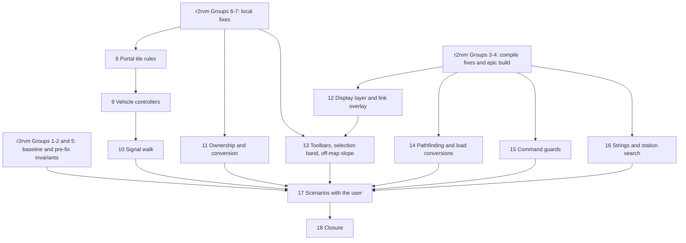
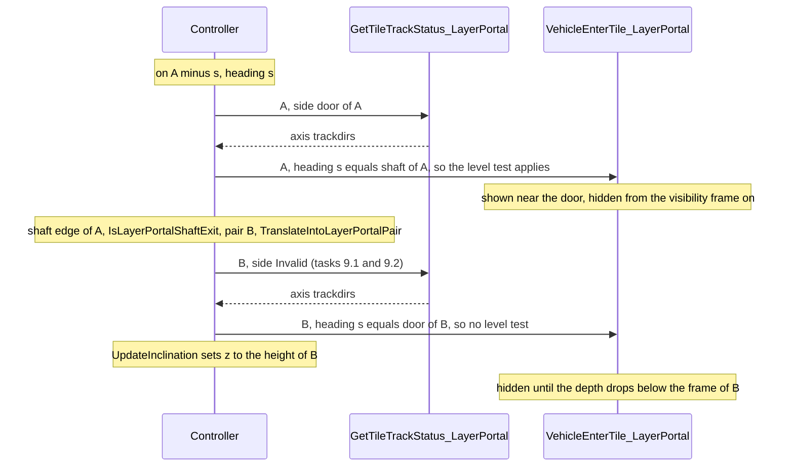
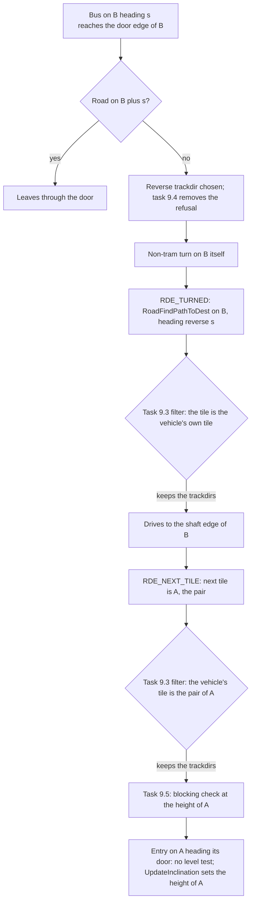
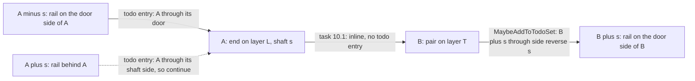
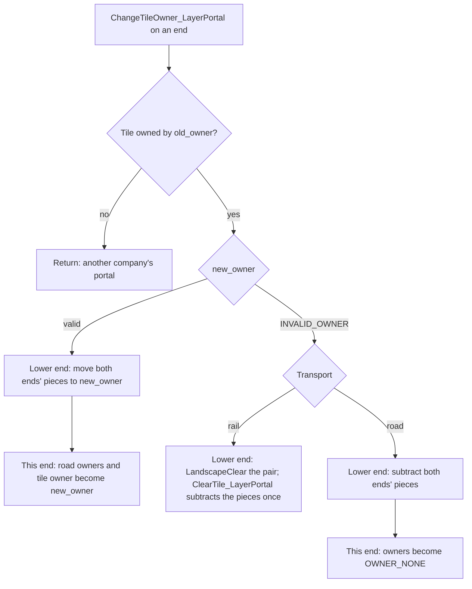
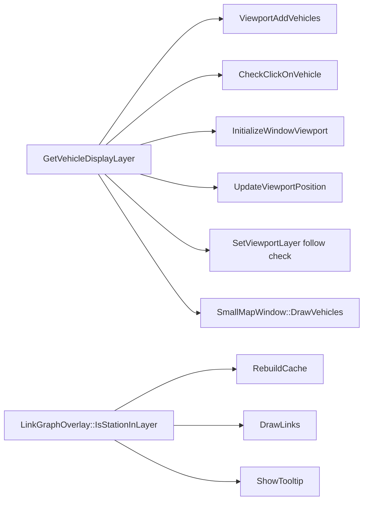

# R2RVM2 Plan - Review Fixes for the Multi-Layered Map (R2MLM), Part 2

## Global Mandatory Reading

> **Execution protocol**
>
> - Read this Global Mandatory Reading section before the first task and again
>   after every context compaction.
> - Before starting or resuming a task group, read the nearest preceding Area
>   Mandatory Reading block whose `Applies to` label includes that group. Area
>   blocks appear immediately before the first group they govern.
> - A referenced heading or exported symbol is authoritative. Global navigation
>   hints and Area line ranges are for navigation only; if they drift, relocate
>   the named section or symbol rather than expanding to the whole file.
> - Mandatory reading is non-transitive. Do not preload a linked file's own
>   Mandatory Reading, Consult on Demand, or Planning Provenance entries unless
>   this plan names them directly for the current area.
> - Do not read Consult on Demand or Planning Provenance merely because those
>   sources are listed. Use a Consult on Demand source only when its trigger
>   occurs.
> - No created source file, test file or JSON file should start with same prefix as a planning MD file (such as r2). Only MD files can have that prefix. No MD file should be created anywhere in source directories unless specifically asked.
> - After EVERY CONTEXT COMPACTION, you must add a note above the task group
>   which is currently in execution. The note will say: "Context has compacted
>   X times while executing this group.". If the compaction occurs before any
>   meaningful work was done (this can happen when there is a lot of baggage
>   from the previous compaction), then and ONLY then you can skip this step.
> - When exceeding 3 context compactions, YOU MUST ask yourself if you're not 
>   chewing more than we can handle :). Heck, plans change! :). In such a case, 
>   the way out is to split the group on the spot,
>   in the plan, into more groups, 
>   by appending B, C, D as a suffixes to those groups (splitting sub-groups 
>   themselves is also allowed). When you do this, create Local Mandatory
>   Reading areas so you can optimize your context only for the
>   ACTUAL task at hand.
>   Before starting or resuming a task group, read the nearest preceding Area
>   Mandatory Reading block whose `Applies to` label includes that group. Area
>   blocks appear immediately before the first group they govern.

| File name | Line Ranges | Description |
| --- | --- | --- |
| [r2rvm-review-map.md](r2rvm-review-map.md) | 448-514 | `## Fix Decisions`, FD-1 to FD-12. These are the authoritative designs for every fix: the vertical shaft crossing, visibility as a function of position, door-only connections, the signal walk, ownership accounting, layer of an interaction, display layer of a vehicle, surface-only conversions, the two-tile guard, savegame layer counts and the evidence rule. Every task names its FD. Where an FD and a finding's "Fix" bullet differ, the FD wins. An FD never overrides a master-plan AD. |
| [r2rvm-review-map.md](r2rvm-review-map.md) | 141-175 | `### Severity index`: the finding IDs (C-1, H-1 to H-5, M-1 to M-11, L-1 to L-12) every task cites, the task that fixes each, and the Status column that Group 18 of this file fills. Read a finding's own `####` section only when the current Area block points to it. |
| [r2rvm-review-map.md](r2rvm-review-map.md) | 569-659 | `### Commands used by every group`: the Bash variables, the configure, build and test commands (with `/nodeReuse:false`), the error and warning extraction, and the rules for starting `openttd.exe`. When a task here says "build Debug" or "run the unit tests", it means exactly these commands. |
| [r2rvm-review-map.md](r2rvm-review-map.md) | 661-672 | `### Comment and header rules`: the user's rules of 2026-10-03 for file headers (a related `archi-*.md` or `r*.md` page), Javadoc, business comments on compound `if`s and non-trivial loops, and scratch file names. Every file this plan and r2rvm2 create or modify follows them. |
| [r2mlm-multi-layered-map.md](r2mlm-multi-layered-map.md) | 66-76, 99-102, 119-128 | `### AD-2 Stacked-plane addressing`, `### AD-8 Cross-layer movement only through layer portals` and `## Cross-plan Invariants` I-1 to I-8. AD-2 means a tile's layer is implicit in its `TileIndex`, so no command or pool gains a layer field. AD-8 means `GetLayerPortalNextTile` is the only cross-layer step and portals have no wormhole state. Every fix must keep I-1 to I-8 true. I-6 and I-7 get their final evidence in task 18.1. |
| [r2mlm-multi-layered-map.md](r2mlm-multi-layered-map.md) | 158-164 | `## Engineering Conventions`: the `//comment` style with no space, Javadoc on every function and parameter, OpenTTD naming, file registration, **never** `git checkout`, `git reset` or `git stash`, never move or delete files, and English-only strings. They bind every edit in this plan, including the snippets below. |
| [r2mlm-multi-layered-map.md](r2mlm-multi-layered-map.md) | 166-177 | `## Build and Test Commands`: the Build Tools 2022 CMake path, the standalone vcpkg at `D:\Codez\Tools\vcpkg` (never the one bundled with Build Tools), and the configure command. `### Commands used by every group` in r2rvm-review-map.md adds the flags this plan needs. Do not use any other toolchain. |
| [src/map_func.h](../../../../src/map_func.h) | 457-498 | `TileY` (stacked), `TilePlaneY`, `GetTileLayer`, `TileXYL`: the addressing primitives every fix uses. Plane-relative logic uses `TilePlaneY` and `TileXYL`, never `TileY` against `Map::MaxY()`. |
| [src/map_layer.h](../../../../src/map_layer.h) | 188-198, 272-292 | `MultiLayerMap::TileInLayer`, `MultiLayerMap::GetPortalTargetLayer` and `CheckLayerAllowsConstruction`: the controller boundary. Gameplay never adds `Map::PlaneSize()` to a tile by hand, and Surface pairs only with Underground in version 1. |

## Outcome

This file is the second half of the R2RVM plan. [r2rvm-review-map.md](r2rvm-review-map.md) holds the review findings, the fix decisions, the shared commands and Groups 1 to 7: the pre-epic reference, the epic build, the regression run and the local fixes. This file holds Groups 8 to 18. When it is done:

- vehicles cross portals at any height and enter an end only through its door;
- the signal walk, the ownership accounting and road conversion treat a portal pair as one piece;
- views, overlays, toolbars and selections take their layer from the tile or vehicle concerned, never from the main viewport;
- two-tile commands stay in one layer, and old-version load conversions touch the surface only;
- scenarios S1 to S7 have passed with the user, I-6 and I-7 have their final evidence, and every finding is fixed or deferred by the user.

The r2mlm10 acceptance plan can start afterwards.

Group and task numbers continue those of r2rvm-review-map.md, so a task number names one task in either file. A task below 8.1 (for example task 6.4) is a task of r2rvm-review-map.md. Every group here assumes that Groups 3, 4, 6 and 7 there are done; the entry gate of Group 8 checks it.

Every group is SIMPLE or MEDIUM and holds at most eight tasks. A task gives the code to write, written against the epic code as it stood on 2026-10-03. Where a snippet depends on an earlier task, the task carries an ASSUMPTION note; if that earlier work is missing or looks different, re-assess before pasting.

## Implementation Tasks

Line numbers in the Area blocks and snippets are those of the tree after Group 3 of r2rvm-review-map.md. The probe copy `build-probe-tree/src` had exactly that state on 2026-10-03. Groups 6 and 7 and every later edit shift them, so relocate by the named symbol.

How the groups of this file depend on each other and on the first file:



| Group | Name | Tag | Tasks |
| --- | --- | --- | --- |
| 8 | Portal tile rules | MEDIUM | 5 |
| 9 | Vehicle controllers at the shaft | MEDIUM | 6 |
| 10 | Signal walk and reservations | MEDIUM | 5 |
| 11 | Ownership, infrastructure and conversion | MEDIUM | 8 |
| 12 | Vehicle display layer and link overlay | MEDIUM | 8 |
| 13 | Toolbars, selection band and off-map slope | MEDIUM | 8 |
| 14 | Pathfinding, aircraft clamp and surface-only conversions | MEDIUM | 7 |
| 15 | Two-tile command guards | SIMPLE | 8 |
| 16 | Strings and station search | SIMPLE | 6 |
| 17 | Scenario runs with the user | MEDIUM | 8 |
| 18 | Closure and hand-off | SIMPLE | 7 |

### Area Mandatory Reading - Portal tile rules

_Applies to Group 8._

**Entry gate:**
- **Required:** Groups 3, 4, 6 and 7 of [r2rvm-review-map.md](r2rvm-review-map.md) are checked, and the Debug build of the repository succeeds.
- **How to verify:** read those checkboxes, then build Debug.
- **If absent:** finish those groups first. Every group of this file edits code they fix or depend on.
- **Forbidden fallback:** never start this file on a tree that does not build. Groups 1, 2 and 5 are not needed to start; task 14.7, Group 17 and task 18.1 need their saves and digests.

| File name | Line Ranges | Description |
| --- | --- | --- |
| [r2rvm-review-map.md](r2rvm-review-map.md) | 179-196, 242-251 | Findings C-1 and H-5: the call order of entry check and height update, and the back entry that the track-status side rule must close. FD-1, FD-3 and FD-4 (Global) prescribe the fixes. |
| [r2mlm7-layer-portal-foundation.md](r2mlm7-layer-portal-foundation.md) | 63-72 | `## Portal Contract`: pair, directions, neighbour mapping, relocation and visibility frames. FD-1, FD-3 and FD-4 refine its Relocation, Visibility and Track and road bits bullets; the other bullets are unchanged. |
| [src/layer_portal_map.h](../../../../src/layer_portal_map.h) | 40-61, 176-199 | `GetLayerPortalShaftDirection`, `GetLayerPortalDoorDirection`, `IsLayerPortalShaftExit` and `GetLayerPortalNextTile`: the direction vocabulary every snippet below uses. |
| [src/layer_portal_cmd.h](../../../../src/layer_portal_cmd.h) | 38-44 | The declaration of `TranslateIntoLayerPortalPair`, after which task 8.1 declares the visibility helper. |
| [src/layer_portal_cmd.cpp](../../../../src/layer_portal_cmd.cpp) | 51-72, 132-142, 209-248 | The `_tunnel_visibility_frame` extern and `TranslateIntoLayerPortalPair`, then `GetTileTrackStatus_LayerPortal` (side rule) and `VehicleEnterTile_LayerPortal` (level test, visibility, sounds). |
| [src/tunnelbridge_cmd.cpp](../../../../src/tunnelbridge_cmd.cpp) | 1966-2035 | `_tunnel_visibility_frame` and the tunnel branch of `VehicleEnterTile_TunnelBridge`: the frame arithmetic and sound triggers the portal mirrors. |
| [src/tests/map_layer.cpp](../../../../src/tests/map_layer.cpp) | 10-26, 260-308 | The includes and `Layer portal neighbour mapping and relocation`: the hand-built-portal pattern task 8.4 reuses without pools (FD-12). |

### Group 8 - Portal tile rules

A vehicle crossing from `A` (shaft `s`) to its pair `B` (shaft `reverse s`), with the changes of Groups 8 and 9:



Depth is measured from the door edge along the shaft heading. It is the tunnel "frame" of a vehicle heading into the shaft:

| Shaft | Coordinate read | Door edge at | Depth | Hidden from depth |
| --- | --- | --- | --- | --- |
| NE | x | `x & 15 == 15` | `15 - (x & 15)` | 12 |
| SE | y | `y & 15 == 0` | `y & 15` | 8 |
| SW | x | `x & 15 == 0` | `x & 15` | 8 |
| NW | y | `y & 15 == 15` | `15 - (y & 15)` | 12 |

> ASSUMPTION: this was already built previously. If not, re-asses at runtime. Depends on: Group 3 leaving `GetTileTrackStatus_LayerPortal` and `VehicleEnterTile_LayerPortal` as the epic wrote them (lines 132-142 and 209-248 after Group 3). If a compile fix reshaped them, apply the same rules to the new shape.

{{MEDIUM}}
- [ ] 8.1 FD-3: add the depth and visibility helpers.
  - In `layer_portal_cmd.h`, after `TranslateIntoLayerPortalPair`:
    ```cpp
    /**
     * Whether a vehicle at a point on a portal end is inside the shaft, so it is not drawn.
     * @param shaft Shaft direction of the end.
     * @param x World X of the point.
     * @param y World Y of the point.
     * @return True from the tunnel visibility frame of that shaft to the shaft edge.
     */
    bool IsHiddenInLayerPortal(DiagDirection shaft, int x, int y);
    ```
  - In `layer_portal_cmd.cpp`, after `TranslateIntoLayerPortalPair`:
    ```cpp
    /**
     * Distance of a point from the door edge of a portal end, measured along the shaft heading.
     * @param shaft Shaft direction of the end.
     * @param x World X of the point.
     * @param y World Y of the point.
     * @return 0 at the door edge, TILE_SIZE - 1 at the shaft edge.
     */
    static uint8_t GetLayerPortalDepth(DiagDirection shaft, int x, int y)
    {
    	uint8_t pos = static_cast<uint8_t>((DiagDirToAxis(shaft) == Axis::X ? x : y) & TILE_UNIT_MASK);
    	//NE and NW head towards smaller coordinates, so their door edge is the high end of the tile.
    	if (shaft == DiagDirection::NE || shaft == DiagDirection::NW) return static_cast<uint8_t>(TILE_SIZE - 1 - pos);
    	return pos;
    }

    /**
     * Whether a vehicle at a point on a portal end is inside the shaft, so it is not drawn.
     * The point alone decides, so a turn or a reversal on the end keeps the state right.
     * @param shaft Shaft direction of the end.
     * @param x World X of the point.
     * @param y World Y of the point.
     * @return True from the tunnel visibility frame of that shaft to the shaft edge.
     */
    bool IsHiddenInLayerPortal(DiagDirection shaft, int x, int y)
    {
    	return GetLayerPortalDepth(shaft, x, y) >= _tunnel_visibility_frame[shaft];
    }
    ```
- [ ] 8.2 C-1, FD-1, FD-3: replace the body of `VehicleEnterTile_LayerPortal` with:
  ```cpp
  /** @copydoc VehicleEnterTileProc */
  static VehicleEnterTileStates VehicleEnterTile_LayerPortal(Vehicle *v, TileIndex tile, int x, int y)
  {
  	TransportType transport = GetLayerPortalTransportType(tile);
  	//Each end accepts only its own transport. A road elevator refuses trams.
  	if (transport == TransportType::Rail && v->type != VehicleType::Train) return VehicleEnterTileState::CannotEnter;
  	if (transport == TransportType::Road) {
  		if (v->type != VehicleType::Road) return VehicleEnterTileState::CannotEnter;
  		if (RoadTypeIsTram(RoadVehicle::From(v)->roadtype)) return VehicleEnterTileState::CannotEnter;
  	}

  	const DiagDirection shaft = GetLayerPortalShaftDirection(tile);
  	const DiagDirection vdir = DirToDiagDir(v->GetMovingDirection());

  	//FD-1: heading into the shaft, the vehicle came through the door at this end's height. Heading out, it came through the shaft, and the controller sets its new height right after this call.
  	if (vdir == shaft && abs(GetSlopePixelZ(x, y, true) - v->z_pos) > 2) return VehicleEnterTileState::CannotEnter;

  	//Steam engines play the tunnel sound one step past the door. The track stays the axis track, never a wormhole.
  	if (transport == TransportType::Rail && vdir == shaft && v->IsMovingFront() && GetLayerPortalDepth(shaft, x, y) == 1) {
  		Train *t = Train::From(v);
  		if (!PlayVehicleSound(t, VehicleSoundEvent::Tunnel) && RailVehInfo(t->engine_type)->engclass == EngineClass::Steam) {
  			SndPlayVehicleFx(SND_05_TRAIN_THROUGH_TUNNEL, v);
  		}
  	}

  	//FD-3: the point decides visibility. Only the change from shown to hidden plays the elevator sound.
  	bool hidden = IsHiddenInLayerPortal(shaft, x, y);
  	if (hidden && !v->vehstatus.Test(VehState::Hidden)) {
  		//Road works is the mechanical stand-in for the elevator ride.
  		if (transport == TransportType::Road && v->IsFrontEngine()) SndPlayTileFx(SND_21_ROAD_WORKS, tile);
  		v->vehstatus.Set(VehState::Hidden);
  	} else if (!hidden && v->vehstatus.Test(VehState::Hidden)) {
  		v->vehstatus.Reset(VehState::Hidden);
  	}
  	return {};
  }
  ```
  The old `z == 0` condition on unhiding goes away. A vehicle heading out of the shaft is never level-tested, and the height of the point no longer decides visibility. The transport checks now run first; they used to run after the level test, which made no difference to the result.
- [ ] 8.3 H-5, FD-4: in `GetTileTrackStatus_LayerPortal`, replace the side line and its comment with:
  ```cpp
  	//FD-4: on its own layer an end is reached only through its door. The shaft side answers nothing; a step through the shaft asks with no side.
  	if (side != DiagDirection::Invalid && side != GetLayerPortalDoorDirection(tile)) return {};
  ```
- [ ] 8.4 FD-12: add `#include "../tile_cmd.h"` to `src/tests/map_layer.cpp` (and `#include "../track_func.h"` if the build asks for it), and append:
  ```cpp
  /**
   * FD-3 and FD-4 on a hand-built pair: which part of an end hides a vehicle, and which sides answer a track query.
   */
  TEST_CASE("Layer portal visibility and track status")
  {
  	Map::Allocate(64, 64, MAX_MAP_LAYERS);
  	//Road type masks are game state. The original types let SetRoadTypes accept ROADTYPE_ROAD.
  	ResetRoadTypes();
  	TileIndex surface = TileXYL(10, 10, MapLayer::Surface);
  	TileIndex underground = TileXYL(10, 10, MapLayer::Underground);
  	const int base_x = static_cast<int>(TileX(surface) * TILE_SIZE);
  	const int base_y = static_cast<int>(TileY(surface) * TILE_SIZE);
  	const int tile_size = static_cast<int>(TILE_SIZE);

  	for (DiagDirection shaft : {DiagDirection::NE, DiagDirection::SE, DiagDirection::SW, DiagDirection::NW}) {
  		//Walk from the door edge to the shaft edge: hidden starts once and never ends.
  		TileIndexDiffC step = TileIndexDiffCByDiagDir(shaft);
  		bool was_hidden = false;
  		int hidden_count = 0;
  		for (int depth = 0; depth < tile_size; depth++) {
  			//SE and SW head to larger coordinates, so their door edge is the low end of the tile.
  			int along = (step.x + step.y > 0) ? depth : tile_size - 1 - depth;
  			int x = base_x + (step.x != 0 ? along : 5);
  			int y = base_y + (step.y != 0 ? along : 5);
  			bool hidden = IsHiddenInLayerPortal(shaft, x, y);
  			CHECK((hidden || !was_hidden));
  			//The position across the axis never matters.
  			CHECK(IsHiddenInLayerPortal(shaft, x + (step.x == 0 ? 7 : 0), y + (step.y == 0 ? 7 : 0)) == hidden);
  			was_hidden = hidden;
  			if (hidden) hidden_count++;
  		}
  		//The tunnel frames hide the last 4 units of NE and NW ends and the last 8 of SE and SW ends.
  		CHECK(hidden_count == ((shaft == DiagDirection::NE || shaft == DiagDirection::NW) ? 4 : 8));

  		//Rail: the door side and a query without a side see the axis; every other side sees nothing.
  		MakeRailLayerPortal(surface, OWNER_NONE, shaft, MapLayer::Underground, RAILTYPE_RAIL);
  		MakeRailLayerPortal(underground, OWNER_NONE, ReverseDiagDir(shaft), MapLayer::Surface, RAILTYPE_RAIL);
  		TrackdirBits axis = TrackBitsToTrackdirBits(DiagDirToDiagTrack(shaft));
  		CHECK(GetTileTrackStatus(surface, TransportType::Rail, RoadTramType::Invalid).trackdirs == axis);
  		for (DiagDirection side : {DiagDirection::NE, DiagDirection::SE, DiagDirection::SW, DiagDirection::NW}) {
  			TrackdirBits expected = (side == ReverseDiagDir(shaft)) ? axis : TrackdirBits{};
  			CHECK(GetTileTrackStatus(surface, TransportType::Rail, RoadTramType::Invalid, side).trackdirs == expected);
  		}
  		CHECK(GetTileTrackStatus(surface, TransportType::Road, RoadTramType::Road).trackdirs.None());

  		//Road: the same sides, and trams see nothing.
  		MakeRoadLayerPortal(surface, OWNER_NONE, shaft, MapLayer::Underground, ROADTYPE_ROAD);
  		MakeRoadLayerPortal(underground, OWNER_NONE, ReverseDiagDir(shaft), MapLayer::Surface, ROADTYPE_ROAD);
  		CHECK(GetTileTrackStatus(surface, TransportType::Road, RoadTramType::Road, ReverseDiagDir(shaft)).trackdirs == axis);
  		CHECK(GetTileTrackStatus(surface, TransportType::Road, RoadTramType::Road, shaft).trackdirs.None());
  		CHECK(GetTileTrackStatus(surface, TransportType::Road, RoadTramType::Tram).trackdirs.None());
  	}
  }
  ```
  `openttd_test` links `openttd_lib`, so `GetTileTrackStatus` reaches the portal proc. `road.h`, which declares `ResetRoadTypes`, is already included (task 3.8). Build `axis` the same way the tile proc builds its trackdirs; if Group 4 changed that expression, mirror the new one.
- [ ] 8.5 Build Debug and run the unit tests, and record the result under this task. The new test case must be in the pass list.

### Area Mandatory Reading - Vehicle controllers at the shaft

_Applies to Group 9._

**Entry gate:**
- **Required:** Group 8 is checked, so `GetTileTrackStatus_LayerPortal` refuses the shaft side and `VehicleEnterTile_LayerPortal` level-tests only vehicles heading into the shaft.
- **How to verify:** read the side line of `GetTileTrackStatus_LayerPortal` and the `vdir == shaft` test in `VehicleEnterTile_LayerPortal`.
- **If absent:** finish Group 8 first. Tasks 9.3 and 9.4 do not depend on it and may start.
- **Forbidden fallback:** never special-case the shaft side inside the controllers instead of in the tile proc. The follower, the signal walk and the controllers must all see the same answer.

| File name | Line Ranges | Description |
| --- | --- | --- |
| [r2rvm-review-map.md](r2rvm-review-map.md) | 233-240, 242-251, 323-334 | Findings H-4, H-5 and M-10: the two freeze cases, the back-entry paths in the controllers, and the height blind spot at the shaft step. FD-1, FD-2 and FD-4 (Global) prescribe the fixes. |
| [src/train_cmd.cpp](../../../../src/train_cmd.cpp) | 3418-3448, 4014-4039 | The new-tile branch of `TrainController` with its shaft relocation and track query, and the next-tile query of `TrainCheckIfLineEnds`. Tasks 9.1 and 9.2 change only the `side` argument. |
| [src/roadveh_cmd.cpp](../../../../src/roadveh_cmd.cpp) | 638-714 | `RoadVehFindData`, `FindClosestBlockingRoadVeh` (height test at 659) and `RoadVehFindCloseTo`, which task 9.5 changes. |
| [src/roadveh_cmd.cpp](../../../../src/roadveh_cmd.cpp) | 902-955 | The tile filters of `RoadFindPathToDest`. Task 9.3 adds the portal filter after the road-stop filter. |
| [src/roadveh_cmd.cpp](../../../../src/roadveh_cmd.cpp) | 1216-1330, 1382-1412 | The `RDE_NEXT_TILE` step (next tile, path choice, the U-turn refusal task 9.4 deletes, the non-tram turn on `v->tile`, the blocking check and the entry call) and the `RDE_TURNED` step, which calls `RoadFindPathToDest` on the vehicle's own tile. |
| [src/pathfinder/follow_track.hpp](../../../../src/pathfinder/follow_track.hpp) | 214-229, 383-397, 482-499 | `FollowTileExit` portal step, the portal clause of `CanEnterNewTile`, and `TryReverse`. The controllers must agree with these: entry through the door, or through the shaft only after crossing a pair. |

### Group 9 - Vehicle controllers at the shaft

The road vehicle case behind H-4: a bus on `B` whose door has no road beyond it, with the changes of this group.



{{MEDIUM}}
- [ ] 9.1 H-5, FD-4: in the new-tile branch of `TrainController`, query the pair without a side. Replace the block from `DiagDirection moving = ...` to the `GetTileTrackStatus` line with:
  ```cpp
  				/* A shaft exit is relocated onto the pair. DiagdirBetweenTiles cannot see across layers. */
  				DiagDirection moving = DirToDiagDir(v->GetMovingDirection());
  				bool shaft_step = IsLayerPortalShaftExit(gp.old_tile, moving);
  				if (shaft_step) {
  					TranslateIntoLayerPortalPair(gp.old_tile, gp.x, gp.y);
  					gp.new_tile = GetLayerPortalPairTile(gp.old_tile);
  					enterdir = moving;
  				} else {
  					/* Determine what direction we're entering the new tile from */
  					enterdir = DiagdirBetweenTiles(gp.old_tile, gp.new_tile);
  				}
  				assert(IsValidDiagDirection(enterdir));

  				/* Get the status of the tracks in the new tile and mask
  				 * away the bits that aren't reachable. */
  				//FD-4: the pair is entered through its shaft, a side its track status refuses, so that query has no side.
  				DiagDirection side = shaft_step ? DiagDirection::Invalid : ReverseDiagDir(enterdir);
  				TrackStatus ts = GetTileTrackStatus(gp.new_tile, TransportType::Rail, RoadTramType::Invalid, side);
  ```
  > ASSUMPTION: this was already built previously. If not, re-asses at runtime. Depends on: task 8.3. Without it the old side still works for the pair, and this change does nothing visible until 8.3 lands.
- [ ] 9.2 H-5, FD-4: in `TrainCheckIfLineEnds`, replace the two lines after the "Calculate next tile" comment with:
  ```cpp
  	TileIndex tile = GetLayerPortalNextTile(moving_front->tile, dir);
  	//FD-4: the pair is entered through its shaft, a side its track status refuses, so that query has no side.
  	DiagDirection side = IsLayerPortalShaftExit(moving_front->tile, dir) ? DiagDirection::Invalid : ReverseDiagDir(dir);

  	/* Determine the track status on the next tile */
  	TrackStatus ts = GetTileTrackStatus(tile, TransportType::Rail, RoadTramType::Invalid, side);
  ```
  A train behind an end (on the shaft side, same layer) now gets nothing from its query. It treats the end as the line end and stops or reverses there, as at any buffer stop.
  > ASSUMPTION: this was already built previously. If not, re-asses at runtime. Depends on: task 8.3.
- [ ] 9.3 H-5, FD-4: in `RoadFindPathToDest`, extend the filter chain after the road-stop branch (the `}` before the "The above lookups should be moved" comment):
  ```cpp
  	} else if (IsLayerPortalTile(tile)) {
  		//FD-4: an end is entered through its door, out of the shaft from its pair, or by finishing a turn on the end itself.
  		bool through_door = enterdir == GetLayerPortalShaftDirection(tile);
  		bool from_pair = v->tile == GetLayerPortalPairTile(tile);
  		if (!through_door && !from_pair && v->tile != tile) ts.trackdirs.Reset();
  	}
  ```
  `enterdir` here is the heading of the step. A vehicle that moves in direction `shaft` arrives through the door, so the door test compares with the shaft direction. With no trackdir left, the function already returns the reverse trackdir, and the vehicle turns on its current tile instead of entering from behind.
- [ ] 9.4 H-4, FD-2: delete this block and its comment from the `RDE_NEXT_TILE` branch of `IndividualRoadVehicleController`:
  ```cpp
  		//An elevator is a drive-through. A U-turn on it is refused and the vehicle waits.
  		if (IsReversingRoadTrackdir(dir) && (IsLayerPortalTile(v->tile) || IsLayerPortalTile(tile))) {
  			v->cur_speed = 0;
  			return false;
  		}
  ```
  The generic code below it already turns a non-tram vehicle on `v->tile`, because a portal is not a normal road tile. Trams never reach a portal: the tile proc offers them no trackdirs.
- [ ] 9.5 M-10, FD-1: make the blocking search use the height at the searched point.
  - Add a field to `RoadVehFindData`, after `y`:
    ```cpp
    	int z; ///< Height the searching vehicle has at (x, y).
    ```
  - In `FindClosestBlockingRoadVeh`, compare with that height:
    ```cpp
    	/* Not close when at a different height or when going in a different direction. */
    	if (abs(v->z_pos - rvf->z) >= 6 || v->direction != rvf->dir) return;
    ```
  - In `RoadVehFindCloseTo`, after `rvf.y = y;`:
    ```cpp
    	//M-10: a shaft step lands on the pair, whose height may differ. Look for blockers at the height the vehicle will have there.
    	rvf.z = GetTileLayer(TileVirtXY(x, y)) != GetTileLayer(v->tile) ? GetSlopePixelZ(x, y, true) : v->z_pos;
    ```
  `RoadVehFindData` is used only in `roadveh_cmd.cpp` (declared at 638, filled at 678), so no other initialiser needs the field. Off the shaft step the layers are equal, and the search behaves exactly as before.
  > ASSUMPTION: this was already built previously. If not, re-asses at runtime. Depends on: task 8.2. Before it, no vehicle crossed between ends of different height, so the blind spot could not occur.
- [ ] 9.6 Build Debug and run the unit tests. Then grep `src/train_cmd.cpp` for `GetTileTrackStatus(` and confirm that the only calls passing a side are the two changed in 9.1 and 9.2. Record both results under this task.

### Area Mandatory Reading - Signal walk and reservations

_Applies to Group 10._

| File name | Line Ranges | Description |
| --- | --- | --- |
| [r2rvm-review-map.md](r2rvm-review-map.md) | 242-251, 255-260 | Findings H-5 (the signal part: a shaft-side entry treated as a shaft crossing) and M-1 (a start on a portal walks one way). FD-5 (Global) prescribes the fix. |
| [src/signal.cpp](../../../../src/signal.cpp) | 207-249 | `CheckAddToTodoSet` and `MaybeAddToTodoSet`: adding an entry removes its reverse, and the assert forbids adding an entry already present. |
| [src/signal.cpp](../../../../src/signal.cpp) | 275-286, 364-372 | The `ExploreSegment` loop head (`oldtile`, `exitdir`) and the station case: the straight-piece pattern the portal case copies. |
| [src/signal.cpp](../../../../src/signal.cpp) | 403-434 | The current portal case and the closing `MaybeAddToTodoSet(tile, enterdir, oldtile, exitdir)` that task 10.1 relies on. |
| [src/signal.cpp](../../../../src/signal.cpp) | 511-578 | `UpdateSignalsInBuffer` and its start switch: the portal case task 10.2 rewrites, and the Railway case it mirrors. |
| [src/pbs.cpp](../../../../src/pbs.cpp) | 44-46, 137-141, 195-197, 344-347, 394-397, 421-422 | The portal branches of `GetReservedTrackbits`, `TryReserveRailTrack`, `UnreserveRailTrack`, `FollowTrainReservation`, `GetTrainForReservation` and `IsSafeWaitingPosition`, checked in task 10.4. |
| [src/train_cmd.cpp](../../../../src/train_cmd.cpp) | 2432-2477, 2483-2543 | `ClearPathReservation` and `FreeTrainTrackReservation`, checked in task 10.4. |

### Group 10 - Signal walk and reservations

A todo entry `(tile, d)` means "the walk enters `tile` through its side `d`". Adding an entry with `MaybeAddToTodoSet` removes its reverse, `(oldtile, exitdir)`, so no edge is walked twice. Task 10.1 treats the pair as one straight piece with two sides, the two doors, exactly like a station tile. The pair itself never gets a todo entry.



> ASSUMPTION: this was already built previously. If not, re-asses at runtime. Depends on: task 6.1 (removal queues the two former door sides on cleared tiles) and tasks 9.1 and 9.2 (no train enters an end from behind, so a shaft-side signal entry has no train to find).

{{MEDIUM}}
- [ ] 10.1 H-5, FD-5: replace the `TileType::LayerPortal` case of `ExploreSegment` with:
  ```cpp
  			case TileType::LayerPortal: {
  				if (GetTileOwner(tile) != owner) continue;
  				if (GetLayerPortalTransportType(tile) != TransportType::Rail) continue;
  				//FD-5: the door is the only side an end shares with its own layer. The shaft side leads nowhere on this layer.
  				if (enterdir != GetLayerPortalDoorDirection(tile)) continue;
  				TileIndex pair = GetLayerPortalPairTile(tile);
  				//A train on either end occupies the block.
  				if (!flags.Test(SigFlag::Train) && (HasVehicleOnTile(tile, IsTrainAndNotInDepot) || HasVehicleOnTile(pair, IsTrainAndNotInDepot))) flags.Set(SigFlag::Train);
  				//Cross the pair as one straight piece and leave by the pair's door.
  				oldtile = pair;
  				exitdir = GetLayerPortalDoorDirection(pair);
  				tile = TileAddByDiagDir(pair, exitdir);
  				enterdir = ReverseDiagDir(exitdir);
  				break;
  			}
  ```
  `oldtile` is a plain local set at the top of the loop body, so assigning it is allowed. The closing `MaybeAddToTodoSet(tile, enterdir, oldtile, exitdir)` then adds the pair's door neighbour and removes `(pair, door of pair)`, the walk in the other direction. `DiagDirection::Invalid` never reaches this case: it fails the door test and continues.
- [ ] 10.2 M-1, FD-5: replace the `TileType::LayerPortal` case of `UpdateSignalsInBuffer` with:
  ```cpp
  			case TileType::LayerPortal: {
  				assert(GetLayerPortalTransportType(tile) == TransportType::Rail);
  				//FD-5: start at the door and walk both ways from it, like a plain rail tile. The pair is reached through the door entry.
  				DiagDirection door = GetLayerPortalDoorDirection(tile);
  				_tbdset.Add(tile, door);
  				_tbdset.Add(TileAddByDiagDir(tile, door), ReverseDiagDir(door));
  				break;
  			}
  ```
  The queued side `dir` is ignored, because an end has one block. When a caller queued both axis sides (`AddTrackToSignalBuffer`), the second globset entry walks the same block again. That is harmless.
- [ ] 10.3 Confirm the caller audit below against the code: grep `src/` for `AddSideToSignalBuffer(`, `AddTrackToSignalBuffer(`, `SetSignalsOnBothDir(` and `UpdateSignalsOnSegment(`. Line numbers are from 2026-10-03, so relocate each row by its call text. Record "confirmed" or the difference under this task.

  | Caller (line on 2026-10-03) | Starts on | Portal start possible? | Lands in |
  | --- | --- | --- | --- |
  | `train_cmd.cpp` 2106 (reversal) and 4097 (`TrainLocoHandler`): `UpdateSignalsOnSegment(moving_front->tile, dir, ...)` | the moving front's tile | yes | task 10.2 case; the side is ignored |
  | `train_cmd.cpp` 3524 (`TrainController`, red signal ahead): `UpdateSignalsOnSegment(v->tile, enterdir, ...)` | the front's tile | yes | task 10.2 case |
  | `train_cmd.cpp` 3807 (`DeleteLastWagon`): `SetSignalsOnBothDir(tile, track, ...)` | the tile a removed wagon stood on | yes | task 10.2 case, twice (both axis sides) |
  | `layer_portal_cmd.cpp` `NotifyRailPortalChanged` (build) | both new ends | yes | task 10.2 case |
  | `layer_portal_cmd.cpp` `ClearTile_LayerPortal` (removal, after task 6.1) | the two cleared tiles, door sides | no, the tiles are Clear | `default` branch, which steps to the former door neighbours |
  | `train_cmd.cpp` 2385, 2392, 2425 and `vehicle.cpp` 1593 | a depot tile | no | — |
  | `train_cmd.cpp` 2533, 3192, `economy.cpp` 492, `rail_cmd.cpp` 1556 | a rail tile with signals | no | — |
  | `rail_cmd.cpp` 608, 750-755, 1057, 1225, 1874, `station_cmd.cpp` 1592, 1808, `tunnelbridge_cmd.cpp` 599, 802, 924-925, 1022-1023 | rail, depot, station or tunnel tiles | not as the start; a door neighbour can push `(end, door)` | `ExploreSegment` portal case, task 10.1 |
- [ ] 10.4 Confirm that portal reservations need no change, by checking each expected answer below against the code. If an answer is wrong, record a finding. Fix it here only when the fix is one line; otherwise add it to Group 17 as a scenario check.
  - `TryReserveRailTrack` sets an end's bit only when it is free, and `UnreserveRailTrack` clears it (`pbs.cpp` 137-141, 195-197).
  - `ClearPathReservation` frees only the end the last wagon left. The pair is freed when the last wagon leaves the pair (after task 7.2, the portal branch is one `UnreserveRailTrack` call).
  - `FreeTrainTrackReservation` follows with `CFollowTrackRail`, which steps through the shaft (`is_portal`). Each reserved end ahead is freed through `ClearPathReservation`. `free_tile` is true for a front on a portal, because a portal is neither a station nor a tunnel.
  - `FollowTrainReservation` and `GetTrainForReservation` also look for trains on the pair (`pbs.cpp` 344-347, 394-397).
  - `IsSafeWaitingPosition` never accepts a portal end (`pbs.cpp` 421-422), so no path reservation ends inside a shaft.
  > ASSUMPTION: this was already built previously. If not, re-asses at runtime. Depends on: task 7.2 (dead code removed from `ClearPathReservation`).
- [ ] 10.5 Build Debug and run the unit tests, and record the result under this task.

### Area Mandatory Reading - Ownership and conversion

_Applies to Group 11._

| File name | Line Ranges | Description |
| --- | --- | --- |
| [r2rvm-review-map.md](r2rvm-review-map.md) | 211-222, 268-272, 307-312 | Findings H-2, M-3 and M-8: the merger and bankruptcy accounting errors, the ownerless elevator, and one-end road conversion. FD-6 (Global) prescribes the fix. |
| [src/layer_portal_cmd.h](../../../../src/layer_portal_cmd.h) | 20-30 | `LAYER_PORTAL_TRACKBIT_FACTOR`, which task 11.1 renames. |
| [src/layer_portal_cmd.cpp](../../../../src/layer_portal_cmd.cpp) | 144-195, 263-310, 374-390 | `TransferPortalInfrastructure` and `ChangeTileOwner_LayerPortal`, `ClearTile_LayerPortal`, and the build accounting in `CmdBuildLayerPortal`. Tasks 11.2 to 11.4 rewrite the first three. |
| [src/saveload/company_sl.cpp](../../../../src/saveload/company_sl.cpp) | 233-247 | The portal case of `AfterLoadCompanyStats`: the authoritative recount (rail by tile owner, road by road owner, lower tile only) that runtime accounting must match. |
| [src/economy.cpp](../../../../src/economy.cpp) | 478-482 | `ChangeOwnershipOfCompanyItems` calls `ChangeTileOwner` on every tile. This is why the ownership test must come first. |
| [src/road_cmd.cpp](../../../../src/road_cmd.cpp) | 181-196, 259-276 | `UpdateCompanyRoadInfrastructure` (skips an owner that is not a company, dirties the window) and `CheckAllowRemoveRoad` (the `OWNER_NONE` rule FD-6 adopts). |
| [src/road_cmd.cpp](../../../../src/road_cmd.cpp) | 2464-2500, 2513-2700 | `CanConvertUnownedRoadType`, `ConvertRoadTypeOwner` and `CmdConvertRoad`: the switch with the portal case, the ownership and town checks, the generic branch with the dead portal piece count, and the tunnel branch that converts both ends. |
| [src/road_internal.h](../../../../src/road_internal.h) | 18 | The declaration of `CheckAllowRemoveRoad`, which `layer_portal_cmd.cpp` must include. |
| [src/rail_cmd.cpp](../../../../src/rail_cmd.cpp) | 1783-1820 | The portal case of `CmdConvertRail`: the both-ends pattern task 11.5 copies for road. |

### Group 11 - Ownership, infrastructure and conversion

How an owner change reaches each end after tasks 11.2 and 11.3. `ChangeOwnershipOfCompanyItems` visits every tile in index order, so the lower end of a pair always comes first:



> ASSUMPTION: this was already built previously. If not, re-asses at runtime. Depends on: tasks 6.1 to 6.3, which already changed `ClearTile_LayerPortal` (door-side signal updates, both-end reservation check, positive price). Task 11.4 replaces the whole function and keeps those changes.

{{MEDIUM}}
- [ ] 11.1 L-11: rename `LAYER_PORTAL_TRACKBIT_FACTOR` to `GetLayerPortalPieceCount`, keeping its Javadoc. Use the editor's replace-all in each file that `grep -rln LAYER_PORTAL_TRACKBIT_FACTOR src` lists. On 2026-10-03 that was nine uses in five files: `layer_portal_cmd.h` (the definition), `layer_portal_cmd.cpp` (five), `rail_cmd.cpp`, `road_cmd.cpp` and `saveload/company_sl.cpp`. Afterwards the grep must print nothing. The snippets below use the new name.
- [ ] 11.2 H-2, FD-6: replace `TransferPortalInfrastructure`, including its Javadoc, with:
  ```cpp
  /**
   * Move the infrastructure pieces of a portal pair from one owner to another.
   * FD-6, the rule AfterLoadCompanyStats counts by: rail pieces belong to the tile owner, road pieces to the road owner,
   * which is always the tile owner. Each end counts GetLayerPortalPieceCount pieces, and the lower tile index counts the pair.
   * @param tile The end whose owner change is being processed.
   * @param pair The other end.
   * @param old_owner Owner that loses the pieces.
   * @param new_owner Owner that gains the pieces, or INVALID_OWNER when the pieces are dropped.
   */
  static void TransferPortalInfrastructure(TileIndex tile, TileIndex pair, Owner old_owner, Owner new_owner)
  {
  	//The higher end is skipped, so the pair moves once.
  	if (tile > pair) return;
  	TransportType transport = GetLayerPortalTransportType(tile);
  	uint pieces = GetLayerPortalPieceCount(transport) * 2;
  	if (transport == TransportType::Rail) {
  		RailType rt = GetRailType(tile);
  		//An owner that is not a company has no counters to change.
  		if (Company *from = Company::GetIfValid(old_owner); from != nullptr) {
  			from->infrastructure.rail[rt] -= pieces;
  			DirtyCompanyInfrastructureWindows(old_owner);
  		}
  		if (Company *to = Company::GetIfValid(new_owner); to != nullptr) {
  			to->infrastructure.rail[rt] += pieces;
  			DirtyCompanyInfrastructureWindows(new_owner);
  		}
  	} else {
  		//UpdateCompanyRoadInfrastructure skips an owner that is not a company and dirties the window itself.
  		RoadType rt = GetRoadTypeRoad(tile);
  		UpdateCompanyRoadInfrastructure(rt, old_owner, -static_cast<int>(pieces));
  		UpdateCompanyRoadInfrastructure(rt, new_owner, static_cast<int>(pieces));
  	}
  }
  ```
- [ ] 11.3 H-2, M-3, FD-6: replace the body of `ChangeTileOwner_LayerPortal` with:
  ```cpp
  /** @copydoc ChangeTileOwnerProc */
  static void ChangeTileOwner_LayerPortal(TileIndex tile, Owner old_owner, Owner new_owner)
  {
  	//H-2: this proc runs for every tile of the map, so an end that old_owner does not own is left alone.
  	if (!IsTileOwner(tile, old_owner)) return;

  	TileIndex pair = GetLayerPortalPairTile(tile);
  	TransportType transport = GetLayerPortalTransportType(tile);
  	if (new_owner == INVALID_OWNER) {
  		//A rail pair is removed together, by the lower end. ClearTile_LayerPortal subtracts its pieces, so nothing is transferred first.
  		if (transport == TransportType::Rail) {
  			if (tile < pair) {
  				[[maybe_unused]] CommandCost ret = Command<Commands::LandscapeClear>::Do({DoCommandFlag::Execute, DoCommandFlag::Bankrupt}, tile);
  				assert(ret.Succeeded());
  			}
  			return;
  		}
  		//M-3: a road pair stays and becomes ownerless. The lower end drops the pieces of both ends.
  		TransferPortalInfrastructure(tile, pair, old_owner, INVALID_OWNER);
  		SetRoadOwner(tile, RoadTramType::Road, OWNER_NONE);
  		SetRoadOwner(tile, RoadTramType::Tram, OWNER_NONE);
  		SetTileOwner(tile, OWNER_NONE);
  		return;
  	}

  	TransferPortalInfrastructure(tile, pair, old_owner, new_owner);
  	//The road owners follow the tile owner, as MakeRoadLayerPortal set them.
  	if (transport == TransportType::Road) {
  		SetRoadOwner(tile, RoadTramType::Road, new_owner);
  		SetRoadOwner(tile, RoadTramType::Tram, new_owner);
  	}
  	SetTileOwner(tile, new_owner);
  }
  ```
  The higher end of a rail pair is a Clear tile by the time the walk reaches it, so its own proc does nothing.
- [ ] 11.4 M-3, FD-6: add `#include "road_internal.h"` after `#include "road_func.h"` in `layer_portal_cmd.cpp`. Then replace the whole of `ClearTile_LayerPortal` with:
  ```cpp
  /** @copydoc ClearTileProc */
  static CommandCost ClearTile_LayerPortal(TileIndex tile, DoCommandFlags flags)
  {
  	if (flags.Test(DoCommandFlag::Auto)) return CommandCost(STR_ERROR_MUST_REMOVE_LAYER_PORTAL_FIRST);

  	TileIndex pair = GetLayerPortalPairTile(tile);
  	TransportType transport = GetLayerPortalTransportType(tile);
  	//FD-6: a road end follows the road removal rules, so anyone may remove an ownerless elevator. A rail end needs its owner.
  	if (transport == TransportType::Road) {
  		RoadBits axis_road = AxisToRoadBits(DiagDirToAxis(GetLayerPortalShaftDirection(tile)));
  		CommandCost ownership = CheckAllowRemoveRoad(tile, axis_road, GetRoadOwner(tile, RoadTramType::Road), RoadTramType::Road, flags, false);
  		if (ownership.Failed()) return ownership;
  	} else {
  		CommandCost ownership = CheckTileOwnership(tile);
  		if (ownership.Failed()) return ownership;
  	}

  	CommandCost blocked = EnsureNoVehicleOnGround(tile);
  	if (blocked.Failed()) return blocked;
  	blocked = EnsureNoVehicleOnGround(pair);
  	if (blocked.Failed()) return blocked;

  	//M-2: a train may have reserved through either end, so both ends are checked.
  	if (transport == TransportType::Rail && (HasLayerPortalReservation(tile) || HasLayerPortalReservation(pair))) {
  		return CommandCost(STR_ERROR_TRAIN_IN_THE_WAY);
  	}

  	if (flags.Test(DoCommandFlag::Execute)) {
  		Owner owner = GetTileOwner(tile);
  		DiagDirection shaft = GetLayerPortalShaftDirection(tile);
  		//FD-6: rail pieces belong to the tile owner and road pieces to the road owner, the rule AfterLoadCompanyStats counts by.
  		uint pieces = GetLayerPortalPieceCount(transport) * 2;
  		if (transport == TransportType::Rail) {
  			if (Company *c = Company::GetIfValid(owner); c != nullptr) {
  				c->infrastructure.rail[GetRailType(tile)] -= pieces;
  				DirtyCompanyInfrastructureWindows(owner);
  			}
  		} else {
  			//UpdateCompanyRoadInfrastructure skips an owner that is not a company.
  			UpdateCompanyRoadInfrastructure(GetRoadTypeRoad(tile), GetRoadOwner(tile, RoadTramType::Road), -static_cast<int>(pieces));
  		}
  		DoClearSquare(tile);
  		DoClearSquare(pair);
  		if (transport == TransportType::Rail) {
  			//H-1: both ends are Clear now, so the saved shaft gives the doors. The pair's door faces the clicked end's shaft direction.
  			Track track = DiagDirToDiagTrack(shaft);
  			AddSideToSignalBuffer(tile, ReverseDiagDir(shaft), owner);
  			AddSideToSignalBuffer(pair, shaft, owner);
  			YapfNotifyTrackLayoutChange(tile, track);
  			YapfNotifyTrackLayoutChange(pair, track);
  		}
  	}

  	//One price for the pair, the same multiple used when the pair was built.
  	return CommandCost(ExpensesType::Construction, _price[Price::ClearTunnel] * 4);
  }
  ```
  Bankruptcy still works for rail: `ChangeOwnershipOfCompanyItems` sets `_current_company` to the old owner while it runs, so `CheckTileOwnership` passes.
- [ ] 11.5 M-8: in `CmdConvertRoad`, insert this branch after the town-rating block and directly before the comment `/* Vehicle on the tile when not converting normal <-> powered`:
  ```cpp
  		//M-8: an elevator converts as one pair, like a tunnel. Its ends are on different layers, so a drag never holds both.
  		if (tt == TileType::LayerPortal) {
  			TileIndex endtile = GetLayerPortalPairTile(cur_tile);
  			//Convert the pair once, from the lower tile, so test and execute stay in step.
  			if (endtile < cur_tile && tilearea.Contains(endtile)) continue;
  			if (!HasPowerOnRoad(from_type, to_type)) {
  				CommandCost ret = EnsureNoVehicleOnGround(cur_tile);
  				if (ret.Succeeded()) ret = EnsureNoVehicleOnGround(endtile);
  				if (ret.Failed()) {
  					error = std::move(ret);
  					continue;
  				}
  			}
  			//Each end counts its own pieces, so the pair moves twice that.
  			uint num_pieces = GetLayerPortalPieceCount(TransportType::Road) * 2;
  			found_convertible_road = true;
  			cost.AddCost(num_pieces * RoadConvertCost(from_type, to_type));
  			if (flags.Test(DoCommandFlag::Execute)) {
  				//The road owner of both ends is the same company, so one call moves the pair's pieces.
  				if (owner == _current_company) ConvertRoadTypeOwner(cur_tile, num_pieces, owner, from_type, to_type);
  				SetRoadType(cur_tile, rtt, to_type);
  				SetRoadType(endtile, rtt, to_type);
  				MarkTileDirtyByTile(cur_tile);
  				MarkTileDirtyByTile(endtile);
  				//Road vehicles on either end get their new road type properties.
  				for (TileIndex end : {cur_tile, endtile}) {
  					for (Vehicle *v : VehiclesOnTile(end)) {
  						if (v->type == VehicleType::Road) include(affected_rvs, RoadVehicle::From(v)->First());
  					}
  				}
  			}
  			continue;
  		}
  ```
  A tram type never reaches it: `GetRoadType(cur_tile, RoadTramType::Tram)` is `INVALID_ROADTYPE` on a portal, and the loop skips the tile earlier.
- [ ] 11.6 M-8: clean up what task 11.5 made dead in `CmdConvertRoad`:
  - in the switch, replace the comment `//Both ends are visited. Each end keeps its own road type bits.` with `//An elevator converts as a pair, in its own branch below.`;
  - in the generic branch, delete the last `else if` of the piece count:
    ```cpp
    			} else if (tt == TileType::LayerPortal) {
    				num_pieces = GetLayerPortalPieceCount(TransportType::Road);
    ```
    so that the chain ends with the road depot case and its closing `}`.
- [ ] 11.7 FD-6: check each answer below against the code and record "confirmed" or the difference under this task. Fix a difference only if it is in a function this group changed; otherwise record a finding.

  | Place | Owner charged | Pieces | Expected after this group |
  | --- | --- | --- | --- |
  | `AfterLoadCompanyStats` (authority) | rail: tile owner; road: road owner | `GetLayerPortalPieceCount` × 2, lower end only | unchanged |
  | `CmdBuildLayerPortal` | `_current_company`, which `MakeRailLayerPortal` and `MakeRoadLayerPortal` write as tile and road owner | × 2 | unchanged |
  | `ClearTile_LayerPortal` | rail: tile owner; road: road owner | × 2 | task 11.4 |
  | `ChangeTileOwner_LayerPortal` via `TransferPortalInfrastructure` | old and new owner, lower end only | × 2 | tasks 11.2, 11.3 |
  | `CmdConvertRail`, portal case | `GetTileOwner(cur_tile)` | × 2, once per pair | unchanged |
  | `CmdConvertRoad`, portal branch | road owner, through `ConvertRoadTypeOwner` | × 2, once per pair | task 11.5 |
- [ ] 11.8 Build Debug and run the unit tests, and record the result under this task.

### Area Mandatory Reading - Vehicle display layer and link overlay

_Applies to Group 12._

| File name | Line Ranges | Description |
| --- | --- | --- |
| [r2rvm-review-map.md](r2rvm-review-map.md) | 294-299, 374-376 | Findings M-6 (the sentinel coordinate and stray link lines) and L-6 (aircraft and the Big UFO classified by a clamped tile). FD-8 (Global) prescribes the fix. |
| [src/map_layer_gui.h](../../../../src/map_layer_gui.h) | 13-57 | The includes, the `struct Window` forward declaration and the view-layer API, where `GetVehicleDisplayLayer` is declared. |
| [src/map_layer_gui.cpp](../../../../src/map_layer_gui.cpp) | 10-22, 71-126 | The includes, `GetLayerOfWorldY` (after which the helper is defined) and `SetViewportLayer` with its follow check. |
| [src/vehicle.cpp](../../../../src/vehicle.cpp) | 1187-1197, 1277-1286 | The layer filters in `ViewportAddVehicles` and `CheckClickOnVehicle`, two copies FD-8 replaces. |
| [src/viewport.cpp](../../../../src/viewport.cpp) | 244-252, 2017-2028 | The vehicle-focus layer in `InitializeWindowViewport` and the follow layer in `UpdateViewportPosition`, two more copies. |
| [src/smallmap_gui.cpp](../../../../src/smallmap_gui.cpp) | 639-666, 970-976, 1486-1512, 1542-1554, 1781-1786, 2231-2240 | `SmallMapWindow` with its protected `layer` and `overlay`, the `DrawVehicles` filter, the public section and constructor, `GetStationMiddle` with the sentinel, the layer button, and `GetSmallMapStationMiddle`. |
| [src/smallmap_gui.h](../../../../src/smallmap_gui.h) | 10-37 | The smallmap's exported functions, where `GetSmallMapLayer` is declared. |
| [src/linkgraph/linkgraph_gui.h](../../../../src/linkgraph/linkgraph_gui.h) | 41-105 | `LinkGraphOverlay`: its window, cache and protected helpers. |
| [src/linkgraph/linkgraph_gui.cpp](../../../../src/linkgraph/linkgraph_gui.cpp) | 72-120, 279-296, 367-380, 420-433 | `RebuildCache`, `DrawLinks`, the head of `ShowTooltip` and `GetStationMiddle`: every place FD-8 filters by layer. |

### Group 12 - Vehicle display layer and link overlay

Four copies of the "which layer shows this vehicle" rule disagree today: `vehicle.cpp` treats disasters by world Y, the viewport and smallmap code by tile. FD-8 puts the rule in one function and makes aircraft, ships and disasters surface vehicles. The overlay then filters by station layer instead of reading a sentinel point.



{{MEDIUM}}
- [ ] 12.1 FD-8: in `src/map_layer_gui.h`, add `struct Vehicle;` on the line after `struct Window;`. Then add this declaration after the one of `GetLayerOfWorldY`:
  ```cpp
  /**
   * Layer whose views draw a vehicle and accept clicks on it.
   * FD-8: aircraft, ships and disasters belong to the surface. Effects use their world Y. Every other vehicle uses its tile.
   * @param v Vehicle to place.
   * @return The layer that shows the vehicle.
   */
  MapLayer GetVehicleDisplayLayer(const Vehicle *v);
  ```
  `Vehicle` is declared as `struct` in `vehicle_base.h`, so the forward declaration must say `struct` (task 3.7 explains why).
- [ ] 12.2 FD-8, L-6: in `src/map_layer_gui.cpp`, add the definition after `GetLayerOfWorldY`. The file already includes `vehicle_base.h`.
  ```cpp
  /**
   * Layer whose views draw a vehicle and accept clicks on it.
   * FD-8: aircraft, ships and disasters belong to the surface. Effects use their world Y. Every other vehicle uses its tile.
   * @param v Vehicle to place.
   * @return The layer that shows the vehicle.
   */
  MapLayer GetVehicleDisplayLayer(const Vehicle *v)
  {
  	switch (v->type) {
  		//L-6: flying and sailing vehicles stay on the surface, even when their position lies south of the surface band.
  		case VehicleType::Aircraft:
  		case VehicleType::Ship:
  		case VehicleType::Disaster:
  			return MapLayer::Surface;

  		//An effect has no tile of its own that matters. Its world point decides.
  		case VehicleType::Effect:
  			return GetLayerOfWorldY(v->y_pos);

  		default:
  			//A vehicle that is not on the map yet has no tile, so its world point decides.
  			if (v->tile == INVALID_TILE) return GetLayerOfWorldY(v->y_pos);
  			return GetTileLayer(v->tile);
  	}
  }
  ```
- [ ] 12.3 FD-8: in `src/vehicle.cpp`, replace both copies of the rule.
  - In `ViewportAddVehicles`, replace
    ```cpp
    				MapLayer vehicle_layer = (v->type == VehicleType::Effect || v->type == VehicleType::Disaster || v->tile == INVALID_TILE)
    					? GetLayerOfWorldY(v->y_pos) : GetTileLayer(v->tile);
    				if (vehicle_layer != _viewport_draw_layer) {
    ```
    with `				if (GetVehicleDisplayLayer(v) != _viewport_draw_layer) {`. Keep the comment above it.
  - In `CheckClickOnVehicle`, replace the same two `vehicle_layer` lines and `if (vehicle_layer != vp.layer) {` with `				if (GetVehicleDisplayLayer(v) != vp.layer) {`. Keep the comment "A click must not select a vehicle drawn in another layer." directly above the `if`.
- [ ] 12.4 FD-8: replace the other four copies, each with a call of the helper:
  - `src/viewport.cpp`, `InitializeWindowViewport`: `vp->layer = (veh->tile == INVALID_TILE) ? GetLayerOfWorldY(veh->y_pos) : GetTileLayer(veh->tile);` becomes `vp->layer = GetVehicleDisplayLayer(veh);`.
  - `src/viewport.cpp`, `UpdateViewportPosition`: `MapLayer vehicle_layer = (veh->tile == INVALID_TILE) ? GetLayerOfWorldY(veh->y_pos) : GetTileLayer(veh->tile);` becomes `MapLayer vehicle_layer = GetVehicleDisplayLayer(veh);`.
  - `src/map_layer_gui.cpp`, `SetViewportLayer`: `if (veh->tile == INVALID_TILE || GetTileLayer(veh->tile) != layer) vp->CancelFollow(*w);` becomes `if (GetVehicleDisplayLayer(veh) != layer) vp->CancelFollow(*w);`.
  - `src/smallmap_gui.cpp`, `DrawVehicles`: the two lines `MapLayer vehicle_layer = ...;` and `if (vehicle_layer != this->layer) continue;` become `if (GetVehicleDisplayLayer(v) != this->layer) continue;`.

  Afterwards `grep -rn 'GetLayerOfWorldY(v->y_pos)\|GetLayerOfWorldY(veh->y_pos)' src` lists only `map_layer_gui.cpp`.
- [ ] 12.5 M-6, FD-8: let the overlay ask a smallmap for its layer.
  - `src/smallmap_gui.h`: add `#include "map_layer_type.h"` after `#include "core/geometry_type.hpp"`, and `MapLayer GetSmallMapLayer(const Window *w);` after the declaration of `GetSmallMapStationMiddle`.
  - `src/smallmap_gui.cpp`: in `class SmallMapWindow`, directly after `friend class NWidgetSmallmapDisplay;` in the `public:` section, add:
    ```cpp

    	/**
    	 * Layer this smallmap shows.
    	 * @return The shown layer.
    	 */
    	MapLayer GetLayer() const
    	{
    		return this->layer;
    	}
    ```
  - At the end of `src/smallmap_gui.cpp`, after `GetSmallMapStationMiddle`, add:
    ```cpp

    /**
     * Layer a smallmap window shows.
     * @param w The smallmap window.
     * @return The layer of that smallmap.
     */
    MapLayer GetSmallMapLayer(const Window *w)
    {
    	return static_cast<const SmallMapWindow *>(w)->GetLayer();
    }
    ```
- [ ] 12.6 M-6, FD-8: give `LinkGraphOverlay` one layer test and use it while caching.
  - `src/linkgraph/linkgraph_gui.h`, in the `protected:` section after `Point GetStationMiddle(const Station *st) const;`:
    ```cpp
    	MapLayer GetLayer() const;
    	bool IsStationInLayer(const Station *st) const;
    ```
    `MapLayer` is known there through `window_gui.h`, which includes `viewport_type.h` and `map_layer_type.h`.
  - `src/linkgraph/linkgraph_gui.cpp`, after `LinkGraphOverlay::GetStationMiddle`:
    ```cpp

    /**
     * Layer of the window this overlay draws into.
     * FD-8: a viewport shows its own layer, and a smallmap shows the layer chosen on it.
     * @return The layer whose stations and links are shown.
     */
    MapLayer LinkGraphOverlay::GetLayer() const
    {
    	if (this->window->viewport != nullptr) return this->window->viewport->layer;
    	/* assume this is a smallmap */
    	return GetSmallMapLayer(this->window);
    }

    /**
     * Whether a station is on the layer this overlay shows.
     * @param st Station to test.
     * @return True when the station sign is on the shown layer.
     */
    bool LinkGraphOverlay::IsStationInLayer(const Station *st) const
    {
    	return GetTileLayer(st->xy) == this->GetLayer();
    }
    ```
  - In `LinkGraphOverlay::RebuildCache`, after `if (sta->spread.IsEmpty()) continue;` add:
    ```cpp
    		//FD-8: a station on another layer has no place in this window.
    		if (!this->IsStationInLayer(sta)) continue;
    ```
    and after `if (stb->spread.IsEmpty()) continue;` add `				if (!this->IsStationInLayer(stb)) continue;`.
- [ ] 12.7 M-6, FD-8: filter the drawing and the tooltip, then remove the sentinel.
  - `DrawLinks`: replace the comment and the line `if (this->window->viewport != nullptr && GetTileLayer(from->xy) != this->window->viewport->layer) continue;` with:
    ```cpp
    		//FD-8: a link is drawn only when both stations are on the shown layer. The cache may predate a layer change.
    		if (!this->IsStationInLayer(from)) continue;
    ```
    and replace `if (this->window->viewport != nullptr && GetTileLayer(Station::Get(j.first)->xy) != this->window->viewport->layer) continue;` with `			if (!this->IsStationInLayer(Station::Get(j.first))) continue;`.
  - `ShowTooltip`: replace
    ```cpp
    		Point pta = this->GetStationMiddle(Station::Get(i->first));
    		//A station the smallmap is not showing has no line to measure.
    		if (pta.x <= INT32_MIN / 4) continue;
    ```
    with
    ```cpp
    		const Station *sta = Station::Get(i->first);
    		//FD-8: a station on another layer has no line to measure.
    		if (!this->IsStationInLayer(sta)) continue;
    		Point pta = this->GetStationMiddle(sta);
    ```
    and replace the two lines `Point ptb = this->GetStationMiddle(Station::Get(j->first));` and `if (ptb.x <= INT32_MIN / 4) continue;` with:
    ```cpp
    			const Station *stb = Station::Get(j->first);
    			if (!this->IsStationInLayer(stb)) continue;
    			Point ptb = this->GetStationMiddle(stb);
    ```
  - `SmallMapWindow::GetStationMiddle`: delete the comment "A station in another layer has no place on this smallmap." and the sentinel `return` below it.
  - Mark the cache dirty whenever a layer changes:
    - `SmallMapWindow::OnClick`, case `WID_SM_MAP_LAYER`: add `this->overlay->SetDirty();` before `this->SetDirty();`;
    - `SmallMapCenterOnCurrentPos`: inside the `if` that task 7.4 added, add `this->overlay->SetDirty();` after the `SetSprite` line;
    - `SetViewportLayer` (`src/map_layer_gui.cpp`): inside `if (old != layer) {`, after the follow check, add
      ```cpp
      		//FD-8: the link overlay cached the stations of the old layer.
      		if (vp->overlay != nullptr) vp->overlay->SetDirty();
      ```
      and add `#include "linkgraph/linkgraph_gui.h"` to the includes of `map_layer_gui.cpp`, so `LinkGraphOverlay` is a complete type there.

  The smallmap creates its overlay in its constructor before `SmallMapCenterOnCurrentPos` runs, so `this->overlay` is never null in those two places.
  > ASSUMPTION: this was already built previously. If not, re-asses at runtime. Depends on: task 7.4 (the layer `if` in `SmallMapCenterOnCurrentPos`).
- [ ] 12.8 Build Debug and run the unit tests. Then grep `src` for `INT32_MIN / 2` and `INT32_MIN / 4`: neither may appear in `smallmap_gui.cpp` or `linkgraph_gui.cpp`. Record both results under this task.

### Area Mandatory Reading - Toolbars, selection band and off-map slope

_Applies to Group 13._

| File name | Line Ranges | Description |
| --- | --- | --- |
| [r2rvm-review-map.md](r2rvm-review-map.md) | 283-292, 336-348, 352-354, 401-403 | Findings M-5, M-11, L-1 and L-12: where view code still uses the main viewport's layer, the command guard the toolbar change relies on, the dropped layer argument, and the ungated elevator button. FD-7 (Global) prescribes the fixes. |
| [src/rail_gui.cpp](../../../../src/rail_gui.cpp) | 479-510, 523-537, 755-761 | `BuildRailToolbarWindow::OnInvalidateData`, `OnInit` and the `WID_RAT_BUILD_LAYER_PORTAL` placement. The constructor calls `OnInvalidateData` after `OnInit`, so the `can_build` gate lives in `OnInvalidateData`. |
| [src/road_gui.cpp](../../../../src/road_gui.cpp) | 384-443, 445-462, 725-731 | `BuildRoadToolbarWindow::OnInvalidateData` with its `can_build` gating, `OnInit`, and the `WID_ROT_LAYER_ELEVATOR` placement. |
| [src/map_layer_gui.cpp](../../../../src/map_layer_gui.cpp) | 119-125 | The toolbar invalidations at the end of `SetViewportLayer`, whose comment task 13.3 updates. |
| [src/viewport.cpp](../../../../src/viewport.cpp) | 2172-2302 | The doc comment of `SetSelectionTilesDirty`, `MainViewportBandY` wedged between them, and `SetSelectionTilesDirty` with its straight and diagonal branches. |
| [src/viewport.cpp](../../../../src/viewport.cpp) | 3118-3145, 3147-3250 | `CheckUnderflow` and `CheckOverflow`, then the forced-direction clamps and asserts of `CalcRaildirsDrawstyle`. |
| [src/landscape.cpp](../../../../src/landscape.cpp) | 328-345 | `GetSlopePixelZOutsideMap`, which task 13.6 makes compute the off-map height with its own layer. |
| [src/tile_map.h](../../../../src/tile_map.h) | 44-49 | `TileHeightOutsideMap`: its `y` is the stacked tile row, and it clamps into the given layer's band. |
| [src/void_cmd.cpp](../../../../src/void_cmd.cpp) | 35-45 | `GetSlopePixelZ_Void` and its `_viewport_draw_layer` fallback, replaced in task 13.7. |

### Group 13 - Toolbars, selection band and off-map slope

> ASSUMPTION: this was already built previously. If not, re-asses at runtime. Depends on: task 6.4. Task 13.3 makes a click on a Space tile send `MapLayer::Invalid`, which only the task 6.4 guard refuses safely.

{{MEDIUM}}
- [ ] 13.1 FD-7: rail toolbar enable rule.
  - `OnInvalidateData`: replace `bool portal_ok = can_build && MultiLayerMap::GetPortalTargetLayer(GetMainWindow()->viewport->layer) != MapLayer::Invalid;` with:
    ```cpp
    		//FD-7: a portal can be placed from any viewport, so the button depends on the game having layers, not on the main view's layer.
    		bool portal_ok = can_build && MultiLayerMap::GetLayerCount() > 1;
    ```
  - `OnInit`: replace `bool portal_ok = MultiLayerMap::GetPortalTargetLayer(GetMainWindow()->viewport->layer) != MapLayer::Invalid;` with `bool portal_ok = MultiLayerMap::GetLayerCount() > 1;`.
- [ ] 13.2 FD-7, L-12: road toolbar enable rule.
  - `OnInvalidateData`: replace the `if (RoadTypeIsRoad(this->roadtype)) { ... }` block of the elevator with:
    ```cpp
    		//The elevator exists only on the road toolbar. FD-7 and L-12: it needs layers and the same vehicle gate as the depot and the stops.
    		if (RoadTypeIsRoad(this->roadtype)) {
    			bool enabled = can_build && MultiLayerMap::GetLayerCount() > 1;
    			this->SetWidgetDisabledState(WID_ROT_LAYER_ELEVATOR, !enabled);
    		}
    ```
  - `OnInit`: in its elevator block, replace `bool enabled = MultiLayerMap::GetPortalTargetLayer(GetMainWindow()->viewport->layer) != MapLayer::Invalid;` with `bool enabled = MultiLayerMap::GetLayerCount() > 1;`.
- [ ] 13.3 M-5, FD-7: take the target layer from the clicked tile.
  - `src/rail_gui.cpp`, case `WID_RAT_BUILD_LAYER_PORTAL`: replace the two lines `MapLayer target = MultiLayerMap::GetPortalTargetLayer(GetMainWindow()->viewport->layer);` and `if (target == MapLayer::Invalid) break;` with:
    ```cpp
    				//FD-7: the other end's layer follows from the clicked tile, so any viewport can place a portal. The command refuses a layer without a pair.
    				MapLayer target = MultiLayerMap::GetPortalTargetLayer(GetTileLayer(tile));
    ```
  - `src/road_gui.cpp`, case `WID_ROT_LAYER_ELEVATOR`: the same replacement.
  - `src/map_layer_gui.cpp`, `SetViewportLayer`: replace the comment `//The road elevator button is enabled only when the viewed layer has a pair.` with `//Build toolbars refresh their buttons. Since FD-7 the portal buttons depend on the layer count only.`
- [ ] 13.4 M-5, FD-7: in `src/viewport.cpp`, add the band helper directly above the comment block that starts with "Marks the selected tiles as dirty." (above `MainViewportBandY`):
  ```cpp
  /**
   * World Y where one layer's band begins.
   * FD-7: a selection lives in the layer of its own tiles, not in the main viewport's layer.
   * @param layer Layer whose band is wanted.
   * @return Pixel Y of the north edge of that band.
   */
  static int GetLayerBandY(MapLayer layer)
  {
  	return static_cast<int>(to_underlying(layer)) * static_cast<int>(Map::SizeY()) * static_cast<int>(TILE_SIZE);
  }

  ```
  Then, in `SetSelectionTilesDirty`:
  - replace `int band_y = MainViewportBandY();` with
    ```cpp
    		//FD-7: clamp to the band of the layer the highlighted tile is on.
    		int band_y = GetLayerBandY(GetLayerOfWorldY(_thd.pos.y));
    ```
  - in the diagonal branch, add directly before `for (int a = -interval_a; a != a_size + interval_a; a += interval_a) {`:
    ```cpp
    		//FD-7: the rotated selection lives in the layer of its anchor tile.
    		int band_tile_y = GetLayerBandY(GetLayerOfWorldY(_thd.pos.y)) / static_cast<int>(TILE_SIZE);
    ```
    and replace `int plane_y = static_cast<int>(y) - MainViewportBandY() / static_cast<int>(TILE_SIZE);` with `int plane_y = static_cast<int>(y) - band_tile_y;`.
- [ ] 13.5 M-5, FD-7: in `CalcRaildirsDrawstyle`, run the vanilla clamps on a band-relative `y`. In the `VPM_FIX_HORIZONTAL` branch, replace the five lines after `/* Make sure we do not overflow the map! */` with:
  ```cpp
  					//FD-7: clamp inside the layer the drag started in. y is measured from that layer's band while the vanilla clamps run.
  					int band_y = GetLayerBandY(GetLayerOfWorldY(_thd.selstart.y));
  					y -= band_y;
  					CheckUnderflow(x, y, 1);
  					CheckUnderflow(y, x, 1);
  					CheckOverflow(x, y, (Map::MaxX() - 1) * TILE_SIZE, 1);
  					CheckOverflow(y, x, (Map::MaxY() - 1) * TILE_SIZE, 1);
  					assert(x >= 0 && y >= 0 && x <= (int)(Map::MaxX() * TILE_SIZE) && y <= (int)(Map::MaxY() * TILE_SIZE));
  					y += band_y;
  ```
  In the `VPM_FIX_VERTICAL` branch, make the same replacement with `-1` instead of `1` as the last argument of all four calls. Both blocks sit inside an `else { }`, so the local `band_y` is allowed. The underflow clamp now also stops at the band's north edge, which the epic's version did not. Finally, delete `MainViewportBandY` and its Javadoc ("World Y where the main viewport's layer begins."). `grep -n MainViewportBandY src/viewport.cpp` must print nothing, and the "Marks the selected tiles as dirty." comment must sit directly above `SetSelectionTilesDirty` again.
- [ ] 13.6 L-1: in `GetSlopePixelZOutsideMap` (`src/landscape.cpp`), add ` * @param layer Layer whose band and edge heights are used.` to the Javadoc after the `@param y` line. Replace the `else` branch
  ```cpp
  	} else {
  		return _tile_type_procs[TileType::Void]->get_slope_pixel_z_proc(INVALID_TILE, x, y, false);
  	}
  ```
  with
  ```cpp
  	} else {
  		//L-1: past this layer's band, the edge heights of this layer decide. The unsigned arithmetic is the one the Void proc uses.
  		uint ux = static_cast<uint>(x);
  		uint uy = static_cast<uint>(y);
  		auto [tileh, z] = GetTilePixelSlopeOutsideMap(ux >> 4, uy >> 4, layer);
  		return z + GetPartialPixelZ(ux & 0xF, uy & 0xF, tileh);
  	}
  ```
  The Void proc receives `x` and `y` as `uint`, so the casts keep its exact result for negative coordinates.
- [ ] 13.7 L-1: in `GetSlopePixelZ_Void` (`src/void_cmd.cpp`), replace
  ```cpp
  	//A real void tile uses its own layer. A coordinate past the map uses the layer being drawn.
  	MapLayer layer = (tile != INVALID_TILE) ? GetTileLayer(tile) : _viewport_draw_layer;
  ```
  with
  ```cpp
  	//A real void tile uses its own layer. Since L-1 no caller passes INVALID_TILE; if one does, the surface is the safe answer.
  	MapLayer layer = (tile != INVALID_TILE) ? GetTileLayer(tile) : MapLayer::Surface;
  ```
  Then `grep -rn 'get_slope_pixel_z_proc(INVALID_TILE' src` must print nothing. Leave the `viewport_func.h` include in place.
- [ ] 13.8 Build Debug and run the unit tests, and record the result under this task.

### Area Mandatory Reading - Pathfinding and load conversions

_Applies to Group 14._

| File name | Line Ranges | Description |
| --- | --- | --- |
| [r2rvm-review-map.md](r2rvm-review-map.md) | 366-368, 370-372, 374-376, 390-392 | Findings L-4, L-5, L-6 and L-10. FD-9 (Global) governs L-10. |
| [src/pathfinder/pathfinder_func.h](../../../../src/pathfinder/pathfinder_func.h) | 16-47 | `CalcClosestStationTile`, whose clamp becomes plane-based in the station's layer. |
| [src/pathfinder/yapf/yapf_road.cpp](../../../../src/pathfinder/yapf/yapf_road.cpp) | 37-54 | `CYapfCostRoadT::SlopeCost`, which must ignore a layer jump. |
| [src/map.cpp](../../../../src/map.cpp) | 93-112 | `TileVirtXYClampedToMap`, which gains a layer parameter defaulting to Surface. |
| [src/map_func.h](../../../../src/map_func.h) | 445 | The declaration of `TileVirtXYClampedToMap`. |
| [src/aircraft_cmd.cpp](../../../../src/aircraft_cmd.cpp) | 114-126, 1357 | The two `TileVirtXYClampedToMap` callers (`FindNearestHangar`, the crash news location). They stay on the surface default. |
| [src/saveload/afterload.cpp](../../../../src/saveload/afterload.cpp) | 162-164, 567-576, 652-653, 934-946 | `ConvertTownOwner` and its guarded call, the missing-plane initialisation that FD-9 keeps in place, and the one unguarded station loop that keeps `Map::Iterate()`. |
| [r2mlm3-layer-call-site-migration.md](r2mlm3-layer-call-site-migration.md) | 237-298 | The `afterload.cpp` rows of the call-site ledger (`C1`, `kept`), which FD-9 supersedes and task 14.6 updates. |

### Group 14 - Pathfinding, aircraft clamp and surface-only conversions

{{MEDIUM}}
- [ ] 14.1 L-4: in `CalcClosestStationTile` (`src/pathfinder/pathfinder_func.h`), clamp inside the station's plane. Replace the code from `uint minx = TileX(ta.tile);` to the `return` with:
  ```cpp
  	uint minx = TileX(ta.tile);  // topmost corner of station
  	//L-4: the station area lives in one layer, so its rows are counted inside that plane.
  	uint miny = TilePlaneY(ta.tile);
  	uint maxx = minx + ta.w - 1; // lowermost corner of station
  	uint maxy = miny + ta.h - 1;

  	/* we are going the aim for the x coordinate of the closest corner
  	 * but if we are between those coordinates, we will aim for our own x coordinate */
  	uint x = ClampU(TileX(tile), minx, maxx);

  	/* same for y coordinate, see above comment */
  	uint y = ClampU(TilePlaneY(tile), miny, maxy);

  	/* return the tile of our target coordinates */
  	return TileXYL(x, y, GetTileLayer(ta.tile));
  ```
  For a station on the vehicle's own layer the result is the same tile as before.
- [ ] 14.2 L-5: at the top of `SlopeCost` in `src/pathfinder/yapf/yapf_road.cpp`, before `/* height of the center of the current tile */`, add:
  ```cpp
  		//L-5: an elevator ride changes the layer, and the heights of two layers are not a slope.
  		if (GetTileLayer(tile) != GetTileLayer(next_tile)) return 0;
  ```
- [ ] 14.3 L-6: give `TileVirtXYClampedToMap` a layer.
  - `src/map_func.h`: change the declaration to `TileIndex TileVirtXYClampedToMap(int x, int y, MapLayer layer = MapLayer::Surface);`.
  - `src/map.cpp`: replace the function, including its Javadoc, with:
    ```cpp
    /**
     * Get a tile from the virtual XY-coordinate.
     * Coordinates outside of one layer's band are clamped to that layer's edge.
     * @param x The virtual x coordinate of the tile.
     * @param y The virtual y coordinate of the tile, in the stacked world space of all layers.
     * @param layer Layer the result is clamped to. Aircraft fly over the surface, so their callers keep the default.
     * @return The TileIndex calculated by the coordinate, clamped to the bounds of that layer.
     */
    TileIndex TileVirtXYClampedToMap(int x, int y, MapLayer layer)
    {
    	//L-6: world Y is stacked, one band of Map::SizeY() rows per layer. Only the asked layer's band is a valid result.
    	int band_top = static_cast<int>(to_underlying(layer)) * static_cast<int>(Map::SizeY());
    	int plane_y = Clamp<int>(y / static_cast<int>(TILE_SIZE) - band_top, 0, static_cast<int>(Map::MaxY()));
    	int tile_x = Clamp<int>(x / static_cast<int>(TILE_SIZE), 0, static_cast<int>(Map::MaxX()));
    	return TileXYL(static_cast<uint>(tile_x), static_cast<uint>(plane_y), layer);
    }
    ```
  The two aircraft callers stay unchanged and now always get a surface tile.
- [ ] 14.4 FD-9: confirm the loop list before editing:
  ```bash
  awk '/Map::Iterate\(\)/ {print NR}' src/saveload/afterload.cpp | tr '\n' ' '
  ```
  Expected, 52 lines: `164 622 639 666 863 880 936 943 1013 1069 1099 1139 1204 1235 1317 1361 1415 1499 1531 1565 1579 1660 1720 1748 1765 1808 1870 1904 1926 1935 1982 2003 2027 2114 2126 2142 2297 2309 2441 2486 2525 2572 2611 2920 2989 3024 3049 3242 3249 3344 3352 3423`.
  - Line 164 is in `ConvertTownOwner`, called only under the guard at line 653.
  - Line 943 is the station loop after the closing brace of the `IncreaseStationTypeFieldSize` guard. It runs for every save, so it keeps `Map::Iterate()`.
  - Every other line sits inside an `IsSavegameVersionBefore` or `IsSavegameVersionBeforeOrAt` guard of a version older than `SaveLoadVersion::MapLayers`.

  No earlier group of this plan edits `afterload.cpp`. If the list still differs, open each differing line, classify it by these three rules, and record the new list under this task.
- [ ] 14.5 FD-9: from the repository root, run the command of `#### FD-9 loop rewrite` below. It rewrites the 51 guarded loops and must print `51 loops rewritten`. Then `grep -c 'Map::Iterate()' src/saveload/afterload.cpp` must print 1. Add two comments; neither changes code:
  - after the closing `}` of the loop `for (uint layer_index = _map_file_layers; ...)`: `	//FD-9: the version-gated conversions below read files that hold one plane, so they walk the surface only.`
  - directly above the remaining `for (const auto t : Map::Iterate()) {`: `	//FD-9: this loop runs for every save. Stations exist on every layer, so it walks every plane.`

  `afterload.cpp` already includes `map_layer.h`.
- [ ] 14.6 FD-9: from the repository root, run the command of `#### FD-9 ledger update` below. It must print `52 rows updated`. The ledger's line numbers are those of the r2mlm3 migration; row `afterload.cpp:941` is the loop now near line 944.
- [ ] 14.7 Build Debug and run the unit tests, then build RelWithDebInfo. Repeat tasks 5.3 to 5.5 of [r2rvm-review-map.md](r2rvm-review-map.md) with the save prefix `fd9_` instead of `epic_` (and `fd9_upgraded_`, `fd9_roundtrip_`), so the evidence of Group 5 stays. Confirm the digests still match and record both results.

#### FD-9 loop rewrite

Run as is, in Git Bash. Splitting on `\n` keeps the file's CRLF line endings, and the assert stops before writing if any listed line lacks the loop.

```bash
python - <<'EOF'
path = "src/saveload/afterload.cpp"
lines = [164, 622, 639, 666, 863, 880, 936, 1013, 1069, 1099, 1139, 1204, 1235, 1317, 1361, 1415, 1499, 1531,
	1565, 1579, 1660, 1720, 1748, 1765, 1808, 1870, 1904, 1926, 1935, 1982, 2003, 2027, 2114, 2126, 2142,
	2297, 2309, 2441, 2486, 2525, 2572, 2611, 2920, 2989, 3024, 3049, 3242, 3249, 3344, 3352, 3423]
with open(path, "rb") as f:
	data = f.read().split(b"\n")
for n in lines:
	#Only a line that holds the expected loop is rewritten.
	assert b"Map::Iterate()" in data[n - 1], n
for n in lines:
	data[n - 1] = data[n - 1].replace(b"Map::Iterate()", b"MultiLayerMap::IterateLayer(MapLayer::Surface)")
with open(path, "wb") as f:
	f.write(b"\n".join(data))
print(len(lines), "loops rewritten")
EOF
```

#### FD-9 ledger update

Run as is, in Git Bash. The ledger file uses LF line endings.

```bash
python - <<'EOF'
path = "docs/zz-reach2/upgrades/2026-10/r2mlm3-layer-call-site-migration.md"
old = "| C1 | kept | The conversion repairs every stored tile. Old files hold one plane. |"
with open(path, encoding="utf-8") as f:
	rows = f.read().split("\n")
count = 0
for i, row in enumerate(rows):
	#Only the afterload.cpp loop rows that still carry the old single-plane rationale change.
	if row.startswith("| src/saveload/afterload.cpp:") and "| Map::Iterate() |" in row and row.endswith(old):
		if row.startswith("| src/saveload/afterload.cpp:941 "):
			rows[i] = row[:-len(old)] + "| C1 | kept | Runs for every save. Stations exist on every layer, so it walks every plane (FD-9). |"
		else:
			rows[i] = row[:-len(old)] + "| C1 | migrated | FD-9: a version-gated conversion reads a one-plane file, so it walks the surface only (r2rvm task 14.5). |"
		count += 1
with open(path, "w", encoding="utf-8", newline="\n") as f:
	f.write("\n".join(rows))
print(count, "rows updated")
EOF
```

### Area Mandatory Reading - Command guards, strings and station search

_Applies to Groups 15-16._

| File name | Line Ranges | Description |
| --- | --- | --- |
| [r2rvm-review-map.md](r2rvm-review-map.md) | 360-364, 386-388, 394-399 | Findings L-3, L-9 and L-11. FD-10 (Global) governs L-9. |
| [src/map_layer.h](../../../../src/map_layer.h) | 286-294 | `CheckLayerAllowsConstruction` at the end of the header, after which task 15.1 declares `CheckTilesShareLayer`. |
| [src/map_layer.cpp](../../../../src/map_layer.cpp) | 10-22, 176-195 | The includes (no `command_func.h` yet) and `CheckLayerAllowsConstruction`, after which the new function goes. |
| [src/rail_cmd.cpp](../../../../src/rail_cmd.cpp) | 899, 1304, 1593 | `CmdRailTrackHelper`, `CmdSignalTrackHelper`, `CmdConvertRail`. |
| [src/road_cmd.cpp](../../../../src/road_cmd.cpp) | 986, 1083, 2513 | `CmdBuildLongRoad`, `CmdRemoveLongRoad` (returns a tuple), `CmdConvertRoad`. |
| [src/station_cmd.cpp](../../../../src/station_cmd.cpp) | 1854, 1887, 2504 | `CmdRemoveFromRailStation`, `CmdRemoveFromRailWaypoint`, `CmdRemoveFromRoadWaypoint`. |
| [src/landscape.cpp](../../../../src/landscape.cpp) | 762-764 | `CmdClearArea`, which returns `{ CommandCost, Money }`. |
| [src/terraform_cmd.cpp](../../../../src/terraform_cmd.cpp) | 330-332 | `CmdLevelLand`, which returns `{ CommandCost, Money, TileIndex }`. |
| [src/lang/english.txt](../../../../src/lang/english.txt) | 384-420, 790, 986, 5150, 5416 | The strings Group 16 edits: the main-toolbar tooltip block (`###length 32`, ordered by widget id), `STR_SMALLMAP_CAPTION`, `STR_EXTRA_VIEWPORT_TITLE`, `STR_ERROR_FLAT_LAND_REQUIRED` and the duplicate `STR_ERROR_LAYER_PORTAL_NEEDS_FLAT_LAND`. |
| [src/smallmap_gui.cpp](../../../../src/smallmap_gui.cpp) | 1562-1570 | `SmallMapWindow::GetWidgetString`, the caption concatenation. |
| [src/viewport_gui.cpp](../../../../src/viewport_gui.cpp) | 68-77 | The extra viewport's `GetWidgetString`, the other concatenation. |
| [src/station_kdtree.h](../../../../src/station_kdtree.h) | 28-63 | `ForAllStationsRadius`, which task 16.5 simplifies without changing results. |

### Group 15 - Two-tile command guards

Every guard is the same statement, placed as the first statement of the command body, with the two tile parameters its task names. For `CmdRailTrackHelper` it reads:

```cpp
	//FD-10: an area or a drag stays in one layer.
	if (CommandCost layer = CheckTilesShareLayer(tile, end_tile); layer.Failed()) return layer;
```

`CheckTilesShareLayer` range-checks both tiles itself, so it may come before the command's own `>= Map::Size()` check.

A command that returns a tuple returns `{ layer, 0 }` or `{ layer, 0, INVALID_TILE }` instead, matching its existing `CMD_ERROR` returns. Every file below already includes `map_layer.h`.

{{SIMPLE}}
- [ ] 15.1 FD-10: add the guard function.
  - `src/map_layer.h`, after the declaration of `CheckLayerAllowsConstruction`:
    ```cpp

    /**
     * Refuse a command whose two corner or end tiles lie on different layers.
     * @param a First corner or end tile.
     * @param b Second corner or end tile.
     * @return An empty cost when both tiles are on the map and share a layer, otherwise CMD_ERROR.
     */
    CommandCost CheckTilesShareLayer(TileIndex a, TileIndex b);
    ```
  - `src/map_layer.cpp`: add `#include "command_func.h"` after `#include "company_func.h"`, and at the end of the file:
    ```cpp

    /**
     * Refuse a command whose two corner or end tiles lie on different layers.
     * FD-10: an area or a drag stays in one layer, so its walk never has to cross a void fence to find out.
     * @param a First corner or end tile.
     * @param b Second corner or end tile.
     * @return An empty cost when both tiles are on the map and share a layer, otherwise CMD_ERROR.
     */
    CommandCost CheckTilesShareLayer(TileIndex a, TileIndex b)
    {
    	//A tile past the map has no layer, so it can never share one.
    	if (a >= Map::Size() || b >= Map::Size()) return CMD_ERROR;
    	if (GetTileLayer(a) != GetTileLayer(b)) return CMD_ERROR;
    	return CommandCost();
    }
    ```
  - `src/tests/map_layer.cpp`, at the end:
    ```cpp

    //FD-10: two tiles share a layer only when both are on the map and on the same plane.
    TEST_CASE("CheckTilesShareLayer")
    {
    	Map::Allocate(64, 64, MAX_MAP_LAYERS);
    	TileIndex surface_a = TileXYL(3, 4, MapLayer::Surface);
    	TileIndex surface_b = TileXYL(60, 61, MapLayer::Surface);
    	TileIndex underground = TileXYL(3, 4, MapLayer::Underground);
    	CHECK(CheckTilesShareLayer(surface_a, surface_b).Succeeded());
    	CHECK(CheckTilesShareLayer(underground, underground).Succeeded());
    	CHECK(CheckTilesShareLayer(surface_a, underground).Failed());
    	CHECK(CheckTilesShareLayer(surface_a, TileIndex{Map::Size()}).Failed());
    }
    ```
- [ ] 15.2 FD-10: `src/rail_cmd.cpp`:
  - `CmdRailTrackHelper`: `CheckTilesShareLayer(tile, end_tile)`;
  - `CmdSignalTrackHelper`: `CheckTilesShareLayer(tile, end_tile)`;
  - `CmdConvertRail`: `CheckTilesShareLayer(tile, area_start)`.

  The helpers cover `CmdBuildRailroadTrack`, `CmdRemoveRailroadTrack`, `CmdBuildSignalTrack` and `CmdRemoveSignalTrack`, which only forward to them.
- [ ] 15.3 FD-10: `src/road_cmd.cpp`:
  - `CmdBuildLongRoad`: `CheckTilesShareLayer(start_tile, end_tile)`;
  - `CmdRemoveLongRoad`: `CheckTilesShareLayer(start_tile, end_tile)`, returning `{ layer, 0 }`;
  - `CmdConvertRoad`: `CheckTilesShareLayer(tile, area_start)`.
- [ ] 15.4 FD-10: `src/station_cmd.cpp`: `CmdRemoveFromRailStation`, `CmdRemoveFromRailWaypoint` and `CmdRemoveFromRoadWaypoint`, each with `CheckTilesShareLayer(start, end)`.
- [ ] 15.5 FD-10: the two tuple commands:
  - `CmdClearArea` (`src/landscape.cpp`): `CheckTilesShareLayer(tile, start_tile)`, returning `{ layer, 0 }`;
  - `CmdLevelLand` (`src/terraform_cmd.cpp`): `CheckTilesShareLayer(tile, start_tile)`, returning `{ layer, 0, INVALID_TILE }`.
- [ ] 15.6 FD-10: the remaining five, each with `CheckTilesShareLayer(tile, start_tile)` unless stated:
  - `CmdPlaceHouseArea` (`src/town_cmd.cpp`);
  - `CmdPlantTree` (`src/tree_cmd.cpp`);
  - `CmdBuildBridge` (`src/tunnelbridge_cmd.cpp`): `CheckTilesShareLayer(tile_start, tile_end)`;
  - `CmdBuildCanal` (`src/water_cmd.cpp`);
  - `CmdBuildObjectArea` (`src/object_cmd.cpp`).
- [ ] 15.7 FD-10: confirm that no two-tile command is left:
  ```bash
  grep -rnE '^(CommandCost|std::tuple<[^>]*>|static CommandCost) Cmd[A-Za-z]+\([^)]*TileIndex [a-z_]+,[^)]*TileIndex ' src --include=*.cpp | sed -E 's/\(.*//'
  ```
  On 2026-10-03 it listed 20 functions: the 16 of tasks 15.2 to 15.6 and the four rail wrappers named in task 15.2. Record any other function under this task, with its guard or the reason it is exempt.
- [ ] 15.8 Build Debug and run the unit tests. The test case `CheckTilesShareLayer` must be in the pass list. Record the result under this task.

### Group 16 - Strings and station search

{{SIMPLE}}
- [ ] 16.1 L-3: in `src/lang/english.txt`, end the `###length 32` block after its 32nd string, `STR_TOOLBAR_TOOLTIP_SWITCH_TOOLBAR`. Insert these two lines between it and `STR_TOOLBAR_TOOLTIP_MAP_LAYER_CURRENT`:
  ```text

  # Tooltips of the map layer button that name the shown layer
  ```
  The 32 strings of the block are indexed by toolbar widget, so the order inside it must not change.
- [ ] 16.2 L-3: smallmap caption.
  - `src/lang/english.txt`: add this line after `STR_SMALLMAP_CAPTION`:
    ```text
    STR_SMALLMAP_CAPTION_WITH_LAYER                                 :{WHITE}Map - {STRING} - {STRING}
    ```
  - `src/smallmap_gui.cpp`, case `WID_SM_CAPTION`: `return GetString(STR_SMALLMAP_CAPTION_WITH_LAYER, STR_SMALLMAP_TYPE_CONTOURS + to_underlying(this->map_type), GetMapLayerName(this->layer));`

  Keep `STR_SMALLMAP_CAPTION`: 64 translations carry it, and strgen warns for every translated string that `english.txt` no longer has.
- [ ] 16.3 L-3: extra viewport caption.
  - `src/lang/english.txt`: add this line after `STR_EXTRA_VIEWPORT_TITLE`:
    ```text
    STR_EXTRA_VIEWPORT_TITLE_WITH_LAYER                             :{WHITE}Viewport {COMMA} - {STRING}
    ```
  - `src/viewport_gui.cpp`, case `WID_EV_CAPTION`: `return GetString(STR_EXTRA_VIEWPORT_TITLE_WITH_LAYER, this->window_number + 1, GetMapLayerName(this->viewport->layer));`

  Keep `STR_EXTRA_VIEWPORT_TITLE` for the same reason.
- [ ] 16.4 L-3: in `CheckPortalEnd` (`src/layer_portal_cmd.cpp`), replace `STR_ERROR_LAYER_PORTAL_NEEDS_FLAT_LAND` with `STR_ERROR_FLAT_LAND_REQUIRED`. Then delete the line `STR_ERROR_LAYER_PORTAL_NEEDS_FLAT_LAND ...` from `src/lang/english.txt`. The epic added it, and no translation has it. `grep -rn STR_ERROR_LAYER_PORTAL_NEEDS_FLAT_LAND src` must print nothing.
- [ ] 16.5 L-11: in `ForAllStationsRadius` (`src/station_kdtree.h`), compute the exclusive end row the same way as the start row, and drop the layer filter the box already enforces. Replace the code from `y1 = ...` to the end of the `FindContained` call with:
  ```cpp
  	//C6: the tree stores stacked Y, so the box is this layer's band, expressed through TileXYL.
  	y1 = static_cast<uint16_t>(TileY(TileXYL(0, static_cast<uint>(y_start), layer)));
  	//The exclusive end row. At the band's end it is the next layer's first row, or the end of storage for the last layer.
  	y2 = static_cast<uint16_t>(TileY(TileXYL(0, static_cast<uint>(y_end), layer)));

  	//The box holds only rows of this layer, so every station found has its sign in this layer.
  	_station_kdtree.FindContained(x1, y1, x2, y2, [&](StationID id) {
  		func(Station::Get(id));
  	});
  ```
  `TileXYL` has no asserts, and `TileXYL(0, Map::SizeY(), layer)` is the first tile of the next band, so the results are identical. Keep the lines that compute `layer`, `plane_y`, `y_start`, `y_end`, `x1` and `x2`.
- [ ] 16.6 Build Debug and run the unit tests. Start the game from `build/` once (tell the user), open the smallmap and an extra viewport, and confirm both captions show the layer name. Record both results under this task.

### Area Mandatory Reading - Scenario verification and closure

_Applies to Groups 17-18._

**Entry gate:**
- **Required:** Groups 1 to 7 of [r2rvm-review-map.md](r2rvm-review-map.md) and Groups 8 to 16 of this file are checked, and the latest Debug build passes the unit tests.
- **How to verify:** read the checkboxes, then build Debug and run the unit tests.
- **If absent:** stop Group 17 and tasks 18.1 and 18.4 to 18.7. Tasks 18.2 and 18.3 (user decisions) may continue.
- **Forbidden fallbacks:**
  - never mark a scenario passed by code reading;
  - never run scenarios in RelWithDebInfo instead of Debug, because the asserts are part of the evidence;
  - never use AI or GameScript companies as a substitute for the user's runs.

| File name | Line Ranges | Description |
| --- | --- | --- |
| [r2rvm-review-map.md](r2rvm-review-map.md) | 425-438 | `### Test coverage gaps`: behaviours unit tests cannot reach, each covered by one scenario in Group 17. |
| [r2mlm7-layer-portal-foundation.md](r2mlm7-layer-portal-foundation.md) | 68-71 | `## Portal Contract` bullets Relocation, Visibility, Tile bits, and Track and road bits. Task 18.4 rewrites Relocation, Visibility, and Track and road bits per FD-1, FD-3 and FD-4. |
| [r2mlm10-multi-layer-acceptance.md](r2mlm10-multi-layer-acceptance.md) | 180-186 | `## Completion Conditions` of the acceptance plan. Group 17 must not duplicate its multiplayer, savegame-matrix or performance runs; it proves only the review fixes. |
| [r2mlm-multi-layered-map.md](r2mlm-multi-layered-map.md) | 148-156, 291-297 | `## Deferred Points` (where open findings go) and `### Group 7`, whose task 7.3 remains the master plan's own two-year traffic run. |
| [r2mlm11-split-toolbar-subsidies.md](r2mlm11-split-toolbar-subsidies.md) | 47-66 | `## Outcome and Boundaries`: the Subsidies half of L-2 is planned there, and the Pause and Fast-forward half is out of its scope. Task 18.3 asks the user only about that half. |
| [src/cachecheck.cpp](../../../../src/cachecheck.cpp) | 37-40, 60-72 | `CheckCaches` runs only when `IsVisibleSeverity(Facility::Desync, Severity::Warning)` is true, and logs `infrastructure cache mismatch`. This is the evidence for scenario S5. |
| [src/console_cmds.cpp](../../../../src/console_cmds.cpp) | 1091-1134 | `ConResetCompany`: removes a company through `ChangeOwnershipOfCompanyItems`; server only, so S5 needs a local multiplayer server. |
| [src/toolbar_gui.cpp](../../../../src/toolbar_gui.cpp) | 1578-1646 | `arrange14` and `arrange15` with their `static_assert`s, edited only if the user answers task 18.3 with a change. |

### Group 17 - Scenario runs with the user

{{MEDIUM}}
- [ ] 17.1 Prepare the Debug runs: the baseset in `build/baseset/` (task 5.1), a 256x256 temperate game, and the desync cache check enabled (`-d desync=2`, or the level found through Consult on Demand). Tell the user where the debug output appears.
- [ ] 17.2 S1 (C-1, FD-1, FD-3), with the user:
  - build a rail portal whose surface end is at height 3 or more, with a surface station and an underground station;
  - run one train for one in-game year at fast forward;
  - save while the train is in the shaft, reload, and run one more month.

  Pass: the train crosses both ways, is hidden only inside the shaft frames, and no assert fires.
- [ ] 17.3 S2 (H-4, M-10, FD-1, FD-2, FD-3), with the user:
  - build a road elevator whose surface end is at height 2 or more;
  - send a bus through it while the underground door has no road;
  - then connect road and a stop underground, and run four or more buses so that they queue back through the elevator.

  Pass: the bus turns around underground, returns visible and never freezes. After the connection the buses pass through, no two buses overlap at the shaft, and the queue never stalls.
- [ ] 17.4 S3 (H-5, FD-4, FD-5), with the user: lay rail and road up to the shaft side of a portal, connected to the network.

  Pass: no vehicle enters a portal from its shaft side, and the signal block behind the shaft stays independent of the portal block.
- [ ] 17.5 S4 (M-1, H-1, FD-5), with the user:
  - put block signals beside both doors and let a train cross;
  - then remove the portal while those signals are in place.

  Pass: both blocks free after the train leaves; the removal raises no assert and the neighbouring signals update.
- [ ] 17.6 S5 (H-2, M-3, FD-6), with the user:
  - start a local multiplayer server, and use the change-company cheat to build rail and road portals for two companies;
  - run `reset_company` on one of them.

  Pass: no `infrastructure cache mismatch` in the debug output, the other company's infrastructure window is unchanged, and the ownerless road elevator can be removed. If a company buy-out can be arranged, repeat it as a merger and record the result.
- [ ] 17.7 S6 (M-5, M-6, M-7, M-11, FD-7, FD-8), with the user:
  - with the main view on Surface, open an extra viewport on Underground and build a rail portal and a diagonal rail drag there;
  - switch the extra viewport to Space and click a tile with the rail portal tool;
  - show the cargo-flow overlay on the smallmap for a cross-layer route;
  - with the smallmap on Surface, click an underground station in the station list twice.

  Pass: builds land in the viewed layer, the Space click is refused with an error message and no assert, no stray link line appears, and the main view stays on Underground.
- [ ] 17.8 S7 (M-2, M-8), with the user:
  - remove a portal;
  - try to remove a rail portal while a train has reserved through its far end;
  - convert road on one elevator end.

  Pass: removal charges money, the reserved removal is refused, and both ends change road type.

### Group 18 - Closure and hand-off

{{SIMPLE}}
- [ ] 18.1 Build RelWithDebInfo, then repeat tasks 5.3 to 5.5 of [r2rvm-review-map.md](r2rvm-review-map.md) on the final build with the save prefix `final_`. Record the I-6 and I-7 evidence (the digest lines) under this task.
- [ ] 18.2 M-9: ask the user whether the cost of three full planes (memory and tick time) is accepted for version 1, and record the answer. If it is not, add the chosen mitigation to master plan `## Deferred Points`; it is not implemented here.
- [ ] 18.3 L-2: the Subsidies half belongs to r2mlm11 (master-plan task 2.5). Ask the user whether the Pause and Fast-forward half (these buttons appear in one row only for 15 to 20 buttons) is accepted or deferred, and record the answer. If the user wants a change, apply it in `toolbar_gui.cpp` keeping the `static_assert`s, then build Debug.
- [ ] 18.4 Rewrite the Relocation, Visibility, and Track and road bits bullets of r2mlm7 `## Portal Contract` per FD-1, FD-3 and FD-4. Ask the user before adding any sentence to master-plan AD-8.
- [ ] 18.5 Fill the Status column of `### Severity index` in [r2rvm-review-map.md](r2rvm-review-map.md) with `Fixed (task x.y)`, `Deferred (user, date)` or `Open` for every row. That includes the L-11 reservation-drawing nit, which waits for the r2mlm9 art swap.
- [ ] 18.6 Copy every `Open` or `Deferred` finding, with its ID, to master plan `## Deferred Points`.
- [ ] 18.7 Add a note under master plan `### Group 7` that the r2rvm fixes are in and r2mlm10 may start. Do not check master-plan tasks this plan did not execute.

## Consult on Demand

| Trigger | File name | Start at | Expand only when | Consultation purpose |
| --- | --- | --- | --- | --- |
| A dedicated run in task 14.7 or 18.1 ends without writing its save | [src/openttd.cpp](../../../../src/openttd.cpp) | `OnStartGame` (line 838) and `SwitchToMode` (line 1009) | The server starts, but `scripts/game_start.scr` does not run for that start mode | Confirm which start paths call `OnStartGame`. Diagnosis only; never move the save commands to `on_dedicated.scr`. |
| A surface digest differs in task 14.7 or 18.1 | [r2mlm3-layer-call-site-migration.md](r2mlm3-layer-call-site-migration.md) | `## Call-site Ledger` (line 68) | The differing plane points at a world-generation file listed in the ledger | Find which migrated call site changed generation. The ledger is history; the live code is authority. |
| `-d desync=2` produces no cache-check output in Group 17 | [src/debug.cpp](../../../../src/debug.cpp) | The facility and severity parsing for `-d` | The level-to-severity mapping is still unclear | Find the level that makes `IsVisibleSeverity(Facility::Desync, Severity::Warning)` true. |
| A Debug assert fires in `CheckAddToTodoSet` or `UpdateSignalsInBuffer` during S3 or S4 | [src/signal.cpp](../../../../src/signal.cpp) | The station case of `ExploreSegment` (lines 364-372) | The asserting entry names a portal tile or a door neighbour | Compare the portal case with the straight-piece pattern. The walk must leave one todo entry per door and none for the pair. |
| YAPF asserts `n.estimate >= n.parent->estimate` or reaches the closed-node `NOT_REACHED` during S1 to S3 | [docs/zz-reach2/architecture/pathfinder/archi-pathfinder.md](../../architecture/pathfinder/archi-pathfinder.md) | `## Node expansion` (lines 178-247) | The failing node lies on a portal segment | Understand estimate consistency across the shaft. AD-5 stays the authority. |
| The road vehicle's turn on a portal looks different from a normal road-end turn in S2 | [docs/zz-reach2/architecture/vehicles/road-vehicles.md](../../architecture/vehicles/road-vehicles.md) | `## One step` | The difference involves drive-data frames, not visibility | Compare with the standard turn-around path. Diagnosis only. |
| A train shows or hides at the wrong point after reversing on a portal in S1 | [docs/zz-reach2/architecture/vehicles/trains.md](../../architecture/vehicles/trains.md) | `## One step` | The wrong state survives the next tile step | Confirm that `UpdateStatusAfterSwap` calls `VehicleEnterTile` after a reversal, so FD-3 recomputes the state. Diagnosis only. |
| The user cannot trigger a company buy-out for S5 | [src/economy.cpp](../../../../src/economy.cpp) | `CmdBuyCompany` (line 2020) | A hostile-takeover setting or condition is needed | Learn how a merger can be triggered in a local game. Scenario set-up only. |
| A fix decision appears to contradict an AD | [r2mlm-multi-layered-map.md](r2mlm-multi-layered-map.md) | `## Architecture Decisions` | The conflict is in a concrete symbol, not wording | Decide whether the FD or the AD changes. The AD wins unless the user approves. |
| A desync appears in S5 | [docs/zz-reach2/architecture/desync/archi-desync.md](../../architecture/desync/archi-desync.md) | `## When dumps and logs are written` | The dump shows divergence in tile, company or vehicle data | Capture and replay the desync. Diagnosis procedure only. |

## Planning Provenance

This table records what shaped this plan:

- It is not an execution reading queue.
- It must not be preloaded after context compaction.
- It is non-transitive.
- Its line ranges record planning use, not runtime authority.

| File name | Sections or Line Ranges used while planning | Planning contribution |
| --- | --- | --- |
| [r2rvm-review-map.md](r2rvm-review-map.md) | `## Review Findings`, `## Fix Decisions`, `### Commands used by every group` | Source of every finding ID, severity, location and fix decision the tasks of this file cite. On 2026-10-03 the plan was split at Group 8; Groups 8 to 18 moved here unchanged, with their numbers. |
| [r2mlm-multi-layered-map.md](r2mlm-multi-layered-map.md) | 66-76, 99-102, 119-128, 148-177, 291-297 | ADs and invariants the fixes must respect; conventions and build commands reused by reference; `## Deferred Points` and `### Group 7`, which tasks 18.6 and 18.7 update, and whose task 7.3 is not duplicated. |
| `build-probe-tree/` (scratch copy, gitignored) | `src/`, `build/build-round2.log` to `build-round5.log`, `ctest-debug-2.log` | The probe build of 2026-10-03: the nine edits of Group 3, the error each removed, and 103 of 103 unit tests passing in Debug. Its line numbers are the "after Group 3" numbers used from Group 4 on. |
| [r2mlm7-layer-portal-foundation.md](r2mlm7-layer-portal-foundation.md) | 49-72 | `## Outcome and Boundaries` and `## Portal Contract`: the portal semantics FD-1, FD-3 and FD-4 refine, and the exported names that stay stable apart from the rename in task 11.1. |
| [r2mlm3-layer-call-site-migration.md](r2mlm3-layer-call-site-migration.md) | 237-298, 595-616 | The 52 `C1 kept` rows of `afterload.cpp` loops and their single-plane rationale, which FD-9 supersedes and task 14.6 rewrites. |
| [r2mlm10-multi-layer-acceptance.md](r2mlm10-multi-layer-acceptance.md) | 180-186 | Acceptance scope that Group 17 must not duplicate. |
| [r2mlm11-split-toolbar-subsidies.md](r2mlm11-split-toolbar-subsidies.md) | 47-66 | The user's 2026-10-03 fix for the Subsidies half of L-2, which reduced task 18.3 to the Pause and Fast-forward question. |
| [src/layer_portal_cmd.cpp](../../../../src/layer_portal_cmd.cpp) | 1-416 (after Group 3) | The whole portal command file, read to write the snippets of Groups 8 and 11 (and of Group 6 in r2rvm) against its current shape, including the M-11 order of `TileInLayer` before `CheckPortalEnd`. |
| [src/train_cmd.cpp](../../../../src/train_cmd.cpp) | 1646-1679, 2432-2546, 3386-3716, 3975-4051 | `UpdateStatusAfterSwap` calls `VehicleEnterTile` after a reversal, which made a position-only visibility rule (FD-3) safe. The reservation clearing needs no change (task 10.4). The controller and line-end code are the only train queries that pass a side (tasks 9.1, 9.2). |
| [src/roadveh_cmd.cpp](../../../../src/roadveh_cmd.cpp) | 638-714, 902-1011, 1067-1143, 1160-1595 | The blocking search and its height test, which revealed M-10. `RDE_TURNED` asks `RoadFindPathToDest` for the vehicle's own tile, which added `v->tile == tile` to FD-4. In-tile frames call `VehicleEnterTile` every step, which FD-3 relies on. A turn on any tile with road is supported, which led to FD-2. |
| [src/pathfinder/follow_track.hpp](../../../../src/pathfinder/follow_track.hpp) | 205-499 | The follower queries road and rail without a side and refuses a same-layer shaft entry, so the FD-4 side rule does not change pathfinding. |
| [src/signal.cpp](../../../../src/signal.cpp) | 1-710 | The todo-set assert, the half-edge removal and the LIFO exploration. They led to the inline continuation in FD-5 instead of queuing the pair, and to the caller audit of task 10.3. |
| [src/pbs.cpp](../../../../src/pbs.cpp) | 30-50, 130-200, 330-425 | Per-end reservation bits and pair checks, which made task 10.4 a confirmation rather than a change. |
| [src/road_cmd.cpp](../../../../src/road_cmd.cpp), [src/saveload/company_sl.cpp](../../../../src/saveload/company_sl.cpp) | road_cmd 182-300, 2464-2700; company_sl 225-250 | `CheckAllowRemoveRoad` treats `OWNER_NONE` road as removable by anyone (FD-6). `ConvertRoadTypeOwner` and the tunnel branch gave the pair pattern of task 11.5. `AfterLoadCompanyStats` fixed the piece rule of task 11.7. |
| [src/smallmap_gui.cpp](../../../../src/smallmap_gui.cpp), [src/linkgraph/linkgraph_gui.cpp](../../../../src/linkgraph/linkgraph_gui.cpp), [src/map_layer_gui.cpp](../../../../src/map_layer_gui.cpp) | smallmap 639-666, 960-990, 1486-1570, 1777-1782, 2200-2236; linkgraph 10-135, 270-300, 360-440; map_layer_gui 10-135 | The overlay's only layer knowledge was the sentinel point and a viewport-only filter, and the smallmap creates its overlay before it first centres. This shaped tasks 12.5 to 12.7. |
| [src/viewport.cpp](../../../../src/viewport.cpp), [src/landscape.cpp](../../../../src/landscape.cpp), [src/tile_map.cpp](../../../../src/tile_map.cpp) | viewport 236-256, 2012-2032, 2172-2310, 3140-3262; landscape 320-346; tile_map 72-88 | The remaining main-viewport band uses and the clamps around them (tasks 13.4, 13.5), and the stacked-Y convention of `GetTilePixelSlopeOutsideMap` (task 13.6). |
| [src/saveload/afterload.cpp](../../../../src/saveload/afterload.cpp) | Every `Map::Iterate()` line and its nearest version guard; 150-166, 566-580, 932-946 | 52 loops: 50 directly guarded, one in `ConvertTownOwner` guarded by its caller, one unguarded. The list of task 14.4 comes from this scan; the commands of task 14.5 and 14.6 were run on copies. |
| [src/landscape.cpp](../../../../src/landscape.cpp) | 54-91, 582-585 | `GetTileTrackStatus` defaults `side` to `DiagDirection::Invalid`, which task 8.4 relies on. |
| [CMakeLists.txt](../../../../CMakeLists.txt) | 244-296 | `openttd_test` links `openttd_lib`, so the task 8.4 test can call `GetTileTrackStatus` on hand-built tiles. |
| [src/strgen/strgen_base.cpp](../../../../src/strgen/strgen_base.cpp) | 536-540 | A translated string missing from `english.txt` only warns, which is why tasks 16.2 and 16.3 keep the old caption strings rather than delete them. |
| [src/cachecheck.cpp](../../../../src/cachecheck.cpp) | 37-72 | The infrastructure cache check that makes S5 observable without code changes. |
| [src/console_cmds.cpp](../../../../src/console_cmds.cpp) | 1091-1134 | `reset_company` as the server-side trigger for the bankruptcy path in S5. |

## Completion Conditions

- Every task of Groups 8 to 18 is checked, and every row of `### Severity index` in [r2rvm-review-map.md](r2rvm-review-map.md) reads `Fixed (task x.y)` or a user-approved `Deferred`.
- The epic tree builds in Debug and RelWithDebInfo. The unit tests pass, including the new test cases of tasks 8.4 and 15.1.
- I-6 and I-7 evidence from task 18.1 matches the pre-epic baseline of r2rvm Group 2.
- Scenarios S1 to S7 passed in Debug with no assert and no cache mismatch.
- r2mlm7 `## Portal Contract` reflects FD-1, FD-3 and FD-4, and master plan `## Deferred Points` lists every finding that is still open or deferred.
