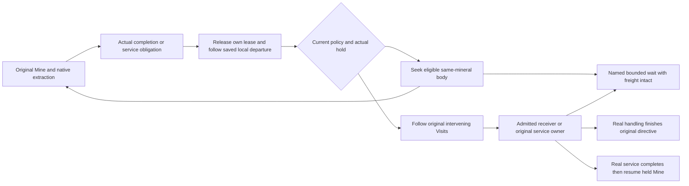

# Native mining continuation: execution notes

Owner: [Space fixes plan](r2sff1-space-fixes-features-1.md), Group 20.
Prerequisites: [mining targets](r2sff1-l-mining-targets.md) and
[receiver admission](r2sff1-m-return-targets.md).

## Delivered work

Execution resumed on 2026-10-23. Group 20 is complete and the temporary stop
handover has been absorbed and removed. Groups 21 onward remain pending.

`space_mining_continuation.h/.cpp` now provide the controller and pure effective
target query under the existing native mission and queue owners. The first
production build passed in `logs/space-fixes/build-space-continuation.log`.
Final focused build passed in `logs/space-fixes/build-space-continuation-final.log`.

## Queue and physical ownership

`ResolveEffectiveSpaceOrderTarget` is shared by queue dispatch, approach
gathering, native validation and existing action adapters. A configured Mine
is dispatched before the old missing-original-target and Holding-completion
branches. Initial/continued native Approach and Mining still delegate actual
movement, exclusive attachment and finite extraction to `SpaceVehicle::Tick`.

`BeginSpaceMiningContinuation` releases only the original body lease/work. It
keeps pose, stopped state, packets and a distinct actual static service berth.
Normal depletion/full-hold completion can arm this controller now; policy
publication is still unregistered until Group 23. Group 25 must supply actual
pre-exit safety admission before calling this transition. No live exit is
enabled by Group 20.



Two additional contained fields need Group 23's transport: `route_cursor`
(UINT8_MAX default, otherwise an index into the original queue) and
`travel_ticks` (frozen bounded movement allowance). Neither stores another queue
or another service countdown. Original Visits execute once, in order, while
the Mine remains held. Service may resume that Mine without replaying Visits
already reached. Completing actual handling then advances past the original
Mine, reached Visits and performed handling directive together.

A positive allowance makes an original ReturnService a physical service visit,
not an implicit cargo unload or another paid bill. The new read-only
`SpaceReturnPurpose::ServiceVisit` preserves that existing behavior. Due service
still requires zero allowance, no pending descents and actual original parts.
Partial Surface unloading may need multiple original shells/batches. An actual
service start retains the current Mine until normal native work renews allowance.

Selection/reselection and waits preserve the actual source berth until the
mining selector can use its admitted departure geometry. Failed remote targets
release their request. Body waits/local departure never reacquire historical
body slots. Local movement rechecks swept geometry against current native
static owners on each opportunity.

## Verified results

Seven focused cases cover actual mining on two same-mineral bodies on both
roles, no-target waits and matching wake events, Recall/edit conservation, full
holds, original Visit ordering and non-unloading service visits. Required
service first waits for missing parts, reaches the original Core, retains its
actual berth through pause/resume, earns renewal through the original common
power/job owner and resumes the same held Mine with its packets intact.

The completed-extraction checkpoint also proves the next common approach
gather cannot reacquire the just-released historical body. The native validator
rejects a changed pin even with an empty hold, unissued history and hidden
navigation progress. Explicit continuation publication on a stopped miner keeps
its actual pose, flag, freight and cursor while releasing only its own lease.

Focused tags:

```text
[space-mining-continuation],[space-mining-policy],[space-mining-target],[space-return-target],[space-return-surface],[space-return-service],[space-mining-intercept-native]
```

They passed **35,924 assertions in 29 cases**, under one second.
Log: `logs/space-fixes/space-mining-continuation-final.log`.
The retained-file spotcheck `continuation-legacy` passed **274 assertions** in
4.218 seconds. Log: `logs/space-fixes/continuation-legacy.log`; reproducible
runtime: `test-cache/space-fixes/continuation-legacy/`.
Executable SHA256:
`98c1607f9fbbc7fc9a0e724dbf55fde14f72fd4437a6704de6ce7929c96d68b4`.
The unchanged source is `space-factory-440.sav`, SHA256
`e063202b825bf16d7fa0b536b482740e1201e0ef29050bc957fbf3301da9a53e`.

## Persistence gate

The old extraction packet writer and field installation gate still belong to
Groups 21–24. Do not publish an actual retired native field or claim old legacy
packet provenance survives deletion before those migrations exist. Group 20's
native cases may reduce declared component reserve inputs to force ordinary
finite depletion; extraction, freight and movement must still be earned through
original owners. Real pre-exit removal and save/reload evidence follow later.

After compaction, re-read the Global Mandatory Reading and the nearest **One
queue and effective continuation targets** block above Group 20, scoped to the
controller/provider being changed. `space_mining_continuation.cpp` is now the
actual controller producer; add these symbols to later reading lists as needed.
