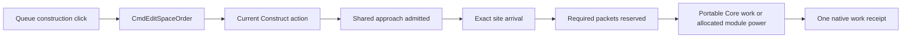
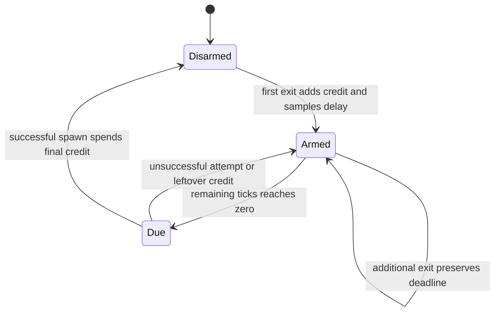
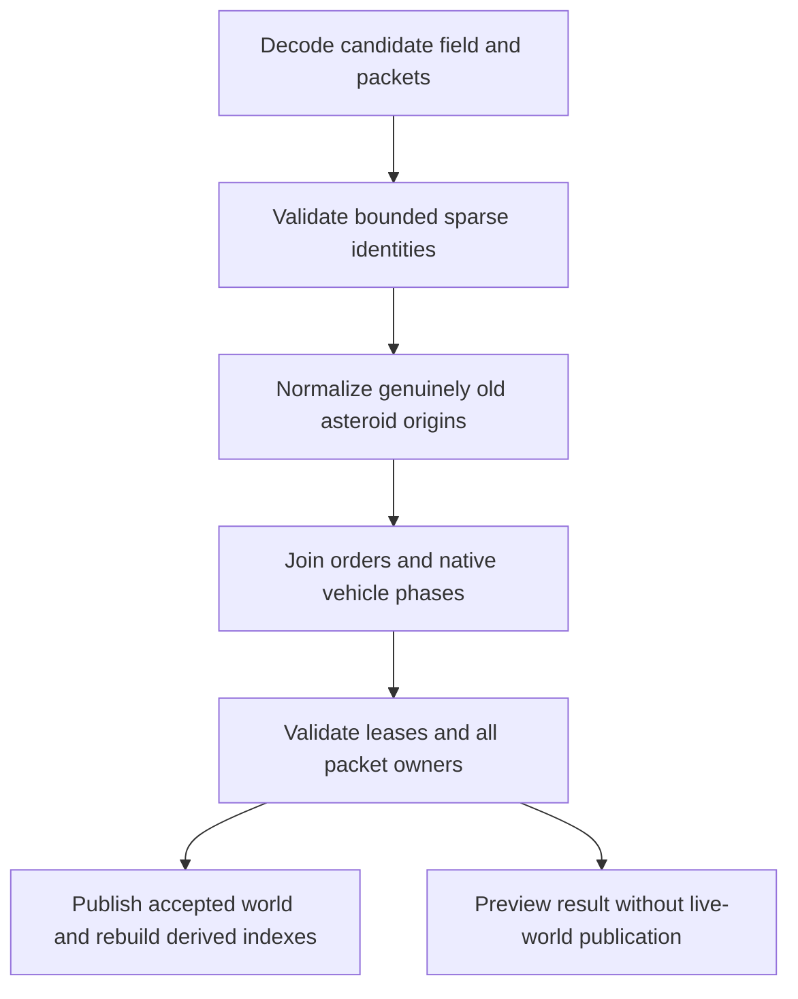
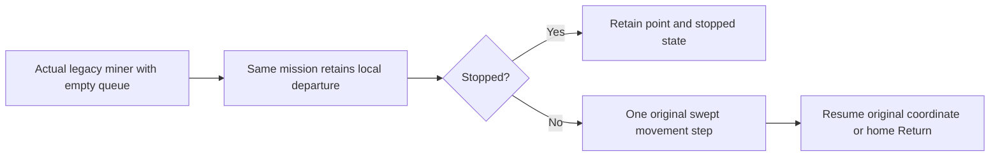
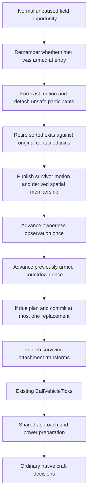
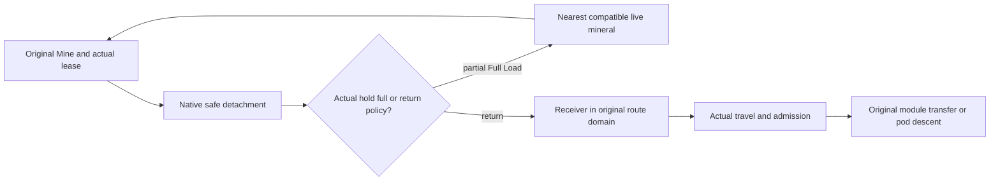

# R2SFF1 - Space Fixes and Features 1

## Global Mandatory Reading

> **Execution protocol**
>
> - Read this Global Mandatory Reading section before the first task and again
>   after every context compaction.
> - Before starting or resuming a task group, read the nearest preceding Area
>   Mandatory Reading block whose `Applies to` label includes that group. Area
>   blocks appear immediately before the first group they govern.
> - A referenced heading or exported symbol is authoritative. Global navigation
>   hints and Area line ranges are for navigation only; if they drift, relocate
>   the named section or symbol rather than expanding to the whole file.
> - Mandatory reading is non-transitive. Do not preload a linked file's own
>   Mandatory Reading, Consult on Demand, or Planning Provenance entries unless
>   this plan names them directly for the current area.
> - Do not read Consult on Demand or Planning Provenance merely because those
>   sources are listed. Use a Consult on Demand source only when its trigger
>   occurs.
> - No created source file, test file or JSON file should start with same prefix as a planning MD file (such as r2). Only MD files can have that prefix. No MD file should be created anywhere in source directories unless specifically asked.
> - After EVERY CONTEXT COMPACTION, you must add a note above the task group
>   which is currently in execution. The note will say: "Context has compacted
>   X times while executing this group.". If the compaction occurs before any
>   meaningful work was done (this can happen when there is a lot of baggage
>   from the previous compaction), then and ONLY then you can skip this step.
> - When exceeding 3 context compactions, YOU MUST ask yourself if you're not
>   chewing more than we can handle :). Heck, plans change! :). In such a case,
>   the way out is to split the group on the spot,
>   in the plan, into more groups,
>   by appending B, C, D as a suffixes to those groups (splitting sub-groups
>   themselves is also allowed). When you do this, create Local Mandatory
>   Reading areas so you can optimize your context only for the
>   ACTUAL task at hand.
>   Before starting or resuming a task group, read the nearest preceding Area
>   Mandatory Reading block whose `Applies to` label includes that group. Area
>   blocks appear immediately before the first group they govern.

| File name | Line Ranges | Description |
| --- | --- | --- |
| [Native asteroid and probe runtime handoff](../../../zz-rhr/upgrades/2026-10/r2mlsp-z-z-p-probe-runtime-handoff.md) | 5-15 | **Delivered ownership** identifies the sole field, native Vehicle, packet, service and command owners. Every group must preserve those boundaries: UI work cannot manufacture progress, and lifecycle work cannot introduce another cargo or vehicle registry. This plan explicitly replaces retained-body/reflection behavior, not the paid ownership contracts. |
| [asteroid.h](../../../../src/asteroid.h) | 28-30; 107-130; 151-172 | `AsteroidClass`, `AsteroidSize`, `AsteroidBody`, `AsteroidKnowledgeRecord` and `AsteroidField` distinguish mineral, size, finite stock, disclosure and field ownership. These distinctions apply to the inspector, exit accounting, orders and save changes; size credits must never become cargo quantities. |
| [space_orders.h](../../../../src/space_orders.h) | 17-86 | `SpaceOrderAction`, `SpaceOrderTarget`, `SpaceOrder`, `SpaceApproachRequest` and `SpaceOrderQueue` establish typed, generation-qualified targets and the native queue owner. All fixes and controls must operate on these owners, retaining explicit waits and exclusive approach admission. |
| [GUI architecture](../../architecture/gui/archi-gui.md) | 237-245 | **Invariants** separates retained windows, draw-only hooks and synchronized command publication. Globally necessary because all four reports cross presentation and simulation: drawing, selection, resizing and keyboard input must not advance gameplay. |

## Scope and decisions

Created 2026-10-23 from the [Space master](r2mlsp-space-master-plan.md), the [demo bug report](demo/r2df-demo-fixes.md), both accompanying screenshots and current architecture/code. This is an implementation plan; completed tasks are marked [X] against recorded evidence. Groups follow dependency order. Each batch has one difficulty level, with at most eight tasks, so an implementation agent can be selected for that batch.

| Report | Observed evidence and current boundary | Required result | Delivery groups |
| --- | --- | --- | --- |
| R1 - Orbital window overflow | [01OrbitalClutter.png](demo/01OrbitalClutter.png) shows bottom controls extending behind the status/taskbar area. `space_structure_gui.cpp` combines a 720x400 minimum panel with nine action rows; its scrollbar covers site rows, not the entire window. | A bounded, resizable construction window with every action reachable at the reported Full HD setup and its actual GUI/font scale. | 1-2, 31, 34 |
| R2 - Alt+4 and repeated F2 | `d2sa-space-adventures.md` promises these controls, but current toolbar lists only bind layer cycling to `N`; `ShowGameOptions` closes and immediately recreates the window. Debug also claims Alt+1/2. | Alt+1..4 select Surface, Underground, Deep Underground and Space; F2 opens, raises or closes Game Options consistently with its toggle setting. | 1, 3, 31, 34 |
| R3 - Construction probe makes no progress | [02Stuck.png](demo/02Stuck.png) shows three empty construction probes described as idle. It contains no queue, site, pause or elapsed-work evidence establishing a controller deadlock. | Diagnose the actual demo path, repair any failed command/controller transition, and expose the precise reason and next action for legitimate waits. A valid supplied construction order must progress through ordinary ticks. | 1, 4-8, 31, 34 |
| R4 - Asteroid reversal and replacement | `AdvanceSpaceMotion` intentionally reflects at the middle-half travel envelope. The field requires exact initial population, dense IDs and retained depleted bodies. Native orders have no explicit full-load continuation policy. | Straight trajectories to actual map exit, safe pre-exit probe detachment, order-driven nearest destinations and persistent delayed size-budget replacement. | 9-34 |

The user confirmed the timer policy: **20-60 seconds at normal game speed, accelerated by fast-forward and frozen while paused**. Use synchronized simulation ticks, independent of calendar-year length, camera visibility, rendering FPS and machine wall clocks. Convert the inclusive interval using `MILLISECONDS_PER_TICK`: round the lower tick bound up and the upper bound down (741-2222 ticks with the current 27ms constant); do not approximate it as 20-60 game days or use the truncated `TICKS_PER_SECOND` estimate.

The following choices make the requested behavior implementable and reviewable. Groups 9-11 specify geometry and accounting; Groups 15-20 specify cargo provenance and order continuation before dependent runtime work begins:

- **Exit geometry:** an asteroid keeps its signed velocity through the old strip boundary and is retired at the actual Space-plane edge. The existing middle-half placement/construction policy is not the map edge. Separate spawn preference, static-placement restrictions, safe craft envelopes and terminal bounds. No reversal, wrapping, teleportation, or new station-damage mechanic is introduced. Existing modules remain valid; transient craft safety must use the shared approach owner.
- **Retirement:** remove the live body, index entries, leases and live disclosure references. Historical packet provenance may retain the retired ID as history; it must never resolve to a new asteroid. Do not retain invisible live-body tombstones indefinitely. Depletion alone does not earn replacement credit: an empty body keeps drifting until it exits.
- **Accounting:** proposed replacement costs are Small=1, Medium=3, Large=5. These are dedicated renewal weights, independent of reserve multipliers. Save cumulative exit counts by size, a nonnegative pending weighted credit balance, and the most recent exit's size and resource class. Multiple exits in one tick are processed in ascending body-ID order; the last such ID defines the latest exit.
- **Replacement selection:** at each due interval, spawn at most one new body whose size differs from the latest exited size and whose cost fits the balance. Debit only after successful creation. Choose from eligible sizes with deterministic randomness; retain all credits when none qualify. A new body has a fresh ID, newly sampled finite reserve and an inward trajectory from a legal map-entry location. It does not inherit the departed body's mineral, knowledge, lease or exhausted stock. Saving the latest resource class does not imply a ban on that mineral recurring.
- **No instant refill:** arm a fresh random interval when an empty credit balance first becomes positive. Additional exits do not postpone an already armed timer. A due unsuccessful attempt schedules another random interval while credits remain; zero credits disarm it. No catch-up burst occurs after load or resume. If every live body has disappeared and the only remaining credit is insufficient for a different size, the field remains valid and empty; never mint credits or violate the size rule to refill it.
- **Probe behavior:** release attachments before an unsafe edge step. A partially loaded miner ordered to wait for full load seeks the nearest eligible asteroid of the same mineral, preserving its cargo and instruction. A return/unload policy seeks the nearest eligible owned destination permitted by that order. Full holds and required service follow their applicable return/service action. No compatible asteroid or receiver produces a safe, visible wait with cargo intact. Explicit Recall/cancellation takes precedence over automatic continuation.
- **Nearest means:** compare actual squared plane distances among compatible, reachable, safely interceptable candidates. Tie-break by stable typed ID/generation, never container order. Eligibility includes ownership/access, capacity, approach reservations, outgoing edge trajectory and real shell/service requirements. Selection grants neither a berth nor a transfer; command/work admission revalidates it.
- **Compatibility:** existing saves adopt the new exit policy without regenerating their field, changing paid assets or guessing historical exits. Initialize missing renewal counters to zero, preserve existing body IDs/velocities/cargo, and default old orders to their previous return behavior. Historical initial population/class shares constrain generation, not the changing live population. The new lifecycle/version contract explicitly supersedes the old reflection and permanent-body assertions.

The unfinished [earlier demo-fix plan](r2df-demo-fixing-oct-15.md) already owns Alt+digit and window-toggle proposals. Group 3 implements the shared mechanism once and Group 34 reconciles only the overlapping items. This plan does not claim completion of the older plan's separate small-map, Escape or Underground work. Existing Space master financial and end-to-end tasks retain their own status; this bug-fix plan does not resume their simulation trials.

All new implementation/test/JSON filenames use descriptive names without the `r2` planning prefix. Assisting Markdown belongs beside this plan, not under `src`. Test/build output and scratch captures go under repository-local `logs/space-fixes/` or `test-cache/space-fixes/`. Preserve original demo images, saves and user configuration. No Git writes are part of this plan; do not change configuration outside a Git repository without explicit user approval.

## Implementation tasks

### Reading the implementation sketches

This refinement replaces open-ended design batches with small producer/consumer steps. Every group is HARD or lower. Code snippets describe proposed interfaces or narrow transformations; they are not claims that those exports already exist, and their types/includes must be checked against the live tree. A plain declaration alone does not satisfy an entry gate: verify its implementation and focused behavior.

The exact assumption note before dependent work identifies earlier planned producers. If a producer is absent, re-assess that dependency at execution time and complete/split the missing producer; do not improvise a competing owner. Keep new live behaviors disconnected until their specified persistence and safety gates pass. In particular, Groups 15-24 must preserve current legacy packet/order handling while preparing new fields, and expose each new live writer/command only when its matching reader and migration are ready.

### Area Mandatory Reading - Report characterization

_Applies to Group 1._

| File name | Line Ranges | Description |
| --- | --- | --- |
| [Demo reports](demo/r2df-demo-fixes.md) | 1-12 | Reports **1-4** are the requested behavior, including pre-exit detachment and saved size-aware replenishment. Preserve these distinctions when recording reproductions. |
| [Space adventures](d2sa-space-adventures.md) | 36-52; 263-305 | **Start the game** and **Tour orbital Core construction, service and module work** identify the promised controls and paid construction tours. Establish which checkpoint/action sequence produced the screenshots instead of treating every idle craft as broken. |
| [space_structure_gui.cpp](../../../../src/space_structure_gui.cpp) | 36-101 | `widgets` and `desc` show the actual minimum body and stacked controls; measure client-area fit after GUI scaling rather than assuming the PNG dimensions equal the display mode. |
| [Earlier demo-fix plan](r2df-demo-fixing-oct-15.md) | 137-171 | **Area Mandatory Reading - Map window, hotkeys and window input**, Groups **2** and **3** contain the overlapping unfinished shortcut/toggle proposals. Record their current implementation status and reuse their shared owner; their other tasks are outside this report. |

Context has compacted 1 times while executing this group.

### Group 1 - Capture reproducible baseline inputs

Evidence: [baseline observations](r2sff1-a-baseline-notes.md#measured-baseline-2026-10-23).

{{SIMPLE}}
- [X] 1.1 Record the actual application path/configuration and hash, demo launcher entry, immutable source-save hash, game pause state, screen/client dimensions, GUI/font scale and relevant hotkey/toggle settings in a short assisting Markdown file beside this plan. Read configuration in place; reproduce with copies inside the repository.
- [X] 1.2 Reproduce R1 at the user's Full HD setup; record the window's minimum/current bounds and every clipped action. Also inspect the space-field inspector so new order controls will not repeat the same overflow.
- [X] 1.3 Reproduce Alt+4 and F2 twice using both fresh defaults and a copied demo hotkey configuration. Record Debug Alt+digit conflicts separately from missing bindings and window focus/toggle behavior.
- [X] 1.4 Trace R3 from the relevant construction tour: identify the exact probe/site generations, full queue/cursor, stopped/service flags, cargo and reserved inputs, Core/power eligibility, and progress over a bounded unpaused interval. If the original save is unavailable, record that limitation and use the nearest retained tour; do not declare an exact reproduction from the image alone.
- [X] 1.5 Record one existing reflection at each relevant boundary and list the fixed-population/dense-ID assumptions to replace. Label old reflection tests as intentionally superseded requirements, preserving unrelated conservation and determinism checks.

### Area Mandatory Reading - Window layout and keyboard dispatch

_Applies to Groups 2-3._

| File name | Line Ranges | Description |
| --- | --- | --- |
| [GUI architecture](../../architecture/gui/archi-gui.md) | 7-50 | **Retained windows** and **Widget tables** explain `WindowDesc`, `InitNested`, sizing, selection containers and resize increments. Fix the nested layout and client-area fit through those owners rather than shrinking text globally. |
| [space_structure_gui.cpp](../../../../src/space_structure_gui.cpp) | 36-101; 364-520; 522-616 | `widgets`, `SpaceConstructionWindow::DrawWidget` and `OnClick` bind the current content, site hit rectangles and synchronized actions. Retain every action and exact selected incarnation while reorganizing controls. |
| [map_layer_gui.h](../../../../src/map_layer_gui.h) | 79-88 | `SetViewportLayer` and `CycleMainViewportLayer` are the public layer-switch boundary; new direct shortcuts must reuse the viewport/layer authority. |
| [Map-layer architecture](../../architecture/map-layers/archi-map-layers.md) | 38-48 | **Layer dropdowns and view state** documents independent viewports and display ordering. A main-view shortcut must not reinterpret enum ordinals or change unrelated extra viewports. |
| [toolbar_gui.cpp](../../../../src/toolbar_gui.cpp) | 2198-2254; 2322-2365; 2634-2668; 2741-2766 | `MainToolbarWindow::OnHotkey`, `ScenarioEditorToolbarWindow::OnHotkey` and their `hotkeys` lists own the actual game/editor dispatch. Add direct layer actions and F2 toggling here, preserving editor special-action identities. |
| [main_gui.cpp](../../../../src/main_gui.cpp) | 476-520 | `MainWindow::hotkeys` owns global Debug Alt+digit defaults and runs ahead of toolbar handling. Move only the conflicting debug bindings and retain the existing Escape/input contracts. |
| [hotkeys.cpp](../../../../src/hotkeys.cpp) | 267-282 | `HotkeyList::Load` replaces code defaults with saved entries, including empty bindings. Diagnose copied user overrides and migrate only the known obsolete Debug defaults, preserving intentional customization. |
| [settings_gui.cpp](../../../../src/settings_gui.cpp) | 1851-1864 | `_game_options_desc` and `ShowGameOptions` expose the `(GameOptions, number)` identity and close/recreate behavior. Apply shortcut toggling at dispatch without turning every menu invocation into a toggle. |
| [underground_window.cpp](../../../../src/tests/underground_window.cpp) | 96-151 | **Main and editor toolbar entries open the captured underground layer** demonstrates actual toolbar/hotkey dispatch testing. Extend the relevant fixture instead of validating only a helper detached from input routing. |

### Group 2 - Make every orbital action reachable

Evidence: [layout implementation and native checks](r2sff1-b-layout-notes.md#verified-results).

Execution refinement: the existing command preflights commonly return generic
`CMD_ERROR`, so this layout group preserves their admission and existing reason
disclosures. It must not invent another readiness authority. Groups 6 and 8 own
the new precise construction reasons and their presentation.

{{MEDIUM}}
- [X] 2.1 Replace numeric widget references with a named enum in the existing widget convention, preserving command mappings. Divide the current action rows into compact selectable pages for Construction, Inventory, Service, Connections and Manufacture; keep site/builder selection and the active page visible.
- [X] 2.2 Build a resizable nested layout with a small scalable minimum, a scrollable details/site area and a bounded active-action area. Fit width and height to the usable client region below the toolbar and above the status bar; provide a resize control. Long translations and large fonts must not force hidden actions.
- [X] 2.3 Recompute scroll capacities and hit rectangles on resize, page changes and selection changes. Clamp stale positions, clip details and rows, and keep selected site/craft references stable. Move presentation bookkeeping out of draw hooks where needed; no query may grant work.
- [X] 2.4 Preserve every existing quote, disabled-state check, reason disclosure and command argument on its new page. Keep full action labels available through tooltips when constrained text is ellipsized, and make all supported actions reachable by visible controls without moving the window beyond the screen. Bind newly factored construction reasons in Group 8 after Group 6 supplies their sole read-only producer.
- [X] 2.5 Verify actual click routing and captures at 1920x1080 with the reported scale, a smaller supported window, enlarged fonts and changed resolution. Cover Core, unfinished Storage, Dock and Assembly pages; prove the bottommost action is visible and clickable, not merely present in the widget tree.

### Group 3 - Deliver the promised shortcuts once

Evidence: [shortcut implementation, both configurations and overlap notes](r2sff1-c-shortcut-notes.md).

{{MEDIUM}}
- [X] 3.1 Add named Alt+1..4 actions to normal and editor toolbar dispatch, mapped explicitly to the GUI layer order. Route through the existing viewport setter, ignore unavailable layers and preserve the main viewport's plane location. Keep `N` cycling working.
- [X] 3.2 Move the Debug crash/money/coordinate default shortcuts to Ctrl+Alt+0/1/2 through the existing global hotkey owner. Cover stored defaults and intentional remappings; do not overwrite an entire user hotkey file. Test configuration changes on repository-local copies.
- [X] 3.3 Implement or reuse the earlier plan's client-side `gui.hotkey_toggles_window` setting, default on, with native settings metadata, strings and UI entry. Keep the shared window-toggle helper in the existing window/input owner; do not create a second setting or per-window framework.
- [X] 3.4 Apply the F2 rule in both toolbar paths: open absent Game Options, raise it if covered, close it when already front-most and toggling is enabled. With the setting off, preserve existing open/raise behavior. Check pinned/non-closable and modal cases against the shared helper; menu opening remains predictable.
- [X] 3.5 Run actual input-dispatch regressions for Alt+1..4, unavailable layers, repeated F2, covered windows, saved custom bindings and both build configurations. Ensure modifier conflicts do not trigger money/debug actions and edit boxes retain their intended input handling.
- [X] 3.6 Update shortcut tooltips and the affected walkthrough statements to match delivered behavior. Record exactly which earlier Group 2/3 subrequirements are satisfied; leave their unrelated small-map and Escape items pending.

### Area Mandatory Reading - Construction admission and work

_Applies to Groups 4-6._

| File name | Line Ranges | Description |
| --- | --- | --- |
| [orbital_station.h](../../../../src/orbital_station.h) | 144-183 | `ReserveOrbitalConstructionInputs`, `PrepareOrbitalConstructionTick`, `IsSpaceConstructionWorkTick` and `CommitOrbitalConstructionStep` separate delivery, admission and paid work. Preserve those owners while isolating the demonstrated stall. |
| [space_orders.cpp](../../../../src/space_orders.cpp) | 230-279; 351-467 | `CmdEditSpaceOrder` and `TickSpaceOrders` own insertion/cursor reset, arrival, deadlines and completion. Check the actual current action before diagnosing the work producer. |
| [orbital_station.cpp](../../../../src/orbital_station.cpp) | 173-289 | `ReadyProbe`, `ConstructionTarget`, `CoreConstructionProbe`, `AppendOrbitalConstructionRequests` and the material/work predicates expose the individual prerequisites. A missing current-interval power grant is different from a missing packet. |
| [orbital_module_assembly.cpp](../../../../src/tests/orbital_module_assembly.cpp) | 32-50 | **Orbital assembly preserves partial grant work and caps useful final energy** is the exact accounting contract; do not reset partial work or spend an already consumed grant to make a test pass. |

### Group 4 - Identify the first failed construction boundary

Evidence: [retained construction traces](r2sff1-d-construction-notes.md#group-4-observed-first-boundaries).

This batch produces a reproducible diagnosis, not a controller rewrite. Follow the actual command path:



{{MEDIUM}}
- [X] 4.1 Use Group 1's identified demo copy and record the command result, exact craft/site generations, queue before/after insertion, cursor, stopped flag and pause state. Do not infer a queue failure from the screenshot's Idle text.
- [X] 4.2 Trace one bounded ordinary-loop interval through the diagram. Record the first false predicate and its actual inputs; distinguish an empty queue, a completed cursor, an approach wait, missing packets and unavailable power.
- [X] 4.3 Add one focused failing native case at that first boundary, plus one adjacent successful case using the existing construction fixture. Keep setup artifacts separate from the original demo and state whether the exact user save was available.
- [X] 4.4 Record the smallest repair location for Groups 5-6 and the expected before/after observation. If the system is waiting correctly, record the missing player prerequisite and make Group 8's actionable presentation the required repair.

### Group 5 - Repair construction order activation and arrival

Outcome: [native queue/arrival behavior verified; no controller repair required](r2sff1-d-construction-notes.md#group-5-queue-and-identity-contracts-verified).

ASSUMPTION: this was already built previously. If not, re-asses at runtime

Required input: Group 4's reproduction and failing boundary. If absent, stop repairs and finish that characterization; read-only trace preparation may continue.

{{HARD}}
- [X] 5.1 Repair only the demonstrated queue/command issue, if present: append a Construct action to the selected builder, preserve valid typed generations, and ensure the intended action becomes current under existing queue-edit semantics. Do not silently clear another action or start a stopped craft from painting.
- [X] 5.2 Repair the demonstrated approach/deadline issue, if present. Reuse `RequestSpaceApproach` and `GetSpaceApproachDestination`; distinguish travelling, waiting for a slot, precise arrival and an exhausted deadline. Retain the final-tick-arrival protection already used by Construct.
- [X] 5.3 Verify queue edits while stopped, already working, servicing and targeting a removed/reused site. Estimate and mixed Execute/QueryCost calls leave queues, packets, RNG and work unchanged; failed commands leave the original state intact.
- [X] 5.4 Re-run Group 4's case through actual command dispatch. Close this batch only with a repaired regression or explicit evidence that command/arrival behavior is correct and the remaining issue belongs to Group 6 or 8.

Context has compacted 1 times while executing this group.

### Group 6 - Separate construction readiness from work commitment

Evidence: [shared read-only reasons and native interruption checks](r2sff1-d-construction-notes.md#group-6-readiness-and-interruption-results).

ASSUMPTION: this was already built previously. If not, re-asses at runtime

Required input: Group 5's valid current Construct/arrival path. Stop dependent work tests if it is absent; a pure status-record declaration may proceed. Add `GetOrbitalConstructionReadiness` to `orbital_station.h` only as a read-only view of existing predicates, with a reason enum; it is not another allocator.

The existing Construct branch intentionally samples work eligibility before delivering this tick's cargo. Preserve this ordering unless the failing native test proves it wrong:

```cpp
// Implementation sketch using current native owners.
const bool working = IsSpaceConstructionWorkTick(vehicle);
ReserveOrbitalConstructionInputs(site, vehicle, true);
if (working) CommitOrbitalConstructionStep(vehicle);
// Newly delivered final materials can make NEXT tick eligible.
// Do not turn a GUI/readiness query into another grant or commit.
```

{{HARD}}
- [X] 6.1 Factor the observed reason into `GetOrbitalConstructionReadiness`: no current Construct, stopped, service-held, wrong approach, missing inputs, waiting for Core worker, missing power or eligible. Share the original predicates; preserve `IsSpaceConstructionWorkTick` as the admission authority.
- [X] 6.2 Repair any demonstrated failure in material delivery or eligibility refresh. Missing quantities come from the actual recipe and job packets; delivering the last unit cannot charge active work before its admitted opportunity.
- [X] 6.3 Repair any demonstrated stale power/worker selection at the existing preparation boundary. Preserve the Core bootstrap's portable work, one eligible extension worker per Core, whole-joule accounting and `last_work_tick`/interval receipts.
- [X] 6.4 Exercise loss/restoration of materials, power, berth and service independently. Verify actual resumption without resetting earned partial work or granting a second completion; keep Group 4's no-defect conclusion if all producers were already correct.

### Area Mandatory Reading - Construction continuation and presentation

_Applies to Groups 7-8._

ASSUMPTION: this was already built previously. If not, re-asses at runtime

Entry gate: Groups 4-6 supply the diagnosed command path and `GetOrbitalConstructionReadiness`. Verify the live declaration and focused native results. Stop dependent assertions/status binding in Groups 7-8 if absent; preparing captures and localized wording may continue. No synthetic work, stock, private utility account or inferred Idle-to-working transition may replace the missing producer.

| File name | Line Ranges | Description |
| --- | --- | --- |
| [orbital_station.h](../../../../src/orbital_station.h) | Live definitions; no fixed range | Group 6 produces `GetOrbitalConstructionReadiness`; existing `GetSpaceConstructionVisualWork` reports real committed/eligible work. These are the status and progress boundaries. |
| [asteroid_gui.cpp](../../../../src/asteroid_gui.cpp) | 270-380 | `SpaceSurveyWindow::DrawWidget` already prefers an active non-mining order over Idle. Reuse that behavior and disclose why a valid instruction waits. |
| [space_structure_gui.cpp](../../../../src/space_structure_gui.cpp) | 364-520; 522-616 | `SpaceConstructionWindow::DrawWidget` and `OnClick` own material display and synchronized queue actions; Group 2 may have reorganized them, so relocate by symbol. |

### Group 7 - Verify construction ownership across reload

Evidence: [four exact checkpoint/control comparisons and two real workers](r2sff1-d-construction-notes.md#group-7-reload-and-shared-worker-results).

{{HARD}}
- [X] 7.1 Save ordinary command-produced checkpoints while queued, waiting for materials, waiting for power and partially working. After reload compare the original queue, packets, partial work and current builder/site generations.
- [X] 7.2 Continue each checkpoint through the same native opportunities as an uninterrupted control; compare completion, material consumption, paid energy and upkeep. A delivery tick followed by a working tick must remain distinct when required by admission.
- [X] 7.3 Use two real eligible builders against one Core slot and prove stable worker selection and one job increment per opportunity. Repeat paused/stopped, resumed and target-removal cases without borrowing another builder's receipt.
- [X] 7.4 Record current results and the exact reproduction limitation, if any. A screenshot correction alone does not establish that an admitted construction job makes progress.

### Group 8 - Make construction waits actionable

Evidence: [native captures, material disclosure and presentation purity](r2sff1-e-construction-presentation.md).

Execution refinement: delivered cargo and Core-reserved cargo share the same
exclusive native job containers; the saved owner has no route-of-arrival split.
Show required quantities, inputs held/reserved at the site, still-carried
builder cargo, remaining requirements and consumed receipts without inventing
another material account. To keep the added explanations readable at the
reported scale, pull forward the inspector's bounded layout, wrapped full-content
scrolling and draw-only refresh foundation from Group 30. Group 30 still owns
the later policy controls and their interaction coverage.

{{MEDIUM}}
- [X] 8.1 Bind the read-only readiness reason to both construction views: no instruction, stopped, travelling, waiting for approach/materials/power/worker, servicing, working or complete. Show the actual current site and instruction.
- [X] 8.2 Separate required, reserved, delivered and consumed amounts. A finished Core with empty input containers must show consumed materials and completed work, rather than suggesting the recipe is missing again.
- [X] 8.3 Make Queue construction identify the selected builder/site and display normal command rejection. Offer the existing visit/load/queue/start actions as the next step; selection, resizing and painting must not issue them automatically.
- [X] 8.4 Capture a legitimate wait, its player remedy, resumed work and completion through the repaired compact window. Verify opening/closing windows and switching layers changes no work or custody result.

### Area Mandatory Reading - Pure motion and occupancy rules

_Applies to Groups 9-10._

| File name | Line Ranges | Description |
| --- | --- | --- |
| [Map-layer architecture](../../architecture/map-layers/archi-map-layers.md) | 132-163 | **Generated Space bodies and current mining simulation** fixes plane coordinates, saved history and pre-craft publication. The new terminal boundary must not use viewport or stacked-layer coordinates. |
| [space.h](../../../../src/space.h) | 17-58 | `SpacePoint`, `SpaceMotion`, `SpaceTravelBand` and `AdvanceSpaceMotion` define integer positions and saved unsigned remainders. The old band is a placement preference, not the terminal map bounds. |
| [space.cpp](../../../../src/space.cpp) | 19-66 | `GetSpaceTravelBand`, `AdvanceAxis` and `AdvanceSpaceMotion` contain the reflection being replaced. Preserve integer carry while separating prediction from publication. |
| [space_structure.cpp](../../../../src/space_structure.cpp) | 129-140 | `IsSpaceStructureSiteValid` permits modules in outer strips. Existing paid sites must remain valid when a straight asteroid crosses those projected strips. |
| [space_approach.cpp](../../../../src/space_approach.cpp) | 156-215; 234-261 | `IsSafeStaging`, `FindSafeStaging`, `GetSpaceMiningDepartureDestination` and `GetTargetSlots` own local craft clearance. Reuse their bounded ring and occupancy checks; a selected safe point is not permission to teleport there. |

### Group 9 - Implement pure straight-step and exit prediction

Evidence: [physical boundary, pure exports and focused tests](r2sff1-f-straight-motion.md).

Implement the geometry before connecting it to the game loop. Use the existing valid native centre rectangle `0 <= x <= (width-1)*SPACE_Q16`, likewise for y; the next step outside that rectangle retires the centre. This is the last valid map-tile centre, not the old middle-half strip. Body art may be clipped at the border; art size does not change velocity.

```cpp
// Proposed pure arithmetic, with validated inputs and 64-bit intermediates.
const int64_t magnitude = std::abs(int64_t{velocity});
const int64_t numerator = magnitude + remainder;
const int64_t step = numerator / ticks_per_day;
const auto next_remainder = numerator % ticks_per_day;
const int64_t candidate = position + (velocity < 0 ? -step : step);
// Keep velocity unchanged. Publish candidate only if it is in bounds.
// For distance d to the inclusive edge, first outside tick is:
// ceil(((d + 1) * ticks_per_day - remainder) / magnitude).
// A zero velocity has no crossing on this axis.
```

{{MEDIUM}}
- [X] 9.1 Declare `StepSpaceMotionStraight` in `space.h` with a pure result containing proposed motion and a crossed-edge mask. Accept explicit plane bounds and use the canonical ticks-per-day. Do not mutate the live field or replace `TickAsteroidField` yet.
- [X] 9.2 Add `AsteroidExitForecast`/`ForecastAsteroidExit` in `asteroid.h`, using the same axis arithmetic for first outside tick and last safe position. Handle zero components, fractional carry, corners and overflow-safe ceiling division explicitly.
- [X] 9.3 Keep generation's middle-half band and frozen starter inputs unchanged. Add separately named plane bounds; document that terminal retirement checks these bounds and static placement still consumes its own policy.
- [X] 9.4 Test each canonical heading/speed, zero motion components, exact last-centre arrival, the following outward step and both narrow-map orientations. Compare the analytic forecast to repeated pure steps, including nonzero remainders.
- [X] 9.5 Record the geometry decision beside this plan with examples for Small/Medium/Large art. Do not activate motion until the persistence and safety producers later in this plan are ready.

### Group 10 - Forecast attachment safety

Evidence: [analytic attachment hazards and shared geometry checks](r2sff1-g-attachment-safety.md).

Execution refinement: code inspection separates analytic collision timing from
bounded departure routing and shared slot publication. The former Group 10 is
split into Groups 10, 10B and 10C, all HARD or lower, before live detachment work.
Each subgroup has its own focused acceptance boundary.

ASSUMPTION: this was already built previously. If not, re-asses at runtime

Required exports: Group 9's `StepSpaceMotionStraight` and `ForecastAsteroidExit`.
Their four focused cases passed. Existing `space_departure.h` already owns
`GetSpaceMiningDepartureDestination`; extend that boundary rather than creating
another movement or lease owner.

Asteroids retain their trajectory and do not damage or displace modules;
projected body/module overlap is possible. Attached hulls must stay inside the
native clear centre envelope. A future conflicting attachment releases before
its next unsafe translation. No existing site is erased to preserve the old strip.

{{HARD}}
- [X] 10.1 Declare a pure `ForecastSpaceAttachmentSafety` in `space_departure.h`, with an explicit invalid-input result, optional first-unsafe tick, hazard and optional last-safe craft point. Inspect a body forecast, the original motion, the craft offset and explicit plane bounds. Distinguish an already unsafe point from a stationary safe attachment.
- [X] 10.2 Compute the first entry into static footprints or exact approach points using bounded integer time intervals per axis; do not iterate millions of future ticks. Take the earliest of body exit, offset-centre map exit and static conflict. Factor bounded multi-tick projection through the shared straight-motion arithmetic for the last-safe point.
- [X] 10.3 Test edge/corner offsets, fractional carry, stationary attachments, already-invalid offsets and an outer-strip module crossing. Compare analytic collision timing with bounded repeated pure steps. Preserve the copied body, module geometry and all original signed velocities; no query moves or releases a live hull.

The collision interval for a positive axis uses the same integer displacement
`floor((speed*t + remainder)/day)`. For an inclusive obstacle range `[lo,hi]`,
solve the first tick reaching `lo` and the last tick not beyond `hi`, intersect
those intervals for X and Y, and cap by the body's first exit. Negative axes
mirror the coordinate inequalities, not the saved velocity. A stationary axis
either spans the whole horizon or never intersects.

### Area Mandatory Reading - Bounded departure proposal

_Applies to Group 10B only._

| File name | Line Ranges | Description |
| --- | --- | --- |
| [space_departure.h](../../../../src/space_departure.h) | Live `ForecastSpaceAttachmentSafety` and `GetSpaceMiningDepartureDestination` | Group 10 supplies pure hazard timing; the existing native return helper owns actual departure selection. Verify its tests before deriving a release lead time. |
| [space_approach.cpp](../../../../src/space_approach.cpp) | Live `IsSafeStaging`, `FindSafeStaging`, `GetSpaceMiningDepartureDestination` | Reuse the fixed eight rings/eight directions and actual craft, request, static and body occupancy checks. Do not acquire another berth or teleport to a selected point. |
| [space.cpp](../../../../src/space.cpp) | Live `MoveSpaceSurveyTowards` and straight projection helpers | The actual four-tile/day integer movement and saved carry determine lead time and path admission; wall time is not an input. |

### Group 10B - Plan bounded departure and its lead time

Evidence: [bounded native-owner departure proposals](r2sff1-g-attachment-safety.md#group-10b-bounded-departure-proposal).

ASSUMPTION: this was already built previously. If not, re-asses at runtime

Required input: Group 10's focused attachment forecast. The proposal is read-only;
Group 25 will release the actual lease and Group 29 will connect terminal motion.

{{HARD}}
- [X] 10B.1 Expose read-only `PlanSpaceDeparture` beside `FindSafeStaging`. Return an explicit no-clear-point result or a local safe destination using the existing at-most-eight-rings/eight-directions order, with deterministic onward-distance ties.
- [X] 10B.2 Derive a conservative clearance lead time from the selected destination and native movement, checking the bounded proposed departure path against the original static/approach occupancy. Report when detachment becomes due at the earlier of that lead boundary and the next unsafe attachment translation; no literal wall-clock delay or live release occurs here.
- [X] 10B.3 When no route is admitted, propose release before the unsafe transform while retaining the craft's current valid point. Later ordinary opportunities may retry; do not move a blocker, transfer cargo or acquire another slot in this query.
- [X] 10B.4 Test crowded rings, equal-distance ties, edge/corner destinations, blocked paths and a stopped attached miner's identical safety proposal. Prove bounded search, unchanged hull/cargo/lease ownership and no teleportation.

### Area Mandatory Reading - Body approach safety

_Applies to Group 10C only._

| File name | Line Ranges | Description |
| --- | --- | --- |
| [space_approach.cpp](../../../../src/space_approach.cpp) | Live `GetTargetSlots`, `PlanSpaceApproaches`, `GetSpaceApproachDestination` | Derived body slots must be rejected by the same owner that retains real static berth occupants and saved request priority. |
| [space_departure.h](../../../../src/space_departure.h) | Live attachment/departure safety exports | Reuse the established bounds/obstacle predicates, with no competing clearance policy. |
| [space_approach.cpp tests](../../../../src/tests/space_approach.cpp) | `Shared Space approaches preserve one owner and stable request priority` | Existing copied-slot arbitration covers retained occupants and conflicting requests. Extend focused safety admission without commissioning fake gameplay hulls. |

### Group 10C - Reject unsafe body approach slots

Evidence: [shared body-slot admission and retained static owners](r2sff1-g-attachment-safety.md#group-10c-current-point-body-slot-admission).

ASSUMPTION: this was already built previously. If not, re-asses at runtime

Required input: Groups 10 and 10B's verified pure safety/departure boundaries.
Current-point slot validation can be connected now; future release/motion remains
behind Groups 25/29. Existing static sites and their berth owners remain intact.

{{MEDIUM}}
- [X] 10C.1 Make a body's approach slot unavailable when its offset centre lies outside plane bounds or inside a static footprint/exact berth. Share the attachment obstacle predicates and preserve the body's velocity and every paid static slot.
- [X] 10C.2 Verify copied extreme-body slot geometry and actual shared arbitration: reject unsafe body admission while retaining an existing safe static berth and its owner. Test stopped-hull safety queries without granting a movement/work opportunity.
- [X] 10C.3 Record the limited overlap policy, bounded proposal and remaining live-release gate beside this plan. Confirm the current field still uses legacy motion until the later persistence/retirement prerequisites pass.

### Area Mandatory Reading - Renewal accounting and live identity

_Applies to Groups 11-14. Groups 14B and 14C have narrower reading below._

| File name | Line Ranges | Description |
| --- | --- | --- |
| [asteroid.cpp](../../../../src/asteroid.cpp) | 170-203; 205-268; 313-393; 429-438 | `MakeSpaceRandom`, initial class allocation, generation, validation, installation and `GetMutableAsteroidBody` expose feature streams and dense-ID assumptions. Preserve initial generation while changing live storage. |
| [space.h](../../../../src/space.h) / [space.cpp](../../../../src/space.cpp) | 79-92 / 105-154 | `SpaceSpatialIndex` uses ID-sized `locations`/`slots` arrays today. Replace those derived arrays with bounded live membership; neither index nor lookup may own reserve. |
| [core/random_func.hpp](../../../../src/core/random_func.hpp) | 24-41 | `Randomizer` exposes two saved state words and bounded `Next(limit)`. Use independent renewal streams, not `_random` or `_interactive_random`. |
| [Game-loop architecture](../../architecture/game-loop/archi-game-loop.md) | 360-370 | **TimerGameTick** versus **TimerGameRealtime** constrains the confirmed timer semantics: saved simulation opportunities, frozen on pause, faster in fast-forward. |
| [fios.h](../../../../src/fios.h) | 144-153 | `LoadCheckData::asteroid_body_count`, `asteroid_knowledge_rows` and `native_cargo_packet_rows` are candidate-file metadata. Add sparse IDs/class labels to this existing preview owner, with matching reset in `LoadCheckData::Clear`; no running-world lookup may substitute for a candidate row. |
| [asteroid.h](../../../../src/asteroid.h) / [space_departure.h](../../../../src/space_departure.h) | Live definitions; no fixed range | Group 9 produces `ForecastAsteroidExit`; Group 10 produces attachment safety through the shared departure boundary. Those functions are pure prerequisites for later retirement, not permission to remove anything during these storage batches. |

Context has compacted 1 times while executing this group.

### Group 11 - Implement the renewal ledger as pure state transitions

Execution refinement: the complete contained ledger owns both words of both RNG
streams now; Group 22 owns their versioned wire representation. Until that gate,
native field validation permits only pristine seeded state or canonical legacy
absence, and installation seeds genuine absence once from the saved feature
seed. Evolved pure test ledgers cannot be installed and then silently dropped by
the old writer. A due attempt consumes exactly one saved candidate ticket;
Group 27 uses a ticket-local generator for full proposal sampling. First-credit
arming is not decremented during the same native opportunity in Group 29.

Keep identity issuance separate from the replenishment ledger, both contained by `AsteroidField`. The following is a proposed shape, not an existing export:

```cpp
struct AsteroidRenewalState {
    std::array<uint64_t, 3> exited_by_size{};
    uint64_t credits = 0;
    std::optional<AsteroidExitMetadata> last_exit; // size and resource class
    uint32_t ticks_remaining = 0;                // zero means disarmed
    Randomizer timer_rng{}, candidate_rng{};     // explicitly seeded once
};
// AsteroidField additionally owns next_body_id; UINT32_MAX is exhausted.
constexpr std::array<uint32_t, 3> renewal_cost{1, 3, 5};
```



{{MEDIUM}}
- [X] 11.1 Add `AsteroidRenewalState`, explicit absent/latest size-class metadata and `GetAsteroidRenewalCost` to the field owner. Use costs 1/3/5, checked addition/subtraction and cumulative exit counts distinct from spendable credits. Validate their checked sum against total issued body IDs: a body can exit at most once, so 32-bit issuance bounds cumulative exits and prevents 64-bit counter overflow; reject forged history instead of wrapping.
- [X] 11.2 Seed two independent renewal RNG streams from the saved world seed and new fixed domains, preserving generation domains 1/2/3. Initialize once for a new/migrated world; persist both words of each stream. Default initialization alone is not seeding.
- [X] 11.3 Implement pure `ApplyAsteroidExitCredit`, `AdvanceAsteroidRenewalTimer` and `FinishAsteroidRenewalAttempt`. Timer draws occur on first-credit arming and rearming after a due attempt; extra exits preserve the deadline. A due unsuccessful attempt retains credit; zero credit disarms.
- [X] 11.4 Specify exactly one candidate proposal per due interval and no backlog bursts. Use 741..2222 inclusive ticks at the current 27ms normal interval. Define the candidate RNG consumption separately from timer draws, so refused allocation cannot perturb subsequent timer samples.
- [X] 11.5 Test Large +5, Medium -3, then two Small spawns on later intervals; Small +1 with no eligible different size; multiple exits sorted by body ID; zero credit; arithmetic limits and pause-equivalent no-step calls. Do not connect the ledger to the live loop yet.

### Group 12 - Replace dense body identity lookup

Execution refinement: detached field storage gains the sparse identity helpers
now. Native installation retains its dense/pristine compatibility gate until
Groups 13-14 migrate consumers and Group 22 supplies the complete writer. Old
reader cursor absence is initialized from its validated dense count exactly
once at install; no high-ID field can silently pass through the old writer.
Direct edits to decoded/copied `bodies` require `RebuildAsteroidBodyLookup`
before structural helpers. Read-only lookup checks cached identities and may
scan copied unbuilt/stale layouts, without changing any field. Raw-ID validation
never trusts that cache. The sorted-ID producer returns borrowed pointers;
collect terminal event copies before changing vector structure.

ASSUMPTION: this was already built previously. If not, re-asses at runtime

Required input: Group 11's declared field/ledger defaults. Verify them before changing field equality/install/reset; geometry and lookup test preparation may continue independently.

Use compact live `bodies` storage and a disposable `body ID -> dense slot` map. Save/digest in explicit ID order. Physical vector order must not decide simultaneous exits, RNG draws or arbitration. This avoids both a permanent tombstone vector and allocation proportional to the highest ever issued ID.

{{HARD}}
- [X] 12.1 Add `FindAsteroidBody(const AsteroidField &, OrbitalBodyID)` plus the mutable field overload in `asteroid.h`; retain `GetMutableAsteroidBody` for installed-field callers. Rebuild derived mappings on install/reset, exclude them from saved equality/digests, and validate copied input IDs independently of any stale cache. No lookup may create a missing body.
- [X] 12.2 Add field-owned `InsertAsteroidBody` and `EraseAsteroidBody` helpers with bounded live storage. On swap/pop erasure, update the moved body's derived slot and invalidate borrowed pointers; callers must retain IDs rather than references across structural changes.
- [X] 12.3 Add monotonic `next_body_id` issuance with the invalid sentinel as exhausted state. Allocate an ID only on successful insertion; permit old IDs below the cursor to be absent. Never reuse a removed identity.
- [X] 12.4 Provide explicit sorted-ID iteration for serialization, digests and lifecycle events, caching only where invalidation is clear. Ordinary per-body motion may use dense iteration when its result does not depend on iteration order.
- [X] 12.5 Test sparse IDs beyond 65,535, first/middle/last erasure, duplicate insertion, lookup after swap/pop, reset/install and issuance exhaustion. These are field tests; live extraction of high IDs remains gated on Groups 15-16 and 21.

### Group 13 - Make the spatial index support removal and insertion

ASSUMPTION: this was already built previously. If not, re-asses at runtime

Required input: Group 12's live identity contract. Verify sparse lookup/erase tests before integrating the index; independent bucket tests may continue. Index membership remains derived and unsaved.

```cpp
// Proposed disposable index membership, keyed only by LIVE body ID.
struct Membership { uint32_t bucket; uint32_t slot; };
// Remove(id): swap bucket.back() into the removed slot, update that
// moved ID's Membership, pop_back(), then erase id's Membership.
// Query(): return explicitly sorted IDs, never hash-container order.
```

{{MEDIUM}}
- [X] 13.1 Replace ID-sized `locations` and `slots` with live-key membership while retaining fixed spatial buckets. Add explicit Insert/Remove semantics and reject out-of-plane positions before calculating a bucket.
- [X] 13.2 Implement constant-work bucket swap/pop unlink and update the moved entry's slot. An index erasure must not modify `AsteroidBody`, credits, knowledge or packets.
- [X] 13.3 Rebuild the complete disposable index from saved live bodies on install. Keep native drawing/clicking queries sorted and safe when a recently queried ID has disappeared before lookup.
- [X] 13.4 Test repeated reuse of dense storage slots with fresh body IDs, many departures from one bucket, empty fields and high IDs. Check memory depends on live membership plus map buckets, not lifetime issuance.

### Group 14 - Migrate field validation, disclosures and selection

Execution refinement: the audit found distinct live-field, detached preview
and native custody/transition boundaries. Split them into 14, 14B and 14C with
focused verification. General validation supports copied dynamic fields here;
native installation retains an explicit legacy writer gate until Group 22.
Sparse copied-state tests do not enable high-ID extraction or claim a new-format
save/reload.

ASSUMPTION: this was already built previously. If not, re-asses at runtime

Required exports: Groups 12-13's canonical lookup and index mutation. Verify them before replacing callers; an inventory of callers can proceed without them. Do not retain `bodies[id]` as a hidden fallback.

{{HARD}}
- [X] 14.1 Migrate `GetAsteroidQuantityDisclosure`, `CompleteAsteroidSurvey`, rendering, picking and selected-body recovery to canonical lookup. Replace knowledge's `id < body_count` rule with sorted unique live membership; never reveal an old body's scan receipt on a new ID.
- [X] 14.2 Separate exact initial generation assertions from dynamic field validation. Keep initial starter/class/population checks at generation or genuine initial-history validation; continuing fields may have zero bodies or changed class counts while preserving valid reserves, velocities and IDs.
- [X] 14.3 Test copied-field knowledge removal, stale selection, absent targets, zero/changed population and corrupt identities/history/reserves/company masks. Verify the old-writer install gate still refuses evolved unsupported state; runtime exit remains unconnected.

### Area Mandatory Reading - Detached asteroid identity joins

_Applies to Group 14B._

| File name | Symbols / sections | Description |
| --- | --- | --- |
| [asteroid.h](../../../../src/asteroid.h) / [asteroid.cpp](../../../../src/asteroid.cpp) | `FindAsteroidBody`, `ValidateAsteroidField`, knowledge validators | Group 14's copied-field membership/disclosure checks; never substitute installed state for candidate data. |
| [fios.h](../../../../src/fios.h) / [fios_gui.cpp](../../../../src/fios_gui.cpp) | `LoadCheckData`, `LoadCheckData::Clear` | Existing copied metadata owner and complete reset. |
| [asteroid_sl.cpp](../../../../src/saveload/asteroid_sl.cpp) | `ASTRChunkHandler::LoadCheck`, `SPKNChunkHandler::Read/FixPointers`, `ValidateAsteroidKnowledgeLoadPreview` | Bounded decoding and detached joins; preserve old wire limits until migration. |
| [space_order_sl.cpp](../../../../src/saveload/space_order_sl.cpp) | `ValidateSpaceOrderLoadPreview` | Approach, mining and partial-survey references must join to candidate IDs rather than use body count as an ID bound. |

### Group 14B - Join preview references to copied sparse identities

ASSUMPTION: this was already built previously. If not, re-asses at runtime

Required input: Group 14's copied-field membership/disclosure validation. A live
world with coincident IDs cannot supply evidence for another candidate file.

{{HARD}}
- [X] 14B.1 Extend preview metadata with sorted live body identities/class labels and issuance instead of treating `asteroid_body_count` as an ID bound. Add candidate-only lookup and complete `LoadCheckData::Clear`.
- [X] 14B.2 Populate rows from decoded ASTR and join SPKN and SPOR/native-preview references to the same candidate. Separate knowledge row shape from membership checks; retain legacy transport restrictions until Group 22.
- [X] 14B.3 Test high/absent/duplicate/unsorted IDs, class/issuance rejection, candidate-world independence and complete Clear. Run one actual retained-file load/preview spotcheck.

### Area Mandatory Reading - Remaining native identity consumers

_Applies to Group 14C._

| File name | Symbols / sections | Description |
| --- | --- | --- |
| [space_transition.cpp](../../../../src/space_transition.cpp) | `ValidateSpaceTransitionRecords`, live/candidate callers | Structural body-ID domain checks versus actual membership; live-count caps are not lifetime bounds. |
| [space_vehicle.cpp](../../../../src/space_vehicle.cpp) | `PrepareNativeSpaceMiningDemo`, `ValidateSpaceVehicles`, `ValidateAsteroidPacketCustody` | Canonical starter/custody lookup; retired-source semantics remain Groups 15-16. |
| [cargo_source_sl.h](../../../../src/saveload/cargo_source_sl.h) | `IsValidCargoPacketSource` | Preserve 16-bit source/legacy restrictions until typed origins and CAPA migration in Groups 15/21. |
| [sparse identity notes](r2sff1-i-sparse-identity.md) | Groups 12-14 evidence and remaining assumptions | Lookup/index/install gate and exact pending reader boundaries. |

### Group 14C - Finish native identity consumer migration

ASSUMPTION: this was already built previously. If not, re-asses at runtime

Required input: Groups 14/14B's live/copied membership checks. Preserve existing
custody; this batch does not enable retired or 32-bit cargo origins before their
matching readers exist.

{{HARD}}
- [X] 14C.1 Inventory remaining numeric-limit assumptions, including transitions, demo setup and tests. Keep `MAX_ORBITAL_BODIES` as the live-count cap; body targets use issued/live identity rules.
- [X] 14C.2 Migrate remaining native direct-index consumers, using candidate membership for detached joins and live membership for current targets. Record retained CAPA restrictions and tests describing initial generation or superseded reflection.
- [X] 14C.3 Run focused absent/high-body transition and custody checks plus one native retained-world observation. Preserve paid assets, finite reserve, cargo and company masks; leave retirement disconnected.

### Area Mandatory Reading - Cargo provenance after body retirement

_Applies to Group 15. Group 16 has a focused block below._

ASSUMPTION: this was already built previously. If not, re-asses at runtime

Entry gate: Groups 12-14C supply sparse live lookup, issued-ID bounds and detached candidate-body metadata. Verify the public functions and focused tests. Stop historical-reference integration in Groups 15-16 if absent; native source-value declarations and packet-copy tests may continue. Do not truncate IDs, cap lifetime generation at 16 bits, retain every dead body forever, or build a parallel cargo registry.

| File name | Line Ranges | Description |
| --- | --- | --- |
| [source_type.h](../../../../src/source_type.h) | 21-80 | `SourceID` is **uint16_t**, while `OrbitalBodyID` is uint32_t; `Source` equality controls packet merging. Add typed asteroid provenance without silently changing Industry/Town/CompanySupply identity semantics. |
| [space_mining_inventory.cpp](../../../../src/space_mining_inventory.cpp) | Current named symbols | Group 15's `PrepareAsteroidMiningSource` and `GetSpaceMiningProductionTile` preflight full provenance and actual coordinates. `CommitSpaceMiningExtraction` keeps its legacy source constructor behind the old transport cap until Group 21; preserve original atomic debit/allocation. |
| [space_vehicle.cpp](../../../../src/space_vehicle.cpp) | Current named symbols | `ValidateAsteroidPacketCustody` and `ValidateSpaceVehicles` now use canonical body lookup but still require a live legacy source and infer its class. Retired-source cargo needs the full origin predicate while retaining exact all-container custody. |
| [cargopacket.cpp](../../../../src/cargopacket.cpp) | 76-126 | The split constructor and `CargoPacket::Split` copy `Source`. Its new asteroid metadata must survive every split/transfer without new stock. |
| [saveload/cargo_source_sl.h](../../../../src/saveload/cargo_source_sl.h) | 12-35 | `IsValidCargoPacketSource` currently caps asteroid source IDs at `MAX_ORBITAL_BODIES`. Separate source-era structural validation from later candidate/live field joins; preserve CompanySupply's non-paying rule. |

### Group 15 - Make asteroid cargo identity self-contained

Prefer a targeted extension of existing `Source`, leaving its 16-bit non-asteroid domain intact. The typed asteroid payload is authoritative for modern asteroid packets; the legacy `id` is normalized to `Source::Invalid` for that type. The following API is proposed here and does not exist in the current tree:

```cpp
struct AsteroidCargoOrigin {
    uint32_t body = UINT32_MAX;
    CargoLabel mineral = 0;
    auto operator<=>(const AsteroidCargoOrigin &) const = default;
};
// Source contains a canonical optional AsteroidCargoOrigin.
// Source::FromAsteroid(body, mineral) creates that tagged value.
// Source::GetAsteroidOrigin() reads it without resolving a live body.
// Non-asteroid sources must have no asteroid payload.
```

{{HARD}}
- [X] 15.1 Add `AsteroidCargoOrigin`, factory/accessor and canonical defaults to the existing source owner. Make constructors, `IsValid`, `MakeInvalid`, `SetIndex` and comparison explicitly handle the tagged payload; generic 16-bit setters must not rewrite an asteroid identity.
- [X] 15.2 Keep all existing source type ordinals, Industry/Town/Headquarters conversion behavior and CompanySupply payment purpose. Prevent malformed combinations such as a Town carrying an asteroid payload or a modern asteroid carrying two disagreeing IDs.
- [X] 15.3 Prepare the extraction adapter to construct the exact 32-bit body/mineral source through the factory; switch live extraction only when Group 21 installs its matching transport. Preserve original packet allocation, reserve debit and production-tile checks; reject unsafe extraction coordinates before any debit.
- [X] 15.4 Verify Source copying, packet splitting and both vehicle/station merge predicates preserve and compare the full asteroid origin. Two different retired body IDs with the same mineral must not become indistinguishable by truncation.
- [X] 15.5 Add focused boundaries at IDs 65,534/65,535/65,536, the invalid sentinel and different minerals. Save/load wiring belongs to Group 21; high-ID runtime activation remains gated until that transport passes.

### Area Mandatory Reading - Retired cargo and copied custody

_Applies to Group 16. Read the rows relevant to the current numbered task; the
table is not a request to reload every container implementation after compaction._

| File name | Symbols / sections | Description |
| --- | --- | --- |
| [source_type.h](../../../../src/source_type.h) / [asteroid_cargo.h](../../../../src/asteroid_cargo.h) | Typed origin, factory/accessor/canonicality; current origin APIs | Tasks 16.1-16.2: historical provenance is a value, not a live target. Legacy reconstruction requires a surviving same-owner body. |
| [space_vehicle.cpp](../../../../src/space_vehicle.cpp) | `ValidateAsteroidPacketCustody`, `ValidateSpaceVehicles` | Tasks 16.2/16.4: exact native all-container ownership, production tile, first station and current leases remain independent requirements. |
| [Savegame architecture](../../architecture/savegame/archi-savegame.md) | `SaveLoadOperation::Check` paragraph, approximately 597-600 | Task 16.3: preview skips full afterload/pointer reconstruction and must use copied metadata without touching native pools. |
| [fios.h](../../../../src/fios.h) / [fios_gui.cpp](../../../../src/fios_gui.cpp) | `NativeCargoPacketPreview`, `NativeCargoReferencePreview`, `LoadCheckData::Clear` | Task 16.3: copied packet origin/production evidence and original ordinary container cargo slots; clear every new field. |
| [station_sl.cpp](../../../../src/saveload/station_sl.cpp) / [vehicle_sl.cpp](../../../../src/saveload/vehicle_sl.cpp) | `SlStationGoodsCargoPreview`, `SlStationCargoPreview`, `STNNChunkHandler::LoadCheck`; `SlSpaceOwnerPreview`, `SlOrdinaryCargoPreview`, `VEHSChunkHandler::LoadCheck` | Task 16.3: preserve actual goods-array and carrier cargo slots alongside original packet references; no invented active-world label mapping. |
| [cargopacket_sl.cpp](../../../../src/saveload/cargopacket_sl.cpp) / [space_cargo_preview.cpp](../../../../src/saveload/space_cargo_preview.cpp) | `CAPAChunkHandler::LoadCheck`, `CheckCargoPacketSourceFields`, copied ownership/meaning validators | Task 16.3: copy existing production tile/first-station fields and join modern origins to candidate cargo definitions. Preserve genuine pre-CDIM limitations without borrowing live meanings. |
| [hub_cargo.cpp](../../../../src/hub_cargo.cpp) / [launch_center.h](../../../../src/launch_center.h) / [orbital_station.h](../../../../src/orbital_station.h) | `HubCargoTransfer::Move`, `SpaceDescentJob`, `SurfaceHandlingJob`, `OrbitalModule::stock` | Task 16.4: transfer the original packets through actual native containers. Declared unit owners do not prove paid procurement or timed gameplay delivery. |
| [cargo-origin notes](r2sff1-j-cargo-origin.md) | Current gates and evidence | Tasks 16.4-16.5: current source encoding remains legacy until Group 21; preserve old fixture bytes and distinguish unit origin conversion from runtime activation. |

Context has compacted 1 times while executing this group.

### Group 16 - Validate retired-source cargo through every owner

Evidence: [cargo custody, copied validation and semantic consumer audit](r2sff1-j-cargo-origin.md#group-16-verification).

Execution refinement: copied ordinary station/carrier references omitted their
cargo slot, and CAPA preview omitted production tile/first station. Task 16.3
copies those already-existing file fields into the existing preview owner before
joining mineral meaning. This changes preview evidence, not the wire format.
Modern typed origins require candidate labels; genuine files predating CDIM keep
their former full-load-only ordinal check without consulting the open world.
Task 16.4 can audit actual native containers against a prevalidated copied field
with its source erased, keeping the live-install/new-wire gate intact.

ASSUMPTION: this was already built previously. If not, re-asses at runtime

Required exports: Group 15's `Source::FromAsteroid` and `GetAsteroidOrigin`, plus Groups 14/14B's candidate/live ID views. Stop custody predicate replacement if absent; listing existing packet owners may continue. Historical source references never grant a mining target or reserve.

{{HARD}}
- [X] 16.1 Add `ValidateAsteroidCargoOrigin` over explicit candidate/live field metadata: ID issued before `next_body_id`, known mineral label, and matching class if the body is still live. A retired source needs no live-body allocation; retirement never calls generic packet-source invalidation. Missing active leases remain invalid elsewhere.
- [X] 16.2 Replace both source-body dereferences in `ValidateSpaceVehicles`/`ValidateAsteroidPacketCustody` with the typed origin predicate and container-cargo comparison. Keep original Space production tile, first-station, duplicate-packet and all-container exclusivity checks.
- [X] 16.3 Carry the same predicate into copied cargo validation after candidate field/packet metadata exists. Do not consult the open game's bodies, cargo configuration or company state to fill a missing candidate origin.
- [X] 16.4 Verify mined packets held on a probe, descent pod, module, Surface handling job, station and ordinary carrier remain valid after the source body is erased in a controlled fixture. A wrong mineral, future ID or second owner must still fail.
- [X] 16.5 Inventory semantic digests, diagnostic reports and tests that read asteroid `source.id`. Switch only asteroid consumers to the typed accessor; preserve old fixture bytes and record deliberate assertion changes.

### Area Mandatory Reading - Native mining policy and target selection

_Applies to Groups 17-18. Groups 19-20 have focused blocks below._

ASSUMPTION: this was already built previously. If not, re-asses at runtime

Entry gate: Groups 9-10C and 12-16 supply pure exit/departure forecasts, sparse lookup and safe cargo-origin validation. Verify those declarations and focused tests before dependent selectors or queue integration. Group 17's declarations/command validation can proceed independently; stop Groups 18-20 if their producers are absent. Do not borrow GUI selection, direct body array offsets, another company's receiver or a private berth/cargo owner.

| File name | Line Ranges | Description |
| --- | --- | --- |
| [space_vehicle.h](../../../../src/space_vehicle.h) | 22-33; 83-100 | `SpaceMission`, `ReleaseSpaceMiningSlot`, `GetSpaceMiningApproachTicks` and `AssignSpaceMiningMission` define mission ownership and pursuit admission. Extend current state rather than add a second craft controller. |
| [space_orders.cpp](../../../../src/space_orders.cpp) | 89-180; 230-279; 305-349; 351-467 | Queue validation, edits, heavy-miner module return and action ticking currently require the original Mine target. Every one must agree on an effective continuation target after exit. |
| [space_approach.cpp](../../../../src/space_approach.cpp) | 263-346 | `PrepareSpaceApproachTick` currently gathers `order.target`, before `SpaceVehicle::Tick`. A later-only retarget would be overwritten or blocked here; both paths must use the same resolver. |
| [space_order_actions.cpp](../../../../src/space_order_actions.cpp) | 51-85 | `ExecuteSpaceOrderUnload` and `ExecuteSpaceOrderService` call real freight/service owners. A nearest-target selector may navigate to an eligible destination but cannot fake arrival or transfer. |
| [space_structure.cpp](../../../../src/space_structure.cpp) | 593-645 | `CmdMoveOrbitalFreight` validates precise approach, capacity, packet fragments and heavy return allowance. Factor a navigation-only eligibility query; do not call an arrival-sensitive command as a distant candidate test. |
| [asteroid.h](../../../../src/asteroid.h) / [space_departure.h](../../../../src/space_departure.h) | Live definitions; no fixed range | Groups 9-10C produce `ForecastAsteroidExit`, `ForecastSpaceAttachmentSafety` and `PlanSpaceDeparture`; Groups 12-14 supply sparse field lookup. These are the authoritative inputs to selector safety. |

### Group 17 - Define policy state and checked player edits

Evidence: [policy ownership, unregistered command gate and focused verification](r2sff1-k-mining-policy.md#group-17-verification).

The following records are proposed here. Use an explicit continuation discriminator rather than inferring completion from `SpaceMissionPhase::Holding`:

```cpp
enum class SpaceMiningPolicy : uint8_t {
    LegacyReturn, ReturnNearest, FullLoadNearest
};
enum class MiningContinuationPhase : uint8_t {
    None, Detaching, SeekMineral, ReturnCargo, NeedService, Waiting
};
// SpaceMiningContinuationState, owned by the existing Space mission:
// phase; mineral CargoLabel; previous_body; optional effective_target;
// optional departure_point; retry_ticks. Original queue entry is retained.
```

{{MEDIUM}}
- [X] 17.1 Add `SpaceMiningPolicy` to Mine instructions and `SpaceMiningContinuationState` to the existing mission, with explicit inert defaults. Pin the mineral label at first admitted assignment, even for an empty hold; do not derive it later from a vanished body.
- [X] 17.2 Define the policy table: partial FullLoadNearest seeks the same mineral; full hold or ReturnNearest seeks an allowed receiver; service shortage preserves the current instruction and real service obligation. LegacyReturn retains the former explicit route/home, with mandatory safety detachment. No destination means a named safe wait.
- [X] 17.3 Implement generation-checked `CmdSetSpaceMiningPolicy` in the existing Space command owner using its registration/serialization conventions; expose new policy execution only with Group 23's matching transport, leaving old command IDs and argument layouts intact. Reject unsupported roles, invalid enum values, foreign craft and edits during retained service; publish only in real Execute, not QueryCost.
- [X] 17.4 Make new explicitly configured mining orders use the requested policy; old saves and old command layouts default to LegacyReturn. Queue clear/replace, Recall and role changes cancel only their associated continuation intent without deleting cargo.
- [X] 17.5 Test quote purity, exact craft generations, canonical defaults and edit/cancel behavior. New fields are not enabled for live exit handling until Groups 21-24 persist them.

### Group 18 - Select a nearest compatible asteroid

Evidence: [native eligibility, interception and retry verification](r2sff1-l-mining-targets.md#group-18-verification).

ASSUMPTION: this was already built previously. If not, re-asses at runtime

Required exports: Group 17's policy/mineral state and Groups 9-14's live lookup/forecasts. Stop selector integration if absent; distance-ordering tests may proceed over copied candidates.

```cpp
// Selector sketch; EligibleForMining is a pure shared admission query.
std::optional<std::pair<uint64_t, OrbitalBodyID>> best;
for (const auto id : candidate_ids) {
    const auto *body = FindAsteroidBody(GetAsteroidField(), id);
    if (!body || !EligibleForMining(craft, *body, pinned_mineral)) continue;
    auto key = std::pair{SpaceDistanceSquared(craft.position,
                                            body->motion.position), id};
    if (!best || key < *best) best = key;
}
// Selection reserves nothing. Native assignment/approach rechecks admission.
```

{{HARD}}
- [X] 18.1 Implement `FindNearestEligibleMiningTarget` as a read-only query using the pinned cargo label, native hold compatibility, nonzero reserve and actual shared slot eligibility. A temporarily occupied asteroid is not an automatic replacement target until eligible.
- [X] 18.2 Reject a target whose forecast leaves insufficient time for safe interception and departure. Reuse the native pursuit budget and movement math; test the conservative filter against actual pursuit for both mining roles so it does not silently reject all reachable bodies near an edge.
- [X] 18.3 Rank by actual squared distance and body ID. Begin with a bounded event-triggered live scan for correctness; use the existing spatial index for pruning only with an exact stopping bound. Never return an arbitrary fixed number of nearby candidates as if that proved global nearest.
- [X] 18.4 Define retry events: a body enters/exits, a relevant claim is released, or a saved bounded retry delay expires. No compatible body retains the partial hold and policy; it does not switch mineral or fabricate a replacement asteroid.
- [X] 18.5 Test exact distance ties, reversed storage order, partial incompatible cargo, depletion, high sparse IDs, simultaneous competitors and a soon-exiting nearest body with a safe second candidate. Verify assignment can still refuse cleanly if eligibility changes after the query.

### Area Mandatory Reading - Original return and service admission

_Applies to Group 19. Read the native owner relevant to the current receiver
domain; selection must share its admission, not simulate arrival by moving a copy._

| File name | Symbols/sections | Description |
| --- | --- | --- |
| [space_return_target.h](../../../../src/space_return_target.h) / [space_return_target.cpp](../../../../src/space_return_target.cpp) | Current route/receiver query exports | The first original Unload/ReturnService establishes the allowed domain; intervening Visits remain original instructions. LegacyReturn is exact, configured policies may search owned compatible members. |
| [space_descent.cpp](../../../../src/space_descent.cpp) / [launch_center.h](../../../../src/launch_center.h) | `CanReleaseOrbitalCargo`, `CommitOrbitalCargoRelease`, `GetSpaceDescentMassLimit`, `GetLaunchStockHeadroom`, plane/drop-zone helpers | Surface navigation may omit current arrival geometry only; preserve actual shell custody, supported cargo/role, pending returns, fixed40 framing, mass, recovery slots and real stock headroom. |
| [space_structure.cpp](../../../../src/space_structure.cpp) | `CmdMoveOrbitalFreight`, `GetOrbitalModuleCargoCapacity` | Share module exchange's actual ownership, operation, stock/packet capacity and heavy allowance checks. A distant quote must not fabricate Holding, a berth or cargo. |
| [orbital_service.cpp](../../../../src/orbital_service.cpp) / [orbital_service.h](../../../../src/orbital_service.h) | `ReadyCraft`, `ReadyJob`, `CmdServiceOrbitalProbe`, service assignment/power helpers | Preserve real service job ownership, both berths, immutable bills, original utility source, reserved parts and exhausted heavy allowance. |
| [space_manifest.cpp](../../../../src/space_manifest.cpp) / [space_order_actions.cpp](../../../../src/space_order_actions.cpp) | `CmdServiceLaunchProbe`, `IsSpaceOnboardServiceOrder`, `ExecuteSpaceOrderUnload`, `ExecuteSpaceOrderService` | Onboard service consumes the actual manifest's parts, not receiving-station stock. Actual arrival/action execution remains separate from navigation eligibility. |
| [space_approach.cpp](../../../../src/space_approach.cpp) | `CanAcquireSpaceApproach`, `GetTargetSlots`, `GetSpaceStructureBerth` | Destination selection reserves no slot; exact native arbitration and retained physical/service owners must govern immediate eligibility. |

Context has compacted 1 times while executing this group.

### Group 19 - Select a nearest legitimate receiver

Evidence: [receiver admission and original arrival/work checks](r2sff1-m-return-targets.md#verified-results).

ASSUMPTION: this was already built previously. If not, re-asses at runtime

Required input: Group 17's saved policy and allowed return-domain rule. Stop live receiver routing if absent; pure native capacity-query extraction can proceed. A matching mineral label alone does not authorize every craft to use every receiver.

{{HARD}}
- [X] 19.1 Define allowed destinations from the real role and first applicable Unload/ReturnService action: existing launch-center shell recovery and supported orbital-module handling. LegacyReturn keeps its specified target. New nearest policies search compatible owned members of that allowed domain, retaining intervening explicit Visit semantics.
- [X] 19.2 Factor `GetSpaceReturnCandidateAdmission` from existing receiver owners into navigation-only checks and arrival/commit checks. Navigation checks include current capacity, mineral, role, ownership, generation, return allowance and actual pods; omit only the requirement that the craft is already at the destination. Never move a temporary copy of the craft to force a quote to pass.
- [X] 19.3 Implement `FindNearestEligibleSpaceReturn` with deterministic squared plane distance and typed-ID/generation ties. Use each destination's authoritative anchor/approach consistently; the drop-circle entry rule remains a movement/arrival contract.
- [X] 19.4 On arrival, re-run original full admission and commit using `CanReleaseOrbitalCargo`/`CommitOrbitalCargoRelease` or `CmdMoveOrbitalFreight` and service owners. A full/removed/busy receiver preserves the hold and yields a wait/reselection event, never an unearned transfer.
- [X] 19.5 Test near foreign/full/incompatible receivers, a farther eligible receiver, missing pods, pending returns, exact distance ties and both mining roles. Prove nearest selection creates no inventory, service quota, berth or payment.

### Area Mandatory Reading - One queue and effective continuation targets

_Applies to Group 20._

| File name | Symbols/sections | Description |
| --- | --- | --- |
| [space_vehicle.h](../../../../src/space_vehicle.h) / [space_vehicle.cpp](../../../../src/space_vehicle.cpp) | `SpaceMission`, continuation state, `AssignSpaceMiningMission`, `ReleaseSpaceMiningSlot`, native approach/mining/return tick | Preserve one mission, actual leases, stopped flags, pinned meaning and original work/cargo. Assignment starts a craft; it is not a safety-release helper. |
| [space_mining_continuation.h](../../../../src/space_mining_continuation.h) / [space_mining_continuation.cpp](../../../../src/space_mining_continuation.cpp) | Current effective-target, transition, native controller and validation exports | Group20's actual producer; contained `route_cursor` indexes original Visits, `travel_ticks` bounds navigation, and no second queue/service clock exists. Before compaction resume, read only the functions being changed. |
| [space_orders.cpp](../../../../src/space_orders.cpp) | `TickSpaceOrders`, `ValidateNativeSpaceOrders`, `HasHeavyMiningModuleReturn`, `CancelSpaceOrders`, policy command | Resolve continuation before missing-original-target and Holding-completion branches. Existing queue entries remain the sole ordered instructions; edits/Recall cancel associated intent. |
| [space_approach.cpp](../../../../src/space_approach.cpp) | `PrepareSpaceApproachTick`, `GetSpaceApproachDestination`, `CanAcquireSpaceApproach` | Common gathering runs before native craft ticks and must see the same effective destination without replacing it with the historical Mine target. |
| [space_mining_target.h](../../../../src/space_mining_target.h) / [space_return_target.h](../../../../src/space_return_target.h) | Actual Group18-19 exports | Use tested original admission/selection and bounded retry events; do not add another destination, stock or reservation authority. Verify completed implementations before integrating. |
| [space_order_actions.cpp](../../../../src/space_order_actions.cpp) | Unload/service handlers and reached service-order predicates | Real arrival revalidates the original freight/service owners. Preserve intervening Visits, pending service, actual parts and queue cursor semantics. |
| [space_departure.h](../../../../src/space_departure.h) | `PlanSpaceDeparture` and exact geometry exports | Until Group25's actual safe-release producer exists, use explicit fixture transitions; do not activate unsafe runtime exits through a temporary pose or old Assign call. |

### Group 20 - Integrate continuation with the existing queue

Evidence: [native continuation, queue and original service checks](r2sff1-n-mining-continuation.md#verified-results).

ASSUMPTION: this was already built previously. If not, re-asses at runtime

Required exports: Groups 17-19's state and pure target selectors. Stop integration until their tests pass; queue-state test preparation may continue. `AssignSpaceMiningMission` starts a craft and releases old claims, so it is not a safety-detachment helper.

Execution handoff: use Group18's `GetSpaceMiningTargetRetryDelay` for bounded
fallback waits and `NotifySpaceMiningTargetChange` for committed resource/claim
events. The selector recognizes only an independently admitted current source
berth for its first departure segment; preserve that real admission while
resolving a post-service continuation. Do not invent a temporary craft pose.

```cpp
// Proposed dispatch ordering inside the EXISTING TickSpaceOrders owner.
if (HasSpaceMiningContinuationOrder(vehicle)) {
    return TickSpaceMiningContinuation(vehicle); // explicit outcome, no cursor guess
}
// Existing target resolution and ordinary action handling follow.
// PrepareSpaceApproachTick also consumes ResolveEffectiveSpaceOrderTarget().
```

{{HARD}}
- [X] 20.1 Add `ResolveEffectiveSpaceOrderTarget` shared by approach gathering, navigation, validators and action handlers. An active continuation may use `mission.target`/its explicit receiver while the player's original Mine target remains historical; unrelated actions retain their original target.
- [X] 20.2 Handle continuation before the current missing-original-target branch in `TickSpaceOrders`. Keep the Mine cursor while seeking or mining replacements; do not call the existing `complete()` solely because a safely detached craft is Holding/Return.
- [X] 20.3 Adjust `PrepareSpaceApproachTick` to gather the effective target and skip requests while safely detached/waiting. Keep one shared approach per craft; release the original body request once and preserve stable request-tick/vehicle arbitration.
- [X] 20.4 Update `HasHeavyMiningModuleReturn`, `ValidateNativeSpaceOrders` and mining role validation to consume the pinned mineral and explicit continuation state. Preserve heavy podless-return restrictions, service ownership and finite-work rules when the original body is absent.
- [X] 20.5 Intercept both exit signals and `CommitSpaceMiningExtraction`'s depletion/full-hold completion at the queue boundary: partial FullLoadNearest seeks another body, full cargo follows return, and ordinary LegacyReturn remains compatible. Never extract another unit while detached.
- [X] 20.6 Test cursor stability through two same-mineral bodies, no-target waiting/retry, full hold, service shortage, order edits and Recall. Use fixture-triggered continuation transitions until saved transport and the real exit loop are enabled.

Runtime boundary: `BeginSpaceMiningContinuation` supplies the shared
packet/pose/stop-preserving transition for a future admitted exit signal;
Group25 still owns actual pre-translation safety admission and invocation.
Group20's real finite-depletion/full-hold paths and explicit stopped-release
component case passed. Actual body deletion and its historical typed-packet
joins remain gated on Groups21-24. Persist both new contained fields
`route_cursor` and `travel_ticks` in Group23 before publishing the policy command.

### Area Mandatory Reading - Versioned field, packet and mission transport

_Applies to Groups 21-24._

ASSUMPTION: this was already built previously. If not, re-asses at runtime

Entry gate: Groups 11-20 supply the actual ledger, sparse lookup/candidate metadata, `AsteroidCargoOrigin`, policy and continuation records. Verify their live headers and copied/native validators. Stop transport for missing records and stop runtime activation in Groups 25-29; independent schema review and malformed-file fixture preparation may continue. Do not use GUI state, sidecar files, regenerated bodies, truncated packet IDs or current-world lookups to satisfy a candidate file.

| File name | Line Ranges | Description |
| --- | --- | --- |
| [Savegame architecture](../../architecture/savegame/archi-savegame.md) | 187-213; 653-671 | **Independent Space content and typed orders (410)** and **Changing the format** establish staged validation and versioned evolution. Keep the native family owners and append save versions; live handlers govern actual bytes. |
| [asteroid_sl.cpp](../../../../src/saveload/asteroid_sl.cpp) | `ASTRChunkHandler`, `SPKNChunkHandler`, `ValidateAsteroidKnowledgeLoadPreview` | Current native handlers frame explicit lifecycle fields and full-width sparse knowledge, with same-file membership joins. Genuine old schemas retain their original restrictions. |
| [asteroid_field_sl.h](../../../../src/saveload/asteroid_field_sl.h) / [asteroid_field_sl.cpp](../../../../src/saveload/asteroid_field_sl.cpp) | `AsteroidFieldWireEra`, `EncodeAsteroidField`, `DecodeAsteroidField` | Group22's complete bounded owner transport. Groups23-24 must preserve original field decisions and both complete renewal streams; old layouts migrate absent fields only. |
| [space_order_sl.cpp](../../../../src/saveload/space_order_sl.cpp) | `ValidateSpaceOrderLoadPreview`, `SPORChunkHandler` | Current443 policy transport and same-file continuation joins preserve original targets separately from effective mining. Genuine old rows retain14-byte orders and LegacyReturn. |
| [space_mining_state.h](../../../../src/space_mining_state.h), [space_mining_continuation.h](../../../../src/space_mining_continuation.h) / [space_mining_continuation.cpp](../../../../src/space_mining_continuation.cpp) | Contained state and `SpaceMiningContinuationContext` / `ValidateSpaceMiningContinuation` | Current original mission state and shared native/candidate semantic validator. Read phase/target/pin rules relevant to Group23-24; native and copied views must supply their own facts. |
| [space_mining_sl.h](../../../../src/saveload/space_mining_sl.h) / [space_mining_sl.cpp](../../../../src/saveload/space_mining_sl.cpp), [vehicle_sl.cpp](../../../../src/saveload/vehicle_sl.cpp) | Explicit scalar adaptation, `ValidateSpaceMiningContinuationPreview`, `WithSpaceMiningContinuation`, `SlVehicleSpace`, `SlSpaceVehiclePreview` | Group23's current443 complete required-field transport and bidirectional same-file ASTR lease joins. Older files migrate inert defaults; no optional host memory or active-world lookup supplies candidate decisions. |
| [cargopacket_sl.cpp](../../../../src/saveload/cargopacket_sl.cpp) | 130-153; 155-226 | `GetCargoPacketDesc`, `CheckCargoPacketSourceFields` and `CAPAChunkHandler` own original packet fields and copied previews. Add typed asteroid payload here, with symmetric modern-field requirements and legacy normalization. |
| [cargo_source_sl.h](../../../../src/saveload/cargo_source_sl.h) | 12-35 | `IsValidCargoPacketSource` is the shared full/preview source-era predicate. New origin fields cannot weaken company-supply purpose/credit admission. |
| [cargo_source_sl.cpp](../../../../src/saveload/cargo_source_sl.cpp) / [asteroid_cargo.cpp](../../../../src/asteroid_cargo.cpp) / [space_cargo_preview.cpp](../../../../src/saveload/space_cargo_preview.cpp) | Current source codec/schema and `NormalizeLegacyAsteroidCargoPackets` / `NormalizeLegacyAsteroidCargoPreview` | Group21's explicit U32 adaptation and genuine-old same-file migrations; no optional host memory is serialized. Group22-24 joins must preserve these original packet identities and preview isolation. Read only the migration relevant to the current group. |
| [asteroid.h](../../../../src/asteroid.h), [source_type.h](../../../../src/source_type.h), [space_orders.h](../../../../src/space_orders.h), [space_vehicle.h](../../../../src/space_vehicle.h) | Live definitions; no fixed range | Groups 11-20 produce `AsteroidRenewalState`, `AsteroidCargoOrigin`, `SpaceMiningPolicy` and `SpaceMiningContinuationState`. Serialize these owners once, including fields that affect the next decision. |

### Group 21 - Persist typed cargo provenance with explicit legacy conversion

Evidence: [typed source transport, native conversion and malformed-file checks](r2sff1-o-cargo-transport.md#verified-results).

Use the next available save version, named for this actual change. Keep the old `source_id` U16 field for non-asteroid sources and old-file decoding. Add version-gated `asteroid_body` U32 and `asteroid_mineral` U32 fields to CAPA and its copied preview. For modern asteroid sources, the old id field is the canonical invalid sentinel; the typed payload is authoritative. Non-asteroid payload fields must be canonical empty values.

{{HARD}}
- [X] 21.1 Allocate the current next save version for typed asteroid cargo origin and update source-era validation. Define exact modern field requirements and defaults; do not rely on a missing table field silently becoming a valid origin.
- [X] 21.2 Extend `GetCargoPacketDesc` and `CAPAChunkHandler::LoadCheck` symmetrically. Connect Group 15's extraction adapter only after both transport paths exist. Serialize the optional source payload through explicit bounded fields/transport adaptation, never by writing `std::optional` memory or host-endian structs.
- [X] 21.3 For genuine older saves only, retain decoded 16-bit asteroid IDs until candidate ASTR metadata exists; derive the mineral from that same file's original body, then normalize to typed Source. Implement the corresponding full-load normalization before final fleet/custody validation. Missing legacy source bodies refuse rather than inventing a label.
- [X] 21.4 Test high-ID modern packets, legacy conversion and split/resave through vehicle, station and pod containers. Reject missing fields, dual conflicting identities, invalid labels, forged newer payload in old files and non-asteroid payloads in both full and preview loads.
- [X] 21.5 Verify Industry/Town/Headquarters/CompanySupply fixtures preserve IDs, invalid sentinels, feeder share, merges and payment purpose. Update semantic digests to include the full typed origin; no body is retired by this batch.

Execution boundary: high-ID codec/native packet components pass, and actual
high future IDs are rejected by both native file modes against an unissued
field cursor. Accepted whole-world sparse high-ID/retired-source cases require
Group22's matching field transport and Group24's joined load gate. No native
field is retired here. Extraction now also checks the exact native field-owned
body pointer; copied or unissued resources cannot emit packets.

Context has compacted 1 times while executing this group.

### Group 22 - Persist sparse fields and the renewal ledger

Evidence: [field codec, genuine migration and native checks](r2sff1-p-field-transport.md#verified-results).

ASSUMPTION: this was already built previously. If not, re-asses at runtime

Required records: Groups 11-14C's ledger and sparse field/candidate views; Group 21 establishes the preceding save-version boundary. Stop dependent serialization if absent; exact byte-layout calculations may continue.

{{HARD}}
- [X] 22.1 Allocate the next field-lifecycle save version and a distinct lifecycle revision while retaining generation provenance. Extend ASTR with `next_body_id`, exit counts, credits, optional last-exit size/class, both RNG states and timer. Bound payload length with checked arithmetic before allocating any vectors.
- [X] 22.2 Serialize live bodies in sorted ID order and save no disposable lookup/index. Decode into staged field data, reject duplicate/future/sentinel IDs, permit empty active fields and rebuild derived state only after complete validation.
- [X] 22.3 Change SPKN structural validation to sorted unique IDs with valid masks, then join each receipt to staged live bodies. In preview, use the same candidate identity set rather than `asteroid_body_count`; removal of the last body must accept an empty knowledge set.
- [X] 22.4 Migrate old fields with original bodies, signed velocities, remainders, reserve and starter metadata intact; initialize exit history/credit to zero and RNG once from saved seed, deriving next ID safely. Never reroll the starter triple or grant missed historical exits.
- [X] 22.5 Round-trip pure owner-transition checkpoints with armed/disarmed/due timers, last-exit changes and failed spawn attempts. Compare the next planned event and all ledger fields, then test truncated, oversized, duplicate and inconsistent payloads through both loading modes.

### Group 23 - Persist policy and continuation under the native owners

Evidence: [mission transport, native command and paired refusal checks](r2sff1-q-mining-transport.md#verified-results).

ASSUMPTION: this was already built previously. If not, re-asses at runtime

Required records: Groups 17-20's policy/effective-target contract and Groups 21-22's source/field readers. Verify field defaults and next-version ordering; stop dependent saves if absent. The byte encoding belongs to existing SPOR/VEHS handlers, not a new mission registry.

{{HARD}}
- [X] 23.1 Allocate the next mission-policy save version. Wire Group 17's checked policy command once these transports pass. Add per-Mine policy to SPOR and mission-owned continuation fields to the existing Space VEHS description/copied preview. Explicitly bound enums, option presence, retry counters and exact row lengths; preserve older SPOR row formulas by version.
- [X] 23.2 Preserve original queue target/cursor separately from effective body/receiver, pinned mineral, prior-body history and optional departure point. Define valid phase/target combinations; a missing historical body is allowed only where no live lease/scan/pursuit is claimed.
- [X] 23.3 Update copied/native queue joins so started replacement mining agrees with the effective target, and waiting/departure state may retain the original missing target. Require active Mining's matching actual body lease and partial Survey's surviving body.
- [X] 23.4 Migrate older orders to LegacyReturn with an inert continuation. Preserve existing mission, work, cargo, service, stop flags and generations; neither full load nor preview can start a request or sample RNG.
- [X] 23.5 Test each continuation phase, wrong mineral, stale receiver generation, future body ID, non-miner policy, orphaned lease and save-before/after queue editing. Extend native/order digests with every decision field.

### Group 24 - Join migration and preview validation before runtime activation

Evidence: [joined native/candidate producer gate in both configurations](r2sff1-r-transport-gate.md).

ASSUMPTION: this was already built previously. If not, re-asses at runtime

Required exports: Groups 21-23's versioned readers and normalizers. Stop the joined acceptance gate if any reader is absent; fixture inventory can continue. Future runtime groups must not treat isolated codec tests as ordinary gameplay proof.



{{HARD}}
- [X] 24.1 Place legacy packet normalization and field/order joins at the actual full-load/preview phases where their dependencies exist. Inspect `AfterLoadGame`'s current ASTR -> launch -> SPOR -> SPKN sequence; do not assume packets, modules or cargo definitions are ready earlier than they are.
- [X] 24.2 Add valid-corrupt-valid preview tests for source, field and mission schemas using a different open world. Verify complete staging cleanup, no borrowed IDs/companies, no global RNG changes and no live pool mutation.
- [X] 24.3 Load and resave retained old Space/preview demos plus Classic/no-field games. Verify paid assets and all original source packet quantities survive migration; old ownerless surveys remain explicitly ownerless.
- [X] 24.4 Compare copied-state transitions and next RNG/timer outcomes before and after codec round-trip for pre-detachment, pending credit and waiting continuation. Label these component fixtures accurately; actual event save/reload proof follows Group 31 after runtime activation.
- [X] 24.5 Publish a narrow producer gate identifying passing current schemas and focused results in both configurations. Enable live removal only after the origin, field and continuation owners all pass; do not gate unrelated completed UI fixes on later gameplay work.

### Area Mandatory Reading - Safe native and preview departure

_Applies to Groups 25-26._

ASSUMPTION: this was already built previously. If not, re-asses at runtime

Entry gate: Group 24 must certify the saved origin/field/continuation contracts; Groups 10 and 20 must expose `PlanSpaceDeparture` and effective-target dispatch. Verify current exports and producer tests before committing departure state. Stop Groups 25-26 if absent; preparing native edge fixtures may continue. No direct position clamp, fabricated order, `AssignSpaceMiningMission` call on a stopped craft, or deleted cargo may replace safety handling.

| File name | Line Ranges | Description |
| --- | --- | --- |
| [asteroid_motion.cpp](../../../../src/asteroid_motion.cpp) | 13-28 | `UpdateAttachedSpaceCraftTransforms` translates stopped leased miners before their native ticks. Release unsafe attachments before this function, not after `SpaceVehicle::Tick` notices a missing body. |
| [space_vehicle.cpp](../../../../src/space_vehicle.cpp) | 152-161; 190-238; 370-475 | `ReleaseSpaceMiningSlot` clears only the matching lease/work and body approach; `AssignSpaceMiningMission` explicitly clears Stopped; `Tick` charges upkeep and dispatches normal movement. Safety release must preserve stop state and must not charge a second tick. |
| [space_departure.h](../../../../src/space_departure.h) / [space_vehicle.h](../../../../src/space_vehicle.h) | Live definitions; no fixed range | Groups 10/17/20 produce `PlanSpaceDeparture`, `SpaceMiningContinuationState` and `TickSpaceMiningContinuation`. Use their saved safe-point and explicit policy contract, not the old body's continued existence. |
| [asteroid.cpp](../../../../src/asteroid.cpp) | 448-489 | `AdvanceAsteroidField` owns the legacy ownerless preview phases and currently cycles target IDs modulo three. Retirement requires explicit no-target and removed-target behavior without commissioning a native hull. |

### Area Mandatory Reading - Saved legacy departure without a queue

_Applies to Group 25._

Execution refinement: actual legacy miners may have an empty queue. Group23's
contained intent currently requires a current Mine, so it cannot yet persist
that miner's local departure after its body disappears. Split this producer
from actual unsafe-step publication; this adds no order or new feature scope.

| File name | Sections / symbols | Description |
| --- | --- | --- |
| [Joined transport gate](r2sff1-r-transport-gate.md) | **Certified boundary**, **Refinement found while joining** | Current441-443 readers pass both configurations. Preserve that gate and its known-cost/initial-credit checks while extending only missing legacy-departure admission. Old sparse artifacts in note p are superseded. |
| [space_mining_state.h](../../../../src/space_mining_state.h), [space_mining_continuation.cpp](../../../../src/space_mining_continuation.cpp) | Contained state; `HasSpaceMiningContinuationOrder`, `BeginSpaceMiningContinuation`, `TickMiningDeparture`, `TickSpaceMiningContinuation`, shared/native validators | Keep the existing sole mission and scalar fields. Empty queues need narrowly bounded departure intent and a dispatch before the current empty-queue early return; they must not acquire automatic nearest policy. |
| [space_vehicle.cpp](../../../../src/space_vehicle.cpp), [space_orders.cpp](../../../../src/space_orders.cpp) | `AssignSpaceMiningMission`, `SpaceVehicle::Tick` Return branch; `TickSpaceOrders` early return/completion | Assignment restarts a stopped craft and cannot implement safety. Unordered legacy returns use their existing saved home; typed LegacyReturn Mine completion must retain its original instruction semantics. |
| [space_mining_sl.cpp](../../../../src/saveload/space_mining_sl.cpp), [space_order_sl.cpp](../../../../src/saveload/space_order_sl.cpp), [saveload.h](../../../../src/saveload/saveload.h) | Required schema, candidate join, `AcceptLoadedSpaceOrders`, source eras | Existing40-byte continuation fields can carry a departure, but the new unqueued semantics need the next source-era gate. Genuine443 files cannot forge newly supported unqueued intent; old default legacy state remains inert. |
| [space_approach.cpp](../../../../src/space_approach.cpp) | `PlanSpaceDeparture`, `GetSpaceMiningDepartureDestination` | The old Return helper bypasses local departure once the body is missing. Retain an admitted local point in the original mission and use the existing bounded/swept movement owner before resuming ordinary Return. |

Context has compacted 1 times while executing this group.

### Group 25 - Persist and dispatch legacy mining departure without inventing orders

ASSUMPTION: this was already built previously. If not, re-asses at runtime

Required input: Group24's current gate and Group20's real local departure mover.
The same `SpaceMission::continuation` holds the optional point/retry/wait; no
fabricated Mine, replacement vehicle, extra queue or sidecar owner is allowed.



{{HARD}}
- [X] 25.1 Extend the contained departure contract narrowly for an actual unqueued mining role, preserving its empty queue, original home, cargo, stop state and historical body. Permit only local departure/retry state, not automatic mineral or receiver selection. Reuse the same native bounded mover and immutable mineral pin.
- [X] 25.2 Allocate the next source-era version for the new unqueued semantics using existing explicit continuation fields. Gate genuine older full/preview sources against forged nondefault unqueued intent; keep old defaults inert and retain every previous source/field/policy wire layout and packet owner.
- [X] 25.3 Dispatch this mission-owned legacy departure before empty-queue completion. Stopped craft does not move; running craft follows one revalidated local step, then resumes the original Return. Blocked departure retains a named mission wait with bounded retry and no fake queue block/berth. Preserve typed LegacyReturn Mine's original explicit route/completion behavior.
- [X] 25.4 Verify stopped/running/blocked legacy state, body disappearance, actual native save/resave and older-source refusal, plus explicit Recall/cancellation. Compare original cargo, work, costs, flags, clock and RNG; record the narrow producer gate for Group25B before actual unsafe-step publication.

Group25 completed 2026-10-24. [Saved legacy departure evidence](r2sff1-s-legacy-departure.md) records444 admission, original typed legacy completion, both focused configurations, native save/reload and genuine443 refusal. Actual unsafe-step publication remains Group25B; normal-loop activation remains Group29.

### Area Mandatory Reading - Native unsafe-step publication

_Applies to Group 25B._

ASSUMPTION: this was already built previously. If not, re-asses at runtime

Required input: Group25's legacy saved-point reader/dispatcher and Groups10/20's
configured departure producer. Verify actual focused results before release;
all release helpers remain disconnected from normal body motion until Group29.

| File name | Sections / symbols | Description |
| --- | --- | --- |
| [space_departure.h](../../../../src/space_departure.h), [space_approach.cpp](../../../../src/space_approach.cpp) | `PlanSpaceDeparture`, `GetSpaceDepartureReleaseDelay`, original staging/swept admission | Use actual forecast, travel lead and bounded geometry; stopped status never waives release. Proposals grant no movement or berth. |
| [space_vehicle.cpp](../../../../src/space_vehicle.cpp), [asteroid_motion.cpp](../../../../src/asteroid_motion.cpp) | `ReleaseSpaceMiningSlot`, `SpaceVehicle::Tick`, `UpdateAttachedSpaceCraftTransforms` | Release before unsafe translation, preserving one native accounting opportunity and the original stopped flag. No assignment, clamp or final free extraction. |
| [space_mining_continuation.cpp](../../../../src/space_mining_continuation.cpp), [space_mining_target.h](../../../../src/space_mining_target.h) | Current departure dispatch/validation; actual candidate admission | Use Group25's real legacy path and existing configured path. Approaching craft needs actual safe interception admission; a historical target alone supplies no lease. |
| [Joined transport gate](r2sff1-r-transport-gate.md) | **Certified boundary** | All original source/field/mission owners must remain valid after release and body erasure. Group25's added source-era checks are an additional entry gate, not an exception. |
| [Saved legacy departure](r2sff1-s-legacy-departure.md) | **Certified boundary**, **Focused evidence** |444 now retains only local departure on an empty original queue. Native unsafe-step publication must use this verified producer without inventing Mine/receiver instructions or starting stopped craft. |

### Group 25B - Commit native mining detachment without restarting stopped craft

The safety transition must be separate from ordinary assignment. This sketch assumes Groups 10 and 17-20 exist:

```cpp
// Proposed BeginSpaceBodyDeparture; no physical movement in this helper.
const auto stopped_before = craft.vehstatus.Test(VehState::Stopped);
const auto position_before = craft.position;
const auto departure = PlanSpaceDeparture(craft, forecast, onward);
ReleaseSpaceMiningSlot(craft); // releases matching body approach and partial work
InstallMiningContinuation(craft, departure, reason); // existing mission owner
assert(craft.position == position_before);
assert(craft.vehstatus.Test(VehState::Stopped) == stopped_before);
// Normal Tick later moves a running craft; stopped craft stays in-map.
```

{{HARD}}
- [X] 25B.1 Implement `BeginSpaceBodyDeparture` with exact craft generation/body identity, policy reason and saved departure proposal. Invoke release while the body still exists; clear only that craft's lease and incomplete mining work, preserving packets, service assignments and financial state.
- [X] 25B.2 Gather native participants in stable VehicleID order from the bounded fleet. Include active miners, stopped leased miners and approaching miners whose target cannot remain safely interceptable; unrelated craft and static service jobs are untouched.
- [X] 25B.3 Preserve current valid positions during safety publication. Running craft follow normal movement toward the admitted departure point and subsequent selector result; stopped craft remains stopped. When no clear point exists, retain a named wait and retry without following the outgoing body.
- [X] 25B.4 Make continuation after body deletion use retained departure state and current occupancy, never require the original body to resolve. Explicit Recall overrides automatic seek; order edits/cancel release only their continuation intent and keep cargo.
- [X] 25B.5 Test release just before an unsafe transform, simultaneous competitors, partial/full holds, stopped/resumed craft and repeated calls in one tick. Prove no final free extraction, duplicate cost, lost packet, extra berth or implicit Start action.

Group25B completed 2026-10-24. [Native safety publication evidence](r2sff1-t-mining-safety-publication.md) records exact admission, stable participants, contained endpoint occupancy, both focused configurations and the current444 native transport spot check. The producer remains disconnected from normal motion until Group29.

### Area Mandatory Reading - Survey target disappearance

_Applies to Group 26._

| File name | Sections / symbols | Description |
| --- | --- | --- |
| [asteroid.cpp](../../../../src/asteroid.cpp), [asteroid_field_sl.cpp](../../../../src/saveload/asteroid_field_sl.cpp) | `AdvanceAsteroidField`, survey validation and exact ownerless row transport | Replace retained-target/modulo-three assumptions with explicit surviving/no-target phases. Preserve actual saved position/home, scan count and ownerless model. |
| [space_orders.cpp](../../../../src/space_orders.cpp), [space_order_actions.cpp](../../../../src/space_order_actions.cpp), [space_approach.cpp](../../../../src/space_approach.cpp) | Survey/Visit dispatch, partial scans and actual request release | Release only affected natural targets before removal. Do not grant a completed scan, new native hull or restart a stopped craft. |
| [asteroid_motion.cpp](../../../../src/asteroid_motion.cpp), [asteroid.h](../../../../src/asteroid.h) | Attachment publication, `SpaceSurveyPreview`, live knowledge owner | Group25B provides participant/release ordering. Company knowledge is live-body disclosure and is retired by the later atomic field transaction, not converted into cargo. |
| [saveload.h](../../../../src/saveload/saveload.h), [asteroid_sl.cpp](../../../../src/saveload/asteroid_sl.cpp) | `SpaceSurveyDeparture`, ASTR handler `Read` source-era selection |445 keeps every original34-byte preview row and permits explicit no-target Return/Waiting only in the new genuine source era. Earlier valid rows migrate unchanged; older forged sentinels refuse in both readers. |

### Group 26 - Handle survey and ownerless preview target exits

ASSUMPTION: this was already built previously. If not, re-asses at runtime

Required input: Group 25B's pre-publication participant/release ordering and Group 14's sparse lookup. Stop live integration if absent; copied preview phase tests may continue. Ownerless previews never gain native Vehicle, packet or company knowledge rights.

{{MEDIUM}}
- [X] 26.1 For native Survey/Visit actions affected by an exit, release body approach and incomplete scan work before removal; retain earned company knowledge until the body's live receipt is retired. Report TargetRemoved/its explicit next action without claiming the lost scan completed.
- [X] 26.2 For legacy `SpaceSurveyPreview`, replace `% 3` targeting with deterministic selection among surviving IDs. A departing attachment returns toward its saved home using ordinary preview motion; zero live candidates produces a valid waiting state with an explicit no-target sentinel.
- [X] 26.3 Update preview validation and versioned migration defaults to admit Return/Waiting without a live target but require a real target for Approach/Attached. Preserve ownerless model, saved position/home, scan counts and no-native-cargo invariants.
- [X] 26.4 Verify all native/ownerless approach, attached, return and waiting phases, including the last body exiting and save/reload after detachment. A stopped native survey craft remains safely stopped; no code indexes a missing former starter body.

Group26 completed 2026-10-24. [Survey departure evidence](r2sff1-u-survey-departure.md) records native partial-work release, ownerless no-target Return/Waiting,445 source-era admission, both focused configurations and twelve native refusals. Actual erasure remains Group28 and unsafe-step normal-loop calls remain Group29.

### Area Mandatory Reading - Candidate creation and field transactions

_Applies to Groups 27-28._

ASSUMPTION: this was already built previously. If not, re-asses at runtime

Entry gate: Groups 11-14/21-24 supply the persisted ledger, field and index; Groups 25B-26 supply safe departure for every participant. Verify current producer results before fixture-level transactions; Group 29 owns final loop activation. Pure candidate tests in Group 27 may proceed without departure, but no live insertion/retirement may bypass it. Do not introduce a second loop, window timer, unmanaged RNG, direct cargo mutation or missing-body tombstone fallback.

| File name | Line Ranges | Description |
| --- | --- | --- |
| [multilayer_asteroid_catalogue.h](../../../../src/multilayer_asteroid_catalogue.h) | 15-49 | Class-share, placement/version, heading and speed definitions supply canonical content. Initial exact population apportionment is not a dynamic refill target. |
| [asteroid.cpp](../../../../src/asteroid.cpp) | 205-268; 448-498 | `GenerateAsteroidField`, `AdvanceAsteroidField` and `TickAsteroidField` own construction, motion and index/attachment publication. Reuse sampling primitives, not whole-field regeneration. |
| [Game-loop architecture](../../architecture/game-loop/archi-game-loop.md) | 360-370 | The simulation tick is the renewal time source. A machine-clock timer would violate the user's confirmed fast-forward/pause behavior. |
| [space.h](../../../../src/space.h), [asteroid.h](../../../../src/asteroid.h), [space_vehicle.h](../../../../src/space_vehicle.h) | Live definitions; no fixed range | Prior groups produce `AsteroidRenewalState`, `StepSpaceMotionStraight`, `BeginSpaceBodyDeparture` and field/index transactions. Group 29 connects those tested producers; it does not redesign them. |
| [asteroid.cpp](../../../../src/asteroid.cpp), [asteroid.h](../../../../src/asteroid.h) | `BeginAsteroidRenewalAttempt`, `FinishAsteroidRenewalAttempt`, `GetAsteroidRenewalCost` | Group11 already fixes exactly one saved candidate-stream ticket per due attempt, including an ineligible attempt. Expand only an eligible ticket through a local generator; no local placement retry may draw more saved randomness. |
| [asteroid_renewal.h](../../../../src/asteroid_renewal.h), [asteroid_renewal.cpp](../../../../src/asteroid_renewal.cpp), [proposal evidence](r2sff1-v-renewal-proposal.md) | `AsteroidRenewalProposal`, `PlanAsteroidRenewal`; **Producer boundary** | Group27 returns an unissued body plus its exact copied ticket, using explicit field/static/hull snapshots. Group28 must revalidate these inputs and publish only through the original field/index/ledger owners. |

### Group 27 - Generate one bounded renewal proposal

ASSUMPTION: this was already built previously. If not, re-asses at runtime

Required input: Group11's actual `BeginAsteroidRenewalAttempt` and its tested
one-ticket saved-stream contract. The original27.1 wording about no candidate
draws meant no body-generation draws when sizes are ineligible; it must not
undo Group11's one saved ticket per due unsuccessful attempt. Size selection
already uses that ticket; class/reserve/motion/entry expand only its local RNG.

{{MEDIUM}}
- [X] 27.1 Add `PlanAsteroidRenewal` returning a candidate body description or a named no-candidate reason, plus Group11's copied attempt/resulting candidate-RNG state. Reuse its size whose 1/3/5 cost fits current credit and differs from the latest exited size. An empty eligible set retains that one saved attempt ticket and performs no local body-generation draws.
- [X] 27.2 For an eligible ticket, define a fixed local draw sequence for canonical resource class, finite reserve, heading/speed and entry-side/entry-coordinate. Preserve the preceding saved-ticket size choice and test a fixed bounded set of entry alternatives without further RNG draws; do not loop randomness until an unoccupied position appears.
- [X] 27.3 Place the new centre at the valid plane boundary with a strictly inward component on that side. Reject outward/tangential immediate exits and forbidden entry occupancy using native geometry. Never spawn at the old body's location merely because it exited there.
- [X] 27.4 Preserve canonical reserve scaling, resource labels, valid motion and new empty lease/knowledge fields. The proposal grants no ID, body, credit debit or global RNG change; blocked placement yields a recorded failure for the next interval.
- [X] 27.5 Test every eligible-size subset, latest-size exclusion, deterministic class/heading draws, all entry sides, corners/narrow maps and fully blocked candidate locations. Repeat from copied RNG state and require identical proposals.

Group27 completed 2026-10-24. [Proposal evidence](r2sff1-v-renewal-proposal.md) records the fixed one-ticket/six-local-draw contract, at most16 entry alternatives, unchanged original owners and both focused configurations. There is no insertion, issuance, debit or normal-loop caller; Group28 owns commit.

### Area Mandatory Reading - Native field transactions

_Applies to Group 28._

| File name | Sections / symbols | Description |
| --- | --- | --- |
| [Proposal evidence](r2sff1-v-renewal-proposal.md), [asteroid_renewal.h](../../../../src/asteroid_renewal.h), [asteroid_renewal.cpp](../../../../src/asteroid_renewal.cpp) | **Producer boundary**; `PlanAsteroidRenewal` | Preserve the one saved ticket/six local draws and unissued body. Revalidate actual native snapshots at commit; stale identity/ledger quotes cannot issue another body. |
| [asteroid.cpp](../../../../src/asteroid.cpp), [asteroid.h](../../../../src/asteroid.h) | Original installed field/index; `ValidateAsteroidField`, `InstallAsteroidField`, `ApplyAsteroidExitCredit`, `FinishAsteroidRenewalAttempt` | Prepare complete fallible storage before publication. Full field conservation must join live size weight/credit to possible original retired sizes, not just coarse unknown-history cost bounds. |
| [space.h](../../../../src/space.h), [space.cpp](../../../../src/space.cpp), [asteroid_identity.cpp](../../../../src/asteroid_identity.cpp) | `SpaceSpatialIndex::Insert/Remove/Update`, `InsertAsteroidBody`, `EraseAsteroidBody`, `RemoveAsteroidKnowledge` | These are original owners with allocation refusal. Stage derived storage before swapping; batch knowledge filtering uses one merge pass instead of repeated vector erasure. Do not retain pointers across compact removal. |
| [space_orders.cpp](../../../../src/space_orders.cpp), [asteroid.cpp](../../../../src/asteroid.cpp), [space_mining_departure.cpp](../../../../src/space_mining_departure.cpp) | `ForgetSpaceBodySurveyOrders`, `ForgetSpaceSurveyBodyTargets`, `ReleaseUnsafeSpaceSurveyPreviews`, native exact release | Mining safety must already have released actual leases. Prepare ownerless changes in the copied field; clear native affected scan/Visit work only after all fallible transaction preparation, immediately before final publication. |
| [space_mining_target.cpp](../../../../src/space_mining_target.cpp) | `NotifySpaceMiningTargetChange` | Notify only after successful publication. A rejected allocation/batch must not wake target waits or change any original packet/work owner. Failed due attempts publish only their defined ledger/RNG/timer closure. |

Execution refinement: prepare complete field/index changes in temporary copies
of the existing owners, then publish with nonthrowing moves. These are bounded
transaction scratch, not saved registries. Focused allocation faults must target
actual preparation allocations and remain disabled outside their test scope.

Context has compacted 1 times while executing this group.

### Group 28 - Commit retirement and validate size conservation

ASSUMPTION: this was already built previously. If not, re-asses at runtime

Required exports: Groups 11-14C's ledger/lookup/index transactions, Group 16's retired-source validation and Group 27's bounded proposal. Verify component tests before wiring them. Live loop activation waits for Group 29.

After a successful entry/exit commit, call Group18's
`NotifySpaceMiningTargetChange` with each affected original mineral label. The
event only wakes existing matching FullLoadNearest waits; it performs no extra
selection, allocation, extraction or RNG draw. A refused transaction emits no
successful resource-change event. Native lease release already wakes this same
existing mission-owned retry state.

{{HARD}}
- [X] 28.1 Add `RetireAsteroidBatch` accepting sorted verified exiting IDs after participant release. Copy needed size/class data before erasing storage; erase live body/index entries once and filter the sorted knowledge vector in one merge pass for the batch. Apply exact credit/count/latest-exit updates in ID order; do not repeatedly shift the whole knowledge vector for a burst of exits.
- [X] 28.2 Check validated issued-ID/cumulative-exit bounds and prepare all retirement storage before publication. Join possible original retired-size weight to current live replacement weight plus credit; unknown retired replacements cannot mint weight or claim births of a size that was never eligible. Preserve the exact credit equation; do not freeze an outward body to hide a malformed counter.
- [X] 28.3 Exercise repeated, absent, unsorted and leased retirement batches plus actual preparation allocation faults. Refusal preserves field/index/knowledge/native work and sends no successful event. Verify complete successful batch credit/latest metadata, original surviving reserves and valid existing historical cargo; retain bounded exhausted-cursor retirement coverage for the following creation gate.

Evidence: [atomic native retirement](r2sff1-w-native-retirement.md) records both configurations, actual allocation refusal, native resave/reload and independent cargo/mission/field preservation.

Execution refinement: original28.3-28.4 and creation portions of28.5 now form
Group28B. Retirement and a due replacement have different refusal contracts:
retirement refusal changes nothing, while a recognized failed due attempt must
close its defined ticket/timer. Splitting those gates adds no lifecycle feature.

### Area Mandatory Reading - Replacement attempt publication

_Applies to Group 28B._

| File name | Sections / symbols | Description |
| --- | --- | --- |
| [asteroid_renewal.h](../../../../src/asteroid_renewal.h), [asteroid_renewal.cpp](../../../../src/asteroid_renewal.cpp), [proposal evidence](r2sff1-v-renewal-proposal.md) | `PlanAsteroidRenewal`, **Producer boundary** | Preserve one saved ticket/six local draws and at most16 alternatives. Revalidate actual static/hull snapshots before admission. |
| [asteroid_lifecycle.h](../../../../src/asteroid_lifecycle.h), [asteroid.cpp](../../../../src/asteroid.cpp) | `RetireAsteroidBatch`, `ValidateAsteroidLiveWeight`, `FinishAsteroidRenewalAttempt` | Group28 supplies owner/counter preflight and nonthrowing publication. Only a recognized current due ticket may publish failed-attempt closure; stale quotes change nothing. |
| [asteroid_identity.cpp](../../../../src/asteroid_identity.cpp), [space.cpp](../../../../src/space.cpp) | `InsertAsteroidBody`, `SpaceSpatialIndex::Insert` | Prepare both original storages before moving their copies into place. Exhausted issuance forbids creation while existing bodies can still retire. |
| [space_approach.cpp](../../../../src/space_approach.cpp), [space_mining_target.cpp](../../../../src/space_mining_target.cpp) | `GetSpaceAttachmentObstacles`, common occupancy, `NotifySpaceMiningTargetChange` | Read bounded actual native geometry/hulls. Successful notification follows publication; rejected creation sends no successful event. |

### Group 28B - Commit one replacement and close its due interval

ASSUMPTION: this was already built previously. If not, re-asses at runtime

Required input: Group28's verified retirement/conservation/allocation gate and
Group27's unissued proposal. Keep normal-loop wiring in Group29.

{{HARD}}
- [X] 28B.1 Add `CommitAsteroidRenewal` using exact current ticket, credit, latest-size, capacity, issuance and actual native geometry. Prepare field/index allocation, then issue one fresh ID, insert it and debit once. Use the same read-only admission predicate for the validated full-capacity component and actual commit; no fake map or pool supplies physical arrival/ownership.
- [X] 28B.2 Publish the defined candidate-stream advancement even for a recognized due refused attempt, then rearm from the independent timer stream when credit remains. A read-only quote or genuinely stale ledger/ticket changes nothing; repeated commit cannot close an interval twice. No unsuccessful resource-change event is emitted.
- [X] 28B.3 Verify allocation refusal, full live pool, insufficient credit, changed occupancy, stale/modified proposals, exhausted IDs and successful creation. Assert exact credit conservation, no refused ID, unchanged old reserves/cargo/clock/global RNG and correct next saved streams/timer. Previously issued bodies must still retire with an exhausted cursor.

Evidence: [native creation and failed intervals](r2sff1-x-native-creation.md) records both configurations, real allocation faults, actual one-body save/reload and original packet/work conservation.

### Area Mandatory Reading - Final simulation-loop publication

_Applies to Group 29._

ASSUMPTION: this was already built previously. If not, re-asses at runtime

Entry gate: Groups 9-28B supply the tested forecasts, persisted owner state, `BeginSpaceBodyDeparture`, preview detachment, `RetireAsteroidBatch` and `CommitAsteroidRenewal`. Verify those implementations and focused results before connecting the loop. Stop Group 29 if any is missing; read-only call-order inspection may continue. Do not install runtime-only counters, a second timer or duplicate approach/power preparation to bypass a producer.

| File name | Line Ranges | Description |
| --- | --- | --- |
| [openttd.cpp](../../../../src/openttd.cpp) | 1218-1311 | `StateGameLoop` contains the actual pause return, editor branch and normal timer/field/vehicle sequence. Keep lifecycle gating and one opportunity within this owner. |
| [space_approach.cpp](../../../../src/space_approach.cpp) | 263-346 | `PrepareSpaceApproachTick` and `GetSpaceApproachDestination` consume the effective-target resolver from Group 20. They must see completed field/index publication before granting native movement. |
| [asteroid_motion.cpp](../../../../src/asteroid_motion.cpp) | 13-28 | `UpdateAttachedSpaceCraftTransforms` publishes surviving exact leases, including stopped craft. Every unsafe lease must already have been released. |
| [space.h](../../../../src/space.h), [asteroid.h](../../../../src/asteroid.h), [asteroid_lifecycle.h](../../../../src/asteroid_lifecycle.h), [space_mining_departure.h](../../../../src/space_mining_departure.h) | Live definitions; no fixed range | Groups9-28B produce straight motion, saved renewal, exact native safety, retirement and replacement commits. Use their actual owning headers; no replacement owner is authorized here. |

### Group 29 - Connect the tested lifecycle to one normal tick

ASSUMPTION: this was already built previously. If not, re-asses at runtime

Required exports: Groups9-28B's pure forecasts, safe departure, typed provenance, saved ledger and commit functions. Verify all component gates before enabling this wiring. Stop this group if a producer is absent; read-only call-order inspection may continue. Do not replace a missing producer with a temporary grant or a second timer.



{{HARD}}
- [X] 29.1 Locate both `StateGameLoop` call sites in `openttd.cpp` and the `CallVehicleTicks` preparation in `vehicle.cpp`. For the new lifecycle, run field advancement only in normal unpaused simulation; editor/menu/GUI callbacks do not earn exits, credit or renewal time.
- [X] 29.2 Make the field owner gather pure next-motion/exit decisions without retaining pointers across erasure. Use stable exit-ID order and stable native participant order; keep per-body forecasting linear and native-craft inspection bounded by the fleet cap.
- [X] 29.3 Execute the diagram's departure/retirement/survivor-motion/index phases. Never feed an out-of-bounds centre into tile projection or the index, and never translate a craft whose lease was released by safety. Native craft movement still occurs once in its ordinary tick.
- [X] 29.4 Drive the saved timer once only if it was armed at opportunity entry. First credit this tick samples a full fresh delay; an already due interval observes exits/latest-size updates from this tick. A new spawn starts moving on the next opportunity, not immediately on insertion.
- [X] 29.5 Keep `PrepareSpaceApproachTick`/power preparation in the existing vehicle-loop owner, consuming Group 20's effective targets. Preserve the actual field -> transforms -> arbitration -> craft order; remove/replace obsolete reflection paths rather than retaining a second live policy.
- [X] 29.6 Verify ordinary ticks at edge/corner/same-tick exit-and-expiry, pause, stopped craft, hidden Space view and editor mode. Assert one timer decrement, one exit receipt and at most one spawn per opportunity; compare against the separately tested producers.

Runtime ordering refinement: retirement validates original ownerless attachment
joins at their last contained checkpoint, so it precedes survivor translation.
Ownerless observation then advances once against complete survivor motion before
due creation validates that field. Native attachment transforms still publish
after renewal and before original vehicle arbitration/work. A due native quote
uses only the exact existing mining lease to project its pending attachment
centre; it changes no hull pose or movement opportunity. The old copied-field
reflection writer is removed. Short-horizon component tests use the test-only
`AdvanceContainedAsteroidSnapshot`, which refuses an outward horizon and cannot
advance an installed owner or supply native retirement/renewal.

Evidence: [sole normal-loop lifecycle](r2sff1-y-normal-lifecycle.md) records both focused configurations, actual StateGameLoop exits/renewal, pause/editor/hidden/fast-forward checks and independent native resave/reload.

### Area Mandatory Reading - Player controls for the delivered policies

_Applies to Group 30._

ASSUMPTION: this was already built previously. If not, re-asses at runtime

Entry gate: Groups 17-20/25-29 expose working checked policy edits and read-only continuation status. Verify their public declarations and native results before command binding. Without them, stop 30.2-30.5; layout/localization preparation may continue. Gameplay policy, mineral, RNG and countdown must never live in `SpaceSurveyWindow` or a window refresh timer.

| File name | Line Ranges | Description |
| --- | --- | --- |
| [asteroid_gui.cpp](../../../../src/asteroid_gui.cpp) | 270-380 | `SpaceSurveyWindow::DrawWidget` discloses actual queue, service and craft state. Bind native continuation reasons and high-ID selection without adding simulation logic to rendering. |
| [space_orders.h](../../../../src/space_orders.h) / [space_vehicle_cmd.h](../../../../src/space_vehicle_cmd.h) | Live definitions; no fixed range | Group 17 produces `SpaceMiningPolicy` and `CmdSetSpaceMiningPolicy`; Group 20 produces the effective target resolver. These govern player changes and original-versus-current target display. |
| [asteroid_inspection.h](../../../../src/asteroid_inspection.h) | 10-27 | `GetSpaceTrajectoryDisclosure` and `GetAsteroidInspectionDisclosure` are read-only and company-gated. Edge/continuation status cannot reveal unsurveyed reserve amounts. |

### Group 30 - Expose full-load and return policy with truthful status

{{MEDIUM}}
- [X] 30.1 Add compact localized policy controls for supported miners, including Wait until full and Return to nearest compatible receiver. Distinguish the legacy explicit route where applicable; keep the original instruction and effective target visible in the repaired sizing model.
- [X] 30.2 Bind edits through the generation-checked command. Disable unsupported/foreign-role edits and retain normal rejection feedback, reorder/delete and Recall behavior; a rejected edit must not optimistically alter displayed gameplay state.
- [X] 30.3 Show native Detaching, Seeking same mineral, Returning, Waiting for compatible asteroid and Waiting for receiver/service states. Keep size-credit internals out of ordinary player controls and preserve survey-gated reserve amounts.
- [X] 30.4 On body disappearance clear only that body's actionable selection. Retain the craft/order view and safe high-ID picking; a new asteroid must not inherit an old highlight, knowledge or click target.

Evidence: [native Mine controls](r2sff1-z-mining-controls.md) records both builds, command purity and actual bounded native layout/capture. Live input/gameplay/reload acceptance remains Group30B.

Execution refinement: original30.5 combines native input/capture, multi-stage
gameplay and separate-process transport. Group30 retains the MEDIUM control
implementation; Group30B below owns those HARD acceptance steps. The feature
scope and final acceptance requirement are unchanged.

### Area Mandatory Reading - Policy controls and native gameplay acceptance

_Applies to Group 30B._

| File name | Sections / symbols | Description |
| --- | --- | --- |
| [asteroid_gui.cpp](../../../../src/asteroid_gui.cpp), [space_survey_widget.h](../../../../src/widgets/space_survey_widget.h) | `SelectedMiningOrder`, `MiningContinuationStatus`, `RefreshPresentation`, policy widget IDs | Group30 supplies native controls/read-only status. Verify the compiled implementation before actual input; no second window policy state. |
| [space_fixes_native.cpp](../../../../src/tests/space_fixes_native.cpp), [space_fixes_checks.py](../../../../src/tests/multilayer/acceptance/space_fixes_checks.py) | `ClickSpaceFixesWidget`, `CaptureSpaceFixesWindow`, disposable runtime/run modes | Use actual press/release dispatch, measured client rectangles and real native captures. Retain inputs/logs/artifacts in this plan's repository-local directories. |
| [space_orders.cpp](../../../../src/space_orders.cpp), [space_mining_continuation.cpp](../../../../src/space_mining_continuation.cpp), [space_return_target.h](../../../../src/space_return_target.h) | `CmdSetSpaceMiningPolicy`, `ResolveEffectiveSpaceOrderTarget`, `FindNearestEligibleSpaceReturn`, `ExecuteSpaceReturnArrival` | Original command/route/mineral/service/cargo owners alone perform actual continuation and receiver arrival. Capture does not advance work or imply an unavailable receiver. |
| [Vehicle architecture](../../architecture/vehicles/archi-vehicles.md) | **Native moving-target mining and runtime evidence**,94-141 | Existing native hulls, packets, leases, shells and paid work remain original owners. Declared terminal geometry/due checkpoints must be distinguished from elapsed travel, paid procurement or fabricated arrival. |
| [asteroid_lifecycle_native.h](../../../../src/tests/asteroid_lifecycle_native.h), [asteroid_lifecycle_native.cpp](../../../../src/tests/asteroid_lifecycle_native.cpp) | `RunSpaceLifecycleGameOpportunity` | Offer the actual ordinary loop until precisely one field opportunity completes; retry genuine CargoDist pauses without assigning clocks. |
| [space_structure.cpp](../../../../src/space_structure.cpp), [space_return_target.cpp](../../../../src/space_return_target.cpp) | `CmdMoveOrbitalFreight`, `ExecuteSpaceReturnArrival`, `FindNearestEligibleSpaceReturn` | Revalidate physical receiving admission and the original packet transfer, stock and heavy-miner allowance. |

Context has compacted 1 times while executing this group.

### Group 30B - Verify policy controls through native input and saved continuation

ASSUMPTION: this was already built previously. If not, re-asses at runtime

Required exports: Group30's compiled controls, Group29's ordinary lifecycle and
Groups19-23's real receiver/continuation/transport owners. Reuse actual retained
worlds and original native admission. A missing receiver or asset is a concrete
precondition to establish through existing commands/stock, never an invented
facility, cargo grant or forced physical arrival.

{{HARD}}
- [X] 30B.1 Exercise actual policy-button press/release, saved lowered state, unsupported/non-Mine/foreign observer disabling and generation-checked rejection. Verify policy edits preserve actual cargo/current work/pose/cost; capture all controls at the reported client/font scale without painting progress.
- [X] 30B.2 Use actual ordinary opportunities for a partially loaded configured miner's edge departure, same-mineral second target and permitted nearest-receiver return. Revalidate original transfer/service ownership and truthful waits; no edited source save or synthetic arrival substitutes for gameplay.
- [X] 30B.3 Reload the resulting saved policies/continuation in separate current applications and compare next decisions. Capture resulting status/destination and verify the bounded inspector's controls and last wrapped row remain reachable. Register focused cases and record source/build/log identities.

Evidence: [actual policy input](r2sff1-z-a-policy-input.md) completes30B.1 in both builds/roles plus unsupported, foreign and non-Mine input. [Native continuation and separate application replay](r2sff1-z-b-policy-continuation.md) completes30B.2-30B.3 in both configurations, including original module transfer, five saved phases, complete packet/order/field transport and wrapped-row captures. Group31 retains the broader acceptance matrix.

### Area Mandatory Reading - Ordinary single-process acceptance

_Applies to Group 31._

ASSUMPTION: this was already built previously. If not, re-asses at runtime

Entry gate: Groups 2-30B have their focused producer results and Group 29 is active. Verify actual current binaries and required exports; stop a scenario whose producer is absent, leaving its checkbox open. Independent UI captures and fixture inventory may continue. No edited source save, synthetic resource grant or historical executable receipt substitutes for ordinary current behavior.

| File name | Line Ranges | Description |
| --- | --- | --- |
| [Vehicle architecture](../../architecture/vehicles/archi-vehicles.md) | 94-141 | **Native moving-target mining and runtime evidence** fixes paid packet/work ownership and visible/hidden agreement. Re-run changed boundary behavior while preserving those owners. |
| [space_demo_checks.py](../../../../src/tests/multilayer/acceptance/space_demo_checks.py) | 75-113 | `ordinary` runs actual application load/continuation and preserves its original configuration. Reuse that path for the affected demos, with output redirected to this plan's repository-local logs. |
| [asteroid_motion_checks-1.py](../../../../src/tests/multilayer/acceptance/asteroid_motion_checks-1.py) | 15-42 | `verify` is the existing focused motion runner. Update intentional reflection assertions individually; keep generation, arithmetic and unrelated custody checks. |
| [Space adventures](d2sa-space-adventures.md) | 36-52; 263-305 | **Start the game** and **Tour orbital Core construction, service and module work** define the actual reproduction steps and original playable inputs. |

### Group 31 - Prove reports and ordinary save continuation

Build/verification receipts: [ordinary builds and focused acceptance](r2sff1-z-c-native-builds.md). Both ordinary applications, both ordinary test targets and both focused native binaries pass their current checks. No broader31.2-31.5 gate is closed by these build receipts.

{{HARD}}
- [X] 31.1 Build affected native application/test targets in RelWithDebInfo and Debug; run each relevant focused suite on its completed build. Record commands, source/build identities and output under `logs/space-fixes/`; register new native cases in the existing test build.
- [X] 31.2 Replay R1-R3 using ordinary applications and copied demo saves: every control reachable, Alt+4 and F2 correct, builder progress or the demonstrated actionable wait. Retain original screenshots/saves and label any missing exact-user-save reproduction.

Report replay evidence: [current ordinary construction and native input](r2sff1-z-d-report-replay.md) completes31.2, with the unavailable exact personal-save limitation retained.

Execution refinement: former31.3 combines two mining roles, two return domains,
three refusal families, original paid service, stop/Recall and transport. Its
actual native owners have now been inspected. Split that acceptance matrix into
31B-31D; move former31.4/31.5 into31E/31F so every remaining batch stays bounded.
This changes verification granularity only, with no additional gameplay feature.

### Area Mandatory Reading - Native mining roles and actual handling

_Applies to Group 31B._

| File name | Sections / symbols | Description |
| --- | --- | --- |
| [space_fixes_native.cpp](../../../../src/tests/space_fixes_native.cpp) | `ObserveMiningControlCargo`, `VerifySpaceMiningPolicyControls`, `ObserveMiningPolicyDecision`, `StageMiningControlEdge`, `VerifySpaceMiningPolicyContinuation`, `VerifySpaceMiningSurfaceReturn`, `VerifySpaceMiningPolicyReplay` | Reuse actual mouse input, declared edge geometry, ordinary opportunities, original packet/source totals and separate-process next-step oracles. Generalize the role parameter rather than copying or forging a model. |
| [asteroid_lifecycle_native.h](../../../../src/tests/asteroid_lifecycle_native.h) | `RunSpaceLifecycleGameOpportunity` | Existing one-completed-ordinary-opportunity helper; no assigned clock or independent field tick. |
| [space_mining_tuning.cpp](../../../../src/space_mining_tuning.cpp), [space_manifest.cpp](../../../../src/space_manifest.cpp) | `GetSpaceMiningTuning`, `GetSpaceFreightCapacity` | Original15:20-unit hold,2/74 extraction;21:40-unit hold,4/74. Use actual cargo mass/capacity, manifest and carried shells. |
| [space_return_target.cpp](../../../../src/space_return_target.cpp), [space_structure.cpp](../../../../src/space_structure.cpp) | `GetSpaceReturnRoute`, `ExecuteSpaceReturnArrival`, `CheckOrbitalFreightAdmission`, `CmdMoveOrbitalFreight` | Explicit module routes and implicit Surface routes are distinct. Only heavy positive module handling spends a heavy return allowance; selection never grants arrival. |
| [space_mining_continuation.cpp](../../../../src/space_mining_continuation.cpp), [space_descent.cpp](../../../../src/space_descent.cpp) | `TickSpaceMiningContinuation`, `CommitOrbitalCargoRelease`, `TickSpaceDescents` | Full holds take the original return branch. Positive Surface handling first transfers into the real descent owner; actual descent later settles stock/quota. |
| [launch_center.h](../../../../src/launch_center.h), [openttd.cpp](../../../../src/openttd.cpp) | `SpaceDescentJob`; normal `CallVehicleTicks` then `TickSpaceDescents` | The original paid pod is the sole packet owner. Its release opportunity also earns the first descent decrement later in the same normal loop; preserve that actual147/148 phase instead of resetting its clock. |

### Group 31B - Verify both mining roles and full holds

ASSUMPTION: this was already built previously. If not, re-asses at runtime

Entry gate:30B's actual21 trace, native input and five replay phases pass in both
builds;31.1's application/test builds are current. Check actual role/ref/manifest
in each selected retained world. A legacy hull with no manifest must not receive
one merely to make the Surface case pass; select a genuine prepared paid-source
checkpoint with its existing shells/allowance instead.

Implementation sketch (existing helpers, planned role parameter):

```cpp
// Test orchestration only; role chooses an existing actual incarnation.
VerifySpaceMiningPolicyContinuation(output, SPACE_PROBE_MODEL);
// Every movement/work/transfer remains inside this existing native helper:
RunSpaceLifecycleGameOpportunity();
// Compare complete Source totals; native transfers may legitimately merge CPPs.
```



{{HARD}}
- [X] 31B.1 Add explicit test-only role selection to the existing input/continuation/replay modes. Select original15/21 by actual model/incarnation, retain command generation checks, and preserve the existing21 scenario. Do not change production tuning or actor identity to obtain another role.
- [X] 31B.2 Run actual15 partial Full Load through edge release, same-mineral second attachment and a permitted explicit nearest-module unload. Preserve the Mine cursor, finite reserve debit, original CPP source quantities and actual capacity;15 must retain its original module-return allowance semantics. Save phases and compare separate current applications in both configurations.
- [X] 31B.3 From actual second-source checkpoints, earn each role's genuinely full20/40-unit hold without assigning reserve/cargo/work. Verify automatic Full Load return reaches the real admitted receiver and transfers once. Check original source totals, finite debit, actual heavy quota, cursor completion and the next saved decision.
- [X] 31B.4 Use an original15 with actual paid manifest/shells for its implicit nearest-Surface route. Actual arrival must release the original cargo into one real pod descent; ordinary148-tick descent alone settles the original packets, pending claim and allowance. Retain a separately declared source precondition if a legacy hull lacks those paid owners.
- [X] 31B.5 Capture/reload the resulting role/full-hold/Surface phases, assert current destination/status and all controls/final wrapped row remain reachable, register the focused modes, and record exact source/build/log identities. Re-run only a changed consumer's relevant scenarios.

Evidence for31B.1-31B.2: [original role input, small-miner partial return and separate replay](r2sff1-z-e-mining-roles.md). [Actual full holds, original module transfers and four-phase replay](r2sff1-z-f-full-holds.md) completes31B.3 in both configurations. [Original paid Surface handling, actual148-tick descent, four-phase replay and wrapped captures](r2sff1-z-g-surface-return.md) completes31B.4-31B.5. All31B gates pass in both configurations.

### Area Mandatory Reading - Native target and receiver refusal

_Applies to Group 31C._

| File name | Sections / symbols | Description |
| --- | --- | --- |
| [space_mining_continuation.cpp](../../../../src/space_mining_continuation.cpp), [space_mining_target.cpp](../../../../src/space_mining_target.cpp) | `WaitForMiningContinuation`, `TickSpaceMiningContinuation`, `FindNearestEligibleMiningTarget`, `NotifySpaceMiningTargetChange` | Saved named waits/retry cadence and matching resource events own reselection; no perpetual per-tick search or fake target grants. |
| [space_return_target.cpp](../../../../src/space_return_target.cpp), [space_structure.cpp](../../../../src/space_structure.cpp), [orbital_station.cpp](../../../../src/orbital_station.cpp) | `FindNearestEligibleSpaceReturn`, `CheckOrbitalFreightAdmission`, `CmdRemoveOrbitalModule`, `GetOrbitalModuleCargoCapacity` | Real domain/stock/physical removal admission. A full receiver retains its cargo and a removed generation cannot inherit another module. |
| [multilayer_space_content.h](../../../../src/multilayer_space_content.h), [space_structure.cpp](../../../../src/space_structure.cpp), [orbital_station.cpp](../../../../src/orbital_station.cpp) | `SpaceBuildKind`, `CmdActivateOrbitalModule`, `TickOrbitalConstructionInventory` | Read actual kind identities before selecting retained paid frames:7 is Dock,8 is Storage. Activation follows a fully consumed original recipe and its real countdown; an occupied finished frame needs an actual constructor departure. |
| [space_fixes_native.cpp](../../../../src/tests/space_fixes_native.cpp), [asteroid.cpp](../../../../src/asteroid.cpp) | Saved phase helpers; `TickAsteroidField`, `RetireAsteroidBatch` | Reuse original retained actors and declared last-safe geometry; actual ordinary exits remove candidate availability. Preserve earned packets and independent renewal timing. |
| [space.h](../../../../src/space.h) | `SpaceMotionExitForecast`, `ForecastSpaceMotionExit` | `ticks_until_exit` is the original optional first-outside opportunity; `last_safe_motion` is contained geometry. The field alias does not introduce another counter or forecast layout. |

Context has compacted 1 times while executing this group.

### Group 31C - Verify native missing-target and receiver waits

ASSUMPTION: this was already built previously. If not, re-asses at runtime

Entry gate:31B supplies role-qualified original input and actual next-step replay.
Read actual receiver capacity and retained stock before choosing the full-stock
precondition. Existing component full-stock tests are useful admission evidence,
but cannot alone be described as ordinary paid-world gameplay. Do not assign
cargo/stock, forge ownership, delete a pool record directly or change a countdown
to force a desired wait. A long legitimate preparation is split at actual saves,
with each native process below110seconds.

{{HARD}}
- [X] 31C.1 For both original roles, remove compatible candidate availability through actual terminal exits from declared contained geometry. Offer ordinary opportunities to the saved NoCompatibleAsteroid wait; verify safe pose, released approach, original Mine, retained packet sources and bounded retry. Record any natural renewal event rather than suppressing it.
- [X] 31C.2 Establish a genuine full compatible receiver from original retained stock or real native transfers, checking both quantity and original packet-transport capacity. Query and offer ordinary return opportunities; actual packets/quota remain aboard, a farther eligible permitted receiver is selected when present, and no receiver produces the truthful saved wait. Preserve finite procurement/service ownership during preparation.
- [X] 31C.3 Remove a real permitted receiver through its original checked removal command after satisfying its actual occupancy/inventory prerequisites. Revalidate same-domain fallback or NoReceiver; retain cargo and reject stale-generation arrival without inventing a replacement facility.
- [X] 31C.4 Save/reload each refusal's actual next opportunity, capture the precise reason/remedy, and verify retry/resource-change wake behavior against original native events. Record component-only boundaries separately from completed ordinary scenarios.

Evidence: [actual missing-mineral waits, genuine full receiver, farther paid Storage fallback, checked removal, native mineral-specific event wake, wrapped captures and independent saved decisions/transport](r2sff1-z-h-native-refusals.md) completes31C.1-31C.4 in both configurations. Removal also fixes an invalid paused ApproachBusy state after its effective request is cleared. Group31C is complete; original paid service/stopped/Recall acceptance continues in31D.

### Area Mandatory Reading - Original service and explicit cancellation

_Applies to Group 31D._

| File name | Sections / symbols | Description |
| --- | --- | --- |
| [space_orders.cpp](../../../../src/space_orders.cpp), [space_mining_continuation.cpp](../../../../src/space_mining_continuation.cpp) | `GetSpaceMiningBlock`, `TickMiningReturn`, `TickSpaceMiningContinuation` | Genuine allowance/pending/shell/part waits control continuation; service is neither an unload side effect nor a duplicate instruction. |
| [space_manifest.cpp](../../../../src/space_manifest.cpp), [orbital_service.cpp](../../../../src/orbital_service.cpp) | `CmdServiceLaunchProbe`, `TickSpaceManifests`, `CmdServiceOrbitalProbe`, `TickOrbitalServices` | Original onboard/module work, physical compartments, real RFMT/ELEC consumption and per-role service durations. |
| [space_resupply.cpp](../../../../src/tests/space_resupply.cpp), [space_manifest.cpp](../../../../src/space_manifest.cpp), [orbital_service.cpp](../../../../src/orbital_service.cpp) | Native **Three mined collections use one paid probe and a cargo-only second rocket flight**, prepare's two actual return loop; `CheckSpaceOnboardService`, `CheckOrbitalServiceStart`, `CmdMoveOrbitalSupply` | Genuine414 resupply input has two spent returns and an actual incoming paid rocket carrying two shells/one part per label. Service renews allowance only; it never creates shells. Heavy after-unload checkpoints retain their actual two onboard parts while the Core has only one per label; real movement can fund the original two-part service bill. |
| [utility_power.h](../../../../src/utility_power.h), [orbital_service.cpp](../../../../src/orbital_service.cpp), [source_type.h](../../../../src/source_type.h) | `UtilityPowerConsumer::shares`, `GetUtilityPowerConsumer`, `OrbitalServiceStep::Commit`, `Source::FromAsteroid` | Observe actual750J settled service shares per native work opportunity, retaining other consumers' source accounting. Completed service consumes the role's original reserved bill; resumed output retains its typed actual body/mineral source. No observation may allocate a grant or add a second meter. |
| [utility_power_sl.cpp](../../../../src/saveload/utility_power_sl.cpp), [space_preview_checks.py](../../../../src/tests/multilayer/acceptance/space_preview_checks.py) | `_utility_power_chunk_handlers`; `chunks` | Current service no-op transport separately compares complete UPLH/UPLD/UPPH/UPPD saved ledger/lineage bytes. The bounded framing reader only observes actual saves; it must never prepare a resource or work precondition by rewriting payloads. |
| [space_vehicle.cpp](../../../../src/space_vehicle.cpp), [space_fixes_native.cpp](../../../../src/tests/space_fixes_native.cpp) | `CmdSetSpaceMissionChecked`, actual native input/role helpers | Original generation-checked Recall and ordinary stopped-state admission. Stopped freezes hull-controlled mining/navigation; field safety still releases unsafe leases and a safe attachment may follow its body. Original onboard/module service owners retain their own work rules; idle upkeep persists. |

### Group 31D - Verify real service waits, stopped craft and Recall

ASSUMPTION: this was already built previously. If not, re-asses at runtime

Entry gate:31B/31C retain the actual role's cargo/manifest and real return owners.
Exhaust allowance only through genuine completed returns, and consume parts only
through existing native handling/service. Missing supplies never justify a free
manifest, allowance edit, invented packet or completed-service assignment.

{{HARD}}
- [X] 31D.1 Exercise each role's genuine service shortage after original return expenditure, preserving the held Mine/cargo. Distinguish pending descent, missing shell, unavailable berth and missing parts in native status; save/reload the bounded wait without hidden work.
- [X] 31D.2 Supply the existing service owner through legitimate original stock movement when available. Actual per-role normal opportunities and power/parts alone complete service once, renew allowance and resume the held Full Load instruction. Split long preparation into actual saved checkpoints and keep each child below110seconds.
- [X] 31D.3 For both roles, stop before dangerous movement, confirm native safety still releases an unsafe lease without starting the hull, then explicitly resume through the original command. Exercise actual checked Recall/cancellation during continuation; preserve emitted cargo/paid work and prevent automatic reacquisition after explicit cancellation. Record independent saved next-step outcomes.

Evidence: [original paid waits, occupied berth, truthful status, actual supply/service, resumed extraction, stopped safety, checked Recall and independent owner/power transport](r2sff1-z-i-native-service.md) completes31D.1-31D.3 in both configurations. Captions now report initial paid Mine waits and stopped controllers accurately while retaining actual role bills and original service ownership. Group31D is complete; lifecycle phase/view acceptance continues in31E.

### Area Mandatory Reading - Lifecycle phase saves and view-independent replay

_Applies to Group 31E._

| File name | Sections / symbols | Description |
| --- | --- | --- |
| [asteroid_lifecycle_native.cpp](../../../../src/tests/asteroid_lifecycle_native.cpp), [space_fixes_native.cpp](../../../../src/tests/space_fixes_native.cpp) | `RunSpaceLifecycleGameOpportunity`, `VerifyAsteroidLifecycleNative`, next-opportunity oracle/capture helpers | Existing actual loop ordering and original clock/packet/mission assertions. Geometry declaration is distinct from earning elapsed timer opportunities. |
| [asteroid.cpp](../../../../src/asteroid.cpp), [asteroid_renewal.cpp](../../../../src/asteroid_renewal.cpp) | `TickAsteroidField`, `AdvanceAsteroidRenewalTimer`, `FinishAsteroidRenewalAttempt` in asteroid.cpp; `PlanAsteroidRenewal` in asteroid_renewal.cpp | First credit arms a complete interval; one ordinary opportunity decrements once, one due attempt closes once, and successful native creation alone debits. |
| [space_policy_replay_checks.py](../../../../src/tests/multilayer/acceptance/space_policy_replay_checks.py) | `invoke`, five-phase replay/transport pattern | Separate actual next-opportunity and no-op full CPP/order/field transport applications; elapsed native accounting must not be compared with a save-only oracle. |

### Group 31E - Verify exit-credit, timer and birth save continuation

ASSUMPTION: this was already built previously. If not, re-asses at runtime

Entry gate: ordinary lifecycle and prior native phase replay pass; original31.4
scope continues here. Use funded actual exits and a naturally armed interval.
Retain both complete private RNG streams and the global simulation words. A
declared geometry checkpoint cannot be reported as elapsed travel.

{{HARD}}
- [X] 31E.1 Save actual states before detachment, after departure, after exit credit, immediately before expiry and after successful native birth. Earn the arming/countdown/birth through ordinary opportunities; retain original hulls, packet history and permits. Split a long trace into saved stages when its process budget requires it.
- [X] 31E.2 Reload each phase in a separate current application and match uninterrupted next decisions: typed IDs/sources, positions, effective orders/leases, credit/latest exit, both full private RNG streams and countdown. Verify complete no-op transport separately in both configurations.
- [X] 31E.3 Repeat the same source/command/opportunity sequence with Space visible and hidden. Compare actual outcomes and strict phase oracles; paused callbacks freeze timing, and the real fast-forward switch changes opportunity frequency without duplicate decrements or catch-up bursts.

Evidence: [naturally earned lifecycle checkpoints, independent transport, identical1596-opportunity views and measured real scheduler cadence](r2sff1-z-j-native-lifecycle.md) completes31E. Both configurations naturally armed1446 ticks and created one body; paused callbacks froze all observed owners. No timer or geometry was assigned by this observer.

### Area Mandatory Reading - Ordinary older and no-field worlds

_Applies to Group 31F._

| File name | Sections / symbols | Description |
| --- | --- | --- |
| [space_ordinary_checks.py](../../../../src/tests/multilayer/acceptance/space_ordinary_checks.py), [space_fixes_checks.py](../../../../src/tests/multilayer/acceptance/space_fixes_checks.py) | Ordinary immutable source modes, native preview/cargo/shortcuts modes | Current ordinary executable and isolated configurations; preserve legacy sources and any intentionally absent field. |
| [asteroid_cargo_roundtrip_checks.py](../../../../src/tests/multilayer/acceptance/asteroid_cargo_roundtrip_checks.py), [asteroid_field_wire_checks.py](../../../../src/tests/multilayer/acceptance/asteroid_field_wire_checks.py), [space_mining_wire_checks.py](../../../../src/tests/multilayer/acceptance/space_mining_wire_checks.py) | `compare`, current/legacy candidate gates | Exact no-op CPP/mission/field transport; do not erase real elapsed accounting changes to force equivalence. |
| [asteroid_motion_native.cpp](../../../../src/tests/asteroid_motion_native.cpp), [space_preview.cpp](../../../../src/tests/space_preview.cpp) | Native straight-step observer, historical pure reflection helper cases | Installed field motion now exits straight. Historical standalone reflection arithmetic and unchanged generation tables remain distinguishable from current runtime assertions. |

### Group 31F - Verify older demo and Classic compatibility

ASSUMPTION: this was already built previously. If not, re-asses at runtime

Entry gate: current ordinary builds and31B-31E scoped scenarios pass. This is
former31.5, not a request to resume master financial or end-to-end simulation
trials. Preserve all original fixture/screenshot/configuration bytes.

{{HARD}}
- [X] 31F.1 Run affected405/418/440 demo loads, no-op current resaves and bounded ordinary continuation in both configurations. Verify migrations retain actual body identities/velocities, packets, missions, finite stock and genuine operational waits; record unavailable exact-user-save evidence.
- [X] 31F.2 Run a genuine Classic/no-field source through ordinary load/continuation and current preview/input. Confirm no field, renewal credit/timer, layer allocation or cargo owner is manufactured, and retain unrelated existing gameplay behavior.
- [X] 31F.3 Verify intentionally superseded reflection/fixed-population assertions individually, retain unrelated generation/arithmetic/custody checks, and reconcile current focused source/build/log identities for the following peer/performance gates. Copied component fixtures alone cannot close an ordinary gameplay condition.

Evidence: [ordinary405/418/440 migrations and elapsed travel, genuine374 Classic absence, original four-plane geometry, native input/preview, scoped historical assertions and current binary/source identities](r2sff1-z-k-native-compatibility.md). Both configurations passed. Classic's four physical planes were already saved by its source; no asteroid or renewal owner was created. The exact personal bug-report save remains unavailable.

### Area Mandatory Reading - Network and bounded-work acceptance

_Applies to Group32._

ASSUMPTION: this was already built previously. If not, re-asses at runtime

Entry gate: Groups31-31F supply current ordinary runtime proof and repeatable native scenarios; Group29 supplies the final event order. Verify them before joined-peer or performance claims. If absent, stop dependent runs; preparing command streams and diagnostic counters may continue. Do not replace real peers with two copied in-memory fields or replace resource accounting with timing-only assertions.

| File name | Line Ranges | Description |
| --- | --- | --- |
| [Desync architecture](../../architecture/desync/archi-desync.md) | 368-376 | **Invariants** requires equal command streams, RNG draws and simulation state. Explicitly compare both renewal RNG streams; independent-stream drift may not change the global sync word immediately. |
| [probe_replay_native.cpp](../../../../src/tests/probe_replay_native.cpp) | 73-96 | `SaveProbeReplay` and `ProbeReplayOpportunity` provide native checkpoint/opportunity helpers; the adjacent **Original paid probe mission converges across views queues and connected peers** case owns actual socket-client/server execution. Expand into that case when adapting the new scenario. |
| [asteroid_work_costs-1.cpp](../../../../src/tests/asteroid_work_costs-1.cpp) | 11-56 | **Asteroid field work follows exact populations and output sensitive native buckets** measures actual generation, motion and bucket operations. Add renewal/high-ID measures while retaining live-population work bounds. |
| [space_work_cost.h](../../../../src/space_work_cost.h) | 13-42 | Existing optional diagnostics count operations without saved/network authority. Use them for measured work; never use a diagnostic counter to decide whether a gameplay event is allowed. |

### Group 32 - Verify actual joined peers and replay

{{HARD}}
- [X] 32.1 Extend the existing joined client/server scenario with a checked policy edit, real pre-exit detachment, credit receipt and randomized replacement. The client posts through the actual network command path; compare named frame/tick checkpoints.
- [X] 32.2 Join another client while a timer is armed and a probe is waiting/retargeting. Compare saved field/mission/source owners and the next event; camera visibility and independent rendering rates must not affect the result.
- [X] 32.3 Replay the same command stream and simulation opportunities locally and through peers, comparing semantic digests including both RNG streams, original typed cargo provenance and effective targets. Reversed storage order must not change tie-breaking or last-exit metadata. The separately prepared high-ID cargo boundary continues in32B below.
- [X] 32.4 Capture the first mismatch with bounded command/event logs and source identities; rerun only affected cases after a fix. Passing global RNG sync alone is insufficient for the private renewal state.

Evidence: [actual owning-client wire edit, naturally earned lifecycle, armed-timer third-process join and local/reversed twins](r2sff1-z-l-native-peers.md) passes in both configurations. The actual observed low-ID cargo remains original. Execution refinement: the high-ID clause formerly inside32.3 needs its own native source preparation; it is preserved as32B, not claimed by these completed gameplay runs.

### Area Mandatory Reading - Native high-ID cargo peer boundary

_Applies to Group32B._

| File name | Sections / symbols | Description |
| --- | --- | --- |
| [asteroid.cpp](../../../../src/asteroid.cpp), [asteroid_creation.cpp](../../../../src/tests/asteroid_creation.cpp) | `ValidateAsteroidField`, `CommitAsteroidRenewal`; exhausted-issuance turnover fixture | Preserve original live IDs and real credits. An explicitly declared historical prefix must satisfy live-plus-terminal and weighted-spend bounds; it is not evidence of elapsed historical births. |
| [space_fixes_native.cpp](../../../../src/tests/space_fixes_native.cpp), [space_mining_inventory.cpp](../../../../src/space_mining_inventory.cpp), [space_vehicle.cpp](../../../../src/space_vehicle.cpp) | `StageMiningControlEdge`, `ObserveMiningControlCargo`; `CommitSpaceMiningExtraction` in space_mining_inventory.cpp, checked native mining assignment | Native ordinary extraction alone creates the new high-ID CPP Source. Preserve existing low-ID packet history and paid hull/manifest owners; geometry declaration grants no travel/work. |
| [space_lifecycle_peer_native.cpp](../../../../src/tests/space_lifecycle_peer_native.cpp), [space_lifecycle_peer_checks.py](../../../../src/tests/multilayer/acceptance/space_lifecycle_peer_checks.py) | Fifteen-owner trace, actual client policy submission, shared named phases, separate local/reversed twins | Parameterize the original source-body/holding preconditions instead of weakening their typed ownership. Preserve actual frame matching and full no-op packet/queue/ASTR comparisons. |

### Group32B - Verify native-produced high-ID cargo across joined peers

ASSUMPTION: this was already built previously. If not, re-asses at runtime

Required inputs:32's real socket and exact local/reversed replay pass, plus31E's
actual after-credit heavy checkpoint. This isolates the former32.3 high-ID
boundary from ordinary gameplay proof. A declared historical issuance prefix is
a schema boundary fixture; never report it as65,536 elapsed native births.

{{HARD}}
- [X] 32B.1 From the actual after-credit checkpoint, stop the original heavy miner through its native command. Declare only a causally fundable retired Small/Medium prefix to advance issuance to65,536, retaining original live IDs, existing packet history, actual five credits, countdown and both private streams. Validate the complete field and record the exact declared metadata separately from earned events.
- [X] 32B.2 Earn the remaining ordinary interval and actual new high-ID body through the native producer. Use original checked queue/assignment/start commands to pursue that body and earn one real finite batch. Preserve the old low-ID cargo and paid permits; assert the actual new CPP Source names the complete32-bit body ID. Split preparation into saved stages if needed for the110-second child deadline.
- [X] 32B.3 Establish a genuinely funded fresh interval if preparation consumed the previous one: the two remaining unleased original Medium bodies' declared final geometry may earn six weights only through their actual ordinary exits. Wait for a real attempt/rearm, retain the high-ID miner's cargo, then declare only its last-safe attachment geometry. No timer/credit/cargo/permit assignment may replace these native events. The only original Large body already exited in31E; do not assume another exists.
- [X] 32B.4 Generalize the peer observer's source-body and positive holding preconditions from this saved native input. Run the checked owning-client edit, ordinary departure/credit/birth, armed-timer late join and local/reversed twins in both configurations. Compare every shared opportunity and complete typed high-ID CPP/order/ASTR phase owners.
- [X] 32B.5 Verify the high-ID source through a separate native no-op preview/resave. Record exact declared-prefix limits, native extraction/credit/timing evidence, current executable/source identities and the first failing witness if any. Do not let this boundary fixture replace32's already earned low-ID gameplay proof.

Evidence: [native body65,536 birth/extraction, retained low-ID cargo, paid permits, actual funding exits, independent no-op transport and real high-ID peers/local/reversed replay](r2sff1-z-m-high-id-peers.md) passes in both configurations. The historical issuance prefix is explicitly declared; all subsequent high-ID cargo, credit, timing and peer events are earned natively.

### Area Mandatory Reading - Bounded live storage and event work

_Applies to Group33._

| File name | Sections / symbols | Description |
| --- | --- | --- |
| [asteroid_work_costs-1.cpp](../../../../src/tests/asteroid_work_costs-1.cpp), [asteroid_work_fixture.h](../../../../src/tests/asteroid_work_fixture.h) | Exact populations/output-sensitive buckets; `ASTEROID_WORK_CASES`, scoped native measurements | Retain original10/160/10,240/14,336 and narrow-map cases while measuring dynamic events separately. |
| [space_work_cost.h](../../../../src/space_work_cost.h) | `SpaceWorkKind`, `ScopedSpaceWork` | Caller-owned diagnostics count real native operations; no diagnostic authorizes work or gameplay. |
| [asteroid.cpp](../../../../src/asteroid.cpp), [space.h](../../../../src/space.h) | `RetireAsteroidBatch`, `CommitAsteroidRenewal`, `TickAsteroidField`; `SpaceSpatialIndex` | Measure actual publication/index/lookup work and live allocations rather than synthetic timing-only loops or lifetime-ID-sized storage. |

### Group 33 - Verify long-running storage and event work bounds

{{HARD}}
- [X] 33.1 Extend 10/160/10,240/14,336-body and narrow-map fixtures to burst exits and repeated replacements. Preserve exact initial population expectations while measuring dynamic live counts separately.
- [X] 33.2 Measure storage after many removals and IDs above 65,535: body/index/knowledge memory depends on live rows, and retained packet-origin memory depends on actual packets, not every historical asteroid. No dead-body catalogue or highest-ID-sized array may grow indefinitely.
- [X] 33.3 Count forecasts, index updates, participant visits, selector retries and candidate attempts. Keep ordinary motion linear in live bodies; expensive nearest scans occur on bounded events/retry opportunities, never unconditionally for every body and every probe each tick.
- [X] 33.4 Exercise capacity refusal and all-bodies-gone/insufficient-credit worlds over many intervals. Verify no retry busy-loop, forced same-size spawn, credit leak or ID reuse; report operation counts separately from diagnostic wall time and avoid whole-game FPS claims.

Evidence: [exact population fixtures, native burst/capacity events,64 high-ID turnovers, actual empty/insufficient-credit intervals and genuine bounded mining retries](r2sff1-z-n-lifecycle-work.md) passes in both configurations. Operation counts and live storage capacities match exactly across builds; allocator-specific heap bytes and whole-game FPS are not claimed. Valid empty funded worlds and valid still-populated one-credit shortages are exercised separately.

### Area Mandatory Reading - Documentation and implementation handoff

_Applies to Group 34._

ASSUMPTION: this was already built previously. If not, re-asses at runtime

Entry gate: Groups 31-33 supply current scoped results. Verify their evidence before closing implementation claims; documentation of known limitations and link validation may continue if a result is missing. No old checked master item or synthetic screenshot may replace an unexecuted acceptance condition.

| File name | Line Ranges | Description |
| --- | --- | --- |
| [Space adventures](d2sa-space-adventures.md) | 36-54; 264-318; 413-431 | **Start the game**, construction tour and **New worlds: the generated asteroid field** must match verified controls, waits and lifecycle behavior. |
| [Space master](r2mlsp-space-master-plan.md) | 40-52 | **Execution order and status rules** explains how source evidence and checked master items relate. Reconcile only the completed overlap; do not close unrelated financial/continuous-chain work. |
| [Earlier demo-fix plan](r2df-demo-fixing-oct-15.md) | 152-183 | Groups **2-3** contain overlapping hotkey/toggle work and independent small-map/Escape work. Mark only subrequirements actually delivered here. |

Context has compacted 1 times while executing this group.

### Group 34 - Reconcile documentation and close verified work

Evidence: [final handoff and reproducible audit](r2sff1-z-o-final-handoff.md),
[current evidence index](../../../../logs/space-fixes/implementation-evidence.json).
All final ordinary/focused binaries built in both configurations. Final actual
high-ID peers, pre-expiry next decisions and report controls pass against those
binaries. Historical scoped receipts retain their original hashes. The user's
exact personal save remains unavailable; unrelated master/demo gates retain
their status. This handover note can be deleted.

{{SIMPLE}}
- [X] 34.1 Update the exact architecture sections consumed here for GUI controls, geometry/occupancy, mining continuation, typed cargo origins, save migrations and timing. Replace obsolete current reflection/dense-body claims while retaining historical receipts.
- [X] 34.2 Update demo steps and troubleshooting for construction pages/prerequisites, Alt+digit/F2, full-load continuation and delayed different-size replenishment. Explain pause/fast-forward and the legitimate insufficient-credit wait.
- [X] 34.3 Link this follow-up from the Space master and reconcile only verified overlapping tasks in the earlier demo-fix plan. Preserve unrelated unfinished Space financial, continuous-chain, small-map, Escape and Underground work.
- [X] 34.4 Publish the current evidence index under `logs/space-fixes/` and a concise Markdown handoff beside this plan. Include exact reproduction commands/input identities, playable demo entries, tested schemas, pending limitations and any unavailable exact-user-save evidence.
- [X] 34.5 Audit task evidence, numbering, difficulty batches, assumptions, nearest Area coverage, public symbols, line hints and local links. Check a task only when its work and required proof exist; inspect the scoped diff without Git writes.


## Consult on Demand

| Trigger | File name | Start at | Expand only when | Consultation purpose |
| --- | --- | --- | --- | --- |
| A straight trajectory crosses the old static construction exclusion and live approach code does not establish safety | [Space world and construction](r2mlvs8-space-world-and-construction.md) | **Group 10 - Partition drift, construction and approach occupancy** | Its named geometry/occupancy invariant conflicts with the Groups 9-10 exit design | Identify the specific predecessor invariant to revise; the old reflection policy cannot override this user's new requirement. |
| A new motion test fails only at fractional exact-edge arrival | [Shared motion and attachment publication](../../../zz-rhr/upgrades/2026-10/r2mlsp-u-motion-notes.md) | **Implemented and accepted batch**, 5-17 | Live Q16 stepping and the focused failure do not explain the conserved remainder | Recover the former arithmetic invariant; reflection itself is intentionally superseded. |
| Construction remains blocked after a valid native queue reaches its site | [orbital_station.cpp](../../../../src/orbital_station.cpp) | `AppendOrbitalConstructionRequests`, `ReserveOrbitalConstructionInputs`, `IsSpaceConstructionWorkTick`, `CommitOrbitalConstructionStep` | The first failing admission predicate depends on an external utility grant | Trace the exact paid material/power boundary; do not read unrelated manufacturing or change recipes to force completion. |
| A deleted body's retained departure point cannot find a clear onward path | [space_approach.cpp](../../../../src/space_approach.cpp) | `GetSpaceMiningDepartureDestination` | The returned wait comes from another occupancy helper | Locate the shared staging/occupancy producer to extend; avoid a second path or berth owner. |
| A Space load refuses before the new field/order decoder runs | [Savegame architecture](../../architecture/savegame/archi-savegame.md) | **Load sequence** and **AfterLoadGame** | The logged refusal points to registration, profile identity or cross-owner fixup order | Determine the correct load stage and version gate; current handlers are authoritative for bytes. |
| F2 dispatch is swallowed or a covered/modal window closes incorrectly | [window.cpp](../../../../src/window.cpp) | `HandleKeypress`, `Window::IterateFromFront` consumers | The event trace identifies editbox focus, modal or close dispatch | Resolve keyboard routing in the existing retained-window system, without expanding this task into all Escape/window behavior. |
| The affected demo application or retained save is missing | [Historical debug and recovery architecture](../../architecture/archi-historical-debug.md) | **Checkpoints, cleanup and transfer** | The named retained artifact cannot be resolved or the ordinary build command fails | Recover the current repo-local artifact/build path; old executable hashes are historical evidence, not permission to write outside the repository or regenerate source saves. |
| Joined peers disagree although global RNG sync words match | [Desync architecture](../../architecture/desync/archi-desync.md) | **What is compared**, then **Recording and replay** | The first differing lifecycle digest/event requires command-frame or RNG trace evidence | Diagnose independent-stream/event-order divergence and preserve a bounded reproduction. |

## Planning Provenance

This table is not an execution reading queue and must not be preloaded after context compaction. It is non-transitive. Its ranges record planning use, not runtime authority; current public code and executable behavior govern implementation.

| File name | Sections or Line Ranges used while planning | Planning contribution |
| --- | --- | --- |
| [User's plan-format instructions](C:/Users/Axonn/.codex/attachments/faea48bf-8bd1-43a4-ad91-a331f9f9d992/Pasted%20text.txt) | **Global Mandatory Reading**, **Area Mandatory Reading**, **Reading-source selection rules**, **Consult on Demand**, **Planning Provenance**, **Final validation** | Required the exact protocol, chronological numbered difficulty batches, non-transitive reading lists and final validation structure. |
| [Demo reports](demo/r2df-demo-fixes.md), [window screenshot](demo/01OrbitalClutter.png), [probe screenshot](demo/02Stuck.png) | Reports 1-4 and both complete images | Defined the four outcomes; distinguished visible overflow and idle status from an unproven construction-controller cause; supplied the saved size-budget feature. |
| [Space master](r2mlsp-space-master-plan.md) | **Execution order and status rules**; Plan 10 entries for Groups 3, 5, 13, 15-17 and 20-22 | Established the delivered ownership baseline, old reflection/retained-body expectations and the need to preserve unrelated master work. |
| [Space adventures](d2sa-space-adventures.md) | **Start the game**, **Tour orbital Core construction, service and module work**, **New worlds: the generated asteroid field** | Exposed the discrepancy between promised keyboard behavior and live code and identified construction demo inputs. |
| [Earlier demo-fix plan](r2df-demo-fixing-oct-15.md) | Report rows **R3/Q2**, **Groups 2-3** | Established that shortcut/toggle proposals already exist but remain unchecked; prevented duplicate shared implementation and unsupported completion claims. |
| [Native runtime handoff](../../../zz-rhr/upgrades/2026-10/r2mlsp-z-z-p-probe-runtime-handoff.md) | **Delivered ownership**, **Focused commands and work bounds** | Anchored paid cargo/vehicle ownership, existing continuation evidence and bounded work expectations. |
| [Map-layer architecture](../../architecture/map-layers/archi-map-layers.md), [vehicle architecture](../../architecture/vehicles/archi-vehicles.md) | **Layer dropdowns and view state**, **Generated Space bodies and current mining simulation**, **Native moving-target mining and runtime evidence** | Supplied the architecture spine requested by the user and the explicit geometry/publication/finite-resource invariants affected by real removal. |
| [GUI architecture](../../architecture/gui/archi-gui.md), [game-loop architecture](../../architecture/game-loop/archi-game-loop.md), [savegame architecture](../../architecture/savegame/archi-savegame.md), [desync architecture](../../architecture/desync/archi-desync.md) | GUI **Retained windows**, **Widget tables**, **Invariants**; **TimerGameTick/TimerGameRealtime**; **Independent Space content and typed orders (410)**, **Changing the format**; desync **Invariants** | Shaped layout repair, confirmed tick-based timing, and ordered persistence before runtime activation. |
| [asteroid.cpp](../../../../src/asteroid.cpp), [space.cpp](../../../../src/space.cpp), [asteroid_sl.cpp](../../../../src/saveload/asteroid_sl.cpp) | `GenerateAsteroidField`, `ValidateAsteroidField`, `TickAsteroidField`, `AdvanceAxis`, `SpaceSpatialIndex`, `ASTRChunkHandler` | Revealed exact population, dense-ID/index allocation and save framing assumptions; justified separate identity, persistence and runtime batches. |
| [space_structure_gui.cpp](../../../../src/space_structure_gui.cpp), [space_orders.cpp](../../../../src/space_orders.cpp), [orbital_station.cpp](../../../../src/orbital_station.cpp), [asteroid_gui.cpp](../../../../src/asteroid_gui.cpp) | `widgets`, `OnClick`, `TickSpaceOrders`, `ReadyProbe`, `ConstructionTarget`, `IsSpaceConstructionWorkTick`, craft status rows | Separated command admission, genuine waits and displayed Idle; identified missing full-load policy and the original-target resolution problem after retirement. |
| [source_type.h](../../../../src/source_type.h), [cargo_source_sl.h](../../../../src/saveload/cargo_source_sl.h), [cargopacket_sl.cpp](../../../../src/saveload/cargopacket_sl.cpp) | `SourceID`, `Source`, `IsValidCargoPacketSource`, `GetCargoPacketDesc`, `CAPAChunkHandler` | Deeper refinement exposed the 16-bit source-ID narrowing, live-source-body dependency and symmetric preview/full migration requirement; added dedicated typed-origin batches before retirement. |
| [space_approach.cpp](../../../../src/space_approach.cpp), [space_vehicle.cpp](../../../../src/space_vehicle.cpp), [space_orders.cpp](../../../../src/space_orders.cpp) | `GetSpaceMiningDepartureDestination`, `PrepareSpaceApproachTick`, `AssignSpaceMiningMission`, `ValidateNativeSpaceOrders`, `HasHeavyMiningModuleReturn` | Revealed that assignment starts stopped craft and arbitration/validation still use the original order target; separated geometry, pure selection, effective-target dispatch and safety publication. |
| [space_structure.cpp](../../../../src/space_structure.cpp), [space_order_actions.cpp](../../../../src/space_order_actions.cpp) | `IsSpaceStructureSiteValid`, `CmdMoveOrbitalFreight`, `ExecuteSpaceOrderUnload` | Established the projected static-strip conflict and why a distant receiver query must separate navigation eligibility from actual arrival/transfer admission. |

## Completion Conditions

Completion requires all four reported outcomes and the applicable evidence in Groups 31-33. Planning this file alone does not satisfy any implementation checkbox.

- Orbital controls fit the usable viewport at the reported scale; every existing action remains reachable and uses its original synchronized owner.
- Alt+1..4 work in the supported game/editor configurations and repeated F2 obeys its setting without accidental Debug actions or lost custom bindings.
- The demonstrated construction path advances through actual paid native work, or its legitimate prerequisite is clearly explained and actionable; no admitted order silently stalls.
- Asteroids keep their trajectory to the actual map edge and are removed once. Every affected craft detaches safely beforehand; partial full-load missions continue to the nearest eligible same-mineral target, and return policies use a legitimate nearest receiver.
- Exit counts by size, weighted credits, latest exit size/class, identity issuance, random sequence and timer survive save/load. At most one affordable different-size asteroid spawns per 20-60 second normal-speed interval; pause freezes it and fast-forward accelerates it. No immediate refill, ID reuse, negative balance or forced same-size spawn occurs.
- Ordinary saves, old-save migration, read-only previews, hidden-view simulation and actual joined peers preserve the same native state and next decisions. Cargo provenance, paid work, lease exclusivity and finite extraction remain intact.
- Current architecture/demo docs and overlapping plan items match verified results, while unrelated unfinished work and any remaining exact-reproduction limitations remain explicit.
