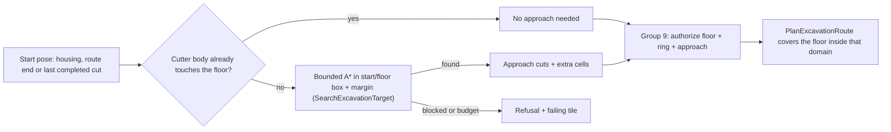
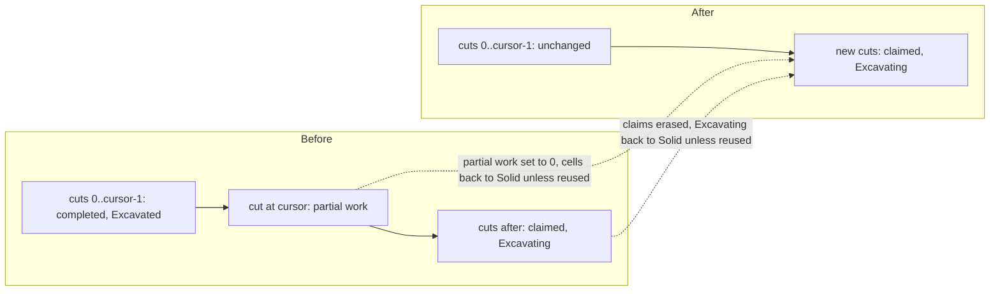
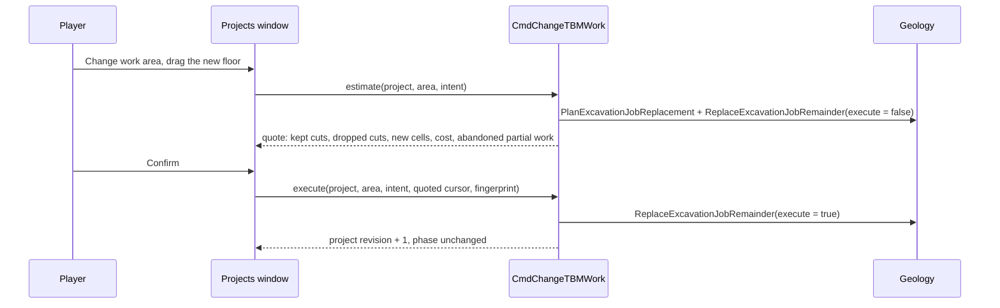

> **Historical donor snapshot — not an execution plan.** OpenTTD3 `75ea75718f`, imported2026-10-23.
> Original: `docs/zz-reach2/upgrades/2026-10/r2df-demo-fixes-interface-movement-and-planning.md`; exact source SHA256 `a7120b448a51894732c34ff68025015c28de9eb855af0c8e3fe69d613e2f32fb`.
> Current integration: [M2O23-1](../../../../../../../zz-reach2/upgrades/2026-10/m2o23-1-come-space.md); storage and evidence roles: [archi-historical-debug.md](../../../../../../../zz-reach2/architecture/archi-historical-debug.md). Original completion claims, instructions and human-review limits below remain dated; they grant no new execution, spending, publication or deletion authority.

# R2DF - Demo fixes, 2026-10-15: interface, train movement and work planning

## Global Mandatory Reading

> **Execution protocol**
>
> - Read this Global Mandatory Reading section before the first task and again
>   after every context compaction.
> - Before starting or resuming a task group, read the nearest preceding Area
>   Mandatory Reading block whose `Applies to` label includes that group. Area
>   blocks appear immediately before the first group they govern.
> - A referenced heading or exported symbol is authoritative. Global navigation
>   hints and Area line ranges are for navigation only; if they drift, relocate
>   the named section or symbol rather than expanding to the whole file.
> - Mandatory reading is non-transitive. Do not preload a linked file's own
>   Mandatory Reading, Consult on Demand, or Planning Provenance entries unless
>   this plan names them directly for the current area.
> - Do not read Consult on Demand or Planning Provenance merely because those
>   sources are listed. Use a Consult on Demand source only when its trigger
>   occurs.
> - No created source file, test file or JSON file should start with same prefix as a planning MD file (such as r2). Only MD files can have that prefix. No MD file should be created anywhere in source directories unless specifically asked.
> - After EVERY CONTEXT COMPACTION, you must add a note above the task group
>   which is currently in execution. The note will say: "Context has compacted
>   X times while executing this group.". If the compaction occurs before any
>   meaningful work was done (this can happen when there is a lot of baggage
>   from the previous compaction), then and ONLY then you can skip this step.
> - When exceeding 3 context compactions, YOU MUST ask yourself if you're not 
>   chewing more than we can handle :). Heck, plans change! :). In such a case, 
>   the way out is to split the group on the spot,
>   in the plan, into more groups, 
>   by appending B, C, D as a suffixes to those groups (splitting sub-groups 
>   themselves is also allowed). When you do this, create Local Mandatory
>   Reading areas so you can optimize your context only for the
>   ACTUAL task at hand.
>   Before starting or resuming a task group, read the nearest preceding Area
>   Mandatory Reading block whose `Applies to` label includes that group. Area
>   blocks appear immediately before the first group they govern.

| File name | Line Ranges | Description |
| --- | --- | --- |
| [This plan](r2df-demo-fixes-interface-movement-and-planning.md#demo-reports-and-decisions) | 58-76 | **Demo reports and decisions** table, rows R1-R9, R11, Q1-Q2 and decisions D1-D8, D10 and D11 (R11/D11 were found by Group 1). Every group implements one or more of these rows; row R10 points to [R2DF2](r2df2-face-exchange-and-demo-acceptance.md), which owns it and decision D9. The table separates observed facts from planning-time hypotheses. A hypothesis marked unconfirmed must be confirmed by Group 1 before a fix is accepted. The decisions record what the user asked for, and they override older plan text that described narrower behaviour. |
| [This plan](r2df-demo-fixes-interface-movement-and-planning.md#execution-conventions) | 93-111 | **Execution conventions**: build/test cadence on this machine (one MSBuild project, eight compiler workers since 2026-10-15), new file names without the `r2` prefix, log/review/runtime locations, documentation headers, save-version policy and the no-Git-write default. These rules constrain every group's file creation and verification steps. |
| [R2MLVS parent](r2mlvs-multilayer-vehicles-and-structures.md#development-artifact-layout) | 36-48 | **Development artifact layout**: `mlm/runtime/<profile>/<run-id>/<process>/`, `mlm/reviews/<feature>/<scenario>/<run-id>/` with mandatory `images/`, `mlm/tools/`, `logs/<feature>/<scenario>/<run-id>/`, and docs-only `docs/zz-reach2/`. Every reproduction, capture, save and log produced here must follow it; test output never goes into docs or immutable fixture folders. |
| [R2MLVS parent](r2mlvs-multilayer-vehicles-and-structures.md#cross-plan-invariants) | 458-476 | **Cross-plan invariants** I-1..I-8 and I-13: layer identity, no free excavation, cargo conservation, atomic commands with pure estimates, determinism independent of view, explicit transport, persistence and the 45-degree advancing-turn rule. Each fix in this plan (window behaviour, signal segmentation, planner approaches, work replacement) must keep all of them. |
| [Map layers architecture](../../architecture/map-layers/archi-map-layers.md#code-map) | 194-233 | **Code map** and **Invariants**: which file owns layer rules, portal tiles, saved portal work, train movement, signals/YAPF and layer saves. Above all, `Viewport::layer` never influences a command, simulation tick or `Random()`. This is the ownership spine for routing every change to its owner. It also forbids GUI layer changes (Groups 2-3) from touching simulation. |
| [`src/map_layer_type.h`](../../../../src/map_layer_type.h) | 15-32 | `enum class MapLayer` and `MAX_MAP_LAYERS`. Storage values (Surface 0, Underground 1, Space 2, Deep 3) differ from the GUI display order and are baked into every saved `TileIndex`. Hotkeys, the small map, portal pairs and planners must map by name/display order and never renumber layers. |

## Status and scope

Status: planned 2026-10-15. Executed 2026-10-15 to 2026-10-16: Groups 1-12 and 6B are complete, and [R2DF2](r2df2-face-exchange-and-demo-acceptance.md) Groups 10-11 carried out the joint acceptance and guide updates. User acceptance is pending; see the [review checklist](r2df2-b-acceptance-notes.md#review-checklist-task-116). Group 1 executed on 2026-10-15; its checkpoint is in [r2df-a-reproduction-notes.md](r2df-a-reproduction-notes.md#checkpoint-task-18) and re-scoped Groups 6-7 and added Group 6B (R11). Input: the user's demo of the `tbm-work` checkpoint (menu 11), recorded in [DemoNotes.txt](../../../../../../../Demo2026-06-13/DemoNotes.txt) and six screenshots in the same folder. The screenshots show project 0 / Train#2 at 11, 13 and 22 of 50 cuts, then a second project (project 1) at the same portal after release. Second planning pass (same day): the first draft's COMPLEX approach and change-work groups were split into Groups 8-12, each HARD or easier, with code sketches and diagrams. The sketches guide the work, but live code and the named symbols stay authoritative.

**Split (same day).** The plan was then split in two. This plan keeps the reproduction, map and window controls, TBM status wording, sprite spacing, signals, the false obstruction, approach planning and work-area changes (Groups 1-12). [R2DF2](r2df2-face-exchange-and-demo-acceptance.md) took the hauler face exchange (R10, D9) and the integrated demo acceptance and guide updates for both plans. Each plan numbers its groups from 1, so a task in the other plan is always named with its prefix, for example R2DF2 task 11.3. Execute this plan first; R2DF2's entry gates name the groups here that it needs.

This is an independent remediation queue requested by the user. It does not resume the paused [R2MLVS3MP master](r2mlvs3mp-master-plan.md) queue or tick any of its child tasks. The user resumed that master separately on 2026-10-16, after both plans were executed; its [Demo fixes](r2mlvs3mp-master-plan.md#demo-fixes-r2df-and-r2df2-2026-10-16) section summarizes this work. Where a fix here changes a delivered public contract, its task queues a handoff note (6.5, 12.7) that R2DF2 task 11.3 folds into the owning documents. Master task 12.6 (fixture pruning) still waits for user acceptance; the refreshed checkpoints from R2DF2 Group 10 are an input to that gate, not a pass.

Owners touched: Plan2 geology/excavation (approach planning, work replacement), Plan3 portals (signal segmentation), Plan4 TBMs (controller, steering, status), Plan13 graphics (vehicle poses/packing), R2MLM map layers (small map, layer hotkeys) and the core window system (hotkey toggle, Escape).

## Demo reports and decisions

Each row cites the screenshot, what the code shows at planning time, and the decision. "Unconfirmed" means a code-reading hypothesis that Group 1 must reproduce before the owning fix is accepted.

| # | Report (screenshot) | Planning-time diagnosis | Decision | Groups |
| --- | --- | --- | --- | --- |
| R1 | Small map cannot be made shorter; large empty legend area (01). | `SmallMapWindow::GetNumberRowsLegend` and `OnInit` reserve the largest row count of **all** map types (cargo/industry/company counts), whichever type is shown. `NWidgetSmallmapDisplay::SetupSmallestSize` turns that into the minimum height. The fork's extra layer button adds one button row; multilayer cargos/industries raise the counts. **Group 1:** confirmed, minimum 307x533. The "0 ft" legend comes from `map_height_limit = 0` (unresolved "auto") in the demo saves: the legend gets one entry and the contour colour tables one height, so lookups above height 0 read past the end (Surface land draws black). | Size the legend from the map type actually shown, and check that the contour legend lists real entries for each layer. | 2 |
| R2 | The small map does not change layer when the layer hotkey is used (01). | `SetViewportLayer` invalidates only toolbars. The small map keeps its own `layer` member by design (architecture "Layer dropdowns and view state"; review item M-7). | **D1:** the small map follows every main-view layer change (hotkey, `N`, toolbar dropdown). Its own selector may still preview another layer until the next main-view change. | 2 |
| R3 | One hotkey per layer; Alt+1..4 do nothing (01). | No per-layer binding exists. In Debug builds Alt+0/1/2 are `crash_game`/`money`/`update_coordinates` in the global list, matched before the toolbar, and `build/hotkeys.cfg` stores them. | **D2:** Alt+1 Surface, Alt+2 Underground, Alt+3 Deep Underground, Alt+4 Space (GUI display order). Unallocated layers are ignored. The debug actions move to Ctrl+Alt+0/1/2. | 2 |
| R4 | "Held: nothing" although the TBM and hauler carry spoil (02, 03). | `Held:` prints `TBMBlockedReason` (`None` means "nothing"). It is not cargo. The projects list never shows cargo; only Portal controls shows attached-wagon loads. | **D3:** say what the machine is waiting for, or that it is working. Add a carried-cargo line for the cutter and its haulers. | 4 |
| R5 | The loaded hauler (Train#1, "Heading for Invenville", 0 mph) stays in its Surface depot unless forced through signals (03). | Unconfirmed, primary: `ExploreSegment` crosses a Sealed/Commissioning pair as one piece, while `GetTileTrackStatus_LayerPortal` hides it from routing and support cannot carry signals. The Surface stub, the pair and the whole corridor are therefore one block, occupied by the working TBM, and `CheckTrainStayInDepot` sees it Full forever. Secondary: magazine entry/departure never updates signals, and the key's reservation bit can be left behind. **Group 1:** primary confirmed (the demo has no signals at all; every depot check is Full with the cutter as occupant). Secondary not observed. | **D4:** a pair that is not Connected ends the signal segment. The project controller, not signals, owns admission to the corridor. | 6 |
| R6 | A new construction area needs a full return and park (02, 04). | The projects window always shows the **release** requirement "Return and park the whole machine first…", which looks like a general gate. **New area** on a portal with a project refuses. **Pause and extend** only appends after the last planned cut and requires a pause. Parked projects cannot be extended. | **D5:** **Change work area** is available while working, paused, returning or parked. It replaces the unfinished remainder from the last completed cut. Completed ground, support, cargo and money are untouched. The quote states any partial-face work that is abandoned. No return or parking is needed. | 4, 11-12 |
| R7 | Moving consist sprites overlap, "crushed into one another" (04). | Packed Earth/Rock hoppers are 42-43 px wide in the E/W views against a 32 px envelope; the hauler is 36 and the Deep TBM 35. `convert_vehicle_art.py` skips its `ENVELOPES` for `pose_sampling: "native"` sources. Every part is 8 length units. | **D6:** fit the art to the envelopes. Do **not** change vehicle lengths, because measured consist dimensions are frozen into accepted jobs and saves. | 5 |
| R8 | "The boring machine cannot plan a supported route out of the portal through this area" for an area beside the exit (05). | The planner authorizes only the floor rectangle, a one-cell ring and the anchor's 3x3. A solid start must leave straight. `AuthorizeExcavationOutline` never adds approach cells. The refused quote shows £0 and zero lines, labels new solid cells as "new cuts" and never shows the failing tile. The extension flow reports the same failure as PARTIAL. **Group 1:** confirmed word for word. Also found: under `forbid_90_deg`, door-anchored floors that widen to the right are refused with "needs sharp rail bends", so the planner proposes 90-degree routes the game forbids. | **D7:** the planner works out a legal paid approach (straight exit, then advancing 45-degree bends) from the start pose to the requested floor. The approach appears as explicit charged extra cells in the quote the player confirms. Off-axis straight-tunnel endpoints get the same treatment. When a request is truly impossible, the quote names the blocking tile and reason. | 4, 8-10 |
| R9 | The TBM of project 1 shows "0 mph - Waiting: something is in the way" at the portal and never leaves (06). | That text is `TBMBlockedReason::Obstruction`. While travelling, its only source is `VehicleRailFlag::Stuck` with a steering target (`ObserveTBMPhaseInputs`). Unconfirmed candidates: (a) a Source-bay return target uses the door trackdir, but the cutter arrives along the shaft, so YAPF never matches; (b) `GetLayerPortalAdmittedTrackdirs` hides the key while another train's part is on it (the forced-out hauler stopped with its tail there); (c) stale key/Surface reservations; (d) junctions on the corridor. **Group 1:** (a)-(d) refuted. The cutter is cutting, not travelling: `PrepareTBMSupport` refuses the first cell outside the door because project 0's support record is still on it. `RetireTBMProject` never removes or hands over `_tbm_support` entries, and the commission quote accepted a route the cut then refuses. | **D8:** fix the confirmed causes. The status names the blocking vehicle or tile, and the cutter resumes by itself when the blocker clears. | 7 |
| R10 | The hauler should drive to the TBM, take the load and go home; the TBM should never return to unload (06). | Moved with its diagnosis to [R2DF2](r2df2-face-exchange-and-demo-acceptance.md#demo-report-and-decision). | **D9**, recorded in R2DF2: the hauler meets the cutter at the face and takes the spoil there. | R2DF2 1-9 |
| R11 | Found by Group 1 in the user's own saves (`autosave2`, `am1`): the hauler shows 65536 t in a 64 t hopper. | The user set the hauler's order to "Unload all, No loading". The fork's spoil-receiver refusal then reassigns only the refused part of the Deliver cargo to Transfer. Upstream `VehicleCargoList::Reassign<Deliver, Transfer>` splits with `sum - T + max_move` instead of `sum - (T + max_move)`, a latent bug upstream never triggers, so a packet wraps below zero. The next station stop asserts (`AssertCountConsistency`); after reload the next depot entry asserts (`CargoRemoval`). | **D11:** refused spoil is reassigned without corrupting packets, on every order type; saves already holding wrapped packets are not silently repaired (documented). | 6B |
| Q1 | Why does Simulation Rate differ from Frame Rate? | Separate clocks; see answers below. **Group 1** measured 36.95 ticks/s against 60.2 fps drawing on the demo, with a 0.13 ms game loop. | Answer the question; explain it in the window's tooltip; measure the demo. | 1, 3 |
| Q2 | F2 again should hide Settings; Escape does not close windows; is there a setting? | `ShowGameOptions` closes and re-creates the window on every press. Escape is always taken by the `reset_object_to_place` global hotkey. No toggle or Escape-close setting exists; only right-click close and Delete exist. | **D10:** pressing a window's toolbar hotkey again closes it when it is the front-most closable window (setting, default on). Escape first cancels any active placement; otherwise it closes the front-most closable window (setting No/Yes/Yes except pinned; default Yes except pinned). | 3 |

## Answers to the bonus questions

**Q1 - Simulation rate versus frame rate.** They are two independent clocks, and they are not meant to match.

- **Simulation rate.** The simulation advances one tick every `MILLISECONDS_PER_TICK` = 27 ms (`src/gfx_type.h`). At normal speed that is about **37.04 ticks per second**.
- **Graphics frame rate.** Drawing follows the `gui.refresh_rate` setting, default **60 fps**, or the display when vsync is on with hardware acceleration (`VideoDriver::GetGameInterval`/`GetDrawInterval`, `src/video/video_driver.hpp`).
- **What the window shows.** The Frame rate window measures them separately: `PerformanceElement::GameLoop` and `PerformanceElement::Drawing`. At normal speed, about 37 versus about 60 is the expected result.
- **Fast-forward.** Only the simulation interval shrinks, so the simulation rate climbs above the frame rate.
- **When to worry.** If the simulation rate stays clearly below about 35 at normal speed, the computer cannot keep up with the game. The shortfall shows in the "Game loop" total and its sub-rows. The fork's Space ticks and the per-layer tile loop also add work there. Task 1.7 measures the demo, and task 3.5 puts this explanation into the window's tooltip.

**Q2 - F2 again and Escape.** No setting does this today.

- **What exists.** **Close window on right-click** (`gui.right_click_wnd_close`) and the **Delete** hotkey (`delete_windows`), which closes every non-pinned window.
- **No-code workaround.** In `hotkeys.cfg`, clear `reset_object_to_place` and add `ESC` to `delete_windows`. This closes *all* windows at once and stops Escape from cancelling placement, so it is not recommended.
- **Planned fix.** Group 3 adds both requested behaviours as settings that are on by default (D10).

## Execution conventions

- **Order and completion.** Execute groups top to bottom. Mark a task `[X]` only after its stated behaviour and focused evidence pass. A design note, declaration or isolated fixture does not complete player-facing behaviour.
- **Builds.** Batch each group's related source and test changes before compiling. Build one MSBuild project at a time (`-j 1 -- /p:CL_MPCount=8 /nodeReuse:false`). The earlier out-of-memory incident set two compiler workers; on this machine (24 threads, 32 GB) the user raised it to eight on 2026-10-15. Never overlap heavyweight native file suites with compilation.
- **Waiting and test length.** Wait at least 50 seconds when polling a running build or test. Split any test case that runs longer than two minutes into focused companion files (`...-1`).
- **Regressions.** Run only focused tests per group. The one justified affected regression burst is R2DF2 task 10.3, which covers both plans.
- **New file names.** New source, test and JSON files never start with `r2`. Proposed names:
  - tests: `src/tests/smallmap_layer.cpp`, `src/tests/window_hotkey_toggle.cpp`, `src/tests/portal_signal_boundary.cpp`, `src/tests/tbm_obstruction.cpp`, `src/tests/excavation_approach.cpp` and `src/tests/tbm_change_work.cpp`, each registered in `src/tests/CMakeLists.txt`;
  - Catch2 tags: `[demo-fix-...]`;
  - native runner: `src/tests/multilayer/tbm/demo_feedback.py`, which R2DF2 extends.
- **Companion notes.** Notes live beside this plan as `r2df-<letter>-<topic>.md` (the user's execution instruction of 2026-10-15 replaced the earlier `demo-fixes/` subfolder). Temporary scratch files are removed when no longer needed.
- **Artifacts.**
  - logs: `logs/demo-fixes/<scenario>/<run-id>/`;
  - saves, reports and captures: `mlm/reviews/demo-fixes/<scenario>/<run-id>/`, with captures in `images/`;
  - native homes: `mlm/runtime/`;
  - immutable demo snapshots in `src/tests/fixtures/demos/` are never overwritten.
- **Code documentation.** Every created or modified source/test file has an architecture/owning-plan header. Every new or modified function has a JavaDoc purpose/parameters/return. Compound conditions and non-trivial loops are explained in gameplay terms.
- **Saves.** New persistent fields, if a fix here needs any, use **one** new save version appended after `AsteroidStarterInputs` (424), with explicit older-version mapping and malformed-load refusal. R2DF2 Group 9 appends the face-exchange version after the current tail. Preview and estimate paths stay pure.
- **Strings and Git.** New strings go into `src/lang/english.txt` only. Perform no Git commits, pushes or tags unless the user asks.

## Execution queue

### Area Mandatory Reading - Demo reproduction

_Applies to Group 1._

| File name | Line Ranges | Description |
| --- | --- | --- |
| [DemoNotes.txt](../../../../../../../Demo2026-06-13/DemoNotes.txt) | 1-34 | The user's complete report; every line is a requirement or a question, so the whole short file is the source. Pair each numbered note with its screenshot in the same folder before reproducing it. |
| [`demo-checkpoints.json`](../../../../src/tests/fixtures/demos/underground/demo-checkpoints.json) | 34-105 | `tbm-work` checkpoint: immutable snapshot path/SHA256, layer, camera and pause state. This is the exact starting input of the demo; a reproduction must load it read-only and record its hash. |
| [`runner.py`](../../../../src/tests/multilayer/support/runner.py) | 162-264 | `current_run_context`, `native_command`, `run_native`, `start_native`: the shared native launcher that writes runtime homes, logs and captures to the R2FC locations. The new `demo_feedback.py` must use it rather than inventing paths. |
| [`tbm_feedback_runtime.cpp`](../../../../src/tests/tbm_feedback_runtime.cpp) | 1050-1105 | `TEST_CASE("TBM feedback reproduces native input and loaded movement")`: the existing native observer that loads saves, drives real GUI input and logs vehicle/project state. Extend this pattern for the reproduction scenarios instead of writing a parallel harness. |
| [Underground demo guide](d2um-underground-mines.md#tour-excavation-and-the-spoil-loop) | 332-343 | **Tour excavation and the spoil loop**: the exact steps the user followed (Projects, Portal controls, unpause, Return and park). Reproduce the same path so the evidence matches the screenshots. |

### Group 1 - Reproduce every reported state from the demo save

> Context has compacted 1 times while executing this group.

{{MEDIUM}}
- [X] 1.1 Record the reproduction inputs in `r2df-a-reproduction-notes.md`: `tbm-work-403.sav` hash, the executable configuration used for the demo, `build/play.cfg` signal/path-reservation settings and the `build/hotkeys.cfg` bindings. The repo-local `hotkeys.cfg` suggests a Debug build. Never modify the snapshot.
- [X] 1.2 Add `src/tests/multilayer/tbm/demo_feedback.py` plus native observer cases that load `tbm-work`, unpause and reach screenshot 03's state. Log the hauler's tile and track state (real depot or portal magazine), `CheckTrainStayInDepot`/`CheckTrainStayInMagazine` decisions, signal states and segment flags on the portal block, and key/pair reservation bits. Confirm or refute R5's hypotheses.
- [X] 1.3 Drive the user's path from screenshots 04-05: return and park, finish and release, **New area** at the same portal for project 1, then the area beside the exit. Record the outline, authorized cells, failing tile, planner error and the quote text exactly as displayed.
- [X] 1.4 Reproduce screenshot 06: project 1 started, hauler forced through a red signal and then stopped. Record which `Obstruction` source fires, the Stuck flag, `path_found`, the target trackdirs, the key's admitted trackdirs, reservation bits and which train's part occupies the key. Classify R9's candidates (a)-(d) as confirmed or refuted.
- [X] 1.5 Capture the projects list showing "Held: nothing" in the same frame as the actual per-part cargo of the cutter and the assigned hauler (from `InspectTBMConsist` and the hauler chain).
- [X] 1.6 Capture the moving consist in all eight directions at every zoom level. Measure each packed pose's opaque width against `occupied_envelopes` and the 8-unit spacing for the cutter, Deep cutter, Earth/Rock hoppers and hauler.
- [X] 1.7 Reproduce R1-R3 natively: the small map's minimum height on Underground contours, its layer after `N`, the dropdown and Alt+1..4, and the legend entries per layer. Read the Frame rate window on `tbm-work` at normal speed and record the Simulation and Graphics rates and the Game-loop sub-rows.
- [X] 1.8 Publish the checkpoint with confirmed causes, refuted hypotheses and remaining unknowns for R1-R10/Q1, each mapped to its fixing group. Update this plan's diagnosis column where a hypothesis was refuted. Do not start a fix whose cause is still unknown without recording that explicitly.

### Area Mandatory Reading - Map window, hotkeys and window input

_Applies to Groups 2-3._

| File name | Line Ranges | Description |
| --- | --- | --- |
| [`smallmap_gui.cpp`](../../../../src/smallmap_gui.cpp) | 782-796; 1523-1546; 1582-1637; 1874-1909; 2111-2129 | `SmallMapWindow::GetNumberRowsLegend`, `SmallMapCenterOnCurrentPos`, `OnInit`, `OnInvalidateData` and `NWidgetSmallmapDisplay::SetupSmallestSize`. Row counts are shared by minimum size, layout, hit-testing and drawing, so a per-map-type change must update all of them together and keep at least two columns. `OnInvalidateData` codes 0-2 already mean industry chain, owner legend and colours; any other code hits `NOT_REACHED()`, so the layer notification needs a new code. |
| [`map_layer_gui.cpp`](../../../../src/map_layer_gui.cpp) | 192-246 | `SetViewportLayer` and `CycleMainViewportLayer`: the single place where a view changes layer and toolbars are invalidated. The small-map notification belongs here, only for the main window, never for extra viewports. |
| [`toolbar_gui.cpp`](../../../../src/toolbar_gui.cpp) | 2198-2254; 2322-2365; 2634-2668; 2741-2766 | `MainToolbarWindow::OnHotkey`, the `maintoolbar` `HotkeyList`, `ScenarioEditorToolbarWindow::OnHotkey` and the `scenedit_maintoolbar` list. New layer hotkeys append after `MTHK_CYCLE_MAP_LAYER`; editor entries must be special hotkeys. The F2 toggle is decided at the top of both `OnHotkey` functions. |
| [`main_gui.cpp`](../../../../src/main_gui.cpp) | 274-423; 476-520 | `MainWindow::OnHotkey` and the `global` hotkey list. Escape is `GHK_RESET_OBJECT_TO_PLACE`, and the Debug-only Alt+0/1/2 entries are matched before toolbar hotkeys. The Escape decision (abort placement first, else close a window) and the Debug key move live here. |
| [`window.cpp`](../../../../src/window.cpp) | 2673-2729; 3371-3387 | `HandleKeypress` dispatch order (focused editbox, windows front to back, main toolbar, global) and `CloseNonVitalWindows`. The new close helper sits beside the latter and respects `WindowDefaultFlag::NoClose`, sticky windows and vital windows. Editbox, query and save/load Escape handling must still win. |
| [`settings_gui.cpp`](../../../../src/settings_gui.cpp) | 1859-1864 | `ShowGameOptions` closes and re-creates the window on every call: the direct cause of Q2's F2 behaviour. |
| [`gui_settings.ini`](../../../../src/table/settings/gui_settings.ini) | 139-150 | `gui.right_click_wnd_close` definition: the template (client-only, not saved, GUI dropdown) for the two new window-close settings. |
| [GUI architecture](../../architecture/gui/archi-gui.md#retained-windows) | 7-31 | **Retained windows**: window identity is `window_class` + `window_number`, and the z-order list is front-to-back. The toggle mapping and "front-most closable window" rule depend on this. |

### Group 2 - Make the map window follow layers and shrink

{{SIMPLE}}
- [X] 2.1 Make `GetNumberRowsLegend`, `GetMinLegendWidth` and `OnInit` depend on the shown `map_type`. LinkStats reserve the link-colour column; Industries/Owners use their counts; other types use their own fixed rows. Keep `GetPositionOnLegend` and `DrawWidget` consistent and the column count at least 2.
- [X] 2.2 Confirm the contour legend lists the correct height entries on each layer (the "0 ft" observation from 1.7). Fix the legend source if a rock layer shows a misleading single entry; leave simulation untouched.
- [X] 2.3 In `SetViewportLayer`, notify `WindowClass::SmallMap` with a new invalidation code when the main window changes layer. In `SmallMapWindow::OnInvalidateData`, adopt the main view's layer through one shared helper that updates the layer button sprite and marks the link overlay dirty. Reuse that helper in `SmallMapCenterOnCurrentPos` and `OnDropdownSelect`.
- [X] 2.4 Add per-layer hotkeys Alt+1..4 in display order (D2) to the game toolbar (`MTHK_*` after `MTHK_CYCLE_MAP_LAYER`) and the editor toolbar (special hotkeys). Each selects through one helper in `map_layer_gui.cpp` that ignores unallocated layers. Mention the keys in the layer button tooltips.
- [X] 2.5 Move the Debug `crash_game`/`money`/`update_coordinates` defaults to Ctrl+Alt+0/1/2 and check for conflicts. Back up the repo-local `build/hotkeys.cfg`, then update its stored Alt+1/Alt+2 entries so the new defaults take effect. Record the change in the 2.7 documentation.
- [X] 2.6 Add `src/tests/smallmap_layer.cpp`: the legend minimum per map type, the layer following after `N`/dropdown/Alt+N, extra viewports not moving the small map, and unallocated layers ignored. Use the hotkey pattern of `src/tests/underground_window.cpp`. Capture the small map at the screenshot size for each layer.
- [X] 2.7 Update the map-layer architecture **Layer dropdowns and view state** paragraph and the review-map M-7 note to say the small map now follows the main view. List the new hotkeys.

### Group 3 - Toggle and close popups from the keyboard

> Context has compacted 1 times while executing this group.

{{MEDIUM}}
- [X] 3.1 Add the client settings `gui.hotkey_toggles_window` (bool, default on) and `gui.escape_closes_window` (No/Yes/Yes except pinned, default Yes except pinned) beside `right_click_wnd_close`. Add their strings, help text and settings-tree entries.
- [X] 3.2 Add `CloseFrontmostClosableWindow(bool except_sticky)` in `window.cpp` (declared in `window_func.h`). It skips vital windows, `NoClose`, the main window, tooltips and optionally pinned windows, and returns whether it closed one.
- [X] 3.3 Change the Escape path. While placement is active (place mode, a callback window or a special mouse mode), Escape only aborts placement, as today. Otherwise it closes the front-most closable window according to the setting. Editbox, query and save/load Escape handling keep precedence.
- [X] 3.4 Toggle at the top of both toolbar `OnHotkey` functions. Map each window-opening hotkey to its `(WindowClass, number)`, with F2 mapping to Game Options. If that window is the front-most closable window, close it; otherwise keep the existing raise or open behaviour. A build toolbar for a different rail or road type switches rather than closes. Pause, fast-forward, zoom, screenshots and layer selection never toggle.
- [X] 3.5 Add tooltips to the Frame rate window's Simulation rate and Graphics frame rate rows that explain the two clocks and their normal-speed targets (Q1). Use the existing measurement values; add no new simulation timing.
- [X] 3.6 Add `src/tests/window_hotkey_toggle.cpp`: F2 opens then closes Game Options, a covered window is raised rather than closed, Escape aborts placement first and then closes, pinned windows obey the setting and editboxes keep Escape. Re-run the Escape-dependent placement checks in `tbm_feedback_runtime.cpp`; the underground palette must stay open after aborting placement.

**Group 3 result (2026-10-15).** Two changes from the task text:

- **Toggle rule.** The toggle closes a window when `IsWindowRaisedAsFarAsPossible` holds, not only when it is the front-most window. Game Options and other dialogs always sit above map and list windows, so under the literal rule M would do nothing while Game Options were open.
- **Where each check runs.** F2 and the edit-box precedence are checked by the native `windows` scenario of `demo_feedback.py`, because the mock environment has no video driver.

Evidence is in [r2df-a-reproduction-notes.md](r2df-a-reproduction-notes.md#later-groups).

### Area Mandatory Reading - TBM status presentation

_Applies to Group 4._

| File name | Line Ranges | Description |
| --- | --- | --- |
| [`tbm_projects_gui.cpp`](../../../../src/tbm_projects_gui.cpp) | 43-78; 235-273 | `GetTBMVehicleStatus` and `TBMProjectsWindow::DrawWidget`. The list draws name, progress and the `Held:` hold line per project, and draws the release requirement into `WID_TP_RELEASE_REASON` unconditionally. These are the exact R4/R6 presentation defects. |
| [`layer_portal_gui.cpp`](../../../../src/layer_portal_gui.cpp) | 158-188 | `GetTBMHoldString`: the `TBMBlockedReason` to text mapping shared by the projects list, portal window and vehicle caption. Wording changes stay consistent across all three. |
| [`tbm_controls.cpp`](../../../../src/tbm_controls.cpp) | 153-232 | `DescribeTBMProject`: its unit loop sums actual Earth/Rock cargo and capacity per role from `InspectTBMConsist`. Extract that loop into a pure helper; do not call the full `GetTBMPairControls`, which runs command estimates, from a once-per-second list repaint. |
| [`tbm_project.cpp`](../../../../src/tbm_project.cpp) | 426-445 | `GetTBMProjectReleaseProblem`: the release-only readiness check whose `STR_ERROR_TBM_RELEASE_RETURN` text the user mistook for a general gate. |
| [`underground_gui.cpp`](../../../../src/underground_gui.cpp) | 191-271; 523-622 | `UndergroundConstructionWindow::GetWidgetString` (quote price/material/time/floor lines) and `OnPlaceObject` (portal click; the `STR_UNDERGROUND_PORTAL_HAS_PROJECT` dead end for a portal with a project). |
| [`tbm_commission.cpp`](../../../../src/tbm_commission.cpp) | 211-231 | `PreviewTBMCommissionArea`: a refused plan returns `purchase = CommandCost(refusal)` with zero cost, which is why refused quotes print £0 lines. |

### Group 4 - Say what the machine is waiting for and what it carries

{{SIMPLE}}
- [X] 4.1 Replace `Held: {STRING}`/`Held: nothing` with wording that states the wait ("Waiting for: …") or "Working normally". Apply it in the projects list, portal window and vehicle caption through `GetTBMHoldString`, keeping string IDs stable or migrating every use.
- [X] 4.2 Extract the per-role cargo/capacity summation from `DescribeTBMProject` into a pure helper. Show "Carrying: Earth x/y t, Rock x/y t" for the cutter and each assigned hauler in the projects list, adjusting the row height.
- [X] 4.3 Show the release requirement only as the **Finish/cancel and release** prerequisite, prefixed "To finish and release:", so it no longer reads as a gate for other actions. Keep the named settlement blocker vehicle.
- [X] 4.4 When **New area** is clicked on a portal that already has an owned project, open that project's change-work flow (the existing **Pause and extend** until Group 12 lands) instead of the `PORTAL_HAS_PROJECT` dead end. Foreign or invalid projects keep their refusal.
- [X] 4.5 Refused quotes hide the £0 price, material and time lines and show the refusal plus the failing tile (highlighted in the preview). Label solid cells as "new solid cells" and cutter positions separately. Make the fresh and extension flows report the same failure with the same message.
- [X] 4.6 Add focused GUI tests for the wording, cargo line, release prefix, New-area routing and refused-quote layout. Capture native replacements for screenshots 02, 04 and 05.

**Group 4 result (2026-10-15).** Two wording choices differ from the task text:

- **Wait line.** It reads "Waiting: <reason>", not "Waiting for: …", to match the existing reason texts and the vehicle caption.
- **Refusal message.** The extension flow now tests the planner error before partial cover, so both flows show "cannot plan a supported route into this area".

Tests: `src/tests/tbm_status_presentation.cpp`, tag `[demo-fix-tbm-status]`. Native captures: `held` and `new-area` runs. Evidence and carry-forward notes, including a `[tbm-project]` failure that predates this group and a test request Group 8 must replace, are in [r2df-a-reproduction-notes.md](r2df-a-reproduction-notes.md#later-groups).

### Area Mandatory Reading - Vehicle sprite envelopes

_Applies to Group 5._

| File name | Line Ranges | Description |
| --- | --- | --- |
| [`convert_vehicle_art.py`](../../../../media/multilayer/convert_vehicle_art.py) | 25-86 | `ENVELOPES` and `native_pose`: per-view safe envelopes (N/S 16, diagonal 24, E/W 32 px) and the `pose_sampling: "native"` branch that returns reused poses without fitting them. This is R7's root cause and the only conversion change point. |
| [`vehicle-details-manifest.json`](../../../../logs/proofs/mlm/native-art/derived/vehicle-details-manifest.json) | 36613-36646 | `occupied_envelopes` in the generated (git-ignored) conversion report: the per-view limits written from `ENVELOPES` in `convert_vehicle_art.py`, which stays the authority. Regenerate the report before measuring. Since the 2026-10-09 file reorg, the untracked copy under `media/multilayer/sprites/m1/` is stale and must not be used. |
| [`multilayer_sprite.cpp`](../../../../src/multilayer_sprite.cpp) | 174-258 | `GetMultiLayerTrainSprite`: the runtime pose selection that replaces base art for native vehicles. It confirms that only art changes are needed; gameplay length stays 8 units. |
| [Plan13 M1 packing](../../../../../../../../../OpenTTD3/docs/zz-reach2/upgrades/2026-10/r2mlvs13-graphics-and-asset-pipeline.md#group-79b---pack-the-selected-m1-source-set) | 949-987 | **Local Mandatory Reading - M1 deterministic packing preparation**, **Group 79B**, **Group 80B**, **Group 81B**: the pinned packing route, protected sprite ranges 0..65/66..73, checksum regeneration and corruption fixtures that a repack must preserve. |

### Group 5 - Stop wagon sprites from overlapping

{{HARD}}
- [X] 5.1 Using 1.6's measurements, list every M1 vehicle family/direction/state whose opaque width exceeds `occupied_envelopes`. Keep the decision fixed: no vehicle length or articulation change (D6).
- [X] 5.2 Make `convert_vehicle_art.py` enforce the envelopes for every pose, including `pose_sampling: "native"` sources. Refuse oversize poses with a clear family/direction message; never silently clip them.
- [X] 5.3 Re-derive the Deep cutter, Earth hopper, Rock hopper and hauler poses within the envelopes from their retained originals through the established conversion, keeping anchors and contacts. If a view cannot be reduced legibly, re-author only that view through Plan13's framed ImageGen procedure. Retain originals and provenance.
- [X] 5.4 Repack through the M1 route, preserving protected and published ranges, IDs and offsets. Regenerate checksums and confirm two clean conversions are identical and the corruption fixtures still refuse.
- [X] 5.5 Verify in the real game: straight, diagonal and curved track at every zoom, coupler gaps between all neighbours, depot/vehicle list widths and depth sorting. Store captures under `mlm/reviews/demo-fixes/vehicle-spacing/<run-id>/images/` and compare them with screenshot 04.

**Group 5 result (2026-10-15).**

- **Art.** The four oversize chassis (Deep cutter, both hoppers, hauler) are re-derived inside the envelopes by a declared, uniform scale about the ground contact. No view needed re-authoring, and lengths are unchanged.
- **Repack.** Done with byte-identical ranges. Python was re-pinned to 3.10.11 after proving it reproduces the checked-in pack, and grfcodec 6.2.0 now comes from `build/grfcodec-win32`. Both builds are reproducible and the generator-free load is exact.
- **Spacing.** Hopper-pair overlap fell from 195-253 px to 62-65 px.
- **Open.** The evidence-finalize activation fails on collector evidence that was already missing before this group; it is left for R2DF2 task 10.3.

Details: [r2df-a-reproduction-notes.md](r2df-a-reproduction-notes.md#later-groups).

### Area Mandatory Reading - Signals, reservations and portal movement

_Applies to Groups 6-7._

| File name | Line Ranges | Description |
| --- | --- | --- |
| [`signal.cpp`](../../../../src/signal.cpp) | 269-427 | `ExploreSegment`, including its `TileType::LayerPortal` case: it crosses any company rail pair "as one straight piece" regardless of work state. The R5 segment boundary is decided here and must keep Connected pairs unchanged. |
| [`layer_portal_cmd.cpp`](../../../../src/layer_portal_cmd.cpp) | 243-256; 378-432; 434-484 | `GetTileTrackStatus_LayerPortal` (hides non-Connected pairs from routing), `RunLayerPortalMagazine` (magazine entry, no signal update) and `VehicleEnterTile_LayerPortal` (entry admission). Signal, reservation and admission rules must agree across all three. |
| [`layer_portal_work.cpp`](../../../../src/layer_portal_work.cpp) | 133-162; 164-248 | `CheckLayerPortalWorkAccess`, `GetLayerPortalMagazineExit`, `IsLayerPortalMagazineBusy` and `GetLayerPortalAdmittedTrackdirs`. These decide who may use the key and when the key's track becomes invisible (R9 candidate b). |
| [`train_cmd.cpp`](../../../../src/train_cmd.cpp) | 2700-2827; 3182-3445 | `CheckTrainStayInMagazine`, `CheckTrainStayInDepot`, `ChooseTrainTrack` (its TBM no-path branch marks Stuck) and `TryPathReserve`. These are the hold, stuck and reservation owners behind R5 and R9. |
| [`tbm_project.cpp`](../../../../src/tbm_project.cpp) | 966-999 | `ObserveTBMPhaseInputs`: converts `VehicleRailFlag::Stuck` plus a steering target into `TBMBlockedReason::Obstruction`, the only travelling source of "something is in the way". |
| [`tbm_support.cpp`](../../../../src/tbm_support.cpp) | 170-219 | `GetTBMCutterSteeringTarget`: the return branch uses the door trackdir for both bay kinds, while the hangar branch accepts the shaft axis. This is R9 candidate (a). |
| [`tbm_exchange.cpp`](../../../../src/tbm_exchange.cpp) | 754-822 | `IsTBMHaulerHeld`, `IsTBMHaulerAdmittedAtBay`, `MayTBMTrainLeaveMagazine`, `IsTBMWaitingAtLineEnd` and `GetTBMHaulerSteeringTarget`: hauler-side holds and targets that must not be mistaken for the signal hold. |
| [`yapf_destrail.hpp`](../../../../src/pathfinder/yapf/yapf_destrail.hpp) | 140-197; 205-219 | `CYapfDestinationTileOrStationRailT::SetDestination` (TBM cutter/hauler targets and their trackdirs) and its `PfDetectDestination(TileIndex, Trackdir)` match. A target trackdir that a train cannot arrive with makes `path_found` false forever. |
| [Rail pathfinder architecture](../../../../../../../zz-reach2/architecture/pathfinder/archi-pathfinder-rail.md#destination) | 116-140 | **Destination** and **Reservation**: how YAPF matches targets and how path reservation and safe waiting points work. Use it to keep the fix consistent with path signals. |

### Group 6 - Let a loaded hauler leave under normal signals

{{HARD}}
- [X] 6.1 From 1.2's trace, state which hold applies (real depot `CheckTrainStayInDepot`, magazine exit, or a red signal after departure) and which segment and occupant keep it red. Write the confirmed cause into the checkpoint before changing code.
- [X] 6.2 Make `ExploreSegment` end the segment at a rail pair whose work state is not Connected, matching `GetTileTrackStatus_LayerPortal`. Corridor trains then no longer occupy Surface blocks. Connected pairs keep crossing as one piece with both ends occupying the block.
- [X] 6.3 Update signals when trains enter or leave a portal magazine, as depots do. Where path signals apply, reserve a path on magazine departure, and free it on refusal. (Group 1 did not observe this defect: the demo has no signals. Implement it only if 6.6's signalled cases show a stale signal state; otherwise record the test as the evidence and close the task.)
- [X] 6.4 Clear the key's reservation bit when a consist is fully stored in the magazine or leaves the key, and release a backing cutter's leftover reservation through the door. Preserve reservations held by trains that still occupy the key. (Group 1 saw the key bit follow the cutter correctly. As 6.3, change code only for a failing 6.6/6.7 case.)
- [X] 6.5 Re-verify corridor admission now that signals no longer guard it. Ordinary trains still cannot enter a Commissioning pair; the project's own trains are admitted by the controller's rules. Record this ownership in the Plan3 public handoff note list for R2DF2 task 11.3.
- [X] 6.6 Add `src/tests/portal_signal_boundary.cpp`: block signals, path signals and path reservation on/off. A loaded hauler leaves a Surface depot and the magazine while the TBM works. Ordinary trains outside are unaffected, and a Connected tunnel keeps its signal behaviour.
- [X] 6.7 Save and reload with the hauler mid-departure and with a stored consist. Assert there are no leftover reservations, identical next transitions, and that demolition and connection guards are unchanged.

**Group 6 result (2026-10-16).**

- **Cause (6.1).** The hold was the real depot's rule, which evaluates the depot's signal block. That block crossed the Commissioning pair into the corridor, where the cutter worked.
- **Fix (6.2).** Signal blocks now end at a pair that is not open to the network. Routing and signals share one answer, `IsLayerPortalOpenToNetwork`. Connected pairs still form one block.
- **Defects the test exposed (6.3, 6.4).** Fixed: a block signal stayed green while the cutter moved on the key, and a stored consist kept the key's reservation. Signals are now refreshed on magazine entry and exit and on crossing a closed shaft, through `UpdateLayerPortalSignals`. A stored consist releases the key. Path reservation on departure needed no change, because no case failed.
- **Admission (6.5).** Re-verified; the ownership note is queued for R2DF2 task 11.3.
- **Evidence (6.6, 6.7).** `[demo-fix-portal-signals]` passes for no signal, block and path signals, each with reservation off and on. On the demo save, the loaded hauler now leaves its depot 19 ticks after arriving while the cutter works below. Checkpoints saved mid-departure and with the consist stored reload into the same 400 following ticks, with the same reservations and guards.
- **Open.** The `[tbm-movement]`, `[tbm-loop]` and `[tbm-exchange-acceptance]` failures predate this group (baseline-confirmed or planning preconditions). They are left for R2DF2 task 10.3.

Details: [r2df-a-reproduction-notes.md](r2df-a-reproduction-notes.md#later-groups).

### Local Mandatory Reading - Refused spoil on Unload orders

_Applies to Group 6B._

| File name | Line Ranges | Description |
| --- | --- | --- |
| [Reproduction notes](r2df-a-reproduction-notes.md#r11-new---unload-all-corrupts-spoil-packets-new-group-6b) | R11 section | The packet signature in the user's saves, the arithmetic of the wrong split and the two assertion sites. |
| [`cargopacket.cpp`](../../../../src/cargopacket.cpp) | 579-606; 455-548 | `VehicleCargoList::Reassign<Deliver, Transfer>` (the split at line 596) and `Stage`, whose `AssertCountConsistency` fires on the next stop. Upstream code: keep the fix minimal and exact. |
| [`economy.cpp`](../../../../src/economy.cpp) | 1736-1781 | The upstream refusal path and the fork's spoil/material receiver refusal that reassigns only the refused part of the Deliver cargo. |

### Group 6B - Keep refused spoil intact on Unload and Transfer orders

{{MEDIUM}} Added by Group 1 (R11, D11).
- [X] 6B.1 Add a focused unit test (`src/tests/cargo_partial_transfer.cpp`): a vehicle cargo list with several Deliver packets reassigns a partial amount to Transfer; packet counts never wrap, their sum equals the cache, `AssertCountConsistency` holds, and exactly the requested amount changes designation, including a split inside a packet. It must fail on the current code.
- [X] 6B.2 Fix the split size in `VehicleCargoList::Reassign<Deliver, Transfer>` to the excess over `Transfer + max_move`, with a comment naming the partial caller. Keep the full-amount behaviour byte-identical.
- [X] 6B.3 Re-run the `unload-order` reproduction: the hauler with "Unload all, No loading" delivers what the receiver accepts, transfers the rest to the station, passes later station stops without an assertion, and never shows a load above capacity.
- [X] 6B.4 Record in the notes that saves already holding wrapped packets (`am1`, `autosave2`) are not repaired on load, and why (a guessed repair could invent or destroy cargo). Group 1's tooling keeps them out of movement scenarios.

**Group 6B result (2026-10-16).**

- **Fix.** The split in `VehicleCargoList::Reassign<Deliver, Transfer>` now takes the excess over `Transfer + max_move`. Whole-amount reassignments never reach that split and are unchanged.
- **Unit evidence.** `[demo-fix-cargo-transfer]` failed on the old code exactly as in the demo (a 9 t packet wrapped to 65478) and passes now.
- **Native evidence.** With "Unload all, No loading", the hauler delivered the receivers' 96 t, transferred its other 282 t to the station, and stopped again without an assertion or an overload.
- **Old saves.** Saves that already hold wrapped packets are not repaired: any repair would have to guess the real cargo.

Details: [r2df-a-reproduction-notes.md](r2df-a-reproduction-notes.md#later-groups).

### Local Mandatory Reading - Support records after release

_Applies to Group 7. Supersedes the R9 candidate rows of the area block above; read those only to keep refuted candidates documented._

| File name | Line Ranges | Description |
| --- | --- | --- |
| [Reproduction notes](r2df-a-reproduction-notes.md#r9---project-1s-tbm-waits-something-is-in-the-way-forever-group-7) | R9 section | The `DEMO_CUT_BLOCKER` evidence: the refused cell, its track and the orphan record, and why (a)-(d) are refuted. |
| [`tbm_support.cpp`](../../../../src/tbm_support.cpp) | 41-70; 253-310; 330-360; 455-475 | The support registry, `PrepareTBMSupport` (the reuse and "other infrastructure" rules), its commit and the record removal. |
| [`tbm_project.cpp`](../../../../src/tbm_project.cpp) | 426-479; 716-810 | `GetTBMProjectReleaseProblem`, `RetireTBMProject` (erases the project, never the records) and `PreviewTBMExtension`. |
| [`tbm_commission.cpp`](../../../../src/tbm_commission.cpp) | 110-231 | `PreviewTBMCommissionArea`: the quote that accepted the route the first cut refused. |

### Group 7 - Free the TBM from false "something is in the way"

{{HARD}} Re-scoped after Group 1: R9's candidates (a)-(d) are refuted. The confirmed cause is the retired project's support records left on its corridor, plus a commission quote that accepts a route its first cut then refuses.
- [X] 7.1 From 1.4's trace, name the active `Obstruction` source and every contributing condition (R9 a-d) with evidence. Keep refuted candidates documented.
- [X] 7.2 Decide and implement what release does with the retired project's `_tbm_support` records: hand the open-floor pieces over as ordinary owned permanent rail (removing the records), so a later project's support planner applies its existing reuse rule. Keep every demolition and payment guard that depends on the records correct. Treat orphan records in existing saves the same way on load.
- [X] 7.3 Make the support planner and the commission/extension quote agree. A route whose cut would need a piece on infrastructure the planner refuses must be refused or priced in the quote, naming the tile, never accepted and then blocked. The cut path keeps its refusal as a safety net.
- [X] 7.4 Make an obstruction found while cutting clear itself when the cause disappears: the controller re-checks the next cut, and the cutter resumes without player action.
- [X] 7.5 Name the actual blocker in the status, for example "Waiting for Train#1 to clear the portal" or "Blocked by existing track at (13,11)", in the vehicle caption and the projects list. Keep the generic text only when no blocker can be identified.
- [X] 7.6 Add `src/tests/tbm_obstruction.cpp`: release project 0 after it has laid support, commission project 1 at the same portal over the old corridor and see it cut. Also: a route whose first cut needs a junction piece on old rail is refused or priced in the quote; a reload with orphan support records; the forced-out hauler stopped on the key as a guard. The cutter leaves by itself once any real blocker clears.

**Group 7 result (2026-10-16).**

- **Cause.** The cut's support planner refused project 0's leftover support record on the first cell, and the quote never applied that rule.
- **Released support (7.2, decision).** A later project of the same company now reuses support a released project left behind. The support stays temporary, so making it permanent is still paid. This deliberately differs from the plan's free hand-over, because a free hand-over would drop that payment guard; orphan records in old saves work the same way.
- **Quotes (7.3).** Both quotes apply the cuts' own per-cell rule and refuse with the tile marked. The message is "build that piece first" for the company's own track lacking a piece, and "in the way" otherwise.
- **Resume and status (7.4, 7.5).** The cutter resumes by itself once a blocker clears; that needed no code change. The status names the train or the tile in the way.
- **Evidence.** `[demo-fix-tbm-obstruction]` covers reuse (also after reload), the quote refusal and its fix by the player, a named train in the sweep, and the key guard. On the demo save, project 1 now cuts.
- **Existing tests.** The depot workflow tests now build the route's missing pieces before quoting, as the documented workflow says.
- **Open.** `[tbm-depot-cycle]` fails identically without Groups 6 and 7 and is left for R2DF2 task 10.3.

Details: [r2df-a-reproduction-notes.md](r2df-a-reproduction-notes.md#later-groups).

### Area Mandatory Reading - Approach planning

_Applies to Groups 8-10._

**Entry gate for Groups 9-10.** Group 8's producer must exist: `ExcavationApproachProposal` and `PlanExcavationApproach` declared in `src/excavation.h`, with `[demo-fix-approach]` passing on the current build. Verify by searching the header and running the tag. If either is absent, stop Groups 9-10; Group 8 work may continue. Do not bypass the gate by enlarging the ring in `MakeTBMOutlineWithRing`, by widening `authorized_tiles` inside the TBM layer, or by passing cells to `AuthorizeExcavationOutline` that the quote never displays.

| File name | Line Ranges | Description |
| --- | --- | --- |
| [`excavation_route.cpp`](../../../../src/excavation_route.cpp) | 53-99; 140-269; 271-411; 413-447 | `AdvanceExcavationPlanningPose`; `CheckPlanningCut`, `NewPlanningCells` and `SearchExcavationTarget`, the deterministic A* (straight first edge from a solid start, `PlanningDistance` goal, stable tie order); `PlanExcavationRouteInternal` (cleared set, starter rule, tunnel branch refusing off-axis endpoints with `IllegalTurn`, area target loop); `PlanExcavationRoute` and `PlanExcavationJobExtension` (replays the accepted route into the start pose). The approach producer reuses `SearchExcavationTarget` with a wider domain instead of writing a second search. |
| [`excavation.h`](../../../../src/excavation.h) | 752-778; 796-833; 855-867 | `ExcavationOutline`, `NormalizeExcavationOutline`/`AuthorizeExcavationOutline` ("never silently adding a planner's turn/approach cells"), `ExcavationPlanningPose`, `ExcavationPlanningStep`, `ExcavationPlanIntent`, `ExcavationPlanningLimits`, `ExcavationRouteProposal` and `PlanExcavationJobExtension`. New approach types are declared beside them. |
| [`excavation_outline.cpp`](../../../../src/excavation_outline.cpp) | 15-93 | `NormalizeExcavationOutline` (eight-connected set, Deep gate, `MAX_EXCAVATION_JOB_TILES`) and `AuthorizeExcavationOutline` (canonical union plus extra-cell quote). Approach cells keep the authorized set connected and within its limits. |
| [`tbm_area.cpp`](../../../../src/tbm_area.cpp) | 21-190 | `MakeTBMOutlineWithRing`, `MakeTBMWorkOutline`, `MakeTBMTunnelOutline` and `PreviewTBMAreaWithDimensions`. `turn_envelope` is swept minus requested, so authorized approach cells appear as charged working space without new drawing code. |
| [`tbm_area_preview.h`](../../../../src/tbm_area_preview.h) | 29-47 | Builder declarations whose signatures gain a start pose. |
| [`tbm_commission.cpp`](../../../../src/tbm_commission.cpp) | 110-185; 211-231 | `PlanTBMCommission` (start pose = `proof.destination` + `proof.exit_heading` + measured planning points; outline and authorization at lines 160-169) and `PreviewTBMCommissionArea` (fingerprint over pass terms and totals). |
| [`tbm_project.cpp`](../../../../src/tbm_project.cpp) | 715-810 | `PreviewTBMExtension`/`CmdExtendTBMProject`: ring anchor = `commissioning_anchor`, start = replayed `route.back()`, alignment refusal for straight intent, combined-job fingerprint. |
| [`tbm.h`](../../../../src/tbm.h) / [`tbm_replanning.h`](../../../../src/tbm_replanning.h) | 272-285 / 14-34 | `TBMAreaPreview` (`turn_envelope` already documented as "approach, turn and working space") and `TBMExtensionPreview`/`PreviewTBMExtension`: the two quote records that gain the approach summary in 10.1. |
| [`underground_gui.cpp`](../../../../src/underground_gui.cpp) | 191-271 | `UndergroundConstructionWindow::GetWidgetString`: the quote price, material, time and floor lines beside which 10.2 adds the approach line. |
| [R2MLVS parent AD-5](r2mlvs-multilayer-vehicles-and-structures.md#ad-5---a-tbm-is-a-train-with-a-work-controller-owners-4-5) | 277-289 | **AD-5**: paid support is the only way rail enters solid rock; advancing turns of at most 45 degrees; area clearing of any reachable rock with fully charged approach and turn space. These bound every approach. |

### Group 8 - Produce legal approaches in the geology planner

Today the planner may only use the requested floor, a one-cell ring and the housing's 3x3. An area beside the exit therefore has no way in. Group 8 adds a pure producer that finds a bent approach inside a bounded box and returns its cells as an explicit proposal. Groups 9-10 show and charge that proposal. Nothing here touches the TBM layer.



Proposed public API (`src/excavation.h`, beside `ExcavationRouteProposal`):

```cpp
/** Read-only approach from a start pose to the requested floor; its cells stay proposals until the player confirms the quote. */
struct ExcavationApproachProposal {
	ExcavationError error = ExcavationError::None; ///< None, Limit, or the first geometry/ownership refusal.
	TileIndex failure_tile = INVALID_TILE; ///< Stable failing tile for the preview.
	std::vector<ExcavationCutGeometry> route; ///< Advancing cuts from the start; empty when no approach is needed.
	std::vector<TileIndex> extra_tiles; ///< Canonical swept cells outside the floor and the existing authorization.
	ExcavationPlanningPose end; ///< Pose at which coverage planning continues.
	uint32_t expansions = 0; ///< Deterministic budget consumed.
};

ExcavationApproachProposal PlanExcavationApproach(const ExcavationPlanningPose &start, const ExcavationOutline &target,
	uint16_t model_id, const ExcavationPlanningLimits &limits, ExcavationJobID continuing_job, bool solid_start, bool exact_goal);
```

Implementation sketch (`src/excavation_route.cpp`):

```cpp
static constexpr int APPROACH_MARGIN = 4; ///< Cells around start and floor in which a bent approach may search.

// SearchExcavationTarget gains `bool exact_goal = false`; existing callers keep their behaviour.
const auto remaining = [&](TileIndex p) { return exact_goal ? DistanceMax(p, target) : PlanningDistance(p, target); };
// goal test:  remaining(node.pose.position) == 0 && !(solid_start && index == 0)
// heuristic:  remaining(next.pose.position)   (still admissible)

ExcavationApproachProposal PlanExcavationApproach(...)
{
	// 1. Goal = requested cell with the smallest PlanningDistance (or DistanceMax when exact) from start.position;
	//    ties pick the lowest TileIndex, so every peer chooses the same goal.
	// 2. No approach: !solid_start && remaining(start.position) == 0  ->  return {.end = start}.
	// 3. Domain = box around start.history and target.requested_tiles, grown by APPROACH_MARGIN, clipped to the map
	//    and to the start layer (reuse AddPlanningRectangle), then sorted. Refuse with Limit above 4 * MAX_EXCAVATION_JOB_TILES.
	// 4. cleared = Excavated cells of the domain, plus every swept cell of the continuing job's accepted route
	//    (the same rules as PlanExcavationRouteInternal lines 317-334; the unopened solid pocket stays solid).
	// 5. ExcavationOutline domain_outline; domain_outline.authorized_tiles = domain;
	//    SearchExcavationTarget(start, goal, domain_outline, cleared, model_id, limits, scratch, solid_start, continuing_job, exact_goal).
	// 6. Success: route = scratch.route, end = scratch.end, extra_tiles = union(swept) minus target.authorized_tiles.
	//    Failure: copy error and failure_tile; route stays empty, because an approach is all or nothing.
}
```

{{HARD}}
- [X] 8.1 Add the `exact_goal` parameter (default false) to `SearchExcavationTarget` with the goal and heuristic shown. Prove existing callers are unchanged: run the current planner, TBM area and coverage tags and compare their routes.
- [X] 8.2 Declare `ExcavationApproachProposal` and `PlanExcavationApproach` in `excavation.h` with JavaDoc, and implement steps 1-6. Refuse non-rock layers, locked Deep and invalid limits exactly as `PlanExcavationRouteInternal` does.
- [X] 8.3 Honour solid starts: when the start is a Sealed housing (`ResolveExcavationStarter` reports `required`), check the exit heading, keep the pocket out of `cleared` and let the search's existing root rule force a straight first edge.
- [X] 8.4 Keep the producer pure and bounded: no claims, terrain, money or `Random()` use; `CheckPlanningCut` still refuses structures, foreign claims, foreign seams and active cuts inside the wider domain.
- [X] 8.5 Add `src/tests/excavation_approach.cpp` (`[demo-fix-approach]`): the screenshot-05 shape (floor beside the exit), floor behind the housing, diagonal offsets, exact goal, map edge, owned structure in the way, foreign claim, locked Deep, budget exhaustion, and two identical runs.
- [X] 8.6 Record the margin, goal rule and measured expansion counts per test case in `r2df-b-approach-design.md`, as evidence that the default limits suffice.

**Result (2026-10-16).** Done; details in [r2df-b-approach-design.md](r2df-b-approach-design.md) and [r2df-a-reproduction-notes.md](r2df-a-reproduction-notes.md#later-groups).

- **Producer.** `PlanExcavationApproach` returns the cells beyond the existing authorization, the route proving them, or a refusal at the blocking tile.
- **Deviation (area mode).** The sketch's nearest-cell approach is empty for screenshot 05: the exit cut already touches the strip, which lacks turning space. So area mode covers the floor inside the existing authorization if it can. Otherwise it covers it in the margin box and returns every swept cell outside the base. Exact goals use one exact-goal search, through a private `exact_search` tunnel branch that task 9.4 can reuse.
- **Additions.**
  - `ExcavationPlanningLimits::spaced_bends` (R8's sharp-bend finding). Group 9 removed it again: the support path's side-cell choice settles that finding.
  - `ExcavationRouteProposal::blocker`: names the building, claim or map edge.
- **Base in pieces.** The producer accepts a base whose floor does not touch the housing. `MakeTBMWorkOutline` refuses such floors today, so Group 9's builder must pass the base in pieces.
- **Evidence.**
  - `[demo-fix-approach]`: 9 cases pass.
  - The existing planner, starter, area, coverage, commission and replanning tags give the baseline's results. One `[tbm-coverage]` breakpoint failure is pre-existing; it is left for R2DF2 task 10.3.

### Group 9 - Use approaches in commissioning, extension and tunnels

ASSUMPTION: this was already built previously. If not, re-asses at runtime. Group 8's `PlanExcavationApproach` exists and passes `[demo-fix-approach]`.

The TBM layer builds the floor and ring as today, asks for an approach, and authorizes floor + ring + approach through the one public `AuthorizeExcavationOutline`. Coverage planning then runs unchanged inside that domain. Fingerprints already hash the job's route and authorized cells (`ComputeExcavationPassFingerprint`), so approach cells are part of every reviewed quote.

```cpp
// src/tbm_area.cpp (new; MakeTBMWorkOutline keeps its signature for existing callers)
ExcavationOutline MakeTBMWorkOutlineWithApproach(const ExcavationPlanningPose &start, bool solid_start, uint16_t model_id,
	ExcavationJobID continuing_job, TileIndex ring_anchor, TileIndex area_start, TileIndex area_end,
	std::span<const TileIndex> previous_work, ExcavationApproachProposal &approach)
{
	auto base = MakeTBMWorkOutline(ring_anchor, area_start, area_end, previous_work);
	if (base.error != ExcavationError::None) return base;
	approach = PlanExcavationApproach(start, base, model_id, {}, continuing_job, solid_start, false);
	if (approach.error != ExcavationError::None) return {approach.error, approach.failure_tile};
	std::vector<TileIndex> extra = base.extra_tiles; // ring + previous work
	extra.insert(extra.end(), approach.extra_tiles.begin(), approach.extra_tiles.end());
	return AuthorizeExcavationOutline(base, extra, model_id); // canonical, connected, quoted
}
```

Off-axis straight tunnels: `MakeTBMTunnelOutline` builds its floor and work from an exact-goal approach. The tunnel branch of `PlanExcavationRouteInternal` then follows that authorized path instead of refusing:

```cpp
// PlanExcavationRouteInternal, tunnel branch, replacing the off-axis IllegalTurn refusal at line 347
if (steps == 0 || dx != steps * delta.x || dy != steps * delta.y) {
	const size_t before = result.route.size();
	const bool reached = SearchExcavationTarget(result.end, tunnel_end, work, cleared, model_id, limits, result,
		starter.required, continuation == nullptr ? ExcavationJobID{UINT32_MAX} : continuation->id, true);
	// Quote route[before..] exactly like the area loop (lines 393-403), then fill covered/remaining targets.
	result.partial = !reached;
	return result;
}
```

{{HARD}}
- [X] 9.1 Add `MakeTBMWorkOutlineWithApproach` as shown, with its declaration and JavaDoc in `tbm_area_preview.h`.
- [X] 9.2 Switch the area path of `PlanTBMCommission` to it: start = housing pose with measured planning points, `solid_start = true`, ring anchor `proof.destination`, invalid continuing job.
- [X] 9.3 Extract the route replay of `PlanExcavationJobExtension` (lines 436-443) into one shared helper that returns the pose after N accepted cuts. Switch the area path of `PreviewTBMExtension` to the new builder with that pose after all cuts, `solid_start = false` and the job as continuing job.
- [X] 9.4 Angled tunnels: give `MakeTBMTunnelOutline` the start pose, model and continuing job. For an off-axis endpoint, build floor (cutter centres) and work (swept cells) from an exact-goal approach. Replace the off-axis refusal in the tunnel branch with the exact-goal search shown. Exactly-ahead endpoints keep the existing straight loop.
- [X] 9.5 Add the approach cell count and its `QuoteExcavationCells` cost to the commission and extension fingerprints. Prove that changing one approach tile between quote and execute refuses as stale.
- [X] 9.6 Extend `src/tests/excavation_approach.cpp` (`[demo-fix-approach-tbm]`): screenshot 05's commission quote now succeeds with charged approach cells; extension approach from the route end; angled tunnel; an impossible request returns its failing tile; repeated quotes leave money, terrain, claims and `Random()` unchanged; `PrepareExcavationPass` and `CheckTBMSupportRailTurns` accept every result.
- [X] 9.7 Commission and drive an approach-plus-area job natively. Every cutter and wagon part stays on paid support through the bends and the area completes. Captures go to `mlm/reviews/demo-fixes/approach/<run-id>/images/`.

**Result (2026-10-16).** Done; details in [r2df-b-approach-design.md](r2df-b-approach-design.md) and [r2df-a-reproduction-notes.md](r2df-a-reproduction-notes.md#later-groups).

- **Wiring.**
  - The commission plans from the housing with its measured consist, and the extension from `ReplayExcavationRoute`'s pose after every cut.
  - `MakeTBMWorkOutlineWithApproach` adds the approach to floor, ring and housing (a floor away from its housing is allowed) without quoting earlier work.
  - An off-axis tunnel end is an angled tunnel along an exact-goal approach.
  - Both fingerprints include the approach.
- **Deviations found by the native run.**
  - (a) A housing opened by a released project could be left diagonally, where support has no path; a consist still standing in its housing now leaves straight on.
  - (b) Group 8's spaced-bend rule made the demo's strip a 23-cut loop, so it was removed. Instead `GetTBMWorkRailPath` passes the other side cell of a diagonal advance when its usual one would bend 90 degrees under the rail type's rule. A scratch enumeration shows this always finds legal support and never changes support that was already legal.
- **Changed tests.** `[underground-workflow-turn-refusal]` became `[underground-workflow-turns]`: the chamber is accepted. The off-axis tunnel end in `[tbm-planning-intent]` is accepted. Two `[demo-fix-tbm-status]` requests stay impossible through a claimed cell.
- **Evidence.**
  - `[demo-fix-approach-tbm]` (5 cases) and `[demo-fix-approach]` pass.
  - Native run `20261015-235953-0166785c88` accepts the demo's beside-exit request with 9 approach cells and 90-degree turns forbidden. It digs it to completion with no part ever off usable rail.
  - `[tbm-acquisition]` (yield drift) and `[tbm-coverage]` line 236 fail before and after; they are left for R2DF2 task 10.3.

### Group 10 - Present the approach in the quote

ASSUMPTION: this was already built previously. If not, re-asses at runtime. Groups 8-9 supply `ExcavationApproachProposal` to the quotes; task 4.5 supplies the refused-quote layout and failing-tile highlight.

Approach cells already draw in the working-space colour because they are part of `turn_envelope`. This group only adds the numbers and words that explain them.

{{MEDIUM}}
- [X] 10.1 Carry the approach (cells, cut count, `QuoteExcavationCells` estimate) on `TBMAreaPreview` and `TBMExtensionPreview`, filled by the callers changed in Group 9.
- [X] 10.2 Add one quote line, "Approach: N cells, £X, Earth/Rock …", separate from the area totals and hidden when N is zero.
- [X] 10.3 Check that cutter-position numbering continues across the approach in the viewport preview. Add help text saying the shaded working space includes the approach path.
- [X] 10.4 Map approach refusals to short reasons: map edge ("would leave the map"), `Conflict` ("a building is in the way"), `ActiveCut`/claims ("another project's work"), `Limit` ("too far to plan; draw a closer area"). Highlight the failing tile.
- [X] 10.5 Add a GUI test and a native capture of screenshot 05's request, now accepted with its approach.

**Result (2026-10-16).** Done.

- **Summary (10.1).** `TBMApproachSummary` on `TBMAreaPreview` and `TBMExtensionPreview` comes from the final route (`SummarizeTBMApproach`). It holds the cells the route really sweeps beyond floor, ring, housing and earlier work, the cutter positions that use them, and their `QuoteExcavationCells` estimate, so the line states only what is dug and charged. Both fingerprints mix all three.
- **Quote line (10.2).**
  - The palette shows "Approach and turning space: N cells, £X; Earth: … t; Rock: … t; used by M cutter positions." in its own row inside the cost stack, hidden when N is zero or the quote is refused.
  - That row, the time row and the floor row now get three lines, because the time and floor rows were already cut off at two.
- **Numbering and help (10.3).** Preview numbering already runs over the whole route, approach included, and the approach cells draw as blue working space. The area tooltip and the new row's tooltip say so.
- **Refusal reasons (10.4).** `GetTBMApproachRefusal`: map edge, a building, another company's or project's work, or too far to plan (draw a closer area). The failing tile keeps its red "!" from task 4.5.
- **Evidence (10.5).**
  - `[demo-fix-approach-gui]` (tag in `tbm_status_presentation.cpp`) checks the line, its hiding, the numbering through the approach and the shading. `[demo-fix-approach-tbm]` checks the reasons.
  - Native run `20261016-001428-77d67fa2da` captures screenshot 05's request accepted with "9 cells, £180; Earth: 18 t; Rock: 36 t; used by 6 cutter positions" (`mlm/reviews/demo-fixes/approach/<run-id>/images/05-approach-quote.png`).

### Area Mandatory Reading - Work remainder replacement

_Applies to Groups 11-12._

**Entry gate for tasks 12.4-12.5.** Groups 8-9 must exist: `PlanExcavationApproach` and `MakeTBMWorkOutlineWithApproach`, with `[demo-fix-approach-tbm]` passing. If absent, stop 12.4-12.5; Group 11 and tasks 12.1-12.3, 12.6-12.7 may continue with approach-free plans. Do not bypass the gate by appending hidden approach cells to the replacement outline.

| File name | Line Ranges | Description |
| --- | --- | --- |
| [`excavation.h`](../../../../src/excavation.h) | 392-418; 869-881 | `ExcavationJob` (cursor, `partial_work_ticks`, revision, requested/authorized sets, `pass_terms`) and the `AppendExcavationJob` contract. Replacement keeps the identity and completed prefix and changes only the unfinished part. |
| [`excavation.cpp`](../../../../src/excavation.cpp) | 187-307; 465-494 | `AppendExcavationJob` (admission, breakpoints, claims, Solid to Excavating, atomic container swap) and `CancelExcavationJob` (claim erase, Excavating back to Solid). Replacement combines both patterns in one transaction. |
| [`excavation_jobs.cpp`](../../../../src/excavation_jobs.cpp) | 39-167 | `ValidateExcavationJobGeometry` (continuity from the anchor, every sweep authorized, requested cells swept or open) and `RebuildExcavationJobClaims` (claims = sweeps of cuts cursor..end; a claimed Solid cell is corruption). The replaced job must pass both. |
| [`excavation_route.cpp`](../../../../src/excavation_route.cpp) | 413-447 | `PlanExcavationJobExtension`: replays accepted cuts into a start pose. The replacement planner replays only the completed cuts. |
| [`tbm_work.cpp`](../../../../src/tbm_work.cpp) | 297-321 | `IsTBMExchangeDue`: an exchange is due at a breakpoint in `exchange_after` with spoil aboard. Replacement keeps breakpoints up to the cursor and seeds new ones from the actual load. |
| [`tbm_project.cpp`](../../../../src/tbm_project.cpp) | 715-810 | `PreviewTBMExtension`/`CmdExtendTBMProject`: owner, reference, model, origin, capacity and retreat checks plus the fingerprint pattern to mirror. |
| [`tbm_replanning.h`](../../../../src/tbm_replanning.h) / [`tbm_cmd.h`](../../../../src/tbm_cmd.h) | 14-34 / 44-58 | `TBMExtensionPreview`/`PreviewTBMExtension` and the `CmdExtendTBMProject` declaration plus `DEF_CMD_TRAIT`: the templates for `TBMWorkChangePreview`, `PreviewTBMWorkChange` and `CmdChangeTBMWork`. |
| [`command_type.h`](../../../../src/command_type.h) | 200-443 | `enum class Commands : uint8_t`. A new command is appended immediately before `End`, so existing command identities keep their values; confirm a free `uint8_t` value remains. |
| [`tbm_projects_gui.cpp`](../../../../src/tbm_projects_gui.cpp) | 212-337 | `OnPaint` button states, `DrawWidget` and `OnClick` (the Extend handler): where **Change work area** is exposed. |
| [`underground_gui.cpp`](../../../../src/underground_gui.cpp) | 151-174; 523-622; 649-674; 846-855 | `PlanExtension`, `OnPlaceObject` (New area on a portal that has a project), `QuoteWork` and `PlanUndergroundProjectExtension`: the existing-machine planning flow that change-work reuses. |

### Group 11 - Replace an unfinished job's remainder atomically

A replacement keeps every completed cut, drops the planned cuts that were not finished, and appends new cuts that start next to the last completed position. The cutter's face approach tile (`route[cursor - 1]`) does not move. The controller therefore needs no phase change, and nothing physical is undone.



Proposed API (`src/excavation.h`):

```cpp
/** Spoil already aboard the cutter's wagons, measured by the TBM owner; it seeds the first new exchange breakpoint. */
struct ExcavationLoadStart {
	uint64_t earth_t = 0; ///< Earth aboard now.
	uint64_t rock_t = 0; ///< Rock aboard now.
};

ExcavationJobResult ReplaceExcavationJobRemainder(ExcavationJobID job, uint32_t expected_cursor, const ExcavationOutline &outline,
	std::span<const ExcavationCutGeometry> route, ExcavationLoadStart load, bool execute);

ExcavationRouteProposal PlanExcavationJobReplacement(ExcavationJobID job, const ExcavationOutline &outline, uint8_t planning_points,
	const ExcavationPlanningLimits &limits = {}, ExcavationPlanIntent intent = ExcavationPlanIntent::Area, TileIndex tunnel_end = INVALID_TILE);
```

Core of `ReplaceExcavationJobRemainder` (after the same admission checks as `AppendExcavationJob` lines 191-211, plus `cursor > 0`, `cursor < route.size()` and `cursor == expected_cursor`):

```cpp
ExcavationJob next = *job;
next.route.resize(job->cursor); // completed cuts only
next.partial_work_ticks = 0;    // abandoned face work; the quote states it
std::erase_if(next.requested_tiles, [](TileIndex t) { return GetGeologyWorldState().terrain.Get(t) != ExcavationState::Excavated; });
// authorized = sweeps of the kept cuts + kept requested + outline.authorized_tiles (unused old authorization is dropped)
next.route.insert(next.route.end(), route.begin(), route.end());
// exchange_after: keep entries <= cursor; seed earth/rock counters with `load`; then add breakpoints exactly like
// AppendExcavationJob lines 238-276 (one cut must fit each wagon group; final return appended at next.route.size()).
// Execute: dropped = sweeps of old cuts [cursor, end) not in the new footprint -> erase claim, Excavating -> Solid;
//          footprint = sweeps of the new cuts -> claim, Solid -> Excavating; ++revision; swap containers atomically.
```

{{HARD}}
- [X] 11.1 Declare `ExcavationLoadStart`, `ReplaceExcavationJobRemainder` and `PlanExcavationJobReplacement` in `excavation.h` with JavaDoc covering the cursor rules (refuse `cursor == 0`, an empty new route, closed jobs and a stale cursor).
- [X] 11.2 Implement `PlanExcavationJobReplacement` with Group 9's shared replay helper over `route[0, cursor)`. Pass a truncated copy of the job as continuation, so dropped cuts neither count as open floor nor block the new route through their claims.
- [X] 11.3 Implement replacement admission: owner, policy, references, outline layer, support continuity, structures, claims, seams and per-cut capacity, following `AppendExcavationJob` lines 238-264. The `execute = false` path changes nothing.
- [X] 11.4 Implement breakpoint recomputation seeded by `load`, recompute the pass fingerprint, and validate `next` with `ValidateExcavationJobGeometry` before publishing.
- [X] 11.5 Implement the atomic execute: prepare job and claim containers, swap them, then update terrain for dropped-only and new cells, then `++revision`. In Debug builds, assert that `RebuildExcavationJobClaims` on a copy of the world succeeds.
- [X] 11.6 Add geology cases to `src/tests/tbm_change_work.cpp` (`[demo-fix-change-work]`): replacement mid-route, with partial work, with overlapping old and new cells, `cursor == 0` refusal, stale cursor, foreign claim, a load that forces an immediate breakpoint, no completed cell reverting, claim-rebuild equality, and estimates leaving state unchanged.

**Result (2026-10-16).** Done.

- **API (11.1).** `ExcavationLoadStart`, `ReplaceExcavationJobRemainder` and `PlanExcavationJobReplacement` are declared in `excavation.h` with the cursor rules: no completed cut gives InvalidRoute, a stale cursor gives StaleParticipant, a closed job gives AlreadyCompleted, and an empty route gives InvalidRoute.
- **Planner (11.2).**
  - `PlanExcavationJobReplacement` replays `route[0, cursor)` with `ReplayExcavationRoute` and passes a copy of the job cut to that prefix as the continuation.
  - `QuoteExcavationCells` gained `own_job`: the continuing job's own claimed cells quote as the rock or floor they still are. A replacement can therefore reuse, and pay again for, the dropped cuts' unopened cells. An extension never reaches them, because its whole accepted route is virtual floor.
- **Admission, breakpoints and publish (11.3-11.5).**
  - `ReplaceExcavationJobRemainder` follows `AppendExcavationJob`: owner, references, policy, layer, support, structures, claims, seams, per-cut capacity, and the world cell and claim budgets.
  - Floor and authorization are what the completed cuts opened plus the new outline.
  - Breakpoints up to the cursor are kept. The new ones are seeded by the load, or by zero when an exchange is already due at the cursor. The pass fingerprint is recomputed and the job validated before publishing.
  - Execute prepares both containers, swaps them, then sets the released never-opened cells back to Solid and the new footprint to Excavating, with one revision bump.
  - In Debug builds a rebuild of the claims on a copy of the world is asserted equal.
  - Deviation from the sketch: partial face work is kept when the first new cut is the cut in progress, and abandoned otherwise.
- **Tests (11.6).** `[demo-fix-change-work]` in `src/tests/tbm_change_work.cpp` (4 cases) covers:
  - replacement mid-route, with dropped cells reused and charged;
  - partial work, both abandoned and kept;
  - overlapping old and new cells staying active;
  - no completed cell reverting, and claim-rebuild equality;
  - the load forcing an immediate breakpoint;
  - refusals: cursor 0, stale cursor (including after another cut), foreign company, empty or closed job, and another job's claim;
  - estimates leaving state unchanged.

### Group 12 - Change the work area from the projects window

> Context has compacted 1 times while executing this group.

ASSUMPTION: this was already built previously. If not, re-asses at runtime. Group 11's replacement primitive, task 4.2's cargo summation helper and (for 12.4-12.5) Groups 8-9's approach builder exist.

The face approach tile is unchanged by a replacement, so the controller keeps its phase. A cutter in `Bore` simply starts the new route's first cut. The quote binds the **cursor** rather than the job revision, which changes on every work tick. A running machine can therefore be replanned without pausing; the quote goes stale only when another cut completes.



```cpp
/** Transient change-work quote; no identities, terrain or inventories are allocated. */
struct TBMWorkChangePreview {
	CommandCost result; ///< Success, or the player's refusal message.
	ExcavationOutline outline; ///< New floor, ring and approach.
	ExcavationRouteProposal plan; ///< New cuts from the last completed cut.
	uint32_t cursor = 0; ///< Completed cuts kept.
	uint32_t dropped_cuts = 0; ///< Planned cuts that will no longer be made.
	uint64_t abandoned_work_ticks = 0; ///< Partial face work discarded.
	uint64_t fingerprint = 0; ///< Reviewed geometry, quantities and cursor.
};
TBMWorkChangePreview PreviewTBMWorkChange(CompanyID company, TBMProjectID id, TileIndex area_start, TileIndex area_end, ExcavationPlanIntent intent);
CommandCost CmdChangeTBMWork(DoCommandFlags flags, TBMProjectID id, TileIndex area_start, TileIndex area_end,
	uint32_t expected_cursor, uint64_t expected_fingerprint, ExcavationPlanIntent intent);
```

{{HARD}}
- [X] 12.1 Implement `PreviewTBMWorkChange` mirroring `PreviewTBMExtension`'s owner, reference, model, origin, capacity and retreat checks, without the Pause requirement. Accept working, returning and parked projects. Refuse finished jobs (12.5 handles them). Measure the actual load for `ExcavationLoadStart` with the task 4.2 helper.
- [X] 12.2 Declare `CmdChangeTBMWork` and its `DEF_CMD_TRAIT` in `tbm_cmd.h` beside `CmdExtendTBMProject`, with the same flags and script/AI exposure, and append `Commands::ChangeTBMWork` immediately before `End` in `command_type.h`. Execute calls `ReplaceExcavationJobRemainder`, bumps `project->revision` and keeps phase, heading and `work_remainder`.
- [X] 12.3 Add **Change work area** to the projects window, enabled for live unfinished projects with at least one completed cut. It opens the area tool bound to the project, posts no Pause, shows kept/dropped/new/abandoned values and confirms through `CmdChangeTBMWork`.
- [X] 12.4 Plan the replacement through `MakeTBMWorkOutlineWithApproach`, with the start pose after the completed cuts, so a new area anywhere reachable gets its paid approach.
- [X] 12.5 **New area** on the portal of an owned project: open Change work area when the project is unfinished (replacing task 4.4's interim routing). When the project is finished and its machine stored, offer **Release and plan new work**, which posts Retire and then the commissioning command with machine reuse, and shows the Retire refusal if one occurs.
- [X] 12.6 Add command/GUI cases to `src/tests/tbm_change_work.cpp` (`[demo-fix-change-work-ui]`): parity; change while boring without a pause (the next cut is the new route's first); while returning; while parked (Resume goes to the new work); stale after a cut completes; foreign refusal; a real save just after the change reloading to the same next cut.
- [X] 12.7 Record the change-work contract (kept prefix, dropped remainder, no pause, cursor-bound quote, unchanged phase) in `r2df-b-approach-design.md` for the Plan2/Plan4 handoff updates in R2DF2 task 11.3.

**Result (2026-10-16).** Done.

- **Quote and command (12.1-12.2, 12.4).**
  - `PreviewTBMWorkChange` mirrors the extension quote's owner, reference, model, origin, capacity and retreat checks, without the pause. It plans through `MakeTBMWorkOutlineWithApproach` from the pose after the completed cuts (`kept_cuts`), then `PlanExcavationJobReplacement`. It measures the load with `SumTBMCutterSpoil` and admits with `ReplaceExcavationJobRemainder(..., false)`.
  - The quote states kept, dropped and new cuts and the abandoned face work. The fingerprint binds the cursor, not the job revision.
  - `CmdChangeTBMWork` (`Commands::ChangeTBMWork`, appended before `End`) replaces the remainder and bumps the project revision. Phase, heading and work remainder stay.
- **Windows (12.3, 12.5).**
  - The projects window has Change work area beside Pause and extend; it opens the palette in change mode, with no pause.
  - The palette shows a kept/replaced/abandoned row, "Change work area" captions and its own ready and cancel texts.
  - New area on the company's portal opens Change work area. Before the first cut it opens Pause and extend instead. For a finished project it asks "Release and plan new work"; Yes posts Retire and arms the portal for a commission that reuses the machine.
- **Found natively and fixed.**
  - The face's laid support piece points at the old next cut. Paths now keep a laid piece's side cell, and the change lays a junction piece at the face when the new remainder needs one. While a train stands on the face, the change refuses instead ("choose work that starts the way it faces, or return and park it first").
  - Return and park, or Cancel, from Bore or AdvanceSupport now backs the consist out like the automatic return. A press while the cutter rolled onto new support used to leave it waiting at the dead end for ever.
- **Evidence (12.6).**
  - `[demo-fix-change-work-ui]` (5 cases) covers:
    - quote and command parity;
    - a change while boring with no pause, whose next completed cut is the new first;
    - staleness only after a cut completes;
    - returning, exchange-return and parked machines;
    - the foreign, unstarted and releasing refusals;
    - the projects window and New-area flows, and release-and-plan.
  - Native `change` run `20261016-011136-dc49659e86`:
    - a change while boring at 22 of 50 cuts, whose new first cut is then completed and driven onto;
    - Return and park, a change while parked, and Resume to the new first cut;
    - checkpoints `change-work.sav` and `change-parked.sav` saved just after each change. Replays `20261016-011158-3e3bb223c2` and `20261016-011200-993765b610` reproduce all 400 logged ticks, including the next cut.
- **Contract (12.7).** In [r2df-b-approach-design.md](r2df-b-approach-design.md#change-of-work-area-groups-11-12).

## Consult on Demand

| Trigger | File name | Start at | Expand only when | Consultation purpose |
| --- | --- | --- | --- | --- |
| A legend-size change alters the non-contour map types' layout unexpectedly | Upstream `src/smallmap_gui.cpp` at commit `d3e0d0e115` (`git show d3e0d0e115:src/smallmap_gui.cpp`) | `SmallMapWindow::GetNumberRowsLegend` | The upstream row/column rules differ from the fork's in more than the layer button | Learn the original legend contract; it does not override D1 or R1's per-type decision. |
| Someone objects that the small map should keep its independent layer | [Review map M-7](map-layers/r2rvm-review-map.md) | **M-7 The smallmap pushes its own layer onto the main view** (317-322) | The review contains a follow-up decision about smallmap layer ownership | Explain the earlier one-way rule; D1 supersedes it only for main-view changes. |
| A stored `hotkeys.cfg` still overrides new defaults after 2.5 | [`hotkeys.cpp`](../../../../src/hotkeys.cpp) | `HotkeyList::Load` (271-282) | A key name fails to parse | Confirm how saved bindings replace code defaults; not a reason to change parsing. |
| Escape handling collides with a focused editbox or query window | [`window.cpp`](../../../../src/window.cpp) | `Window::HandleEditBoxKey` (2565-2639) | A window-specific `OnKeyPress` also consumes Escape | Keep editbox and query precedence; no new global Escape path may preempt them. |
| The Game-loop measurement in 1.7 shows a large unexplained remainder | [`openttd.cpp`](../../../../src/openttd.cpp) | `StateGameLoop` (1218-1311) | The remainder exceeds the Space/tile-loop work listed there | Identify unmeasured per-tick owners for the record; performance tuning is out of scope. |
| Connected tunnels lose correct signal blocks after 6.2 | [Plan3](r2mlvs3-sealed-portals-and-deep-rail.md) | **Group 15 - Controls, art and acceptance** (360-381) | A connected crossing/reversal case fails | Recover the delivered Connected signal/reversal acceptance; it does not authorize signalling Commissioning pairs. |
| A path-reservation or safe-waiting-point rule blocks the hauler or cutter fix | [Rail pathfinder architecture](../../../../../../../zz-reach2/architecture/pathfinder/archi-pathfinder-rail.md) | **Call sites in `train_cmd.cpp`** (141) | The fix touches `CheckNextTrainTile` or depot reservation | Understand native reservation call order; native rules stay authoritative for ordinary trains. |
| The approach planner exhausts its budget on ordinary requests | [Plan2](r2mlvs2-geology-and-excavation.md) | **Group 14B - Reconcile canonical planning and cuts with a solid commissioning pocket** (314-325) | The solid starter rule itself seems to prevent a legal approach | Confirm the starter/pocket contract; budgets may change only within the hard caps in `excavation.h`. |
| Separating ordinary freight from project corridor claims behaves unexpectedly | [Plan4](r2mlvs4-tunnel-boring-machines.md) | **Group 14 - Separate work reservations from ordinary freight** (381-396) | Ordinary trains enter the corridor in any test | Recover the corridor/claim separation rules; ordinary trains stay refused. |
| Repacking changes protected ranges or published hashes | [M1 packing notes](../../../../../../../../../OpenTTD3/docs/zz-reach2/upgrades/2026-10/portal-tbm/r2mlvs3mp-q-m1-packing-notes.md) | The 40-brief scope and native range paragraph (line 11) | The 79B reproducibility comparison fails or a native offset outside 74..2,404 moves | Recover the 40-family packing layout and immutable payload strategy. |
| A pose must be re-authored instead of reduced | [Plan13](../../../../../../../../../OpenTTD3/docs/zz-reach2/upgrades/2026-10/r2mlvs13-graphics-and-asset-pipeline.md) | **Framed ImageGen sheets and safe extraction** (218) | The framed sheet extraction itself fails | Follow the safe extraction procedure; generated output is not approved art without review. |

## Planning Provenance

This section records sources that shaped the plan. It is not an execution reading queue: do not preload it after context compaction. It is non-transitive, and its line ranges record planning use, not runtime authority.

| File name | Sections or Line Ranges used while planning | Planning contribution |
| --- | --- | --- |
| [DemoNotes.txt](../../../../../../../Demo2026-06-13/DemoNotes.txt) and screenshots `01MapIssues.png`..`06SomethingInTheWay.png` | 1-34; all six images | Defined R1-R10, Q1-Q2 and the demo checkpoint (project 0 at 11/13/22 of 50, then project 1). R10 and the user's decision D9 moved to R2DF2 in the split. |
| [R2MLVS3MP master](r2mlvs3mp-master-plan.md) | 1-63; 496-538 | Paused-queue authority, demo dispatch, fixture-pruning gate 12.6 and completion vocabulary, which kept this plan independent of the master queue. |
| [R2TBMF fixes](r2tbmf-tbm-fixes.md) | 1-78, especially execution rules 18-25 | Prior user-feedback plan structure and the build/test discipline adopted in Execution conventions. |
| [R2MLVS parent](r2mlvs-multilayer-vehicles-and-structures.md) | 277-289; 458-476 | AD-5 and the invariants, which bound the paid approaches of Groups 8-10. |
| [Plan4](r2mlvs4-tunnel-boring-machines.md) and [Plan5](r2mlvs5-spoil-wagons-and-haulage.md) public handoffs | Plan4 53-79; Plan5 53-61 | Delivered controller, settlement, parking and hangar contracts that bound which owners the fixes may change. |
| [Underground demo guide](d2um-underground-mines.md) | 49-117; 332-443; 476-507 | How the user played the demo, the documented "remote room cannot be dug" refusal and the feedback format. |
| [How-to, now in the demo guide](d2um-underground-mines.md#limits-today) | Limits today; If something goes wrong | Confirmed that **Held** is documented as a hold reason, explaining R4's wording problem. |
| [Map layers architecture](../../architecture/map-layers/archi-map-layers.md) | 38-48 | Smallmap layer ownership (R2). |
| Second-pass code dive for Groups 8-12 (2026-10-15) | `excavation_route.cpp` 191-447, `excavation.cpp` 187-494, `excavation_jobs.cpp` 39-167, `tbm_area.cpp` 21-190, `tbm_commission.cpp` 110-231, `tbm_project.cpp` 115-160, 715-1082, `tbm_work.cpp` 148-468 | Showed that coverage routes only advance and that the face approach tile is unchanged by a remainder replacement (no controller phase change). These findings shaped the split into Groups 8-12, the snippets and the diagrams. |
| Code investigation of the cited owners | `smallmap_gui.cpp`, `map_layer_gui.cpp`, `toolbar_gui.cpp`, `main_gui.cpp`, `window.cpp`, `settings_gui.cpp`, `video_driver.hpp`, `framerate_gui.cpp`, `tbm_*.cpp`, `excavation_*.cpp`, `signal.cpp`, `layer_portal_*.cpp`, `train_cmd.cpp`, `yapf_destrail.hpp`, `convert_vehicle_art.py`, packed/vehicle manifests | The planning-time diagnoses in the reports table, the Debug Alt+digit conflict and the sprite envelope bypass. |

## Completion Conditions

Every report R1-R9 and both questions have direct evidence on the fixed build: a reproduction before the fix and a native capture, test or real file after it. A planner unit test does not prove the GUI accepts the area, and a signal unit test does not prove the demo hauler leaves its depot.

- The small map follows layer changes and shrinks for each map type, and Alt+1..4 select layers in both configurations.
- F2 toggles and Escape closes as configured, without breaking placement.
- The project list states the wait and carried cargo truthfully.
- Wagon sprites no longer overlap at any zoom.
- A loaded hauler leaves under ordinary signals. A cutter never stays in a false obstruction, and its status names any real blocker.
- Off-axis areas and endpoints are planned with paid legal approaches.
- The work area can be changed at any time without returning.

R10, the integrated replay of the whole demo, the refreshed checkpoints and the guide and contract updates are completed by [R2DF2](r2df2-face-exchange-and-demo-acceptance.md). User acceptance of the refreshed demo remains pending until the user reviews it; neither plan completes master task 12.6 or R2TBMF task 11.5.
