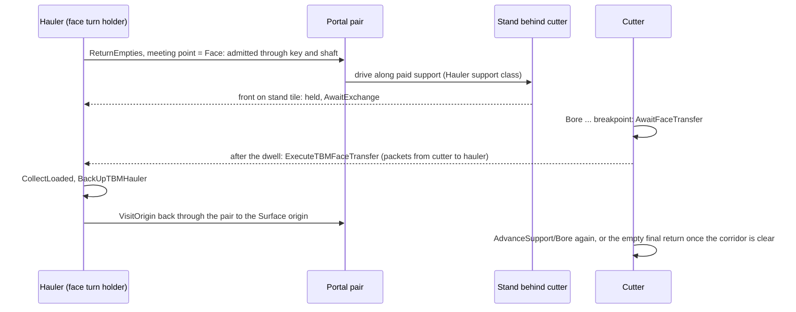
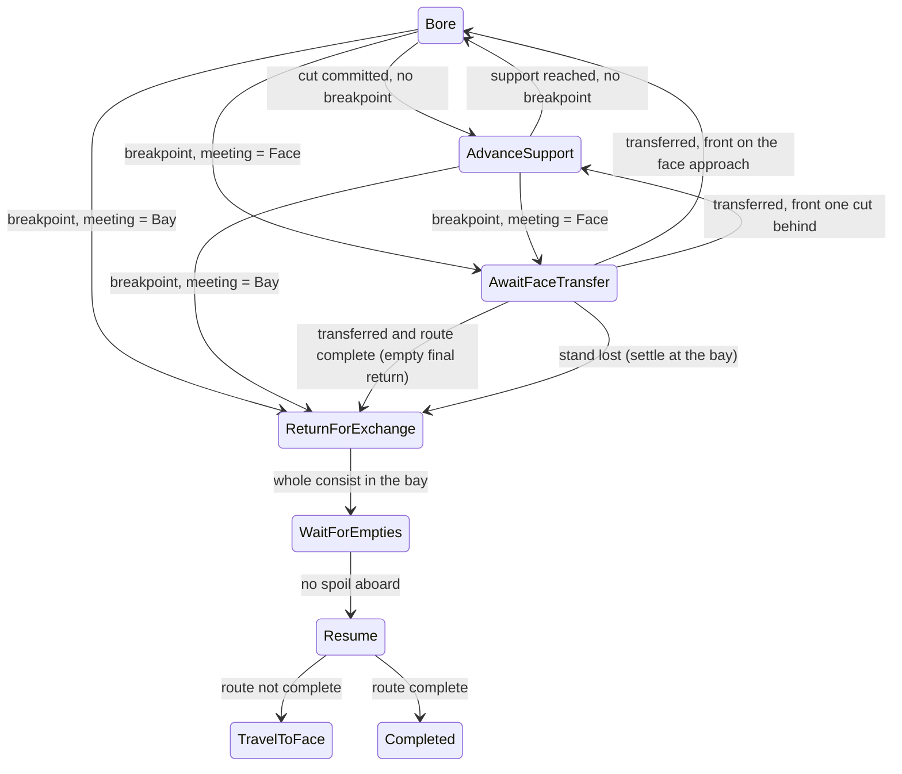

> **Historical donor snapshot — not an execution plan.** OpenTTD3 `75ea75718f`, imported2026-10-23.
> Original: `docs/zz-reach2/upgrades/2026-10/r2df2-a-face-exchange-design.md`; exact source SHA256 `9f20e1d401d76e9fee2dcde26d112008fcb694d04a63ac05546c7eb8e369fe11`.
> Current integration: [M2O23-1](../../../../../../../zz-reach2/upgrades/2026-10/m2o23-1-come-space.md); storage and evidence roles: [archi-historical-debug.md](../../../../../../../zz-reach2/architecture/archi-historical-debug.md). Original completion claims, instructions and human-review limits below remain dated; they grant no new execution, spending, publication or deletion authority.

# R2DF2-A - Face exchange design, 2026-10-16

Companion of [R2DF2](r2df2-face-exchange-and-demo-acceptance.md) Group 1 (tasks 1.1, 1.2 and 1.4). It records the user's decision D9 as rules F1-F9, checked against the live code on 2026-10-16 after R2DF closed.

**D9 in one paragraph.** The assigned hauler drives through its project's portal pair and along the paid support to a stand behind the cutter. The cutter's spoil packets then move into the hauler's own hoppers. The hauler returns to its Surface origin. The cutter keeps cutting while the hauler travels, and waits at the face only when a breakpoint needs an exchange. Bays and magazines remain for parking, hangars and legacy saves.

Narrowed 2026-10-16 by [master task 10R.2](r2mlvs3mp-master-plan.md#group-10r---re-baseline-the-underground-after-the-demo-fixes): only a project whose exchange bay is its Source magazine meets at the face. A project whose bay is an underground depot meets at that depot, because the native depot rule keeps the hauler inside while the waiting cutter occupies the same unsignalled chamber block, so each would wait for the other. The architecture records it ([archi-map-layers.md, Face exchange](../../architecture/map-layers/archi-map-layers.md#paid-boring-and-real-spoil-haulage)).

Where this note differs from the plan's sketches, the note wins and says why. Each difference came from a check in task 1.2 and is marked **(1.2)**.

## Rules

- **F1 Meeting point, derived and never saved.** The meeting point is **Face** when all of these hold; otherwise it is **Bay**.
  - **Phase.** The cutter is in a face phase (Bore, AdvanceSupport, AwaitFaceTransfer) or in a Return phase (`IsTBMReturning`).
  - **Position.** The cutter's front stands on the approach tile of its last completed cut (`cursor == 0 ? anchor : route[cursor - 1].cutter_position`). In a face phase, the approach tile of the cut before it also counts.
  - **Stand.** `FindTBMFaceStand` finds a stand.
  - **Room (Group 4).** The stand leaves room for the whole of every assigned hauler beyond the housing: `tail >= GetTBMHaulerRoomCells + 2`, which includes a spare cell for corner pieces.
    - Without it, a hauler stopped on a stand near the housing kept its last part stored in the key's magazine. The magazine releases parts only while the train moves.
    - Such a train cannot be reversed: its followers lose their track, which the native movement asserts on.
    - Early in a route the meeting point therefore stays the Bay a few cuts longer.
  - **Why the two refinements (1.2).**
    - A cut that makes the exchange due is committed while the front still stands on the previous approach tile. `AdvanceTBMWork` then sends the consist straight on without first driving onto the new support. With the plan's exact-tile rule, every breakpoint reached by a commit would choose the Bay. That is the common case.
    - Return phases count only on the exact tile. A cutter that has started backing never invites a hauler in behind it.
  - **Held return (Group 7).** A return also counts from the approach of the cut before while a hauler of the project is already in the corridor (`FindTBMHaulerInCorridor`), because rule F7 holds it still there.
    - A breakpoint commits with the front one cut short of the face. So a park, release or hangar request made during the face wait would otherwise turn the meeting point into the Bay, and the hauler already on the stand would back out unserved.
    - No new hauler is invited: until one is inside, the meeting point stays the Bay.
- **F2 Breakpoints.** At an `exchange_after` breakpoint the cutter enters the new `TBMPhase::AwaitFaceTransfer` when the meeting point is the Face, or the existing `ReturnForExchange` when it is the Bay.
  - **Leaving the wait.** Once the exchange is no longer due:
    - a completed route makes the empty final return (`ReturnForExchange`);
    - a cutter whose front is on the current approach goes to `Bore`;
    - a cutter still one cut behind goes to `AdvanceSupport`, and so onto the new support before cutting. **(1.2)** The cut owner reads the next cut from the job, not from the train, so Bore must never start a cell short of the face.
  - **Stand lost.** A wait whose meeting point turns to Bay settles at the bay as before (`ReturnForExchange`).
  - **As built (Group 6).** `StepTBMProjectPhase` takes the edges from Bore and AdvanceSupport, and out of the wait, as listed. The face wait also counts as a working phase in two existing rules:
    - a cancelled job turns it back to the bay like the other forward phases, and its return still lets a standing hauler take the spoil (F8);
    - a service visit rejoins at the face (`TravelToFace`).
  - The room rule (F1) keeps early breakpoints at the bay. On the demo-size chamber routes, Deep's first breakpoint (cut 4) and Standard's (cut 7) still use the bay; every later one meets at the face.
- **F3 Transfer.**
  - Whole packets move from the cutter's spoil wagons to the hauler's set wagons, Earth to Earth and Rock to Rock, with `VehicleCargoList::Shift` (Keep packets only; source and loading tile kept).
  - It runs only when the hauler's free capacity covers the cutter's entire load. The dwell must also have passed: `project.phase_ticks >= TBM_FACE_TRANSFER_TICKS`.
  - No wagon changes train. The cutter's units keep their Assigned set, or none. The hauler's set goes from ReturningEmpty to Loaded with `visited_origin = false`.
  - **As built (Group 5).** `DescribeTBMFaceTransfer`, `ValidateTBMFaceTransfer` (the description alone) and `ExecuteTBMFaceTransfer` in `tbm_exchange.cpp`.
    - The hauler must be on the stand the way the hold sees it: its moving front on the stand tile with the stand's trackdir (`IsTBMHaulerFacingStand`), not merely its front on the tile.
    - The packet pool must have room for one split per source part plus one per destination part. Each `Shift` call empties a source part or fills a hopper, so there are never more splits than that. A full pool would otherwise make `Shift` move a whole packet and overfill a hopper.
    - `NoSpoil` is kept in the order but cannot be reached from a live game: with nothing aboard the exchange is not due, so the readiness rule refuses first with `NotAtBay`.
- **F4 Hauler cycle unchanged.**
  - **Stand trackdirs (Group 6).** The stand is the tile plus every laid piece on it that leaves on the stand trackdir's exit side, towards the cutter (`GetTBMFaceStandTrackdirs`). The hold, the steering target and the PBS safe-waiting check all use this set.
    - A wide chamber tile can carry a straight piece and a diagonal one, and the work path names only one of them. A Deep hauler arriving along the diagonal missed the hold and struck the cutter.
  - The hauler keeps its saved phases and waits. "At bay" becomes "at the meeting point": the bay tile, or for the face turn holder its front on the stand tile.
  - `ReturnEmpties` steers to the meeting point; `GetTBMHaulerSteeringTarget` then carries the trackdirs.
- **F5 One hauler in the corridor.**
  - The **face turn holder** is the lowest assignment ID of the project that meets all of these:
    - it is in `ReturnEmpties` or `AwaitExchange`;
    - its set is wholly aboard and empty;
    - its empties cover the job's frozen pass terms per role, the bay exchange's own `InsufficientEmpties` rule (1.2);
    - no other hauler of the project has a part in the corridor (1.2).
  - Only the turn holder is admitted inbound through the pair. Other haulers wait at the bay (the Source magazine, or the exchange depot) as today.
  - **Why the two additions (1.2).**
    - **Capacity.** At every breakpoint, and on every parking request, the load is bounded by the pass terms. A hauler that meets the terms can therefore always complete the transfer. Without this rule, a hauler with short empties would stand at the stand for ever while F7 holds the cutter behind it. Such a hauler is never admitted, and it reports `NoEmpties` at the bay, as it does today.
    - **Corridor.** When the turn holder takes the load it stops being the turn holder. The next hauler would otherwise be admitted while the loaded one is still on the single-track corridor, and the two would meet head on.
- **F6 When the hauler leaves.** As built in Group 4, a hauler on the stand facing the cutter is always held there (`IsTBMHaulerHeld`), whatever its phase. In a leaving phase (CollectLoaded, VisitOrigin, DisposeOrTransfer) it turns round there with `BackUpTBMHauler`, and only with no part stored.
  - Once turned it no longer faces the stand, so it turns once per visit. This replaces the plan's one-shot call on the phase change, which could turn a hauler twice, or turn one still half in the magazine.
  - **Group 6.** `AdvanceTBMHauler` calls `ExecuteTBMFaceTransfer` when the cutter is ready at its face (`IsTBMReadyForFaceTransfer`), and the bay exchange otherwise. After a successful transfer it applies the same turnaround rule at once, so the loaded hauler turns on that tick.
  - An empty hauler inside that may no longer serve the face steps from ReturnEmpties to VisitOrigin, drives on to the stand, and turns there.

  A hauler in the corridor leaves in any of these cases:
  - after a transfer, on the step to `CollectLoaded`;
  - when the cutter returns with no spoil aboard;
  - when the project is finished or stored;
  - when it is no longer the face turn holder while still inside, for example because the stand was lost **(1.2)**. Without a reversal, a hauler whose target changed to the bay would have no way back from the dead end.
- **F7 No backing past a hauler.** While a hauler of the project has a part on the corridor or on either end of the pair, the cutter in a Return phase does not move.
  - A part stored in a magazine or depot there (`track == Track::Depot`) does not count **(Group 2)**. Haulers queued at the Source bay wait on the key tile, so counting them would hold the cutter's ordinary bay return for ever.
  - `GetTBMTravelHoldReason` returns `Obstruction` and names that hauler. `IsTBMHoldingTrain` already zeroes the speed of a train for which it names a reason (`tbm_work.cpp`).
  - The reversal on the tick the return starts (`BackUpTBMConsist`) runs while the wait phase is still unblocked. The cutter therefore faces the bay and holds until the corridor is clear.
  - **Proof (Group 6, task 6.3).** F7 applies only to Return phases, and the hold reason is read with the phase from before the step. A wait at the face is therefore never blocked by F7 on the tick it turns into a return, so `AdvanceTBMWork` always backs the consist then.
    - The loop tests check that every return from the face wait starts with the cutter backing (`DrivingBackwards`).
    - They also check that the cutter then stands still while the loaded hauler is in the corridor.
- **F8 Returns.** This covers the final return, park, cancel and hangar travel, while the cutter still stands at its face.
  - With a hauler in the corridor and spoil aboard, F7 holds the cutter. The hauler reaches the stand and takes the load (`IsTBMReadyForFaceTransfer` admits a Return phase on the exact approach tile). The empty cutter then returns along the existing path.
  - With no hauler in the corridor, the cutter returns loaded, and the existing bay exchange settles the spoil.
  - **As built (Group 7).**
    - `ControlTBMProject` (park, cancel) and `BeginTBMHangarReturn` back a cutter out of the face wait at once (`BackUpTBMConsist`), and F7 holds its motion.
    - The transfer runs in the Return phase after the dwell, counted on that phase's own timer.
    - A hauler on the corridor or the pair is a settlement blocker, so release waits for it and names it.
    - The far-exit handover refuses with `STR_ERROR_TBM_EXIT_HAULER` while one is there.
    - A change of work keeps the breakpoint at the cursor (`ReplaceExcavationJobRemainder`), so the wait, the cursor and the stand stay until the transfer.
- **F9 Saved state.** One `TBMPhase` value is appended; no field is added. Meeting points, stands and turn holders are all derived, so legacy saves need no conversion. In-flight bay exchanges finish under the old rules, and later breakpoints use the face.

## Diagrams

## Symbols

Checked against live code on 2026-10-16 with `git grep -w`. Every new name below had no match, and every existing name was found where stated.

| Symbol | Owner | Group | Notes |
| --- | --- | --- | --- |
| `TBMPhase::AwaitFaceTransfer`, `IsTBMAwaitingFaceTransfer(TBMPhase)` | `tbm.h` | 2.1 | Appended after `FollowOrders`. Not added to `IsTBMWaitingForExchange`, so park, release and hangar map it to their Return phases. |
| `enum class TBMMeetingKind : uint8_t { Bay, Face }`, `struct TBMFaceStand { TileIndex tile; Trackdir trackdir; }` | `tbm.h` | 2.1 | Derived values, never saved. |
| `FindTBMFaceStand(const TBMProject &)` | `tbm.h`, implemented in `tbm_support.cpp` | 2.3 | The work-rail path owner. |
| `GetTBMMeetingKind(const TBMProject &)`, `IsTBMReadyForFaceTransfer(const TBMProject &)` | `tbm.h`, `tbm_support.cpp` | 2.4 | F1 as refined above. |
| `IsTBMHaulerInCorridor(const TBMProject &, VehicleID)`, `FindTBMHaulerInCorridor(const TBMProject &)` | `tbm.h`, `tbm_support.cpp` | 2.5 | Corridor tiles plus both pair ends. |
| `GetTBMPathPieceTrackdir(std::span<const TileIndex> path, size_t index, TileIndex tile)` | `tbm_support.cpp` (file-static) | 2.2 | Extracted from `GetTBMCutterSteeringTarget`. The plan cited lines 205-217; they are 283-296 since R2DF Group 12. |
| `GetLiveTBMCutter`, `GetLiveTBMJob` | exported through `tbm.h` | 2.3 | File-static in `tbm_project.cpp` today. |
| `TBM_FACE_TRANSFER_TICKS` | `tbm_exchange.h` | 5.1 | 74, see Constants. |
| `DescribeTBMFaceTransfer`, `ValidateTBMFaceTransfer`, `ExecuteTBMFaceTransfer` (`const TBMExchangeRequest &` → `TBMExchangeProposal`) | `tbm_exchange.h` / `.cpp` | 5.1-5.3 | Reuse `TBMExchangeError` values: `NotAtBay`, `UnstableCargo`, `NoSpoil`, `WrongWagons`, `InsufficientEmpties`, `Limit`. No new value is needed. |
| `struct TBMHaulerSteeringTarget { TileIndex tile; TrackdirBits trackdirs; }` | `tbm_exchange.h` | 4.1 | Replaces the `TileIndex` result of `GetTBMHaulerSteeringTarget`. |
| `IsTBMFaceTurnHolder(const TBMExchangeAssignment &)`, `IsTBMHaulerAdmittedThroughPortal(const Train &, TileIndex)` | `tbm_exchange.h` / `.cpp` | 3.2 | F5 with the two 1.2 additions. |
| `BackUpTBMHauler(Train &)` | `train_cmd.cpp`, declared beside `BackUpTBMConsist` | 4.4 | Same pattern: reverse when stopped, otherwise set `Reversing`. |
| `SaveLoadVersion::TBMFaceTransfer` | `saveload.h` | 9.1 | 425; the tail is still `AsteroidStarterInputs` (424). |

**Existing names confirmed.**

- **Hauler lookup.** `GetTBMExchangeAssignmentForHauler` is the public const lookup. `FindTBMExchangeAssignmentForHauler` is file-static and mutable in `tbm_exchange.cpp`, so code outside that file (support, portals) uses the public one.
- **Spoil-unit helpers.** `GetTBMSpoilRole` and `IsEmptyTBMSpoilUnit` are file-static in `tbm_exchange.cpp`, which is where the face transfer lives.
- **Others.** `GetLayerPortalPairKey`, `GetLayerPortalAdmittedTrackdirs`, `VehicleEnterTile_LayerPortal`, `GetLayerPortalMagazineExit`, `IsSafeWaitingPosition`, `TBM_SUPPORT_MAX_SPEED` (40), `GetTBMLogisticsWait` and `TBMLogisticsWait::NoHauler` exist as the plan names them.

## Behaviour that must survive (task 1.2)

| Behaviour | Live owner | Finding | Design consequence |
| --- | --- | --- | --- |
| Settlement before release | `GetTBMProjectSettlementBlocker` (`tbm_exchange.cpp`) | A hauler in `ReturnEmpties` with no part on the bay and no cargo counts as settled, so one driving up the corridor would look settled. | Task 7.3 adds the corridor (`IsTBMHaulerInCorridor`) to the blocker. `ReleaseSettledTBMProjectHaulers` and `GetTBMProjectReleaseProblem` already go through it. `IsTBMCorridorOccupied` counts any train, the hauler included, unchanged. |
| Parking and cancel | `ControlTBMProject` (`tbm_project.cpp`) | Park and cancel map wait phases through `IsTBMWaitingForExchange`, so AwaitFaceTransfer maps to `ReturnToPark`/`ReturnToRelease` as intended. R2DF Group 12 backs the consist out only when the previous phase was Bore or AdvanceSupport. | AwaitFaceTransfer joins that list: the cutter stands at its face with the bay behind it. Reversing a stopped train only turns it, and F7 holds the motion. Task 7.1. |
| Hangar order | `BeginTBMHangarReturn` (`tbm_project.cpp`) | A loaded cutter outside a wait phase goes to `ReturnForHangar` and `ChooseTBMReturnDirection`. | The cutter is unchanged. After a face transfer (F8) the cutter is empty. It still backs to its bay, and `WaitForHangar` sees no spoil and moves on to `TravelToHangar`, as the plan's table expects. |
| Far-exit handover (R2TBMF9) | `CheckTBMExitHandover` (`tbm_support.cpp`) | It needs a completed job, a stopped cutter and every part off the last two path tiles. F7 keeps the cutter at the face while a hauler is inside, and no hauler is admitted once the cutter backs off. | A hauler cannot be in the corridor at a valid handover. Task 7.4 still adds an explicit `FindTBMHaulerInCorridor` refusal as a guard. |
| Too-few-orders advice | `CheckOrders` → `GetTBMOrderProblem` (`tbm_controls.cpp`) | A healthy hauler needs its origin order, its set and its owners. A lost pathfinder flag is excused only at the bay. | Task 6.5 also excuses a hauler held on its face stand. The face cycle adds no order, so the origin-order rule stays. |
| Origin leg | `MayTBMSpoilLeaveVehicle` (`tbm_exchange.cpp`) | A Loaded set unloads only from its own carrier, at the origin or after visiting it. The cutter never unloads spoil. | Unchanged. After the transfer the hauler's own set is Loaded with `visited_origin = false`, and `assignment.set` is unchanged. |
| Hauler holds and waits | `StepTBMHaulerPhase`, `IsTBMHaulerHeld` | `Stopped` and `BlockedLine` are excused at the bay. `AwaitExchange` returns to `ReturnEmpties` when the hauler leaves the meeting point. | "At the meeting point" feeds the same `at_bay` input, so the existing excuses and the creep to a stand that moved need no new edge. |
| Load validators | `tbm_exchange.cpp` load checks | An Assigned set rides on the cutter; carried sets are never Assigned. | Still valid: no wagon changes train at the face. |
| Change of work area (R2DF Group 12) | `CmdChangeTBMWork` | The cursor stays, so the stand stays. | A change during AwaitFaceTransfer keeps the wait (task 7.4). |

## Constants (task 1.4)

- **`TBM_FACE_TRANSFER_TICKS = 74`, one game day (`Ticks::DAY_TICKS`).**
  - The bay exchange is instant once both trains stand in the bay. At the face, the user asked to see the hauler "take the load", so a short, visible, deterministic dwell is wanted.
  - The dwell is counted on the saved project phase timer, so it survives save and load. It does not depend on view, wall clock or `Random()` (I-5, I-7).
  - One day is a small fraction of a pass: in the R2DF native `change` run, one Standard cut alone took about 1,000 ticks, and a pass holds several cuts. Group 8.5 measures the actual throughput.
  - **Measured (Group 8.5).** On the demo route, the face wait costs 75 ticks per breakpoint; the bay detour cost about 2,300. The face loop completes 32 cuts in 20,000 ticks against 25 for the bay loop. Details are in [R2DF2-C](r2df2-c-execution-notes.md#group-8-2026-10-16).
- **Stand gap: one clear tile** between the hauler's front (on the stand) and the cutter's rearmost part.
  - The hold zeroes speed on the tick the front enters the stand tile, at most `TBM_SUPPORT_MAX_SPEED` (40), which is under one tile of travel. The gap tile is the margin, so the two chains never share or touch a tile.
  - Distinct tiles also keep the track reservations of both trains apart.
  - **Placement.** The stand is `path[tail - 2]`, two path entries behind the rearmost part. It must be plain rail on the work path, never the housing (`tail >= 3`), and it must lie outside the next cut's swept tiles, which `PrepareTBMCutParticipation` would otherwise treat as an obstruction.
