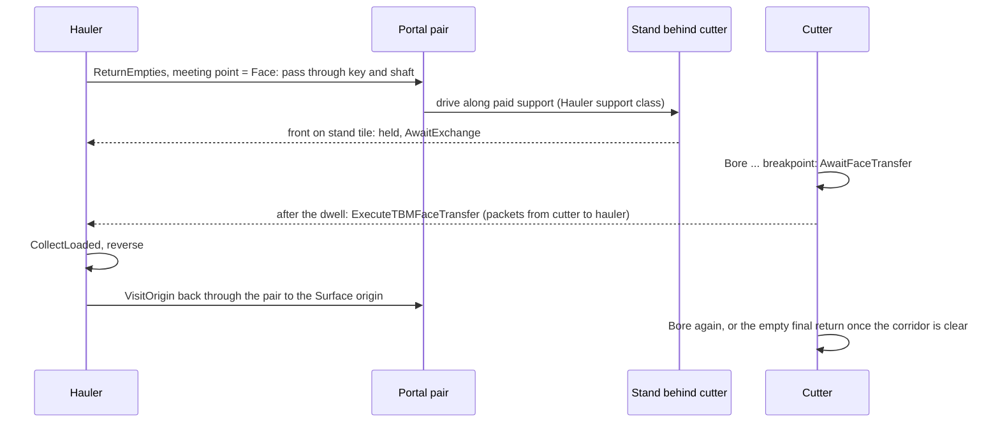
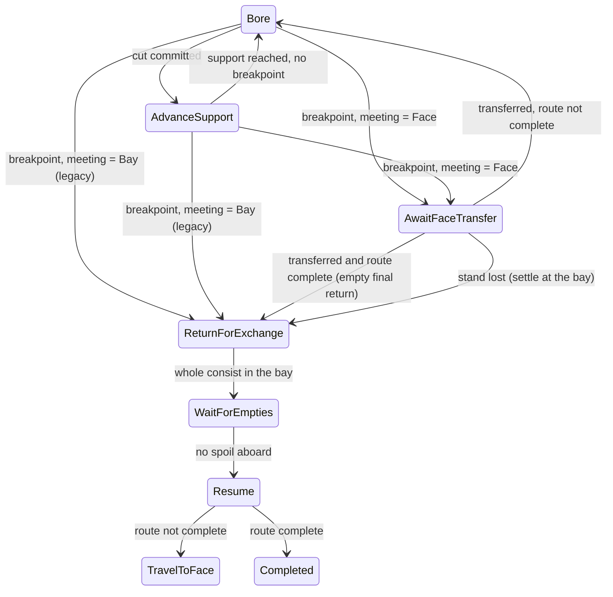

> **Historical donor snapshot — not an execution plan.** OpenTTD3 `75ea75718f`, imported2026-10-23.
> Original: `docs/zz-reach2/upgrades/2026-10/r2df2-face-exchange-and-demo-acceptance.md`; exact source SHA256 `22d62e0ec2e9079555225ca1d53d31ffeed6cb4582d361480c6e777f15d4261a`.
> Current integration: [M2O23-1](../../../../../../../zz-reach2/upgrades/2026-10/m2o23-1-come-space.md); storage and evidence roles: [archi-historical-debug.md](../../../../../../../zz-reach2/architecture/archi-historical-debug.md). Original completion claims, instructions and human-review limits below remain dated; they grant no new execution, spending, publication or deletion authority.

# R2DF2 - Demo fixes, 2026-10-15: hauler face exchange and demo acceptance

## Global Mandatory Reading

> **Execution protocol**
>
> - Read this Global Mandatory Reading section before the first task and again
>   after every context compaction.
> - Before starting or resuming a task group, read the nearest preceding Area
>   Mandatory Reading block whose `Applies to` label includes that group. Area
>   blocks appear immediately before the first group they govern.
> - A referenced heading or exported symbol is authoritative. Global navigation
>   hints and Area line ranges are for navigation only; if they drift, relocate
>   the named section or symbol rather than expanding to the whole file.
> - Mandatory reading is non-transitive. Do not preload a linked file's own
>   Mandatory Reading, Consult on Demand, or Planning Provenance entries unless
>   this plan names them directly for the current area.
> - Do not read Consult on Demand or Planning Provenance merely because those
>   sources are listed. Use a Consult on Demand source only when its trigger
>   occurs.
> - No created source file, test file or JSON file should start with same prefix as a planning MD file (such as r2). Only MD files can have that prefix. No MD file should be created anywhere in source directories unless specifically asked.
> - After EVERY CONTEXT COMPACTION, you must add a note above the task group
>   which is currently in execution. The note will say: "Context has compacted
>   X times while executing this group.". If the compaction occurs before any
>   meaningful work was done (this can happen when there is a lot of baggage
>   from the previous compaction), then and ONLY then you can skip this step.
> - When exceeding 3 context compactions, YOU MUST ask yourself if you're not 
>   chewing more than we can handle :). Heck, plans change! :). In such a case, 
>   the way out is to split the group on the spot,
>   in the plan, into more groups, 
>   by appending B, C, D as a suffixes to those groups (splitting sub-groups 
>   themselves is also allowed). When you do this, create Local Mandatory
>   Reading areas so you can optimize your context only for the
>   ACTUAL task at hand.
>   Before starting or resuming a task group, read the nearest preceding Area
>   Mandatory Reading block whose `Applies to` label includes that group. Area
>   blocks appear immediately before the first group they govern.

| File name | Line Ranges | Description |
| --- | --- | --- |
| [This plan](r2df2-face-exchange-and-demo-acceptance.md#demo-report-and-decision) | 59-65 | **Demo report and decision**: report R10 and the user's decision D9, the face exchange that Groups 1-9 build. D9 records what the user asked for and overrides older plan text, including the parent AD-6 deferral of "a hauler reaching past an active cutter". |
| [This plan](r2df2-face-exchange-and-demo-acceptance.md#execution-conventions) | 67-85 | **Execution conventions**: build/test cadence on this machine (one MSBuild project, two compiler workers), new file names without the `r2` prefix, log/review/runtime locations, documentation headers, save-version policy and the no-Git-write default. These rules constrain every group's file creation and verification steps. |
| [R2MLVS parent](r2mlvs-multilayer-vehicles-and-structures.md#development-artifact-layout) | 36-48 | **Development artifact layout**: `mlm/runtime/<profile>/<run-id>/<process>/`, `mlm/reviews/<feature>/<scenario>/<run-id>/` with mandatory `images/`, `mlm/tools/`, `logs/<feature>/<scenario>/<run-id>/`, and docs-only `docs/zz-reach2/`. Every reproduction, capture, save and log produced here must follow it; test output never goes into docs or immutable fixture folders. |
| [R2MLVS parent](r2mlvs-multilayer-vehicles-and-structures.md#cross-plan-invariants) | 458-476 | **Cross-plan invariants** I-1..I-8 and I-13: layer identity, no free excavation, cargo conservation, atomic commands with pure estimates, determinism independent of view, explicit transport, persistence and the 45-degree advancing-turn rule. Each fix in this plan (hauler admission, the face meeting point, packet transfer and its persistence) must keep all of them. |
| [Map layers architecture](../../architecture/map-layers/archi-map-layers.md#code-map) | 194-233 | **Code map** and **Invariants**: which file owns layer rules, portal tiles, saved portal work, train movement, signals/YAPF and layer saves. Above all, `Viewport::layer` never influences a command, simulation tick or `Random()`. This is the ownership spine for routing every change to its owner, and the rule behind Group 8's visible/hidden equivalence. |

## Status and scope

Status: planned 2026-10-15. Executed 2026-10-15 to 2026-10-16: Groups 1-11 are complete. User acceptance of the refreshed demo is pending; see the [review checklist](r2df2-b-acceptance-notes.md#review-checklist-task-116). This plan is the second half of the 2026-10-15 demo-fixing plan, split on the same day from [R2DF](r2df-demo-fixes-interface-movement-and-planning.md). R2DF keeps the reproduction, map and window controls, TBM status wording, sprite spacing, signals, the false obstruction, approach planning and work-area changes (its Groups 1-12). This plan holds the hauler face exchange (Groups 1-9) and the integrated demo acceptance and guide updates for both plans (Groups 10-11). Each plan numbers its groups from 1, so a task in the other plan is always named with its prefix, for example R2DF task 6.5.

Input: the user's demo of the `tbm-work` checkpoint (menu 11), recorded in [DemoNotes.txt](../../../../../../../Demo2026-06-13/DemoNotes.txt) and six screenshots in the same folder; R10 cites screenshot 06. The second planning pass (same day) split the first draft's face-exchange group into Groups 1-9 here, each HARD or easier, with code sketches and diagrams. The sketches guide the work, but live code and the named symbols stay authoritative.

**Order.** Start after R2DF. Group 1 (the design note and contract amendments) may start at any time. The entry gates and assumptions before later groups name what they need, in either plan.

This is an independent remediation queue requested by the user. It does not resume the paused [R2MLVS3MP master](r2mlvs3mp-master-plan.md) queue or tick any of its child tasks. The user resumed that master separately on 2026-10-16, after both plans were executed; its [Demo fixes](r2mlvs3mp-master-plan.md#demo-fixes-r2df-and-r2df2-2026-10-16) section summarizes this work. Where a fix changes a delivered public contract, the named task in this plan amends the owning plan (1.3, 11.3); task 11.3 also folds in the handoff notes queued by R2DF tasks 6.5 and 12.7. Master task 12.6 (fixture pruning) still waits for user acceptance; the refreshed checkpoints from Group 10 are an input to that gate, not a pass.

Owners touched: Plan3 portals (hauler admission), Plan4 TBMs (controller, meeting point, parking, release and hangar flows), Plan5 haulage (face exchange), the rail pathfinder (hauler steering and safe waiting) and Plan15 savegame (the new phase). Groups 10-11 also refresh the demo checkpoints, the launcher and the guides.

## Demo report and decision

R10 came from the same demo as R1-R9 and Q1-Q2, which [R2DF](r2df-demo-fixes-interface-movement-and-planning.md#demo-reports-and-decisions) records with decisions D1-D8 and D10. The columns match that table.

| # | Report (screenshot) | Planning-time diagnosis | Decision | Groups |
| --- | --- | --- | --- | --- |
| R10 | The hauler should drive to the TBM, take the load and go home; the TBM should never return to unload (06). | Today the TBM backs to an exchange bay (source magazine or underground depot), and `ExecuteTBMWagonExchange` swaps whole wagon units with both heads on the bay tile. The user's prompt did not ask for this: it was recorded as an initial-release deferral in parent AD-6 ("a hauler reaching past an active cutter is deferred"). Blockers include: no Hauler support class, no hauler admission through a Commissioning pair, no moving meeting target, and a single track that makes a wagon swap impossible without a passing loop. | **D9 (user, 2026-10-15):** the assigned hauler travels through the portal and along paid support to the cutter's tail. The actual cargo packets move from the TBM's attached hoppers into the hauler's own hoppers (`VehicleCargoList::Shift` semantics: no copy, no buffer, provenance kept). The hauler then returns to its Surface origin. The TBM keeps cutting while the hauler travels and waits at the face only when its hoppers are full. Bays and magazines remain for parking, hangars and legacy saves. Rejected alternative: paid passing loops for wagon swaps. | 1-9 |

## Execution conventions

- **Order and completion.** Execute groups top to bottom. Mark a task `[X]` only after its stated behaviour and focused evidence pass. A design note, declaration or isolated fixture does not complete player-facing behaviour.
- **Builds.** Batch each group's related source and test changes before compiling. Build one MSBuild project at a time (`-j 1 -- /p:CL_MPCount=8 /nodeReuse:false`). The earlier out-of-memory incident set two compiler workers; on this machine (24 threads, 32 GB) the user raised it to eight on 2026-10-15. Never overlap heavyweight native file suites with compilation.
- **Waiting and test length.** Wait at least 50 seconds when polling a running build or test. Split any test case that runs longer than two minutes into focused companion files (`...-1`).
- **Regressions.** Run only focused tests per group. The one justified affected regression burst is task 10.3, which covers both plans.
- **New file names.** New source, test and JSON files never start with `r2`. Proposed names:
  - tests: `src/tests/tbm_face_meeting.cpp`, `src/tests/tbm_face_access.cpp`, `src/tests/tbm_face_steering.cpp`, `src/tests/tbm_face_transfer.cpp`, `src/tests/tbm_face_controller.cpp`, `src/tests/tbm_face_lifecycle.cpp` and `src/tests/tbm_face_exchange_save.cpp`, each registered in `src/tests/CMakeLists.txt`;
  - Catch2 tags: `[demo-fix-...]`;
  - native runner: extend `src/tests/multilayer/tbm/demo_feedback.py`, created by R2DF task 1.2.
- **Companion notes.** Notes live beside this plan as `r2df2-<letter>-<topic>.md`, next to R2DF's `r2df-<letter>-<topic>.md` notes (the user's execution instruction of 2026-10-15 replaced the earlier `demo-fixes/` subfolder). Temporary scratch files are removed when no longer needed.
- **Artifacts.**
  - logs: `logs/demo-fixes/<scenario>/<run-id>/`;
  - saves, reports and captures: `mlm/reviews/demo-fixes/<scenario>/<run-id>/`, with captures in `images/`;
  - native homes: `mlm/runtime/`;
  - immutable demo snapshots in `src/tests/fixtures/demos/` are never overwritten.
- **Code documentation.** Every created or modified source/test file has an architecture/owning-plan header. Every new or modified function has a JavaDoc purpose/parameters/return. Compound conditions and non-trivial loops are explained in gameplay terms.
- **Saves.** New persistent fields use **one** new save version (Group 9), appended after the current tail (`AsteroidStarterInputs` (424) at planning time), with explicit older-version mapping and malformed-load refusal. Preview and estimate paths stay pure.
- **Strings and Git.** New strings go into `src/lang/english.txt` only. Perform no Git commits, pushes or tags unless the user asks.

## Execution queue

### Area Mandatory Reading - Face exchange design and meeting point

_Applies to Groups 1-2._

| File name | Line Ranges | Description |
| --- | --- | --- |
| [R2MLVS parent AD-3](r2mlvs-multilayer-vehicles-and-structures.md#ad-3---sealed-portals-and-bootstrap-access-owners-3-4-5) | 257-267 | **AD-3**: only the assigned TBM may enter a Commissioning pair's work pocket. Task 1.3 amends it to admit the project's assigned hauler while every other train stays out. |
| [R2MLVS parent AD-6](r2mlvs-multilayer-vehicles-and-structures.md#ad-6---transfer-the-actual-wagons-owner-5) | 291-303 | **AD-6**: bay exchange of actual wagons, no invisible buffers, saved origin/receivers, and the deferral of "a hauler reaching past an active cutter". D9 replaces the bay exchange during work with a packet transfer at the face; conservation and the origin leg stay. |
| [Plan5 public handoff](r2mlvs5-spoil-wagons-and-haulage.md#public-handoff-contract) | 53-61 | Settlement, advice and parking consumers of the exchange (`GetTBMProjectSettlementBlocker`, `ReleaseSettledTBMProjectHaulers`, hangar settlement) that must keep working. |
| [Plan4 public handoff](r2mlvs4-tunnel-boring-machines.md#public-handoff-contract) | 53-79 | Parking, release, hangar and far-exit handover contracts whose flows Group 7 re-verifies. |
| [`tbm.h`](../../../../src/tbm.h) | 25-56; 87-113; 647-664 | `TBMPhase` with its predicates, `struct TBMProject` and the controller boundary (one tick call site; commands record intent only; wagons and cargo stay in the actual chains). |
| [`tbm_exchange.h`](../../../../src/tbm_exchange.h) | 95-171 | `TBMWagonSet`, `TBMWagonSetState`, `TBMHaulerPhase`, `TBMHaulerWait` and `TBMExchangeAssignment`. The face design keeps every one of these unchanged. |
| [`tbm_exchange.cpp`](../../../../src/tbm_exchange.cpp) | 612-752 | `ObserveTBMHaulerInputs`, `StepTBMHaulerPhase` (edges at 683-713) and `AdvanceTBMHauler`: the cycle whose "at bay" input becomes "at the meeting point". |
| [`tbm_project.cpp`](../../../../src/tbm_project.cpp) | 812-932; 1023-1082 | `StepTBMProjectPhase` (Bore/AdvanceSupport to `ReturnForExchange`) and `AdvanceTBMWork` (backs the consist only when leaving the face for a return). |
| [`tbm_support.cpp`](../../../../src/tbm_support.cpp) | 87-126; 170-219 | `GetTBMWorkRailPath` (housing, side cells, cutter positions) and `GetTBMCutterSteeringTarget` (laid-piece trackdir selection, lines 205-217). The stand behind the cutter is computed on this path with the same piece rule. |
| [`tbm_work.cpp`](../../../../src/tbm_work.cpp) | 148-208; 297-321 | `PrepareTBMCutParticipation` (any foreign vehicle in the next cut's sweep blocks the cut) and `IsTBMExchangeDue` (capacity breakpoints): the stand must stay outside that sweep, and breakpoints become transfer points. |

### Group 1 - Write the face exchange design and amend the contracts

The design is decided here. The note records it, checks it against live code and amends the owning contracts.

Coverage routes only **advance** (`SearchExcavationTarget` expands straight, left 45 and right 45; backing is never a cut edge). A hauler waiting behind the cutter therefore never meets a reversing cutter during work; the cutter backs only when it returns to its bay.

- **F1 Meeting point, derived and never saved.** The meeting point is the Face when the cutter's front stands on its current face approach tile and `FindTBMFaceStand` finds a stand; otherwise it is the Bay.
- **F2 Breakpoints.** At an `exchange_after` breakpoint the cutter enters the new `TBMPhase::AwaitFaceTransfer` when the meeting point is the Face, or the existing `ReturnForExchange` when it is the Bay.
- **F3 Transfer.** Whole packets move from the cutter's spoil wagons to the hauler's set wagons, Earth to Earth and Rock to Rock, with `VehicleCargoList::Shift`. The transfer runs only when the hauler's free capacity covers the cutter's entire load, and only after `project.phase_ticks >= TBM_FACE_TRANSFER_TICKS`, a deterministic dwell.
- **F4 Hauler cycle unchanged.** The hauler keeps its existing phases. "At bay" becomes "at the meeting point": the bay tile, or the hauler's front on the stand tile. `ReturnEmpties` steers to the meeting point.
- **F5 One hauler in the corridor.** Only one hauler of a project is in the corridor at a time: the turn holder, which is the lowest assignment ID needing the face. Other haulers wait in the Source magazine as today.
- **F6 When the hauler leaves.** A hauler in the corridor reverses out after a transfer, when the cutter returns with no spoil aboard, or when the project is finished or stored.
- **F7 No backing past a hauler.** The cutter never moves backwards while a hauler of its project has a part on the corridor. It holds with that hauler named as the blocker.
- **F8 Returns.** For the final return, park, cancel and hangar travel:
  - if a hauler stands at the stand and spoil is aboard, the transfer happens at the face first, then the empty cutter returns along the existing path;
  - with no hauler present, the existing bay exchange settles the spoil.
- **F9 Saved state.** One `TBMPhase` value is appended and no field is added. Legacy saves finish their in-flight bay exchanges under the old rules.





Proposed public symbols, to be confirmed in 1.1:

- `TBMPhase::AwaitFaceTransfer` (appended) and `inline bool IsTBMAwaitingFaceTransfer(TBMPhase)`;
- `enum class TBMMeetingKind : uint8_t { Bay, Face }`, `struct TBMFaceStand { TileIndex tile; Trackdir trackdir; }`;
- `FindTBMFaceStand`, `GetTBMMeetingKind`, `IsTBMReadyForFaceTransfer`, `IsTBMHaulerInCorridor`, `FindTBMHaulerInCorridor` (`tbm.h`);
- `TBM_FACE_TRANSFER_TICKS`, `DescribeTBMFaceTransfer`, `ValidateTBMFaceTransfer`, `ExecuteTBMFaceTransfer`, `struct TBMHaulerSteeringTarget`, `IsTBMHaulerAdmittedThroughPortal`, `IsTBMFaceTurnHolder`, `BackUpTBMHauler` (`tbm_exchange.h`).

{{MEDIUM}}
- [X] 1.1 Write `r2df2-a-face-exchange-design.md` recording F1-F9, both diagrams and the final symbol names, after checking each named symbol against live code.
- [X] 1.2 Check the rules against behaviour that must survive: settlement (`GetTBMProjectSettlementBlocker`), parking and hangars (`ControlTBMProject`, `BeginTBMHangarReturn`), far-exit handover, too-few-orders advice suppression and the origin leg (`MayTBMSpoilLeaveVehicle`). Record any conflict as a design change before Group 2 starts.
- [X] 1.3 Amend parent AD-3 (the assigned hauler may traverse its project's Commissioning pair and support) and AD-6 (packet transfer at the face; bay exchange kept as fallback, parking and legacy; deferral reversed on 2026-10-15 at the user's request). Update the Plan4/Plan5 public handoffs, keeping superseded text marked.
- [X] 1.4 Fix and justify the constants: `TBM_FACE_TRANSFER_TICKS` (proposed 74, one day) and the stand gap (one clear tile between the hauler's front and the cutter's rearmost part).

**Result (2026-10-16).** Done in [r2df2-a-face-exchange-design.md](r2df2-a-face-exchange-design.md).

- **Symbols.** Every symbol was checked with `git grep -w`. The new names are free; the existing ones are live. Two notes:
  - the public hauler lookup is `GetTBMExchangeAssignmentForHauler`, while `FindTBMExchangeAssignmentForHauler` is file-static;
  - the steering lines the plan cites moved to `tbm_support.cpp` 283-296.
- **Design changes found by 1.2.** The note marks each one.
  - **F1.** The front may also stand one cut behind in a face phase, because a commit that makes the exchange due happens before the advance. A Return phase counts only on the exact approach tile.
  - **F2.** The wait ends in AdvanceSupport when the front is still one cut behind.
  - **F5.** The turn holder needs empties that cover the frozen pass terms (no stand deadlock) and an otherwise empty corridor (no head-on meeting).
  - **F6.** A hauler that stops being the turn holder while inside reverses out.
  - **Return and park.** AwaitFaceTransfer joins R2DF Group 12's back-out-from-the-face rule.
  - **Advice.** The lost-route excuse extends to the stand (6.5).
  - **Settlement.** It must count the corridor (7.3).
- **Contracts.**
  - Parent AD-3 admits the assigned hauler through its own pair.
  - Parent AD-6 records the face transfer; its deferral sentence is marked superseded.
  - Plan4 and Plan5 public handoffs have dated paragraphs.
- **Constants.**
  - `TBM_FACE_TRANSFER_TICKS = 74`: one day on the saved phase timer.
  - The stand is one clear tile behind the rearmost part, outside the next sweep. The save version will be 425 after `AsteroidStarterInputs`.

### Group 2 - Derive the meeting point behind the cutter

These are pure queries over the work-rail path and the actual consist. Every later face group consumes them.

```cpp
std::optional<TBMFaceStand> FindTBMFaceStand(const TBMProject &project)
{
	const Train *front = GetLiveTBMCutter(project); // file-static in tbm_project.cpp today; exported by 2.3
	const ExcavationJob *job = GetLiveTBMJob(project);
	if (front == nullptr || job == nullptr || job->cursor == 0) return std::nullopt;
	std::vector<size_t> ends;
	const auto path = GetTBMWorkRailPath(*job, job->cursor, ends); // housing ... last completed cutter position
	// A consist of N parts covers at most N tiles, so only the path tail is searched (I-9: no full-route scan every tick).
	size_t parts = 0;
	for (const Train *part = front; part != nullptr; part = part->Next()) ++parts;
	const auto window_begin = path.end() - std::min(path.size(), parts + 2);
	size_t tail = path.size();
	for (const Train *part = front; part != nullptr; part = part->Next()) {
		const auto it = std::find(window_begin, path.end(), part->tile);
		if (it == path.end()) return std::nullopt; // A part still in the shaft or on the other layer: no stand yet.
		tail = std::min<size_t>(tail, static_cast<size_t>(it - path.begin()));
	}
	if (tail < 3) return std::nullopt; // path[0] is the housing; keep one clear tile and stand on plain rail.
	const size_t stand = tail - 2;
	if (job->cursor < job->route.size() && std::ranges::binary_search(job->route[job->cursor].swept_tiles, path[stand])) return std::nullopt;
	const Trackdir trackdir = GetTBMPathPieceTrackdir(path, stand); // shared with GetTBMCutterSteeringTarget lines 205-217
	if (trackdir == INVALID_TRACKDIR) return std::nullopt;
	return TBMFaceStand{path[stand], trackdir};
}
```

{{HARD}}
- [X] 2.1 Append `TBMPhase::AwaitFaceTransfer` (not yet produced by any edge) with `IsTBMAwaitingFaceTransfer`. Declare `TBMMeetingKind`, `TBMFaceStand`, `FindTBMFaceStand`, `GetTBMMeetingKind`, `IsTBMReadyForFaceTransfer`, `IsTBMHaulerInCorridor` and `FindTBMHaulerInCorridor` in `tbm.h` with JavaDoc. Do **not** add the new phase to `IsTBMWaitingForExchange`, because park, release and hangar map those phases to bay-only waits.
- [X] 2.2 Extract the entry/exit laid-piece selection of `GetTBMCutterSteeringTarget` (lines 205-217) into `GetTBMPathPieceTrackdir`, and use it from both the cutter target and the stand.
- [X] 2.3 Export `GetLiveTBMCutter` and `GetLiveTBMJob` (file-static in `tbm_project.cpp` today) through `tbm.h`, then implement `FindTBMFaceStand` as sketched in `tbm_support.cpp`, the path owner.
- [X] 2.4 Implement `GetTBMMeetingKind` per F1 (front on `cursor == 0 ? anchor : route[cursor - 1].cutter_position` and a stand exists) and `IsTBMReadyForFaceTransfer` (Face, spoil aboard per `IsTBMExchangeDue`, and phase `AwaitFaceTransfer` or a `IsTBMReturning` phase still at the face).
- [X] 2.5 Implement `IsTBMHaulerInCorridor(project, hauler)` (that assigned hauler has a part on the sorted `GetTBMWorkCorridor` tiles or on either end of the project's pair) and `FindTBMHaulerInCorridor(project)` (the lowest such hauler ID, or `VehicleID::Invalid()`).
- [X] 2.6 Add `src/tests/tbm_face_meeting.cpp` (`[demo-fix-face-meeting]`): a straight route; two 45-degree bends (side cells); a consist partly in the housing; a short route (`tail < 3`); exclusion of the next cut's sweep; the trackdir matching the laid piece; the meeting kind for every phase; and a performance bound on a 1,024-cut route.

**Result (2026-10-16).** Done. `[demo-fix-face-meeting]` passes: 6 cases.

- **Phase.** `TBMPhase::AwaitFaceTransfer` is appended, with `IsTBMAwaitingFaceTransfer`. It is outside `IsTBMWaitingForExchange`, and `ValidateTBMProject` accepts it. The save bound waits for 9.1.
- **Queries.** In `tbm.h`: `TBMMeetingKind`, `TBMFaceStand`, `FindTBMFaceStand`, `GetTBMMeetingKind`, `IsTBMReadyForFaceTransfer`, `IsTBMHaulerInCorridor` and `FindTBMHaulerInCorridor`. `GetLiveTBMCutter` and `GetLiveTBMJob` are now exported.
- **Implementation.**
  - The stand and meeting queries are in `tbm_support.cpp`. They share `GetTBMPathPieceTrackdir`, which `GetTBMCutterSteeringTarget` also uses now, and a tail-only consist locator.
  - The corridor queries are in `tbm_exchange.cpp`, beside the assignment store.
- **Rules as built.** As refined in [R2DF2-A](r2df2-a-face-exchange-design.md):
  - a working cutter meets at the face from the approach before its last cut;
  - a returning one meets there only on the exact face tile;
  - stored parts (`Track::Depot`) never count as in the corridor.
- **Tests.** They cover:
  - straight placements with one and two parts per cell, and the trackdir of the laid piece;
  - every phase on the face, one cut short and two cuts short;
  - readiness;
  - side-cell stands after two bends;
  - the housing, the first-cell and off-path cases;
  - stands inside and outside the next sweep;
  - corridor membership and the lowest hauler;
  - 1,000 paths over a synthetic 1,024-cut job in 19 ms.
- **Neighbouring tags.** The existing steering, recovery, control, bay and change-work tags pass, apart from failures recorded in [R2DF2-C](r2df2-c-execution-notes.md) as pre-existing, including `[tbm-project]` 93-110.

### Area Mandatory Reading - Hauler track access and steering

_Applies to Groups 3-4._

**Entry gate.** R2DF Group 6's Connected-only segment rule and R2DF Group 7's obstruction fixes must pass (`[demo-fix-signal-boundary]`, `[demo-fix-obstruction]`), and Group 2's queries must exist (`[demo-fix-face-meeting]`). If any is absent, stop Groups 3-4; Group 1 documentation may continue. Do not bypass the gate by disabling signals or path reservation, by setting force-proceed from a controller, by admitting all trains through Commissioning pairs, or by moving the hauler between tiles.

| File name | Line Ranges | Description |
| --- | --- | --- |
| [`tbm.h`](../../../../src/tbm.h) | 705-730; 939-979 | `TBMSupportClass` (already lists `Hauler`), `TBMSupportTile`, `TBM_SUPPORT_MAX_SPEED`, corridor queries, `IsTBMHoldingTrain`, `GetTBMTravelHoldReason` and the cutter steering target. |
| [`tbm_support.cpp`](../../../../src/tbm_support.cpp) | 495-559 | `GetTBMSupportClass` ("Plan 5 haulers will declare the Hauler class here"), `MayTBMSupportCarry`, `GetTBMWorkCorridor` and `IsTBMCorridorOccupied`. |
| [`layer_portal_work.cpp`](../../../../src/layer_portal_work.cpp) | 133-248 | `CheckLayerPortalWorkAccess` (cutter only), `GetLayerPortalMagazineExit`, `IsLayerPortalMagazineBusy` and `GetLayerPortalAdmittedTrackdirs` (today a hauler reaches only its Source key, through the door). |
| [`layer_portal_cmd.cpp`](../../../../src/layer_portal_cmd.cpp) | 378-484 | `RunLayerPortalMagazine` (stores a part entering against its exit side) and `VehicleEnterTile_LayerPortal` (admission recheck). A pass-through hauler must not be stored. |
| [`tbm_exchange.h`](../../../../src/tbm_exchange.h) | 309-405 | `TBMHaulerInputs`, `TBMHaulerStep`, `ObserveTBMHaulerInputs`, `StepTBMHaulerPhase`, `AdvanceTBMHauler`, `IsTBMHaulerHeld`, `IsTBMHaulerAdmittedAtBay`, `MayTBMTrainLeaveMagazine`, `IsTBMWaitingAtLineEnd` and `GetTBMHaulerSteeringTarget`. |
| [`tbm_exchange.cpp`](../../../../src/tbm_exchange.cpp) | 612-822 | Hauler cycle and the hold/admission/leave/steering implementations changed by Groups 3-4. |
| [`yapf_destrail.hpp`](../../../../src/pathfinder/yapf/yapf_destrail.hpp) | 140-197 | `SetDestination`: cutter target with trackdirs, hauler bay target with a recomputed door trackdir (replaced by the supplied trackdirs). |
| [`follow_track.hpp`](../../../../src/pathfinder/follow_track.hpp) | 383-393 | The follower refuses temporary support for any part `MayTBMSupportCarry` refuses; the Hauler class must pass here. |
| [`pbs.cpp`](../../../../src/pbs.cpp) | 429-475 | `IsSafeWaitingPosition`: a plain tile before an occupied one is not safe today, so a reserving hauler would stick short of its stand. |
| [`train_cmd.cpp`](../../../../src/train_cmd.cpp) | 2451-2473; 2700-2744; 4513-4717 | `BackUpTBMConsist`/`ChooseTBMReturnDirection` (reversal pattern), `CheckTrainStayInMagazine`, and `TrainLocoHandler`'s early hold (`IsTBMHoldingTrain`/`IsTBMHaulerHeld` zero the speed) and stuck handling. |
| Live R2DF Group 6/7 and Group 2 exports | Live definitions; no fixed range | R2DF Groups 6/7 produce the segment rule and named-blocker status; Group 2 produces `FindTBMFaceStand`, `GetTBMMeetingKind` and `IsTBMHaulerInCorridor`. Their tags are the authority. |

### Group 3 - Let the assigned hauler use its project's portal and support

ASSUMPTION: this was already built previously. If not, re-asses at runtime. R2DF Group 6 ends signal segments at non-Connected pairs; Group 2's meeting queries exist.

```cpp
// tbm_support.cpp, GetTBMSupportClass: recognise an assigned hauler (replacing the "will declare" comment)
if (project == nullptr) {
	return GetTBMExchangeAssignmentForHauler(front->index) != nullptr ? std::optional{TBMSupportClass::Hauler} : std::nullopt;
}

// MayTBMSupportCarry: a hauler runs only on support laid by the project it serves
if (*vehicle_class == TBMSupportClass::Hauler) {
	const auto *assignment = GetTBMExchangeAssignmentForHauler(part.First()->index);
	if (assignment == nullptr || assignment->project != support->project) return false;
}
```

```cpp
// tbm_exchange.cpp (new)
bool IsTBMHaulerAdmittedThroughPortal(const Train &front, TileIndex tile)
{
	const TBMExchangeAssignment *assignment = FindTBMExchangeAssignmentForHauler(front.First()->index);
	const TBMProject *project = assignment == nullptr ? nullptr : GetTBMProject(assignment->project);
	if (project == nullptr || front.owner != project->company) return false;
	const auto key = GetLayerPortalPairKey(tile);
	if (!key.has_value() || *key != project->portal) return false; // its own project's pair, either end
	// Outbound whenever a part is already inside; inbound only as the face turn holder.
	return IsTBMHaulerInCorridor(*project, front.First()->index) ||
		(GetTBMMeetingKind(*project) == TBMMeetingKind::Face && IsTBMFaceTurnHolder(*assignment));
}
```

Integration points:

- `GetLayerPortalAdmittedTrackdirs`: the `hauler` branch also accepts `IsTBMHaulerAdmittedThroughPortal`, including shaft steps (`side == Invalid`).
- `VehicleEnterTile_LayerPortal`: the `admitted` expression gains the same predicate.
- `GetLayerPortalMagazineExit`: returns `Invalid` for a pass-through hauler, so `RunLayerPortalMagazine` never stores it.
- `MayTBMTrainLeaveMagazine`: a queued hauler stored in the magazine may leave through the shaft once it becomes the turn holder.

{{HARD}}
- [X] 3.1 Change `GetTBMSupportClass` and `MayTBMSupportCarry` as shown. The follower and rail movement pick this up unchanged; prove that ordinary and foreign trains still refuse support.
- [X] 3.2 Add `IsTBMFaceTurnHolder` (lowest assignment ID of the project in `ReturnEmpties`/`AwaitExchange` with an empty set) and `IsTBMHaulerAdmittedThroughPortal` as shown.
- [X] 3.3 Wire the predicate into `GetLayerPortalAdmittedTrackdirs` and `VehicleEnterTile_LayerPortal` for both pair ends. Cutter admission stays byte-for-byte the same.
- [X] 3.4 Magazine rules: `GetLayerPortalMagazineExit` returns `Invalid` for a pass-through hauler, and `MayTBMTrainLeaveMagazine` releases a stored queued hauler through the shaft when it becomes the turn holder.
- [X] 3.5 Make `IsSafeWaitingPosition` return true for an assigned face-mode hauler on its current stand tile and trackdir, so path signals or `reserve_paths` cannot leave it Stuck. Every other train keeps the existing rule.
- [X] 3.6 Add `src/tests/tbm_face_access.cpp` (`[demo-fix-face-access]`): admission through both ends only for the hauler's own project; a second hauler queuing in the magazine; ordinary and foreign trains refused at both ends and on support; cutter admission unchanged; `reserve_paths` on and off.

**Result (2026-10-16).** Done. `[demo-fix-face-access]` passes: 4 cases.

- **Support.** `GetTBMSupportClass` gives every part of an assigned hauler the Hauler class. `MayTBMSupportCarry` lets it run on its own project's support, and on released support that route reuses (R2DF Group 7 keeps the old project ID on reused cells). Another live project's corridor stays closed.
- **Turn holder and pair passage.**
  - `IsTBMFaceTurnHolder`: the lowest eligible assignment, eligible meaning:
    - returning empties or awaiting an exchange, with no wait other than `OccupiedBay`;
    - its own set wholly aboard and empty;
    - empties covering the frozen pass terms per spoil;
    - no other hauler of the project inside.
  - `IsTBMHaulerAdmittedThroughPortal`: in through the project's own pair only as the turn holder at a Face meeting; out whenever a part is beyond the key. It is wired into `GetLayerPortalAdmittedTrackdirs` and `VehicleEnterTile_LayerPortal` at both ends. Cutter admission is unchanged.
- **Magazine.** A passing hauler is never stored. A stored turn holder exits through the shaft and may leave (`MayTBMTrainLeaveMagazine`). Other haulers queue and leave by the door as before.
- **Safe waiting.** `IsSafeWaitingPosition` accepts the turn holder's own stand and trackdir (`IsTBMHaulerFaceStand`), and nothing else for any other train.
- **Tests.** They cover:
  - both pair ends with `reserve_paths` off and on, and the real tile entry;
  - a short hauler skipped for the turn;
  - the queue and its release through the shaft;
  - a loaded hauler inside closing the turn;
  - support refused to ordinary and other-company trains;
  - the cutter's admission unchanged;
  - the stand as the only safe end.
- **Neighbouring tags.**
  - The bay, exchange, support, hold and portal tags pass.
  - Two self-driving source loops (`[tbm-travel-uturn]` 1119 and `[spoil-receiver-delivery]` 41, 42, 90) fail until Groups 4-6 complete the face loop: the turn holder now passes the pair before it is steered and held at the stand. This is recorded in [R2DF2-C](r2df2-c-execution-notes.md#group-3-2026-10-16) for re-running after Group 6.

### Group 4 - Steer, hold and turn the hauler at the meeting point

ASSUMPTION: this was already built previously. If not, re-asses at runtime. R2DF Group 7 and Groups 2-3 provide the named-blocker status, meeting queries and track access.

```cpp
// tbm_exchange.h: the steering target carries its trackdirs (replaces the TileIndex result)
struct TBMHaulerSteeringTarget {
	TileIndex tile = INVALID_TILE; ///< Bay tile or face stand.
	TrackdirBits trackdirs{}; ///< Bay door direction, or the stand's direction towards the cutter.
};
std::optional<TBMHaulerSteeringTarget> GetTBMHaulerSteeringTarget(const Train &front);

// yapf_destrail.hpp: use the supplied trackdirs instead of recomputing a door
if (const auto target = GetTBMHaulerSteeringTarget(*v); target.has_value()) {
	Yapf().DisableCache(true);
	this->dest_tile = target->tile;
	this->dest_station_id = StationID::Invalid();
	this->dest_trackdirs = target->trackdirs;
	this->CYapfDestinationRailBase::SetDestination(v);
	return;
}
```

```cpp
// ObserveTBMHaulerInputs: "at the bay" becomes "at the meeting point"
if (GetTBMMeetingKind(*project) == TBMMeetingKind::Face && IsTBMFaceTurnHolder(assignment)) {
	const auto stand = FindTBMFaceStand(*project);
	inputs.at_bay = stand.has_value() && hauler->tile == stand->tile; // IsTBMHaulerHeld stops it on this tile
} else {
	/* existing bay rule */
}
inputs.cutter_waiting = IsTBMWaitingForExchange(project->phase) || IsTBMReadyForFaceTransfer(*project);
if (IsTBMHaulerInCorridor(*project, hauler->index)) {
	inputs.exchange_finished |= IsTBMReturning(project->phase) && !IsTBMExchangeDue(*project); // F6: nothing left to collect
}

// IsTBMHaulerHeld: also stop on the stand while still returning empties
if (assignment->phase == TBMHaulerPhase::ReturnEmpties && GetTBMMeetingKind(*project) == TBMMeetingKind::Face) {
	const auto stand = FindTBMFaceStand(*project);
	return stand.has_value() && front.tile == stand->tile;
}
```

When the stand moves forward after a cut, the existing edge `AwaitExchange` → `ReturnEmpties` ("it left the bay without exchanging") releases the hold. The hauler then creeps to the new stand.

{{HARD}}
- [X] 4.1 Replace `GetTBMHaulerSteeringTarget`'s `TileIndex` result with `TBMHaulerSteeringTarget` and update `yapf_destrail.hpp` and every caller. A Face meeting with the turn holder targets the stand; Bay keeps the door rule; other queued haulers target the Source bay.
- [X] 4.2 Generalise `ObserveTBMHaulerInputs` (`at_bay`, `cutter_waiting`, `exchange_finished`) as shown.
- [X] 4.3 Extend `IsTBMHaulerHeld` for the stand. Show in a test that `TrainLocoHandler`'s early hold stops the hauler on the stand tile at `TBM_SUPPORT_MAX_SPEED` without entering the gap tile.
- [X] 4.4 Add `BackUpTBMHauler` (the `BackUpTBMConsist` pattern: reverse when stopped, otherwise set `Reversing`). Call it when a hauler inside its project moves to `CollectLoaded` or `VisitOrigin`, so it follows its ordinary origin order back out through the pair.
- [X] 4.5 F7: `GetTBMTravelHoldReason` returns `Obstruction` while the cutter is in a return phase and `FindTBMHaulerInCorridor` returns a hauler; R2DF Group 7's blocker status names that hauler.
- [X] 4.6 Add `src/tests/tbm_face_steering.cpp` (`[demo-fix-face-steering]`): the hauler reaches and stops on the stand; follows a stand that moved after a cut; never enters the next cut's sweep; reverses and leaves under F6; the cutter's return waits for it; YAPF finds the stand through the pair with and without path reservation.

**Result (2026-10-16).** Done. `[demo-fix-face-steering]` passes: 2 cases of real movement through the game's vehicle step, on the shared `tbm_source_loop_fixture.h`.

- **Steering (4.1).** `GetTBMHaulerSteeringTarget` returns a `TBMHaulerSteeringTarget` with trackdirs:
  - the stand, laid towards the cutter, for the face turn holder;
  - the door rule for the bay otherwise.

  `yapf_destrail.hpp` uses the supplied trackdirs.
- **Inputs (4.2).**
  - `at_bay` means at the meeting point.
  - `cutter_waiting` adds `IsTBMReadyForFaceTransfer`.
  - A new `inside` input (a part beyond the key) adds the F6 departures to `exchange_finished`, with a ReturnEmpties to VisitOrigin edge for an empty hauler inside.
- **Hold and turnaround (4.3-4.4).**
  - A hauler whose moving front is on the stand heading towards the cutter is held in every phase.
  - In a leaving phase it turns there once, with `BackUpTBMHauler` (new in `train_cmd.cpp`), and only with no part stored.
  - The meeting point needs room for the whole of every assigned hauler (`GetTBMHaulerRoomCells`). The movement test found that a stand near the housing left a stored part in the magazine.
- **F7 (4.5).** A cutter in a Return phase holds with `Obstruction` while a hauler of its project is in the corridor, and `FindTBMObstruction` names that hauler.
- **Tests (4.6).**
  - The hauler reaches the stand through the pair at support speed 40 and stops on it, with reservation off and on. It follows the stand after a cut, and never enters the next sweep, a cutter tile or the gap.
  - On a Return and park with nothing aboard it turns and leaves while the cutter waits, blocked by the named hauler. The cutter then parks.
- **Neighbouring tags.** The bay, exchange, hold, obstruction, status, signal and controls tags pass, and `[tbm-travel-uturn]` passes again. Known pre-existing failures and one possible reservation deadlock at cut 1 are recorded in [R2DF2-C](r2df2-c-execution-notes.md#group-4-2026-10-16).

### Area Mandatory Reading - Face transfer and controller integration

_Applies to Groups 5-7._

**Entry gate.** Groups 2-4 must pass (`[demo-fix-face-meeting]`, `[demo-fix-face-access]`, `[demo-fix-face-steering]`). If any is absent, stop Groups 5-7. Do not use `ExchangeRailWagonUnits` at the face, copy cargo counts, keep a side buffer, or move either train between tiles.

| File name | Line Ranges | Description |
| --- | --- | --- |
| [`tbm_exchange.cpp`](../../../../src/tbm_exchange.cpp) | 395-597 | `DescribeTBMWagonExchange`, `ValidateTBMWagonExchange`, `HandOverTBMWagonSets` and `ExecuteTBMWagonExchange`: identity checks, Keep-only cargo rule and set/assignment bookkeeping that the face transfer mirrors without relinking wagons. |
| [`tbm_exchange.cpp`](../../../../src/tbm_exchange.cpp) | 718-752; 867-929; 959-973 | `AdvanceTBMHauler` (exchange dispatch at 724-733), the load validators (an Assigned set rides on the cutter; carried sets are never Assigned) and `MayTBMSpoilLeaveVehicle` (origin leg). The packet design keeps all three valid unchanged. |
| [`cargopacket.h`](../../../../src/cargopacket.h) | 487-496 | `VehicleCargoList` move operations, including `Shift(uint max_move, VehicleCargoList *dest)`. |
| [`cargopacket.cpp`](../../../../src/cargopacket.cpp) / [`cargoaction.cpp`](../../../../src/cargoaction.cpp) | 623-634 / 190-202 | `VehicleCargoList::Shift` and `CargoShift::operator()`: moves Keep packets and may split one, which allocates a packet. Pre-check the pool. |
| [`tbm_work.cpp`](../../../../src/tbm_work.cpp) | 226-270; 297-321; 454-468 | `TBMCutParticipant::Commit` (after cargo changes: `CargoChanged`, `UpdateAcceleration`, window/vehicle dirtying), `IsTBMExchangeDue` and `IsTBMHoldingTrain`. |
| [`tbm_project.cpp`](../../../../src/tbm_project.cpp) | 258-279; 481-574; 812-1082 | `BeginTBMHangarReturn`, `ControlTBMProject` (park/cancel phase mapping at 520 and 535-536), `StepTBMProjectPhase`, `ObserveTBMPhaseInputs`, `GetTBMWorkState` and `AdvanceTBMWork` (`leaving_face` backing at 1060-1062). |
| [`layer_portal_gui.cpp`](../../../../src/layer_portal_gui.cpp) | 128-188 | `GetTBMPhaseString` and `GetTBMHoldString`: player wording for the new phase. |
| Live Group 2-4 exports | Live definitions; no fixed range | `TBMPhase::AwaitFaceTransfer`, meeting queries, hauler admission/steering/hold and `BackUpTBMHauler`, as named by the Group 1 note. |

> Context has compacted 1 times while executing this group.

### Group 5 - Transfer spoil from the cutter to the hauler at the face

ASSUMPTION: this was already built previously. If not, re-asses at runtime. Groups 2-4 deliver the stand, admission and hold.

```cpp
TBMExchangeProposal DescribeTBMFaceTransfer(const TBMExchangeRequest &request)
{
	// Identity checks as DescribeTBMWagonExchange lines 411-423 (project, company, assignment, live trains), then:
	//  - GetTBMMeetingKind(*project) == Face && IsTBMReadyForFaceTransfer(*project)          else NotAtBay
	//  - project->phase_ticks >= TBM_FACE_TRANSFER_TICKS                                     else NotAtBay (dwell)
	//  - cutter stopped; hauler->tile == FindTBMFaceStand(*project)->tile and stopped        else NotAtBay
	//  - every cutter spoil part: ActionCount(Keep) == TotalCount() (as line 444)            else UnstableCargo
	//  - the cutter carries spoil                                                            else NoSpoil
	//  - every hauler set wagon on the hauler and IsEmptyTBMSpoilUnit (as line 464)          else WrongWagons
	//  - per role: hauler set free capacity >= cutter load                                   else InsufficientEmpties
	//  - CargoPacket::CanAllocateItem(number of hauler destination parts)                    else Limit
	// loaded_units = cutter spoil units, empty_units = hauler set units, earth_t/rock_t, capacities;
	// original_* == proposed_*, because no part changes train.
}

TBMExchangeProposal ExecuteTBMFaceTransfer(const TBMExchangeRequest &request)
{
	auto proposal = DescribeTBMFaceTransfer(request);
	if (proposal.error != TBMExchangeError::None) return proposal;
	// project, assignment, cutter, hauler and set are resolved exactly as in the description.
	// Destination parts per role, in set order: the hauler's own set wagons (GetTBMSpoilRole splits Earth/Rock).
	std::vector<Train *> earth_dest, rock_dest;
	for (VehicleID id : set->wagons) {
		Train *unit = Train::Get(id);
		auto &dest = GetTBMSpoilRole(*unit) == TBMConsistRole::EarthWagon ? earth_dest : rock_dest;
		for (Train *part = unit; part != nullptr; part = part->Next()) {
			if (part->cargo_cap != 0) dest.push_back(part);
			if (part == unit->GetLastEnginePart()) break;
		}
	}
	// Source parts: the cutter's detachable spoil units, read exactly as DescribeTBMWagonExchange does (lines 438-450).
	size_t next_earth = 0, next_rock = 0;
	for (const auto &unit : InspectTBMConsist(*cutter, *project).exchangeable_units) {
		const bool earth = unit.role == TBMConsistRole::EarthWagon;
		auto &dest = earth ? earth_dest : rock_dest;
		size_t &next = earth ? next_earth : next_rock;
		Train *head = Train::Get(unit.vehicle);
		for (Train *source = head; source != nullptr; source = source->Next()) {
			while (source->cargo.TotalCount() != 0) {
				while (dest[next]->cargo.StoredCount() >= dest[next]->cargo_cap) ++next; // capacity proven by the description
				const uint room = dest[next]->cargo_cap - dest[next]->cargo.StoredCount();
				source->cargo.Shift(std::min<uint>(room, source->cargo.TotalCount()), &dest[next]->cargo);
			}
			if (source == head->GetLastEnginePart()) break;
		}
	}
	for (Train *t : {cutter, hauler}) { t->CargoChanged(); t->UpdateAcceleration(); t->MarkDirty(); }
	// Bookkeeping as HandOverTBMWagonSets (lines 549-583), without moving wagons: the hauler's set -> Loaded,
	// visited_origin = false; assignment -> CollectLoaded, ++exchanges, wait None, phase_ticks 0; revisions bumped.
	// The cutter's own units keep their set (Assigned) or none, so the load validators stay valid.
	return proposal;
}
```

{{HARD}}
- [X] 5.1 Declare `TBM_FACE_TRANSFER_TICKS` and `DescribeTBMFaceTransfer`/`ValidateTBMFaceTransfer`/`ExecuteTBMFaceTransfer` in `tbm_exchange.h` with JavaDoc. Reuse existing `TBMExchangeError` values; add one only if no existing value fits.
- [X] 5.2 Implement `DescribeTBMFaceTransfer` with every rule listed, in that order, so refusals are stable.
- [X] 5.3 Implement `ValidateTBMFaceTransfer` (the description is the whole check because nothing is relinked) and `ExecuteTBMFaceTransfer` with the Shift loop, cache updates, window invalidation and bookkeeping.
- [X] 5.4 Prove conservation: total Earth and Rock, every packet's source and loading tile, and money are unchanged. The cutter is empty and the hauler set Loaded afterwards, and `MayTBMSpoilLeaveVehicle` still lets the spoil leave only at the origin.
- [X] 5.5 Add `src/tests/tbm_face_transfer.cpp` (`[demo-fix-face-transfer]`): success; dwell not elapsed; hauler off the stand; unstable cargo; insufficient hauler capacity; wrong wagons; packet-pool exhaustion (an isolated file, as the existing pool fixture rule requires); estimates leave state unchanged.

**Result (2026-10-16).** Done. `[demo-fix-face-transfer]` (3 cases) and the isolated `[demo-fix-face-transfer-pool]` pass.

- **Declarations (5.1).** `TBM_FACE_TRANSFER_TICKS` (74) and the three entry points are in `tbm_exchange.h`. The existing errors cover every rule; none was added.
- **Describe (5.2).** The rules run in the listed order. The stand check uses the hold's own test, `IsTBMHaulerFacingStand` (moving front on the stand with its trackdir), and the pool check counts one possible split per source and per destination part.
- **Validate and execute (5.3).**
  - Validation is the description.
  - The commit moves Keep packets with `Shift` into the set's hoppers in order, refreshes both trains' weight, acceleration and windows, and does the bay hand-over's bookkeeping without moving wagons.
- **Conservation (5.4).** In ReturnToPark and in AwaitFaceTransfer at a real breakpoint, the following are all unchanged:
  - tonnes per cargo, source tile, first station, age and feeder share;
  - money and sole packet custody;
  - both chains.

  The cutter is empty and the hauler set Loaded without its origin visit, and the spoil may leave at the origin only.
- **Tests (5.5).** Refusals are covered for:
  - the dwell, the hauler short of the stand or facing away, a moving train, a boring cutter, and a cutter already empty;
  - unstable cargo, a loaded set wagon, too little room, and an unassigned hauler;
  - two rules failing at once.

  Each refusal leaves the snapshot unchanged.
- **Also.** An R2DF 64-bit truncation warning in `underground_gui.cpp` is fixed. Fixture facts for Groups 6-7 are in [R2DF2-C](r2df2-c-execution-notes.md#group-5-2026-10-16).

### Group 6 - Make the cutter wait at the face and the hauler serve it

ASSUMPTION: this was already built previously. If not, re-asses at runtime. Groups 2-5 deliver the phase value, meeting queries, hauler movement and transfer.

```cpp
// StepTBMProjectPhase
case TBMPhase::Bore:
	if (exchange_due) {
		step.phase = GetTBMMeetingKind(project) == TBMMeetingKind::Face ? TBMPhase::AwaitFaceTransfer : TBMPhase::ReturnForExchange;
	} else if (inputs.cut_committed) {
		step.phase = TBMPhase::AdvanceSupport;
	}
	break;
// AdvanceSupport: the same replacement in its exchange_due branch.
case TBMPhase::AwaitFaceTransfer:
	if (!inputs.exchange_due) {
		step.phase = inputs.route_complete ? TBMPhase::ReturnForExchange : TBMPhase::Bore; // empty final return, or keep cutting
	} else if (GetTBMMeetingKind(project) != TBMMeetingKind::Face) {
		step.phase = TBMPhase::ReturnForExchange; // stand lost: settle at the bay as before
	}
	break;

// AdvanceTBMWork: a return that starts at the face still backs the consist
const bool leaving_face = previous_phase == TBMPhase::Bore || previous_phase == TBMPhase::AdvanceSupport ||
	previous_phase == TBMPhase::TravelToFace || previous_phase == TBMPhase::Commissioning || previous_phase == TBMPhase::AwaitFaceTransfer;

// IsTBMHoldingTrain
return project->phase == TBMPhase::Bore || IsTBMAwaitingFaceTransfer(project->phase) || IsTBMWaitingForExchange(project->phase) || IsTBMStored(project->phase);

// AdvanceTBMHauler: pick the transfer kind
const auto proposal = IsTBMReadyForFaceTransfer(*project) ? ExecuteTBMFaceTransfer(request) : ExecuteTBMWagonExchange(request);
if (proposal.error == TBMExchangeError::None && GetTBMMeetingKind(*project) == TBMMeetingKind::Face) BackUpTBMHauler(*hauler);
```

{{HARD}}
- [X] 6.1 Give `AwaitFaceTransfer` its player text in `GetTBMPhaseString` ("waiting for the hauler at the face"), and add hauler captions ("bringing empty hoppers to the TBM", "taking spoil from the TBM").
- [X] 6.2 Apply the `StepTBMProjectPhase` edges shown, including the fallback to the bay when the stand disappears.
- [X] 6.3 Apply the `AdvanceTBMWork` `leaving_face` and `IsTBMHoldingTrain` changes shown. `BackUpTBMConsist` runs only on the transition tick and only when `stepped->blocked` is `None`; prove the cutter still reverses when F7 holds it at that moment, or reverse it once the hold clears.
- [X] 6.4 Apply the `AdvanceTBMHauler` dispatch shown, mapping face refusals to hauler waits as the bay path does (`InsufficientEmpties` → `NoEmpties`).
- [X] 6.5 Logistics and advice: `GetTBMLogisticsWait` treats `AwaitFaceTransfer` like a bay wait (`NoHauler` without an assignment), and `CheckOrders` suppression still recognises the healthy face cycle for both trains.
- [X] 6.6 Add `src/tests/tbm_face_controller.cpp` (`[demo-fix-face-controller]`): every phase edge including the fallback; an in-memory loop for Standard and Deep (commission, cut, breakpoint, hauler arrives, transfer, disposal, empty return, next breakpoint) with no bay visit before the final return; ordinary trains still refused.

**Result (2026-10-16).** Done. `[demo-fix-face-controller]` passes: 5 cases in `tbm_face_controller.cpp` and `tbm_face_controller_layers.cpp`.

- **Wording (6.1).** `STR_TBM_PHASE_AWAIT_FACE` is added. The face turn holder reads "bringing empty hoppers to the TBM" and "taking spoil from the TBM", through a new `GetTBMHaulerPhaseString(const TBMExchangeAssignment &)` used by the pair window and the vehicle status line.
- **Edges (6.2).** The edges are as shown. Leaving the wait goes to `Bore` on the face, or to `AdvanceSupport` when one cut behind, as the design's 1.2 refinement requires. The face wait also joins the cancel and service-rejoin lists.
- **Hold and backing (6.3).**
  - `leaving_face` and `IsTBMHoldingTrain` include the wait.
  - F7 is read with the phase from before the step, so it never blocks the tick a wait turns into a return, and the consist always backs on that tick.
  - The loops check the backing, and that the cutter then stands still while the hauler leaves.
- **Dispatch (6.4).** Face transfer or bay exchange is chosen by `IsTBMReadyForFaceTransfer`, `InsufficientEmpties` becomes `NoEmpties`, and a loaded hauler turns on the stand at once.
- **Logistics and advice (6.5).** An unserved face wait reports `NoHauler`. A hauler held at its meeting point gets no lost-line advice.
- **Tests (6.6).**
  - Every edge with the bay fallback, cancel, service and holds.
  - A Standard 14-cut loop with both breakpoints served at the face and no bay visit before the final return.
  - Wide-chamber workflow loops for Standard and Deep: Deep serves cuts 17 and 20 at the face. Early breakpoints, before the face has room for the hauler (F1), still use the bay.
  - Ordinary trains are refused.
- **Defect fixed.** A stand tile with two laid pieces missed the hold, and a Deep hauler struck the cutter. The stand now accepts any piece leaving towards the cutter (design F4).
- **Recorded, not caused by this plan.** Two pre-existing failures are traced in [R2DF2-C](r2df2-c-execution-notes.md#group-6-2026-10-16):
  - `[tbm-economics]`: a single frozen breakpoint;
  - `[tbm-logistics-queue-save]`: magazine departure has no occupied-line check.

### Group 7 - Keep parking, release, hangar and far-exit flows working

ASSUMPTION: this was already built previously. If not, re-asses at runtime. R2DF Group 12 and Groups 2-6 deliver change-work, the meeting point, hauler movement, transfer and the face phase.

`IsTBMWaitingForExchange` excludes `AwaitFaceTransfer`. The existing mappings in `ControlTBMProject` (`WaitToPark` : `ReturnToPark`, `WaitToRelease` : `ReturnToRelease`) and `BeginTBMHangarReturn` therefore already send a face-waiting cutter to the **Return** phases while it still stands at its face. `IsTBMReadyForFaceTransfer` lets a standing hauler take the spoil there (F8), and F7 keeps the backing held until that hauler has left.

| Request while at the face | Hauler at the stand and spoil aboard | No hauler at the stand |
| --- | --- | --- |
| Return and park | transfer, hauler leaves, empty cutter returns, Parked | cutter returns loaded; bay exchange as today |
| Finish/cancel and release | same, then ReleasePending | as today |
| Hangar order | transfer, then TravelToHangar | ReturnForHangar as today |
| Final cut | AwaitFaceTransfer, transfer, empty final return, Completed | ReturnForExchange as today |

{{HARD}}
- [X] 7.1 Verify `ControlTBMProject`, `BeginTBMHangarReturn` and cancellation map `AwaitFaceTransfer` to Return phases. `ChooseTBMReturnDirection` may reverse the cutter at once, but F7 holds its motion until the hauler leaves.
- [X] 7.2 Prove each table row: after a face transfer in a Return phase, the empty cutter backs to its bay, and the Wait phases see no spoil and finish (`Parked`, `ReleasePending`, `TravelToHangar`, `Completed`).
- [X] 7.3 Settlement: `GetTBMProjectSettlementBlocker`, `ReleaseSettledTBMProjectHaulers` and `IsTBMCorridorOccupied` treat a hauler on the corridor as unsettled until it leaves. Release stays refused meanwhile and names the hauler.
- [X] 7.4 Far exit and change work: building exit B (the R2TBMF9 handover) refuses while a hauler is in the corridor. **Change work area** during `AwaitFaceTransfer` keeps the wait until the transfer completes; the cursor, and so the stand, are unchanged.
- [X] 7.5 Fleet lifecycle: a hauler sold, crashed or stopped in the corridor uses the existing deletion/sale/stop hooks. The cutter falls back to the bay rule, or its F7 hold names the stopped hauler.
- [X] 7.6 Add `src/tests/tbm_face_lifecycle.cpp` (`[demo-fix-face-lifecycle]`): both columns of every table row, outcomes matching the existing R2TBMF parking/release/hangar expectations, and no orphaned claims, packets or assignments.

**Result (2026-10-16).** Done. `[demo-fix-face-lifecycle]` passes: 6 cases in `src/tests/tbm_face_lifecycle.cpp`, mostly real movement on the 14-cut Standard loop.

- **Mappings (7.1).** Park, cancel and hangar orders map the face wait to the Return phases. Each now backs the cutter out at once, and F7 holds its motion until the hauler has left.
- **Table rows (7.2).** Each row is proven in both columns.
  - **Hauler on the stand.** One transfer at the face, then the empty cutter returns and the Wait phase ends: `Parked`, `ReleasePending` then `Cancelled`, or `TravelToHangar`.
  - **No hauler.** A loaded return and a bay exchange, as before.
  - **Final cut.** Covered by the Group 6 loops.
  - **Meeting refinement.** A return requested during the wait still meets the hauler already in the corridor. A breakpoint leaves the cutter one cut short of the face, which the exact-tile rule would have sent to the bay (design F1, "Held return").
- **Settlement (7.3).** A hauler on the corridor or the pair blocks settlement and is named. Release waits for it.
- **Far exit and change work (7.4).**
  - The exit handover refuses with "Wait for the hauler to leave the tunnel first".
  - A change of work keeps the wait, the cursor and the stand until the transfer.
- **Fleet (7.5).**
  - A stopped hauler is named by the cutter's hold.
  - A sale away from a depot is refused and changes nothing.
  - A crashed hauler is named until its wreck is deleted. Then the assignment ends, the hold clears, and the loaded cutter asks for a hauler (`NoHauler`).
- **Neighbours (7.6).** The parking, hangar, exit, change-work, control and exchange-lifecycle tags pass. Details are in [R2DF2-C](r2df2-c-execution-notes.md#group-7-2026-10-16).

### Area Mandatory Reading - Face-loop acceptance and persistence

_Applies to Groups 8-9._

**Entry gate.** Groups 5-7 must pass (`[demo-fix-face-transfer]`, `[demo-fix-face-controller]`, `[demo-fix-face-lifecycle]`). If any is absent, stop Groups 8-9. Do not reuse an existing phase value for the face wait without a version, write transient fields into the `VEHS` cargo chunks, or count prepared fixture states as real-file evidence.

| File name | Line Ranges | Description |
| --- | --- | --- |
| [`saveload.h`](../../../../src/saveload/saveload.h) | 435-437; 485-489 | `SaveLoadVersion` entries `TBMProjects` (376), `SpoilReceivers` (377) and `TBMExchange` (378), and the current tail `AsteroidStarterInputs` (424) before `MaxVersion`. The new version appends here. |
| [`tbm_sl.cpp`](../../../../src/saveload/tbm_sl.cpp) | 199-307 | `TBMPChunkHandler`, including the per-version phase and blocked-reason bounds at 259-264 that the new phase extends. |
| [`tbm_exchange_sl.cpp`](../../../../src/saveload/tbm_exchange_sl.cpp) | 149-318 | `TBXH`/`TBXA`/`TBXS` handlers. Hauler phases and waits are unchanged by F4, so their bounds stay as they are; confirm that. |
| [`tbm_exchange.cpp`](../../../../src/tbm_exchange.cpp) | 867-929 | Load validators: still valid under F3, because wagons never change trains at the face. |
| [Plan15 evidence matrix](r2mlvs15-savegame-determinism-and-lifecycle.md#ground-persistence-evidence-matrix) | 314-331 | **Ground persistence evidence matrix**: what counts as real-file evidence and the owner/clock/RNG comparisons expected. |
| [`tbm_feedback_runtime.cpp`](../../../../src/tests/tbm_feedback_runtime.cpp) / [`runner.py`](../../../../src/tests/multilayer/support/runner.py) | 1050-1105 / 162-264 | The native observer and launcher that drive and capture the real loop. |
| Live Groups 2-7 outputs | Live definitions; no fixed range | The face phase, queries, transfer and lifecycle behaviour delivered earlier; their tags are the authority. |

### Group 8 - Prove the face loop in the real game

ASSUMPTION: this was already built previously. If not, re-asses at runtime. Groups 2-7 deliver the complete face exchange.

{{HARD}}
- [X] 8.1 Extend `demo_feedback.py` and the native observer to drive `tbm-work` on the fixed build through at least three face transfers with the default hauler. Log the stand, dwell, packets, money and both trains' phases at each transfer.
- [X] 8.2 Repeat on a Deep project (1980 or later) whose stand lies behind a diagonal section after a bend.
- [X] 8.3 Prove visible/hidden and headless equivalence for the loop: cameras and rendering may change presentation only.
- [X] 8.4 Capture the hauler behind the cutter at the face, comparable with screenshot 06, under `mlm/reviews/demo-fixes/face-loop/<run-id>/images/`.
- [X] 8.5 Measure cuts per 20,000 ticks against the old bay loop on the same route and record the result. Do not retune.

**Result (2026-10-16).** Done. The `face-loop` scenario of the native demo observer drives the real game (`demo_feedback.py --scenario face-loop`). Details are in [R2DF2-C](r2df2-c-execution-notes.md#group-8-2026-10-16).

- **`tbm-work` (8.1).**
  - With the default hauler, three face transfers took place, at cuts 11, 25 and 35, with no bay exchange.
  - Each row logs the stand, the 74-tick dwell, the packets (378, 378 and 315 units moved, the cutter left empty), the unchanged money and both trains' phases.
- **Deep (8.2).**
  - The 1980 Deep tunnel is resumed, then bent to 45 degrees and extended through ordinary work changes.
  - Three face transfers followed, at cuts 11, 14 and 17, each with the stand on a half-tile piece of the diagonal behind the bend.
  - The earlier exchanges near the portal had no room for a stand, so the bay served them (rule F1).
  - Observed and not retuned: the Deep cutter waits 3,800 to 5,600 ticks at the face, because the hauler's round trip crosses three layers.
- **Views (8.3).** Visible and hidden runs log the same rows as headless in both worlds: plan, cuts, phases, transfers, and the game random state, money, geology, portal-work and train digests every 1,000 ticks and at each transfer.
- **Capture (8.4).** `mlm/reviews/demo-fixes/face-loop/20261016-034946-94ac7459bf/images/06-hauler-behind-cutter.png` shows "waiting for the hauler at the face; 11/50 cuts complete", with the hauler behind the cutter. A Deep counterpart is kept too.
- **Rate (8.5).** On the same route, the face loop completes 32 cuts in 20,000 ticks against 25 for the old bay loop. The timelines are identical up to cut 11. Each bay detour cost about 2,300 ticks, against 612 ticks to the next cut with the face wait.

### Group 9 - Persist the face exchange

ASSUMPTION: this was already built previously. If not, re-asses at runtime. `TBMPhase::AwaitFaceTransfer` exists (Group 2) and is produced (Group 6).

```cpp
// saveload.h: append after the current last version (424 at planning time; use the next free value)
TBMFaceTransfer, ///< Saveload version: 425\n Cutter AwaitFaceTransfer phase; wagon custody unchanged. See r2df2-face-exchange-and-demo-acceptance.md Group 9.

// tbm_sl.cpp, TBMP read: extend only the newest bound
... IsSavegameVersionBefore(SaveLoadVersion::TBMNativeOrderControl) ? TBMPhase::ParkedHangar :
	IsSavegameVersionBefore(SaveLoadVersion::TBMFaceTransfer) ? TBMPhase::FollowOrders : TBMPhase::AwaitFaceTransfer;
```

{{HARD}}
- [X] 9.1 Append the save version and extend the TBMP phase bound as shown. All older bounds stay exactly as they are.
- [X] 9.2 Legacy loads: prove that saves in `ReturnForExchange`/`WaitForEmpties` finish under the bay rules and that later breakpoints use the face. The mode is derived, so no conversion code is needed.
- [X] 9.3 Malformed and preview refusals: `AwaitFaceTransfer` in a pre-425 file refuses. Confirm the project digest covers the new value.
- [X] 9.4 Add `src/tests/tbm_face_exchange_save.cpp` (`[demo-fix-face-save]`) with real files: hauler travelling to the stand, held at the stand, cutter mid-dwell, hauler leaving loaded through the pair. Each reloads to the same next transition and the same owner/clock/RNG state as the uninterrupted run.
- [X] 9.5 Reload lifecycle states: hauler stopped in the corridor, cutter return held by F7, and release pending while the hauler leaves.

**Result (2026-10-16).** Done. Details are in [R2DF2-C](r2df2-c-execution-notes.md#group-9-2026-10-16). Report: `mlm/reviews/demo-fixes/face-save/20261016-040823-cb0f416e9f/reports/face-save-report.json`.

- **Version (9.1).** Version 425 `TBMFaceTransfer` is appended. The TBMP phase bound admits the face wait from 425 only; older bounds and every other wire field are unchanged.
- **Legacy files (9.2).** Files of the R2DF build (version 424) finish under the bay rules, and the next breakpoint meets at the face:
  - a cutter waiting for empties in its bay exchanges there, then meets the hauler at the face at cut 35;
  - a boring cutter meets the hauler at the face at cut 25;
  - a returning Deep cutter copied at 424 reaches the same next transition as at 425.
- **Refusals (9.3).** The face wait in a 424 file is refused by the preview (the world is untouched) and by a full load, after which the valid file reloads unchanged. The project digest covers the phase.
- **Real files (9.4).** `src/tests/tbm_face_exchange_save.cpp` adds `[demo-fix-face-save]` (version and digest) and the native reader `[.demo-fix-face-save-file]`, driven by `face_save.py`.
  - Checkpoints written by the ordinary saver during real face loops: the hauler travelling to the stand, held there, the cutter mid-dwell, the hauler leaving loaded through the pair, and a Deep return to the bay.
  - Each reloads with the same owners and reaches the same next transition at the same offset: clock, random state, money, and the project, exchange, geology, portal-work and train digests.
  - Saving changes nothing: the writers log the same face-loop evidence as the Group 8 runs.
- **Lifecycle (9.5).** These checkpoints reload the same way:
  - the hauler stopped in the corridor;
  - the return held by rule F7, whose transfer follows after 74 ticks;
  - release pending while the loaded hauler leaves.

### Area Mandatory Reading - Integrated demo acceptance and handoff

_Applies to Groups 10-11._

**Entry gate.** R2DF Groups 1-12 and this plan's Groups 1-9 must have their tasks checked with evidence. Verify this from the checkboxes of both plans and the linked companion notes. If a group is incomplete, Group 10 may still replay and capture the delivered reports, but it records each undelivered report as not delivered. Group 11 documents only delivered behaviour. Do not substitute prepared saves, edited save bytes, console cheats or fixture-only states for the ordinary native journey, and do not describe pending behaviour as available in the guides.

| File name | Line Ranges | Description |
| --- | --- | --- |
| [R2DF](r2df-demo-fixes-interface-movement-and-planning.md#demo-reports-and-decisions) | 58-75; 77-91 | **Demo reports and decisions** and **Answers to the bonus questions**: R1-R9, Q1-Q2 and their decisions D1-D8 and D10. Group 10 replays them beside R10, and Group 11 documents them, including the Q1/Q2 answers for task 11.4. |
| [Underground demo guide](d2um-underground-mines.md#all-launcher-commands) | 68-117; 332-443 (before the 2026-10-16 split) | **Numbered save menu** (now **All launcher commands**), **Tour excavation and the spoil loop**, **Select work successfully**, **Select a digging area** and **Build the far exit and retain the TBM**: the player-facing steps and checkpoint descriptions that the refreshed saves and documentation must match. |
| [`demo-checkpoints.json`](../../../../src/tests/fixtures/demos/underground/demo-checkpoints.json) | 34-105 | `tbm-work` checkpoint record (snapshot, ordinary load, verification log fields): the shape every refreshed TBM checkpoint record follows. |
| [`play.ps1`](../../../../play.ps1) | 92-107 | `tbm-work`/`tbm-plan`/`tbm-exit`/`tbm-tunnel` launcher entries: names, snapshot paths and menu text to update with refreshed saves. |
| [How-to, now in the demo guide](d2um-underground-mines.md#limits-today) | Limits today; If something goes wrong | **Limits today** and **If something goes wrong**: current player guidance that cites **Held**, bay exchange and recovery actions changed by this plan. |
| [R2MLVS3MP master](r2mlvs3mp-master-plan.md#scope-and-authority) | 15-37 | **Scope and authority**: the master queue is paused and its checkpoints are not completed by this plan. Status updates must not tick master tasks. |
| Live outputs of R2DF Groups 1-12 and Groups 1-9 | Live definitions; no fixed range | Companion notes `r2df-a`, `r2df-b` and `r2df2-a`, the new focused tags of both plans and the refreshed public symbols. Acceptance consumes them; it does not re-derive designs. |

### Group 10 - Replay the demo and refresh the playable checkpoints

{{HARD}}
- [X] 10.1 Replay the user's demo journey natively on the fixed build. The hauler leaves under normal signals; the list shows waits and cargo; the area is changed while working; the off-axis area is accepted with its approach; the cutter leaves the portal; the hauler meets the cutter at the face and delivers to the Surface receivers.
- [X] 10.2 Regenerate the affected underground checkpoints (`tbm-work`, `tbm-plan`, `tbm-exit`, `tbm-tunnel`) through ordinary native commands at the new save version. Add them beside the retained 403 snapshots, and update `demo-checkpoints.json` and `play.ps1` with hashes and descriptions.
- [X] 10.3 Build Debug and RelWithDebInfo; run every new `[demo-fix-*]` tag and the affected existing TBM, portal, exchange and small-map tags in both configurations. Run one justified affected-integration regression and record every failure.
- [X] 10.4 Capture the six screenshot views after the fixes under `mlm/reviews/demo-fixes/acceptance/<run-id>/images/` and pair each with its original in `r2df2-b-acceptance-notes.md`.
- [X] 10.5 Re-measure the Frame rate window on the refreshed `tbm-work` at normal speed. Record whether the simulation stays at or above 95% of 37.04 ticks per second. Profile and record, but do not tune, if it does not.

**Result (2026-10-16).** Done. Details are in [R2DF2-C](r2df2-c-execution-notes.md#group-10-2026-10-16), and the screenshot pairs are in [R2DF2-B](r2df2-b-acceptance-notes.md).

- **Journey (10.1).** Natively, on the refreshed `tbm-work`:
  - the loaded hauler leaves its depot under normal signals;
  - the list shows waits and cargo;
  - the area is changed while boring and while parked;
  - the beside-exit area is accepted with its bent approach and dug out;
  - the second cutter leaves the portal;
  - the hauler meets the cutter at the face three times and unloads everything at the Surface receivers.
- **Checkpoints (10.2).** `tbm-work`, `tbm-plan`, `tbm-exit` and `tbm-tunnel` were resaved at version 425 by the ordinary game, twice, beside the retained 403 snapshots. Every native owner chunk is unchanged. `demo-checkpoints.json` and `play.ps1` name the new files, and all 12 retained snapshots verify.
- **Regression (10.3).**
  - Debug and RelWithDebInfo were built; Debug needed a clean rebuild after the compiler change.
  - 160 affected tags ran in both configurations with the same results. Every `[demo-fix-*]` tag passes, and the native face loop in Debug matches the RelWithDebInfo run.
  - Every failure is recorded. All predate this plan or are independent of the face exchange: switching face meetings off leaves them unchanged.
- **Captures (10.4).** Each of the six views has an after-fix capture, paired with its original under `mlm/reviews/demo-fixes/acceptance/20261016-042113-389032f395/images/`.
- **Frame rate (10.5).** The simulation runs at 36.83 and 36.95 ticks per second (99.4% and 99.8% of 37.04) over 1,500 and 8,000 ticks, with a 0.1 ms game loop. Nothing needed profiling.

### Group 11 - Update the guides and record the answers

{{SIMPLE}}
- [X] 11.1 Update [the player how-to, now in d2um-underground-mines.md](d2um-underground-mines.md): new wait and cargo wording, Alt+1..4 and small-map following, Change work area at any time, angled approaches, the hauler meeting the cutter, and the troubleshooting table.
- [X] 11.2 Update [d2um-underground-mines.md](d2um-underground-mines.md): refreshed checkpoints, excavation tour steps, F2/Escape behaviour and the settings that control it.
- [X] 11.3 Update [archi-map-layers.md](../../architecture/map-layers/archi-map-layers.md) **Paid boring and real spoil haulage** and **Layer dropdowns and view state**, plus [archi-gui.md](../../architecture/gui/archi-gui.md) for hotkey toggling and Escape. Fold in the handoff notes queued by R2DF tasks 6.5 and 12.7.
- [X] 11.4 Add the Q1 and Q2 answers to the how-to, including what a low simulation rate means and the new window settings.
- [X] 11.5 Add a dated note to the master plan's scope section and to R2TBMF task 11.5. It records that R2DF and this plan captured and addressed the 2026-10-15 demo feedback, the master queue remains paused, and 11.5/12.6 stay pending until the user reviews the refreshed demo.
- [X] 11.6 Publish a short review checklist in `r2df2-b-acceptance-notes.md` mapping every DemoNotes item to its evidence and to the checkpoint to try. Leave user acceptance explicitly pending.

**Result (2026-10-16).** Done. Details are in [R2DF2-C](r2df2-c-execution-notes.md#group-11-2026-10-16).

- **How-to (11.1, 11.4).** [The how-to](d2um-underground-mines.md) now covers:
  - the Waiting and Carrying lines;
  - Alt+1..4 and the small map following;
  - Change work area at any time after the first cut;
  - paid angled approaches;
  - the hauler meeting the cutter at the face, and the portal exchange near the door;
  - the updated troubleshooting table;
  - a new section with the Q1 (simulation rate) and Q2 (F2 and Escape settings) answers.
- **Demo guide (11.2).** [The demo guide](d2um-underground-mines.md) names the version-425 checkpoints for entries 11-14. Its excavation tour shows the face meeting after cuts 11, 25 and 35. A new subsection covers F2 and Escape and their settings in Settings -> Interface -> General.
- **Architecture (11.3).**
  - **Map layers.** **Paid boring and real spoil haulage** in `archi-map-layers.md` gains the face exchange and every R2DF handoff note: tasks 6.5 and 12.7, and Groups 7-12. It also gains code-map rows and invariants. **Layer dropdowns and view state** was already current.
  - **GUI.** `archi-gui.md` gains the setting names and the owners of hotkey toggling and Escape.
- **Status notes (11.5).** Dated notes are in the master plan's Scope and authority and under R2TBMF task 11.5. The queue stays paused, and 11.5 and 12.6 stay pending.
- **Checklist (11.6).** In [R2DF2-B](r2df2-b-acceptance-notes.md#review-checklist-task-116), every DemoNotes item is mapped to its fix, the checkpoint to try and the evidence. User acceptance is explicitly pending.

## Consult on Demand

| Trigger | File name | Start at | Expand only when | Consultation purpose |
| --- | --- | --- | --- | --- |
| The Game-loop measurement in 10.5 shows a large unexplained remainder | [`openttd.cpp`](../../../../src/openttd.cpp) | `StateGameLoop` (1218-1311) | The remainder exceeds the Space/tile-loop work listed there | Identify unmeasured per-tick owners for the record; performance tuning is out of scope. |
| A path-reservation or safe-waiting-point rule blocks the hauler or cutter fix | [Rail pathfinder architecture](../../../../../../../zz-reach2/architecture/pathfinder/archi-pathfinder-rail.md) | **Call sites in `train_cmd.cpp`** (141) | The fix touches `CheckNextTrainTile` or depot reservation | Understand native reservation call order; native rules stay authoritative for ordinary trains. |
| A coverage route appears to back the cutter during work, contradicting F1/F7 (Group 1) | [Plan4](r2mlvs4-tunnel-boring-machines.md) | **Group 11 - Exercise area coverage and turning as a separate behavior** (346-361) | The canonical passes expose a backing extent during coverage | Find where backing during work is defined; the stand must then stay behind that extent, and the canonical pass remains the authority. |
| Face settlement conflicts with release or parking readiness | [Release notes R](../../../../../../../../../OpenTTD3/docs/zz-reach2/upgrades/2026-10/tbm-fixes/r2tbmf-r-release-notes.md) | **Delivered release contract** (35-42) | A release, parking or hangar test fails after Group 7 | Recover the settled-release contract; face exchange must satisfy it, not weaken it. |
| Separating ordinary freight from project corridor claims behaves unexpectedly | [Plan4](r2mlvs4-tunnel-boring-machines.md) | **Group 14 - Separate work reservations from ordinary freight** (381-396) | Ordinary trains enter the corridor in any test | Recover the corridor/claim separation rules; ordinary trains stay refused. |
| Refreshed demo saves conflict with retained fixture policy | [R2FC](r2fc-file-cleanup.md) | **Output and fixture contract** (263-274) | A retained 403 snapshot would be replaced or deleted, or a new checkpoint needs a fixture home | Keep immutable inputs; master 12.6 still owns pruning. |

## Planning Provenance

This section records sources that shaped the plan. It is not an execution reading queue: do not preload it after context compaction. It is non-transitive, and its line ranges record planning use, not runtime authority.

| File name | Sections or Line Ranges used while planning | Planning contribution |
| --- | --- | --- |
| [R2DF](r2df-demo-fixes-interface-movement-and-planning.md) | Status and scope; Demo reports and decisions | The plan this one was split from on 2026-10-15. It keeps the reports R1-R9 and Q1-Q2 that Group 10 replays. |
| [DemoNotes.txt](../../../../../../../Demo2026-06-13/DemoNotes.txt) and screenshots `01MapIssues.png`..`06SomethingInTheWay.png` | 1-34; all six images | Defined R10, the demo journey that Group 10 replays and the user's decision D9. |
| [R2MLVS3MP master](r2mlvs3mp-master-plan.md) | 1-63; 496-538 | Paused-queue authority, demo dispatch, fixture-pruning gate 12.6 and completion vocabulary, which kept this plan independent of the master queue. |
| [R2TBMF fixes](r2tbmf-tbm-fixes.md) | 1-78, especially execution rules 18-25 | Prior user-feedback plan structure, the build/test discipline adopted in Execution conventions, and the parking/hangar/release behaviour that face exchange must preserve. |
| [R2MLVS parent](r2mlvs-multilayer-vehicles-and-structures.md) | 257-267; 291-303; 458-476 | AD-3/AD-6 and the invariants. Showed that the return-to-bay design was an explicit initial-release deferral (AD-6) rather than the user's request. |
| [Plan4](r2mlvs4-tunnel-boring-machines.md) and [Plan5](r2mlvs5-spoil-wagons-and-haulage.md) public handoffs | Plan4 53-79; Plan5 53-61 | Delivered controller, settlement, parking and hangar contracts that bound which owners the fixes may change. |
| [Underground demo guide](d2um-underground-mines.md) | 49-117; 332-443; 476-507 | How the user played the demo, the documented "remote room cannot be dug" refusal and the feedback format. |
| [Map layers architecture](../../architecture/map-layers/archi-map-layers.md) | 60-66 | The current haulage description to update. |
| Second-pass code dive for Groups 1-9 (2026-10-15) | `excavation_route.cpp` 191-447, `tbm_project.cpp` 481-574, 812-1082, `tbm_work.cpp` 148-468, `tbm_support.cpp` 87-245, 495-559, `tbm_exchange.cpp` 395-973, `layer_portal_work.cpp` 133-248, `layer_portal_cmd.cpp` 378-484, `train_cmd.cpp` 1627-1695, 2451-2473, 4513-4717, `pbs.cpp` 429-475, `cargopacket.cpp` 623-634, `saveload/tbm_sl.cpp` 199-307 | Showed that coverage routes only advance (no backing during work), that `IsTBMWaitingForExchange` drives park/release/hangar mappings (so the face wait needs its own predicate), and that packets can move without relinking wagons. These findings shaped Groups 1-9, the snippets and the diagrams. |
| Code investigation of the cited owners | `tbm_*.cpp`, `layer_portal_*.cpp`, `train_cmd.cpp`, `yapf_destrail.hpp`, save handlers | R10's planning-time diagnosis and the single-track constraint behind the packet-transfer decision. |

## Completion Conditions

R10 has direct evidence on the fixed build: a native capture, test or real file for each face-exchange behaviour. Group 10 replays every report R1-R10 and both questions natively and pairs each with its original screenshot. A face-transfer unit test does not prove that the demo hauler reaches the cutter, and a prepared fixture state does not prove persistence.

- The hauler meets the cutter at the face and settles spoil there, with conservation, persistence, lifecycle and visibility equivalence proven.
- Refreshed checkpoints, guides and contracts describe the new behaviour of both plans.

User acceptance of the refreshed demo remains pending until the user reviews it; this plan does not complete master task 12.6 or R2TBMF task 11.5.
