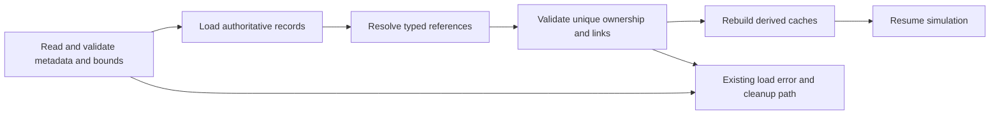

> **Historical donor snapshot — not an execution plan.** OpenTTD3 `75ea75718f`, imported2026-10-23.
> Original: `docs/zz-reach2/upgrades/2026-10/r2mlvs15-savegame-determinism-and-lifecycle.md`; exact source SHA256 `9f316c7d0ca2ce37ba9c17a307c84c535469ccb70aea9fbd1331c15b3968c7dc`.
> Current integration: [M2O23-1](../../../../../../../zz-reach2/upgrades/2026-10/m2o23-1-come-space.md); storage and evidence roles: [archi-historical-debug.md](../../../../../../../zz-reach2/architecture/archi-historical-debug.md). Original completion claims, instructions and human-review limits below remain dated; they grant no new execution, spending, publication or deletion authority.

# R2MLVS15 - Savegame, Determinism and Lifecycle

Owner: [R2MLVS parent](r2mlvs-multilayer-vehicles-and-structures.md). Dispatch: [master9.5B/11.3](r2mlvs3mp-master-plan.md). Architecture: [map layers](../../architecture/map-layers/archi-map-layers.md).

## Global Mandatory Reading

> **Execution protocol**
>
> - Read this Global Mandatory Reading section before the first task and again
>   after every context compaction.
> - Before starting or resuming a task group, read the nearest preceding Area
>   Mandatory Reading block whose `Applies to` label includes that group. Area
>   blocks appear immediately before the first group they govern.
> - A referenced heading or exported symbol is authoritative. Global navigation
>   hints and Area line ranges are for navigation only; if they drift, relocate
>   the named section or symbol rather than expanding to the whole file.
> - Mandatory reading is non-transitive. Do not preload a linked file's own
>   Mandatory Reading, Consult on Demand, or Planning Provenance entries unless
>   this plan names them directly for the current area.
> - Do not read Consult on Demand or Planning Provenance merely because those
>   sources are listed. Use a Consult on Demand source only when its trigger
>   occurs.
> - No created source file, test file or JSON file should start with same prefix as a planning MD file (such as r2). Only MD files can have that prefix. No MD file should be created anywhere in source directories unless specifically asked.
> - After EVERY CONTEXT COMPACTION, you must add a note above the task group
>   which is currently in execution. The note will say: "Context has compacted
>   X times while executing this group.". If the compaction occurs before any
>   meaningful work was done (this can happen when there is a lot of baggage
>   from the previous compaction), then and ONLY then you can skip this step.
> - When exceeding 3 context compactions, YOU MUST ask yourself if you're not 
>   chewing more than we can handle :). Heck, plans change! :). In such a case, 
>   the way out is to split the group on the spot,
>   in the plan, into more groups, 
>   by appending B, C, D as a suffixes to those groups (splitting sub-groups 
>   themselves is also allowed). When you do this, create Local Mandatory
>   Reading areas so you can optimize your context only for the
>   ACTUAL task at hand.
>   Before starting or resuming a task group, read the nearest preceding Area
>   Mandatory Reading block whose `Applies to` label includes that group. Area
>   blocks appear immediately before the first group they govern.

| File name | Line Ranges | Description |
| --- | --- | --- |
| [docs/zz-reach2/upgrades/2026-10/r2mlvs-multilayer-vehicles-and-structures.md](r2mlvs-multilayer-vehicles-and-structures.md) | 296-300 | `AD-14` supplies the canonical gameplay/ownership decision for every group of this plan. It constrains feature-owned serialization, old-save compatibility and deterministic lifecycle repair; a consumer must not redefine it locally. |
| [src/map_layer.h](../../../../../../../../src/tests/fixtures/cleanup/source-epochs/29c86bf77e2c7b62-map_layer.h) | 78-85 | `MultiLayerMap` ownership preamble: `Map` owns packed storage/geometry and this controller owns layer semantics. Every group uses world tiles/explicit layer helpers; camera selection and ad hoc plane offsets cannot define gameplay. |
| [src/saveload/saveload.h](../../../../../../../../src/tests/fixtures/cleanup/source-epochs/openttd3-75ea75718f/07a93e01c4af28af-saveload.h) | 447-518 | `ChunkType`, `ChunkId`, `ChunkHandler` and handler aliases define save/load/fixup/preview ownership; every feature persists its own authoritative fields through this boundary. |

Status: Groups 1-6 initial M0 Schema Foundation delivered, including metadata/editor/legacy round trips, reference hooks and canonical diagnostics. [Schema evidence](../../../../../../../../../OpenTTD3/docs/zz-reach2/upgrades/2026-10/r2mlvs15-a-schema-foundation.md) records the focused validation. Later feature-phase save/network acceptance and the full plan remain unfinished. Parent: [R2MLVS master](r2mlvs-multilayer-vehicles-and-structures.md).

**Artifact-layout migration (2026-10-09):** this plan consumes the parent [Development artifact layout](r2mlvs-multilayer-vehicles-and-structures.md#development-artifact-layout), implemented by [R2FC](r2fc-file-cleanup.md). It supersedes earlier docs asset/review/helper placement and fixed runtime-config destinations below. New native homes use `mlm/runtime/`, generated feature reviews use `mlm/reviews/`, logs remain under `logs/`, and reusable code/curated inputs keep their code/test owners. Paths and focused native/cold verification are complete; R2FC records the results and retained-input identities. Repository-relative executable commands run from the checkout root through their context-aware wrappers. Historical pass records remain dated evidence and are not new acceptance claims. No gameplay task is completed by this migration and the separate post-demo fixture-pruning gate remains.

## Outcome and Boundaries

**Delivered definition/queue handoff,2026-10-12:** Plan1 Group12B publishes
`multilayer_space_content.h` revision2 recipes, mass, budgets and paid-facility
admission; Plan8 Group6B publishes native `space_orders.h` queue/generation
ownership. Save410 carries exact `SDEF` content identity and separate bounded
`SPOR` transport, preserving ground/profile/package1 and paid old objects.
Both builds and focused native save/replay/refusal gates pass; see
`logs/space-content-orders-verification.json`. These handoffs grant no missing
commissioning, survey, blueprint, processing, descent, service, UI/art or network
producer. Consume their public definitions/commands; retain unfinished tasks.

The complete economy survives saves, multiplayer joins and entity removal without corruption, duplication or dependence on the visible layer.

## State ownership register

**Additional Space authority,2026-10-12:** consume the
[revised Space contract](../../../../../../../../../OpenTTD3/docs/zz-reach2/upgrades/2026-10/r2mlvs1-d-recipes-and-bootstrap.md#space-economy-revision---2026-10-12).
Persist native probe role and typed order queue/index; current target and
generation; scan work and per-company body knowledge; embodied paid payload;
blueprint deliveries/reservations/consumption; selected Steelworks/Goodsworks
recipe, utility/work remainder and output provenance. Each cargo quantity has
one owner across vehicle, construction job, completed station and descent.
Profile changes and appended fields require explicit old-save handling: no
free scan/stock/build, no retroactive material bill, and no inherited knowledge
when a CompanyID is reused. Compare interrupted scan, first-Core delivery,
processor output, local assembly and export-versus-build reservations through
ordinary reload and network join. These remain pending feature acceptance.

R2TBMF8 save handoff,2026-10-09:397 registers portal magazine storage in the existing native Depot pool and map identity fields, with ordinary native depot orders owning the selected destination.398 extends existing controller phase/reason fields for explicit ordinary-list control. Saved work anchors, cargo packets, work remainders and machinery identities remain with their original owners. Full loading cross-checks portal/depot identity and both directions of a paid starter-pocket job binding, including reused portals whose centre is open but surrounding cells are not. Actual397 return/parked files,398 moving-order and remote-reassignment files, nonmutating previews and malformed phase/reason/depot refusals are verified in [W](../../../../../../../../../OpenTTD3/docs/zz-reach2/upgrades/2026-10/tbm-fixes/r2tbmf-w-order-control-notes.md#group8-closure) and its T/V handoffs. No fractional cargo transport was introduced.

| Authoritative state | Feature owner | Derived data rebuilt after load |
| --- | --- | --- |
| Gameplay profile, content identity, tuning, feature seeds, Deep/model/factory availability and explicit legacy/editor policies | 1 | Resolved capability/content/calendar lookups |
| Excavation, deposit reserve, claim, job progress/support | 2 | Survey/render caches and work queues |
| Sealed/commissioning portal and TBM access assignment | 3 | Normal and work-route connectivity caches |
| TBM state, cutter heading, area outline/pass progress, face, costs/remainders, wagon references | 4 | Vehicle display and route summaries |
| Exchange assignment, origin station, hauler/empty sets | 5 | Queue views; train caches after validated consist restoration |
| Mine/deposit binding, reserve consumption, processor inventory | 6 | Catchment and production UI caches |
| Orbital identity/position/motion, typed targets, transition phase | 8 | Spatial indexes and interpolation state |
| Payload ownership, immutable launch anchor, drop release position, target, pad queue, descent and service timers | 9 | Drop-zone/render previews |
| Launch hub memberships, collection radius, stock reservations and timed Surface handling jobs | 9 | Membership lookup, demand queues and collection overlay |
| Asteroid reserve, probe attachment and extraction remainder | 10 | Target search acceleration |
| Blueprint reservation, inventory, consumed inputs, assembly progress | 11 | Module adjacency and displayed capacity |
| Mirror target, service/coverage and output remainder | 12 | Farm mirror lookup and drawn beam |
| Tube vehicle capability/definition IDs, cargo/orders, service and paid-power demand | 16 | Route/reservation and power-availability caches |
| Vent identity/capacity/claim, utility connectivity, allocated heat, conversion/recipe remainders and export | 17 | Thermal/electrical distribution graphs and heat overlays |

Ordinary cargo packet/vehicle/station persistence should be reused where possible. Do not save a second independent count of the same physical cargo without a strict ownership/consistency rule.

## Public Handoff Contract

R2TBMF10-11 handoff,2026-10-09: save399 adds the geological hardness algorithm/seed to GEOS wire2. Saves through398 retain legacy layer/deposit hardness with version0/seed0, including after resaving. Regional generation consumes no Surface RNG and rendering reads authoritative hardness. [Z](../../../../../../../../../OpenTTD3/docs/zz-reach2/upgrades/2026-10/tbm-fixes/r2tbmf-z-geology-notes.md#group10-closure) records actual legacy/new files, malformed preview/full-load refusals, preserved native content and a real399 network map transfer followed by450 synchronized frames. The broader master multiplayer matrix remains separate. [ZB](../../../../../../../../../OpenTTD3/docs/zz-reach2/upgrades/2026-10/tbm-fixes/r2tbmf-zb-final-notes.md) links real accepted, mid-work, local staging, B construction/commissioning, withdrawal/parking, release and public-freight files for one machine; cargo remains in whole native units.

R2TBMF parking/release extension,2026-10-09:395 adds ReturnToPark/WaitToPark/Parked;396 adds ReturnToRelease/WaitToRelease/ReleasePending to the existing TBMP phase field. Earlier phase values, vehicle/job identities and394 work-rate migration retain their meanings. Both preview and full reading bound phases by the saved version. New cancellation preserves work/claims until physical withdrawal and delivery, while previously cancelled legacy work remains cancelled. Real395 parking and396 pending cancellation, release and public-connection loads retain actual vehicles and support same-machine reuse ([P](../../../../../../../../../OpenTTD3/docs/zz-reach2/upgrades/2026-10/tbm-fixes/r2tbmf-p-parking-notes.md), [R](../../../../../../../../../OpenTTD3/docs/zz-reach2/upgrades/2026-10/tbm-fixes/r2tbmf-r-release-notes.md#group7b-closure)); broader malformed/final network acceptance remains scoped to the fixing plan's final checks. No cargo fractions or new cargo fields are introduced.

Delivered foundation owner: `src/multilayer_state.h`, publishing `MultiLayerStateSchema` and `ValidateMultiLayerStateReferences`. Ground and electrical producer save/preview/fixup/Null/lifecycle evidence is delivered through current385; real multiplayer and later capsule/thermal/orbital families remain pending. Downstream consumers use these public owners, not private pools or copied tables.

`Schema Foundation Handoff`: the first reading area publishes empty-compatible profile/schema/version rules and reference validation exports before new world-state implementation. Feature plans add their own descriptors as they land. Final feature/network audits do not block this initial checkpoint.

Selected actual lifecycle handoff,2026-10-19: staged15C/15D/15E completes master9.5B's actual tube depot/interchange/power,vent/collector,both operating generators and native riser rows through their existing public hooks. The [policy](portal-tbm/r2mlvs3mp-z-utility-lifecycle-policy.md) and [combined receipt] (historical reference: `../../../../logs/lifecycle/owner-return/20261018-native-01/handoff-verification.json`) retain exact post-event packet/order/stock/settled-energy owners,122current native cases/53774assertions and14complete126-chunk cross-reader pairs. Unsafe occupied removal refuses;allowed loss/rebuild expires only unused rights;canonical takeover/terminal liquidation and numeric IDreuse have explicit surviving/terminal policies. Actual original paid reconstruction/service remains Plan18's sealed26-state/native+production proof. A changed executable revision may append only one field-checked native diagnostic event,with all125other chunks and prior GLOGbytes unchanged. Whole15.3/15.4 later-profile/orbital portions,real host/client joins and human/operator gates remain pending. Continue master10.8 actual paidTBM/tube final-use integration.

## Implementation Tasks

Ground execution scope: [R2MLVS3MP](r2mlvs3mp-master-plan.md) schedules this plan's foundation and ground-family audits. For its scoped rows, require the actual content/geology/portal/TBM/exchange producers and, only for tube/riser rows, the relevant delivered tube/utility/geothermal producers. Orbital references in a shared area's entry list apply to orbital rows and final whole-epic closure, not to an independent ground audit. Validate every family actually present in the saved feature metadata; do not allocate surrogate objects for an absent family. Only fully covered original tasks/groups may be marked X; mixed-family tasks remain partial with their untested scope recorded.

Deepening pass, 2026-10-04: implementation groups use only SIMPLE, MEDIUM or HARD difficulty, with at most eight pending tasks each. Sketches describe proposed implementation contracts; verify the named earlier producers at each assumption gate. No gameplay or asset implementation is marked complete by this planning pass.

Groups are chronological and contain consecutive tasks of one difficulty. Each difficulty batch has at most eight tasks; area reading changes only when the implementation boundary or source of truth changes.

### Area Mandatory Reading - Schema and migration foundation

_Applies to Groups 1-6._

**Entry gate.** The following public contracts must exist before dependent implementation in this area: `src/multilayer_content.h`: `MultiLayerGameplayProfile`, `LayerVehicleCapability`, `GetMultiLayerContentProfile`, `CheckDeepLayerAvailability`, `UtilityPowerAccount`.
Verify each public file/export/schema field with `rg` in the current workspace and inspect its command/field ownership. For a same-plan contract, compile its type/signature fixture or validate its artifact after the preceding producer groups. For cross-plan behavior, also run the producer's focused executable boundary test; declarations alone cannot authorize dependent mutations or runtime claims.
If a required export is absent, stop the dependent implementation, mutation and runtime claims in Groups 1-6. Read-only characterization, source/range verification, test-case design and asset-template work that does not assume the missing behavior may continue.
Do not bypass this gate by copying private pool/tile state, inventing local IDs or cargo registries, using a historical plan as a delivered implementation, opening user-wide content stores, substituting a second utility/accounting authority, or adding an unreviewed fallback path. Finish the named producer or revise the shared contract and its direct consumers first.

| File name | Line Ranges | Description |
| --- | --- | --- |
| [src/saveload/map_sl.cpp](../../../../../../../../src/tests/fixtures/cleanup/source-epochs/8175f46f8af2acc5-map_sl.cpp) | 30-100 | `_map_desc`, `MapFileTileCount`, `MAPSChunkHandler` distinguish stored layer count from live allocation and validate corrupt/missing planes. |
| [src/saveload/vehicle_sl.cpp](../../../../../../../../src/tests/fixtures/cleanup/source-epochs/openttd3-75ea75718f/6db99340d5935853-vehicle_sl.cpp) | 1119-1196 | `VEHSChunkHandler` and registration construct the vehicle class from saved type before member loading; protect old enum meanings and validate new references. |
| [src/command.cpp](../../../../../../../../src/tests/fixtures/cleanup/source-epochs/openttd3-75ea75718f/99c9ff0dcef87e2f-command.cpp) | 301-328 | `CommandHelperBase::InternalExecuteValidateTestAndPrepExec` defines refusal/estimate before execution; no validation phase may consume inventory, RNG or funds. |
| `src/multilayer_content.h` (planned public contract; link after implementation) | Live definitions; no fixed range | [r2mlvs1-gameplay-contracts-and-content.md](../../../../../../../../../OpenTTD3/docs/zz-reach2/upgrades/2026-10/r2mlvs1-gameplay-contracts-and-content.md) Groups 1-6, ending with Group 6's public-contract task, publish `MultiLayerGameplayProfile`, `LayerVehicleCapability`, `GetMultiLayerContentProfile`, `CheckDeepLayerAvailability`, `UtilityPowerAccount`. These exports/schema fields are authoritative for this area. Same-plan consumers follow those earlier groups; cross-plan consumers verify the producer's required implementation/tests as well. Proposed names alone do not prove delivery. |
| [src/saveload/saveload.cpp](../../../../../../../../src/tests/fixtures/cleanup/source-epochs/openttd3-75ea75718f/ca336e417cabc8ed-saveload.cpp) | 223-314 | Complete `ChunkHandlers` registry fixes handler order and registration; allocate new IDs without changing legacy meanings. |

**ASSUMPTION: this was already built previously. If not, re-asses at runtime**. This applies only to the producer contracts named in this area's gate, after their listed producer groups have run. Verify their actual exports and focused tests before using the sketches below; proposed types and helper names in sketches are not evidence of delivered code.

**Foundation scope.** The first area consumes Draft Content and publishes schema/digest contracts for Content Freeze. It does not require completed feature pools, new vehicle kinds or the final runtime grid. Feature owners add concrete descriptors and focused mid-action tests as those implementations land.

### Group 1 - Schema and migration foundation

{{MEDIUM}}
- [X] 1.1 Assign each state field one owner and representation.
- [X] 1.2 Define stable typed references, valid ranges, limits, optional/invalid semantics and reference removal hooks before producers write data.

### Group 2 - Reserve schema identities and implement metadata scaffolding

{{HARD}}
- [X] 2.1 Inspect the current SaveLoadVersion and all registered chunk IDs, then allocate unique symbolic revisions/IDs. Preserve historical layer and vehicle meanings; never assume numeric 371 is still available.
- [X] 2.2 Define feature/profile metadata fields, size limits, required content identity and preview behavior from r2mlvs1 Draft Content. Implement an empty-compatible scaffold that can validate metadata without depending on feature pools not yet built.
- [X] 2.3 Add load/preview/fixup registration for the scaffold and legacy missing-chunk defaults. Identify the earliest supported point to reject missing/incompatible content before unsafe feature activation.
- [X] 2.4 Test empty new-profile metadata and old Surface/369/370 saves with unchanged legacy rules. Publish schema shape to Content Freeze; later feature records remain their owners responsibility.

### Group 3 - Schema and migration foundation

{{MEDIUM}}
- [X] 3.1 Define legacy load policy for Surface-only saves, versions 369/370 and existing content sets: preserve legacy free underground building and working portals under their saved compatibility mode. New profile generation starts solid; loading old infrastructure must not bury it.
- [X] 3.2 Keep an existing-world conversion tool out of initial scope unless separately designed with cargo/content compatibility and excavation reconstruction. Never auto-enable the new economy by merely changing a setting on load.

### Group 4 - Specify command encoding and canonical state digests

{{HARD}}
- [X] 4.1 Define typed wire fields for feature commands, enum validity, coordinate bounds and optional references. Preserve existing command/save meanings and reject malformed input before mutation.
- [X] 4.2 Define canonical digest order by feature kind and stable ID, then explicit integer fields: reserves, packet owner/quantity, job phase/progress, RNG state, fixed-point positions, leases and accounting remainders.
- [X] 4.3 Exclude pointers, padding, unordered iteration and derived visual/cache state. Give absent/empty records unambiguous encoding and include profile/schema version.
- [X] 4.4 Add a small digest fixture that changes one authoritative field at a time and ignores a presentation-only change; publish the extension points without pretending later feature state already exists.

### Group 5 - Schema and migration foundation

{{MEDIUM}}
- [X] 5.1 Add these fields to desync diagnostics.
- [X] 5.2 Include the 1980 Deep policy and later model/factory dates in profile/version compatibility. Calendar availability is derived from the simulation calendar and saved policy, never local wall time. Explicit legacy/editor exceptions must not leak into ordinary new games.

### Group 6 - Schema and migration foundation

{{HARD}}
- [X] 6.1 Publish `src/multilayer_state.h` with the exact exports/schema fields in `Public Handoff Contract`; document authoritative fields, invalid-ID semantics and command/estimate boundaries. Register any created C++ source in the existing build list. If the chosen implementation uses a different public location, update this contract and every direct consumer before declaring the producer ready.

M0 Foundation evidence: [schema/ownership, actual migration and digest record](../../../../../../../../../OpenTTD3/docs/zz-reach2/upgrades/2026-10/r2mlvs15-a-schema-foundation.md). Groups 1-6 are complete; later feature/lifecycle/network audits remain unchecked. This handoff does not claim future feature pools or whole-world desync acceptance.

### Area Mandatory Reading - Feature persistence integration

_Applies to Groups 7-14._

**Entry gate.** The following public contracts must exist before dependent implementation in this area: `src/multilayer_state.h`: `MultiLayerStateSchema`, `ValidateMultiLayerStateReferences`.
Verify each public file/export/schema field with `rg` in the current workspace and inspect its command/field ownership. For a same-plan contract, compile its type/signature fixture or validate its artifact after the preceding producer groups. For cross-plan behavior, also run the producer's focused executable boundary test; declarations alone cannot authorize dependent mutations or runtime claims.
If a required export is absent, stop the dependent implementation, mutation and runtime claims in Groups 7-14. Read-only characterization, source/range verification, test-case design and asset-template work that does not assume the missing behavior may continue.
Do not bypass this gate by copying private pool/tile state, inventing local IDs or cargo registries, using a historical plan as a delivered implementation, opening user-wide content stores, substituting a second utility/accounting authority, or adding an unreviewed fallback path. Finish the named producer or revise the shared contract and its direct consumers first.

**Scoped integration gates.** The following producer dependencies apply only to the named implementation/test families. Verify each required public export and its focused producer test before those integrations; absent late producers do not block already independent features.

- `src/excavation.h` is required for the r2mlvs2 feature-specific descriptors/fixups/round-trips; other delivered features may be persisted/validated independently, and combined claims wait for all required producers in Groups 7-14 (only the named integration/subscenario). If absent, stop only that integration/subscenario and its passing claim. Other independent code, art, persistence and tests in this area may continue.
- `src/layer_portal_cmd.h` is required for the r2mlvs3 feature-specific descriptors/fixups/round-trips; other delivered features may be persisted/validated independently, and combined claims wait for all required producers in Groups 7-14 (only the named integration/subscenario). If absent, stop only that integration/subscenario and its passing claim. Other independent code, art, persistence and tests in this area may continue.
- `src/tbm.h` is required for the r2mlvs4 feature-specific descriptors/fixups/round-trips; other delivered features may be persisted/validated independently, and combined claims wait for all required producers in Groups 7-14 (only the named integration/subscenario). If absent, stop only that integration/subscenario and its passing claim. Other independent code, art, persistence and tests in this area may continue.
- `src/tbm_exchange.h` is required for the r2mlvs5 feature-specific descriptors/fixups/round-trips; other delivered features may be persisted/validated independently, and combined claims wait for all required producers in Groups 7-14 (only the named integration/subscenario). If absent, stop only that integration/subscenario and its passing claim. Other independent code, art, persistence and tests in this area may continue.
- `src/multilayer_industry.h` is required for the r2mlvs6 feature-specific descriptors/fixups/round-trips; other delivered features may be persisted/validated independently, and combined claims wait for all required producers in Groups 7-14 (only the named integration/subscenario). If absent, stop only that integration/subscenario and its passing claim. Other independent code, art, persistence and tests in this area may continue.
- `src/space.h` is required for the r2mlvs8 feature-specific descriptors/fixups/round-trips; other delivered features may be persisted/validated independently, and combined claims wait for all required producers in Groups 7-14 (only the named integration/subscenario). If absent, stop only that integration/subscenario and its passing claim. Other independent code, art, persistence and tests in this area may continue.
- `src/launch_center.h` is required for the r2mlvs9 feature-specific descriptors/fixups/round-trips; other delivered features may be persisted/validated independently, and combined claims wait for all required producers in Groups 7-14 (only the named integration/subscenario). If absent, stop only that integration/subscenario and its passing claim. Other independent code, art, persistence and tests in this area may continue.
- `src/asteroid.h` is required for the r2mlvs10 feature-specific descriptors/fixups/round-trips; other delivered features may be persisted/validated independently, and combined claims wait for all required producers in Groups 7-14 (only the named integration/subscenario). If absent, stop only that integration/subscenario and its passing claim. Other independent code, art, persistence and tests in this area may continue.
- `src/orbital_station.h` is required for the r2mlvs11 feature-specific descriptors/fixups/round-trips; other delivered features may be persisted/validated independently, and combined claims wait for all required producers in Groups 7-14 (only the named integration/subscenario). If absent, stop only that integration/subscenario and its passing claim. Other independent code, art, persistence and tests in this area may continue.
- `src/solar_power.h` is required for the r2mlvs12 feature-specific descriptors/fixups/round-trips; other delivered features may be persisted/validated independently, and combined claims wait for all required producers in Groups 7-14 (only the named integration/subscenario). If absent, stop only that integration/subscenario and its passing claim. Other independent code, art, persistence and tests in this area may continue.
- `src/transport_tube.h` is required for the r2mlvs17 feature-specific descriptors/fixups/round-trips; other delivered features may be persisted/validated independently, and combined claims wait for all required producers in Groups 7-14 (only the named integration/subscenario). If absent, stop only that integration/subscenario and its passing claim. Other independent code, art, persistence and tests in this area may continue.
- `src/geothermal.h` is required for the r2mlvs18 feature-specific descriptors/fixups/round-trips; other delivered features may be persisted/validated independently, and combined claims wait for all required producers in Groups 7-14 (only the named integration/subscenario). If absent, stop only that integration/subscenario and its passing claim. Other independent code, art, persistence and tests in this area may continue.

Do not emulate an absent producer with copied private state, fake inventories/energy, local IDs or a second registry/grid. A final combined closure/gallery/round-trip still waits for every required family; an independent passing case is not a pass for the missing integration.

| File name | Line Ranges | Description |
| --- | --- | --- |
| [src/industry.h](../../../../../../../../src/tests/fixtures/cleanup/source-epochs/openttd3-75ea75718f/775b4d3c972f76c6-industry.h) | 75-106 | `ProducedCargo`, `AcceptedCargo`, `ProducedCargoes`, `AcceptedCargoes` expose bounded inventory and economy-time history; conserve materials and avoid narrow-counter overflow. |
| [src/cargopacket.h](../../../../../../../../src/tests/fixtures/cleanup/source-epochs/openttd3-75ea75718f/4b67849d158c5190-cargopacket.h) | 458-489 | `VehicleCargoList::Append`, `AgeCargo`, `Stage`, `Return`, `Unload`, `Shift` move accountable packets; exchange/descent/processing must not clone packet age or feeder shares. |
| [src/network/network_command.cpp](../../../../../../../../src/tests/fixtures/cleanup/source-epochs/openttd3-75ea75718f/cab07f5ceefcfdf4-network_command.cpp) | 256-288 | `NetworkExecuteLocalCommandQueue` executes agreed frame order/company authority; all jobs use deterministic simulation time. |
| `src/multilayer_state.h` (planned public contract; link after implementation) | Live definitions; no fixed range | [r2mlvs15-savegame-determinism-and-lifecycle.md](r2mlvs15-savegame-determinism-and-lifecycle.md) Groups 1-6, ending with Group 6's public-contract task, publish `MultiLayerStateSchema`, `ValidateMultiLayerStateReferences`. These exports/schema fields are authoritative for this area. Same-plan consumers follow those earlier groups; cross-plan consumers verify the producer's required implementation/tests as well. Proposed names alone do not prove delivery. |
| `src/excavation.h` (planned public contract; link after implementation) | Live definitions; no fixed range | [r2mlvs2-geology-and-excavation.md](r2mlvs2-geology-and-excavation.md) Groups 1-7, ending with Group 7's public-contract task, publish `ExcavationState`, `GeologyDeposit`, `ExcavationJob`, `CheckExcavatedFootprint`, `CommitExcavationCut`, `GeothermalVentField`. These exports/schema fields are authoritative for this area. Same-plan consumers follow those earlier groups; cross-plan consumers verify the producer's required implementation/tests as well. Proposed names alone do not prove delivery. Read this producer for the r2mlvs2 feature-specific descriptors/fixups/round-trips; other delivered features may be persisted/validated independently, and combined claims wait for all required producers in Groups 7-14 (only the named integration/subscenario); missing it blocks only that integration, not independent work. |
| [src/layer_portal_cmd.h](../../../../../../../../src/tests/fixtures/cleanup/source-epochs/openttd3-75ea75718f/c9b88cad24d07722-layer_portal_cmd.h) | Live definitions; no fixed range | [r2mlvs3-sealed-portals-and-deep-rail.md](r2mlvs3-sealed-portals-and-deep-rail.md) Groups 1-7, ending with Group 7's public-contract task, publish `LayerPortalWorkState`, `GetLayerPortalWorkState`, `CheckLayerPortalWorkAccess`, `CommissionLayerPortalTBM`. These exports/schema fields are authoritative for this area. Same-plan consumers follow those earlier groups; cross-plan consumers verify the producer's required implementation/tests as well. Proposed names alone do not prove delivery. Read this producer for the r2mlvs3 feature-specific descriptors/fixups/round-trips; other delivered features may be persisted/validated independently, and combined claims wait for all required producers in Groups 7-14 (only the named integration/subscenario); missing it blocks only that integration, not independent work. |
| `src/tbm.h` (planned public contract; link after implementation) | Live definitions; no fixed range | [r2mlvs4-tunnel-boring-machines.md](r2mlvs4-tunnel-boring-machines.md) Groups 1-5, ending with Group 5's public-contract task, publish `TBMProject`, `TBMWorkState`, `ValidateTBMAreaRoute`, `AdvanceTBMWork`. These exports/schema fields are authoritative for this area. Same-plan consumers follow those earlier groups; cross-plan consumers verify the producer's required implementation/tests as well. Proposed names alone do not prove delivery. Read this producer for the r2mlvs4 feature-specific descriptors/fixups/round-trips; other delivered features may be persisted/validated independently, and combined claims wait for all required producers in Groups 7-14 (only the named integration/subscenario); missing it blocks only that integration, not independent work. |
| `src/tbm_exchange.h` (planned public contract; link after implementation) | Live definitions; no fixed range | [r2mlvs5-spoil-wagons-and-haulage.md](r2mlvs5-spoil-wagons-and-haulage.md) Groups 1-5, ending with Group 5's public-contract task, publish `TBMExchangeAssignment`, `ValidateTBMWagonExchange`, `ExecuteTBMWagonExchange`. These exports/schema fields are authoritative for this area. Same-plan consumers follow those earlier groups; cross-plan consumers verify the producer's required implementation/tests as well. Proposed names alone do not prove delivery. Read this producer for the r2mlvs5 feature-specific descriptors/fixups/round-trips; other delivered features may be persisted/validated independently, and combined claims wait for all required producers in Groups 7-14 (only the named integration/subscenario); missing it blocks only that integration, not independent work. |
| `src/multilayer_industry.h` (planned public contract; link after implementation) | Live definitions; no fixed range | [r2mlvs6-mines-and-resource-chains.md](r2mlvs6-mines-and-resource-chains.md) Groups 1-6, ending with Group 6's public-contract task, publish `LayerIndustryCapability`, `ValidateMineDepositClaim`, `ProduceLayerMineCargo`, `PrepareLayerRecipeBatch`, `CommitLayerRecipeBatch`. These exports/schema fields are authoritative for this area. Same-plan consumers follow those earlier groups; cross-plan consumers verify the producer's required implementation/tests as well. Proposed names alone do not prove delivery. Read this producer for the r2mlvs6 feature-specific descriptors/fixups/round-trips; other delivered features may be persisted/validated independently, and combined claims wait for all required producers in Groups 7-14 (only the named integration/subscenario); missing it blocks only that integration, not independent work. |
| `src/space.h` (planned public contract; link after implementation) | Live definitions; no fixed range | [r2mlvs8-space-world-and-construction.md](r2mlvs8-space-world-and-construction.md) Groups 1-7, ending with Group 7's public-contract task, publish `SpaceVehicle`, `OrbitalBodyID`, `SpaceMission`, `SpaceStructure`, `SpaceTransition`. These exports/schema fields are authoritative for this area. Same-plan consumers follow those earlier groups; cross-plan consumers verify the producer's required implementation/tests as well. Proposed names alone do not prove delivery. Read this producer for the r2mlvs8 feature-specific descriptors/fixups/round-trips; other delivered features may be persisted/validated independently, and combined claims wait for all required producers in Groups 7-14 (only the named integration/subscenario); missing it blocks only that integration, not independent work. |
| `src/launch_center.h` (planned public contract; link after implementation) | Live definitions; no fixed range | [r2mlvs9-launch-centers-and-rockets.md](../../../../../../../../../OpenTTD3/docs/zz-reach2/upgrades/2026-10/r2mlvs9-launch-centers-and-rockets.md) Groups 1-7, ending with Group 7's public-contract task, publish `LaunchCenterAnchor`, `LaunchCollectionHub`, `SurfaceHandlingJob`, `SpaceDescentJob`, `CanReleaseOrbitalCargo`, `CommitOrbitalCargoRelease`. These exports/schema fields are authoritative for this area. Same-plan consumers follow those earlier groups; cross-plan consumers verify the producer's required implementation/tests as well. Proposed names alone do not prove delivery. Read this producer for the r2mlvs9 feature-specific descriptors/fixups/round-trips; other delivered features may be persisted/validated independently, and combined claims wait for all required producers in Groups 7-14 (only the named integration/subscenario); missing it blocks only that integration, not independent work. |
| `src/asteroid.h` (planned public contract; link after implementation) | Live definitions; no fixed range | [r2mlvs10-asteroids-and-mining-probes.md](r2mlvs10-asteroids-and-mining-probes.md) Groups 1-7, ending with Group 7's public-contract task, publish `AsteroidBody`, `AdvanceAsteroidField`, plus `SpaceVehicle`, `SpaceMission`, `AssignSpaceMiningMission` and `SpaceVehicle::Tick` in `src/space_vehicle.h`. These exports/schema fields are authoritative for this area. Same-plan consumers follow those earlier groups; cross-plan consumers verify the producer's required implementation/tests as well. Proposed names alone do not prove delivery. Read this producer for the r2mlvs10 feature-specific descriptors/fixups/round-trips; other delivered features may be persisted/validated independently, and combined claims wait for all required producers in Groups 7-14 (only the named integration/subscenario); missing it blocks only that integration, not independent work. |
| `src/orbital_station.h` (planned public contract; link after implementation) | Live definitions; no fixed range | [r2mlvs11-orbital-stations-and-manufacturing.md](../../../../../../../../../OpenTTD3/docs/zz-reach2/upgrades/2026-10/r2mlvs11-orbital-stations-and-manufacturing.md) Groups 1-6, ending with Group 6's public-contract task, publish `OrbitalModule`, `OrbitalConstructionJob`, `ReserveOrbitalConstructionInputs`, `CommitOrbitalConstructionStep`. These exports/schema fields are authoritative for this area. Same-plan consumers follow those earlier groups; cross-plan consumers verify the producer's required implementation/tests as well. Proposed names alone do not prove delivery. Read this producer for the r2mlvs11 feature-specific descriptors/fixups/round-trips; other delivered features may be persisted/validated independently, and combined claims wait for all required producers in Groups 7-14 (only the named integration/subscenario); missing it blocks only that integration, not independent work. |
| `src/solar_power.h` (planned public contract; link after implementation) | Live definitions; no fixed range | [r2mlvs12-solar-farms-mirrors-and-eti.md](r2mlvs12-solar-farms-mirrors-and-eti.md) Groups 1-6, ending with Group 6's public-contract task, publish `SolarGenerationAccount`, `MirrorAssignment`, `ComputeMirrorSolarOutput`. These exports/schema fields are authoritative for this area. Same-plan consumers follow those earlier groups; cross-plan consumers verify the producer's required implementation/tests as well. Proposed names alone do not prove delivery. Read this producer for the r2mlvs12 feature-specific descriptors/fixups/round-trips; other delivered features may be persisted/validated independently, and combined claims wait for all required producers in Groups 7-14 (only the named integration/subscenario); missing it blocks only that integration, not independent work. |
| `src/transport_tube.h` (planned public contract; link after implementation) | Live definitions; no fixed range | [r2mlvs17-underground-transport-tubes.md](r2mlvs17-underground-transport-tubes.md) Groups 1-8, ending with Group 8's public-contract task, publish `TubeVehicleCapability`, `TubeTerminal`, `CheckTubeConstruction`, `ComputeTubePowerDemand`. These exports/schema fields are authoritative for this area. Same-plan consumers follow those earlier groups; cross-plan consumers verify the producer's required implementation/tests as well. Proposed names alone do not prove delivery. Read this producer for the r2mlvs17 feature-specific descriptors/fixups/round-trips; other delivered features may be persisted/validated independently, and combined claims wait for all required producers in Groups 7-14 (only the named integration/subscenario); missing it blocks only that integration, not independent work. |
| `src/geothermal.h` (planned public contract; link after implementation) | Live definitions; no fixed range | [r2mlvs18-geothermal-energy-and-industry.md](r2mlvs18-geothermal-energy-and-industry.md) Groups 1-7, ending with Group 7's public-contract task, publish `GeothermalHeatAllocation`, `GeothermalUtilityLink`, `AllocateVentHeat`, `ExportGeothermalPower`. These exports/schema fields are authoritative for this area. Same-plan consumers follow those earlier groups; cross-plan consumers verify the producer's required implementation/tests as well. Proposed names alone do not prove delivery. Read this producer for the r2mlvs18 feature-specific descriptors/fixups/round-trips; other delivered features may be persisted/validated independently, and combined claims wait for all required producers in Groups 7-14 (only the named integration/subscenario); missing it blocks only that integration, not independent work. |
| [src/saveload/saveload.cpp](../../../../../../../../src/tests/fixtures/cleanup/source-epochs/openttd3-75ea75718f/ca336e417cabc8ed-saveload.cpp) | 2366-2400 | Complete `SlLoadChunks`, `SlLoadCheckChunks`, `SlFixPointers` show file-order reads versus registry-order fixups; validate at the appropriate phase. |
| [src/saveload/saveload.cpp](../../../../../../../../src/tests/fixtures/cleanup/source-epochs/openttd3-75ea75718f/ca336e417cabc8ed-saveload.cpp) | 317-363 | Complete `SlNullPointers` and `SlError` define partial-load cleanup; new fixups must tolerate Null action and absent pools. |
| [src/saveload/saveload.cpp](../../../../../../../../src/tests/fixtures/cleanup/source-epochs/openttd3-75ea75718f/ca336e417cabc8ed-saveload.cpp) | 3202-3298 | Complete `DoLoad` mutates the in-progress load world and reports reinitialization on failure; do not promise restoration of the prior live world. |
| `src/utility_power.h` (planned public contract; link after implementation) | Live definitions; no fixed range | [r2mlvs12](r2mlvs12-solar-farms-mirrors-and-eti.md) `Useful Power Handoff`, produced by its native-ledger, atomic-mutation and consumer-effect groups, supplies `PublishUtilityGeneration`, `AllocateUtilityPower`, `GetUtilityAllocation`, `UtilityGrantID`, `UtilityMutationKind`, `PrepareUtilityMutation`, `CommitUtilityMutation`. Verify its allocation, consume/release/layer-transfer, effect and save/retry fixtures before dependent power mutations; no private account writes or duplicate grid. |

**ASSUMPTION: this was already built previously. If not, re-asses at runtime**. This applies only to the producer contracts named in this area's gate, after their listed producer groups have run. Verify their actual exports and focused tests before using the sketches below; proposed types and helper names in sketches are not evidence of delivered code.

**Load-validation sketch.** The live loader determines when these phases can run; the sketch describes dependencies, not permission to arbitrarily reorder legacy chunks.

**ASSUMPTION: this was already built previously. If not, re-asses at runtime**. Each feature family supplies its own descriptors, public validator and mid-action fixture before that family's audit. Verify the actual producer tests; missing tube/geothermal or orbital code stops its dependent subscenario only. Do not invent absent records or claim combined save compatibility from an empty schema fixture.

**Utility persistence gate. ASSUMPTION: this was already built previously. If not, re-asses at runtime**. Audit the r2mlvs12 ledger only after its live descriptors and tests exist: source epochs/lineage, grant balances, mutation sequence, consume/release/transfer state and fixed-scale remainders. Preserve recipe inventory-owner discriminants and completed-but-awaiting-materialization jobs too. Missing producers stop only their subscenarios; never reconstruct consumed energy from caches.

**R2MLVS3MP scoped split, 2026-10-05.** Tasks 7.1-15.4 that span feature families are split into named portions: `-G` ground (master 6.5, closed at 11.2), `-T` tube/utility/first generator and riser (master 9.5/11.2) and `-O` orbital or later direct-heat (pending here, outside that queue). The exact rows and their gating exports are in [r2mlvs3mp-e](../../../../../../../../../OpenTTD3/docs/zz-reach2/upgrades/2026-10/portal-tbm/r2mlvs3mp-e-scoped-gates.md#plan-15-groups-7-15). Record evidence against the portion label; a task is checked only when all its portions pass.

`-G` audit status (2026-10-05, R2MLVS3MP master 6.5): mapped row by row in [r2mlvs3mp-k](../../../../../../../../../OpenTTD3/docs/zz-reach2/upgrades/2026-10/portal-tbm/r2mlvs3mp-k-ground-persistence-audit.md), with the ground lifecycle table for 15.1 and owner hooks for 15.4. Its evidence passes at the R2MLVS3MP end-of-Group-7 milestone. Open ground gaps G1-G6 are recorded there: real-file round trips of the 377/378 families, raw vehicle-chain links, corridor claims, the receiver next interval, straddling and spanning saves, and deposit claimants. No task in Groups 7-15 is checked; the `-T` and `-O` portions are still pending.

### Group 7 - Feature persistence integration

{{MEDIUM}}
- [ ] 7.1 Require each feature plan to deliver its state descriptors, after-load reference fixups and meaningful mid-action fixture alongside implementation.
- [X] 7.1G Verify delivered content/geology/portal/TBM/exchange and electrical ground descriptors/fixups against actual current mid-action files and focused producer boundaries. Orbital/tube/thermal rows remain pending.

### Group 8 - Feature persistence integration

{{SIMPLE}}
- [ ] 8.1 Collect a matrix of states covered, not just idle save samples.
- [X] 8.1G Publish the ground state/evidence matrix below, including real partial bend, capacity wait, spanning hauler, origin loss, electrical retirement/transfer/effect and supported legacy formats.

### Group 9 - Validate feature metadata before activating loaded records

{{HARD}}
- [ ] 9.1 Map the live chunk-loading/AfterLoad sequence and insert profile/map metadata validation before new feature code depends on it. Respect existing chunk order and pointer-fixup phases rather than calling runtime APIs on unresolved IDs.
- [ ] 9.2 Bound each new pool/array/shape/inventory length and validate raw numeric coordinates, enums and counters before allocation/use. Reject missing required content and impossible layer/feature combinations.
- [ ] 9.3 Use the loader existing failure cleanup/error path for an invalid in-progress world. Do not resume gameplay with partially validated records or promise restoration of the previous running world unless the loader actually supports it.
- [X] 9.1G Verify ground registry-order fixups and post-company/map/vehicle acceptance in `AfterLoadGame`; staged transport never becomes live authority before these owners validate.
- [X] 9.2G Verify current ground/utility scalar/count/reference refusals through focused owner checks and actual malformed native files; retain exact content/version policies.
- [X] 9.3G Execute actual read/fixup rejection through the normal game's Null cleanup. Preserve the existing in-progress-world failure semantics.

### Group 10 - Resolve references and unique inventory ownership

{{HARD}}
- [ ] 10.1 After all required objects load, resolve deposit/job, TBM/set/head and center/mission/module references through typed public validators. Check saved incarnation/deletion policy against pool ID reuse.
- [ ] 10.2 Implement new fixup handlers for the loader Null action too: partial-load cleanup must not dereference absent pools or replay normal reference validation on uninitialized records.
- [ ] 10.3 Construct a temporary ownership audit for each packet/inventory reservation: exactly one authoritative container owns the quantity and capacity reservations do not duplicate it.
- [ ] 10.4 Validate consist links, attachment leases, module dependencies and job references for duplicate ownership, invalid IDs and forbidden cycles. Reject or apply only the documented legacy repair; do not silently drop cargo.
- [ ] 10.5 Test one corrupt reference class at a time, including two heads claiming a wagon and two jobs claiming an input packet.
### Local Mandatory Reading - Completed ground ownership subset

_Applies to Group10B; supplement Feature persistence Area._

Read only actual `tbm_exchange_load.cpp` duplicate/reused-owner boundaries, current ground48-owner reader and the actual utility read/fixup Null logs linked in the evidence matrix. The original Group10 includes unselected orbital obligations and remains pending; this separate completed subset preserves the eight-task group limit.

### Group 10B - Completed ground ownership audit

{{HARD}}
- [X] 10.1G Resolve actual ground project/support/set/head/origin and utility references through their public validators, including stale/reused/duplicate claims.
- [X] 10.2G Verify ground numeric staging handlers tolerate real Null dispatch without dereferencing absent pools.
- [X] 10.3G Compare all48 present serialized ground owners, including physical packets/vehicles/industries and complete mine/processor/utility families; no second cargo balance is introduced.
- [X] 10.4G Verify actual consist/set ownership and retained utility source/consumer/link lineage, with no silent packet repair.
- [X] 10.5G Execute isolated ground missing/reused/shared wagon/project cases and malformed utility liveness/free-balance cases. Orbital input reservations remain outside this ground subset.

### Group 11 - Rebuild only derived caches after validation

{{HARD}}
- [ ] 11.1 Rebuild geology/spatial buckets, path/approach reservations and utility connectivity from validated authoritative fields in stable order.
- [ ] 11.2 Verify cache reconstruction cannot change cargo, reserves, consumed milestones or source generation totals. Saved active grants/leases remain authority where their contract says so.
- [ ] 11.3 Run one next-tick comparison per feature family after reload and a repeat load; pointer layout, render state and hash insertion order cannot change decisions.
- [X] 11.1G Verify ground derived train/support/route caches rebuild through the actual native application loader after owner validation.
- [X] 11.2G Preserve initial/next-transition ground packet, reserve, invoice and utility history, including exact accepted clock/RNG state on repeated loading.
- [X] 11.3G Compare current partial-bend, capacity-wait and spanning next transitions after one/two actual loads; independently verify staged cut/phase/exchange/utility continuation owners.

### Group 12 - Feature persistence integration

{{MEDIUM}}
- [ ] 12.1 Verify estimate/execute semantics for portal construction, excavation, wagon swaps, launch/deployment, construction consumption and mirror assignment. Failed estimates or retries cannot consume RNG, inventory or funds.
- [ ] 12.2 Verify saves during TBM cuts, straddling consists, queue waits, probe attachment, ascent/descent, partial modules and partial solar periods resume at the same simulation result.
- [X] 12.1G Verify ground portal/project/cut/exchange and electrical estimate/refusal/retry ownership with current focused producer tests.
- [X] 12.2G Verify actual partial cut/bend, loaded capacity wait and spanning-hauler files resume with unchanged current native owners and timing; keep orbital phases pending.

### Ground persistence evidence matrix

This scoped matrix closes the named G subsets, not mixed whole-profile tasks. Current saved inputs remain declared physical development fixtures; first-bootstrap and real host/client joins are separate requirements.

| State/boundary | Actual evidence and scope |
| --- | --- |
| Partial advancing45-degree bend/work | [Group13B current writer and two native loads](#group-13b---verify-current-ground-files-through-real-loading); heading4/cursor3/partial1; same next exchange after3,749 frames |
| Loaded capacity wait | [Native one/two loads] (historical reference: `../../../../logs/r2mlvs3mp-z-a-ground-wagon-wait-checks.log`); same vehicle packets and next exchange aftertwo frames |
| Real spanning hauler | [Current Deep one/two loads] (historical reference: `../../../../logs/r2mlvs3mp-z-a-ground-current-spanning-checks.log`); exact native physics and179-frame next exchange |
| Project/cut/phase/portal atomic references | [40,292 assertions/19 cases] (historical reference: `../../../../logs/r2mlvs3mp-z-a-ground-reference-checks.log`); unmatched exchange-save selector excluded from its passing scope |
| Exchange phase/ownership/corruption | [Correct exchange-load selector] (historical reference: `../../../../logs/r2mlvs3mp-z-a-ground-exchange-reference-checks.log`);35,009 assertions/five cases, including two actual heads claiming one set |
| Complete present owner families | [48-owner initial/next-exchange comparison] (historical reference: `../../../../logs/r2mlvs3mp-z-a-ground-complete-owner-checks.log`); packet/vehicle/company/clock/map/geology/project/exchange/receiver plus mine/processor/utility families |
| Actual removed Surface origin | [Current writer] (historical reference: `../../../../logs/r2mlvs3mp-z-a-ground-origin-writer.log`), [native one/two loads] (historical reference: `../../../../logs/r2mlvs3mp-z-a-ground-lost-origin-checks.log`); real station rebuilding and10,835-frame next exchange |
| Electrical owner lifetime/reference/cache continuation | [479 assertions/eight cases] (historical reference: `../../../../logs/r2mlvs3mp-z-a-ground-state-owner-checks.log`), [Group15B actual files and normal game](#group-15b---complete-delivered-electrical-company-ownership); older381..384 inputs remain immutable |
| Actual malformed full-load cleanup | [Normal read/fixup refusal and Null dispatch] (historical reference: `../../../../logs/r2mlvs3mp-z-a-utility-null-checks.log`), with UPLH/UPLD cleanup and no previous-world restoration promise |

Tube/thermal portions dispatched by master11.2 are skipped under GP-TG at these Groups7-12; their producers are absent across the separately recorded major gap. Orbital/descent/direct-heat tasks remain out of this master's scope. No skipped or unselected original whole task becomesX.

### Group 13 - Round-trip ground geometry and real wagon ownership

{{HARD}}
- [X] 13.1 Save during a TBM 45-degree bend/partial pass, a full-wagon pause and a spanning-layer hauler. Compare heading, route cursor, support, actual wagon IDs and Earth/Rock quantities.
- [X] 13.2 Verify loaded failure/cancellation states preserve supported retreat and the required Surface origin cycle. Include these fields in the canonical digest.
- [ ] 13.3 After tube delivery, round-trip all five capsule models with layer-local routes, power/service state and interchange cargo; retain the conventional mandatory spoil leg.

13.2 closure,2026-10-08: actual station loss/rebuild [writes90,345 assertions] (historical reference: `../../../../logs/r2mlvs3mp-z-a-ground-origin-writer.log`), then [one/two native loads] (historical reference: `../../../../logs/r2mlvs3mp-z-a-ground-lost-origin-checks.log`) resume the same exchange after10,835 frames. Actual cancel-command execution during partial bend work [writes10,045 assertions] (historical reference: `../../../../logs/r2mlvs3mp-z-a-ground-cancel-writer.log`); [native retreat/exchange] (historical reference: `../../../../logs/r2mlvs3mp-z-a-ground-cancel-checks.log`) matches2,380 frames, and [complete cancelled Surface-haul/disposal/empty-return] (historical reference: `../../../../logs/r2mlvs3mp-z-a-ground-cancel-final-cycle-checks.log`) matches3,478 frames after both loads. All48 present owner chunks include supported track, job/cursor/heading, actual wagon packets, final receiver/company history and clocks/RNG. Fresh current inputs remain immutable. The first complete-loop harness attempt rejected its empty presentation label despite an actual native pass; explicitly declaring headless yields the final two-process pass. Tube13.3 is skipped for master finalization under GP-TG; capsule code remains undelivered.

### Local Mandatory Reading - Current native ground snapshots

_Applies to Group13B; master11.2 ground round-trip proof._

Read this plan's Global/Feature persistence Area, actual `tbm_logistics_save.cpp` read-only writer/`RunUndergroundExcavationWorkflow`, `tbm_logistics_save_fixture.py` complete owner/current-format comparisons, and `tbm_logistics_runtime.cpp` native loader/full-game observer. Fresh385 snapshots must retain real source physics, heading, paid support, work cursor and cargo, with no repositioning. The immutable380 spanning input has serialized hauler acceleration48 while current native cache reconstruction produces16; keep that historical difference explicit and use a fresh current producer for exact initial physics claims. No arbitrary acceleration-ignore or source-byte patch is authorized. Prior `TBMMovingRig::ReloadOnBend` is only controller/support staging, not an actual serialized bend save.

### Group 13B - Verify current ground files through real loading

{{HARD}}
- [X] 13B.1 Record fresh current-version physical stopped/exchange/disposal/return/spanning and partial-bend snapshots through the actual native workflow and writer, preserving the original380 inputs and declared fixture setup.
- [X] 13B.2 Compare complete initial native owners/physics and the next legal transition after one/two actual application loads, including active bend heading/cursor/support and real wagon IDs/packets/invoices. Publish exact passing scope and retain any failed historical comparison.

13B closure,2026-10-08: [current Deep writer] (historical reference: `../../../../logs/r2mlvs3mp-z-a-ground-current-writer.log`) passes33,101 assertions and [Underground wide/bend writer] (historical reference: `../../../../logs/r2mlvs3mp-z-a-ground-bend-writer-1.log`) passes59,355. Fresh385 Deep states are `acceptance-ground-deep-385-a-*`; the wide source is `acceptance-ground-bend-385-b-*`. Actual partial-bend heading/work/cursor/support and wagon IDs survive two full application loads, with an identical next physical exchange after3,749 frames; [spanning] (historical reference: `../../../../logs/r2mlvs3mp-z-a-ground-current-spanning-checks.log`) compares179 frames. [Bend native passes] (historical reference: `../../../../logs/r2mlvs3mp-z-a-ground-bend-checks.log`) and [exact accepted owner/clock/RNG reconstruction] (historical reference: `../../../../logs/r2mlvs3mp-z-a-ground-repeated-owners.log`) retain current evidence. The original380 acceleration difference remains a failed historical exact-physics comparison. First loading may initialize the reduced fixture's unset company face; the already accepted save's repeated load has no such owner/clock/RNG exception. These are declared physical fixture round trips, not real bootstrap or host/client join.

Original13.1 also closes: the wide fixture's `await-exchange` records an actual loaded cutter in WaitForEmpties, with90t Earth/180t Rock and insufficient room for its next bounded cut. [Two native capacity-wait loads] (historical reference: `../../../../logs/r2mlvs3mp-z-a-ground-wagon-wait-checks.log`) preserve its inventory/owners and resume the same exchange aftertwo frames. The saved partial bend has actual heading4, cursor3 and partial work1. [Complete48-owner comparison] (historical reference: `../../../../logs/r2mlvs3mp-z-a-ground-complete-owner-checks.log`) additionally retains present mine/processor/utility families, rejecting partial families. This closes geometry/capacity/spanning evidence; failure/cancellation13.2 and absent tube13.3 remain separate.

### Local Mandatory Reading - Retained ground inputs at the current save version

_Applies to Group 13C._

Read Group 13B and its Local Mandatory Reading, then `resume_case`, `verify_initial_owners`, `owned_chunks` and `saved_table` in `src/tests/tbm_logistics_save_fixture.py`. Read the save-version history from 386 to the current tail in `src/saveload/saveload.h`, and only the conversions it names for the owners `owned_chunks` reads. Run each family alone.

### Group 13C - Re-verify retained 385 ground inputs at the current save version

Added 2026-10-16 by [Plan 5 task 13D.3](r2mlvs5-spoil-wagons-and-haulage.md#group-13d---re-baseline-the-recurring-depot-loop-after-the-halved-yields). On the current build (save version 425), each of the twelve immutable depot families reaches its next legal transition identically after one and two application loads ([log] (historical reference: `../../../../logs/underground-rebaseline/depot-loaders/20261016-13d-01/loaders.log`)). Each then fails the check that compares the version-385 input field for field with its 425 resave. The check predates versions 386-425. Every vehicle gains `space.count` (0), and some values migrate on load by design (R2TBMF task 5.2, old work-rate fractions). The twelve source families and the 13B `acceptance-ground-*-385-*` inputs use the same comparison.

{{HARD}}
- [ ] 13C.1 Make the first-load comparison version-aware. A field or chunk that a later version adds must hold its declared default, and a value that a named conversion changes must match that conversion. Anything else must still be equal, and an unknown difference must still fail. Add a corruption fixture for each rule.
- [ ] 13C.2 Run every retained 385 ground family (source, depot and the 13B inputs) alone on the current build, and record the result. Where a family needs a fresh current-version input, record it beside the original through the writer (`OTTD_TBM_LOGISTICS_RECORD`), as 13B did, and never overwrite an input.

### Group 14 - Round-trip descent, handling and energy ownership

{{HARD}}
- [ ] 14.1 Save off-center at the 20-tile drop boundary and during Surface handling with a pending member change. Verify release position, target incarnation, packet age/provenance and capacity reservations.
- [ ] 14.2 After geothermal delivery, save shared heat allocation, electrical export and direct-processing inputs/remainders. Compare one owner per thermal/electric unit and no second grid credit.
- [ ] 14.3 Compare normalized hashes and next-step ledgers for each independent delivered family. Full combined round-trip closure waits for every producer; a missing late family does not invalidate independent evidence.

- [X] 14.3G Preserve delivered electrical generation/consumption/transfer/lifetime and monotonic account identities through real files, including source/route loss, expiry, town effects and company retirement/reuse. Direct-heat/solar-mirror/orbital inventory portions of Group14 remain pending; absent tube/thermal rows use GP-TG.

### Area Mandatory Reading - Entity lifecycle and multiplayer

_Applies to Groups 15-22._

**Entry gate.** The following public contracts must exist before dependent implementation in this area: `src/multilayer_state.h`: `MultiLayerStateSchema`, `ValidateMultiLayerStateReferences`.
Verify each public file/export/schema field with `rg` in the current workspace and inspect its command/field ownership. For a same-plan contract, compile its type/signature fixture or validate its artifact after the preceding producer groups. For cross-plan behavior, also run the producer's focused executable boundary test; declarations alone cannot authorize dependent mutations or runtime claims.
If a required export is absent, stop the dependent implementation, mutation and runtime claims in Groups 15-22. Read-only characterization, source/range verification, test-case design and asset-template work that does not assume the missing behavior may continue.
Do not bypass this gate by copying private pool/tile state, inventing local IDs or cargo registries, using a historical plan as a delivered implementation, opening user-wide content stores, substituting a second utility/accounting authority, or adding an unreviewed fallback path. Finish the named producer or revise the shared contract and its direct consumers first.

| File name | Line Ranges | Description |
| --- | --- | --- |
| [src/network/network_server.cpp](../../../../../../../../src/tests/fixtures/cleanup/source-epochs/openttd3-75ea75718f/6a45d374c71c770f-network_server.cpp) | 670-687 | `ServerNetworkGameSocketHandler::SendSync` compares RNG seeds, not a full gameplay checksum; validate orbital/geology/cargo ledgers in addition to a no-desync result. |
| [src/timer/timer_game_calendar.h](../../../../../../../../src/tests/fixtures/cleanup/source-epochs/openttd3-75ea75718f/1c2e911d6fe35ac2-timer_game_calendar.h) | 15-39 | `TimerGameCalendar` technology-clock contract and date conversions govern 1980/model/factory introductions; economic/realtime scheduling cannot unlock a technology. |
| [src/tests/map_layer.cpp](../../../../../../../../src/tests/fixtures/cleanup/source-epochs/openttd3-75ea75718f/f2e0e6c6fa33cc70-map_layer.cpp) | 293-322 | Complete Deep initialization test checks fence/terrain and unchanged RNG; new geology must preserve feature-disabled behavior. |
| `src/multilayer_state.h` (planned public contract; link after implementation) | Live definitions; no fixed range | [r2mlvs15-savegame-determinism-and-lifecycle.md](r2mlvs15-savegame-determinism-and-lifecycle.md) Groups 1-6, ending with Group 6's public-contract task, publish `MultiLayerStateSchema`, `ValidateMultiLayerStateReferences`. These exports/schema fields are authoritative for this area. Same-plan consumers follow those earlier groups; cross-plan consumers verify the producer's required implementation/tests as well. Proposed names alone do not prove delivery. |
| [src/network/network_client.cpp](../../../../../../../../src/tests/fixtures/cleanup/source-epochs/openttd3-75ea75718f/1b658186f30d7381-network_client.cpp) | 847-909 | Complete `ReceiveServerMapDone` loads the actual joining snapshot; real join evidence must include post-load and subsequent matching-frame digests. |

**ASSUMPTION: this was already built previously. If not, re-asses at runtime**. This applies only to the producer contracts named in this area's gate, after their listed producer groups have run. Verify their actual exports and focused tests before using the sketches below; proposed types and helper names in sketches are not evidence of delivered code.

**Digest discipline.** Compare explicit serialized-style fields in a canonical stable order, not raw struct memory or only network RNG seeds. Keep failure fixtures narrow first, then combine them. A lifecycle policy row is complete only with an implemented hook and a test showing the post-event resource owner.

### Group 15 - Define lifecycle policy by reference family

{{HARD}}
- [ ] 15.1 For ground references, table sale/removal/cancellation/takeover effects on deposits, jobs, TBMs, wagon sets, bays and Surface origin stations. State refusal versus evacuation, fields changed and cargo owner after each event.
- [ ] 15.2 For orbital references, table center/body/module/farm/mirror/vehicle loss and ID reuse; specify reservation release and recoverable mission state before generic destructors truncate inventory.
- [ ] 15.3 For tube/utility references, table depot/interchange/power-link loss, vent claim changes and accounting grant cancellation. Distinguish derived disconnected networks from saved consumed resources.
- [ ] 15.4 Require each feature owner to implement/test its table rows via public lifecycle hooks. This audit records missing coverage instead of duplicating private repair code.

Delivered utility subset,2026-10-08: [public-hook lifecycle policy and coverage](portal-tbm/r2mlvs3mp-z-utility-lifecycle-policy.md) records tested electrical cancellation/whole-owner refusal, source retirement/new ID, actual portal sealing/demolition/reconnection, interval expiry and real-town authority/ID reuse. Ledger/recipe fixtures pass521 assertions/six cases; actual saved/native/normal-game proof is linked in the handoff. Upcoming tube/vent/operating-generator and company takeover/removal hooks are explicitly pending. The full15.3/15.4 tasks remain unchecked; master9.5A closes this delivered preparation subset and9.5B returns after actual producers.

### Local Mandatory Reading - Delivered electrical company lifecycle

_Applies to Group15B; master11.2 reference ownership audit._

Read this plan's Global/Entity lifecycle Area, `ChangeOwnershipOfCompanyItems` in `src/economy.cpp`, `UtilityPowerConsumer` and public lifecycle APIs in `src/utility_power.h`, source retirement/admission/validation in `src/utility_power.cpp`, and concrete UPLH/UPLD readers in `src/saveload/utility_power_sl.cpp`. Existing384 consumer wire `active` is reserved zero; reserve385/format5 to persist consumer retirement while explicitly reading381..384 as live consumers. Preserve actual lifetime settlement, original shares and monotonic IDs. Only unused grants expire; company reuse never reactivates tombstones. Read the corresponding row in [the lifecycle policy](portal-tbm/r2mlvs3mp-z-utility-lifecycle-policy.md). Tube/thermal company owners remain under GP-TG.

### Group 15B - Complete delivered electrical company ownership

{{HARD}}
- [X] 15B.1 Add a public bounded utility-company lifecycle hook to the actual takeover/removal owner. Transfer retained account ownership on takeover; retire physical links and expire only their unused imports. Removal retires owned sources/consumers and clears town eligibility while preserving settled history.
- [X] 15B.2 Persist inactive consumer tombstones in explicit385/format5 transport; reject usable retired balances/links and retain genuine381..384 readers.
- [X] 15B.3 Test actual company takeover/removal, deletion/ID reuse, stale proposal refusal and native save/preview/reload of retired settled accounts in focused fixtures. Publish the completed policy/evidence without claiming missing tube/thermal lifecycle.

15B closure,2026-10-08: `ChangeUtilityPowerCompanyOwnership` is called by actual `ChangeOwnershipOfCompanyItems` before tile ownership changes. Current live lineage transfers; earlier inactive company incarnations retain their historical owners. Deletion keeps monotonic source/consumer IDs and consumed lifetime use, expires unused slices, clears town eligibility and makes stale tickets refuse. Version385/UPLH5 uses the existing104-byte/25-field active scalar for consumer retirement; explicit381..384 readers preserve their genuine source bytes. [437 owner assertions/12 cases] (historical reference: `../../../../logs/r2mlvs3mp-z-a-company-owner-checks-3.log`), [actual native retirement/two reloads/corrupt previews/physical takeover] (historical reference: `../../../../logs/r2mlvs3mp-z-a-company-native-checks-2.log`), [four retained readers] (historical reference: `../../../../logs/r2mlvs3mp-z-a-company-legacy-readers.log`), and [ordinary game loading/resaving] (historical reference: `../../../../logs/r2mlvs3mp-z-a-company-normal-checks.log`) pass. [Debug game/test] (historical reference: `../../../../logs/r2mlvs3mp-z-a-company-lifecycle-build-5.log`) and [optimized game/test] (historical reference: `../../../../logs/r2mlvs3mp-z-a-company-optimized-build.log`) build. [Lifecycle policy](portal-tbm/r2mlvs3mp-z-utility-lifecycle-policy.md) and [public handoff](portal-tbm/r2mlvs3mp-x-useful-power-handoff.md) now describe current385 authority. This completes the delivered company row, not missing capsule/thermal owners or real join.

### Local Mandatory Reading - Actual tube lifecycle return

_Applies to15C; supplements Global and Entity lifecycle Area,dispatch master9.5B._

Read the9.5A [utility lifecycle table](portal-tbm/r2mlvs3mp-z-utility-lifecycle-policy.md) required upcoming tube rows,completed Plan17-14C/14D/14EB/14EC exact handoffs and only their actual public topology/source/custody hooks. Inspect transport_tube_component_edits.cpp,transport_tube_recovery.cpp andtransport_tube_company_lifecycle.cpp for post-event packet/order/carry/history owners and missing occupied-depot/interchange refusal coverage. Verify ValidateMultiLayerStateReferences/schema foundation in a focused native process before dependent mutation. Consume sealed original-file proofs by exact outer identity;do not recreate useful routes or rerun whole galleries. Native world/native434/artwork remain protected. No orbital/network/operator closure is dispatched here.

### Group 15C - Audit and complete actual tube lifecycle rows

{{HARD}}
- [X] 15C.1 Map actual depot/interchange/power split/rejoin/company/IDreuse hooks and post-event cargo/consumed-energy owners to completed native evidence;identify exact missing refusal/recovery coverage.
- [X] 15C.2 Implement any uncovered actual native lifecycle boundaries,pass focused both-configuration checks and record exact original save/reload continuity;close the selected tube15.3/15.4 rows only.

15C.1 audit closure,2026-10-18: current schema entry passes52assertions/four cases across both builds. Exact completed Plan17 component/company/queued-file receipts map real native rail/station/depot/company hooks to surviving packet17,ordinary orders/carry and settled energy/invoice history. Native depot/station removal already invokes EnsureNoVehicleOnGround before destruction or reservation release;existing component tests remove empty destinations,leaving two precise occupied-facility refusal witnesses to add under15C.2 ([audit] (historical reference: `../../../../logs/lifecycle/owner-return/20261018-native-01/tube-entry-audit.json`)). This audit supplies no missing runtime policy,no new sprite/quantity/save owner and no lifecycle/master9.5B closure. Continue15C.2 before15D.

15C.2/15C closure,2026-10-18: both current test targets build without compiler/linker warnings. Actual occupied depot and physically reached tube-platform removal refuse in estimate/Execute mode for both native and external source families,retaining original packet17,orders/pose/cash,complete shared accounting and derived reach. The platform test continues real native travel into its destination only after refusal checks so ordinary fixture cleanup obeys the same occupancy guard. No production fix was required. All13focused owner/schema tags plus opposite-writer pure-cache/full-next continuations pass52native cases/27644assertions,including four complete126-chunk cross-reader output pairs;125ordinary continuation chunks plus independently exact GLOG load-event timing match unchanged originals ([receipt] (historical reference: `../../../../logs/lifecycle/owner-return/20261018-native-01/tube-verification.json`)). Empty facility loss/rebuild,stable source history,unused grants,loaded takeover,terminal liquidation/IDreuse and surviving cargo recovery retain their actual feature-owned policies. Native434/sourceart/GRF/public69review metadata remain unchanged. Selected tube15.3/15.4 rows are now complete;continue15D actual thermal rows before15E/master9.5B.

### Local Mandatory Reading - Actual vent,plant and riser lifecycle return

_Applies to15D; supplements Global/Entity lifecycle Area and dispatch master9.5B._

Read the9.5A required vent/plant/riser rows,completed Plan18-1CB/1CC/1CD original paid lifecycle handoff and only its actual collector/site/claim,generator/riser retirement/reconstruction and shared grant/source hooks. Distinguish consumed original thermal/electrical history from unused grants,explicit nonreused machinery/vent identities and physical route/cache invalidation. Consume exact original paid-world/file receipts;isolated prepared construction tests do not replace paid replacement delivery/service. Future direct-processing factories remain outside this selected return.

### Group 15D - Audit and complete actual geothermal lifecycle rows

{{HARD}}
- [X] 15D.1 Map actual vent claim/collector,operating both-model generator and riser loss/rebuild/company hooks to exact post-event stock/settled-energy owners and original paid lifecycle receipts;identify uncovered native boundaries.
- [X] 15D.2 Implement any missing actual producer hooks/refusal/recovery tests,pass focused both-reader current/original-file checks and close selected thermal15.3/15.4 rows.

15D.1 audit closure,2026-10-18: actual native Industry destruction and canonical company hooks already retire/transfer collector,both generator models,riser and site references through existing shared owners. Existing focused tests cover original cold claim/capacity,unused grant release/consumed history,operating model service/carry/takeover/IDreuse,paid riser portal incarnation and actual source-connected edge recovery. Exact Plan18-1CB/1CC/1CD receipts retain the original paid-TBM/Surface-carrier/both-model chain through actual complete paid reconstruction and useful service;the26-state native/production lifecycle closure remains immutable ([audit] (historical reference: `../../../../logs/lifecycle/owner-return/20261018-native-01/thermal-entry-audit.json`)). No missing production hook was found. Continue15D.2 fresh bounded actual native tags and original retired/Vent/Magma service-reader samples;do not recreate the paid bootstrap or run all104original files again. Later direct-processing/orbital/network/human/operator gates remain pending.

15D.2/15D closure,2026-10-19:16actual thermal owner/loss/claim/company/riser/recovery tags pass in each current build;three immutable paid-original states(fully retired,both rebuilt models after74useful deliveries) pass repeated ordinary/copy-preview/full-next readers. Final70nativecases/26130assertions,ten complete126-chunk cross-reader output pairs and eight untouched-next comparisons pass ([receipt] (historical reference: `../../../../logs/lifecycle/owner-return/20261018-native-01/thermal-verification.json`)). A rebuilt executable after requestedcommit7301ef0800 appends one actual GLOG Load/Revision event to older originals;the new validator requires the complete earlier raw prefix,every exact new event field/current generated native revision/originalDATEtick and all125other complete chunks. Repeats/cross-reader outputs remain126byte-exact. Five focused corrupted-history/revision/time/content/gameplay/parser checks pass;no GLOG chunk is ignored,no native behavior/schema/resource/source history changes and no paid bootstrap is rebuilt. The earlier complete26-state/104native+104production closure remains retained authority. Selected actual thermal15.3/15.4 rows are complete;continue15E policy/master9.5B before10.8. Future direct-processing/orbital/network/human/operator gates remain pending.

### Local Mandatory Reading - Selected native lifecycle handoff

_Applies to15E; supplements Global/Entity lifecycle Area and dispatch master9.5B._

Read completed15C/15D exact owner/receipt handoffs and original9.5A utility policy. Update only actual delivered selected rows;retain orbital/future direct-processing/network/operator gaps and native conserved owners. Require implemented hooks plus post-event owner evidence before a lifecycle row/master9.5B becomesX.

### Group 15E - Publish selected actual native lifecycle acceptance

{{MEDIUM}}
- [X] 15E.1 Publish the completed selected tube/vent/plant/riser policy and exact focused/native original-file evidence through the existing feature owners;record all remaining whole-plan/network gaps.
- [X] 15E.2 Close master9.5B after15C/15D pass,then return10.8 actual paidTBM/tube final-use integration;whole15.3/15.4 remain pending only for their undispatched later-profile portions.

15E.1 handoff closure,2026-10-19: the existing utility lifecycle policy/public handoff now records completed selected actual tube/vent/plant/riser rows and their exact combined owner receipt. Current122native cases/53774assertions,14complete126-chunk cross-reader pairs and five strict diagnostic-corruption checks preserve original cargo,paid stock/work,source capacity and consumed history. No new native producer/schema/art change or orbital/network/operator/human approval is inferred. Continue15E.2 master9.5B closure,then10.8.

15E.2/15E closure,2026-10-19: selected15C/15D public-hook/native owner acceptance closes master9.5B. This completes only actual delivered tube/vent/collector/both-generator/riser rows;original whole15.3/15.4 keep their later-profile/orbital obligations. Continue master10.8 in its listed child order:Plan7 delivered provider/fleet rows,Plan3 commissioning/bootstrap,Plan4 remaining boring/accounting and actual paid final-use acceptance.

### Local Mandatory Reading - Ground lifecycle and real network audit

_Applies to Groups16-19 when dispatched by master11.3; read only selected ground scope._

Read this plan's Global/Entity lifecycle Area, current master11.3 and the completed ground/utility evidence above. For real networking inspect `NetworkExecuteLocalCommandQueue`, server `SendSync`, client `ReceiveServerMapDone`/`SafeLoad`, and `LogMultiLayerStateDiagnostics`/`ComputeMultiLayerStateDigest`. The workspace currently has crypto unit tests but no discovered ground host/client/join runner; verify actual callable APIs before planning one. The diagnostic feature digest is not automatically a complete vehicle/packet/clock network trace. Actual snapshot-transfer and agreed-frame evidence remain required. Keep first-initialization portrait/RNG behavior distinct from exact already-accepted baseline reloads. GP-TG applies only to missing tube/thermal subscenarios; it cannot silently replace a real ground join.

### Group 16 - Entity lifecycle and multiplayer

Goal finalization exception GP-NJ:16.2 real peer scenarios are skipped under the user's multi-group-gap permission; the absent harness/trace/scenario boundaries are recorded in [the final closure audit](portal-tbm/r2mlvs3mp-z-b-final-closure-audit.md#gp-nj-real-multiplayer-acceptance-requires-a-new-multi-group-harness). Orbital16.1 remains out of scope; independent ground lifecycle is verified below. No host/client pass is inferred.

{{MEDIUM}}
- [ ] 16.1 Exercise lost origin station, destroyed/removed exchange bay, mine depletion, launch center removal, asteroid deletion, module dependency removal and solar-farm replacement. No stale ID can silently bind to a newly allocated object.
- [ ] 16.2 Run host/client identical-command scenarios with different selected layers/viewports and rendering settings.
- [X] 16.1G Exercise delivered ground origin/bay/train/set/mine/processor/company loss and ownership/reuse boundaries, preserving actual cargo and refusing stale ownership. Current focused proof passes11,736 assertions/18 cases.
- [X] 16.2G Run the selected real ground/tube/thermal native host/client matrix with identical agreed commands,different Surface/Underground viewports and detail/animation settings;17B/17C/18B/18C retain complete native state and actual command provenance. Orbital/full-plan16.2 remains pending.

Current real-peer return,2026-10-19:master10.8/Plan17 Group16 is now complete. The preceding GP-NJ absence/skip is historical for this full sequential continuation. Live inspection found src/tests/multilayer/geology/network_checks.py:it already boots an actual loopback dedicated host/hidden Windows client,loads a real regional-rock snapshot and requires444acknowledged synchronized frames. Reuse its delivered runner/context/console mechanics rather than constructing a second transport harness. Its one initial feature digest/ACK check does not establish complete vehicle/packet/order/clock traces or actual agreed-frame command equality;16.2/Groups17-19 remain unchecked until their selected real-peer obligations pass.

### Local Mandatory Reading - Existing real-peer transport and current paid-world join

_Applies to16B;supplements Global/Entity lifecycle and multiplayer Area._

Read existing geology/network_checks.py and runner.start_native/console_executable/current_run_context,NetworkExecuteLocalCommandQueue,server SendSync/ReceiveClientAck and client ReceiveServerMapDone/SafeLoad. Verify MultiLayerStateSchema/ValidateMultiLayerStateReferences with one isolated current foundation case. LogMultiLayerStateDiagnostics currently includes feature-owner digests but not the entire native vehicle/packet/order/clock trace;do not label its initial equality or network RNG ACKs a full simulation proof. Reuse an exact accepted native434 paid-route queue input from Plan17's8f52c4af handoff;no replacement floor,packet,grant,network state or user-wide content store may be introduced. Bind real peers to127.0.0.1 and disable public advertising;use isolated server/client native homes and hidden Windows startup as the existing runner does. Retain only this invocation's processes and always reap them. One configuration/scenario per bounded invocation;logs use logs/network/paid-ground/,native snapshots/reports use mlm/reviews/network/paid-ground/ and actual data homes mlm/runtime/. One project/four compiler workers if rebuilding;no native tests during compilation.

Context has compacted 1 times while executing this group.

### Group 16B - Reuse real peer transport on the current paid native world

{{HARD}}
- [X] 16B.1 Verify actual metadata/reference exports and existing loopback/afterload/ACK mechanics;record the precise remaining complete-trace boundary without claiming metadata/RNG-only success as16.2 acceptance.
- [X] 16B.2 Run the actual current paid-route world on a dedicated host and independently joining client in both native configurations;retain exact content/input/build identities,real snapshot transfer/active ACK continuation and unchanged original input,then publish a bounded transport handoff for the following command/full-trace groups.

16B closure,2026-10-19:the focused metadata/reference entry passes17assertions. Existing transport mechanics now load the exact accepted paid queue original on both Debug/RelWithDebInfo dedicated hosts and independently joining hidden clients. Actual native snapshot transfer/active ACK hooks,matching5C81352FE9FDA077 initial feature digests and452/450 acknowledged frames pass,with unchanged input/content and all four child handles reaped. The [sealed transport receipt] (historical reference: `../../../../logs/network/paid-ground/20261019-native-01/transport-verification.json`),SHA0dead2b120c824ac33f97427fbda25e1c4c5d8b7cefd4200da27e6956f780771,retains original/native/config/diagnostic identities. This is transport foundation only;16.2/17-19/master11.3 remain unchecked until full agreed-frame simulation/command/view/time/active-work evidence passes. Continue17B,not another historical absent-harness skip. [Continuation](r2mlvs15-c-real-peer-return.md).

### Group 17 - Compare complete host and client simulation traces

Goal finalization exception GP-NJ:17.1-17.3 are skipped for this goal because complete actual peer/frame traces and their harness require the three new groups documented in [the audit](portal-tbm/r2mlvs3mp-z-b-final-closure-audit.md). They remain required and unchecked for engineering acceptance.

{{HARD}}
- [ ] 17.1 Run underground and orbital loops on a real host/client pair with identical commands and different selected layers/render settings. Collect canonical feature digests at agreed simulation ticks.
- [ ] 17.2 On divergence, narrow to the first feature/field mismatch and reproduce the responsible command/transition. RNG-only sync success is insufficient evidence for new inventories and positions.
- [ ] 17.3 Retain host/client logs, content hashes, seeds and normalized ledger outputs for the acceptance owner.
- [X] 17.1G Collect complete canonical native ground/tube/thermal owners at actual agreed host/client frames through real command transport,with deliberately different views/rendering;17B/17C/18B/18C retain the selected ground subset.
- [X] 17.2G Diagnose the first observed native comparison discrepancies down to exact PATS unit fields and actual late-join timing;accept only native NoNetworkSync preferences and fix the observer schedule without hiding gameplay mismatches.
- [X] 17.3G Retain exact native originals/build/content/seeds,per-peer logs,full saved owners and normalized paid cargo/heat/electric ledgers in sealed17B/17C/18B/18C handoffs. Combined orbital rows remain pending.

### Local Mandatory Reading - Native agreed-frame observation on real peers

_Applies to17B;supplements Global/Entity lifecycle and multiplayer Area._

Read completed16B's sealed transport receipt and ground_network.py,then the actual network GameLoop command/tick order,TimerGameTick callback timing and existing ordinary application entry in tube_tbm_useful_fixture.h. Reuse openttd_test's actual application initialization and test-only observer ownership if possible;do not add a second simulator or duplicate command dispatcher. Establish a read-only complete canonical state contract covering native vehicles/packets/orders/reservations,all feature owners,clocks/accounts/RNG and gameplay settings at the same actual network frame. Distinguish explicitly local camera/company presentation/history from gameplay;do not hide unknown mismatches. Any diagnostic save must be pure and input originals immutable. Keep raw per-peer outputs under mlm/reviews/network/paid-ground/ and logs/network/paid-ground/. Run one configuration/scenario per bounded invocation;build one project/four compiler workers with no native tests during compilation.

### Group 17B - Observe complete paid-ground state at actual agreed network frames

{{HARD}}
- [X] 17B.1 Publish a test-only read-only agreed-frame observer and explicit complete native-state/command trace contract using the delivered real transport;verify its timing and purity on one bounded paid-world peer scenario.
- [X] 17B.2 Compare both independent native configurations with different client camera/render settings,retain exact per-frame state and native agreed-command identities,and close only the ground subset of17.1-17.3/16.2 that the actual scenarios establish.

17B closure,2026-10-19:four isolated actual peer cases/4794assertions pass at network frames256/384/512/640 on both builds. Sixteen pure same-peer writes match all126chunks;eight real same-frame peer pairs match125complete chunks,including vehicles/packets/orders/PBS/all feature owners/clocks/RNG/accounts/history/VIEW,and all195gameplay PATS fields. Seven exact native NoNetworkSync display-unit preferences remain local:their declarations/defaults/actual values are independently checked,no whole chunk ignored. Actual rendered-client Underground/detail-off/animation-off versus host Surface/detail-on/animation-on observations pass. Native executed command authority/payload/date and received agreed frames retain the two actual unpause commands;the two earlier host pause operations are already represented in the transferred snapshot. The [sealed trace receipt] (historical reference: `../../../../logs/network/paid-ground/20261019-native-01/trace-verification.json`),SHAec3a2db9bd75abbd1f5efc328e4310b2431a03160cde886df7ddb68f05c29397,binds every full snapshot/log/source/input/build. Initial Debug characterization correctly refused the unclassified PATS difference before its native local-unit contract was verified. No gameplay/save/GRF change was needed. Original16.2/17.1-17.3 remain mixed-family tasks;next17C adds actual company-client command authority and physical stop/resume before18 active-work joins and19 time modes. All child processes are reaped.

### Local Mandatory Reading - Actual company-client commands on the paid world

_Applies to17C;supplements Global/Entity lifecycle and multiplayer Area._

Read17B's sealed trace handoff as dated immutable evidence,then ground_network_fixture.h/ground_network_trace.py. For actual input authority inspect CommandHelperBase post/execute ownership,NetworkSendCommand,the server's ReceiveClientIdentify/ReceiveClientCommand ownership checks and public RenameVehicle/StartStopVehicle command signatures. The retained single-player company has a closed native allow-list:an initial ordinary #1 join correctly became a server-side spectator and its attempted company command was rejected. Enrol the actual authenticated client's key using normal dedicated-console authorized_key,then normal move into existing company0;never fabricate a key,company or received packet authority. Inspect ConNetworkAuthorizedKey/ConMoveClient and NetworkServerDoMove for that real administrator path. Any test-only timer posting must borrow that actual local company as a normal input event does and restore the StateGameLoop OWNER_NONE actor immediately. Use only original capsule identities from the accepted queue handoff and public typed Post commands. Preserve original inputs and complete agreed-frame comparisons. Closed17B binaries/source identities are dated;consume its sealed receipt rather than reopening or silently editing it after adding the next test-only observer.

### Group 17C - Send actual company commands through the real client queue

{{HARD}}
- [X] 17C.1 Extend the test-only observer with actual local-company native rename and stop/resume requests from an independently joined client;verify server authority admission,real agreed execution and physical stopped/resumed state without direct vehicle/order writes.
- [X] 17C.2 Run both configurations sequentially,compare complete agreed-frame owners and actual command payload/company/date/frame provenance,and retain the bounded ground-command handoff before active-work joins.

17C closure,2026-10-19:four isolated actual native peers/4814assertions pass on both builds. The retained company correctly refuses unlisted client commands;normal dedicated-console enrollment of that real authenticated public key and normal move place the client in company0 without opening the company to arbitrary users. Its typed native RenameVehicle/StartStopVehicle requests travel through actual client transport/server authority/agreed queues,then both peers observe originalcapsule11 named,stopped at384 and resumed at512/640. All six common executed native payload/company/date entries and received agreed frames are verified;no private vehicle/order/packet/client authority write occurs. Eight complete same-frame comparisons and16all126-chunk pure-repeat pairs pass with17B's strictly named seven client-local unit preferences. The [sealed company handoff] (historical reference: `../../../../logs/network/paid-ground/20261019-native-01/company-verification.json`),SHA189c805c2dd591b4223f8797155ab9aa6bea6f4158837cb90ebbf1067f2647f3,retains exact native/content/source/input/state/command identities. All processes are reaped. Continue18B actual active excavation/wagon-wait joining;whole mixed orbital rows andmaster11.3 remain unchecked.

### Group 18 - Join while independent feature jobs are active

Goal finalization exception GP-NJ: ground18.1 and dependent combined18.3 are skipped for this goal; actual snapshot-transfer/join evidence is absent. Missing tube/thermal18.2 uses GP-TG; orbital18.2 and whole combined closure remain outside scope. Retained single-player files do not count as a join.

{{HARD}}
- [X] 18.1 Prepare a host snapshot with active excavation and wagon waiting, then join a fresh client and compare reconstructed references, next-tick state and subsequent digests.
- [ ] 18.2 Repeat with probe mining, cargo descent and partial module assembly; then add delivered tube/geothermal jobs. Keep each subscenario independent so a failure has a bounded state surface.
- [X] 18.2TG Repeat real initial/next/subsequent joins with the original paid loaded tube queue and operating original Magma/retained VentTap/two-riser world;18C retains independent both-build state and continuing paid-resource ledgers. Orbital18.2 remains pending.
- [ ] 18.3 Run the final combined join after all families pass independently. Single-player replay is useful diagnosis but cannot substitute for actual snapshot transfer and join.

### Local Mandatory Reading - Retained actual active excavation and wagon waits

_Applies to18B;supplements Global/Entity lifecycle and multiplayer Area._

Read the sealed17C handoff and current native observer/trace tool. Inspect the exact paid first-plant producer receipts under logs/geothermal/first-plant/20261017-native-01/ and their explicitly referenced original mid-work/wagon-wait files,then CaptureTBMProjects/GetExcavationJob/GetTBMLogisticsWait and their ordinary native afterload validators. Confirm exact input clocks/owner/cargo/phase identities from retained report/file data before selecting a world. No regenerated floor,restaged project/copied wagon/grant or direct train movement may substitute the earned paid world. Use actual snapshot transfer into a fresh independent client and complete agreed-frame comparisons after real native progression;initial metadata/RNG success is insufficient. If retained originals lack an exact required phase,extend the original paid-world producer through public native commands/ticks and preserve its input lineage before networking. Keep independent active and wagon-wait subscenarios bounded below two minutes with current logs/review/runtime ownership. Native tests never overlap compilation;one project/four workers.

### Group 18B - Join the actual paid active-ground owners

{{HARD}}
- [X] 18B.1 Select exact earned native active-excavation/wagon-wait originals,verify their ordinary reconstructed references and join a fresh actual client without staging replacement state;retain complete initial/next agreed-frame owners and real native progression.
- [X] 18B.2 Repeat the bounded active/wait cases in the other configuration,compare complete native state/command/input/content identities and close original18.1 only when its real active-excavation and wagon-wait snapshot obligations pass.

18B/original18.1 closure,2026-10-19:twelve isolated actual native peer cases/56106assertions pass on exact earned430 Standard/Deep active partials and genuine WaitForEmpties/loaded-hauler original,read by current434 applications. Original jobs,cursors,controllers,parts,exchange/set/packet references and first native clock opportunity are verified after real fresh-client snapshot transfer. Thirty-six initial/next/later same-frame peer pairs match125complete chunks and195gameplay settings;72pure same-peer pairs match all126chunks. Only the seven exact native NoNetworkSync unit preferences differ. Actual Standard/Deep partial work progresses;original475-unit loaded hauler moves through its real route and cutter resumes from waiting. The player-paused wait is resumed only by public native agreed ControlTBMProject before the snapshot;no restaged job/floor/packet/movement occurs. Both builds preserve all input bytes/content and reap every child. [Sealed handoff] (historical reference: `../../../../logs/network/paid-ground/20261019-native-01/active-verification.json`),SHA778fbc37a72486d7773141157d2c0e059a3c3c8fcd043cc377d38fdd18d059aa. Continue18C delivered tube/thermal original jobs,then selected combined ground/time/failure scopes;orbital18.2/full18.3 remain unchecked.

### Local Mandatory Reading - Delivered paid tube and geothermal join snapshots

_Applies to18C;supplements Global/Entity lifecycle and multiplayer Area._

Read sealed18B and the current real peer observer/trace tooling. Select the exact paid native434 competing tube queue from16B/17C lineage and exact original operating first-plant same-world-power.json files through their configuration/output references. Inspect native tube power/vehicle,geothermal generator/heat,utility and riser save/export fields for actual active inputs;never substitute prepared stock,floor,free generation or a new paid plant. Use a test-only initial/next ordinary save observer inside the same real peer game loop and retain all authoritative chunks,with only17B's seven explicitly native local unit fields separated. Prove continuing actual finite cargo/power or paid generator/heat/electric ledgers from source identities and later native checkpoints. Scope orbital probe/descent/assembly rows out explicitly;their absence cannot complete whole18.2 or18.3. Logs/reviews/runtime owners remain as18B. Keep each configuration/scenario below two minutes and all builds sequential at four workers.

### Group 18C - Join delivered actual paid tube and thermal jobs

{{HARD}}
- [X] 18C.1 Bind exact original paid tube queue and operating geothermal/riser inputs,add read-only initial/next native observations and verify actual fresh-client reconstruction without rebuilding their worlds.
- [X] 18C.2 Run both configurations on each selected family,compare complete initial/next/later native owners and continuing useful/cargo/consumed-service ledgers,and mark only the delivered tube/thermal subset of18.2 complete.

18C/18.2TG closure,2026-10-19:eight isolated actual native peer cases/9596assertions pass. Exact original434 competing loaded capsules and431 paid first-plant operating Magma/retained VentTap/collector/two-riser history transfer into fresh current434 clients. Twenty-four initial/next/later peer pairs compare125whole chunks plus195gameplay settings;48pure pairs match all126chunks. The actual first unpaused frame anchors later+128/+256/+384/+512 samples,so a real slow join cannot omit a sample. Original two-capsule paid consumption advances1429299->1608849J with native motion/invoices. Original Magma512paid opportunities advance service38->550,heat1026000->14850000J,electric generation359100->5197500J and useful consumption4995->74115J,with exact conversion,paid cash debit,unchanged earlier VentTap history and original risers4/5. No rebuilt world or injected resource is used. [Sealed handoff] (historical reference: `../../../../logs/network/paid-ground/20261019-native-01/delivered-verification.json`),SHA4585dc35329ff2991cc0b1d917f73c57aabe46d519d0723be585f5a8318951c7. Both inputs/content remain immutable and all children are reaped. Selected16.2G/17G/18.2TG are X;whole orbital16.2/17/18.2/18.3 remain pending. Continue19B pause/pace and supported time modes,then relevant21 power-link/lifecycle scope before master11.3 closure.

### Group 19 - Entity lifecycle and multiplayer

Goal finalization exception GP-NJ:19.1 and the peer/dedicated/time-mode comparisons in19.2 are skipped with the required new network harness/trace/scenario groups. Existing actual headless/hidden single-player evidence remains scoped evidence; unsupported time-mode/network claims stay unchecked.

{{MEDIUM}}
- [ ] 19.1 Verify the joining snapshot and subsequent hashes; single-player command replay is not a substitute for join testing.
- [X] 19.1G Verify selected ground/tube/thermal real joining snapshots,first/next native opportunities and later complete state through sealed18B/18C. Orbital/full19.1 remains pending.
- [ ] 19.2 Check dedicated/headless play, pause/speed changes, supported economy time modes and bounded updates. GUI-less worlds must progress identically.
- [X] 19.2G Verify selected ground dedicated/hidden peers,normal/paused pacing and legally initialized Calendar/default plus Wallclock/default/slow/frozen through19B/19C;unsupported network fast-forward and undispatched orbital scope are not inferred.

### Local Mandatory Reading - Native pause and supported peer pacing

_Applies to19B;supplements Global/Entity lifecycle and multiplayer Area._

Read sealed18B/18C and the actual native peer observer/trace tool. Inspect StateGameLoop's pause return,NetworkGameLoop/client GameLoop's command/frame order,ConPauseGame/ConUnpauseGame and supported fast-forward/pace controls before claiming a mode. Read TimerGameTick versus TimerGameRealtime callback timing and actual economy.timekeeping_units/minutes_per_calendar_year setting flags/callbacks to identify legal subsequent time-mode setup. Never force a clock,pause bit or gameplay setting through a private write. Align samples to actual unpaused simulation opportunities when agreed network frames advance through pause. Require real native Pause commands,frozen gameplay clocks/state and matching post-resume complete owners;unsupported client speed controls must not become a fabricated capability. Preserve prior inputs and exact resource ledgers. Reuse invocation-owned hidden peers,cleanly reap them,and keep one bounded configuration/scenario per call. No native process overlaps a build;one project/four compiler workers.

### Group 19B - Verify actual paused peers and supported pacing

{{HARD}}
- [X] 19B.1 Verify the exact legal pause/pace/time-mode contracts and record the complete selected joining-snapshot/subsequent-hash acceptance from18B/18C as scoped19.1 evidence.
- [X] 19B.2 Run actual native pause/resume and supported pace changes in both builds,prove frozen clocks/state and matching post-resume complete owners with unpaused-opportunity sampling,then retain the bounded pause handoff before the remaining economy time modes.

19B.1 contract verification,2026-10-19:StateGameLoop skips calendar/economy/game-tick/vehicle work while paused;real network frames and agreed command queues still advance. TimerGameRealtime::Always runs before that queue even during pause,so it can observe a frozen world without advancing simulation. ConPauseGame/ConUnpauseGame post native Pause commands. ToolbarFastForwardClick and keyboard video handling explicitly disable fast forward in multiplayer;ChangeGameSpeed itself is only a lower-level setter and cannot be used to fabricate supported network speed. Thus this peer scope tests supported normal/paused pacing. economy.timekeeping_units is NewgameOnly/SceneditToo and minutes_per_calendar_year is NoNetwork:do not mutate either privately or through an unsupported live-network setting call. Subsequent time-mode work needs a legally prepared starting mode. Selected19.1G is X from the actual18B/18C snapshot/next/complete-state receipts,not replay. Continue19B.2 with native Pause plus real-time read-only frozen observations and simulation-tick-based later sampling.

19B closure,2026-10-19:four actual native peers/9524assertions pass normal->paused->normal through real server Pause commands and console unpause after both independent peers finish frozen observations. At least500ms of native network processing advances frames while all126saved chunks and clock/RNG/resource owners stay exact within each peer. Twelve later/initial/next same-agreed-frame pairs and four explicitly frozen-gameplay-tick pairs compare125whole chunks/195gameplay settings;32pure writes match all126chunks. After512unpaused opportunities,each peer matches its prior uninterrupted18C original across every126chunks with no exception,including paid invoices/energy/cargo/positions. [Sealed pause handoff] (historical reference: `../../../../logs/network/paid-ground/20261019-native-01/pause-verification.json`),SHAadacced921a804d405289ea77ae9371036a684f4d57e6a6a96d0ba6108c94b95. Existing input uses Calendar units with retained minutes_per_calendar_year=0(frozen date),so this proves real tick/economy/resource pause parity,not advancing default-calendar or Wallclock acceptance. No unsupported network fast-forward or private setting/clock write is used. All children/builds are reaped. Continue19C legally initialized starting modes,then21 relevant power-link/lifecycle failures;whole19.2/master11.3 remain pending.

### Local Mandatory Reading - Legal newgame time settings before paid owners

_Applies to19C;supplements Global/Entity lifecycle and multiplayer Area._

Read19B's exact contracts and frozen-calendar limitation,then IConsoleSetSetting/SetSettingValue(force_newgame),MakeNewgameSettingsLive in openttd.cpp,GetGameSettings and the ordinary new-world call site. Verify these actual functions before a dependent write. Inspect the declared paid UndergroundWorkflowWorld/RunUndergroundExcavationWorkflow producer and full native save/catalogue preparation used by prior paid-world groups. Configure only legal next-game units/calendar rates through the public settings boundary before a fresh declared fixture has allocated its map/company/paid resource owners;never convert an existing paid world by private setting/clock writes or claim this declared fixture as master11.4 normal-newgame bootstrap. Reuse actual native generated geology,paid Surface setup/commissioning/cuts and original physical wagons;retain exact bills and saved starting policy. Native Calendar/default and Wallclock/default/slow/frozen starting modes should be separate bounded sources and real-peer calls. Use19B's unpaused-opportunity sampler and complete initial/next/later native comparisons;calendar time alone controls technology. Run one native case/configuration at a time,one project/four workers,and preserve all originals/closed handoffs.

Context has compacted 1 times while executing this group.

### Group 19C - Compare legally initialized economy time modes

{{HARD}}
- [X] 19C.1 Prepare separate native Calendar/default and Wallclock/default/slow/frozen starting-mode worlds through verified public newgame settings activation before actual paid ground producers;retain declared fixture classification,original paid progress/participants/settings/clocks and exact input lineage.
- [X] 19C.2 Join real independent native clients in both configurations for each selected mode,compare complete initial/next/later state,clock ratios and continued paid work/resource owners,and close only the selected ground time-mode subset of19.2.

19C.1 closure,2026-10-19:eight isolated native sources/15896assertions pass legal public next-game settings activation before map/company/vehicle/paid owners. Each earns original unfinished work with36Earth/72Rock,360work,2101454setup and original physical wagons. Opt-in native timer dispatch corrects the legacy component stepper's held calendar;over1857paid opportunities actual Calendar/default and Wallclock/default accrue1857calendar fractions,slow24accrues928,and frozen0accrues0;all accrue1857economic fractions. Eight pure and four cross-build pairs compare every126native chunks. [Sealed starting-mode sources] (historical reference: `../../../../logs/network/paid-ground/20261019-native-01/clock-inputs.json`),SHA3a07d19b75969ff44033a9ed28fb0db4a13cd0fcca5fdca83cbaa8d529fd731d,retain actual source/settings/clocks/bills/catalogue and generated-logistics/cash fixture disclosure. These are not normal-newgame bootstrap or networking acceptance. Earlier held-date source attempts are characterization only. Continue19C.2 real peers on these unchanged originals;no existing paid-world time conversion is used.

19C closure,2026-10-19:sixteen actual native peer cases/84811assertions pass on eight unchanged legally prepared paid originals. Forty-eight initial/next/later peer pairs compare125whole chunks plus195gameplay settings;96pure writes and48cross-build pairs compare all126chunks,including clocks/RNG,physical parts,orders,cargo and accounts. Over512native opportunities Calendar/default and Wallclock/default accrue512calendar fractions,Wallclock/slow24accrues256,and frozen0accrues0;every economy advances512. Original cutter gains197partial work ticks and ordinary cash invoices debit in every mode;no setting/date/controller/resource is privately changed. [Sealed time-mode handoff] (historical reference: `../../../../logs/network/paid-ground/20261019-native-01/clock-verification.json`),SHA8ac59fbcc2e0b82e0b376aa83822cfc6caa8035ee68c66d1f4b25e5037d72b58,retains source and actual command/frame/content/owner identities. Different native camera/detail/animation settings affect no gameplay. All children/builds are reaped;one project/four workers remains mandatory. Selected19.2G is X;whole19.2 and master11.3 remain pending for their remaining scope. Continue relevant actual peer power-link/lifecycle failure under21;orbital20/combined18.3 and normal-newgame11.4 remain separate.

### Group 20 - Stress launch collection lifecycle with queued work

{{HARD}}
- [ ] 20.1 Replay member extension beyond range, unlink, station deletion and ownership changes while handling/descent is active, including overlapping launch zones.
- [ ] 20.2 Compare retained packet owners, reservations and explicit target selection after every command/retry; no deleted/reused station inherits a mission.
- [ ] 20.3 Test the exact 20-tile boundary with moved craft and reordered queued commands; execution uses current validated position.

### Group 21 - Stress tube and geothermal lifecycle across technology dates

Goal finalization exception GP-TG:21.1-21.3 tube/thermal consumer/topology/date scenarios are skipped for this goal because their actual producers are undelivered. Existing ground Deep/calendar guards are retained and do not establish capsule/thermal behavior.

{{HARD}}
- [ ] 21.1 Remove tube power/depot/interchange support through allowed/refused commands and verify cargo recovery plus deterministic network invalidation.
- [ ] 21.2 Exercise vent claim reuse and broken electrical risers during allocation/direct-processing; preserve already consumed heat and cancel only uncommitted grants.
- [ ] 21.3 Replay immediately before/on 1980 and later model/factory introductions in calendar time. Changing economic speed or retrying commands cannot bypass availability, TBM turn or heat-capacity rules.
- [X] 21.1G Verify selected actual paid tube source retirement/replacement and original loaded-cargo recovery through both native peer builds under21B/21C;whole depot/interchange/date scope retains its original tasks.
- [X] 21.2G Verify selected original paid two-riser thermal failure/recommissioning and useful Surface service through both native peer builds under21D;later direct-processing/vent-reuse scope remains pending.

### Local Mandatory Reading - Real paid tube power loss

_Applies to21B;supplements Global/Entity lifecycle and multiplayer Area and master11.3._

Read sealed19C and delivered18C,then the exact original paid tube queue selected by delivered-inputs.json and Plan17's queue-verification.json/files-verification.json. Inspect CmdCloseTubePower/CloseTubeExternalPower,GetTubePowerConnection/GetTubePowerVehicle/GetUtilityPowerProducer,and TubeTBMQueueWorld::LosePower/RestorePower/HeldOwners. Verify actual input producer/capsule/cargo/order identities before commands. Post the ordinary synchronized CloseTubePower as the real existing company;no pool/packet/pause/grant/clock writes or replacement world is allowed. Observe complete native initial/next/later states and original physical loaded holds plus historical consumed/cost/carry ledgers through actual independent native peers. Use unpaused-opportunity sampling;the actual camera/render differences and seven native local-unit fields retain their previous contract. This bounded loss subgroup does not claim useful recovery:21C must use its exact broken-world checkpoints and public paid replacement/reconnection,then actual cargo delivery. Existing native depot/interchange and thermal lifecycle evidence remains scoped;whole21.1/21.2/21.3 are not completed by a power-loss portion. One native case/configuration at a time,no overlap with builds,one project/four workers;all invocation-owned handles must close. Logs/review/runtime retain the established network/paid-ground locations.

### Group 21B - Lose original paid tube power through actual peer commands

{{HARD}}
- [X] 21B.1 Verify exact original paid queue and public loss/recovery owners,then add a read-only native loss observer with actual agreed CloseTubePower and complete physical/cargo/history observations.
- [X] 21B.2 Run both native configurations,compare complete same-opportunity peers and pure writes,and retain exact broken original checkpoints for sequential paid recovery21C.

21B closure,2026-10-19:four actual native peer cases/36126assertions pass the original paid queue and agreed company0 CloseTubePower. Twelve complete peer pairs compare125whole chunks plus195gameplay settings;24pure and12cross-build pairs compare all126chunks. Closure at native tick43479 retains source0's1446579consumedJ/3187settled invoice. Across four later samples both original hulls11/14,physical positions,orders,energy carries and their exact original two native packets/provenance/120cargo remain intact;ordinary cargo aging is clock-owned,never excluded from complete peer equality. [Sealed loss handoff] (historical reference: `../../../../logs/network/paid-ground/20261019-native-01/power-loss-verification.json`),SHA2739375a1c6143fdfaf63c5f2962af2f4ac38a3d0dad0f860b71c3d9060c5ea6,retains exact broken tick43959originals for21C. All processes are reaped. This closes only loss/custody preparation;useful paid recovery,thermal-riser failures and whole21.1/21.2/21.3 remain pending.

### Local Mandatory Reading - Paid reconnection of original broken tube peers

_Applies to21C;supplements Global/Entity lifecycle and multiplayer Area and master11.3._

Read21B's sealed power-loss-verification.json and its exact per-build broken_input files,then TubeTBMQueueWorld::RestorePower,CmdConnectTubePower/CmdSetTubeVehiclePower,GetTubePowerConnections and ordinary ModifyOrder/StartStopVehicle. Read TubeTBMUsefulWorld's original physical capsule/freight/wagon/Surface receiver and useful cargo observation;verify exact source12/13 and original two capsule packet identities from the original paid handoff. Never regenerate floor/stock,write a vehicle position/order/packet/grant or reuse a retired source. A real existing-company Post must pay ConnectTubePower on the retained original corridor;after native publication,observe its actual new identity and post explicit reconnection for both original hulls plus the original freight's ordinary return/start actions. Capture complete actual initial/next/later peers and prove settled old source history,paid fresh service and useful original cargo delivery. Permit longer tick-relative offsets only for this bounded recovery case;each native case stays below two minutes,and wrapper deadlines must accommodate it without leaving children. If recovery needs more time,split it at an exact actual native checkpoint into another subgroup rather than raise an unbounded timeout. Preserve all closed handoffs. One project/four workers;native cases never overlap builds.

### Group 21C - Restore paid service and recover original cargo through actual peers

{{HARD}}
- [X] 21C.1 Select exact21B broken originals and add actual agreed paid replacement/reconnection/ordinary freight commands with bounded native recovery observations.
- [X] 21C.2 Run both configurations,compare complete actual peers and useful original cargo/resource/account outcomes,and close only the selected tube power-loss/recovery portion of21.1.

21C closure,2026-10-19:four actual native peers/263650assertions pass exact21B broken originals through paid source1 purchase,both original hulls11/14 explicitly reconnected and ordinary freight delivery of120original cargo units to Surface. Twelve complete same-opportunity peer pairs,24pure pairs and12cross-build pairs pass. Source0 retains1446579consumedJ/3187invoice;fresh service consumes704160J,both capsules return whole and empty,and all371extracted units plus17629remaining reserve conserve the original18000. Debug/optimized native logs span94/89seconds per pair,below two minutes. The longer rendered client required the ordinary bounded native max_lag_time=2000 policy;all gameplay/command/native equality remains strict. The verifier explicitly checks both original retired consumer rows and both fresh active bindings,matching ReconnectTubePowerVehicle rather than demanding rewritten history. [Sealed recovery] (historical reference: `../../../../logs/network/paid-ground/20261019-native-01/power-recovery-verification.json`),SHA89e1de5ab7ba59e1afebc4712cd72e87d63234e719b7e7f83976fe7c3d0b4b97. All native/compiler handles are closed. This closes only selected21.1 power recovery;continue21D actual thermal-riser failure before master11.3 closure.

### Local Mandatory Reading - Original paid thermal riser failure on real peers

_Applies to21D;supplements Global/Entity lifecycle Area and master11.3._

Read sealed21C and18C delivered-verification.json,then exact delivered-inputs.json thermal-operating original431 world and its native generator6/output2,retained VentTap3/output1,collector/two paid risers4/5 and Surface terminal3. Inspect geothermal-service-riser-repair in geothermal_town_recovery.cpp,CmdChangeLayerPortalConnection,InvalidateUtilityPowerPortal,IsGeothermalRiserOperational and CmdConnectGeothermalTownService. The existing company must post actual closure/recommissioning of riser4's original portal and explicit service recovery through both original risers. Observe native retirement of the old edge,absence of useful export while disconnected,nondecreasing original consumed heat/electric history,and fresh useful service after real reopening/reconnection. Never write grants,source history,portal state,construction/material stock or clocks. Complete actual initial/next/later native peer comparisons retain all126chunks/seven explicit local unit fields,plus pure repeats and both builds. Native cases stay below two minutes;one project/four workers,no native/build overlap. This selected native machinery/path scenario does not close later direct-processing,vent reuse,date/orbital or whole21.2 tasks.

### Group 21D - Fail and recover original paid thermal riser through actual peers

{{HARD}}
- [X] 21D.1 Verify exact original paid service/portal/edge owners and add actual agreed riser closure,recommissioning and whole-service recovery commands with bounded read-only observations.
- [X] 21D.2 Run both native builds,verify complete peers/pure writes/cross-build worlds and retained consumed heat/electricity plus useful recovered Surface service;close only the selected master11.3 thermal-riser failure scope.

21D closure,2026-10-19:four actual native peer cases/42840assertions pass original paid431 plant service through current434 ordinary host/client loops. Actual company0 closes and recommissions riser4's existing portal,then posts complete service recovery through original risers5/4 and Surface terminal3. Original edge28 retires;first edge57 survives;only fresh edge58 is acquired. Useful output freezes at9315J while disconnected and resumes to41580J. All512paid plant opportunities still consume14850000HeatJ and generate5197500electricalJ exactly;retained VentTap10285service/9990consumedJ and both original construction receipts stay intact. Twelve complete native peer pairs,24pure pairs and12cross-build pairs pass ([thermal handoff] (historical reference: `../../../../logs/network/paid-ground/20261019-native-01/thermal-riser-verification.json`),SHAf423e8a1d61e63a0394dbfc3350d2652e2f4e2de41279f66c3f106b8b2a86037). Native command payload/company/agreed-frame histories are retained;no private grant/state/stock/clock writes or production/save/art change occurs. Debug-build18/optimized-build11 pass one project/four workers;all handles are closed. Selected master11.3 now closes through the [ten-receipt checkpoint] (historical reference: `../../../../logs/network/paid-ground/20261019-native-01/selected-handoff.json`),SHAafc95a4778bda9349394d51bed358dfff2264682e1770d9b8dfbb941be71f6b4,60native peer cases/512261assertions plus the earlier actual production transport foundation. Consume these dated immutable proofs without reopening closed binaries/sources. Continue master11.4/Plan16-6.1 genuine normal-start acceptance;whole mixed orbital/direct-processing/vent/date tasks remain pending.

21D characterization,2026-10-19:the actual producer gate geothermal-service-riser-repair passes404assertions/one case. Initial real-peer characterization correctly closes original edge28 and later issues edge58 while retaining first edge57,stopping/recovering useful export and preserving both paid models. The observer initially misclassified flow_j as lifetime history:BeginUtilityPowerInterval resets every edge's per-interval flow,including retired edges. That rejected run is not acceptance;the corrected observer checks the exact first retirement flow then native zero on subsequent intervals,while lifetime consumed energy remains source-owned. No production fix is required. Continue both-build acceptance after Debug build18.

### Group 22 - Entity lifecycle and multiplayer

{{SIMPLE}}
- [ ] 22.1 Record the implemented public exports, focused test commands/results and remaining runtime/art/network gaps in this plan; retain original supplied saves and repository-local evidence.
- [ ] 22.2 Update affected architecture/handoff documentation to describe delivered behavior and reconcile the parent index only when this plan's Completion Conditions are met. Keep every unfinished task unchecked.
- [X] 22.1G Record current ground/electrical exports, native/repeated/normal-game/corrupt-load evidence and exact remaining network/thermal/orbital gaps in [the final audit](portal-tbm/r2mlvs3mp-z-b-final-closure-audit.md).
- [X] 22.2G Update delivered map-layer/savegame/electrical handoffs through385; preserve full-plan and parent incompletion.

Ground documentation closure:48-owner physical continuation, genuine370/381..384 compatibility, actual utility company hooks/ID-reuse and full-load Null cleanup retain their source inputs and owning matrix. GP-TG/GP-NJ skip absent thermal/capsule and live join rows for this goal only; original22.1/22.2 full-family claims remain pending.

## Consult on Demand

| Trigger | File name | Start at | Expand only when | Consultation purpose |
| --- | --- | --- | --- | --- |
| A new chunk loads valid values but references remain invalid | [../../architecture/savegame/archi-savegame.md](../../architecture/savegame/archi-savegame.md) | `AfterLoadGame` | The feature-owned descriptor and pointer-fixup pass cannot explain the failure | Trace repair ordering and derived-cache rebuild; the architecture does not permit silently accepting malformed canonical state. |
| A required public export is absent and its owner/location is disputed | [r2mlvs-multilayer-vehicles-and-structures.md](r2mlvs-multilayer-vehicles-and-structures.md) | `Requirements and ownership` and `Plan Index` | The named producer confirms an intentional contract/ownership change | Find the responsible producer and reconcile its public handoff with direct consumers; the hub cannot substitute for missing implementation. |
| Current behavior contradicts a historical subsystem description | [../../architecture/map-layers/archi-map-layers.md](../../architecture/map-layers/archi-map-layers.md) | `Invariants` and the relevant named source in `Code map` | The live symbol and executable test do not explain the difference | Locate layer addressing or lifecycle rationale. Live code/tests govern delivered behavior; this architecture page does not prove future interfaces exist. |

## Planning Provenance

This is not an execution reading queue. Do not preload it after context compaction. It is non-transitive; ranges record planning use, not runtime authority.

| File name | Sections or Line Ranges used while planning | Planning contribution |
| --- | --- | --- |
| [docs/zz-reach2/architecture/initial-inventory.md](../../../../../../../zz-reach2/architecture/initial-inventory.md) | 185-220 | `Command as the only world mutation`, `Pool-indexed game objects`, `Tile map as a packed array` and `File-suffix modules` oriented command/pool/header ownership and source registration. This historical inventory is a location survey, not authority for current layer behavior. |
| [docs/zz-reach2/architecture/@archi-ttd-level0.md](../../../../../../../../../OpenTTD3/docs/zz-reach2/architecture/@archi-ttd-level0.md) | 24-63 | `How the program fits together` and `Source and runtime boundaries` located shared simulation, data/presentation, CMake targets and subsystem handoffs used to choose the live reading sources. |
| [docs/zz-reach2/upgrades/2026-10/r2mlvs-multilayer-vehicles-and-structures.md](r2mlvs-multilayer-vehicles-and-structures.md) | 119-140 | `Requirements and ownership` assigned this plan's feature responsibilities; it shaped the decomposition without making every sibling plan a mandatory reading dependency. |
| [src/saveload/saveload.h](../../../../../../../../src/tests/fixtures/cleanup/source-epochs/openttd3-75ea75718f/07a93e01c4af28af-saveload.h) | 447-518 | The inspected live boundary helped separate characterization, public-contract production, implementation and acceptance batches. It materially constrained feature-owned serialization, old-save compatibility and deterministic lifecycle repair; this entry records planning influence rather than an additional reading obligation. |
| [User planning-format instructions] (historical reference: `<C:/Users/Axonn/.codex/attachments/cd59b20a-3a96-4d54-b4bd-1e8f37639e7d/Pasted text.txt>`) | `Global Mandatory Reading`, `Area Mandatory Reading`, `Consult on Demand`, `Planning Provenance`, `Final validation` | Supplies the exact protocol, chronological difficulty batches of at most eight tasks, reading gates and validation format. |
| [src/saveload/saveload.cpp](../../../../../../../../src/tests/fixtures/cleanup/source-epochs/openttd3-75ea75718f/ca336e417cabc8ed-saveload.cpp) | 2366-2400; 3202-3298 | Deeper planning pass, 2026-10-04: Actual load/fixup ordering and failure cleanup constrained phased validation without promising world rollback. |

## Completion Conditions

Every long-running activity has tested authoritative persistence and safe reference lifecycle. Old supported worlds keep working with their original economy. Multiplayer replay and mid-activity joins agree across views, and no save/reference/action failure creates duplicate cargo, mineral reserves, wagons or power.
