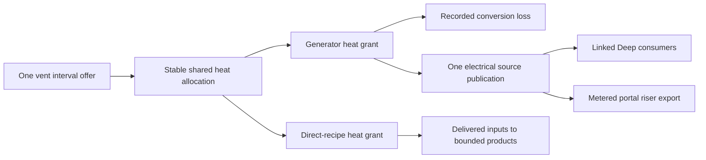

> **Historical donor snapshot — not an execution plan.** OpenTTD3 `75ea75718f`, imported2026-10-23.
> Original: `docs/zz-reach2/upgrades/2026-10/r2mlvs18-geothermal-energy-and-industry.md`; exact source SHA256 `fa40b8617bebe4a087ee5cd71f5c7151ad8762f635652838a3db69b09780407b`.
> Current integration: [M2O23-1](../../../../../../../zz-reach2/upgrades/2026-10/m2o23-1-come-space.md); storage and evidence roles: [archi-historical-debug.md](../../../../../../../zz-reach2/architecture/archi-historical-debug.md). Original completion claims, instructions and human-review limits below remain dated; they grant no new execution, spending, publication or deletion authority.

# R2MLVS18 - Geothermal Energy and Industry

## Global Mandatory Reading

> **Execution protocol**
>
> - Read this Global Mandatory Reading section before the first task and again
>   after every context compaction.
> - Before starting or resuming a task group, read the nearest preceding Area
>   Mandatory Reading block whose `Applies to` label includes that group. Area
>   blocks appear immediately before the first group they govern.
> - A referenced heading or exported symbol is authoritative. Global navigation
>   hints and Area line ranges are for navigation only; if they drift, relocate
>   the named section or symbol rather than expanding to the whole file.
> - Mandatory reading is non-transitive. Do not preload a linked file's own
>   Mandatory Reading, Consult on Demand, or Planning Provenance entries unless
>   this plan names them directly for the current area.
> - Do not read Consult on Demand or Planning Provenance merely because those
>   sources are listed. Use a Consult on Demand source only when its trigger
>   occurs.
> - No created source file, test file or JSON file should start with same prefix as a planning MD file (such as r2). Only MD files can have that prefix. No MD file should be created anywhere in source directories unless specifically asked.
> - After EVERY CONTEXT COMPACTION, you must add a note above the task group
>   which is currently in execution. The note will say: "Context has compacted
>   X times while executing this group.". If the compaction occurs before any
>   meaningful work was done (this can happen when there is a lot of baggage
>   from the previous compaction), then and ONLY then you can skip this step.
> - When exceeding 3 context compactions, YOU MUST ask yourself if you're not 
>   chewing more than we can handle :). Heck, plans change! :). In such a case, 
>   the way out is to split the group on the spot,
>   in the plan, into more groups, 
>   by appending B, C, D as a suffixes to those groups (splitting sub-groups 
>   themselves is also allowed). When you do this, create Local Mandatory
>   Reading areas so you can optimize your context only for the
>   ACTUAL task at hand.
>   Before starting or resuming a task group, read the nearest preceding Area
>   Mandatory Reading block whose `Applies to` label includes that group. Area
>   blocks appear immediately before the first group they govern.

| File name | Line Ranges | Description |
| --- | --- | --- |
| [docs/zz-reach2/upgrades/2026-10/r2mlvs-multilayer-vehicles-and-structures.md](r2mlvs-multilayer-vehicles-and-structures.md) | 310-316 | `AD-16` supplies the canonical gameplay/ownership decision for every group of this plan. It constrains one bounded thermal budget, explicit electricity export and later direct-heat recipes; a consumer must not redefine it locally. |
| [src/map_layer.h](../../../../../../../../src/tests/fixtures/cleanup/source-epochs/29c86bf77e2c7b62-map_layer.h) | 78-85 | `MultiLayerMap` ownership preamble: `Map` owns packed storage/geometry and this controller owns layer semantics. Every group uses world tiles/explicit layer helpers; camera selection and ad hoc plane offsets cannot define gameplay. |
| [src/timer/timer_game_calendar.h](../../../../../../../../src/tests/fixtures/cleanup/source-epochs/openttd3-75ea75718f/1c2e911d6fe35ac2-timer_game_calendar.h) | 15-39 | `TimerGameCalendar` technology-clock contract and date conversions govern 1980/model/factory introductions; economic/realtime scheduling cannot unlock a technology. |

Current dispatch,2026-10-17: master10.6 has completed Plan6 paid-source13C, native1980 construction8C, shared exact-conversion8DB, native operation/service8DC and operating acceptance8DD. Original8.1/.2 and8D are complete. Native8E has completed the2000 model through the same owner. Current8F has completed staged8FA/8FAB/8FAC paid excavation and retained the same ready world;8FB has completed actual Surface construction supplies and paid physical utilities; staged8FC/8.4 now complete the actual paid first-plant/both-model proof. Selected availability13B and recovery14B are complete. Native control providers15B are complete. Whole15BB useful export and15CB site controls are complete. 15CC physical controls/original15C.1 are complete. 15CDB live information/vent ownership and original15CD.1 are complete. 15CDC actual visible acceptance and original15C.2 are complete. 15D boundaries and selected17B generator/export saves are complete, closing master10.6. Current master10.7 integrates selected tube/runtime art and operating lifecycle; later factory scopes remain pending. All selected source/packing work and master10.5 are complete; generator raster bindings remain their explicit10.7 scope. Original8.3,8F.1-.3 and8.4/master10.6 are complete. The subsequent master10.7 operating retirement/reconstruction/file return1CB-1CD now closes1.3B/original1.3; selected Plan14-84.3 runtime integration is current. Later recipes,9.5B/full native integration and human/operator/network gates retain their original scope.

Historical producer status: master10.3 resumed on2026-10-10 after commit `cbd9dc18a1` delivered TBM engineering and R2FC. Dispatched Groups1-7, including paid riser/export/native/Debug5 and bootstrap/public handoff6-7, are complete; master10.4 selected ground asset integration is active, currently Plan13 staged79C collector packing/display after verified passive generator geometry8B; remaining generator source55.3 resumes afterward. Natural vent handoff1.1, cold claims1.2/lifecycle1.3A, actual paid collector1B, shared native Heat2B, bounded source/request2, installed paths3B, connected allocation3 and live topology4 are delivered. Operating plant lifecycle1.3B returns after master10.6. Operating plant/transported bootstrap integration remains master10.6; futuristic facilities below are game designs, not assertions of real industrial capabilities. Parent: [R2MLVS master](r2mlvs-multilayer-vehicles-and-structures.md). Depends on geology/1980 access from r2mlvs2/3, industry lifecycle from r2mlvs6 and the useful-power contract from r2mlvs1. r2mlvs17 consumes available electricity but does not require geothermal for its bootstrap. Separate [TBM fixes](r2tbmf-tbm-fixes.md) retain only their recorded player-feedback acceptance task11.5.

**Artifact-layout migration (2026-10-09):** this plan consumes the parent [Development artifact layout](r2mlvs-multilayer-vehicles-and-structures.md#development-artifact-layout), implemented by [R2FC](r2fc-file-cleanup.md). It supersedes earlier docs asset/review/helper placement and fixed runtime-config destinations below. New native homes use `mlm/runtime/`, generated feature reviews use `mlm/reviews/`, logs remain under `logs/`, and reusable code/curated inputs keep their code/test owners. Paths and focused native/cold verification are complete; R2FC records the results and retained-input identities. Repository-relative executable commands run from the checkout root through their context-aware wrappers. Historical pass records remain dated evidence and are not new acceptance claims. No gameplay task is completed by this migration and the separate post-demo fixture-pruning gate remains.

## Outcome and Boundaries

Deep geothermal vents become useful energy sites and eventually host direct-heat factories.

## Proposed technology timeline

| Available from | Facility | Gameplay |
| --- | --- | --- |
| 1 January 1980 | Deep access, Vent Collector and Vent-Tap Powerhouse | Excavate/claim a vent, tap a bounded heat rate and turn it into electricity for Deep users or explicit Surface export |
| 2000 | Magma-Loop Power Station | A fictional advanced closed-loop installation with better heat-to-electric conversion, higher material/capital/service requirements within the frozen4x4 footprint |
| 2010 | Geothermal Smelter | Use direct vent heat with delivered Iron/Copper/Nickel ore to produce Steel/Refined Metals; saved alternative recipes, no requirement to generate electricity first |
| 2030 | Lithothermal Battery Works | Use heat, Lithium/Cobalt and delivered Chemicals to manufacture Batteries near their mineral sources |
| 2045 | Mantle Forge | Use heat, Refined Metals and Electronics to manufacture Station Components/Robotics Parts for orbital construction |

These recipes reuse existing planned cargos, so vents/heat introduce no extra freight cargo slot. Exact dates after the 1980 access baseline, input quantities, conversion efficiencies and throughput are tuning proposals. Every plant requires transported construction/service inputs, sufficient heat, output space and paid operation. Conventional Surface processing remains available so the timeline never leaves a mineral without a receiver.

## Public Handoff Contract

Partial public owner: [`src/geothermal.h`](../../../../src/geothermal.h) now publishes `GeothermalSiteRequest`, `GeothermalSiteAdmission` and tested pure `PrepareGeothermalSite`, consuming actual natural IDs and frozen per-utility construction terms from `multilayer_bootstrap.h`. This cold geometry view creates no claim, delivered construction, heat or power. Cold `ClaimGeothermalSite`/`CancelGeothermalSite`, retained identities and independent388 GCSH/GCSD coordinate/source transport are delivered. Cold reservations protect their actual floor and cancel on company/world lifecycle; they do not supply constructed collectors. Delivered [`geothermal_collector.h`](../../../../src/geothermal_collector.h) publishes actual native construction/control/receipt/work and `IsGeothermalCollectorOperational`; `CmdBuildGeothermalCollector` charges full frozen capital through the ordinary command kernel, and independent389 GCBH/GCBD resolves native floor/stock/source references. Group2 adds actual `PublishGeothermalCollectorHeat`, `HasGeothermalHeatSources` and `PublishGeothermalHeatSources`, with one391 GCBD shared-meter reference and no private heat balance. [`geothermal_heat.h`](../../../../src/geothermal_heat.h) publishes pure typed `GeothermalHeatRequest`/`PrepareGeothermalHeatRequest`; endpoint admission alone proves no physical path or grant. The common synchronized driver closes heat/electrical intervals even without capsules, and operating plant lifecycle remains staged1.3B. Delivered [`geothermal_utility.h`](../../../../src/geothermal_utility.h) now publishes actual `GeothermalUtilityLink`, paid build/remove preparation, declared native collector ports and deterministic `FindGeothermalUtilityPath`, backed by shared392 local link records and topology. Still publish `GeothermalHeatAllocation`, `AllocateVentHeat`, `ExportGeothermalPower`. These symbols are producer obligations, not existing code. Keep one authority for the fields/commands they expose; downstream plans consume the public contract rather than private pools or copied tables.

Native riser construction/lifecycle/persistence prefix,2026-10-10: [`geothermal_riser.h`](../../../../src/geothermal_riser.h) publishes original-portal-bound `GeothermalRiserState`, `PrepareGeothermalRiserConstruction`, native stock receipt/work and `IsGeothermalRiserOperational`. `CmdBuildGeothermalRiser` in [`industry_cmd.h`](../../../../src/industry_cmd.h) uses ordinary capital settlement and complete native industry creation. Explicit same-pair connection/takeover callbacks preserve paid machinery, while demolition/abandonment permanently retires the original attachment. Native carrier final delivery retains surplus packets and feeder accounting. Version400 `GRSH`/`GRSD` retains original geometry/stamp/loss/work/receipt; native Industry remains the material/history owner. Independent copied preview, exact native reload/refusal/recovery and ordinary executable resave pass in both configurations. Construction readiness creates no numerical transfer link, electrical generation or export; original Group5 owns that next handoff.

Native1980 powerhouse construction prefix,2026-10-16: [`geothermal_generator.h`](../../../../src/geothermal_generator.h) and the exact8320/8320..832F native IIDS/TIDS family retain original Powerhouse site, actual controller, whole-bill receipt and592 prepaid work ticks. Existing Industry accepted slots own STEL12/RFMT8/ELEC4/BATY2; the synchronized command charges180,000 once. Actual paid packet intake preserves surplus and purpose without freight income. Version427 GPGH/GPGD transports work/control only, with independent copied preview, complete native afterload and genuine426 absence. Takeover/abandonment/removal/reuse preserve physical stock and paid history. This construction prefix publishes no heat/electricity; operating conversion/service and full paid-TBM transported bootstrap remain8D/8F. [Exact construction receipt] (historical reference: `../../../../logs/geothermal/generator-construction/20261016-native-01/verification.json`).

Shared exact-conversion prefix,2026-10-17: [`utility_power.h`](../../../../src/utility_power.h) publishes `RegisterUtilityHeatConversionProducer`, pure `PrepareUtilityHeatConversion` and atomic `CommitUtilityHeatConversion`. The shared owner couples original Heat use with exact whole-joule electrical output,0..99 fractional numerator, declared source ceiling and bounded lifetime original thermal attribution. Ordinary rate publication and standalone consumption cannot bypass a bound converter. Version428 UCVH/UCVD joins independent copied metadata/provenance to original utility rows before complete afterload; old source ordinals, original utility table schemas and ordinary source digests remain unchanged. Both configurations pass73 conversion case runs/3,358 assertions plus22 unchanged-geometry runs/12,827 assertions, four builds and the art contract ([receipt] (historical reference: `../../../../logs/geothermal/atomic-conversion/20261016-native-01/verification.json`)). These numerical sources and real five-Money test invoices do not complete actual installed powerhouse paths or its20-per74-tick service;8DC/8DD own that integration.

Native geothermal controls,2026-10-17: [`geothermal_controls.h`](../../../../src/geothermal_controls.h) supplies pure actual facility availability/inspection; [`geothermal_gui.h`](../../../../src/geothermal_gui.h) composes the existing Underground Construction window. Site plan/cancel, collector/generator/riser funding, physical utilities and fresh/recovery town connections use the original synchronized commands. Bounded live stock/work, Heat/electricity and town views borrow native owners. The active survey uses the existing same-layer placement owner and canonical natural/paid terrain state. [Current controls and actual raster acceptance] (historical reference: `../../../../logs/geothermal/first-plant/20261017-native-01/window-raster-verification.json`) verifies both configurations and original paid-world saves without changing any complete saved chunk or RNG. Calendar/policy15D and selected generator/export-save17B are complete. [Selected persistence receipt] (historical reference: `../../../../logs/geothermal/first-plant/20261017-native-01/selected-saves-verification.json`) binds current native replay/reloads, genuine430 reference migration and explicitly prepared nonzero fractional boundaries. Runtime art/operating lifecycle returns under master10.7; full later-factory controls and operator/network gates retain their original scopes.

## Implementation Tasks

Deepening pass, 2026-10-04: implementation groups use only SIMPLE, MEDIUM or HARD difficulty, with at most eight pending tasks each. Sketches describe proposed implementation contracts; verify the named earlier producers at each assumption gate. No gameplay or asset implementation is marked complete by this planning pass.

Groups are chronological and contain consecutive tasks of one difficulty. Each difficulty batch has at most eight tasks; area reading changes only when the implementation boundary or source of truth changes.

### Area Mandatory Reading - Vent sites, heat and utilities

_Applies to Groups 1-7._

**Entry gate.** The following public contracts must exist before dependent implementation in this area: `src/multilayer_content.h`: `MultiLayerGameplayProfile`, `LayerVehicleCapability`, `GetMultiLayerContentProfile`, `CheckDeepLayerAvailability`, `UtilityPowerAccount`; `src/excavation.h`: `ExcavationState`, `GeologyDeposit`, `ExcavationJob`, `CheckExcavatedFootprint`, `CommitExcavationCut`, `GeothermalVentField`; `src/layer_portal_cmd.h`: `LayerPortalWorkState`, `GetLayerPortalWorkState`, `CheckLayerPortalWorkAccess`, `CommissionLayerPortalTBM`; `src/multilayer_industry.h`: `LayerIndustryCapability`, `ValidateMineDepositClaim`, `ProduceLayerMineCargo`, `PrepareLayerRecipeBatch`, `CommitLayerRecipeBatch`.
Verify each public file/export/schema field with `rg` in the current workspace and inspect its command/field ownership. For a same-plan contract, compile its type/signature fixture or validate its artifact after the preceding producer groups. For cross-plan behavior, also run the producer's focused executable boundary test; declarations alone cannot authorize dependent mutations or runtime claims.
If a required export is absent, stop the dependent implementation, mutation and runtime claims in Groups 1-7. Read-only characterization, source/range verification, test-case design and asset-template work that does not assume the missing behavior may continue.
Do not bypass this gate by copying private pool/tile state, inventing local IDs or cargo registries, using a historical plan as a delivered implementation, opening user-wide content stores, substituting a second utility/accounting authority, or adding an unreviewed fallback path. Finish the named producer or revise the shared contract and its direct consumers first.

| File name | Line Ranges | Description |
| --- | --- | --- |
| [src/industry_cmd.h](../../../../../../../../src/tests/fixtures/cleanup/source-epochs/openttd3-75ea75718f/03eb5b5f93fd2a73-industry_cmd.h) | 18-28 | Industry construction/funding command declarations and `DEF_CMD_TRAIT` entries are the shared UI/script mutation boundary; availability must agree on every entry path. |
| [src/command.cpp](../../../../../../../../src/tests/fixtures/cleanup/source-epochs/openttd3-75ea75718f/99c9ff0dcef87e2f-command.cpp) | 301-328 | `CommandHelperBase::InternalExecuteValidateTestAndPrepExec` defines refusal/estimate before execution; no validation phase may consume inventory, RNG or funds. |
| [src/core/random_func.hpp](../../../../../../../../src/tests/fixtures/cleanup/source-epochs/openttd3-75ea75718f/61408bb93262db84-random_func.hpp) | 24-43 | `Randomizer` and simulation versus interactive state constrain feature-seed generation: preserve Surface simulation RNG and exclude presentation randomness. |
| `src/multilayer_content.h` (planned public contract; link after implementation) | Live definitions; no fixed range | [r2mlvs1-gameplay-contracts-and-content.md](../../../../../../../../../OpenTTD3/docs/zz-reach2/upgrades/2026-10/r2mlvs1-gameplay-contracts-and-content.md) Groups 1-6, ending with Group 6's public-contract task, publish `MultiLayerGameplayProfile`, `LayerVehicleCapability`, `GetMultiLayerContentProfile`, `CheckDeepLayerAvailability`, `UtilityPowerAccount`. These exports/schema fields are authoritative for this area. Same-plan consumers follow those earlier groups; cross-plan consumers verify the producer's required implementation/tests as well. Proposed names alone do not prove delivery. |
| `src/excavation.h` (planned public contract; link after implementation) | Live definitions; no fixed range | [r2mlvs2-geology-and-excavation.md](r2mlvs2-geology-and-excavation.md) Groups 1-7, ending with Group 7's public-contract task, publish `ExcavationState`, `GeologyDeposit`, `ExcavationJob`, `CheckExcavatedFootprint`, `CommitExcavationCut`, `GeothermalVentField`. These exports/schema fields are authoritative for this area. Same-plan consumers follow those earlier groups; cross-plan consumers verify the producer's required implementation/tests as well. Proposed names alone do not prove delivery. |
| [src/layer_portal_cmd.h](../../../../../../../../src/tests/fixtures/cleanup/source-epochs/openttd3-75ea75718f/c9b88cad24d07722-layer_portal_cmd.h) | Live definitions; no fixed range | [r2mlvs3-sealed-portals-and-deep-rail.md](r2mlvs3-sealed-portals-and-deep-rail.md) Groups 1-7, ending with Group 7's public-contract task, publish `LayerPortalWorkState`, `GetLayerPortalWorkState`, `CheckLayerPortalWorkAccess`, `CommissionLayerPortalTBM`. These exports/schema fields are authoritative for this area. Same-plan consumers follow those earlier groups; cross-plan consumers verify the producer's required implementation/tests as well. Proposed names alone do not prove delivery. |
| `src/multilayer_industry.h` (planned public contract; link after implementation) | Live definitions; no fixed range | [r2mlvs6-mines-and-resource-chains.md](r2mlvs6-mines-and-resource-chains.md) Groups 1-6, ending with Group 6's public-contract task, publish `LayerIndustryCapability`, `ValidateMineDepositClaim`, `ProduceLayerMineCargo`, `PrepareLayerRecipeBatch`, `CommitLayerRecipeBatch`. These exports/schema fields are authoritative for this area. Same-plan consumers follow those earlier groups; cross-plan consumers verify the producer's required implementation/tests as well. Proposed names alone do not prove delivery. |
| `src/utility_power.h` (planned public contract; link after implementation) | Live definitions; no fixed range | [r2mlvs12](r2mlvs12-solar-farms-mirrors-and-eti.md) `Useful Power Handoff`, produced by its native-ledger, atomic-mutation and consumer-effect groups, supplies `PublishUtilityGeneration`, `AllocateUtilityPower`, `GetUtilityAllocation`, `UtilityGrantID`, `UtilityMutationKind`, `PrepareUtilityMutation`, `CommitUtilityMutation`. Verify its allocation, consume/release/layer-transfer, effect and save/retry fixtures before dependent power mutations; no private account writes or duplicate grid. |

**ASSUMPTION: this was already built previously. If not, re-asses at runtime**. This applies only to the producer contracts named in this area's gate, after their listed producer groups have run. Verify their actual exports and focused tests before using the sketches below; proposed types and helper names in sketches are not evidence of delivered code.

**Ownership and allocation sketch.** Vents already belong to r2mlvs2. This plan adds claims/links and one shared heat allocator; r2mlvs12 owns the common electric ledger. No consumer gets a private copy of the vent capacity.



**ASSUMPTION: this was already built previously. If not, re-asses at runtime**. The existing gates supply geology, profile, portal and industry contracts; electrical export additionally requires r2mlvs12's tested `Useful Power Handoff`. Verify `src/utility_power.h` generation/allocation/query exports and focused tests before export/grid mutation. If absent, stop those dependent operations but continue heat-domain fixtures; do not invent a local grid or use coordinate catchment.

### Local Mandatory Reading - Natural vent and site claims

_Applies to Group1; supplements the Vent sites, heat and utilities Area._

Read Global/AD-16, geology's `GeothermalVentField`, `FindGeothermalVentField`, `ValidateGeothermalVentFields`, `GetGeologyWorldState` and `CheckExcavatedFootprint`/`CheckExcavationConstruction`, shared Deep calendar admission and actual industry/cargo construction participants only when binding them. Natural source IDs/rates remain in geology. Native survey is public/free; vents currently have no separate surveyed-company bit (the mineral field is optional information). Do not add a second discovery registry or regenerate fields. Consume frozen [first utility construction](r2mlvs1-f-utility-and-transfer-contracts.md#group-19---direct-heat-and-early-power-bootstrap): collector3x3/STEL8 RFMT4 ELEC2/180,000/296ticks; powerhouse4x4/STEL12 RFMT8 ELEC4 BATY2/180,000/592; riser2x2/STEL4 RFMT4 ELEC2 BATY2/120,000/296. Site planning/claims must not impersonate paid finished construction or produce heat/electricity; actual operating plant proof remains master10.6. Retain source capacity through ordinary clearing, claim cancellation and rebuild. Scope later heat interval/link APIs to their actual owning groups rather than preloading their entire areas.

### Group 1 - Consume vent geology and bind excavated collectors

Resumed2026-10-08 after master10.2: consume actual natural vent identity/rate and publish validated site/collector claims before heat/utility foundations. The prior finalization skip is historical.

{{MEDIUM}}
- [X] 1.1 Consume r2mlvs2 `GeothermalVentField` IDs, the current public/free survey policy and bounded source capacity; verify its guaranteed-vent/map-size fixture. Do not generate a second set of vents or overwrite geological source identity here.
- [X] 1.2 Define this owner's collector/plant claim record referencing a vent, owner and utility endpoint. Validate full excavation, suitable footprint/access and shared Deep unlock before binding.
- [X] 1.3 Test ordinary clearing and plant removal/rebuilding preserve the original vent ID/capacity; only the consumer claim changes. Discovery or a blueprint alone produces no heat/power. Whole1.3 closes only after both scoped rows below.
- [X] 1.3A Complete the cold site portion: native clearing/overbuild refusal, explicit cancellation/clearing/reclaim, company takeover/world reset and exact saved history preserve original natural ID/capacity/cavity, with no completed construction or heat/power.
- [X] 1.3B After actual plant definitions and operation at master10.6, test the operating collector/plant removal/rebuild and original natural-source preservation through the actual native lifecycle hooks. Return with master10.7/9.5B; cold blueprint tests cannot close this row.

1.1 producer verification,2026-10-08: actual geology supplies a distinct stable-ID Deep vent at1MW on supported square/rectangular maps, leaves its cells solid and mineral identities intact, and restores capacity/ID through a saved cavity. Global Surface RNG remains unchanged; one-plane/unsupported maps refuse. Native information is public/free, with no vent-specific surveyed bit; do not copy the mineral `surveyed_companies` mask into another source authority. [Focused geology/profile/bootstrap/electrical/recipe boundaries] (historical reference: `../../../../logs/r2mlvs3mp-z-h-geothermal-prerequisites-2.log`) pass1,226 assertions/18 cases. First discovery/clearing grants no heat or electricity. **1.2 is current; Group1 and master10.3 remain unchecked for validated claims and lifecycle.**

1.2/1.3A closure,2026-10-08: actual bounded cold site claims retain original natural source/owner/boundary endpoint and full empty excavated floor/access under shared1980 policy. Duplicate/foreign/invalid geometry refuses; cold cancellation preserves monotonic IDs, natural capacity and the cavity. Native clearing/rail-overbuild, actual company takeover and world reset respect the planning owner. Independent388 GCSH/GCSD transport retains original/cancelled geometry and source references; copied preview uses saved local coordinates and decoded vent records rather than the live map. [Debug] (historical reference: `../../../../logs/r2mlvs3mp-z-i-geothermal-reference-checks.log`) and [optimized] (historical reference: `../../../../logs/r2mlvs3mp-z-i-geothermal-optimized-checks.log`) focused natural/site/lifecycle/metadata checks pass857 assertions/14 cases. [Actual388 files] (historical reference: `../../../../logs/r2mlvs3mp-z-i-geothermal-site-native-checks-1.log`) preserve claimed/cancelled identity, exact natural/electrical bytes, six malformed preview refusals and [ordinary game reload/resave] (historical reference: `../../../../logs/r2mlvs3mp-z-i-geothermal-site-normal-loader.log`); the input387 file remains hash-identical. The native cold fixture explicitly supplies test-open floor and claims no paid operating plant. [Debug] (historical reference: `../../../../logs/r2mlvs3mp-z-i-geothermal-reference-build.log`) and [optimized] (historical reference: `../../../../logs/r2mlvs3mp-z-i-geothermal-optimized-build.log`) targets build. Whole1.3/actual1.3B remains staged. **Group1B is current before Group2: thermal publication cannot consume a cold blueprint as a finished collector.**

### Local Mandatory Reading - Actual first collector construction

_Applies to Group1B._

Read Global/AD-16 and actual `geothermal.h` cold planning/388 handoff. Read frozen `GetMultiLayerGeothermalConstruction(Collector)`3x3/STEL8 RFMT4 ELEC2/180,000/296 and shared Deep date/footprint guards. Inspect existing native IIDS/TIDS industry definition/funding, actual Industry input stock and construction flags, bounded inventory/work participants, native industry tick/removal and lifecycle hooks. Publish the collector's real definition and actual construction participant before Group2 operational source offers; pure blueprints cannot authorize heat. Consume actual canonical industry/cargo/identity owners, with no local stand-in inventory, invented UtilityConsumerID or copied energy budget. First collector work is cash/material driven and requires no own electricity. Final Surface procurement/driven delivery/operating generator remains master10.6; final art remains10.4. Read later heat/recipe/plant internals only when their specific producer is active.

Context has compacted 1 times while executing this group.

### Group 1B - Construct a real collector before thermal publication

Scheduling repair2026-10-08: Group1's claim record was correctly cold, while Groups2/8 presumed an already constructed collector. Deliver its actual native construction here, before dependent heat offers, and retain the original later operating generator/plant-removal acceptance. No logical planning claim is promoted by a boolean shortcut.

{{HARD}}
- [X] 1B.1 Register the1980 native Vent Collector through canonical industry/tile definitions, with its frozen3x3 footprint, actual Surface-deliverable construction inputs and exclusive Deep capability. Generic production/automatic completion cannot create heat or construction for free.
- [X] 1B.2 Fund/build and complete the collector through the actual native industry/stock owner with the full180,000 capital and296 cash-driven work ticks. Revalidate/consume its cold planning reservation atomically; missing stock/cash/date/footprint or interrupted construction remains recoverable and produces no heat.
- [X] 1B.3 Persist and expose actual collector identity/source/owner/construction state, with native company/removal/reset hooks and original natural capacity preserved. Operational readiness must inspect actual completed native construction before a heat allocator can publish/use its source.
- [X] 1B.4 Verify actual native stock/work/capital admission, shortage/refusal/retry, save/load and lifecycle, retaining clearly labelled boundary fixtures. No collector or first plant requires geothermal electricity; actual transported bootstrap retains master10.6.

1B closure,2026-10-08: canonical1980 Deep collector IIDS/TIDS restores through the normal content loader and refuses altered/foreign/capacity/input definitions before writes. The ordinary synchronized funding command revalidates/consumes the original cold claim and settles180,000 once; that prepaid bill covers296 construction labour ticks, without an additional unfrozen work fee or electricity dependency. Actual Industry stocks/history receive preciselySTEL8 RFMT4 ELEC2; shortage retains arrived stock, and one whole receipt plus once-per-tick work completes all9 native cells. Generic tile growth, arrival conversion and random closure cannot complete/destroy it. Actual stock-aware demolition, company takeover/abandonment and reset preserve the original natural field and cavity. Independent389 GCBH/GCBD, feature16384 and canonical construction digest resolve actual native IDs/floor/stock/work/receipt/cold source/company after load; copied preview uses this file's native INDY IDs, cold rows and companies. [Debug] (historical reference: `../../../../logs/r2mlvs3mp-z-j-collector-final-checks-1.log`) and [optimized] (historical reference: `../../../../logs/r2mlvs3mp-z-j-collector-optimized-checks.log`) focused collector/affected-industry boundaries pass8,420 assertions/29 cases; both targets build. [Actual389 files] (historical reference: `../../../../logs/r2mlvs3mp-z-j-collector-native-checks-1.log`) prove exact funded/shortage/partial/completed reload,8 corrupt preview refusals and [ordinary completed reload/resave] (historical reference: `../../../../logs/r2mlvs3mp-z-j-collector-normal-loader.log`), preserving the retained388 input hash and original natural/electrical bytes. Boundary fixtures explicitly supply excavated floor/material delivery; actual paid Surface procurement/driven construction bootstrap remains master10.6. **Group2 is current; no thermal allocator or generator/export behavior is claimed.**

### Local Mandatory Reading - Original operating machinery retirement

_Applies to1CB; supplements Global and the Vent sites, heat and utilities Area. This is the master10.7 return after native generators/paid first-plant proof and Plan17 useful-model acceptance; earlier1B/cold lifecycle does not close1.3B._

Read AD-16, completed first-plant power receipt and the original ordinary2000 operating world containing the actual1980/2000 machinery, original collector/vent/paid floors/risers/Surface carrier. Inspect native LandscapeClear industry destruction, geothermal collector/generator/site/utility retirement callbacks and exact active/retired source/grant semantics. Preserve original natural ID/capacity, excavated floor, consumed material receipts, all unaffected freight/spoil/accounts and retired utility history. Do not rebuild the paid world, change its date/cash/materials or replace an actual native lifecycle callback with pool editing. Missing source/report identities stop mutation. Actual reconstruction and ordinary retired/rebuilt files remain1CC/1CD.

### Group 1CB - Retire original operating collector and generators

{{HARD}}
- [X] 1CB.1 Ordinary-load the actual paid first-plant world, retire both operating model incarnations and collector through native clearing, and prove unchanged original natural source/floor plus terminal old grants/meter history. Keep1.3B unchecked until reconstruction/files pass.

1CB closure,2026-10-18: both current native readers load the exact original431 paid-TBM/Surface-carrier/operating-both-model world, preserving its input hash. Ordinary native clearing retires the actual1980 generator,2000 generator and collector in sequence; both real construction/work/service histories and positive original generation/use are required before mutation. Pure estimates, exact command-kernel cash settlement and pure saves pass. The original native definitions quote zero demolition cost, so actual cash3731358 remains unchanged; no fee, capital refund or repair is invented. Original1MW vent ID/capacity, complete paid footprints, every33 protected geological/excavation/spoil/physical vehicle/order/packet/Surface-supply/riser chunks and all consumed/generated lifetime counters remain exact. Retired sources reject typed publication and old consumer grants refuse use. Both test targets build;8 isolated cases/970 assertions and four complete126-chunk cross-build world pairs pass ([retirement receipt] (historical reference: `../../../../logs/geothermal/source-lifecycle/20261018-native-01/retirement-verification.json`)). Native434/packed art unchanged; production behavior needed no change. Continue1CC actual command-funded reconstruction/paid replacement transport/fresh service, then1CD ordinary lifecycle files. Original1.3B/1.3/master10.7 and later runtime-art/9.5B/TBM-to-tube/human/operator/network gates remain pending.

### Local Mandatory Reading - Rebuild machinery on the retained original vent

_Applies to1CC; supplements Global and the Vent sites, heat and utilities Area._

Read completed1CB original retired world/owners, native site/collector/generator funding, frozen bills and original paid Surface supply/carrier/receiver construction owners. Fresh command-funded claims/machinery must acquire new construction/Heat/electric identities on the same paid floor/vent, receive actual paid materials and earn synchronized labour. Cold plans and unfinished machinery produce no heat/power; old claims/meters/history cannot be reassigned or reset. Preserve original natural capacity/ID, unrelated risers/Surface/town/spoil owners and every actual native construction receipt. No inventory/cash/clock/energy grants or copied source balance.

### Group 1CC - Rebuild actual operating machinery on the original paid site

{{HARD}}
- [X] 1CC.1 Command-fund new collector/both dated plants on original paid floor, transport the frozen replacement bills and earn full native construction/fresh useful service with unchanged vent ID/capacity and no reuse of retired grants/history.

1CC staging,2026-10-18: execute1CCB fresh paid claims/machinery,1CCC actual replacement-material carriage/labour and1CCD fresh useful service in that order. These are retained stages of the same original retired paid world; original1CC.1 stays unchecked until all three pass.

### Local Mandatory Reading - Fresh paid machinery on the original retired world

_Applies to1CCB; supplements Global and the Vent sites, heat and utilities Area._

Read completed1CB exact opposite current retired stage3/claim/tile/source identities, frozen collector/VentTap/Magma bills and native `CmdPlanGeothermalSite`, `ClaimGeothermalSite`, `CmdBuildGeothermalCollector`/`CmdBuildGeothermalGenerator`. Native `CheckExcavationConstructionArea` requires explicit removal of surviving utility cells inside a vacant machinery footprint: use paid `CmdRemoveGeothermalUtilityLink` only there, retain original retired link/source history and surrounding paths, and reconnect physically at1CCD. Reuse only original saved site geometry as an observation, not an old active/paid construction binding. Native estimates stay pure, fresh claims are monotonic, full capital/preparation is paid, and all new Industry stock/work/Heat/electric identities start empty/unissued. Preserve original vent/floor, every old retired meter and unrelated cargo/spoil/Surface/riser owner. No material purchase, carrier movement, new labour or energy is claimed here; they follow1CCC/1CCD.

### Group 1CCB - Fund fresh empty machinery on the original retired site

{{HARD}}
- [X] 1CCB.1 Ordinary-load exact opposite1CB stage3, command-plan fresh collector/both models on original paid floor and fund their full capital with pure quotes/new native incarnations, retaining empty stock/zero work/no fresh heat or electricity and all old natural/retired owners.

1CCB closure,2026-10-18: exact opposite original retired stage3 worlds command-remove surviving utility domain cells strictly inside their old machinery footprints (1000 native cost), plan fresh claims3/4/5 and command-fund actual collector/VentTap/Magma for720000 capital. Actual cash3731358->3010358 records all721000; no materials, clock, floor or source quantities are supplied. Native pool reuse2/3/6 acquires only fresh claims and zero stock/history/work/material commitment/service, with all new Heat/electric references unissued. The original1MW vent/floor,33 protected complete physical/geological/spoil/Surface/riser chunks, all old generated/consumed energy and all58 retained utility-link identities remain exact. Only native footprint preparation changes installed-link activity; cold planning/funding cannot change the prepared utility digest or issue a source. Correct native footprint admission first refused surviving paid cells, so the observer now performs the required explicit native removal; no production guard was relaxed. Both test targets build;8 isolated cases/1558 assertions, four complete126-chunk cross-build worlds and exact original434 input-load equality pass ([funding receipt] (historical reference: `../../../../logs/geothermal/source-rebuild/20261018-native-01/funding-verification.json`)). Native434/packed art unchanged; all diagnostics retained. Continue1CCC paid replacement carriage/native labour, then1CCD fresh useful service/1CD ordinary files; original1CC/1.3B/1.3/master10.7 remain unchecked.

### Local Mandatory Reading - Paid replacement cargo and native construction

_Applies to1CCC; supplements Global and the Vent sites, heat and utilities Area._

Read completed1CCB original fresh empty machinery and original paid Surface supply/train/order/station/shaft owners. Buy the complete replacement bills through actual Surface orders, physically deliver them with the same retained carrier and earn construction through complete ordinary frames. Preserve original remaining inventory, packet purpose/provenance, consumed original bills, freight/spoil and native accounts. Save actual loaded/interrupted/completed/whole empty-return states with untouched next opportunities. No direct receiver supply, rating/packet/pose/order-cursor/cash/clock repair or prepared-floor substitution.

### Group 1CCC - Transport replacement bills and earn native construction

{{HARD}}
- [X] 1CCC.1 Purchase/physically deliver the frozen collector and both dated generator replacement bills in the same world, earn all actual construction work and whole empty carrier return, and retain loaded/interrupted/completed originals with complete material/account conservation.

1CCC staging,2026-10-18: actual original Surface history still includes the consumed92 units of the demolished collector/both plants, plus24 units in retained risers. Preserve that historical attribution while new paid replacement stock remains physical native cargo. Execute1CCCB purchase/custody before1CCCC actual driven delivery/labour/empty return and original next-boundary capture. Parent1CCC.1 remains unchecked until both pass.

### Local Mandatory Reading - Actual replacement purchase and historical material custody

_Applies to1CCCB; supplements Global and the Vent sites, heat and utilities Area._

Read completed1CCB exact opposite funded stage3/new Industry/claim IDs, canonical collector/VentTap/Magma input bills and actual `PrepareSurfaceSupplyOrder`/`CmdOrderSurfaceSupply`/native packet-purpose owners. Borrow the original three-stop/four-hold construction train and Surface station from ordinary afterload. Keep the consumed original92-unit bills historical, the retained original riser24-unit bills live consumed, and all new purchases in actual native queues/holds/industry stock until their own fresh whole bill commits. Native quotes are pure, old purchase IDs/history immutable and new paid packets retain native purpose/source/cursor. No material receipt, stock, clock, cash or service grant; movement/labour remains1CCCC.

### Group 1CCCB - Buy actual replacement materials at the original Surface supplier

{{HARD}}
- [X] 1CCCB.1 Ordinary-load exact opposite1CCB funded stage3, buy all frozen replacement bills through actual paid Surface orders and retain original/new purchase/physical/historical-consumption conservation with the same carrier still whole empty/stopped and fresh machinery/work/power unchanged.

1CCCB closure,2026-10-18: both exact opposite funded originals buy44STEL/28RFMT/14ELEC/6BATY through native Surface orders10..13 at original station0, charging18540 once (cash3010358->2991818). Four genuine unshipped native construction-purpose packets hold all92 physical units; earlier9 orders/caps/refunds/dispatch histories remain exact, cursor10->14. Actual total208 purchased=92retired historical consumption+24retained-riser consumption+92new physical stock. Fresh native Industry2/3/6 stock/work/commitment remains zero; original five-part carrier21 stays whole stopped/empty in its depot. No native frame, material receipt, stock/cash/clock/pose/rating/cursor or energy repair occurs. The source owner charges its actual quote; the synchronized wrapper correctly adds zero extra fee. Both test targets build;8 isolated cases/1314 assertions, two complete126-chunk cross-build worlds, exact original-source equality and30 protected complete geological/spoil/vehicle/order/riser chunks pass ([paid stock receipt] (historical reference: `../../../../logs/geothermal/replacement-stock/20261018-native-01/verification.json`)). Native434/packed art unchanged, no failures or production change. Continue1CCCC actual driven replacement freight/all three native construction histories/whole empty return/original-next captures; parent1CCC/1CC/1.3B/1.3/master10.7 remain unchecked.

### Local Mandatory Reading - Actual replacement freight and full native labour

_Applies to1CCCC; supplements Global and the Vent sites, heat and utilities Area._

Read completed1CCCB exact paid replacement stock/retired-bill accounting and borrowed original carrier/orders/stations/shafts. Use complete ordinary native frames and actual departure/depot commands to earn loaded Surface/Deep movement, all three original fresh construction bills/work and whole empty return. Retain each model's genuine unfinished work, all complete/native whole-return states and untouched full next opportunities before observer commands. Let normal native collector publication proceed once earned, preserving all old and newly generated histories rather than freezing sources; fresh useful generator service/physical reconnection remains1CCD. No direct receiver inputs, fake arrival, rating/cursor/packet/cash/clock or power repair.

Context has compacted 1 times while executing this group.

### Group 1CCCC - Drive paid replacement materials and earn complete native construction

{{HARD}}
- [X] 1CCCC.1 Carry the same original paid replacement stock through both actual conventional layer crossings, earn all three whole native bills/construction histories and whole empty carrier return, and retain loaded/each interrupted/completed/original-next worlds; then close1CCC.1 only after1CCCB passes.

1CCCC/original1CCC closure,2026-10-18: the same original paid92 units travel in the retained five-part train through actual Surface/Underground/Deep movement and both conventional crossings. Complete ordinary frames earn all three whole native bills and296/592/888 construction ticks, then whole empty Surface depot return at212166 from205916 (6250 native opportunities). Total208 bought remains92 retired historical consumption+24 retained-riser consumption+92 fresh actual consumption, with no remaining physical stock or construction-freight income. Cash2991818->2991210 retains608 additional actual company operating/standing costs; it is not a separate claimed carrier-profit ledger. Every retired source remains terminal with unchanged lifetime counters. The freshly completed collector naturally acquires source3 and generates73143000J unused Heat by the original return; neither new generator has useful service yet. Both final test builds are warning-free;8 isolated native cases/1109714 assertions,19 complete126-chunk cross-build original world pairs and38 pure repeated world pairs pass ([delivery receipt] (historical reference: `../../../../logs/geothermal/replacement-delivery/20261018-native-01/verification.json`)). Each of nine original route/work/return scenes retains its untouched full native next opportunity before further observer commands. Initial Debug evidence predates a history-index warning fix and remains diagnostic; the receipt accepts only final Debug/optimized writers. Native434, production behavior/binaries and packed art remain unchanged. Original1CCC.1 is X after1CCCB; continue1CCD paid physical reconnection/fresh useful service, then1CD ordinary lifecycle files. Original1CC/1.3B/1.3/master10.7 remain unchecked.

### Local Mandatory Reading - Fresh original-vent service after reconstruction

_Applies to1CCD; supplements Global and the Vent sites, heat and utilities Area._

Read completed1CCC actual reconstruction/empty-return/material receipts, original retired utility identities and native collector publication/typed conversion/physical paths/shared useful town service. Complete any actual paid physical repair/reconnection, acquire fresh nonreused Heat/electric/grant identities and earn real useful output with both dated reconstructed models under the single original vent cap. Preserve consumed original and fresh histories separately; a reused Industry pool ID grants no old rights. Retain actual service boundaries for1CD rather than replacing them with ledger-only fixtures.

### Group 1CCD - Earn fresh useful service on the unchanged original vent

{{HARD}}
- [X] 1CCD.1 Operate both actual reconstructed models with fresh original-vent Heat/electric/service ownership and useful output while all retired identities remain terminal; publish reconstruction handoff and close1CC.1 only after1CCB/1CCC pass.

1CCD/original1CC closure,2026-10-18: exact opposite original whole empty-return worlds command-build five missing collector/generator port-domain cells for5000, retain naturally earned collector3 history and let complete native frames issue fresh Heat consumers6/7 and electrical conversion sources4/5. Actual earlier VentTap owns the one original1MW budget; the same retained paid risers/terminal/populated town receives37/74 interrupted/completed useful135J opportunities. Explicit paid VentTap Heat isolation costs250; the synchronized native town connection then replaces only the source forwarding identity/Deep edge and lets Magma earn its own37/74 useful opportunities. Original source5 forwarding becomes fresh8 then9 while the original town and upper edge remain. Original final212318 follows152 native opportunities from212166: VentTap77 service ticks/311850J generated/10125J used, Magma75ticks/708750J generated/9990J used, collector lifetime77247000J generated/4104000J consumed. No extra vent budget is created; all retired0..2 source histories, inactive grants/cells, original geology/paid material receipts/whole empty carrier remain intact. Native port invoices5250 plus55 actual generator service charges and6 other company standing costs give cash2991210->2985899; neither service remainder is reset. Both warning-free test builds pass8 isolated cases/55136 assertions,19 complete126-chunk cross-build world pairs and38 pure-repeat pairs ([fresh service receipt] (historical reference: `../../../../logs/geothermal/rebuilt-service/20261018-native-01/verification.json`)). Every original boundary retains its untouched complete next opportunity before further commands. Production behavior/binaries, native434 and packed art are unchanged. Original1CC.1 is X after1CCB/1CCC; continue1CD ordinary retired/cold/interrupted/rebuilt readers/continuation. Original1.3B/1.3/master10.7 remain unchecked.

### Local Mandatory Reading - Ordinary operating rebuild files

_Applies to1CD; supplements Global and the Vent sites, heat and utilities Area._

Read completed1CB/1CC original retirement/cold/interrupted/rebuilt worlds and native geology/site/Industry/collector/generator/utility transports/afterload. Copied preview, repeated/opposite current reads and complete uninterrupted-next comparison retain original natural/floor/material/cargo/account/retired-history and fresh-reference owners. Consume old producer receipts opaquely; never require their dated binaries to match current sources. Publish true scope and close1.3B/original1.3 only after actual retirement/reconstruction/file obligations pass.

### Group 1CD - Accept original operating rebuild files and handoff

{{HARD}}
- [X] 1CD.1 Verify original operating lifecycle worlds through ordinary preview/repeat/opposite readers/complete continuation, then publish the source-preserving lifecycle handoff and close1.3B/original1.3 only after1CB/1CC pass.

1CD/operating1.3B/original1.3 closure,2026-10-18: exact sealed1CB/1CC originals provide26 distinct operating-retired/prepared-cold/funded/paid-stock/loaded/unfinished-constructed/useful-rebuilt states per writer. Both opposite current native readers perform independent copied preview, pure repeated complete saves and repeated ordinary loads. All18 original delivery/service boundaries also retain exactly their untouched full native next opportunity, including real packets/poses, valid native stock/history, work, fresh/retired thermal/electrical attribution, actual paid service remainders and town settlement. Final104 isolated native cases/2904 assertions and104 normal-game processes pass;72 original-next comparisons and88 complete126-chunk cross-reader world pairs match ([lifecycle file receipt] (historical reference: `../../../../logs/geothermal/lifecycle-files/20261018-native-01/verification.json`)). Production startup permits only the independently field-checked DATE LinkGraph wait bit; all other fields/chunks remain exact. The first production save succeeded but an older430/431 Python validator refused its434 input; the controller now checks current434 fields directly, and final manifest-2/28 batch reports bind the corrected source. Earlier manifest/read receipts remain diagnostic. No native/production behavior or schema fix was needed; both final warning-free test builds and unchanged normal game binaries pass. Lossless partial NTFS compression of generated symbols/runtime content recovered space without logical-byte/hash changes or deletions; reproducible commands/diagnostic locations are in [runtime notes](r2mlvs18-h-first-plant-runtime.md). All operating reconstruction tasks are X after actual paid retirement/reconstruction/service, without a fixture or old grant substitution. Native434/packed art remain unchanged. Continue master10.7 selected Plan14-84.3 runtime integration;9.5B/later TBM-to-tube/human/operator/network gates remain pending. Independent replay is not an actual host/client join.

### Local Mandatory Reading - Native shared heat identities and accounting

_Applies to Group2B._

Read Global/AD-16, frozen [Group15 utility ownership](r2mlvs1-f-utility-and-transfer-contracts.md#group-15---one-conserved-utility-ledger), existing `UtilityEnergyDomain`/typedIDs and `UtilityHeatUse`, and actual `utility_power.h/.cpp` registration/publication/allocation/grant mutation/rotation/lifecycle/validation. Read its concrete `utility_power_sl.cpp` family, independent preview, native electrical/tube fixtures only as affected. One shared native owner allocates typed IDs and retains Heat/Electricity balances separately; Plan18 owns actual native source readiness, thermal network and whole physical consumers. Never cast GeothermalSiteID into a shared utility identity, manufacture a dummy electrical grant or copy heat energy into another private ledger. Existing electrical/mirror/export/effect APIs must refuse heat, while old valid electrical saves/carries/grants remain playable and unchanged. Only this native domain producer is active; collector source publication/heat routing remains Groups2-4.

Context has compacted 1 times while executing this group.

### Group 2B - Supply the missing shared native heat domain

Scheduling repair2026-10-08: pure frozen `UtilityPowerAccount` already names Heat, but actual native `RegisterUtilityPowerProducer`/consumer and saved validation admit Electricity only. Supply that shared producer before Group2 creates typed actual source offers/requests; no feature-local utility ID/energy registry substitutes for it.

{{HARD}}
- [X] 2B.1 Extend the shared native owner with actual Heat producer/consumer identities and immutable direct-recipe/generator roles, typed publication/allocation/settlement and strict domain separation. Preserve canonical ID/capacity/once-only interval/integer carry policy and electrical API refusals.
- [X] 2B.2 Persist authoritative domain/role/heat allocation/accounting in its existing utility family with an explicit new save boundary and independent preview; actual company/reset/source-loss hooks retain consumed quantities and retire only unused rights. Genuine pre-boundary electrical saves remain valid, with no implicit heat participant.
- [X] 2B.3 Run focused mixed-domain conservation/refusal/interval/carry/atomic settlement and native saved domain/role/legacy/corruption cases, with affected electrical/tube checks only as justified. Publish the actual shared handoff before Group2 source publication, retaining transported/native generator proof at10.6.

2B closure,2026-10-08: `utility_power.h/.cpp` issues Heat and Electricity identities through the same canonical native owner, with immutable direct-recipe/generator roles, separate once-only phases and typed publication/allocation/use/release. Stable ConsumerID allocation, integer source fractions, atomic whole-owner settlement, consumed history and actual company takeover/removal retain their original authority. Electrical publication/effects/export and thermal consumers refuse cross-domain substitution; no second energy registry exists. Explicit390 UPLD domain/revision6 UPLH phase bits and metadata32768 validate actual roles/domain/eligibility independently in copied preview; genuine389 electrical participants acquire no implicit heat. [Debug] (historical reference: `../../../../logs/r2mlvs3mp-z-k-heat-reference-checks-2.log`) and [optimized] (historical reference: `../../../../logs/r2mlvs3mp-z-k-heat-optimized-checks.log`) focused accounting/refusal/carry/lifecycle cases each pass1,247 assertions/23 cases. Affected tube power/native movement/recovery passes10,089 assertions/23 cases in [Debug] (historical reference: `../../../../logs/r2mlvs3mp-z-k-heat-affected-tube-debug-checks.log`) and [optimized] (historical reference: `../../../../logs/r2mlvs3mp-z-k-heat-affected-tube-optimized-checks.log`). [Native390 migration/reservation/expense/reload] (historical reference: `../../../../logs/r2mlvs3mp-z-k-heat-native-checks-1.log`) and ordinary game resave preserve the original389 file hash, natural/collector/cold/native/tube chunks and decoded electrical lineage; six intentionally malformed copies refuse preview without changing the live ledger. The physical collector-to-source association, tick scheduling, connected heat links and actual generator remain their upcoming groups. [Checkpoint and shared-domain handoff](portal-tbm/r2mlvs3mp-z-l-demo-checkpoint.md) publish the exact APIs and demo limits. **Group2 is current; master10.3 remains unchecked.**

### Local Mandatory Reading - Bounded thermal intervals and shared heat

_Applies to Groups2-3; supplements the Vent sites, heat and utilities Area._

Read Global/AD-16, this executing group and the frozen heat/interval/ID ownership paragraphs in [utility contracts](r2mlvs1-f-utility-and-transfer-contracts.md#group-15---one-conserved-utility-ledger), plus `multilayer_utility.h/.cpp` interval integration/thermal proposal contracts and focused tests. Verify actual `UtilityConsumerID`/producer/consumer registration and domains in `utility_power.h/.cpp` before binding any thermal participant; declarations/pure helpers are not a runtime identity issuer. Read `geothermal_collector.h` source readiness and actual original cold-source/native machinery references, geology's immutable vent rate and canonical tick/save owners. Cold claims, cancelled/unfinished/abandoned machinery and repeated interval queries cannot publish usable heat. The one common utility owner retains Heat and Electricity accounting in separate domains; geothermal owns actual source availability/thermal routing and whole physical consumers, with no copied energy ledger. Requests use actual shared utility identities, never a cast GeothermalSiteID or another private energy registry. Real physical link/connected-path construction belongs to Group4; do not publish proximity eligibility or free link capacity before that owner exists. Read later export/riser/plant internals only at their actual groups.

### Group 2 - Produce one bounded thermal offer per interval

Resumed2026-10-08 after actual collector1B: implement source intervals and separately typed requests before allocation. Earlier GP-TG finalization dispositions are historical; pending tasks below are active in the master queue.

{{HARD}}
- [X] 2.1 Convert the vent sustainable rate into an integer interval heat offer with one saved source remainder/epoch. Repeated update/query calls cannot create a second offer for the same interval.
- [X] 2.2 Define consumer requests separately for generators and direct-heat recipes, with owner, connected endpoint, needed quantity and priority policy from the profile.
- [X] 2.3 Specify allocation versus actual use, unused-grant release and closed-interval accounting. Save authoritative grants/cursor/remainders; do not infer consumed heat from an animation or a rebuilt graph.

Group2 closure,2026-10-08: actual completed machinery publishes the immutable vent rate through one shared native Heat meter, with saved epoch/millijoule carry and once-only publication. Pure typed generator/direct requests retain actual company/shared identity/Deep port/feasible quantity and stable ConsumerID priority; they never create proximity connectivity. The existing native pre-vehicle driver rotates both domains, including collector-only worlds, curtails unused offers and respects pause/date waits. Native removal expires only unused rights and rebuilding obtains a new meter without reviving prior grants or use. Explicit391 GCBD/revision2 GCBH stores only the shared reference; source/grants/carry/history remain in UPLH/UPLD. [Debug] (historical reference: `../../../../logs/r2mlvs3mp-z-n-thermal-debug-checks-1.log`) and [optimized] (historical reference: `../../../../logs/r2mlvs3mp-z-n-thermal-optimized-checks.log`) focused source/receipt/request/carry/reload/refusal boundaries each pass1,971 assertions/21 cases, and affected capsule power/movement/recovery each pass10,089/23. [Real files] (historical reference: `../../../../logs/r2mlvs3mp-z-n-thermal-native-checks-1.log`) prove genuine389/390 migration, actual association/reservation/whole expense, exact reload/next tick, six malformed previews and ordinary executable resave; original inputs/startup are preserved. Both configurations build. [Handoff and continuation](../../../../../../../../../OpenTTD3/docs/zz-reach2/upgrades/2026-10/portal-tbm/r2mlvs3mp-z-n-thermal-interval-notes.md) distinguish accounting-only role participants from physical links/operating generators. **Group3B is current before Group3; master10.3 remains unchecked.**

### Local Mandatory Reading - Actual native utility paths before allocation

_Applies to Group3B; supplements the Vent sites, heat and utilities Area._

Read Global/AD-16, frozen Group15 utility identity/domain/priority and Group19 construction/bootstrap terms, plus the actual Group2 source/request/391 handoff. Inspect shared `utility_power.h/.cpp` link identity issuance and validation before extending it: its current `UtilityPowerLink` is a commissioned inter-layer electrical route, and cannot stand in for a Deep heat path. Any needed utility ID is issued by that owner, never a cast site ID or feature-local energy registry. Read only actual command traits, native excavation/occupied-tile/industry-port/road/rail/tube coexistence guards, source/company/world hooks and the feature-owned save/preview entry points. Geometry/topology caches may be rebuilt; installed paid path/identity/capacity/owner must survive real files. Freeze missing per-link tuning in its canonical utility/profile owner before commands consume it; first collector/plant/riser capital/input terms retain their original owners. Do not preload generator/export internals. Physical path preparation creates no source energy or consumer grant.

### Group 3B - Supply installed Deep utility paths before allocation

Scheduling repair,2026-10-08: original Group3 presumed eligible connected paths, while original Group4 built them later. Source intervals and typed requests now exist, but no `GeothermalUtilityLink` or native link command exists. Deliver the physical producer here before allocating heat; Group4's original tasks remain unchecked until construction, caches and its actual live-grant removal/reconnection cases all pass.

{{HARD}}
- [X] 3B.1 Define installed layer-local Heat/Electricity path ownership, canonical per-link capacity/cost and explicit native collector/future-consumer ports. Publish checked preparation over fully excavated Deep footprints, declaring road/rail/tube coexistence without changing their packed metadata or protected retreat. Resolve required typed link identity through the existing shared issuer; no source/consumer or energy registry is copied.
- [X] 3B.2 Implement actual synchronized build/remove commands and bounded installed-path records, with full date/company/funds/occupied/endpoint admission before mutation. Save their physical identities, capacities and geometry through an explicit feature boundary and independent preview; genuine older absence supplies no implicit connection.
- [X] 3B.3 Publish deterministic bounded connected-path/capacity queries and topology revisions from committed construction/removal/company/world changes. Traverse active installed links in stable order; no per-tick rock-plane scan, catchment eligibility or heat edge across layers. Derived caches never own energy or grants.
- [X] 3B.4 Verify real construction/refusal/coexistence/source-port/ownership, split/reconnect and native save/preview/legacy cases in focused bursts. Publish the usable producer for Group3. Original Group4's live uncommitted-grant invalidation/consumed-history rows return after Group3; no operating generator, free link capacity or numerical-only connected-loop claim is made here.

3B closure,2026-10-08: actual synchronized build/remove commands charge1,000/250 per installed cell through the ordinary kernel, preserving every native road/rail/tube field and refusing unsupported floors/ports, foreign ownership, occupancy, protected support and incompatible building overbuild. Shared link IDs retain separate Heat/Electricity local geometry/capacity/control and committed topology, with no new energy registry. Stable bounded path queries use actual installed endpoints; lifecycle/reset/load retain nonreused history and derived-only caches. Explicit392 revision7 UPLH/UPLD plus metadata65536 preserve genuine391 absence and validate independent copied geometry/domain/owner/rate/revision before full native port acceptance. Debug path checks pass1,041 assertions/nine cases; affected source/ledger/capsule checks pass12,060/44 and construction checks1,287/18. Optimized passes the combined14,388/71. [Final native suite] (historical reference: `../../../../logs/r2mlvs3mp-z-o-utility-path-native-checks-3.log`) proves actual paid five-cell construction, source port, split/repaired identity, exact reload, seven malformed previews and ordinary resave, preserving original391 input/startup and all original source/meter/stock rows. Both builds pass. [Handoff and continuation](../../../../../../../../../OpenTTD3/docs/zz-reach2/upgrades/2026-10/portal-tbm/r2mlvs3mp-z-o-utility-path-notes.md) retain actual live-grant/operating plant limits. **Group3 is current; original Group4 and master10.3 remain unchecked.**

### Local Mandatory Reading - Connected allocation over installed native paths

_Applies to Groups3-4; supplements the Vent sites, heat and utilities Area._

Read Global/AD-16, Group2 source/request/391 handoff and the completed Group3B installed-path public APIs/evidence. Read the frozen Group15 stable ConsumerID policy and actual shared heat allocation/whole consume/release/rotation/save owner. Validate every grant against current operational source, real installed path and residual capacity; save authoritative route rights only where rebuilding a cache would lose them. Actual whole consumers prepare feasible input/output/auxiliary requirements before requesting heat. Topology changes revoke only unused rights, preserve consumed history and permit bounded deterministic replan; coordinates and a transient request never prove a path. Read generator/export internals only at their later groups.

Context has compacted 1 times while executing this group.

### Group 3 - Allocate shared heat through explicit connected capacity

Resumed2026-10-08 after actual bounded source intervals: connected allocation follows the inserted actual path producer3B, then Group4 returns for live topology integration. Numerical declarations or endpoint proximity supply no installed path. The earlier GP-TG finalization disposition is historical. No original task below is complete until its actual connected capacity and whole shared reservations are verified.

{{HARD}}
- [X] 3.1 Build a deterministic allocation pass over eligible connected claims in stable priority/ID order, using a saved fair cursor only if the frozen policy requires it.
- [X] 3.2 Bound every grant by the vent residual offer, request and explicit link/path residual capacity. Choose deterministic bounded routing on topology change; an optimal flow solver is unnecessary for the first release.
- [X] 3.3 Reserve grants for generator and direct-processing participants from the same source budget. Prepare input/output constraints before requesting useful heat, so a full factory cannot consume heat it cannot use.
- [X] 3.4 Test two generators plus a direct consumer, zero supply, partial requests and disconnected claims. Sum committed use plus unconsumed reservations never exceeds the interval offer.

Group3 closure,2026-10-09: actual completed source/installed port/path admission, common interval rate limits, stable ConsumerID/ProducerID priority and whole participant demand admission feed the sole native Heat reservation owner. Source/request/shared-cell residuals bound every grant; saturated cells permit bounded deterministic installed alternatives. Complete owner/role/commit refusal preserves cash and energy;393 GHTH/GHTD stores only exact original physical references, with independent copied preview and atomic native acceptance. [Final Debug] (historical reference: `../../../../logs/r2mlvs3mp-z-p-heat-allocation-final-debug-checks.log`) and [optimized] (historical reference: `../../../../logs/r2mlvs3mp-z-p-heat-allocation-optimized-checks.log`) active/affected source/path/ledger/capsule checks each pass13,614 assertions/51 cases; both game/test configurations build. [Native suite3] (historical reference: `../../../../logs/r2mlvs3mp-z-p-heat-allocation-native-checks-3.log`) proves genuine392 absence, connected grants, actual whole expense use, byte-exact reservation/use reload, native next-tick expiry, seven malformed previews and ordinary resave, preserving original source/stock/path/startup/input bytes. [Handoff](../../../../../../../../../OpenTTD3/docs/zz-reach2/upgrades/2026-10/portal-tbm/r2mlvs3mp-z-p-heat-allocation-notes.md) distinguishes tested actual whole company expense participants from operating plant output at10.6. **Original Group4 is current for immediate unused-right topology invalidation and actual repaired recovery; master10.3 remains unchecked.**

### Group 4 - Build Deep utility links and invalidate connectivity

Resumed2026-10-09 after verified connected allocation3: the earlier finalization exception is historical. Actual paid construction/cache geometry has3B evidence; finish live unused-right invalidation, consumed-history retention and repaired recovery below before marking this original group complete.

{{HARD}}
- [X] 4.1 Add heat/electric utility link commands on fully excavated Deep footprints with owner/capacity and declared coexistence rules for road/rail/tube tiles; preserve their packed tile metadata.
- [X] 4.2 Keep heat edges layer-local. A broken link yields a recoverable shortage or an explicitly paid backup source; catchment/coordinate proximity never supplies heat.
- [X] 4.3 Build/rebuild derived connected-component/path caches on committed topology changes, with stable traversal and bounded work. Do not scan all rock-plane tiles per tick.
- [X] 4.4 Test occupied/invalid construction, link removal during an uncommitted grant and reconnection; retain consumed energy and revoke/replan only unused reservations through the allocator.

Group4 closure,2026-10-09: actual paid commands/coexistence and layer-local paths retain3B's native evidence. The shared owner now immediately expires only unused exact-path slices during Heat-cell/company loss, preserving consumed history and invalidating stale whole-use proposals. Fresh paid repair cannot revive old rights; next-interval allocation uses the new cell identity. Stable bounded component/canonical-path caches rebuild on committed topology and isolate residual exclusions. Native load settles older393 lost-path unused rights once, without regenerating energy or changing healthy files. [Debug] (historical reference: `../../../../logs/r2mlvs3mp-z-q-heat-topology-final-debug-checks.log`) and [optimized] (historical reference: `../../../../logs/r2mlvs3mp-z-q-heat-topology-optimized-checks.log`) each pass14,032 assertions/57 focused cases; both game/test targets build. [Native suite2] (historical reference: `../../../../logs/r2mlvs3mp-z-q-heat-topology-native-checks-2.log`) proves actual unused/part-used removal, exact reload, paid fresh repair/replan/use, legacy settlement/idempotence, seven malformed previews and ordinary resave. [Handoff](../../../../../../../../../OpenTTD3/docs/zz-reach2/upgrades/2026-10/portal-tbm/r2mlvs3mp-z-q-heat-topology-notes.md) preserves exact scope and evidence. **The user initially stopped after this group for TBM feedback, then explicitly resumed the master at Group5. Its remaining tasks stay unchecked.**

### Local Mandatory Reading - Electrical risers and metered transfer

_Applies to Groups5B-5; supplements the Vent sites, heat and utilities Area._

Read Global/AD-16 and the frozen Group19 riser construction/rate contract in `r2mlvs1-f-utility-and-transfer-contracts.md`. Paid construction, original portal binding and installed routing are verified in5B/5.1/5.2. For5.3-5.4 read the [current paid-path extension](portal-tbm/r2mlvs3mp-x-useful-power-handoff.md#current-paid-path-extension), `utility_power_transfer.h`, `FindGeothermalElectricalPath` and the current checkpoint/next-feature sections of [Plan12 C](../../../../../../../../../OpenTTD3/docs/zz-reach2/upgrades/2026-10/r2mlvs12-c-paid-path-native-notes.md). The complete shared403 producer owns original source/window/parent accounting, whole commit, expiry and native recovery. `PrepareUtilityMutation(TransferLayer)` is genuine-legacy compatibility only and refuses paid risers. Reuse actual native cable/machinery/commissioned incarnation references; no Heat may cross a layer and imported electrical grants cannot be regenerated. Re-enter shared owner internals only when modifying them. Native393 notes are historical. Actual operating generator/transported first-build proof remains10.6; a numerical link registration is not a completed paid riser.

Context has compacted 1 times while executing this group.

### Group 5B - Establish actual riser construction before electrical export

Current continuation: [riser construction notes](../../../../../../../../../OpenTTD3/docs/zz-reach2/upgrades/2026-10/r2mlvs18-a-riser-construction-notes.md). Tasks5B.1-5B.4 are verified; original Group5/task5.1 is current. Existing prerequisite checks pass3,389 assertions/11 cases; construction/lifecycle/save and affected-owner evidence below establishes its named scope, with electrical export still pending.

Inserted2026-10-09 before original Group5: `RegisterUtilityPowerLink` supplies metering and commissioned-pair checks, but its public contract explicitly leaves physical funding to the feature builder. Original5.1 cannot close from that numerical registration. Develop this prerequisite in order, preserving the original export tasks below.

{{HARD}}
- [X] 5B.1 Publish/test pure complete riser admission: actual owner at both Connected housings, saved incarnation,1980 gate, source-side2x2 excavated machinery/loading space and real cardinal portal attachment. Publish the already frozen200-kW rate beside its construction terms; preview creates no building, materials, capacity or utility identity.
- [X] 5B.2 Add actual native riser machinery/funding through the existing industry/command owners. Charge120,000 once, retain real delivered STEL4/RFMT4/ELEC2/BATY2 stock and require296 once-only construction ticks before activating electrical transfer. Preserve ordinary portal traffic and both endpoint tiles.
- [X] 5B.3 Integrate company/removal/sealing/rebuild ownership and native cargo delivery. Unfinished/abandoned/removed machinery cannot activate a link; stored stock and prior consumed energy retain their existing owners.
- [X] 5B.4 Version/save actual construction, material receipt, complete machinery and original portal incarnation. Verify independent copied preview, malformed refusal, exact native reload and ordinary executable loading before completing the prerequisite.

5B.1 closure,2026-10-09: `geothermal_riser.h/.cpp` publishes pure two-endpoint/full-floor admission, with the frozen200-kW rate added to the content-owned construction terms. Actual native accepted portal geometry covers Deep/Underground rail, Underground/Surface relay and direct Deep/Surface elevator; direct access leaves intermediate geology solid. Both endpoint owners, calendar, Connected incarnation, complete excavated empty floor/access and cardinal attachment must agree. Optimized game/test targets build, and [focused admission/shared-ledger/frozen-contract checks] (historical reference: `../../../../logs/r2mlvs3mp-z-r-riser-admission-final-checks.log`) pass1,592 assertions/nine cases. [Notes](../../../../../../../../../OpenTTD3/docs/zz-reach2/upgrades/2026-10/portal-tbm/r2mlvs3mp-z-r-riser-notes.md) distinguish admission from still-pending funding, delivered materials, persistence and export. **5B.2 is current; original5.1/master10.3 remain unchecked.**

5B.2 closure,2026-10-10: production native definitions/capability and `CmdBuildGeothermalRiser` now fund actual2x2 Industry machinery with120,000 ordinary once-only command settlement. Native accepted stock/history admits only the remaining STEL4/RFMT4/ELEC2/BATY2 bill; all four inputs commit together before exactly296 synchronized labour ticks. Pause/editor/date/duplicate calls retain paid work, and the original Connected portal incarnation governs availability. Both endpoint tiles/records and geological/electrical quantities remain unchanged; direct-elevator machinery leaves intermediate Underground solid. Optimized game/test targets build. [Construction checks] (historical reference: `../../../../logs/geothermal/riser-construction/20261009-resume-01/construction-1.log`) pass1,054 assertions/four cases; [affected boundaries] (historical reference: `../../../../logs/geothermal/riser-construction/20261009-resume-01/affected-1.log`) pass4,084/23. [Source/binary identities] (historical reference: `../../../../logs/geothermal/riser-construction/20261009-resume-01/verification.json`) bind these results to the compiled batch. Inputs explicitly supply open floor/accepted portal records and boundary material delivery, so no driven bootstrap, native persistence, electrical export or new Debug pass is claimed. Lifecycle/cargo hooks are wired but5B.3 remains unchecked until their actual owner/packet cases pass;5B.4 retains all real file/preview obligations.

5B.3 closure,2026-10-10: native connection/company callbacks now restamp only the same existing physical pair. Sealing suspends readiness; reopening resumes retained paid stock/work. Actual takeover preserves partial labour and native infrastructure exactly once. Native housing demolition and company abandonment set a permanent `portal_retired` marker, retaining the original reference/work/receipt even when a new portal reuses its coordinates and numeric revision. Machinery demolition releases only its binding; new funding starts a fresh unpaid material/work bill and charges capital again. Native carrier packets exercise final delivery: excess remains aboard with the same packet/source/feeder share, and completed/sealed/self-source refusals create no delivery income. Existing independently consumed utility history survives portal/machinery rebuild unchanged; this is no operating-export proof. Public approach admission also refuses machinery on a temporarily vacant door tile. Optimized game/test targets build; [active construction/lifecycle/delivery] (historical reference: `../../../../logs/geothermal/riser-lifecycle/20261010-lifecycle-01/focused-1.log`) passes2,447 assertions/10 cases, and [affected owners] (historical reference: `../../../../logs/geothermal/riser-lifecycle/20261010-lifecycle-01/affected-1.log`) pass4,560/29. [Source/binary identities] (historical reference: `../../../../logs/geothermal/riser-lifecycle/20261010-lifecycle-01/verification.json`) retain the exact batch. Portal/approach geometry now uses actual native commands on declared fixture-open floor, and delivery uses actual packet/payment owners; paid excavation and driven Surface bootstrap remain master10.6. Task5B.4 must persist the retained loss marker and exact current construction references before Group5 activation or native riser save acceptance is claimed.

5B.4 closure,2026-10-10: native400 `GRSH`/`GRSD` saves original paid machinery geometry, accepted portal incarnation, permanent housing-loss/abandonment marker, whole material receipt and exact synchronized labour stamp. Native Industry exclusively saves stock/history. Whole native floor/type/stage/stock/company/portal validation precedes construction publication. Preview copies this file's DATE clock, INDY shape/type, IIDS mapping and LPWK company/stamp, without consulting the live map/industry manager; exact native-family coverage refuses omitted machinery even with cleared count/metadata. Both game/test configurations build, and focused active/affected/metadata checks each total9,313 assertions/47 cases. Both native suites prove genuine388 absence, independent preview from a world without riser machinery, nine exact lifecycle reloads, immediate next-tick work, fourteen malformed previews, six full-load refusal/recovery cases and six ordinary executable resaves. Native-only bad stock/stage passes scalar preview but refuses full acceptance; all22 selected machinery/stock/portal/geology/heat/tube chunks remain exact in successful resaves. Debug exposed and fixed the earlier pure admission fixture's missing native road-type initialization. [Final source/binary/run identities] (historical reference: `../../../../logs/geothermal/riser-persistence/20261010-persistence-01/verification.json`) and [continuation](../../../../../../../../../OpenTTD3/docs/zz-reach2/upgrades/2026-10/r2mlvs18-a-riser-construction-notes.md) retain exact evidence, initial diagnostics and fixture limits. No supplied input changed, no full regression or Git write ran, and no operating electrical export/bootstrap is inferred. **Group5/task5.1 is current; master10.3 remains unchecked.**

Context has compacted 2 times while executing this group.

### Group 5 - Export metered electricity through commissioned portals

Resumed2026-10-09 on the user's explicit return to the master. The earlier GP-TG finalization exception is historical. Verify the existing shared transfer producer and supply actual paid riser construction before claiming the exported runtime behavior below.

Completed Group5 continuation: [feature export notes](../../../../../../../../../OpenTTD3/docs/zz-reach2/upgrades/2026-10/r2mlvs18-d-power-export-notes.md) extend [verified installed relay notes](../../../../../../../../../OpenTTD3/docs/zz-reach2/upgrades/2026-10/r2mlvs18-c-electrical-relay-notes.md), following [paid electrical binding](../../../../../../../../../OpenTTD3/docs/zz-reach2/upgrades/2026-10/r2mlvs18-b-riser-electrical-export-notes.md). Native machinery/persistence5B, paid electrical binding5.1 and installed relay geometry/402 persistence5.2 are verified. The complete shared403 [Plan12 Group8C producer](../../../../../../../../../OpenTTD3/docs/zz-reach2/upgrades/2026-10/r2mlvs12-c-paid-path-native-notes.md) now delivers exact original lineage, atomic complete paid paths, descendant expiry, actual native/ordinary/malformed recovery and both-configuration closure; its [public handoff](portal-tbm/r2mlvs3mp-x-useful-power-handoff.md#current-paid-path-extension) is callable. **Feature export5.3 and actual native/Debug acceptance5.4 are verified**, consuming that producer without copied balances, serial partial transfers or the genuine-legacy one-hop operation. Both configurations pass35,615/94 focused assertions/cases for the shared prerequisite. Actual supplied boundary electricity proves no operating geothermal conversion or transported bootstrap; feature export5.3-5.4 is complete; bootstrap specification6 and public API7 remain master10.3.

{{HARD}}
- [X] 5.1 Consume r2mlvs12 `Useful Power Handoff` and r2mlvs3 commissioned pair state. Validate both endpoint owners, date, excavation and electrical riser capacity before constructing an inter-layer link.
- [X] 5.2 Route electricity through explicit paid riser edges, including any required intermediate layer links. Heat itself cannot cross a portal; a direct road elevator still leaves unrelated Underground terrain untouched.
- [X] 5.3 First execute [Plan12 Group8C](r2mlvs12-solar-farms-mirrors-and-eti.md#group-8c---preserve-original-electrical-lineage-across-paid-relay-paths), the shared-owner prerequisite for complete lineage/atomic relay/expiry/native transport. Then implement `ExportGeothermalPower` as a movement of metered electrical allocation with source identity/epoch, not a second generation event. Debit source allocation and publish destination availability once.
- [X] 5.4 Test export bottleneck, closed/removed portal, full destination demand and retry/reload. Reject a pre-1980 or uncommissioned connection without partial endpoint mutation.

5.1 closure,2026-10-10: `RegisterGeothermalRiserLink` binds one original completed Industry and immutable200-kW rate in the existing shared `ElectricalRiser` role, after actual bill/work/floor, both owned Connected/date-valid endpoints and registered electrical planes agree. Estimates and failed registration preserve native stock/cash/identity/sequence; different consumer IDs cannot stack one physical sender. Native sealing/company/machinery loss retires its original shared link before pool reuse. Generic roles cannot bypass an actual machinery binding by registration or saved-role downgrade; genuinely older roles without machinery retain their original behavior. Explicit401 UPLH revision8/27-field UPLD preserves typed machinery references, native afterload ordering and independent same-file construction/INDY/portal/date preview. Optimized game/test builds pass. [New binding cases] (historical reference: `../../../../logs/geothermal/riser-electrical/20261010-electrical-01/link-optimized-1.log`) pass2,607 assertions/four cases, [affected owners] (historical reference: `../../../../logs/geothermal/riser-electrical/20261010-electrical-01/affected-optimized-1.log`)8,748/34 and [typed Heat] (historical reference: `../../../../logs/geothermal/riser-electrical/20261010-electrical-01/heat-optimized-1.log`)324/five. Actual linked/relinked reload and ordinary resave, eight malformed previews, six failed full loads with valid recovery, nine retained construction/lifecycle reloads and explicit400 migration pass. Retained383 generic transfer additionally preserves81J generation/40J original-source import and its old re-export refusal. [Exact source/binary/run identities] (historical reference: `../../../../logs/geothermal/riser-electrical/20261010-electrical-01/verification.json`) retain immutable input hashes and the limited optimized scope. This binds physical readiness only: interval flow remains zero, local electrical relay and source lineage remain5.2-5.3, and operating generator/transported bootstrap remains master10.6. Debug for the completed Group5 batch is still pending. **5.2 is current; Group5/master10.3 remain unchecked.**

5.2 closure,2026-10-10: actual paid Underground electrical cells retain the existing200-kW/1,000 capital/250 removal contract and native road/rail/housing/machinery fields; Heat stays Deep-local. `FindGeothermalElectricalPath` quotes stable bounded original paid transitions and explicit inlet/relay cables, with conservative synchronized interval capacity and no energy mutation.402 UPLH revision9 retains27-field/107-byte UPLD and independently checks saved cell planes/addresses/company. Optimized game/test build3 passes; [relay checks] (historical reference: `../../../../logs/geothermal/electrical-relay/20261010-relay-01/relay-optimized-2.log`) pass3,517 assertions/six cases, and affected riser/shared/path/Heat boundaries total15,237/70. Native connected/split/fresh-repaired reload and ordinary resave preserve31 authority/map chunks; independent no-machinery preview, five malformed copies and six full refusal/recovery cases pass. Genuine401 paid binding,400 machinery,392 Deep utility and383 generic transfer load with unchanged input hashes. [Verified relay handoff](../../../../../../../../../OpenTTD3/docs/zz-reach2/upgrades/2026-10/r2mlvs18-c-electrical-relay-notes.md) and [source/binary/run identities] (historical reference: `../../../../logs/geothermal/electrical-relay/20261010-relay-01/verification.json`) retain the native neutral-Industry ownership correction, missing-include diagnostic and unmatched selector correction. This closes physical routing only: no generation/import/flow, multi-hop settlement, new Debug pass or driven bootstrap is claimed. **5.3 is current; master10.3 remains unchecked.**

5.3 closure,2026-10-10: `geothermal.h` publishes reference-only `GeothermalPowerExportRequest`, pure `PrepareGeothermalPowerExport` and once-only `ExportGeothermalPower`. Discovery selects an actual installed paid path; the shared offer uses original publication durations, source slices, final demand and physical residuals, then seals the complete action. One shared commit retains original parents, debits the source and credits only the final request, with no generation or intermediate grant. Optimized game/test build2 succeeds. [Feature checks] (historical reference: `../../../../logs/geothermal/power-export/20261010-export-01/feature-optimized-1.log`) pass6,863 assertions/eight cases; affected shared/physical owners pass22,156/33 and Heat/tube boundaries6,047/12. [Implementation identities] (historical reference: `../../../../logs/geothermal/power-export/20261010-export-01/implementation-verification.json`) bind66 source files, optimized binaries and eight unchanged retained inputs. [Current notes](../../../../../../../../../OpenTTD3/docs/zz-reach2/upgrades/2026-10/r2mlvs18-d-power-export-notes.md) retain the missing-include correction and selected-path scope. Task5.4 still requires actual feature-native retry/reload and both-configuration closure; operating geothermal generation and transported bootstrap remain10.6. **5.4 is current; master10.3 remains unchecked.**

5.4 closure,2026-10-10: optimized3 and Debug1 game/test builds pass without C++ warnings/errors. Both configurations pass35,563 assertions/54 focused feature/shared/physical/Heat/tube cases. Each actual feature writer calls the public prepare/export/replay boundary on the retained Deep4 world, producing twelve403 states; original digests and thirty-five selected authority chunks match the verified shared writer and each other across configurations. Each configuration passes twelve full native reloads/ordinary resaves, independent copied preview, actual original-source use after load, fresh feature export after paid repair, and seven malformed full-load refusals with valid recovery. Feature refusals cover missing allocation, Heat, bad actor/reference/quantity/epoch, full demand, physical bottleneck, closed/removed/uncommissioned/pre-1980 paths and modified/stale proposals without partial endpoint writes. [Final verification] (historical reference: `../../../../logs/geothermal/power-export/20261010-export-01/verification.json`) binds66 frozen source identities, four binaries, eight unchanged retained inputs and twelve native reports; [feature notes](../../../../../../../../../OpenTTD3/docs/zz-reach2/upgrades/2026-10/r2mlvs18-d-power-export-notes.md) retain exact runs and scope. No schema change, full regression or Git write was needed. **Group5 is complete; Group6/bootstrap specification is current.** Operating generator/transported first-build acceptance remains master10.6, and master10.3 remains unchecked until6-7 deliver.

### Local Mandatory Reading - First plant bootstrap specification

_Applies to Group6; supplements the Vent sites, heat and utilities Area._

Read Global/AD-16, the frozen Group10 first-build ledger in `r2mlvs1-d-recipes-and-bootstrap.md`, Group19 construction/1980 terms in `r2mlvs1-f-utility-and-transfer-contracts.md`, the current R2TBMF pacing/spoil correction in `r2mlvs1-e-ground-and-space-budgets.md`, and the Surface supply/conventional carrier rows in [the ground producer handoff](../../../../../../../../../OpenTTD3/docs/zz-reach2/upgrades/2026-10/portal-tbm/r2mlvs3mp-y-ground-producer-handoff.md). Inspect actual construction definitions/Surface production exports only to verify that the specified inputs and native delivery participants exist. Reuse the delivered portal/TBM excavation/spoil loop and independent paid-grid tube service; do not reread shared403 internals or claim an operating geothermal generator. This group specifies the later master10.6 first-build acceptance; Group7 follows before actual generator implementation.

### Group 6 - Prove the first plant and riser bootstrap requirements

Resumed2026-10-10 after complete Group5; the earlier finalization skip is historical. This group delivers the first-build specification; actual runtime procurement/generation/driven acceptance remains master10.6.

{{MEDIUM}}
- [X] 6.1 List the collector/powerhouse/riser cash and construction inputs from r2mlvs1, with a Surface producer and conventional delivery vehicle for each; no Deep batteries/geothermal output/tube-only supply is allowed.
- [X] 6.2 Work a 1980 commissioning ledger covering rail-origin excavation, spoil removal, plant/utility footprint and input delivery through valid rail/elevator routes.
- [X] 6.3 Specify the first-plant acceptance fixture for the later completed definitions. Check the dependency graph here without claiming an operating generator before the next area builds it.
- [X] 6.4 Retain the independent paid-grid tube service from r2mlvs12/17. Later geothermal substitution changes its source connection, not the ability to build the first tube.

6 closure,2026-10-10: [first-plant bootstrap specification](r2mlvs18-e-first-plant-bootstrap.md) publishes the frozen480,000/10,680 first collector/plant/riser bill, actual Surface factories and native model4/model5 deliveries, current TBM pacing/spoil/support/disposal and complete canonical-footprint receipt obligations. The selected rail route explicitly adds the separately paid upper riser:600,000 capital/13,500 seed,33 facility cells and1,480 retained construction ticks before Surface export. The worked ledger counts actual utilities, full excavation union, wagon cycles and prior native expenses; its normalized arithmetic is not a placement/runtime pass. The acyclic fixture requires actual paid procurement, driven delivery and heat conversion at10.6, with missing Surface order/custody explicitly assigned to staged [Plan6 Group13C](r2mlvs6-mines-and-resource-chains.md#group-13c---supply-paid-surface-bootstrap-cargo). Independent1970 paid-grid tube service remains available. Current bootstrap/actual Surface-supply boundary checks pass356 assertions/two cases; no operating generator, free input, final feedback or pruning approval is inferred. **Group7 is current; master10.3 remains unchecked.**

### Local Mandatory Reading - Public geothermal producer handoff

_Applies to Group7; supplements the Vent sites, heat and utilities Area._

Read Global/AD-16, the actual `geothermal.h`, `geothermal_heat.h`, `geothermal_utility.h` public types/signatures, the actual shared `UtilityGrantID`/whole settlement contract and the delivered Plan6 recipe participant. Read only [completed feature export scope](../../../../../../../../../OpenTTD3/docs/zz-reach2/upgrades/2026-10/r2mlvs18-d-power-export-notes.md), [the current paid-path extension](portal-tbm/r2mlvs3mp-x-useful-power-handoff.md#current-paid-path-extension) and [bootstrap specification](r2mlvs18-e-first-plant-bootstrap.md) for units/cancellation/readiness. Publish callable public schemas without a copied quantity owner; preserve header dependency direction. Source/claim identity, epoch and original consume/release/cancellation authority must remain explicit. Operating plants/direct-heat recipes are upcoming owners, not delivered by these declarations.

### Group 7 - Publish heat allocation and electrical export APIs

Resumed2026-10-10 after completed Groups5-6. [Current public handoff](r2mlvs18-f-public-geothermal-handoff.md) records the source/signature/focused acceptance still in progress; the earlier finalization skip is historical.

{{HARD}}
- [X] 7.1 Publish `src/geothermal.h` exports `GeothermalHeatAllocation`, `GeothermalUtilityLink`, `AllocateVentHeat`, `ExportGeothermalPower`, with source/claim IDs, grant epoch, units and cancellation ownership.
- [X] 7.2 Document the public prepare/commit participant used by r2mlvs6 recipe batches and the common utility ledger. Profile1 owns definitions, geology2 owns vents, this plan owns heat, and12 owns shared electricity allocation.
- [X] 7.3 Register source/build entries and publish focused shared-capacity/export fixtures. Actual plant recipes/functions are implemented next; API declarations alone do not prove them.

7 closure,2026-10-10: `geothermal.h` now exposes complete Heat allocation/installed utility schemas and callable allocation/consume/export APIs. The unchanged admission enum moves to `geothermal_type.h` so specialist utility declarations no longer depend on the facade; CMake registers that header. A signature fixture checks complete schemas/exact public function types before any specialist fixture include. [Public handoff](r2mlvs18-f-public-geothermal-handoff.md) documents original source/claim/grant epoch, watt/joule/tick units, actual Heat/recipe whole participants and consume/release/cancellation ownership, preserving the shared owner for both quantity domains. Both game/test configurations build and pass11,510 focused assertions/20 cases each. Actual optimized/Debug feature writers retain the exact twelve checkpoint digests/thirty-five authority chunks from5.4; no schema or energy behavior changes. [Final identities] (historical reference: `../../../../logs/geothermal/public-api/20261010-handoff-01/verification.json`) bind67 sources, four binaries, eight unchanged retained inputs and both native reports. Direct-heat recipe13B, paid Surface procurement13C and actual operating generators/transported bootstrap remain their later owners. **Dispatched Groups1-7 are complete with operating lifecycle1.3B staged as recorded; master10.3 isX and10.4 selected ground art integration is next.**

### Area Mandatory Reading - Plants and future production

_Applies to Groups 8-14._

**Entry gate.** The following public contracts must exist before dependent implementation in this area: `src/geothermal.h`: `GeothermalHeatAllocation`, `GeothermalUtilityLink`, `AllocateVentHeat`, `ExportGeothermalPower`.
Verify each public file/export/schema field with `rg` in the current workspace and inspect its command/field ownership. For a same-plan contract, compile its type/signature fixture or validate its artifact after the preceding producer groups. For cross-plan behavior, also run the producer's focused executable boundary test; declarations alone cannot authorize dependent mutations or runtime claims.
If a required export is absent, stop the dependent implementation, mutation and runtime claims in Groups 8-14. Read-only characterization, source/range verification, test-case design and asset-template work that does not assume the missing behavior may continue.
Do not bypass this gate by copying private pool/tile state, inventing local IDs or cargo registries, using a historical plan as a delivered implementation, opening user-wide content stores, substituting a second utility/accounting authority, or adding an unreviewed fallback path. Finish the named producer or revise the shared contract and its direct consumers first.

| File name | Line Ranges | Description |
| --- | --- | --- |
| [src/industrytype.h](../../../../../../../../src/tests/fixtures/cleanup/source-epochs/openttd3-75ea75718f/dafd3af073e65076-industrytype.h) | 109-152 | `IndustrySpec` owns layouts, climate/availability, recipes and callbacks; layer capabilities must be explicit and not inferred from fallback graphics. |
| [src/industry.h](../../../../../../../../src/tests/fixtures/cleanup/source-epochs/openttd3-75ea75718f/775b4d3c972f76c6-industry.h) | 75-106 | `ProducedCargo`, `AcceptedCargo`, `ProducedCargoes`, `AcceptedCargoes` expose bounded inventory and economy-time history; conserve materials and avoid narrow-counter overflow. |
| [src/industry_cmd.cpp](../../../../../../../../src/tests/fixtures/cleanup/source-epochs/openttd3-75ea75718f/5316863e999d8f04-industry_cmd.cpp) | 1152-1240 | `ProduceIndustryGoodsHelper` and `ProduceIndustryGoods` expose complete rate/callback production paths; augment output once before authoritative monthly accounting. |
| `src/geothermal.h` (planned public contract; link after implementation) | Live definitions; no fixed range | [r2mlvs18-geothermal-energy-and-industry.md](r2mlvs18-geothermal-energy-and-industry.md) Groups 1-7, ending with Group 7's public-contract task, publish `GeothermalHeatAllocation`, `GeothermalUtilityLink`, `AllocateVentHeat`, `ExportGeothermalPower`. These exports/schema fields are authoritative for this area. Same-plan consumers follow those earlier groups; cross-plan consumers verify the producer's required implementation/tests as well. Proposed names alone do not prove delivery. |
| `src/multilayer_industry.h` (planned public contract; link after implementation) | Live definitions; no fixed range | r2mlvs6 `Publish layer-industry and recipe boundaries` declares `PrepareLayerRecipeBatch`/`CommitLayerRecipeBatch`; its production groups deliver the tested all-input inventory/utility participant contract. Geothermal extends that participant instead of duplicating recipes. |
| `src/utility_power.h` (planned public contract; link after implementation) | Live definitions; no fixed range | [r2mlvs12](r2mlvs12-solar-farms-mirrors-and-eti.md) `Useful Power Handoff`, produced by its native-ledger, atomic-mutation and consumer-effect groups, supplies `PublishUtilityGeneration`, `AllocateUtilityPower`, `GetUtilityAllocation`, `UtilityGrantID`, `UtilityMutationKind`, `PrepareUtilityMutation`, `CommitUtilityMutation`. Verify its allocation, consume/release/layer-transfer, effect and save/retry fixtures before dependent power mutations; no private account writes or duplicate grid. |
| `src/transport_tube.h` (planned public contract; link after implementation) | Live definitions; no fixed range | [r2mlvs17](r2mlvs17-underground-transport-tubes.md) `Publish tube construction and fleet contracts` supplies `TubeVehicleCapability`, `TubeTerminal`, `CheckTubeConstruction`, `ComputeTubePowerDemand`; verify its powered movement tests only before the tube-consuming integration. |
| [src/industry_cmd.cpp](../../../../../../../../src/tests/fixtures/cleanup/source-epochs/openttd3-75ea75718f/5316863e999d8f04-industry_cmd.cpp) | 150-215 | Complete industry destructor clears tiles/references; settle geothermal grants and inventory before generic removal. |
| [src/economy.cpp](../../../../../../../../src/tests/fixtures/cleanup/source-epochs/openttd3-75ea75718f/8e05f708c74fe386-economy.cpp) | 1134-1167 | Complete `TriggerIndustryProduction` otherwise consumes inputs independently; exclude geothermal recipes from that duplicate production path. |
| [src/industry_cmd.cpp](../../../../../../../../src/tests/fixtures/cleanup/source-epochs/openttd3-75ea75718f/5316863e999d8f04-industry_cmd.cpp) | 525-554 | Complete `TransportIndustryGoods` may remove unsent stock; reuse r2mlvs6 finite-output dispatch for geothermal products. |

**ASSUMPTION: this was already built previously. If not, re-asses at runtime**. This applies only to the producer contracts named in this area's gate, after their listed producer groups have run. Verify their actual exports and focused tests before using the sketches below; proposed types and helper names in sketches are not evidence of delivered code.

**Recipe/heat commit sketch (proposed).** The preceding allocator supplies grants; the shared industry batch executor owns all-input/output arithmetic.

```text
batch = prepare recipe against actual transported stock and every output capacity
grant = reserve heat for the feasible batch at the current vent epoch
if batch and grant remain valid:
    commit inputs + heat use + output + saved milestone exactly once
else:
    release only unconsumed grant; retain stock/progress according to contract
```

**ASSUMPTION: this was already built previously. If not, re-asses at runtime**. Verify r2mlvs6 `PrepareLayerRecipeBatch`/`CommitLayerRecipeBatch` tests before adding direct-processing mutations. A missing executor stops those plants; pure heat/generator tests may continue. The first generator fixture runs only after its definition/conversion is implemented in this area.

**Scoped tube gate. ASSUMPTION: this was already built previously. If not, re-asses at runtime**. Supplying live tube consumers needs the r2mlvs17 power-demand/movement contract and tests. If missing, stop only that integration; generators, direct-heat recipes and conventional freight remain independently testable. Do not emulate capsule demand as completed tube gameplay.

### Local Mandatory Reading - Passive dated generator geometry

_Applies to staged Group8B before operating Group8; supplements Plants and future production Area._

Read AD-16, actual `MultiLayerGeothermalConstructionKind`/`GetMultiLayerGeothermalConstruction` in `src/multilayer_bootstrap.h/.cpp`, `PrepareGeothermalSite` and the current collector/riser native definitions. Read only existing `ExcavationFixture` geometry setup and the native IIDS/TIDS ownership used by the new focused fixture. The1980 Powerhouse already has a4x4/592-tick paid site contract; there is no registered operating generator or2000 physical descriptor. Publish immutable source geometry without adding a construction ordinal, runtime ID, cold claim permission or utility/recipe owner. Actual registration/conversion/availability remains operating Group8 at master10.6. Current source/save schemas stay unchanged.

Context has compacted 1 times while executing this group.

### Group 8B - Publish native generator geometry before source authoring

Staged prerequisite under master10.4 before Plan13 Groups55-56. This resolves their geometry/activation ordering without completing any operating Group8 task.

{{HARD}}
- [X] 8B.1 Publish a passive native physical descriptor for the1980/2000 designs, borrowing the existing first-Powerhouse construction terms and supplying the2000 canonical geometry. Preserve per-cell native world layout and existing saved construction ordinals.
- [X] 8B.2 Verify the1980 descriptor against actual full-footprint native site quotes/access/refusal and prove both descriptor queries preserve native managers, funds, geology, clocks, claims and utility state; an advanced descriptor grants no new construction admission.
- [X] 8B.3 Build both configurations once and run a focused combined geometry/site/definition/collector/geology/bootstrap burst. Freeze the two public source geometries and retain exact native evidence, then return to Plan13 task55.1; keep whole operating Group8 unchecked.

8B closure,2026-10-10: `GetGeothermalGeneratorGeometry` freezes both dated4x4/sixteen-cell world layouts and four native construction stages. The1980 descriptor borrows the actual existing Powerhouse contract; the2000 descriptor grants no construction admission. Actual full-floor quotes on all four access sides, refusal and native-owner purity pass with the related site/definition/collector/geology/bootstrap burst: **11,962 assertions/20 cases in each configuration**, both game/test targets built once, no compiler warnings/errors. [Native geometry identities] (historical reference: `../../../../logs/geothermal/generator-geometry/20261010-native-01/verification.json`) retain26 sources, five logs and four binaries. Public145/53,921 validation passes; packed metadata and actual GRF match HEAD, Save403 is unchanged. Return to Plan13 task55.1. No operating Group8 task is completed by this source prerequisite.

### Local Mandatory Reading - Dated operating generator activation

_Applies to original Group8 at master10.6; supplements Plants and future production Area._

Consume the verified passive geometry from8B and the complete Plan6 paid Surface procurement/transported bootstrap specification. Read actual shared Heat/allocation/utility publication, native industry construction/inventory/lifecycle and recipe owners named by the Area. Register/fund/work/convert both dated models using those owners and the frozen native cell layout; metadata/source art alone cannot complete any operating task below.

### Group 8 - Implement the two dated geothermal generators

Operating scope remains scheduled under resumed master10.6 after paid Surface procurement. Staged8B supplies source geometry only; the earlier finalization exception is historical and no operating task is completed by that prefix.

{{HARD}}
- [X] 8.1 Register the 1980 Vent-Tap Powerhouse with Surface-supplied construction inputs, bounded heat request, electrical efficiency, service cost and output capacity.
- [X] 8.2 Implement checked heat-to-electric conversion with saved remainder and explicit losses. Commit heat use and electrical generation once through shared `PrepareUtilityHeatConversion`/`CommitUtilityHeatConversion`, the reviewed exact-joule extension of rate-only `PublishUtilityGeneration` from8DB; output congestion reduces/pauses the prepared conversion.
- [X] 8.3 Register the 2000 Magma-Loop variant with its own footprint/capital/service/efficiency values on the same conversion implementation.
- [X] 8.4 Run the previously specified 1980 first-collector/plant/riser bootstrap using actual Surface supply and compare one interval heat/useful power ledger for both models at valid dates.

Operating execution staging,2026-10-16: Plan6 Group13C is now complete, including ordinary station controls and actual driven collector/riser bills. Execute8C,8D,8E,8F below in order, preserving original8.1-.4 until their entire corresponding scope passes. Passive8B and already packed art do not supply construction, conversion or a first-plant loop. Split the full-bootstrap continuation further when its actual participant scope requires it.

### Local Mandatory Reading - First powerhouse native construction

_Applies to8C, the construction/definition portion of original8.1._

Read Global/Plants Area, AD-16, frozen first-Powerhouse construction and15% efficiency in Plan1 Group19, verified8B geometry, and Plan6's completed paid-source handoff/13CD scope. Inspect only actual `geothermal_definitions.cpp`, collector/riser funding/stock/work patterns, `industry_cmd.cpp` creation/production/destruction, native station/economy intake, company ownership, and native save staging/preview/schema owners required for the new generator. Existing Industry accepted slots own materials; the new facility record owns work/history/references only. This group introduces persistent version427 after paid-source426; subsequent operating state must append its own version. No electricity or heat consumption is authorized by unfinished construction; original8.2's conversion follows8D.

Context has compacted 1 times while executing this group.

### Group 8C - Fund and retain the actual1980 powerhouse

{{HARD}}
- [X] 8C.1 Freeze canonical1980 thermal/output/service terms beside the existing content contract and register exact native IIDS/TIDS for the frozen4x4 layout. Fund the original cold Powerhouse site through a synchronized native command with complete floor/date/company/funds/pool admission and one180,000 capital debit.
- [X] 8C.2 Admit actual native construction packets into the existing accepted slots, conserve the complete STEL12/RFMT8/ELEC4/BATY2 bill and consume it once before592 synchronized prepaid work ticks. Keep shortages, duplicate ticks, hidden views, pause/date refusal and ordinary generic production from completing or generating for free.
- [X] 8C.3 Persist actual construction identity, original site, owner, work and whole-bill receipt through bounded current native transport, independent copied preview and complete afterload validation. Integrate removal/company lifecycle without refunding consumed materials or allowing native ID reuse to inherit work.
- [X] 8C.4 Build both configurations and verify focused native funding/intake/work/lifecycle plus genuine unfinished/completed ordinary loads; publish exact source/binary/input evidence and complete original8.1's registration/construction scope. Keep actual conversion8.2 and full transported first-plant8.4 pending.

8C closure,2026-10-16: [exact source/binary/input receipt] (historical reference: `../../../../logs/geothermal/generator-construction/20261016-native-01/verification.json`) binds34 source files, four successful target builds, six genuine427 original checkpoints and19 focused reports. Each configuration passes61 construction case runs/2,522 assertions, including independent preview, ordinary repeat/continuation,18 structural/reference faults, late native-clock refusal/recovery and genuine426 paid-owner compatibility. Another22 shared native geometry case runs/12,827 assertions per configuration authorize unchanged mine/processor/station/terminal descriptors. The public145-family/42,749-slot art contract passes and the packed GRF hash is unchanged. Ordinary save fixtures disclose prepared floor and explicit receiver-boundary materials; separate packet cases use real paid Surface purchases, without claiming a driven route. Original8.1 retains its operating request/service obligations until8D; original8.2-.4 and master10.6 remain unchecked.

### Local Mandatory Reading - Atomic operating thermal conversion

_Applies to8D after8C; supplements Global/Plants Area._

Read delivered8C state/terms and actual `GeothermalHeatParticipant`, physical demand/allocation/consume, shared utility generation/mutation/epoch lifecycle and the common native interval driver. Inspect only its original source slices, exact publication integrator/carry and complete participant commit ordering. Freeze a reviewed shared API extension if integer-rate publication cannot represent exact granted-joule conversion; never add a second grid or commit heat before an output/invoice that can still fail.

### Group 8D - Convert actual allocated heat into one electrical publication

{{HARD}}
- [X] 8D.1 Prepare bounded whole runs from the actual completed owned powerhouse, valid installed Heat path, real available cash/service, current source grants and output room. Publish only feasible demand; estimates allocate no stock, money, identities, carry or energy.
- [X] 8D.2 Commit heat use, actual service, checked15% conversion/carry/loss and one common electrical generation publication atomically. Preserve original thermal lineage and retry identity; short heat, output congestion, stale epoch, date/topology/owner loss or insufficient funds refuses/pauses without partial benefit.
- [X] 8D.3 Join the common synchronized physical Heat/electrical interval driver once, including worlds without capsules; passive queries/animation and hidden views never advance production. Retain native utility IDs/quantities and saved facility remainders through actual reload.
- [X] 8D.4 Verify both configurations, exact whole/partial/zero and fractional intervals, contention with a real existing consumer, failed/repeated commits, changed topology/funds and ordinary operating saves; publish the actual owner contract and complete original8.2.

Operating staging refinement,2026-10-16: the actual integer-watt/27-ms publication integrator cannot represent every whole-joule result of partial heat grants. Its saved source validator also requires rate-derived energy, and the existing participant contract forbids utility reentry. Execute8DB,8DC,8DD below in order; these deliver original8D.1-.4 without a feature-local energy ledger or post-debit fallible publication. Original8D tasks remain unchecked until their complete scope passes.

### Local Mandatory Reading - Shared exact thermal conversion transaction

_Applies to8DB; supplements Global/Plants Area and the atomic-conversion Local above._

Read the reviewed Group19 extension in Plan1-f, actual `UtilityPowerProducer`/`UtilityPowerState`, `UtilityMutationParticipant`, source publication/integration, `CommitUtilityMutation`, the unpublished `UtilityPathTransferDraft` pattern and `ValidateUtilityPowerState`. Read exact native utility wire/Fios copied preview/version ownership only for the new source kind, conversion ratio/carry and original thermal contributions. Preserve all existing source kinds/ordinals and rate-derived publications. No powerhouse runtime, physical-port installation or common-driver mutation belongs to this foundation group.

### Group 8DB - Publish one exact shared heat-conversion transaction

{{HARD}}
- [X] 8DB.1 Freeze the shared producer/reference, checked15%/35% arithmetic, source-lineage and atomic participant contract in the canonical utility owner. Keep estimates pure and reject ordinary rate publication for the new conversion-only electrical source kind.
- [X] 8DB.2 Implement pure preparation and one atomic commit of original Heat slices, exact electrical publication, explicit losses and saved fractional numerator. Acquire draft storage before the actual participant, refuse reentry and stale/modified/foreign/repeated proposals, and retain original source attribution without a second live grid.
- [X] 8DB.3 Append native428 transport for the shared conversion source fields/contributions, bounded copied preview and complete ordinary afterload. Preserve genuine427 absence and all earlier source/publication schemas; no legacy electrical source becomes conversion-backed by inference.
- [X] 8DB.4 Build both configurations and verify focused whole/partial/fractional/zero/congested and failed/repeated/reentrant transactions plus genuine core conversion loads/refusals/recovery. Publish the exact source/binary/input contract before native generators depend on it.

8DB closure,2026-10-17: [exact source/binary/input receipt] (historical reference: `../../../../logs/geothermal/atomic-conversion/20261016-native-01/verification.json`) binds25 relevant sources, four successful target builds, six genuine428 originals and18 focused reports. Actual pending/fractional/electrical files preserve all six shared owner chunks through repeated ordinary loads, and unfinished service continues with independent cash/numerator/original-heat checks. Both configurations refuse22 independent header/scalar/reference/history/metadata attacks in preview and full loading, then recover the valid original; genuine427 native construction resaves without changing its five stock/work/site owners. Each configuration passes73 conversion runs/3,358 assertions plus22 geometry runs/12,827 assertions. Twelve isolated conversion cases include zero supply, capacity/partial refusal,35%, mixed origins, staged corruption, recursive refusal, bypass protection and detached large-lifetime arithmetic; old domain/mutation cases pass. Geometry/art/payload remain unchanged. The first native writer lacked the ordinary engine's mandatory town; the fixture now supplies a real owned town without changing the engine rule. Actual plant paths,20/74 service and common-driver integration remain8DC, ordinary operating acceptance8DD; original8D.1-.4/original8.2/master10.6 stay unchecked.

### Local Mandatory Reading - Actual powerhouse operating participant and driver

_Applies to8DC after8DB; supplements Global/Plants Area._

Read only delivered8DB APIs and current8C state/terms, actual declared native collector/riser utility ports, `GeothermalHeatParticipant`/physical routed allocation, company/topology lifecycle and `PrepareTubePowerTick`. Resolve actual completed powerhouse ports/bindings and service-time ownership before gathering demand. The synchronized tick may acquire missing real identities; preparation/queries may not. Append a new persistent version for new facility references/service state after428.

### Group 8DC - Run the actual completed powerhouse through common intervals

{{HARD}}
- [X] 8DC.1 Bind actual completed owned1980 machinery to declared installed Heat/electrical ports and shared consumer/output identities, retaining native construction/cold-site references. Prepare bounded feasible heat demand from actual path, output opportunity, model/date and cash/service admission without mutation.
- [X] 8DC.2 Implement the complete native participant: service20 Money per74 committed active economy ticks and its saved fraction settle with exact shared conversion. Refused/short/blocked/repeated work preserves cash, carry, heat and output; no utility reentry occurs inside the native commit.
- [X] 8DC.3 Gather/allocate/consume actual geothermal demand before the one electrical allocation in the common synchronized driver, including worlds without capsules. Handle pause/hidden views, topology changes, takeover/loss/removal and original identity reuse without refunds or duplicate benefit.
- [X] 8DC.4 Persist facility utility references and service state through independent copied preview/full afterload, build both configurations and verify focused real native operating boundaries. Publish exact evidence before ordinary operating acceptance8DD.

8DC closure, 2026-10-17: [exact source/binary/input receipt] (historical reference: `../../../../logs/geothermal/generator-operation/20261017-native-01/verification.json`) binds28 relevant sources, four successful target builds, eight genuine429 originals, two untouched older originals and22 focused reports. Actual completed native machinery uses separately purchased Heat/electrical cells at its original declared port. The common driver acquires original shared references, allocates real physical Heat, commits exact conversion plus20 Money/74 active ticks, then allocates electricity once, including worlds without capsules. Construction stock and all energy/carry/provenance retain their existing owners. Fractional service and original utility identities survive native takeover, path/date/funds/pause interruption, demolition and ordinary continuation. Independent copied preview and full loading refuse12 malformed families, including late physical-port and clock failure, then recover the original. A late physical refusal exposed missing Null cleanup for already accepted generator references; that cleanup is now fixed and verified. Unfinished construction and unrelated electrical worlds do not open a thermal domain.

Each configuration passes66 operating/affected-consumer case runs/13,572 assertions plus22 unchanged-geometry runs/12,827 assertions (88/26,399 total). Fifteen complete owner chunks match across configurations and repeated ordinary loads; genuine427 construction retains its original20 bytes and gains only unbound429 defaults, while genuine428 conversion retains all six shared owner chunks. The145-family/42,749-slot sprite contract passes and the packed GRF is unchanged. Operating fixtures disclose prepared floor and native receiver-boundary materials; fractional files use a declared100-W natural field. Physical contention, blocked checkpoints and paired view acceptance remain8DD; the complete paid-TBM/Surface-carrier bootstrap remains8F. Original8D.1-.4/original8.1/.2/master10.6 remain unchecked.

### Local Mandatory Reading - Ordinary operating generator acceptance

_Applies to8DD after8DC; supplements Global/Plants Area._

Read delivered8DB/8DC contracts and only their actual generator/utility ordinary-file writers/readers, native physical heat/direct-consumer fixtures and current bootstrap ownership disclosures. Use genuine native world saves, original shared source quantities and actual common driver; keep the later paid-TBM/Surface-carrier first-plant proof8F distinct.

### Group 8DD - Accept native operating generation through ordinary files

{{HARD}}
- [X] 8DD.1 Verify complete/partial/zero and fractional intervals, physical contention with an existing real heat consumer, blocked output/funds/date/topology and query/view/pause purity through the actual native powerhouse and common driver.
- [X] 8DD.2 Record genuine ordinary operating/fractional/blocked checkpoints and verify repeated full loads, continued intervals, shared Heat/electrical/source attribution, cash/service and original construction receipts without repurchase or duplicate generation.
- [X] 8DD.3 Verify actual malformed operating references/carry/lineage, copied preview, full refusal/recovery and older-format absence in both configurations. Publish exact source/binary/input evidence, complete original8D.1-.4 and original8.2, and preserve original8.3/.4 for8E/8F.

8DD closure, 2026-10-17: [exact source/binary/input receipt] (historical reference: `../../../../logs/geothermal/generator-acceptance/20261017-native-01/verification.json`) binds37 relevant sources, four successful builds, twelve genuine429 originals, two unchanged older originals and24 reports. The common driver accepts existing complete physical Heat demands and native powerhouse demands in one stable-ConsumerID allocation. An existing real five-Money Heat-expense participant competes with the actual completed native plant for one1-MW source: the plant converts only its remaining partial share, or earns no service when the earlier consumer takes the whole offer. This proves physical competition without claiming an operating smelter. Separate closed-output preparation and repeated queries leave quantities/cash unchanged; actual Deep-view, Surface-hidden and headless replays match utility, generator, collector, geology, cash and gameplay RNG.

Six ordinary checkpoints include fractional operation, a removed paid pipe and a newly paid replacement. Repeated loads preserve all15 owner chunks; blocked continuation pays actual removal/replacement history and resumes original work/service/utility identities without repurchase or refunding the unused Heat. Both configurations refuse16 header/scalar/reference/service/clock/conversion-carry/thermal-attribution/model-rating faults and recover the valid original. Genuine427 construction and428 numerical conversion preserve their original owners without inventing operating bindings. Each configuration passes85 operating/affected-consumer case runs/15,731 assertions plus22 unchanged-geometry runs/12,827 assertions (107/28,558 total). The145-family/42,749-slot art contract passes; packed GRF and physical layouts are unchanged. Explicit fixture floor/native material receipts and a declared100-W fractional natural field remain disclosed; complete paid-TBM/Surface-carrier bootstrap belongs to8F. Original8D.1-.4 and original8.1/.2 are complete. Continue8E, then8F; original8.3/.4 and master10.6 remain unchecked.

### Local Mandatory Reading -2000 generator through the same operating owner

_Applies to8E after8D; supplements Global/Plants Area._

Read delivered native construction/conversion and frozen8B Magma-Loop4x4/date geometry plus Plan1 Group19's35% shared-budget contract. Freeze its additional construction/capital/work/service terms in the canonical content owner before actual funding; preserve old construction ordinals, saved dates and the existing first1980 bill.

Activation content freeze, 2026-10-17: canonical [Plan1 Group19 terms](r2mlvs1-f-utility-and-transfer-contracts.md#group-19---direct-heat-and-early-power-bootstrap) retain the existing8B4x4 floor/date and35% conversion. The additional native model uses appended construction ordinal3, STEL24/RFMT16/ELEC8/BATY4,360,000 capital,888 construction ticks,35 Money/74 active ticks,1-MW thermal request and350-kW electrical rating. The older larger-footprint proposal is reconciled to already frozen/packed source geometry; no first1980 value or earlier ordinal changes. Native430 distinguishes these newly admitted persistent identities from all older formats. This content freeze completes no implementation checkbox.

Context has compacted 1 times while executing this group.

### Group 8E - Add the actual2000 Magma-Loop model

{{HARD}}
- [X] 8E.1 Register/fund the exact frozen2000 model with its own canonical material/capital/work/service bounds on the same native construction/stock owner; every ordinary command/load/profile/calendar entry preserves the2000 gate.
- [X] 8E.2 Reuse the same whole heat-to-electric participant at35%, with one shared vent budget and no extra source, recipe, inventory or publication path. Preserve model identity and fractions in native saves and lifecycle.
- [X] 8E.3 Verify both configurations,1999/2000, actual construction/delivery/operation/reload and two-model contention/efficiency ledgers; complete original8.3 without claiming the later full first-plant proof.

8E closure, 2026-10-17: the actual2000 native family8330/8330..833F uses its frozen4x4/360,000/888-tick bill,35% shared conversion and35 Money/74 active ticks. Both families preflight their combined IIDS/TIDS capacity before registration; shared industry policy now recognizes both exact dated capabilities and refuses generic Surface fallback for malformed/wrong-profile geothermal machinery. Actual1999/2000 funding/work, paid Surface packets, fractional service/conversion, takeover/removal/ID reuse and both priority orders of two native generators on one original vent pass. Version430 admits the new construction/model identities with unchanged46-byte GPGD/schema2; older formats cannot infer them. Nine genuine checkpoints retain15 complete owner chunks identically across configurations and repeated loads; partial work and blocked generation continue without repurchasing machinery, and repair pays for a new link. All19 malformed families refuse with recovery. Both configurations pass169 focused case runs/43,804 assertions, four builds, unchanged geometry and145-family/42,749-slot art checks ([exact47-source/42-report receipt] (historical reference: `../../../../logs/geothermal/generator-magma/20261017-native-01/verification.json`)). This completes8E and original8.3. Explicit prepared floor/native receipt inputs and100-W fractional file fixtures leave the complete paid-TBM/Surface-carrier/export proof to current8F; master10.6 remains unchecked.

### Local Mandatory Reading - Paid first-plant runtime acceptance

_Applies to8F after8E; supplements Global/Plants Area._

Read the exact first-plant bootstrap specification, completed paid Surface command/custody and both actual dated generators. Inspect only the retained real TBM/hauler/source route, canonical target floor/support/spoil receipts, actual conventional orders/portals and shared Heat/electrical/riser/export consumers used by that scenario. Prepared-floor or injected stock/output fixtures cannot satisfy this return.

### Group 8F - Prove the complete paid first plant and useful export

{{HARD}}
- [X] 8F.1 Start from an exact declared solid-target native baseline and actual funded Surface/Deep access participants. Execute canonical paid TBM floor/access cuts, retained support/work, real spoil haulage/disposal and empty returns; publish complete geological/cash/cargo receipts.
- [X] 8F.2 Order/drive real construction supplies into the collector,1980 powerhouse and all actual required paid risers. Retain shortages and unfinished native saves, fund/work each bill once and install/pay every physical Heat/electrical path cell.
- [X] 8F.3 Allocate the actual vent, convert through the actual1980 generator and export the same original electricity once to a real useful consumer. Compare valid1980/2000 model ledgers without inventing a source or destination demand; exercise interrupted/continued ordinary saves and publish exact receipts to complete original8.4.

8F execution staging, 2026-10-17: existing collector/riser freight and generator boundary fixtures explicitly prepare floor or supply materials, while older numerical export fixtures inject electrical publication. They cannot complete this return. Execute8FA,8FB,8FC below in order; each advances only its original8F task when the complete corresponding scenario passes. Reuse one retained original world and real participants across the stages; no disconnected passing fixtures or local quantity account substitutes for the chain.

### Local Mandatory Reading - First-plant solid baseline and paid excavation

_Applies to8FA; supplements Global/Plants Area and original8F Local._

Read the bootstrap specification's Commissioning work and money/runtime steps1,3,8; parent AD-3..AD-6 and I-2..I-8/I-12..I-15/I-17; Plan3/4 Public Handoff Contracts. Inspect only actual `UndergroundWorkflowWorld`, its paid `PrepareInitial`, canonical `PreviewTBMCommissionArea`/`CommissionTBM`, `ChangeTBMWork`, `RunUndergroundExcavationWorkflow`, work/support/haulage settlement and real portal release/connection. The existing Deep workflow discloses pre-opened upper access; the acceptance baseline must retain actual prior access receipts and leave every new target floor/rim/path solid. The source-loop fixture rewinds earlier work and cannot itself certify a new paid baseline.

Context has compacted 3 times while executing this group.

### Group 8FA - Establish and clear the actual paid first-plant world

{{HARD}}
- [X] 8FA.1 Declare exact native baseline/geology/cash/prior access receipts and all original collector/powerhouse/two-riser/station/utility targets. Retain actual paid Surface/Standard/Deep participants; prove every newly required target cell starts solid and all preceding existing floor has disclosed provenance.
- [X] 8FA.2 Quote and execute canonical actual TBM cuts/support/work with actual wagon capacities, Surface disposal and empty returns. Retain per-stage geological/cash/cargo evidence and ordinary original/partial/cleared files; verify interruption/continuation in focused bursts.
- [X] 8FA.3 Finish/release only settled work, preserve paid retreat/participants and publish the exact ready-for-delivery world/receipt to complete original8F.1.

8FA verification staging,2026-10-17: actual paid development now reaches the complete settled original Deep job and funded ready world. Whole-body movement exposed shared face, magazine, origin and reservation defects, which are fixed in the same native owners. The original8FA requirements above remain unchecked until the bounded acceptance groups below pass. Execute8FAB, then8FAC before8FB; this subdivision preserves every original requirement and makes the remaining work reviewable after three compactions.

### Local Mandatory Reading - Paid first-plant ordinary-file verification

_Applies to8FAB; supplements Global/Plants Area and8FA Local._

Read only the actual first-plant writer/loader/release contract and newest continuation cursor in [the runtime notes](r2mlvs18-h-first-plant-runtime.md). Consume retained native originals and final compiled binaries; `verify_original`, `CheckLoadedFirstPlantSpoil`, complete canonical quotation and native release own the checks. Do not reconstruct a fixture after load. Earlier failed diagnostics and superseded live-process notes are historical.

### Group 8FAB - Verify the original paid world across native configurations

{{HARD}}
- [X] 8FAB.1 Build both game/test configurations and pass the isolated affected physical face/bay, magazine, paid spoil, reservation, default excavation and recurring depot boundaries. Keep each native case below two minutes and retain exact counts/source identities.
- [X] 8FAB.2 Record fresh all-solid/paid Standard/unfinished Deep originals in both configurations; verify ordinary original/partial/cleared/ready reloads, repeated/cross-configuration owner preservation, actual useful partial continuation and identical settled release/invoices without new floor, stock or participants.

### Local Mandatory Reading - Paid first-plant receipt and closure

_Applies to8FAC after8FAB; supplements Global/Plants Area and8FA Local._

Consume the complete actual8FAB reports and original accepted187-cut continuation chain. Refresh four geometry descriptors only through their compiled native publishers and verify unchanged shapes/packed art. Check exact original geology/cash/cargo/support/portal/vehicle identities, documentation links/comments and protected fixture paths before marking original8FA/original8F.1. Construction supplies and electricity remain8FB/8FC.

### Group 8FAC - Publish the complete paid excavation handoff

{{HARD}}
- [X] 8FAC.1 Refresh/verify actual geometry and art contracts, finish comment/link/fixture QA and publish exact source/binary/input/report/geology/cash/cargo identities for the complete original paid chain and ready world.
- [X] 8FAC.2 Mark only verified original8FA tasks and8F.1 complete; hand the retained same ready world and original participants to8FB, leaving construction/generation/export and aggregate master10.6 pending.

8FA/8FAB/8FAC closure,2026-10-17: [exact source/binary/input/receipt] (historical reference: `../../../../logs/geothermal/first-plant/20261017-native-01/verification.json`) binds four successful final builds,60 current first-plant reports,22 accepted original chain reports and two current geometry reports. Each configuration passes37 focused case runs/805,046 assertions plus22 unchanged-geometry case runs/12,827 assertions. Seven independent fresh originals agree in every native chunk. Ordinary original/partial/cleared/released/ready, repeated and cross-configuration loads preserve their owners; actual fresh and formerly blocked cut81 continuations earn new work/exchanges. Current releases reproduce the original ready world in every complete chunk, retain both whole stopped TBMs, convert130 actual Deep support pieces and connect the funded B/D pairs and approaches for net28,000. All-solid4096-cell baselines become61 Underground/200 Deep excavated cells; the complete original187-cut Deep job earns200Earth/4752Rock/23,520 work-support with13 actual exchanges. Total Standard+Deep spoil383Earth/5118Rock balances native disposed/crushed/waiting stock and20,872 fees, zero packets/income. Final cash5,204,719 is actual invoiced money. Four real publishers retain exact geometry,145-family/42,749-slot art passes, packed GRF and tracked fixtures remain unchanged;185 added local documentation links resolve. No full regression, Git write, deletion or subagent. The retained current ready file is `mlm/reviews/geothermal/first-plant/20261017-044114-0351f2e29f/saves/first-plant-ready-for-delivery.sav`; collector/plant/riser stock and electrical generation remain absent. Continue8FB on that same world;8F.2/.3, original8.4 and master10.6 remain unchecked.

### Local Mandatory Reading - Driven first-plant construction supplies

_Applies to8FB after8FA; supplements Global/Plants Area and original8F Local._

Read bootstrap First material and capital ledger and runtime steps2,4,5,7,8; Plan6 delivered13C paid orders/custody and13CD actual ordinary train movement. Consume8FA's exact retained native world and floors, then existing native collector/generator/riser construction and common stock/history. `ConstructionSupplyRig` discloses prepared geometry; reuse its public command/order/packet methods without opening any new floor or seeding bill stock.

### Group 8FB - Drive and finish all real first-plant construction bills

{{HARD}}
- [X] 8FB.1 Purchase/drive actual Surface stock through both paid rail transitions into the collector,1980 generator and two required native risers on8FA's retained floor. Preserve shortages, packet purpose and zero freight income in ordinary files; advance each original native bill/work once.
- [X] 8FB.2 Install/pay every required physical Heat/electrical cell, retain original machine/portal/stock/paid history through interruption/reload and publish the exact source-to-Surface route/receipt to complete original8F.2.

8FB execution staging,2026-10-17: consume the exact8FA ready world through ordinary application afterload. Current paid-construction producer boundaries pass both configurations (two cases/15,708 assertions each); their report reader now admits426..430 while retaining the exact34-byte supply-row schema. Execute the following bounded groups in order; no prepared-floor predecessor fixture can replace this original world.

### Local Mandatory Reading - First-plant native construction and freight preparation

_Applies to8FBA; supplements Global/Plants Area and8FB Local._

Read the8FA receipt's exact ready input/layout/retained participants, actual collector/generator site claims and `BuildGeothermalCollector`/`BuildGeothermalGenerator`/`BuildGeothermalRiser`, and native rail/station/vehicle command methods in `construction_supply_fixture.h`. Pay ordinary clearing of released rail where machinery needs vacant floor. Retain original geology and use actual depot orders to withdraw the old spoil hauler before the new construction train runs. No new paid supplies, utility grant or construction work is inferred from funding.

### Group 8FBA - Fund real machinery and prepare the original freight route

{{HARD}}
- [X] 8FBA.1 Fund the collector,1980 powerhouse and two separate riser bills on the exact earned footprints through existing site/native command owners; retain exact invoices and empty accepted stock with unchanged natural source/geology and original TBMs.
- [X] 8FBA.2 Pay the actual same-world rail/station/fleet route through two Connected transitions, physically withdraw the retained old hauler through its ordinary depot order, and save the actual prepared/unfinished world without supplies or construction progress.

8FBA closure,2026-10-17: [exact preparation receipt] (historical reference: `../../../../logs/geothermal/first-plant/20261017-native-01/construction-preparation.json`) binds four builds and actual same-world funding/withdrawal. Native collector2,1980 powerhouse3 and risers4/5 each retain empty accepted stock/zero work. Actual capital600,000 is included in63 ordinary invoices totaling823,616;262 normal game frames withdraw original hauler0 for another27, leaving4,381,076. Paid model4 carrier21 has four real model5 wagons22..25, original Surface station0 and actual Underground1/Deep2 catchments/orders. The ordinary purchase exposed a60-unit native placeholder contradicting the frozen64-unit solid-refit design; the shared engine definition now supplies64 to new purchases, while14 actual original/repeat/continued-result reads per configuration preserve older physical capacities. Eight current preparation/engine/file cases pass1,599 assertions per configuration, eighteen older426 collector cases pass7,005, and22 unchanged-geometry cases pass12,827. Prepared worlds match every complete native chunk across configurations and repeated/cross loads; source/geology, original TBMs, paid packet history and stock remain exact. Actual four publishers/art schema pass; tracked/untracked fixtures remain unchanged. The next same-world input is `mlm/reviews/geothermal/first-plant/20261017-050158-b83f1f817f/saves/first-plant-construction-prepared.sav`. Continue8FBB actual purchase/delivery; original8FB/8F.2/master10.6 remain unchecked.

### Local Mandatory Reading - Purchased stock through the original first-plant carrier

_Applies to8FBB after8FBA; supplements Global/Plants Area and8FB Local._

Consume8FBA's actual prepared save and native paid Surface order/packet/ordinary train orders. Native stations and industry accepted slots own distribution among the four bills; use actual wagon capacities and same-layer catchment. Advance only normal game frames, retaining source/vehicle/recipient custody and real work through shortage/partial/completed saves.

### Group 8FBB - Deliver and complete every actual first-plant bill

{{HARD}}
- [X] 8FBB.1 Purchase the exact four-label total at the owned Surface station, drive actual model4/model5 custody through both transitions and deliver all four real bills with zero freight income and no injected stock.
- [X] 8FBB.2 Retain shortage/partial/completed ordinary originals; finish native whole-bill consumption/work once, empty returns and all original paid packet history without repurchase or duplicated materials.

8FBB closure,2026-10-17: [exact delivery/custody/work receipt] (historical reference: `../../../../logs/geothermal/first-plant/20261017-native-01/construction-delivery.json`) binds42 current isolated native reports and both test builds. Each configuration passes21 material/file case runs/347,993 assertions plus22 unchanged-geometry case runs/12,827 assertions. An actual14Steel first trip retains shortage/zero-work stock, then the same carrier buys/drives only remaining14Steel/20RefinedMetals/10Electronics/6Batteries. Native stations distribute the original packets into four actual bills; every frame reconciles purchased == station + vehicle + accepted waiting + consumed. All28/20/10/6 are consumed once, original work totals1,480, all packets/remaining stock are zero, and a real empty Surface arrival completes the loop. Seed purchases total13,500;4,331 normal frames cost439 operations, leaving4,367,137. Original purchased/outbound/shortage/partial/completed and repeated/cross loads preserve every native owner; all independent matching checkpoints agree in every complete chunk. Actual loaded/partial continuations finish without another order or changed SSOR history. Native implicit station visits are retained alongside the original three manual orders. Actual current publishers/art checks pass; fixture paths and packed GRF are unchanged. Production binaries remain the already built8FBA versions because this group changes only test/control evidence. The next retained same-world input is `mlm/reviews/geothermal/first-plant/20261017-053042-be92032e0f/saves/first-plant-construction-complete.sav`. Its generator has zero service and unbound conversion identities. The completed collector already retains original Heat meter0 at1MW (18,522,000 lifetime generated J, zero consumed/reserved); UPLD has no electrical source or physical link. Empty UPPD/GHTD mean no provenance/direct-heat-route rows, not absence of that real thermal meter. Continue8FBC actual paid paths; original8FB/8F.2/master10.6 remain unchecked.

### Local Mandatory Reading - Paid first-plant physical utilities and handoff

_Applies to8FBC after8FBB; supplements Global/Plants Area and8FB Local._

Consume the same completed four-machine world, native `BuildGeothermalUtilityLink`/topology and original two riser ports. Pay every distinct physical Heat/electrical cell; native machinery and utility owners alone determine readiness. Verify actual ordinary/current-format continuation in both configurations and publish the complete receipt before original8FB/8F.2.

Context has compacted 1 times while executing this group.

### Group 8FBC - Connect paid physical utilities and accept construction

{{HARD}}
- [X] 8FBC.1 Install/pay the complete Deep Heat, Deep electrical and Underground relay paths on actual earned floor and original machinery ports; retain exact topology/cell invoices without publishing synthetic energy.
- [X] 8FBC.2 Verify original/repeated/continued construction/path owners in both configurations, publish exact money/material/vehicle/industry receipts and complete original8FB/8F.2 before8FC actual generation/useful export.

8FBC/original8FB closure,2026-10-17: [exact paid-utilities receipt] (historical reference: `../../../../logs/geothermal/first-plant/20261017-native-01/construction-utilities.json`) binds36 isolated native reports and both current test builds. Each configuration passes24 utility/file/producer cases with5,207 assertions plus22 unchanged-geometry cases with12,827 assertions (46/18,034). Actual299 normal frames withdraw the original construction carrier for26 Money;15 Deep Heat,5 Deep electrical and8 Underground electrical cells cost28,000, leaving4,339,111. Independent parked/partial/full originals agree in every complete native chunk across configurations. Original/repeated/cross loads, partial installation continuation and zero-cost repeat installation preserve exact existing owners; installation changes no underlying map, date, vehicles, material history or completed bill. The original real collector Heat meter0 retains26,568,000 lifetime generated J with zero consumption/reservation; no electrical source or generator service is fabricated. All four compiled geometry publishers and art checks pass, protected fixtures/packed GRF remain unchanged, and production binaries retain their successful8FBA identities because this stage changes only test/control evidence. Original8F.2 is complete. Continue8FC on the same retained world, `mlm/reviews/geothermal/first-plant/20261017-054857-44b74d3722/saves/first-plant-utilities-complete.sav`; actual generation/useful export, original8F.3/8.4 and master10.6 remain unchecked.

### Local Mandatory Reading - Actual first generation and useful Surface export

_Applies to8FC after8FB; supplements Global/Plants Area and original8F Local._

Read bootstrap runtime steps6..8 and Plan1 Group19's both-model ledger; consume actual8FB world, existing common `PrepareTubePowerTick`/native conversion and `PrepareGeothermalPowerExport`/`ExportGeothermalPower`. Resolve a complete actual useful consumer and its native expense/output owner before any demand or grant. Earlier numerical `GeothermalExportRig` explicitly injects source electricity and cannot supply this proof.

8FC entry finding,2026-10-17: the native town effect exists, but no actual Surface terminal gathers demand or settles exports. Execute the narrow [Plan12 Group9B provider](r2mlvs12-solar-farms-mirrors-and-eti.md#group-9b---connect-actual-surface-town-service-to-original-exported-power) before dependent useful-export mutation; do not turn the older injected numerical fixture into a claimed live consumer.

8FC prerequisite closure,2026-10-17: Plan12 Group9B is complete ([exact431 receipt] (historical reference: `../../../../logs/geothermal/first-plant/20261017-native-01/town-service-verification.json`)). Original1980 paid machinery generates from its retained Heat meter and exports9,990 J once through both original paid risers to actual paid Surface terminal3/Town0; population35 receives one25% native growth benefit. The retained complete world has cash4,127,813, original electrical generation41,654,250 J and exact settled/cash ledgers. Both configurations pass61 focused/native geometry case runs/47,877 assertions and eight ordinary production processes each; all independent completed-frame originals and continuations match every chunk. This provider completes the1980 portion of8FC.1 only. Calendar remains1980 despite139 elapsed economic days; actual2000 model comparison on this same paid world and remaining8FC.2 acceptance stay open.

### Group 8FC - Accept useful original electricity and the complete first plant

{{HARD}}
- [X] 8FC.1 Operate the actual1980 machinery and export its same original electricity once across both paid risers to a real useful consumer, with complete Heat/electrical/cash/material ledgers and no synthetic source/demand. Compare actual1980/2000 model conversion at valid dates on the same owners.
- [X] 8FC.2 Verify ordinary interrupted/continued generation/export, dates/views, removed/sealed path, full destination, funds/stock, retry and source/company lifecycle in focused bursts; publish exact receipts to complete original8F.3/original8.4. Keep human feedback/pruning gates pending.

### Local Mandatory Reading - Paid same-world2000 comparison

_Applies to8FCA after the completed Plan12 Group9B provider; supplements Global/Plants Area and8FC Local._

Read only original8FC1980 receipt/ready world, bootstrap runtime6..8 and Plan1 Group19 both-model terms; actual `ClaimGeothermalSite`, `BuildGeothermalGenerator`, paid Surface orders/native carrier orders and native construction progress. The existing native calendar-year cheat supplies an explicitly recorded2000 test-date change; it grants no cash, floor, materials or energy, and must preserve the original economic-date policy. Check1980 refusal before the change. Reuse the earned second4x4 floor, original carrier/collector/risers/TownID and Town consumer. Preserve1980 machinery/output history, obtain fresh native model/source references and pay all additional domain cells. Numerical edge retirement and explicit service rebind never revive released grants. Separate actual new construction from the prior prepared-floor/material boundary fixtures.

### Group 8FCA - Build the paid2000 comparison on the original world

Entry correction,2026-10-17: actual second delivery exposed periodic station-rating culling of already-purchased source packets after the1980 town-growth wait. Execute [Plan6 Group13CE](r2mlvs6-mines-and-resource-chains.md#group-13ce---preserve-actual-purchased-stock-during-station-rating-decay) before dependent delivery acceptance. Do not replace lost units with invented undispatched stock or silently repurchase them. The failed first delivery remains failed evidence; retain the valid purchased original for a fresh corrected run.

{{HARD}}
- [X] 8FCA.1 Retain the complete useful1980 original; verify premature2000 refusal, record the native calendar cheat, fund actual2000 machinery on earned floor and deliver its exact52-unit bill with the original paid Surface carrier. Preserve paid packet history, all expenses and ordinary partial construction checkpoints.
- [X] 8FCA.2 Pay the actual Heat/electrical branch, retain original Heat/history and both risers, and explicitly reconnect the same native town consumer to fresh actual Magma output. Compare74 useful ordinary intervals at35%/35-per74 against the retained15%/20-per74 model, with full material/cash/energy ledgers.

8FCA.1 closure,2026-10-17: completed Plan6 Group13CE resolves the actual paid-stock decay finding ([exact both-configuration receipt] (historical reference: `../../../../logs/geothermal/first-plant/20261017-native-01/paid-stock-verification.json`)). The actual date cheat records2000-01-01 and this world's native economy-date/vehicle/linkgraph shift; it grants no money, floor, cargo, work or energy. Actual360,000 capital,250 old Heat-inlet removal,1,960 owned-track clearing credit,10,680 new supplies and448 native operation costs reduce original cash4,127,813 to3,758,395. The old1980 machinery is retained exactly, with its own Heat inlet disconnected and originalDeep numerical edge retired; collector, both paid risers, upper edge/relay, actual town/consumer/terminal and carrier remain original. Both configurations deliver/consume the52-unit additional bill with888 work and empty actual return. Original/repeated/funded/partial continuations match every complete chunk. Continue8FCA.2 from the retained construction-complete world; Magma ports/output are still absent.

8FCA.2 closure,2026-10-17: actual13 Heat and14 electrical domain cells cost27,000 and connect the earned second floor. One ordinary warmup frame binds native Magma Heat consumer4/output2; fresh Deep forwarding5 reaches the SAME Surface town consumer3 through original risers4/5, retained relay2/upper edge28 and a fresh Deep edge. No old grant is revived. Both configurations' wired/connected/37-use/74-use worlds match every complete native chunk. Over74 useful intervals BOTH actual models consume1,998,000 J of original Heat and supply9,990 J once to the same actual town. VT generates299,700 J at15%/20 service; Magma generates699,300 J at35%/35 service. Magma's additional two Money are ordinary train expenses, with no income. Original Heat0 totals426,033,000 J generated/279,720,000 consumed; original1980 machinery/service/electrical settlement, all116 consumed materials, earned geology and both risers remain intact. Final cash3,731,358. [Exact positive comparison] (historical reference: `../../../../logs/geothermal/first-plant/20261017-native-01/same-world-power.json`) separates the one real Magma warmup from its74 useful intervals. Original8FC/8F.3/8.4 stay unchecked until8FCB's ordinary continuation/calendar/view acceptance.

### Local Mandatory Reading - Complete first-plant comparison acceptance

_Applies to8FCB after8FCA; supplements Global/Plants Area and8FC Local._

Read actual8FCA receipts, current shared/native ordinary-file readers and the still-uncovered8FC.2 matrix. Reuse9B's verified common path/terminal/company/GS and native zero/partial/funds/full-output tests without rerunning unrelated groups. Exercise genuine new-model interrupted/continued files, valid/invalid calendar and hidden views on the same paid world; publish exact model/source/material/service ledgers before closing original8FC/8F/8.4. Master10.6 also retains its explicitly linked availability/controls/recovery/save providers.

### Group 8FCB - Accept the same-world comparison and publish first-plant evidence

{{HARD}}
- [X] 8FCB.1 Verify new-model original/repeated/continued construction and useful generation in both configurations, including cross-configuration files, calendar/view invariance and focused uncovered8FC.2 boundaries.
- [X] 8FCB.2 Publish exact both-model first-plant receipts, current source/binary/geometry/art identities and scoped public handoff; close original8FC.1/.2,8F.3 and8.4 only when their complete conditions pass. Keep later master10.6 providers and human gates explicit.

8FCB/original8FC/8F.3/8.4 closure,2026-10-17: [the exact final first-plant receipt] (historical reference: `../../../../logs/geothermal/first-plant/20261017-native-01/first-plant-power-verification.json`) combines the actual paid-TBM world, Surface purchases, both complete native models, original vent/collector/risers/town and one shared useful-power ledger. Final Magma/construction/file/geometry acceptance passes61 isolated case runs/86,862 assertions and13 ordinary-production processes per configuration; earlier paid-floor/1980/provider receipts remain separately identified. Independent originals, interrupted construction/wiring/generation, repeated/cross-build loads and actual Surface/Deep viewport replays match every complete native chunk. At1999 four ordinary ticks add no Magma service/Heat/electric use and expire town benefit; the genuine blocked file loads, and restoring2000 settles exactly one fresh27000-Heat/9450-electric/135-town-J interval without old rights. The1999/recovered originals also match across configurations and load in both normal games. Existing9B whole-world path/seal/repair/source/terminal/company/GS cases and native model zero/partial/funds/closed-output/carry/contention/lifecycle fixtures are reused with their explicit scope; no prepared fixture replaces the complete paid chain. Current compiled descriptors preserve geometry, art/packed GRF and protected fixtures pass. The identifier audit confirms retained upper edge28, retired original Deep29 and fresh Deep57; code always selected the actual source edge. This closes Group8 first-plant proof, not the remaining master10.6 availability/controls/recovery/save providers, future factories, operating-plant1.3B/runtime art under10.7 or any human gate.

### Group 9 - Bind direct heat to the shared batch executor

{{HARD}}
- [ ] 9.1 Consume r2mlvs6 `PrepareLayerRecipeBatch`/`CommitLayerRecipeBatch` and the previous heat API. Implement a geothermal inventory/utility participant, reusing the shared all-input algorithm.
- [ ] 9.2 Prepare all transported inputs/output headroom before reserving heat; revalidate the grant epoch/claim before commit. Commit inputs, heat use, output and progress once or retain them unchanged.
- [ ] 9.3 Persist recipe choice/version, reserved versus consumed quantities and work/conversion remainders. Test retry, missing one input, full one output and lost heat after preparation.
- [ ] 9.4 Record product provenance through the canonical source contract and consumed-input ledger. A direct-heat benefit must not also receive an unrecorded electricity subsidy.

### Group 10 - Implement the 2010 Geothermal Smelter

{{MEDIUM}}
- [ ] 10.1 Register the frozen Iron/Copper/Nickel alternative recipes producing Steel/Refined Metals, with explicit saved recipe selection and delivered input forms.
- [ ] 10.2 Bind the smelter to a connected heat claim, shared batch participant and bounded product inventory; transport ore in and products out by existing freight.
- [ ] 10.3 Test before/on 2010, one complete recipe of each supported alternative and a starved/full-buffer case. Compare with the earlier Surface receiver route.

### Group 11 - Implement the 2030 Lithothermal Battery Works

{{MEDIUM}}
- [ ] 11.1 Register the Lithium/Cobalt/Chemicals plus heat recipe using existing Batteries cargo, construction/service inputs and canonical date.
- [ ] 11.2 Run a delivered-input batch through the same participant; test missing Chemicals, insufficient heat and full Batteries output without consuming the other inputs.
- [ ] 11.3 Verify before/on 2030 and useful downstream battery transport. The original Surface battery plant remains a valid earlier source.

### Group 12 - Implement the 2045 Mantle Forge

{{MEDIUM}}
- [ ] 12.1 Register the Refined Metals/Electronics plus heat recipes for Station Components/Robotics Parts, with explicit alternative/product policy and no new duplicate cargo meanings.
- [ ] 12.2 Run one bounded batch and transport its product to a real Surface/orbital consumer; test heat competition with a generator and exhausted output space.
- [ ] 12.3 Verify before/on 2045 and demonstrate these supplies improve later manufacture without becoming a first-station/robot dependency.

### Group 13 - Plants and future production

Goal-authorized skip (2026-10-08, master finalization): dispatched expansion work in this group is skipped under [finalization exception GP-TG](portal-tbm/r2mlvs3mp-z-a-finalization-ledger.md#gp-tg-tube-and-geothermal-expansion-requires-major-gap-planning). Existing delivered prefixes stay complete; unimplemented profile work remains pending. No skipped task is markedX.

{{MEDIUM}}
- [ ] 13.1 Keep input/output cargo accounting compatible with r2mlvs6 mines and Surface chains. One plant must not consume both a full heat allocation and an unrecorded electricity subsidy for the same production benefit.
- [ ] 13.2 Enforce availability at purchase/funding, commissioning, script commands, clone/conversion and production entry points. Before 1980, Deep operations remain locked; factories introduced later cannot be made early by reusing an older plant ID.
- [ ] 13.3 Integrate Deep electricity with facilities/tubes and explicit Surface export. Native/ETI modes choose one accounting authority; report exported electricity at a Surface adapter/riser without also crediting its Deep generator as an independent Surface supply. Solar mirrors never boost geothermal output.

### Local Mandatory Reading - Selected generator and riser availability

_Applies to13B, master10.6's selected Group13 return after complete8FC/8.4; supplements Global/Plants Area._

Read the exact first-plant power receipt and native8C/8E funding/model-lock evidence, only `PrepareGeothermalSite`, `PrepareGeothermalGeneratorConstruction`, `CmdBuildGeothermalGenerator`, `CmdBuildGeothermalRiser`, native industry availability/generic funding guards and complete generator operating admission. Confirm actual native Model0/Model1 identities, fixed material-only construction intake and shared output/export ownership. Existing paid first-plant files prove supplied construction and useful Surface export; focused entry-point cases prove refusal without mutation. Do not preload future smelter/battery/forge recipes, solar/ETI adapters or whole tube integration. Original13.1-.3 remain mixed-family tasks until their later producers exist; this return accepts only the generator/riser scope required by master10.6.

### Group 13B - Accept selected dated generator and riser entry points

Context has compacted 1 times while executing this group.

{{MEDIUM}}
- [X] 13B.1 Verify both native generators and risers obey profile/layer/calendar/site/company/funding/construction admission through dedicated and generic entry points. Retain explicit legacy/editor policies and refuse old-site/model reinterpretation; fix only a demonstrated missing selected guard.
- [X] 13B.2 Publish the selected availability/intake/shared-output/Surface-export handoff with current producer evidence. Keep future factory recipes, tube consumers and whole original13.1-.3 unchecked; continue master10.6's applicable Group14/15/17 scope.

13B closure,2026-10-17: both configurations pass14 isolated cases/3,412 assertions, including new actual generic-command execution for both generators and the riser. Existing guards need no production change. The [receipt] (historical reference: `../../../../logs/geothermal/first-plant/20261017-native-01/entry-points-verification.json`) identifies current source/builds, retained earlier tags and unchanged normal-game binaries. Both native geometry producers pass22 cases/12,827 assertions; all four real publishers preserve physical payloads, and the art contract passes. The [selected handoff](r2mlvs18-f-public-geothermal-handoff.md#selected-generator-and-riser-availability-2026-10-17) records explicit native/legacy/editor admission, material-only intake and single shared output/export. Original13.1-.3 remain unchecked; current master10.6 proceeds to applicable Group14 recovery.

### Group 14 - Recover plants and grants through lifecycle changes

Goal-authorized skip (2026-10-08, master finalization): dispatched expansion work in this group is skipped under [finalization exception GP-TG](portal-tbm/r2mlvs3mp-z-a-finalization-ledger.md#gp-tg-tube-and-geothermal-expansion-requires-major-gap-planning). Existing delivered prefixes stay complete; unimplemented profile work remains pending. No skipped task is markedX.

{{HARD}}
- [ ] 14.1 Define shutdown, link loss and full storage as saved recoverable states that retain unconsumed inputs/products. Settle/release only the current uncommitted heat/electric grant.
- [ ] 14.2 Handle vent claim transfer, company takeover/bankruptcy and plant demolition through owner-checked public hooks before generic industry destruction. Removing a consumer never resets the natural vent.
- [ ] 14.3 Invalidate typed target references and affected connectivity before ID reuse; compare retained inventory/grants after a plant is rebuilt on the same tile.
- [ ] 14.4 Test one failure per lifecycle row and a combined shared-vent case so a removed claimant cannot retain its old allocation.

### Local Mandatory Reading - Selected generator and riser recovery

_Applies to14B under master10.6; supplements Global/Plants Area._

Read actual generator/collector/riser removal and company hooks, common utility invalidation, native generator waits/company/removal/model-contention cases and the retained8DD/8E/first-plant recovery receipts. Construction materials remain in native Industry slots; selected generators have no stored cargo product or battery inventory. Electrical output admission is interval capacity, not reusable stored Heat. Verify shutdown/path/date/funds recovery, original unused-right settlement and owner/ID loss with isolated native cases. Add a combined two-model shared-source removal check if existing contention covers only simultaneous allocation. Reuse actual saved interrupted/failed utility evidence without recasting a prepared boundary fixture as the paid whole world. Operating natural-source demolition/rebuild acceptance1.3B and runtime art remain the explicit master10.7 return; future plant recipes/storage remain unchecked.

### Group 14B - Accept selected generator and riser recovery

{{MEDIUM}}
- [X] 14B.1 Verify selected recoverable stops retain construction stock, paid work, service/conversion carry and settled source history; map actual saved failed/repaired states to their existing native owners.
- [X] 14B.2 Verify actual company/removal/reuse hooks retire affected typed utility rights, and a removed generator cannot retain allocation when the other model shares its source.
- [X] 14B.3 Publish the selected lifecycle evidence and retained scope boundaries, then continue master10.6's Group15 controls and date paths. Whole14.1-.4, future recipes/storage and staged1.3B remain pending for their full scopes.

14B closure,2026-10-17: [selected recovery receipt] (historical reference: `../../../../logs/geothermal/first-plant/20261017-native-01/recovery-verification.json`) binds18 isolated native cases/5,628 assertions in each configuration and maps existing native blocked/repaired/closed-output and paid-world interruption files with their original scope. New two-model shared-source demolition coverage verifies the surviving machine receives only fresh intervals and the removed typed pair retains no further output. Native source totals81,000J generated/consumed across three intervals; original geology and retired conversion history remain exact. Production hooks needed no change. Selected generators store construction materials in native Industry slots and generate interval output, without cargo products or battery storage. Whole14.1-.4/future factories and the explicit operating source-rebuild1.3B return under10.7 remain unchecked. Current master10.6 proceeds to Group15 controls/date paths.

### Area Mandatory Reading - Controls, art and acceptance

_Applies to Groups 15-18._

**Raster source workflow.** Vent, collector, generator, later plant and utility/riser originals use Plan13's [framed ImageGen prompt and extraction checks](../../../../../../../../../OpenTTD3/docs/zz-reach2/upgrades/2026-10/r2mlvs13-graphics-and-asset-pipeline.md#framed-imagegen-sheets-and-safe-extraction) when created or corrected. Keep four whole building orientations inside separate pure-magenta source frames with transparent clearance and verified rectangular crops, or use one view per file. Preserve the actual paid footprint, equipment counts and construction/working/starved differences. The Vent-Tap trial is extraction-safe but rejected for duplicate NW equipment; it remains unapproved. Exclude frames before native slicing and keep model approval, packing and actual game display separate. Master10.4B collector display still precedes further generator authoring.

**Entry gate.** The following public contracts must exist before dependent implementation in this area: `src/geothermal.h`: `GeothermalHeatAllocation`, `GeothermalUtilityLink`, `AllocateVentHeat`, `ExportGeothermalPower`.
Verify each public file/export/schema field with `rg` in the current workspace and inspect its command/field ownership. For a same-plan contract, compile its type/signature fixture or validate its artifact after the preceding producer groups. For cross-plan behavior, also run the producer's focused executable boundary test; declarations alone cannot authorize dependent mutations or runtime claims.
If a required export is absent, stop the dependent implementation, mutation and runtime claims in Groups 15-18. Read-only characterization, source/range verification, test-case design and asset-template work that does not assume the missing behavior may continue.
Do not bypass this gate by copying private pool/tile state, inventing local IDs or cargo registries, using a historical plan as a delivered implementation, opening user-wide content stores, substituting a second utility/accounting authority, or adding an unreviewed fallback path. Finish the named producer or revise the shared contract and its direct consumers first.

**Scoped integration gates.** The following producer dependencies apply only to the named implementation/test families. Verify each required public export and its focused producer test before those integrations; absent late producers do not block already independent features.

- `src/underground_gui.h` is required for the integration with the underground toolbar/controls in Group 15 (only the named integration/subscenario). If absent, stop only that integration/subscenario and its passing claim. Other independent code, art, persistence and tests in this area may continue.
- `src/transport_tube.h` is required for the tube-routing branch of the manufacturing supply chain; conventional freight can be tested independently in Group 15 (only the named integration/subscenario). If absent, stop only that integration/subscenario and its passing claim. Other independent code, art, persistence and tests in this area may continue.
- `src/solar_power.h` is required for the solar/native-ETI accounting subscenario; independent thermal-capacity/loss tests may proceed in Groups 16-17 (only the named integration/subscenario). If absent, stop only that integration/subscenario and its passing claim. Other independent code, art, persistence and tests in this area may continue.

Do not emulate an absent producer with copied private state, fake inventories/energy, local IDs or a second registry/grid. A final combined closure/gallery/round-trip still waits for every required family; an independent passing case is not a pass for the missing integration.

| File name | Line Ranges | Description |
| --- | --- | --- |
| [src/cargopacket.h](../../../../../../../../src/tests/fixtures/cleanup/source-epochs/openttd3-75ea75718f/4b67849d158c5190-cargopacket.h) | 458-489 | `VehicleCargoList::Append`, `AgeCargo`, `Stage`, `Return`, `Unload`, `Shift` move accountable packets; exchange/descent/processing must not clone packet age or feeder shares. |
| [src/network/network_command.cpp](../../../../../../../../src/tests/fixtures/cleanup/source-epochs/openttd3-75ea75718f/cab07f5ceefcfdf4-network_command.cpp) | 256-288 | `NetworkExecuteLocalCommandQueue` executes agreed frame order/company authority; all jobs use deterministic simulation time. |
| [src/network/network_server.cpp](../../../../../../../../src/tests/fixtures/cleanup/source-epochs/openttd3-75ea75718f/6a45d374c71c770f-network_server.cpp) | 670-687 | `ServerNetworkGameSocketHandler::SendSync` compares RNG seeds, not a full gameplay checksum; validate orbital/geology/cargo ledgers in addition to a no-desync result. |
| `src/geothermal.h` (planned public contract; link after implementation) | Live definitions; no fixed range | [r2mlvs18-geothermal-energy-and-industry.md](r2mlvs18-geothermal-energy-and-industry.md) Groups 1-7, ending with Group 7's public-contract task, publish `GeothermalHeatAllocation`, `GeothermalUtilityLink`, `AllocateVentHeat`, `ExportGeothermalPower`. These exports/schema fields are authoritative for this area. Same-plan consumers follow those earlier groups; cross-plan consumers verify the producer's required implementation/tests as well. Proposed names alone do not prove delivery. |
| `src/underground_gui.h` (planned public contract; link after implementation) | Live definitions; no fixed range | [r2mlvs7-underground-construction-and-fleet.md](r2mlvs7-underground-construction-and-fleet.md) Groups 1-5, ending with Group 5's public-contract task, publish `ShowUndergroundConstructionToolbar`, `BuildUndergroundVehicleFilter`. These exports/schema fields are authoritative for this area. Same-plan consumers follow those earlier groups; cross-plan consumers verify the producer's required implementation/tests as well. Proposed names alone do not prove delivery. Read this producer for the integration with the underground toolbar/controls in Group 15 (only the named integration/subscenario); missing it blocks only that integration, not independent work. |
| `src/solar_power.h` (planned public contract; link after implementation) | Live definitions; no fixed range | [r2mlvs12-solar-farms-mirrors-and-eti.md](r2mlvs12-solar-farms-mirrors-and-eti.md) Groups 1-6, ending with Group 6's public-contract task, publish `SolarGenerationAccount`, `MirrorAssignment`, `ComputeMirrorSolarOutput`. These exports/schema fields are authoritative for this area. Same-plan consumers follow those earlier groups; cross-plan consumers verify the producer's required implementation/tests as well. Proposed names alone do not prove delivery. Read this producer for the solar/native-ETI accounting subscenario; independent thermal-capacity/loss tests may proceed in Groups 16-17 (only the named integration/subscenario); missing it blocks only that integration, not independent work. |
| `src/transport_tube.h` (planned public contract; link after implementation) | Live definitions; no fixed range | [r2mlvs17-underground-transport-tubes.md](r2mlvs17-underground-transport-tubes.md) Groups 1-8, ending with Group 8's public-contract task, publish `TubeVehicleCapability`, `TubeTerminal`, `CheckTubeConstruction`, `ComputeTubePowerDemand`. These exports/schema fields are authoritative for this area. Same-plan consumers follow those earlier groups; cross-plan consumers verify the producer's required implementation/tests as well. Proposed names alone do not prove delivery. Read this producer for the tube-routing branch of the manufacturing supply chain; conventional freight can be tested independently in Group 15 (only the named integration/subscenario); missing it blocks only that integration, not independent work. |
| [Sprite Contract and delivery owner](../../../../../../../../../OpenTTD3/docs/zz-reach2/upgrades/2026-10/r2mlvs13-graphics-and-asset-pipeline.md#public-handoff-contract) | Live definitions; no fixed range | `Sprite Contract Handoff` defines manifest fields `asset_id`, `consumer`, `directions`, `frames`, `anchor`, `source`; the matching authoring/conversion/runtime groups deliver actual assets. Verify the requested family and packed loading fixture before graphics integration; template/manifest publication alone is not final art. |

**ASSUMPTION: this was already built previously. If not, re-asses at runtime**. This applies only to the producer contracts named in this area's gate, after their listed producer groups have run. Verify their actual exports and focused tests before using the sketches below; proposed types and helper names in sketches are not evidence of delivered code.

**Scoped graphics gate. ASSUMPTION: this was already built previously. If not, re-asses at runtime**. Final graphics tasks in this area require the corresponding r2mlvs13 manifest entries, delivered sprites and packed loading fixture. Verify them before binding/review; if absent, stop only those art tasks and their acceptance claims, continue independent code/state tests, and never count placeholders as finished assets.

### Group 15 - Controls, art and acceptance

Goal-authorized skip (2026-10-08, master finalization): dispatched expansion work in this group is skipped under [finalization exception GP-TG](portal-tbm/r2mlvs3mp-z-a-finalization-ledger.md#gp-tg-tube-and-geothermal-expansion-requires-major-gap-planning). Existing delivered prefixes stay complete; unimplemented profile work remains pending. No skipped task is markedX.

{{MEDIUM}}
- [ ] 15.1 Add vent surveys and heat-capacity overlays, utility links and calendar-aware plant tools to Underground Construction. Show allocated/available heat, electric conversion, direct-heat consumption and blocked reasons.
- [ ] 15.2 Deliver distinct vent/collector, two powerhouses, smelter, battery works, forge and utility sprites with construction/working/starved states. Smelter/furnace animation must reflect production state but never drive it.
- [ ] 15.3 Verify every Deep rail/elevator/construction/vehicle/plant path refuses operation on 31 December 1979 and unlocks on 1 January 1980.
- [ ] 15.4 Verify the 2000 Magma-Loop introduction boundary.
- [ ] 15.5 Verify the 2010 smelter, 2030 battery works and 2045 Mantle Forge introduction boundaries.
- [ ] 15.6 Repeat calendar boundary cases with varied economic time/simulation speed and explicit saved legacy/editor policies.
- [ ] 15.7 Run mineral mine -> tube/conventional freight -> geothermal smelter -> Surface or orbital supply chain.
- [ ] 15.8 Demonstrate a battery and Station Components/Robotics Parts chain at their later dates without cheat-supplied inputs.

### Local Mandatory Reading - Native geothermal controls and site commands

_Applies to15B/15BB/15C/15D under master10.6; supplements Global/Controls Area._

Read actual `underground_gui.h/.cpp`, the existing tube fold-out integration pattern, public natural vent survey and `geothermal.h` site/claim APIs, generator/collector/riser/utility command traits, original construction bills and native status/shared meter fields. Site claims currently have a public simulation API but no synchronized player command: add the missing command boundary before GUI mutation. UI previews may only read actual owners, and funding retains the existing full native command admission. Read command registration/serialization and native focused command tests for any added command. Calendar availability uses `TimerGameCalendar`, with explicit legacy/editor policies; selected presentation never grants permission. Scope these groups to collectors, two generators, risers, Heat/Electric utility cells and their real output/export. Future factory controls, later recipes and art acceptance remain separate.

### Group 15B - Expose the selected native geothermal control providers

{{MEDIUM}}
- [X] 15B.1 Add synchronized owner-checked cold-site planning/cancellation commands over the existing claim owner, preserving pure quotes, exact original geometry and monotonic identity; GUI must not call a mutating API directly.
- [X] 15B.2 Publish read-only selected facility/vent/utility status and calendar-aware tool admission over actual native owners, with focused command/provider tests and no copied simulation registry.

15B closure,2026-10-17: [exact provider receipt] (historical reference: `../../../../logs/geothermal/first-plant/20261017-native-01/control-providers-verification.json`) binds all four successful game/test builds and7 isolated command/inspection cases/1,096 assertions per configuration. The new normal-game planning/cancellation commands use the original cold owner and identical local/network traits; estimates, malformed/foreign requests and repeated inspection preserve money, geology, pools, claims and RNG as applicable. Actual collector funding consumes the new synchronized plan through the existing180,000 capital command. No save field/version changes. Both compiled geometry producers pass22 cases/12,827 assertions; actual publishers retain every physical payload and the art contract passes. Window controls15C, complete useful-export connection15BB, selected date policies15D and saves17 remain their next scopes. An initial missing network trait include was fixed before these passing builds; no compiler workaround or test waiver was added.

### Local Mandatory Reading - Actual player connection of useful geothermal export

_Applies to15BB; supplements Global/Controls Area and the native-controls Local above._

The actual first-plant scenario already proves useful export, but its test driver registers the source/relay/town consumers and paid riser links through simulation APIs. Read only `RegisterUtilityPowerConsumer`, `RegisterGeothermalRiserLink`, `BindUtilityTownConsumer`, `BindUtilityTownService`, actual installed electric path/riser admission and the common town-service driver. Add the player command over these original owners before GUI connection controls. All preflight must precede registration: a refused connection may not leave partial consumers/links or advance identity cursors. Any transient prepared records belong to the sole shared ledger's atomic transaction, not a second grid or a GUI registry. Preserve original producer lineage, paid physical paths, native terminal/town ownership, stable IDs and one town effect. Funding machinery, installing cells and connecting service remain distinct paid/physical actions; connection never supplies construction material or energy.

### Group 15BB - Connect selected useful export through a synchronized player command

{{HARD}}
- [X] 15BB.1 Add complete pure preparation and atomic owner-checked connection of an actual native generator, its installed electrical path, selected paid riser route and actual Surface terminal/town through the existing shared ledger. Cover unchanged refusal, duplicate/retry, lost participants and exact fresh identities without creating power.
- [X] 15BB.2 Expose that connection through a synchronized command with native argument transport and focused actual-owner tests; preserve the current useful-power allocation/consumption driver and single town effect. Record exact provider evidence before15C uses it.

Staging repair,2026-10-17: first-time atomic registration and recovery of an already bound town have different retained-rights obligations. Execute15BBB then15BBC; whole15BB.1/.2 remain unchecked until both pass. Existing paid first-plant receipts stay unchanged.

### Local Mandatory Reading - Fresh atomic geothermal town connection

_Applies to15BBB; supplements Global/Controls Area and the actual-player connection Local above._

Read the original shared consumer/link record and dense/capped identity rules, `CheckUtilityPowerOwner`, `CheckUtilityPowerLink`, real terminal/town admission, selected generator output identity and one/two-riser physical local-path rules. Prepare a transient candidate inside the common ledger owner, validate every original/native participant and publish once; never expose a partially registered route. Native command traits must be present in both command tables and buffer tests. Reuse actual paid-world route evidence for a separate command acceptance scenario; prepared native boundary fixtures remain explicitly scoped. Existing-town recovery and source replacement belong to15BBC, not this fresh prefix.

Context has compacted 1 times while executing this group.

### Group 15BBB - Create a complete new geothermal town route atomically

{{HARD}}
- [X] 15BBB.1 Add pure full preparation and one atomic shared-owner publication for a new owned town service over an actual generator, explicit one/two paid risers, installed cables and real Surface terminal. Refused or repeated requests preserve every cursor, balance, native owner and RNG state.
- [X] 15BBB.2 Expose synchronized native connection arguments and focused actual-owner/paid-world acceptance; record exact first-connection evidence without claiming existing-town recovery or closing whole15BB.

15BBB closure,2026-10-17: [exact fresh-connection receipt] (historical reference: `../../../../logs/geothermal/first-plant/20261017-native-01/fresh-town-connection-verification.json`) binds all four successful builds,13 isolated focused/paid-world cases/42,485 assertions per configuration,22 geometry cases/12,827 assertions per configuration and four ordinary production load/resave processes per configuration. The original paid first-plant world connects through the synchronized command, supplies74 actual town-use intervals and preserves every complete native chunk through repeated loads, partial continuation and independent Debug/optimized checkpoints. Focused native fixtures cover both dated generators and direct/two-riser routes with their prepared floor/material boundary disclosed. Actual publishers retain every geometry payload; art and packed GRF checks pass. The fixture's mock authority range was corrected to the canonical20; production authority was not weakened. Existing-town recovery/source replacement15BBC remains next; whole15BB and master10.6 stay unchecked.

### Local Mandatory Reading - Retained geothermal service recovery

_Applies to15BBC; supplements Global/Controls Area and the actual-player connection Local above._

Read complete15BBB and actual terminal/source loss, owned town binding, retired electrical edge and unused-share settlement hooks. Reuse or replace only the selected owned service's actual graph; preserve consumed shares, physical spent flow, native work, original producer histories and one town effect. Read current native mutation/lineage validators before changing eligibility or retiring an edge. Missing/foreign/unsettled participants refuse before any publication; no numeric ID or coincident housing may revive old rights. Test terminal repair and explicit selected source change, including native saved next-step comparison, before15C controls use the whole provider.

### Group 15BBC - Recover the same owned geothermal town service

{{HARD}}
- [X] 15BBC.1 Support actual terminal/path repair and selected generator replacement through the common atomic owner, retaining the owned town account and original settled history while retiring only superseded unused rights/edges.
- [X] 15BBC.2 Verify refused/repeated/foreign/stale recovery, current-grant settlement and one native town effect in focused and paid-world saved scenarios; publish the whole15BB handoff before15C.

15BBC/whole15BB closure,2026-10-17: [exact retained-service receipt] (historical reference: `../../../../logs/geothermal/first-plant/20261017-native-01/retained-town-recovery-verification.json`) binds all four successful builds,29 isolated focused/paid-world cases/21,505 assertions per configuration,22 geometry cases/12,827 assertions per configuration and nine ordinary production processes per configuration. Successful recovery preserves the original town and unchanged relay/edges, gives a different real converter a fresh Deep forwarder and expires only superseded unused rights. Actual partial-export tests preserve spent50J while settling unused85J root/50J arriving promises; full storage and selected-port loss after quote refuse without changing those promises. The original paid world rebuilds its terminal and connects the already constructed2000 plant through the synchronized command. All seven native checkpoints match every complete chunk across independent builds; repeated loads and interrupted continuations also match every chunk. Actual geometry publishers, packed GRF, art and immutable-input checks pass. The terminal fixture was corrected to observe normal next-tick facility-loss detection; no production lifecycle guard was weakened. This bounded recovery preserves the original one/two-plane topology. Whole15BB is complete;15C actual window controls follow, with15D, selected17 and master10.6 still pending.

### Local Mandatory Reading - Geothermal window tools and boundary acceptance

_Applies to15C/15D; supplements Global/Controls Area and the native-controls Local above._

Read the completed15B/15BB exports and their focused receipts, the actual underground/tube component lifecycle and widget/language conventions. Consume synchronized site/funding/utility/riser/export commands only. Read actual generator/collector/riser state, native Industry stock and shared Heat/Electric meter fields for live information. Overlay rendering is read-only under the real placement owner. For15D read current shared Deep/calendar/model gates and existing dated command/operation/native-save fixtures; vary economy/speed without changing the technology clock. Do not preload future factory or orbital controls.

### Group 15C - Add geothermal tools and live information to Underground Construction

{{MEDIUM}}
- [X] 15C.1 Add a geothermal fold-out with public vent survey/capacity information, selected collector/1980/2000 site planning and funding, paid Heat/Electric cells and original-portal riser placement through existing synchronized commands.
- [X] 15C.2 Display actual stock/work, allocated/available Heat, conversion/output, shared export and blocked reasons; mark natural vent survey locations through the existing actual placement overlay owner. Confirm visible controls and status in both native configurations.

Staging repair,2026-10-17: execute15CB,15CC and15CD sequentially. The construction fold-out, physical utility/export actions and complete live-meter/render acceptance have separate native prerequisites and review surfaces. Mark original15C.1 only after15CB/15CC, and15C.2 only after15CD. Completed command/provider evidence remains original; a displayed control never creates construction, stock or power.

### Local Mandatory Reading - Geothermal site window controls

_Applies to15CB; supplements Global/Controls Area and the window-controls Local above._

Read the actual Underground Construction window and its tube-component placement/dropdown/abort lifecycle, widget/string conventions and native window fixture. Consume15B's read-only natural/site inspection and facility availability, synchronized cold-site plan/cancel and actual collector/generator funding commands. Draft explicit source/family/anchor/boundary/access geometry only in presentation state; select real issued claims after publication, never predict an ID as funding authority. Scope this group to fold-out, public survey/capacity, planning/cancellation and funding; physical utilities/export and complete shared meters/overlay/render acceptance follow15CC/15CD.

Context has compacted 1 times while executing this group.

### Group 15CB - Add geothermal site planning and funding to the real window

{{MEDIUM}}
- [X] 15CB.1 Compose a geothermal fold-out into the actual construction window with explicit natural-source/family/site choices and public survey/capacity; preserve parent placement ownership, dropdown cancellation and the original tube/excavation controls.
- [X] 15CB.2 Post synchronized cold planning/cancellation and native collector/1980/2000 funding over real issued claims; verify actual window actions, quote/refusal purity, date/company admission and native stock/work ownership in focused checks.

15CB closure,2026-10-17: [exact site-window receipt] (historical reference: `../../../../logs/geothermal/first-plant/20261017-native-01/window-site-verification.json`) binds all four successful builds,13 isolated actual-window/compatibility cases/1,004 assertions per configuration and22 geometry cases/12,827 assertions per configuration. The fold-out selects original natural fields and actually issued owned claims, posts synchronized planning/cancellation and native collector/1980/2000 capital funding, and leaves native accepted stock empty with zero construction work or energy. Pure quotes/painting, wrong-plane input, stale plans, cursor takeover, date/company refusal and the original tube/excavation controls pass. The fixture uses the existing supported AllActions pause policy; production pause admission is unchanged. Actual geometry publishers preserve every physical payload and the packed GRF; art checks pass. Empty-clip callback checks do not claim final raster acceptance. Physical controls15CC and live information/overlay/visible acceptance15CD remain pending; original15C and master10.6 stay unchecked.

### Local Mandatory Reading - Physical geothermal utility and export controls

_Applies to15CC; supplements Global/Controls Area and the window-controls Local above._

Read completed15CB and the actual paid Heat/Electric cell, native riser and complete15BB town-service command contracts. Use explicit clicked rock-plane geometry and actual owned generator/riser/terminal/town choices. Re-query native owners for every quote/action; cancel transient placement when another component takes the cursor. UI requests contain no arbitrary source/consumer account or energy quantity. Cover actual fresh connection and retained recovery through the existing common provider, not manual multi-step registration.

### Group 15CC - Expose paid utilities, risers and useful export actions

{{MEDIUM}}
- [X] 15CC.1 Add paid Heat/Electric cell installation/removal and original commissioned-portal riser placement through the existing synchronized native commands, with complete explicit geometry and unchanged refusal.
- [X] 15CC.2 Select actual owned generator/riser route and Surface terminal/town for synchronized first connection or retained service repair; prove actual window actions preserve native accounting and close original15C.1 only after15CB/15CC pass.

15CC/original15C.1 closure,2026-10-17: [exact physical-window receipt] (historical reference: `../../../../logs/geothermal/first-plant/20261017-native-01/window-physical-verification.json`) binds all four successful builds,19 isolated actual-window/compatibility cases/3,782 assertions per configuration and22 geometry cases/12,827 assertions per configuration. Six new physical/export cases contribute2,778 assertions: both rock-plane utility domains/removal invoices, original-portal riser funding with empty native stock/zero work, both actual dated generators and one/two-riser first connections, retained terminal repair, wrong-plane/cursor/page/date/company/stale/lost-participant refusal. The existing window uses bounded pages and only explicit geometry/native participant selections. Original commands and the common utility owner retain all accounting; no schema/trait/version changes. Actual publishers preserve every physical art payload and packed GRF; art and immutable-input checks pass. Initial native API-width/Post/include integration errors were fixed before the passing builds. Callback fixtures disclose prepared floor/commissioned portals/receiver-boundary stocks; earlier paid-world receipts remain separate. With15CB complete, original15C.1 is now X. Complete live information, vent overlay and actual raster acceptance15CD/original15C.2 remain next; master10.6 stays unchecked.

### Local Mandatory Reading - Live geothermal information and visual acceptance

_Applies to15CD; supplements Global/Controls Area and the window-controls Local above._

Read completed15CB/15CC, native Industry accepted-stock and collector/generator/riser work fields, original shared Heat/Electric meters and actual paid town bindings. Presentation borrows/re-queries original owners and never retains balances, grants or permission. Extend the existing actual placement overlay owner for natural vent markers only while its geothermal survey tool is armed. Use existing native GUI/viewport rendering fixtures and both configurations for visible acceptance; preserve source/packed asset payloads and unrelated controls.

### Group 15CD - Complete live geothermal information and visible controls

{{MEDIUM}}
- [X] 15CD.1 Display actual stock/work, shared Heat allocation/availability, conversion/electrical export and native blocked reasons; add read-only vent markers through the existing placement overlay lifecycle.
- [X] 15CD.2 Verify actual visible window/status/overlay behavior and unaffected tube/excavation controls in both native configurations, publish the scoped window handoff and close original15C.2 before15D boundaries.

Staging repair,2026-10-17: execute15CDB live information/active vent ownership, then15CDC actual native raster/visible acceptance. Native information and overlay admission can be verified independently of the ordinary application renderer. Mark original15CD.1 after15CDB, and15CD.2/original15C.2 only after15CDC. Source art/packed payload and immutable paid-world originals remain unchanged.

### Local Mandatory Reading - Native geothermal information and vent overlay

_Applies to15CDB; supplements Global/Controls Area and Live geothermal information Local above._

Read actual native accepted slots, material-commit/work receipts, Heat/Electric meters/current free-grant queries and retained town shares. Show precise current/lifetime units from original owners; a consumed material bill or spent grant must not look available again. Read the actual existing parent survey overlay callback and the delivered geothermal.vent three-state/four-frame manifest, source check and packed identity. Geothermal markers use original field membership and canonical paid excavation only while their same-layer/date-valid survey cursor owns placement. Keep survey and raster coordinates/offsets distinct from the older mineral icon. Add focused native information/overlay-purity tests; full application raster acceptance follows15CDC.

### Group 15CDB - Add native-backed geothermal information and active vent markers

{{MEDIUM}}
- [X] 15CDB.1 Display live native construction stock/work and shared Heat/Electricity/export information with precise current/lifetime units and actual blocked reasons; keep information pages bounded and quantities with their existing owners.
- [X] 15CDB.2 Bind delivered vent survey states through the existing actual placement owner with correct native offset, explicit plane/calendar admission and unchanged geology/utility/RNG; verify focused native information/overlay checks and close original15CD.1.

15CDB/original15CD.1 closure,2026-10-17: [exact information/overlay receipt] (historical reference: `../../../../logs/geothermal/first-plant/20261017-native-01/window-information-verification.json`) binds all four successful builds,24 isolated native cases/4,923 assertions per configuration and22 geometry cases/12,827 assertions per configuration, plus16 unchanged vent-source checks. Four new information/overlay cases contribute974 assertions; the native service policy case contributes167. Actual stock/readiness/consumed-bill/work, current Heat gross/remaining grants, current/lifetime generation/use, final-riser output and town use/bonus stay with original owners. Specific source/path/funds/construction waits remain visible while paused. Natural surveyed/excavated vent states use the existing actual same-plane/date-valid placement owner and native0,0 offset; arm/cancellation redraws preserve geology/utility/RNG. Source/public runtime activation remains pending actual pixels15CDC. A stale conventional renderer-file fingerprint was refreshed only after current compiled geometry passed and removing exactly the new separate vent draw block reproduced the previously approved full renderer hash; every other physical contract, source byte/anchor/range and packed GRF stays exact. The bounded helper is idempotent, and art checks pass. Empty-clip fixtures do not close real raster acceptance. Original15CD.1 is X;15CDC/original15CD.2/15C.2,15D,selected17 and master10.6 remain pending.

### Local Mandatory Reading - Actual geothermal window and survey raster

_Applies to15CDC; supplements Global/Controls Area and Live geothermal information Local above._

Read completed15CDB, existing native_art_render_fixture.h and the loaded multilayer_control_runtime.cpp observer pattern, actual paid first-plant originals and scoped runtime/config/evidence helpers. Capture actual window/viewport pixels from ordinary loaded native worlds in both configurations. Verify visible stock/meters/blocked state, surveyed/excavated marker state and cancellation, with complete native owner/RNG identities unchanged. Inspect resulting images and retain precise dated evidence before publishing selected runtime activation; source/callback checks alone cannot close this group.

Context has compacted 1 times while executing this group.

### Group 15CDC - Verify actual geothermal controls and survey raster

{{MEDIUM}}
- [X] 15CDC.1 Capture and inspect actual native window/status/survey raster in both configurations on original paid-world checkpoints, preserving native owners, inputs and packed art.
- [X] 15CDC.2 Verify affected existing controls, publish complete scoped controls/visual evidence and close original15CD.2/original15C.2 before15D boundaries.

15CDC/whole15CD/original15C.2 closure,2026-10-17: [exact visible-controls receipt] (historical reference: `../../../../logs/geothermal/first-plant/20261017-native-01/window-raster-verification.json`) binds all four successful game/test builds,24 isolated controls cases/4,927 assertions and five ordinary loaded-world raster cases/527 assertions per configuration, plus22 native geometry cases/12,827 assertions per configuration. Each configuration captures57 actual frames from original solid, funded, partly constructed, Vent-Tap and Magma-Loop paid-world saves. Every one of124 complete saved chunks and both RNGs remains exact before/after each capture; all57 corresponding frame pairs match pixel for pixel between configurations. Actual images were inspected: stock/bill/work, current/lifetime Heat/electricity, actual town service, duplicate-funding refusal and surveyed/excavated vent states remain readable; cancellation restores the original viewport pixels. Independently hidden page stacks remove the blank header above information, and an already connected native service displays that status while its duplicate command remains refused. No stock, work, funds, path or grant is created by presentation. Existing excavation/tube controls, compiled physical geometry, source art and packed GRF remain unchanged. The145-family/42,749-slot art contract passes. Runtime manifest/gallery promotion remains explicitly dispatched through master10.7/Plan14-84.3; this technical pixel proof does not complete personal feedback or later factory art. Original15C.2 and15CD.2 are X. Continue15D and selected17; master10.6 remains unchecked.

### Local Mandatory Reading - Selected geothermal calendar and policy boundaries

_Applies to15D; supplements Global/Controls Area and Geothermal window tools and boundary acceptance Local above._

Read actual `CheckDeepLayerAvailability`, `IsGeothermalFacilityToolAvailable`, native generator availability/construction/operation and site/funding command gates. Reuse the completed15CB-15CDC native window and operating fixtures; inspect existing geothermal and portal calendar cases. Exercise1979/1980 and1999/2000 with explicit native/Classic legacy/editor policies, different economy clocks/calendar speeds and current actual controls, preserving original quantities on refusal. Later factories and solar/orbital controls remain outside this selected scope.

### Group 15D - Accept the selected calendar and policy boundaries

{{MEDIUM}}
- [X] 15D.1 Verify selected construction/command/operation/control paths at1979/1980 and1999/2000, including economic clock/simulation speed variations and explicit native/legacy/editor policies.
- [X] 15D.2 Publish selected controls/date evidence and remaining mixed-family scope, then continue master10.6's Group17 generator/export saves. Whole15.1-.3/.6 and later factories/art remain unchecked until all of their scopes pass.

15D closure,2026-10-17: [exact calendar/policy receipt] (historical reference: `../../../../logs/geothermal/first-plant/20261017-native-01/window-calendar-verification.json`) binds all four successful game/test builds,18 isolated native cases/22,867 assertions per configuration and22 current physical geometry cases/12,827 assertions per configuration. Six new cases contribute20,757 assertions. Each actual planning, funding, construction, common-driver operation and already-open window path covers48 combinations: both native models, the day before/first day of1980 or2000, three economic/calendar-freeze/pacing settings and explicit native, saved author-access, Classic legacy and editor policies. Collector and original-portal riser editor funding are tested separately through real kernel estimates/execution. The suite found and fixed direct editor funding: all three geothermal funding commands now refuse before changing capital, plans, native machinery or RNG, matching their existing controls and work/operation policy. Successful native creation retains its existing deterministic randomness; estimates/refusals remain pure. Blocked construction retains its arrived bill, blocked operation earns no Heat/electricity/service, and restoring the native policy/calendar resumes the original machine. Physical descriptors, source art and packed GRF remain exact; the145-family/42,749-slot art contract passes. Window/viewport presentation sources remain identical to the prior actual raster acceptance. Selected15D is complete; later factories, whole15.1-.3/.6, original17's mixed-family/network work and master10.6's selected saves remain pending.

### Group 16 - Verify shared thermal and grid accounting

{{HARD}}
- [ ] 16.1 Connect two generators and a direct smelter to one vent and compare each requested/granted/consumed quantity against the single offer, link capacities and conversion losses.
- [ ] 16.2 Disconnect one consumer/riser and verify predictable reassignment or unused-grant settlement at the declared epoch; no stale path or query creates extra heat.
- [ ] 16.3 After solar integration, test that only solar receives +300% and geothermal source/export is credited once under native/ETI authority. Missing mirror implementation leaves this combined case pending, not the basic heat tests.

### Group 17 - Verify saved geothermal work and hidden-layer replay

Goal-authorized skip (2026-10-08, master finalization): dispatched expansion work in this group is skipped under [finalization exception GP-TG](portal-tbm/r2mlvs3mp-z-a-finalization-ledger.md#gp-tg-tube-and-geothermal-expansion-requires-major-gap-planning). Existing delivered prefixes stay complete; unimplemented profile work remains pending. No skipped task is markedX.

{{HARD}}
- [ ] 17.1 Round-trip vent claims, partial recipe inputs, grant/conversion remainders and failed utilities at mid-action points; compare the next allocation/production step.
- [ ] 17.2 Run matching replay/host-client state with Deep visible versus hidden and different presentation settings; compare per-source heat/electric and per-cargo inventories.
- [ ] 17.3 Repeat the 1980 and later introduction boundaries under different economic time modes, with explicit legacy/editor policies; no local clock or old plant ID bypasses the date.

Selected17 dispatch,2026-10-17: master10.6 selects delivered generator/export saves after15D. Execute17B below for actual vent/collector/generator/riser stock/work, shared grants/conversion/service and original town export. Later direct-heat recipe inputs and later introduction dates remain with their producers; original17.1/.3 stay unchecked. Actual host/client joins remain required by original17.2/master11.3; matching independent processes may prove hidden-view replay but cannot complete that join. No original requirement is removed.

### Local Mandatory Reading - Selected generator and export native saves

_Applies to17B; supplements Global/Controls Area._

Read completed8FCB/15BBC/15D receipts and their retained original paid-world save identities. Inspect native generator/utility/town copied-metadata and full-afterload owners, actual ordinary first-plant reload/continuation/view observers and their context-aware runners. Reuse existing public serializers and actual complete native chunk comparison; do not inject new quantities or replace supplied inputs. Verify current repeated/cross-build/mid-action continuation and explicit hidden/visible presentation against every delivered owner, with genuine older-version evidence classified separately. Host/client network execution and future factory recipes remain their explicit uncompleted scopes.

### Group 17B - Verify selected generator and original export saves

{{MEDIUM}}
- [X] 17B.1 Verify actual current ordinary loads and repeated/cross-build continuations of retained vent/collector/generator/riser stock/work, grant/conversion/service and original town-export checkpoints, preserving every original input and complete native owner.
- [X] 17B.2 Verify delivered hidden/visible/presentation replay and consume15D's actual calendar/policy boundaries; retain explicit genuine-legacy and host/client classifications rather than treating independent replay as a network join.
- [X] 17B.3 Publish the selected native-save handoff and master10.6 disposition. Keep whole17.1-.3, later recipes/art/lifecycle and actual network/operator gates unchecked until their remaining requirements pass.

17B selected native-save closure,2026-10-17: [exact persistence/replay receipt] (historical reference: `../../../../logs/geothermal/first-plant/20261017-native-01/selected-saves-verification.json`) binds both current native test builds, unchanged successful normal-game binaries,54 isolated focused native cases/6,558 assertions and32 actual normal-game processes per configuration. Sixteen original paid-world checkpoints cover partial native stock/work, connected/partial/completed models, path/seal/source loss, repaired terminal and original export bindings. First/repeated ordinary loads, interrupted useful-service continuation and actual Surface/Deep viewport alternation preserve complete owners. All100 corresponding native output pairs match every complete chunk across configurations:74 paid-world/normal-game pairs and26 additional fractional-boundary pairs. Two genuine430 inputs change onlyUPLD at their first431save; every old field and all three absent reference defaults are checked, and repeated current files remain exact. Prepared100W native boundary fixtures separately retain nonzero service remainders60/31 and conversion remainders20/80 at checkpoint3; their first full-content activation initializes reduced content registries and presentation/audit metadata while all15 construction/Heat/Electric owner chunks stay exact. Repeated initialized files and continuation from the same checkpoint compare every complete chunk, including the game log. Those fixtures do not replace the actual paid bootstrap proof. All original inputs, physical art/descriptors, production/calendar code and packed GRF remain exact; art and fixture checks pass. The Vent-Tap test observer now offers the same real hidden/visible replay as the existing Magma observer; no production or persistent schema changed in17B. Original17.1-.3 retain later recipes/introductions and actual host/client joins; independent replay does not complete master11.3. Selected master10.6 is complete. Continue10.7's actual tube power, runtime art and operating lifecycle integration.

### Group 18 - Controls, art and acceptance

{{SIMPLE}}
- [ ] 18.1 Record capacity/price/throughput comparisons for r2mlvs16.
- [ ] 18.2 Record the implemented public exports, focused test commands/results and remaining runtime/art/network gaps in this plan; retain original supplied saves and repository-local evidence.
- [ ] 18.3 Update affected architecture/handoff documentation to describe delivered behavior and reconcile the parent index only when this plan's Completion Conditions are met. Keep every unfinished task unchecked.

## Consult on Demand

| Trigger | File name | Start at | Expand only when | Consultation purpose |
| --- | --- | --- | --- | --- |
| Deep export gets credited twice or native/ETI town control conflicts | [r2mlvs12-solar-farms-mirrors-and-eti.md](r2mlvs12-solar-farms-mirrors-and-eti.md) | `Public Handoff Contract` and `ETI Feasibility Handoff` | Vent allocation and riser output ledgers are correct but Surface consumer totals/growth differ | Resolve the already selected solar/utility adapter authority; thermal generation is not mirror-eligible and cannot install a second grid owner. |
| A required public export is absent and its owner/location is disputed | [r2mlvs-multilayer-vehicles-and-structures.md](r2mlvs-multilayer-vehicles-and-structures.md) | `Requirements and ownership` and `Plan Index` | The named producer confirms an intentional contract/ownership change | Find the responsible producer and reconcile its public handoff with direct consumers; the hub cannot substitute for missing implementation. |
| Current behavior contradicts a historical subsystem description | [../../architecture/map-layers/archi-map-layers.md](../../architecture/map-layers/archi-map-layers.md) | `Invariants` and the relevant named source in `Code map` | The live symbol and executable test do not explain the difference | Locate layer addressing or lifecycle rationale. Live code/tests govern delivered behavior; this architecture page does not prove future interfaces exist. |

## Planning Provenance

This is not an execution reading queue. Do not preload it after context compaction. It is non-transitive; ranges record planning use, not runtime authority.

| File name | Sections or Line Ranges used while planning | Planning contribution |
| --- | --- | --- |
| [docs/zz-reach2/architecture/initial-inventory.md](../../../../../../../zz-reach2/architecture/initial-inventory.md) | 185-220 | `Command as the only world mutation`, `Pool-indexed game objects`, `Tile map as a packed array` and `File-suffix modules` oriented command/pool/header ownership and source registration. This historical inventory is a location survey, not authority for current layer behavior. |
| [docs/zz-reach2/architecture/@archi-ttd-level0.md](../../../../../../../../../OpenTTD3/docs/zz-reach2/architecture/@archi-ttd-level0.md) | 24-63 | `How the program fits together` and `Source and runtime boundaries` located shared simulation, data/presentation, CMake targets and subsystem handoffs used to choose the live reading sources. |
| [docs/zz-reach2/upgrades/2026-10/r2mlvs-multilayer-vehicles-and-structures.md](r2mlvs-multilayer-vehicles-and-structures.md) | 119-140 | `Requirements and ownership` assigned this plan's feature responsibilities; it shaped the decomposition without making every sibling plan a mandatory reading dependency. |
| [src/timer/timer_game_calendar.h](../../../../../../../../src/tests/fixtures/cleanup/source-epochs/openttd3-75ea75718f/1c2e911d6fe35ac2-timer_game_calendar.h) | 15-39 | The inspected live boundary helped separate characterization, public-contract production, implementation and acceptance batches. It materially constrained one bounded thermal budget, explicit electricity export and later direct-heat recipes; this entry records planning influence rather than an additional reading obligation. |
| User planning-format instructions (historical local attachment unavailable; the current execution protocol is reproduced under Global Mandatory Reading above) | `Global Mandatory Reading`, `Area Mandatory Reading`, `Consult on Demand`, `Planning Provenance`, `Final validation` | Supplies the exact protocol, chronological difficulty batches of at most eight tasks, reading gates and validation format. |
| [src/economy.cpp](../../../../../../../../src/tests/fixtures/cleanup/source-epochs/openttd3-75ea75718f/8e05f708c74fe386-economy.cpp) | 1134-1167 | Deeper planning pass, 2026-10-04: Legacy input conversion cannot own direct-heat recipes, so the plan consumes shared atomic recipe participants and explicit grants. |

## Completion Conditions

Deep opens in the proposed 1980 era; excavated geothermal sites then provide bounded useful energy. Later, visibly distinct fictional factories use direct heat and transported materials for useful products. Heat allocation, electrical export and recipes conserve resources across saves and competing consumers; no first facility requires its own future output.
